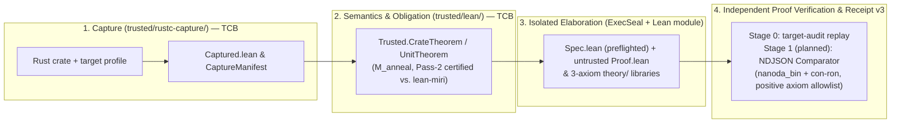

<!-- Copyright 2026 The Fuchsia Authors

Licensed under a BSD-style license <LICENSE-BSD>, Apache License, Version 2.0
<LICENSE-APACHE or https://www.apache.org/licenses/LICENSE-2.0>, or the MIT
license <LICENSE-MIT or https://opensource.org/licenses/MIT>, at your option.
This file may not be copied, modified, or distributed except according to
those terms. -->

# Anneal Design Overview

> [!NOTE]
> **Status legend:** Anneal is under active development across three public
> milestones—[Stage 0 (Alpha usability, `#4095`)][stage-0] →
> [Stage 1 (Audited trust boundary & TCB accounting, `#4012`)][stage-1] →
> [Stage 2 (Broad systems Rust & TCB reduction, `#4096`)][stage-2]. Throughout
> this document, shipped Stage 0 capabilities are labeled **[Implemented]** and
> work under active design or implementation is labeled **[In progress]** or
> **[Planned]** so target architecture is never mistaken for current alpha
> coverage.

Anneal is a formal verification framework for Rust. Its goal is to let
engineers and AI coding agents prove that Rust crates—including crates that
rely on `unsafe` pointers, custom memory layouts, interior mutability, and
inline assembly—are free of Rust undefined behavior (UB) at the captured MIR
boundary and satisfy any stated specifications, while confining human review to
two bounded surfaces: the **TCB audit log** and the **rendered transitive
closure of stated specifications**.

Anneal implements [`META_PRINCIPLES.md`](META_PRINCIPLES.md),
[`PRINCIPLES.md`](PRINCIPLES.md), and [`THREAT_MODEL.md`](THREAT_MODEL.md)
through three structural commitments:

1. **Verify the code `rustc` actually compiles.** Anneal does not ask users to
   rewrite Rust in a custom verification language. It hooks into `rustc` to
   extract typed `Runtime(PostCleanup)` Mid-level Intermediate Representation
   (MIR) after borrow checking and drop elaboration, and states verification
   theorems directly over that captured representation in Lean 4.
2. **Keep the Trusted Computing Base (TCB) small and mechanically fenced.**
   Every first-party component that must be trusted without a machine-checked
   proof lives under [`trusted/`](trusted). Weakest-precondition (WP) calculi,
   separation logic, lowering passes, and proof automation live outside the TCB
   under `theory/`, while MIR correspondence proofs live under
   `correspondence/`. Both are checked by the Lean 4 kernel and audited in
   Anneal's CI, so a bug in `theory/` or user proofs can cause verification to
   fail, never cause a false claim to pass.
3. **Support libraries first and scale incrementally.** Systems Rust lives in
   libraries (`zerocopy`, allocators, synchronization primitives, kernel and
   cryptographic routines) that have no `fn main()` entrypoint and expose
   generic APIs to unknown callers. Anneal verifies functions and safe
   abstraction boundaries modularly so teams can adopt verification
   incrementally—from a single `unsafe` leaf to an entire crate.

For governing commitments and contributor deep dives, see:

- [`README.md`](README.md) for the exact Verification Promise, Stage 0 alpha
  scope, and quickstart.
- [`META_PRINCIPLES.md`](META_PRINCIPLES.md), [`PRINCIPLES.md`](PRINCIPLES.md),
  and [`THREAT_MODEL.md`](THREAT_MODEL.md) for Anneal's governing goals,
  conditional correctness promise, and adversarial threat model.
- [`development/`](development/README.md) for internal contributor design,
  build, and review documentation (not user-facing documentation), including
  [`development/architecture.md`](development/architecture.md),
  [`development/trust-model.md`](development/trust-model.md),
  [`development/elaborator-containment-design.md`](development/elaborator-containment-design.md),
  and [`development/mir-correspondence-strategy.md`](development/mir-correspondence-strategy.md).

## End-to-end verification pipeline

### 1. Mechanical MIR capture (`trusted/rustc-capture/`) — [Implemented]

`cargo anneal verify` (via `--manifest-path`, `--request`, or `verify rustc`)
invokes `anneal-rustc-capture`, a thin `rustc_driver` wrapper that captures
`Runtime(PostCleanup)` MIR with zero semantic normalization. Capture enforces
`-Zmir-preserve-ub` fail-closed (recording `mir_preserve_ub: true` in
`configuration`) and rejects projected `PlaceMention` and `CallSource::Use`
hazards (`#4114`, closing `#4042` and `#4083`), compiler errors
(`tcx.dcx().has_errors()`), and any unmodeled MIR construct, emitting
deterministic Lean MIR data (`Captured.lean`) and a compilation manifest
binding the exact source digest, target triple, `cfg` set, and fixed Stage 0
compiler profile (`-Copt-level=0`, `-Cdebug-assertions=no`,
`-Coverflow-checks=no`). Today's Stage 0 alpha supports the dependency-free,
call-free Profile v1 scalar MIR subset on `x86_64-unknown-linux-gnu`;
references, slices, `unsafe` pointers, aggregates, calls, generics, and
multi-crate capture are tracked on the Stage 1–2 roadmap
([`#4097`](https://github.com/google/zerocopy/issues/4097),
[`#4098`](https://github.com/google/zerocopy/issues/4098)).

### 2. Verification semantics anchored to a reference model — [Implemented]

`trusted/lean/` defines the captured MIR AST (`Trusted/MirAst.lean`),
verification operational semantics $M_{\text{anneal}}$
(`Trusted/MirSemantics.lean`), and top-level obligations
(`Trusted.CrateTheorem` for whole-crate scope and `Trusted.UnitTheorem` for
selected-unit scope). Every `trusted/lean/` module carries a mechanical trust
tier (`-- anneal-trust-tier: vetted` or `candidate:<feature>`) enforced so
`vetted` definitions can depend only on `Init.*` and other `vetted` modules.

Rather than trusting $M_{\text{anneal}}$'s step rules purely by manual review,
Anneal's blocking Pass 2 repository CI audit (`anneal-audit
--require-correspondence`) anchors $M_{\text{anneal}}$ against a SHA-256-pinned
reference semantics $M_{\text{ref}}$ (`vendor/lean-miri/`, bridged via
`trusted/correspondence/Trusted/Correspondence.lean`) by kernel-replaying
`CorrespondenceClaim` and `FaultEquivalenceClaim` in `correspondence/`. The
vendored reference model is never shipped in user toolchain archives; instead,
each archive embeds a digest-bound correspondence provenance record checked and
surfaced by `cargo anneal verify` in Receipt v3. See
[`development/architecture.md`](development/architecture.md) and
[`development/mir-correspondence-strategy.md`](development/mir-correspondence-strategy.md).

### 3. Two distinct audit boundaries: repository CI vs. target verification — [Implemented]

Anneal enforces its trust boundary at two distinct points:

- **In Anneal's repository CI (`anneal-audit`, `trusted/audit/`):** Before any
  change to Anneal merges or ships in a toolchain archive, `anneal-audit`
  stages and preflights `trusted/lean/`, `theory/`, `trusted/correspondence/`,
  and `correspondence/`, verifies pinned manifests and `vetted`/`candidate`
  module tiers, and replays declarations in the standalone Lean 4 kernel. This
  guarantees that Anneal's bundled `theory/` proof libraries are pure,
  side-effect-free, and within the positive 3-axiom allowlist
  (`{Classical.choice, Quot.sound, propext}`), and enforces Statement-Origin
  Separation (`Trusted.*` theorem statements never reference `Anneal.*`
  definitions).
- **During target crate verification (`cargo-anneal`):** When verifying a user
  crate, `cargo-anneal` separates authored `Specification` modules from
  untrusted `Proof` modules. On Linux, `ExecSeal` (`linux_bwrap` or
  `linux_landlock_seccomp`) isolates Lean preflight, elaboration, and audit by
  default; `"spec-preflight"` restricts `Specification` modules to pure
  declarative syntax before elaboration; and `"target-audit"` replays the
  compiled target obligation and emits a structured Receipt Schema v3 report
  (irrevocably marking any `--allow-*` development flag as `tainted_*`). See
  [`development/trust-model.md`](development/trust-model.md) and
  [`development/elaborator-containment-design.md`](development/elaborator-containment-design.md).

### 4. Universal NDJSON Comparator and multi-kernel replay — [Planned — Stage 1]

Under Stage 0, `"target-audit"` still loads compiled target `.olean` artifacts
inside the Lean audit process. To close the Stage 1 adversarial trust boundary
([`#4012`](https://github.com/google/zerocopy/issues/4012),
[`#4016`](https://github.com/google/zerocopy/issues/4016)), Anneal is
transitioning to a **Universal NDJSON Comparator** architecture over Lean 4
`module` isolation (`v4.35.0+`):

- **Zero untrusted `.olean` deserialization in the verdict process:** The
  expected statement cone (`Init`, `Trusted`, `Captured`, `Spec`, `Expected` —
  with zero `Proof` or `Anneal` modules mounted) and the sandboxed proof cone
  elaborate separately and export canonical, memory-safe NDJSON declaration
  streams. No attacker-produced `.olean` binary is ever mapped into the process
  that issues the verification verdict.
- **Independent memory-safe external kernels & positive axiom allowlist:** A
  pure-Rust comparator checks exact statement identity, verifies all kernel
  primitives against a pinned toolchain primitive cone, enforces a strict
  positive foundation-axiom allowlist (`{Classical.choice, Quot.sound,
  propext}`), and invokes independent external proof kernels (`nanoda_bin` and
  `con-ron` by default, with optional multi-kernel paranoid cross-checking in
  CI).
- **~82%–85% runtime Lean audit TCB reduction:** Replacing in-process `.olean`
  inspection and replay orchestration with the NDJSON comparator shrinks
  Anneal's runtime Lean audit TCB from ~4,370 LOC (`TrustedBoundary.lean`) to
  roughly 650–800 LOC.

## Always-rendered golden specification closure and `OWNERS` enforcement

**[Planned — Stage 1/2, `#4012` / `#4102`]**

A central tension in Rust verification is **inline ergonomics vs. audit
isolation**: developers prefer writing specifications inline alongside Rust
items (`core::contracts`, `anodized`, or Anneal attributes), whereas security
reviewers want a single auditable surface that cannot be silently altered by
edits to helper functions, macro expansions, or out-of-band files.

Anneal resolves this tension with an invariant architectural requirement:
**regardless of whether specifications are authored inline in Rust annotations
or out-of-line in dedicated `.lean` files, Anneal always deterministically
emits the complete, unambiguously rendered transitive definition closure of
stated specifications**—bound by digest in Receipt v3—covering:

- **Every semantic definition a specification depends on:** all preconditions,
  postconditions, invariants, helper predicates, constants, type definitions,
  trait implementations, mathematical models, and **any verified Rust helper or
  reference body referenced by a specification** (so reviewers skip all proof
  files and every verified implementation body that defines no specification or
  TCB assumption).
- **Exact spec-to-item binding and safe/`unsafe` signature:** each
  specification's **resolved canonical Rust item path** (forbidding positional
  bindings such as `entryProgForBody program 0` and failing closed on
  unresolved or renamed targets) together with each bound item's **safe /
  `unsafe fn` signature**, so reordering items, renaming a target, or flipping
  `fn` to `unsafe fn` cannot silently change what is proved while the
  specification digest stays fixed.

This design delivers three concrete guarantees:

1. **Unbypassable `CODEOWNERS` / `OWNERS` review governance:** Projects can
   check the canonical rendered spec-closure artifact into version control as a
   golden file protected by `CODEOWNERS` or `OWNERS` rules. Any edit—even a
   subtle change inside an inline Rust attribute, a procedural macro expansion,
   a `fn` → `unsafe fn` signature change, a referenced Rust helper body, or a
   transitive helper definition—that alters the rendered specification closure
   triggers a loud golden diff and mechanically requires specification-owner
   approval.
2. **Closes the inline-vs.-out-of-line audit split:** Teams gain ergonomic
   inline Rust contracts without losing bounded two-surface review: human
   reviewers inspect the rendered golden specification closure and the Receipt
   v3 TCB audit log, and skip all `Proof/` files and every verified
   implementation body that defines no specification or TCB assumption.
3. **Eliminates hidden ambient definitions:** Making the exact kernel-checked
   transitive closure and item bindings visible in one deterministic, diffable
   artifact removes hidden `autoImplicit` bindings, silent shadowing,
   positional drift, and pretty-printer ambiguity.

## Defense-in-depth TCB testing and specification sanity checks

### Mandatory `MirSemantics` and auditor guard-mutation CI — [In progress]

Positive verification proofs and positive canary suites cannot catch an
accidental deletion or weakening of an undefined-behavior check in
`Trusted/MirSemantics/` or a rejection guard in `TrustedBoundary.lean`: if a
refactor drops a division-by-zero, alignment, bounds, or move-deinitialization
check, every positive proof still passes while unsound programs silently become
provable.

To guard against silent TCB regressions, Anneal is adding a mandatory
**guard-mutation CI check** (`ci/check_guard_mutation.py`) strictly outside
`trusted/`: it mutates cataloged `Trusted/MirSemantics/` UB checks and
`TrustedBoundary.lean` policy guards one at a time inside an isolated temporary
copy, confirms that the mutated semantics and positive sanity suites still
compile cleanly (preventing syntax errors or crashes from masquerading as
mutant kills), and requires a 100% kill rate via dedicated negative refutation
theorems or negative auditor fixtures.

### Honest framing of specification sanity checks — [Planned, `#4112`]

Optional kernel-checked specification sanity checks—such as precondition
inhabitation witnesses (`PreInhabited`), assumed-contract realizability
(`AssumedContractRealizable`), and dual-polar mutation refutation
(`MutationRefute`, showing that mutating an implementation violates its
postcondition on at least one valid input)—are valuable **non-adversarial
reviewer aids** for catching accidental contradictions, vacuous clauses, or
specification typos early.

Anneal explicitly positions these checks **strictly as non-adversarial reviewer
aids, never as anti-adversarial security guarantees** (see
[`THREAT_MODEL.md`](THREAT_MODEL.md#2-weak-vacuous-or-unintended-specifications-and-explicit-tcb-assumptions)).
An adversarial contributor or reward-hacking agent can trivially satisfy any
single-witness inhabitation check by narrowing a specification to accept only
that single witness (for example, `requires(x == 0)` or
`requires(buf.is_empty())`), leaving almost all real executions unverified.
Human review of the rendered golden specification closure remains the sole
defense against intentional specification weakening.

## Library-centric verification

Many verification tools assume a closed, whole-program model: they start from a
concrete `fn main()`, monomorphize every generic function at known call sites,
and analyze only states reachable in that binary. That model does not fit
foundational Rust libraries (`zerocopy`, allocators, synchronization
primitives) that expose generic APIs to arbitrary downstream callers.

Anneal is library-centric by default (phased incrementally alongside Pass 2
correspondence in
[`development/mir-correspondence-strategy.md`](development/mir-correspondence-strategy.md):
Stage 0 verifies concrete, monomorphic library functions modularly across *all*
caller states without requiring `fn main()`, failing closed on uninstantiated
generics; polymorphic verification across arbitrary caller type and layout
instantiations lands in a subsequent phase):

- **Modular per-function verification:** Each function is verified against its
  contract for *all* caller states and inputs satisfying its preconditions.
  Callers rely on callees' specifications rather than re-inlining bodies across
  the crate.
- **Safe vs. `unsafe` function contracts:** In Rust, a safe function must be
  UB-free for *every* type-correct input satisfying applicable library
  invariants (each established and preserved by every function in the type's
  visibility scope on every exit, including unwinding, as proved or logged in
  the TCB) in any safe calling context—including open-world callbacks and
  interior mutability. Anneal enforces this structurally: no user specification
  or scope clause can narrow baseline UB-freedom on a safe `fn`. An `unsafe fn`
  may state formal `# Safety` preconditions (which never relax Rust language
  validity); verified callers must discharge those preconditions at every call
  site.
- **Encapsulating `unsafe` behind safe abstractions:** Modules can attach
  library type invariants linking raw struct fields to logical conditions. Safe
  constructors establish the invariant, safe methods assume and preserve it
  across both normal returns and unwind exits, and internal `unsafe` blocks
  rely on it to discharge pointer and aliasing obligations.
- **Compositional cross-crate reuse:** Downstream crates consume upstream
  verified specifications directly while carrying upstream TCB assumptions and
  waivers forward into the combined Receipt v3 audit log.

### Syntax-independent Specification Core v2 — [Planned, `#4102`]

To support multiple specification frontends (`core::contracts`, `anodized`, thin
Rust attributes, and external `Spec.lean`) without duplicating Rust expression
evaluators in `trusted/lean/`, Anneal's planned **Spec Core v2** factors
function contracts into three clean primitives:

- **Split `FnContract` (`safetyPre` vs. `behaviorPre`):** `safetyPre` is active
  exclusively on `unsafe fn` (formalizing `# Safety` preconditions), whereas
  `behaviorPre` gates functional postconditions and effects on both safe and
  `unsafe` functions while leaving safe-API UB-freedom unconditional.
- **Explicit `EffectMask` and assumed-contract realizability (`#3091`, open
  Stage 1):** Every contract makes termination, unwinding (`extern "C"` vs.
  `extern "C-unwind"`), and aborting effects explicit; assumed (`extern` or
  waived) contracts are partial-correctness by default and must satisfy a
  general realizability condition so an assumed contract can never silently
  assume progress or let callers derive `False`.
- **Encapsulation and coinductive `unsafe impl` closure:** Visibility-cone
  invariant preservation across both normal return and unwind paths, paired
  with depth-indexed productivity checks for recursive `unsafe impl` hierarchies
  (admitting inductive pointer containers such as `Option<Box<Node>>` while
  rejecting unsound cyclic `unsafe impl`s).

## Multi-modal specifications

Anneal supports four complementary specification modes within one unified
obligation framework:

1. **Baseline safety (absence of undefined behavior) — [Implemented for
   Profile v1 scalar MIR]:** Every verified function must be free of UB
   (`undefined`) and unmodeled constructs (`unsupported`) across all execution
   prefixes.
2. **Preconditions, postconditions, and invariants — [Implemented in
   `Spec.lean`; inline Rust syntax planned]:** Relational entry/exit clauses
   and encapsulated data-structure invariants. Functional specifications are
   **partial correctness** unless they explicitly require termination (such as
   `¬ Diverges`), meaning a never-returning body (for example `loop {}`)
   satisfies any postcondition unless return is required.
3. **Pure mathematical models — [Implemented in Lean; ergonomics planned]:**
   Linking Rust types to pure Lean mathematical models (lists, finite maps,
   integers, protocol state machines) so callers reason algebraically while
   low-level layout and pointer proofs remain encapsulated.
4. **Relational and behavioral equivalence — [Planned]:** Proving that an
   optimized `unsafe` implementation (such as a SIMD or bit-twiddling routine)
   matches a simpler reference implementation on all valid inputs.

### Opt-in `Anneal ↔ Aeneas` refinement bridge — [Planned, `#4102`]

Teams verifying high-level safe Rust crates in [Aeneas][aeneas] often call
`unsafe` leaf routines (byte casts, `MaybeUninit` buffer writers, SIMD kernels)
that Aeneas leaves as unextracted external functions in `FunsExternal.lean`.
Anneal's planned **`anneal-aeneas-bridge`** is a **zero-TCB, optional Lake
package** (adding zero Aeneas or Mathlib dependencies to core `anneal/`) that
proves operational refinement between Anneal's MIR semantics for the `unsafe`
Rust leaf and a constructive pure Lean model in `FunsExternal.lean`, composing
Aeneas safe-caller proofs with Anneal `unsafe`-leaf proofs inside one Lean 4
build graph with zero custom axioms.

## Incremental adoption

Teams can adopt Anneal along two independent axes:

- **Incremental breadth (one `unsafe` leaf → full crate):** Start with
  `selected_unit` verification of one high-risk `unsafe` function, surface
  unverified callees or out-of-scope siblings explicitly in the Receipt v3 TCB
  audit log, and retire assumptions incrementally until the crate's externally
  reachable surface is covered by a whole-crate receipt (`crate_verified`).
- **Incremental depth (UB-freedom → functional correctness):** Begin with
  baseline UB-freedom (mechanizing `# Safety` comments), add structural
  postconditions and type invariants for internal callers, and connect to pure
  mathematical models or reference implementations as needed.

## Build-system integration and verification at scale

**[Core implemented; split-action & sharding planned — `#4098`, `#4100`,
`#4103`]**

Today, `cargo anneal verify` supports Cargo libraries (`--manifest-path`),
manifest requests (`--request`), and direct compiler-action invocation
(`verify rustc`) emitting Receipt Schema v3. To verify unmodified production
Rust targets across heterogeneous build ecosystems (Cargo, Bazel, GN/Ninja,
Buck2, Nix, CMake, and Meson) at scale, Anneal is evolving around four
primitives:

- **Orthogonal Receipt Schema v3:** Separating self-verified kernel soundness
  verdicts from elaboration containment and remote build provenance, while
  keeping taint accounting (`taint_reasons`) strictly fail-closed and distinct
  from TCB assumptions.
- **Unified split-action contract without build-time `lake`:** Projecting
  capture, `spec-preflight`, `Expected` generation, per-file Lean 4 `module`
  compilation, and NDJSON comparator verification directly onto each build
  system's native action graph using a portable theory DAG
  (`theory/bundle-manifest.json`), with an `anneal-project.json` descriptor
  keeping local IDE/LSP workflows aligned with CI.
- **Two-tier dependency capture:** Default **Tier 1** out-of-band `.verify.mir`
  metadata for lightweight cross-crate contract consumption without altering
  production `.rmeta`/`.rlib` builds, plus opt-in **Tier 2** `.verify.rmeta`
  capture when transitive cross-crate MIR inspection is required.
- **Dual / depth-1 crate sharding:** Splitting large crates into independent
  proof shards compiled in parallel at dependency depth 1 via zero-axiom
  parameterized obligations (`ShardObligation_i := DepSpecs_i → ShardSpec_i`),
  stitched by a lightweight link step without mutating compiled `.olean` files.

## Further reading

Internal contributor and developer design documentation lives under
[`development/`](development/README.md):

- [`development/alpha.md`](development/alpha.md) — Installing and running the
  Stage 0 scalar MIR alpha.
- [`development/architecture.md`](development/architecture.md) — Three-stage
  MIR pipeline, repository layout, and multi-version `rustc` strategy.
- [`development/trust-model.md`](development/trust-model.md) — `trusted/` vs.
  `theory/` boundary enforcement, dependency pins, and Pass 1 / Pass 2 CI
  audits.
- [`development/elaborator-containment-design.md`](development/elaborator-containment-design.md) —
  Linux `ExecSeal` sandboxing, specification preflight, and Receipt v3 taint
  accounting.
- [`development/mir-correspondence-strategy.md`](development/mir-correspondence-strategy.md)
  and [`development/mir-correspondence-design.md`](development/mir-correspondence-design.md) —
  How $M_{\text{anneal}}$ is kernel-certified against pinned
  `vendor/lean-miri/`.

[stage-0]: https://github.com/google/zerocopy/issues/4095
[stage-1]: https://github.com/google/zerocopy/issues/4012
[stage-2]: https://github.com/google/zerocopy/issues/4096
[aeneas]: https://arxiv.org/abs/2206.07185
