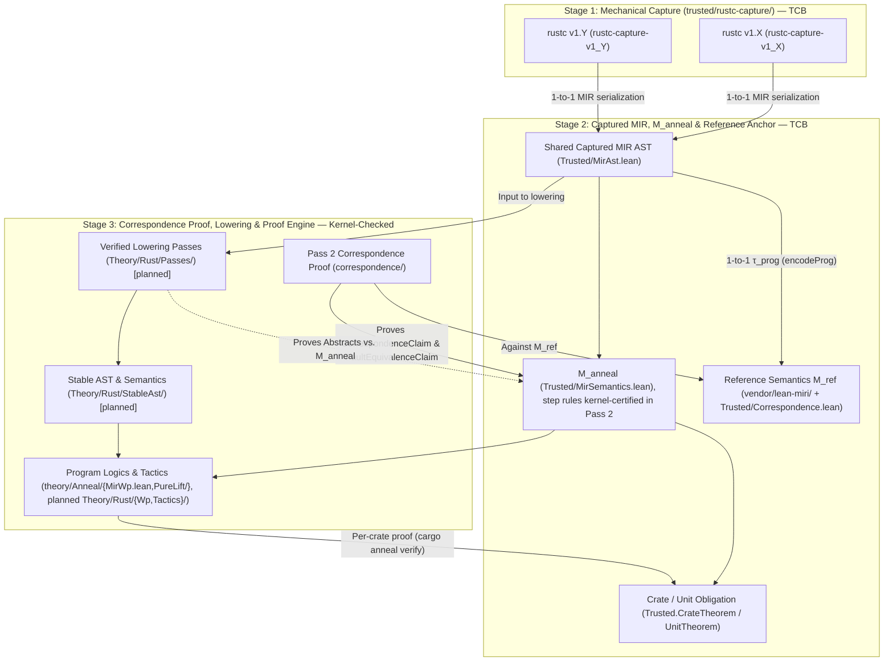

<!-- Copyright 2026 The Fuchsia Authors

Licensed under a BSD-style license <LICENSE-BSD>, Apache License, Version 2.0
<LICENSE-APACHE or https://www.apache.org/licenses/LICENSE-2.0>, or the MIT
license <LICENSE-MIT or https://opensource.org/licenses/MIT>, at your option.
This file may not be copied, modified, or distributed except according to
those terms. -->

# Multi-Step MIR and Toolchain Architecture

> **Note:** Anneal is under active development. The three-stage MIR pipeline
> and correspondence stack described below (`Trusted/MirAst.lean`,
> `Trusted/MirSemantics.lean`, `trusted/correspondence/`, `vendor/lean-miri/`,
> `correspondence/`, `theory/Anneal/MirWp.lean`, `cargo anneal verify`, and
> Pass 2 `anneal-audit --require-correspondence`) are target architecture
> landing incrementally; entries marked `[planned]` denote later-phase layout
> subdivisions beyond that stack. Parts of this document may be aspirational or
> stale relative to the current codebase.

Anneal verifies Rust crates by extracting their Mid-level Intermediate
Representation (MIR) from `rustc` and reasoning about that MIR inside the
Lean 4 theorem prover. Designing this pipeline requires resolving a core
tension between **auditability** and **proof stability**:

- **Auditability pulls toward raw `rustc` MIR:** Any transformation or
  simplification performed inside the Rust extractor happens outside the Lean
  kernel. If the extractor rewrites control flow or desugars operations in
  Rust, a bug in that Rust code can silently alter what the program means and
  compromise soundness. To keep the Trusted Computing Base (TCB) small and easy
  to audit, extraction from `rustc` must be as thin and mechanical as possible.
- **Proof stability and ergonomics pull toward a high-level stable IR:**
  `rustc`'s internal `rustc_middle::mir` structures are designed for compiler
  optimization and code generation, not theorem proving. Moreover, `rustc`'s
  internal APIs and MIR representations evolve across compiler releases. If
  weakest-precondition (WP) lemmas, tactics, and user specifications operated
  directly on raw `rustc` MIR, every minor compiler upgrade would break
  verification.

Anneal resolves this tension with a **three-stage MIR pipeline** split across
the repository's trust boundary (`trusted/`, pinned `vendor/`, `theory/`, and
`correspondence/`):

1. **Stage 1 — Mechanical Capture (`trusted/rustc-capture/`):** A thin,
   version-specific `rustc_driver` wrapper transcribes `rustc`'s
   `Runtime(PostCleanup)` MIR—together with the concrete monomorphic instance,
   layout, and evaluated-constant query metadata required by the initial
   concrete correspondence domain (failing closed to `unsupported` for
   uninstantiated generic bodies or unevaluated generic constants until
   polymorphic substitution/layout parameterization lands in a later phase, as
   described in [`docs/design.md`](design.md#library-centric-verification) and
   [`docs/mir-correspondence-strategy.md`](mir-correspondence-strategy.md))—and
   inline Rust specification attributes 1-to-1 into Lean data definitions
   (`Mir.lean`) and a pure proof script (`Proof.lean`), with zero semantic
   normalization in Rust.
2. **Stage 2 — Shared Captured MIR, Verification Semantics & Reference Anchor
   (`trusted/lean/`, `trusted/correspondence/`, pinned `vendor/`):** A single,
   auditable Lean AST represents the captured MIR (`Trusted/MirAst.lean`,
   planned `Trusted/Rust/Ast/`), and Anneal's verification operational semantics
   ($M_{\text{anneal}}$ in `Trusted/MirSemantics.lean`, planned
   `Trusted/Rust/Semantics/`) states the top-level crate and proof-unit
   obligations (`Trusted.CrateTheorem` and `Trusted.UnitTheorem`, plus their
   MIR Profile v2 counterparts `Trusted.CrateTheoremV2` and
   `Trusted.UnitTheoremV2` over `Trusted.CrateV2`) and
   weakest-precondition proof-interface checks without pulling the reference
   interpreter into the Pass 1 repository audit (`anneal-audit` over
   `trusted/lean/` and `theory/`) or into per-crate `cargo anneal verify` runs.
   To certify $M_{\text{anneal}}$'s evolving step rules (`initState` and
   `evalStep`) mechanically rather than trusting them by human semantic audit, a
   mandatory blocking repository CI correspondence audit (`anneal-audit
   --require-correspondence`, Pass 2—run in repository CI rather than per-crate
   on user machines) anchors $M_{\text{anneal}}$ against an audited reference
   operational semantics ($M_{\text{ref}}$ in `vendor/lean-miri/`, bridged via a
   minimal, one-to-one structural adapter $\tau_{\text{prog}}$ (`encodeProg`) in
   `trusted/correspondence/Trusted/Correspondence.lean`). Minor semantic
   variations across compiler versions or compilation targets are controlled by
   declarative profile data (`CaptureProfile` / `CaptureManifest`, including
   `Program.pointerWidthBits`, `Program.mirProfileVersion`, and target layout
   metadata) rather than by duplicating the interpreter.
3. **Stage 3 — Correspondence Proof, Verified Lowering & Proof Engine
   (`theory/`, `correspondence/`):** In `correspondence/` (staged and audited as
   an untrusted `.theory` root by Pass 2 `anneal-audit
   --require-correspondence`), Anneal proves the kernel-checked
   `CorrespondenceClaim` and `FaultEquivalenceClaim`
   ([`docs/mir-correspondence-strategy.md`](mir-correspondence-strategy.md))
   certifying universally over all programs and queries that $M_{\text{ref}}$
   refines $M_{\text{anneal}}$ (i.e., $M_{\text{anneal}}$ soundly abstracts
   $M_{\text{ref}}$) via $\tau_{\text{prog}}$. Separately, `theory/` (staged and
   audited as `.theory` by Pass 1 `anneal-audit`) holds untrusted program logics
   (`theory/Anneal/MirWp.lean`) and planned lowering passes (translating
   captured MIR into a version-independent `Theory/Rust/StableAst/` via a
   kernel-checked backward simulation `Abstracts`) that reason directly about
   $M_{\text{anneal}}$; per-crate `cargo anneal verify` runs use them to
   discharge `Trusted.CrateTheorem` or `Trusted.UnitTheorem` (or, for
   Profile v2 captures, `Trusted.CrateTheoremV2` or `Trusted.UnitTheoremV2`).

Both `theory/` (in the Pass 1 `anneal-audit` repository audit, distinct from
the syntactic-preflight vs. replay phases within a run) and `correspondence/`
(in blocking Pass 2 `anneal-audit --require-correspondence`) are staged,
source-preflighted, and replayed in the standalone Lean kernel as pure,
axiom-free `.theory` modules. Pass 2 runs in a fresh, isolated staging
environment—extending Pass 1's from-source compilation, preflight, and kernel
replay of `trusted/lean/` and `theory/` with from-source compilation,
preflight, and kernel replay of `trusted/correspondence/` and
`correspondence/` rather than reusing unverified `.olean` artifacts—while
excluding `vendor/lean-miri/`, `trusted/correspondence/`, and `correspondence/`
from both Pass 1 and packaged user toolchain archives. To preserve
[`THREAT_MODEL.md`](../THREAT_MODEL.md)'s bounded human-review guarantee without
shipping the vendored `vendor/lean-miri/` tree or `correspondence/` proofs at
runtime, every packaged user toolchain archive and `cargo-anneal` bundle
carries a compact, CI-checked, digest-bound **correspondence provenance
record** (pinned toolchain metadata, `trusted/lean/` and
`trusted/correspondence/` source digests, `vendor/lean-miri/` upstream commit,
`UPSTREAM_PIN.json` SHA-256, `patched_files` allowlist/digests, and
`correspondence/` proof digests). Repository CI binds the record to the
canonical sources it embeds, `cargo anneal verify` fails closed if the record
is malformed, and it copies the record into every verification receipt—so an
auditor inspecting only stated specifications and the receipt can identify and
audit every TCB artifact, including $M_{\text{ref}}$ and
$\tau_{\text{prog}}$. Re-hashing the packaged `trusted/lean/` artifacts
against the record at archive construction and verification time remains
planned ([`docs/trust-model.md`](trust-model.md)). For
`vendor/lean-miri/`, Pass 2 verifies every vendored file against
`vendor/lean-miri/UPSTREAM_PIN.json`—whose own SHA-256 digest and first-party
patched-file allowlist are pinned inside `trusted/audit/`, rejecting extraneous
or unpinned files and pre-existing `.olean`/`.ir` artifacts so any upstream pin
update or first-party patch in `vendor/lean-miri/` requires a human-reviewed
diff inside `trusted/` covering both semantic changes in the resolved
old-to-new reference-model diff and compile-time code—and compiles the pinned
`execution_machine_closure` `.olean` modules directly from those
`UPSTREAM_PIN.json`-verified sources under the pinned `lean` binary inside an
OS-level isolated sandbox with no credentials or writable access to the
worktree, home directory, or auditor state (confining candidate compile-time
metaprograms strictly to an isolated build output directory before the outer
auditor checks digests and runs standalone replay in a separate
`loadExts := false` process), asserting exact byte-for-byte SHA-256 equality
against the reproducible `.olean` digests pinned in `UPSTREAM_PIN.json`.
External `.olean` caching is disabled by default (`anneal-audit` uses no cache
unless `--miri-cache-dir` or `ANNEAL_MIRI_CACHE_DIR` is set), and cached
`.olean` files are never read whenever `UPSTREAM_PIN.json` or
`trusted/lean/lean-toolchain` changes—so every pin update
verifies reproducible source-to-`.olean` compilation cold from source—while
opt-in external cache restoration on unchanged pins (the `miri-v1` slot in
repository-root [`ci/checks.toml`](../../ci/checks.toml), written and
keyless-signed only by checkout-free `merge_group` and `main`-branch `push`
`publish` runs) lives outside the checkout,
rejects symlinks, and admits a cached `.olean` only when its SHA-256 matches
that source-verified pin. Although vendored
`vendor/lean-miri/` sources are not
passed through untrusted-`theory/` syntactic preflight (upstream `Miri.Input.*` and proof
helpers retain compile-time metaprograms and `partial def`s audited under the
SHA-256 pin in `trusted/audit/`), Pass 2 **replays every non-`isPartial` safe
constant across the pinned vendored closure from scratch in the standalone Lean
kernel (`base.toKernelEnv.replay`, omitting compiler-generated `isPartial`
`*._unsafe_rec` helpers so replay fails if any safe constant references a
skipped `unsafe` or `partial` constant)** on top of the authenticated
`Init`/`Std`/`Lean` sysroot base (verified against
`LOCKED_SYSROOT_FOUNDATION_MANIFEST_SHA256`, loaded with `trustLevel := 0` and
`loadExts := false`), while rejecting `isUnsafe`, non-allowlisted axioms (with
`.vendorMiri` declaring zero `axiom` items), `sorryAx`,
`Lean.ofReduceBool`/`Lean.trustCompiler`, and any `.vendorMiri` `isPartial` or
`opaque` (`partial def`) constant reachable in the full dependency cone of the
locked correspondence claims (including `Miri.Interpreter.ExecutionMachine`) on
every run (cold compile and cache hit alike)—so neither a scoped
`set_option debug.skipKernelTC true` inside a vendored file nor a poisoned
`.olean` cache can admit an un-kernel-checked safe constant. Alongside that
replayed vendor base and the freshly compiled and replayed `trusted/lean/` and
`theory/` modules (within the same isolated Pass 2 staging run), Pass 2
source-preflights, axiom-checks, enforces role/namespace separation over, and
kernel-replays `trusted/correspondence/` and `correspondence/` (so
`correspondence/` cannot declare or spoof `Trusted.*` constants and
`trusted/lean/` cannot import `trusted/correspondence/` or
`vendor/lean-miri/`), verifying that `correspondence/` provides witness
theorems whose exact types (`ConstantInfo.type`) match
`Trusted.Correspondence.CorrespondenceClaim` and
`Trusted.Correspondence.FaultEquivalenceClaim` (Statement-Origin Separation).
Blocking repository CI (`merge_group` / `ci-core / gate`) gates PR merges on
both Pass 1 and Pass 2 passing on the exact same commit.

Within the Lean operational semantics (Stages 2–3), only three semantic
surfaces therefore require human semantic audit (alongside Stage 1's
`trusted/rustc-capture/` transcription of `rustc` MIR, layouts, and
specifications, and the non-semantic TCB enforcement infrastructure in
`trusted/audit/`, `trusted/cargo-anneal/`, pinned toolchain locks, and blocking
CI workflows):

1. **$M_{\text{ref}}$:** the pinned `vendor/lean-miri/` reference semantics
   together with its `trusted/correspondence/Trusted/Correspondence.lean`
   wrapper (`initRefState`, `RefProg`-to-`vendor/lean-miri/` operator,
   statement, terminator, and layout dispatch in `evalRefStep`, reference
   execution predicates, and staged support gate).
2. **The correspondence interface (`Trusted/Correspondence.lean`):**
   $\tau_{\text{prog}}$ (`encodeProg`), any output-equivalence / projection
   relation ($\sim_{\text{out}}$ / $\pi$) and choice-event coupling relation,
   and the locked `CorrespondenceClaim` and `FaultEquivalenceClaim` statements.
3. **The outer theorem-stating boundary of $M_{\text{anneal}}$:** the captured
   MIR AST (`Trusted/MirAst.lean`) and every definition in
   `Trusted/MirSemantics.lean` that `Trusted.CrateTheorem`,
   `Trusted.UnitTheorem`, `CorrespondenceClaim`, and `FaultEquivalenceClaim`
   depend on, other than the step rules `initState` and `evalStep` and the
   helpers that only those rules use—namely the shared input and outcome types
   (`Query`, `Val`, `Out`, `TerminalOut`, and `FaultKind`), execution
   predicates (`Step`, `Reaches`, `ReachesResult`, `WellFormed`, `Behavior`,
   `Diverges`, and `SatisfiesPost`), verification judgments
   (`BodyStaticAdmitted`, `ValidEntryArgs`, `BodyVerified`, `Specs`, `Crate`,
   `ProgramVerified`, `CrateTheorem`, and `UnitTheorem`), and the helpers these
   reference (such as `ValidChoice`, `entryProgForBody`, and
   `bodiesHaveUniqueIdentities`).

(`WpSoundnessClaim`, `WpFaultSoundnessClaim`, and the Profile v2
`ExecSoundnessClaimV2` also live in
`Trusted/MirSemantics.lean` as Pass 1 CI proof-interface locks—enforced via
witness-theorem type checks in `anneal-audit` for `Anneal.MirWp`—not as extra
trust assumptions for per-crate soundness, because per-crate proofs discharge
`CrateTheorem` or `UnitTheorem` (or `CrateTheoremV2` or `UnitTheoremV2`)
directly in the Lean kernel.) Once Pass 2
lands and the corresponding review-policy updates are adopted in `AGENTS.md`,
`.gemini/styleguide.md`, and `skills/trust-review/SKILL.md`, the evolving
execution rules of $M_{\text{anneal}}$ (`initState` and `evalStep`), the stable
IR, the lowering passes, and all downstream proof tactics are planned to remain
**outside the human-audited semantic assumptions** (a planned relaxation of the
current `trusted/lean/` semantic-review policy, which requires human semantic
audit and verbatim Rust Reference/`rustc` citations for definitions in
`trusted/lean/` until those policy updates and Pass 2 enforcement are active);
moreover, because `initState` and `evalStep` initially share
`Trusted/MirSemantics.lean` with the outer boundary definitions, diffs touching
`Trusted/MirSemantics.lean` still receive human review to confirm that no outer
boundary declaration or shared helper changed. Separating
`initState`/`evalStep` into their own module gives file-level diff isolation for
human review. Keeping `initState`/`evalStep` at `candidate` while promoting the
outer boundary to `vetted` (true `vetted` vs. `candidate` tier separation)
additionally requires parameterizing the outer boundary over an abstract step
relation (as in planned `Trusted/Framework/`); alternatively, placing both in
the same tier once Pass 2-certified would either broaden `vetted` beyond
human-audited TCB definitions (see [`docs/trust-model.md`](trust-model.md)) or
introduce a distinct Pass 2-certified audit tier that `vetted` modules may
depend on.

For the broader context around this architecture, see:

- [`META_PRINCIPLES.md`](../META_PRINCIPLES.md),
  [`PRINCIPLES.md`](../PRINCIPLES.md), and
  [`THREAT_MODEL.md`](../THREAT_MODEL.md) for Anneal's controlling
  meta-principles, correctness promise, and threat model.
- [`docs/design.md`](design.md) for Anneal's end-to-end user workflow,
  library-centric verification model, and incremental adoption.
- [`docs/mir-correspondence-strategy.md`](mir-correspondence-strategy.md) for
  how $M_{\text{anneal}}$ is developed against $M_{\text{ref}}$ under locked CI
  correspondence and fault-equivalence theorems.
- [`docs/trust-model.md`](trust-model.md) for how Anneal's CI enforces the
  boundary between `trusted/` and `theory/`.

## The three-stage MIR pipeline



### Stage 1: Thin, mechanical `rustc` capture (`trusted/rustc-capture/`)

`trusted/rustc-capture/` links against `rustc_driver` and `rustc_middle` to
extract the compiled crate's MIR and inline specifications into pure Lean
source files (`Mir.lean` and `Proof.lean`).

To minimize the unverified Rust surface in `trusted/`, Stage 1 obeys a strict
**no-semantic-normalization rule**:

- It does **not** rewrite control-flow graphs, eliminate temporary locals,
  simplify casts, or desugar complex MIR statements into simpler primitives.
- Instead, each `rustc_middle::mir` construct (`BasicBlockData`,
  `StatementKind`, `TerminatorKind`, `Rvalue`, `Operand`, `Place`,
  `ProjectionElem`) is mapped directly to its corresponding constructor in
  Lean.
- Alongside the MIR bodies, Stage 1 emits a declarative capture manifest
  (`CaptureManifest`, including its `CaptureProfile` fields) recording the
  schema version, compiler version and commit, and compilation target
  configuration (pointer width, endianness, target triple, `--cfg` flags, type
  sizes, alignments, and field offsets), paired with the emitted Lean MIR
  definitions (`Mir.lean`) and proof script (`Proof.lean`) stating
  `Trusted.CrateTheorem` / `Trusted.UnitTheorem`.

Because Stage 1 is a straightforward structural serializer and proof-script
generator, a human auditor can verify it by comparing each Rust serialization
arm directly against the cited `rustc` data definition.

### Stage 2: Captured MIR, $M_{\text{anneal}}$ & reference anchor

The Lean files emitted by Stage 1 instantiate data structures defined in
`trusted/lean/` (`Trusted/MirAst.lean` and `Trusted/MirSemantics.lean`, planned
`Trusted/Rust/Ast/` and `Trusted/Rust/Semantics/`), anchored in blocking
repository CI by `trusted/correspondence/` and pinned `vendor/lean-miri/` under
`anneal-audit --require-correspondence`:

- **Captured MIR AST (`Trusted/MirAst.lean`, planned `Trusted/Rust/Ast/`):**
  Defines the Lean inductive types for captured MIR programs (`Program`, `Body`,
  `VerificationScope`), types (`MirTy`, `EnumTy`), places, rvalues, statements,
  terminators, and target profile parameters (including `pointerWidthBits`,
  `mirProfileVersion`, and target layout metadata).
- **Verification operational semantics ($M_{\text{anneal}}$ in
  `Trusted/MirSemantics.lean`, planned `Trusted/Rust/Semantics/`):** Defines the
  outer theorem-stating boundary described above (including the top-level
  obligations and the Pass 1 weakest-precondition proof-interface checks) along
  with the small-step operational evaluator (`initState` and `evalStep`) over
  the captured MIR AST so per-crate `cargo anneal verify` runs do not need to
  load the reference interpreter.
- **Reference operational semantics ($M_{\text{ref}}$ in pinned
  `vendor/lean-miri/` and `trusted/correspondence/`):** Defines the ground-truth
  small-step operational semantics and memory model for captured MIR (bridged
  from the captured MIR AST via a minimal, one-to-one structural adapter
  $\tau_{\text{prog}}$ (`encodeProg`) in
  `trusted/correspondence/Trusted/Correspondence.lean`; `vendor/lean-miri/` is
  verified by `UPSTREAM_PIN.json` SHA-256, patched-file allowlist, `.olean`
  closure digests, standalone kernel replay of all safe constants in the pinned
  closure, and dependency-cone/axiom/namespace purity, while
  `trusted/correspondence/` and `correspondence/` are source-preflighted,
  axiom-checked, and kernel-replayed in Pass 2), explicitly distinguishing
  normal progress from undefined behavior (`undefined` / `UB`) and unmodeled
  constructs (`unsupported`).
- **Top-level theorem statements (`Trusted.CrateTheorem`, `Trusted.UnitTheorem`,
  and `Trusted.Correspondence.{CorrespondenceClaim, FaultEquivalenceClaim}`):**
  `Trusted.CrateTheorem` (whole-crate `.crate` scope) and `Trusted.UnitTheorem`
  (selected proof-unit `.unit` scope, with out-of-scope crate items surfaced in
  the TCB audit log per [`THREAT_MODEL.md`](../THREAT_MODEL.md)) state that for
  a captured `Trusted.Crate` (the captured `Program` paired with its `Specs`),
  every in-scope function is sound (free of `undefined` and `unsupported`) and
  satisfies any stated specifications, while `CorrespondenceClaim` and
  `FaultEquivalenceClaim` (enforced by blocking Pass 2 `anneal-audit
  --require-correspondence`) certify universally that $M_{\text{ref}}$ refines
  $M_{\text{anneal}}$ (i.e., $M_{\text{anneal}}$ soundly abstracts
  $M_{\text{ref}}$) via $\tau_{\text{prog}}$. MIR Profile v2 captures instead
  state `Trusted.CrateTheoremV2` or `Trusted.UnitTheoremV2` over
  `Trusted.CrateV2`, which add caller memory to the query and use the
  Profile v2 rules (`initStateV2`, `evalStepV2`). Pass 2 does not yet relate
  those rules to $M_{\text{ref}}$, so receipts mark correspondence
  inapplicable for them.

Stage 2's theorem-stating boundary, $\tau_{\text{prog}}$, and $M_{\text{ref}}$
are optimized for **clarity and direct correspondence to the Rust Reference and
`rustc`**, not for proof ergonomics. Where `rustc` MIR has verbose or low-level
representations, Stage 2 models them faithfully so there is no semantic gap
between what `rustc` hands to code generation and what `Trusted.CrateTheorem` or
`Trusted.UnitTheorem` constrains.

### Stage 3: Correspondence proof & lowering (`theory/`, `correspondence/`)

Direct proof automation over an imported reference interpreter such as
`lean-miri` or raw captured MIR would be brittle and repetitive. Stage 3
(`theory/` audited in Pass 1 `anneal-audit` and `correspondence/` audited as an
untrusted `.theory` root in Pass 2 `anneal-audit --require-correspondence`)
connects the verification layers to Stage 2 by kernel-checked refinement proofs:

- **Correspondence proof (`correspondence/`):** Proves the locked,
  kernel-checked `CorrespondenceClaim` and `FaultEquivalenceClaim`
  ([`docs/mir-correspondence-strategy.md`](mir-correspondence-strategy.md))
  certifying that $M_{\text{ref}}$ (`vendor/lean-miri/`) refines
  $M_{\text{anneal}}$ (`Trusted/MirSemantics.lean`) via $\tau_{\text{prog}}$
  (`trusted/correspondence/Trusted/Correspondence.lean`), so
  $M_{\text{anneal}}$'s operational step rules (`initState` and `evalStep`) are
  kernel-certified rather than trusted by human semantic audit.
- **Stable AST and semantics (`Theory/Rust/StableAst/` and
  `Theory/Rust/StableSemantics/`, planned):** A clean, normalized intermediate
  representation that coalesces redundant MIR forms and remains stable across
  `rustc` releases.
- **Verified lowering passes (`Theory/Rust/Passes/`, planned):** Pure Lean
  functions that transform a Stage 2 captured MIR body into a Stage 3
  `StableAst` body (or a chain of progressively higher-level representations),
  accompanied by a kernel-checked backward simulation (`Abstracts`) from
  `StableAst` to $M_{\text{anneal}}$.
- **Program logics, 3-axiom proof libraries, and tactics
  (`theory/Anneal/{MirWp,LoopInv,LinearArith,BitVec,BitVecArith}.lean`,
  `theory/Anneal/{InitLemmas,ClassicalEm,Firewall,LeBytes,ListChunks}.lean`,
  `theory/Anneal/{NatBitwise,BitTrieLrat,PTree,SpineForce,Generic}.lean`,
  `theory/Anneal/{Scalar,Simd,Wp}.lean`,
  `theory/Anneal/{AiPcc,ByteRun,ByteSubLens,CallStackUnwind,CnfOrd}/`,
  `theory/Anneal/{ConjunctiveWp,F2Simd,Framework,GaloisCodec,MediaBits}/`,
  `theory/Anneal/{MirMemComp,MiriTreeBorrows,OverflowCastJoin,PureLift}/`,
  `theory/Anneal/{RefFrame,SafeTwin,SepAC,SpatialPinV2,WavefrontReclaim}/`, and
  planned `Theory/Rust/{Wp,Tactics}/`):**
  Weakest-precondition calculi, loop-invariant and simulation combinators,
  Diaconescu classical excluded middle and existential choice, WHNF and
  rewrite firewall combinators, foundation-locked `Bool`/`BEq`/`Nat`/`Int`/
  slice helper lemmas, sparse Farkas and Chvatal-Gomory linear cut certificate
  checker, constructive bitvector, byte-serialization, list-chunking, and
  canonical positive radix-trie framing proof libraries, CPS spine-forcing and
  `@Nat.rec` iteration combinators, a radix-2 trie RUP-only LRAT UNSAT checker,
  reduced-product MIR abstract-interpretation proof-carrying-code (`AiPcc`)
  checking, run-decomposed mixed-`InitMask` padded-aggregate and `[T; N]`
  `Repeat` byte-copy laws (`ByteRun`), lawful sub-allocation byte lenses and
  `@[irreducible]` `&mut` method call summaries (`ByteSubLens`), modular
  `@[irreducible]` call-stack framing and multi-level unwind cleanup propagation
  (`CallStackUnwind`), constructive `< ω^ω` Cantor Normal Form ordinals and
  multi-rank worklist termination (`CnfOrd`), anti-monotonic weakest liberal
  preconditions, minimum-budget conjunctive WP, constructive divergence
  certificates, and binary-doubling fuel (`ConjunctiveWp`),
  $\mathbb{F}_2$-linear, $\mathbb{F}_2$-bilinear, and cone-sliced SIMD
  certificate evaluators (`F2Simd`), standalone, unbundled open-generic MIR
  syntax, parametric type layouts, assume-guarantee trait contracts, and
  closed-instantiation erasure to Day-1 `BodyVerified` (`Generic`, audited
  standalone in Pass 1), Galois byte-representation, `zerocopy` trait,
  padded-product, and `MemoryState` transmute laws (`GaloisCodec`), strict
  `0x000003` RBSP bijections, MSB-first bit cursors, Exp-Golomb codecs, and
  dual-context transcoding lenses (`MediaBits`), computable MIR memory, layout,
  and indirect byte-codec re-exports and stack framing laws
  (`MirMemComp`), Miri-aligned Tree Borrows transitions, retags, and protectors
  (`MiriTreeBorrows`), `@[irreducible]` stage-cut interval joins for overflowing
  tuple arithmetic and `intToInt` casts (`OverflowCastJoin`), 4-way
  call-continuation `&mut` writeback frames and ranged Tree Borrows protectors
  (`RefFrame`), relational `SafeTwin` equivalence, `BiAlign` stride-tiled
  simulation, and constant-time leak-trace 2-safety (`SafeTwin`), reflective ACU
  separating-conjunction normalization, Lithium `PTree` framing, and $O(1)$
  `ByteRange` `split_at_mut` spans (`SepAC`), closure-free `CodecMeta`
  registries, signed-stride 2D tiles, MBAFF field bounds, and four-zone stencil
  framing (`SpatialPinV2`), view-indexed spatial PCM `< ω^ω` wavefront drain and
  universal `.activeMut` loan reclamation (`WavefrontReclaim`), functional
  borrow lifting, separation-logic frame rules, and proof automation built
  against $M_{\text{anneal}}$ and `StableAst` / `StableSemantics`
  (`cargo-anneal` bundles the scalar and MIR proof libraries under
  `theory/Anneal/`, compiling and auditing only the transitive `Anneal.*`
  closure imported by target proof modules).

#### Why $M_{\text{anneal}}$'s step rules and `theory/` do not expand the TCB

In a verified compiler (such as CompCert), a lowering pass translates a source
program $S$ into a target program $T$ that will actually run on hardware; the
compiler must prove that every behavior of $T$ is allowed by $S$.

In a verification framework, the roles are reversed:

- The captured MIR program $C$ (in `Trusted/MirAst.lean`), evaluated under the
  reference semantics $M_{\text{ref}}$ via $\tau_{\text{prog}}(C)$, is the
  ground-truth program whose safety `Trusted.CrateTheorem` and
  `Trusted.UnitTheorem` ultimately guarantee.
- Anneal's verification MIR semantics $M_{\text{anneal}}$ (executing the same
  unnormalized captured MIR program $C$) and the lowered stable program $A$ (in
  `Theory/Rust/StableAst/`) are verification abstractions used to simplify
  reasoning.
- Per-crate verification (`cargo anneal verify`) proves `Trusted.CrateTheorem`
  or `Trusted.UnitTheorem` over $M_{\text{anneal}}$—either directly via
  `Anneal.MirWp` or via a **backward simulation** (`Abstracts A C` from
  `StableAst` to $M_{\text{anneal}}$)—without loading `vendor/lean-miri/`.
  Repository CI (Pass 2) separately proves the universal **correspondence
  claims** (`CorrespondenceClaim` and `FaultEquivalenceClaim` linking
  $M_{\text{anneal}}$ on $C$ to $M_{\text{ref}}$ on $\tau_{\text{prog}}(C)$).
  Unconditionally across every program $C$ and input query $q$ (without gating
  on fault-freedom in $M_{\text{anneal}}$), the combined locked contract
  establishes a choice-coupled execution relation such that every valid
  execution of $M_{\text{ref}}$ on $\tau_{\text{prog}}(C)$ (faulting or
  non-faulting) has a choice-coupled valid execution of $M_{\text{anneal}}$ on
  $C$ matching its fault classification (`undefined` vs. `unsupported`), finite
  terminal outcome, or divergence, and every faulting execution of
  $M_{\text{anneal}}$ on $C$ has a choice-coupled faulting execution of
  $M_{\text{ref}}$ on $\tau_{\text{prog}}(C)$ with the exact same fault
  classification (reducing to `CorrespondenceClaim` plus bidirectional
  fault-reachability equivalence when both models are deterministic and
  productive). Consequently, whenever $M_{\text{anneal}}$ on $C$ is fault-free
  (all-prefix freedom from `undefined` (`UB`) and `unsupported`, as discharged
  by `cargo anneal verify`), $M_{\text{ref}}$ on $\tau_{\text{prog}}(C)$ is
  also all-prefix free from `undefined` and `unsupported`, and every finite
  terminal outcome and diverging run of $M_{\text{ref}}$ on
  $\tau_{\text{prog}}(C)$ is matched by $M_{\text{anneal}}$ on $C$ (and, when
  lowered via `Abstracts A C`, by `StableSemantics` on $A$).

Because the Lean 4 kernel checks (1) the per-crate proof that the specification
holds over $M_{\text{anneal}}$ (including `Abstracts A C` when lowered through
$A$) and (2) the Pass 2 proof of `CorrespondenceClaim` and
`FaultEquivalenceClaim` linking $M_{\text{anneal}}$ to $M_{\text{ref}}$, both
$M_{\text{anneal}}$'s execution rules and the lowering passes are
self-certifying. If a contributor introduces a soundness-breaking bug in
$M_{\text{anneal}}$'s execution rules (such as missing a reference execution,
disagreeing on a fault class, or certifying an unsafe program against
$M_{\text{ref}}$), `Theory/Rust/Passes/`, or `theory/Anneal/MirWp.lean`, the
correspondence proof, simulation proof, or weakest-precondition proof will fail
to typecheck in Lean; it can never certify an unsafe program against
$M_{\text{ref}}$ (while optional reverse totality, when proved, additionally
rejects spurious non-faulting behaviors in $M_{\text{anneal}}$). See
[`docs/trust-model.md`](trust-model.md) for how Anneal's CI auditor
(`anneal-audit`) enforces the `trusted/` vs. `theory/` boundary so untrusted
`theory/` roots remain pure and axiom-free and cannot bypass the Lean
kernel—the same staging, source-preflight, and standalone kernel-replay
mechanism that Pass 2 applies to `correspondence/`.

## Repository layout

The MIR-based workspace is rooted at [`anneal/`](../). See the developer
guide for the [historical workspaces](README.md#historical-workspaces).

The layout below shows where trust-boundary components, proof theory, and
correspondence checks live. Entries marked `[planned]` show future
subdivisions for language-agnostic machinery and Rust-specific semantics.

```text
anneal/
├── trusted/                        # Human-audited Trusted Computing Base (TCB)
│   ├── root-manifest.sha256        # SHA-256 pins for workspace & Nix manifests
│   ├── rustc-capture/              # Stage 1: rustc_driver scaffold
│   │   ├── Cargo.toml
│   │   ├── src/                    # CLI & rustc_driver capture session
│   │   └── crates/                 # [planned] Per-rustc-version thin backends
│   │       ├── rustc-capture-common/
│   │       ├── rustc-capture-v1_85/
│   │       └── rustc-capture-v1_86/
│   ├── lean/                       # Stage 2 (Pass 1): Trusted Lean foundation
│   │   ├── foundation-lock.json    # SHA-256 pins for lean binary & Init.*
│   │   ├── Trusted.lean            # Root TCB prelude import
│   │   └── Trusted/
│   │       ├── MirAst.lean         # Captured MIR AST umbrella (+ MirAst/)
│   │       ├── MirModel.lean       # Shared pure boundary value/query types
│   │       ├── MirSemantics.lean   # M_anneal & CrateTheorem (+ MirSemantics/)
│   │       ├── Framework.lean      # Language-agnostic verification envelope
│   │       ├── Framework/          # MIR ExecutionModel instances & bridges
│   │       └── Rust/               # [planned] Factored Ast/ & Semantics/ dirs
│   ├── correspondence/             # Stage 2 (Pass 2): Reference adapter TCB
│   │   └── Trusted/
│   │       └── Correspondence.lean # RefProg codec, M_ref & claims (+ Correspondence/)
│   ├── audit/                      # CI .olean replay & boundary auditor
│   │   ├── src/                    # anneal-audit binary & UPSTREAM_PIN pin
│   │   └── TrustedBoundary.lean    # Syntactic preflight & kernel DAG inspector
│   └── cargo-anneal/               # Toolchain setup & target verification CLI
├── vendor/
│   └── lean-miri/                  # Pinned lean-miri snapshot (M_ref)
│       └── UPSTREAM_PIN.json       # Upstream & patch digests (pinned in audit)
├── correspondence/                 # Stage 3 (Pass 2) proofs
│   └── Anneal/
│       ├── MirCorrespondence/      # Modular codec, step, simulation & canary proofs
│       └── MirCorrespondenceProof.lean
└── theory/                         # Stage 3 (Pass 1): Untrusted proofs
    ├── bundle-manifest.json        # SHA-256 manifest of bundled theory modules
    ├── Anneal/
    │   ├── AiPcc.lean              # Reduced-product MIR AI-PCC verifier (+ AiPcc/)
    │   ├── BitTrieLrat.lean        # Radix-2 trie RUP-only LRAT checker
    │   ├── BitVec.lean             # Constructive 3-axiom BitVec & tnum lemmas
    │   ├── BitVecArith.lean        # Constructive BitVec range & arithmetic
    │   ├── ByteRun.lean            # Mixed-InitMask padded & Repeat byte-copy laws (+ ByteRun/)
    │   ├── ByteSubLens.lean        # Sub-alloc byte lenses & &mut summaries (+ ByteSubLens/)
    │   ├── CallStackUnwind.lean    # Modular CallSpecCut & unwind cleanup (+ CallStackUnwind/)
    │   ├── ClassicalEm.lean        # Diaconescu excluded middle and choice
    │   ├── CnfOrd.lean             # Constructive < ω^ω CNF ordinals & worklists (+ CnfOrd/)
    │   ├── ConjunctiveWp.lean      # Anti-monotonic WLP, conjunctive WP & pow2 fuel (+ ConjunctiveWp/)
    │   ├── Core.lean               # BlockTree, SepPCM & StepStageCut (+ Core/)
    │   ├── F2Simd.lean             # F2-linear/bilinear & SIMD certificate evaluators (+ F2Simd/)
    │   ├── Firewall.lean           # WHNF & rewrite firewall combinators
    │   ├── Framework.lean          # Envelope laws & legacy bridges (+ Framework/)
    │   ├── Framework/StepWp.lean   # Generic step/checkpoint WP, cuts & loop rules
    │   ├── GaloisCodec.lean        # Galois byte-layout, zerocopy & transmute laws (+ GaloisCodec/)
    │   ├── Generic.lean            # Unbundled open-generic MIR, traits & erasure (+ Generic/)
    │   ├── InitLemmas.lean         # Foundation Bool/BEq/Nat/Int/list helpers
    │   ├── LeBytes.lean            # Parametric LE/BE byte serialization lemmas
    │   ├── LinearArith.lean        # Sparse Farkas & Chvatal-Gomory checker
    │   ├── ListChunks.lean         # Ceiling division & fixed-size chunking
    │   ├── LoopInv.lean            # CFG loop-invariant & simulation combinators
    │   ├── MediaBits.lean          # Strict RBSP bijection, Exp-Golomb & dual-context lenses (+ MediaBits/)
    │   ├── MirMemComp.lean         # MIR memory/codec layer (+ MirMemComp/)
    │   ├── MirSymExec.lean         # Reflective symbolic MIR executor (+ MirSymExec/)
    │   ├── MirTotal.lean           # Computable MIR step mirrors & bridges (+ MirTotal/)
    │   ├── MirWp.lean              # Fuel-bounded MIR WP (+ MirWp/, decoupled Canaries)
    │   ├── MiriTreeBorrows.lean    # Miri-aligned Tree Borrows model & retag laws (+ MiriTreeBorrows/)
    │   ├── NatBitwise.lean         # Shared Nat.bitwise unfolding & bounds
    │   ├── OverflowCastJoin.lean   # Stage-cut joins for overflowing arithmetic & casts (+ OverflowCastJoin/)
    │   ├── PTree.lean              # Canonical positive radix trie & framing
    │   ├── PureLift.lean           # Functional borrow-lifting calculus
    │   ├── PureLift/
    │   ├── RefFrame.lean           # 4-way call-continuation &mut frames & ranged TB (+ RefFrame/)
    │   ├── SafeTwin.lean           # Relational SafeTwin equivalence & BiAlign simulation (+ SafeTwin/)
    │   ├── Scalar.lean             # Constructive scalar/bitvector umbrella
    │   ├── SepAC.lean              # Reflective ACU sep-conj, Lithium PTree framing & ByteRange (+ SepAC/)
    │   ├── Simd.lean               # F2-linear & SIMD verification umbrella
    │   ├── SpatialPinV2.lean       # CodecMeta registries, signed-stride 2D tiles, MBAFF & stencils (+ SpatialPinV2/)
    │   ├── SpineForce.lean         # CPS spine-forcing & @Nat.rec combinators
    │   ├── WavefrontReclaim.lean   # Spatial PCM < ω^ω wavefront drain & loan reclaim (+ WavefrontReclaim/)
    │   └── Wp.lean                 # MIR WP & loop-invariant umbrella
    ├── Framework/                  # [planned] Generic simulation lemmas
    └── Rust/                       # [planned] StableAst/, Passes/, Wp/
```

Pass 1 audits `trusted/lean/` and `theory/`. Pass 2 adds the pinned vendor
model, the trusted correspondence adapter, and the correspondence proofs.
See [Developing Anneal](README.md) for build commands and CI entry points.

### Separating `Framework` from MIR-specific modules

Anneal keeps the language-independent envelope algebra separate from
MIR-specific semantics:

- **`Trusted/Framework.lean`** (`candidate:refinement`) defines the
  language-independent verification envelope (`TerminalOutcome`, `ClaimShape`,
  `OracleGrade`, `DisclosedGap`, `ExecutionModel`, `FnContract`,
  `VerificationEnvelope`, and `EnvelopeTheorem`) with zero Rust or MIR syntax,
  making the core claim boundary small enough to audit independently and
  reusable across multiple profiles or IRs.
- **`Trusted/Framework/Instances.lean`** and **`Trusted/Framework/Bridge.lean`**
  (`candidate:mir_semantics`) instantiate `ExecutionModel` for Rust MIR
  (`MirProfileV1`, `MirProfileV2`, `OracleCertificate`, and legacy
  `CrateEnvelopeTheorem` / `UnitEnvelopeTheorem` compatibility bridges) without
  contaminating `Trusted/Framework.lean` with MIR AST or semantics imports.
- **`theory/Anneal/Framework.lean`** and
  **`theory/Anneal/Framework/StepWp.lean`** supply untrusted (`0`-TCB) envelope
  laws, compatibility equivalences, and generic step/loop weakest-precondition
  combinators.

## Compiler integration and extraction lifecycle

Because Anneal's correctness promise applies to the Rust crate as compiled by
`rustc`, `trusted/rustc-capture/` must extract MIR at the right point in the
compiler pipeline and reject any crate that `rustc` itself would reject.

### Why Anneal captures `Runtime(PostCleanup)` MIR

`rustc` lowers source code through several internal stages: Abstract Syntax
Tree (AST) $\rightarrow$ High-level IR (HIR) $\rightarrow$ Thir $\rightarrow$
built MIR $\rightarrow$ borrow-checked `Analysis` MIR $\rightarrow$
`Runtime(PostCleanup)` MIR $\rightarrow$ monomorphization and LLVM/Cranelift
code generation.

Anneal extracts **`Runtime(PostCleanup)` MIR**, which is the final MIR dialect
produced right before code generation:

- **Explicit drops and control flow:** Implicit destructor calls (`Drop`),
  unwind edges, and coroutine/async state machines have already been elaborated
  into explicit basic blocks and terminators. Anneal does not need to re-
  implement Rust's drop elaboration or borrow-checker rules in `trusted/`.
- **Preserved Rust types and provenance:** Unlike LLVM IR or machine code,
  `Runtime(PostCleanup)` MIR still retains full Rust type definitions, ADTs,
  place projections, and pointer mutability/aliasing metadata required to check
  Rust-level undefined behavior.

### Build-graph and compiler-flag fidelity

A Rust crate's semantics depend on the exact compiler flags passed by Cargo:
`--cfg` predicates, enabled Cargo features, `--target` triple and data layout,
edition settings, and resolved dependency crate hashes.

Rather than parsing `.rs` files standalone, `cargo anneal` accepts an explicit
configured compilation (`--request` or `verify rustc`, passing exact compiler
flags and crate configuration to `rustc-capture`), or discovers library entry
inputs and enabled Cargo features via `cargo metadata` (`--manifest-path`, for
libraries with no required normal or build dependencies — dev-dependencies and
inactive optional dependencies are ignored — under Anneal's fixed x86-64 Linux
scalar profile). Full
Cargo build-graph interception (via `RUSTC_WORKSPACE_WRAPPER`) is planned.

### Guarding against post-monomorphization and late compiler errors

Capturing `Runtime(PostCleanup)` MIR via `rustc_driver` introduces a subtle
soundness hazard if compilation stops too early. In `rustc`, `Runtime` MIR is
constructed per generic function *before* monomorphization and final code
generation complete. However, several classes of fatal Rust compilation errors
are only detected *after* `Runtime(PostCleanup)` MIR is constructed:

- **Post-monomorphization errors (PMEs):** Evaluation failures in `const`
  blocks or associated constants (`panic!` inside `const { ... }`) that depend
  on generic type parameters.
- **Type-size and layout overflows:** Instantiating a generic struct or array
  whose concrete monomorphized size exceeds `isize::MAX`.
- **Inline assembly validation errors:** Register constraint mismatches or
  target-feature errors inside `core::arch::asm!` that are validated during
  codegen preparation.

If `rustc-capture` extracted the `Runtime(PostCleanup)` MIR and exited
immediately inside `after_analysis`, it could emit a seemingly valid `Mir.lean`
for a crate that `rustc` actually refuses to compile. To close this gap,
`rustc-capture` requires the compiler session to complete late validation
passes (including monomorphization/collector checks where applicable) and
queries `tcx.dcx().has_errors()` before finalizing capture. If `rustc` reports
any compilation error at any stage, capture fails closed and emits no
verification artifact.

### Deterministic inline specification capture

Users write specifications and proof guidance directly in Rust source code
using Anneal attributes (for example, attaching preconditions, postconditions,
or loop/type invariants to items). During compilation, `rustc-capture` resolves
those attributes inside the compiler's own name-resolution and typechecking
context—ensuring that identifiers and types in specifications refer to the
exact same `DefId`s as the function body—and serializes them in a canonical,
deterministic order into `Mir.lean` and `Proof.lean`.

## Multi-version toolchain and evolution policy

`rustc`'s internal `rustc_private` APIs carry no stability guarantees: internal
enum variants, query names, and MIR desugarings change regularly from one
compiler release to the next. Anneal is designed to support multiple `rustc`
versions concurrently while keeping both the TCB (`trusted/lean/`) and
downstream verification (`theory/` and user specifications) stable.

### Three independent version axes

Each emitted `CaptureManifest` records three independent version axes rather
than conflating them into a single version number:

| Axis | `CaptureManifest` field | What it governs | When it changes |
| :--- | :--- | :--- | :--- |
| **1. Artifact schema** | `schema_version` | Syntactic wire/file layout of emitted `.lean` files and `CaptureManifest`. | Only when Anneal changes the serialization format between `rustc-capture` and `trusted/lean/`. |
| **2. Compiler toolchain** | `rustc_version` and commit hash | Which `rustc-capture` backend (planned `rustc-capture-v1_<minor>`) produced the capture and which `rustc` release was run. | Every supported `rustc` release. |
| **3. Semantic profile** | `SemProfile` / `CaptureProfile` (`Program.pointerWidthBits`, `Program.mirProfileVersion`, endianness, and layout metadata) | Feature and compilation-target switches shared across $M_{\text{anneal}}$ (`Trusted/MirSemantics.lean`), $\tau_{\text{prog}}$ (`trusted/correspondence/`), and $M_{\text{ref}}$ (`vendor/lean-miri/`)—such as pointer width, MIR profile version, pointer aliasing model, or version-specific intrinsic semantics. | Only when Rust's runtime behavior or MIR execution semantics genuinely differ across versions or configurations. |

### How compiler upgrades are absorbed across the three stages

Separating these three axes allows Anneal to handle `rustc` upgrades at the
cheapest possible layer:

1. **Internal `rustc` API refactoring (absorbed in Stage 1):** Most changes
   between `rustc 1.X` and `rustc 1.Y` are internal compiler refactorings (such
   as renaming a `TyCtxt` query or restructuring an internal arena) that do not
   change the meaning or shape of emitted MIR. These changes are isolated inside
   a new `trusted/rustc-capture/crates/rustc-capture-v1_Y/` crate (planned),
   which still emits the exact same Stage 2 captured-MIR AST structures
   (`Trusted/MirAst.lean`). Neither `trusted/lean/`, `trusted/correspondence/`,
   `vendor/lean-miri/`, `correspondence/`, nor `theory/` changes at all.
2. **New MIR syntactic forms or desugarings (absorbed in Stage 2 $\rightarrow$
   Stage 3 lowering):** Sometimes a new `rustc` version introduces a new
   `Rvalue` or `StatementKind` variant, or changes how a surface Rust construct
   desugars into MIR. When that happens:
   - `Trusted/MirAst.lean` (planned `Trusted/Rust/Ast/`) receives an additive
     constructor for the new MIR construct (preserving all existing constructors
     for older captures), $\tau_{\text{prog}}$ and $M_{\text{ref}}$'s staged
     support gate (in `trusted/correspondence/Trusted/Correspondence.lean`,
     delegating inside the gate to `vendor/lean-miri/`) map and admit the
     construct, and $M_{\text{anneal}}$ (`Trusted/MirSemantics.lean`, planned
     `Trusted/Rust/Semantics/`) receives the corresponding step rule.
   - `correspondence/` updates the proofs of the unchanged
     `CorrespondenceClaim` and `FaultEquivalenceClaim` statements to cover the
     new construct against $M_{\text{ref}}$, while `Theory/Rust/Passes/` and
     `theory/Anneal/` translate the new captured MIR constructor into the
     existing normalized `Theory/Rust/StableAst/` representation and update the
     `Abstracts` / weakest-precondition proofs.
3. **Downstream proof stability:** Because `Theory/Rust/StableAst/`,
   `Theory/Rust/Wp/`, `Theory/Rust/Tactics/`, and user Rust annotations sit
   downstream of `Theory/Rust/Passes/`, absorbing MIR churn in the lowering
   pass keeps existing crate specifications and automated proofs working across
   compiler upgrades without manual rewrites.
