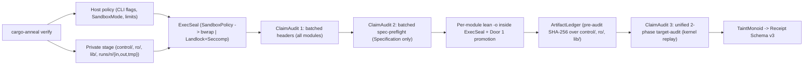

<!-- Copyright 2026 The Fuchsia Authors

Licensed under a BSD-style license <LICENSE-BSD>, Apache License, Version 2.0
<LICENSE-APACHE or https://www.apache.org/licenses/LICENSE-2.0>, or the MIT
license <LICENSE-MIT or https://opensource.org/licenses/MIT>, at your option.
This file may not be copied, modified, or distributed except according to
those terms. -->

# Elaborator Containment, Specification Admission, and Receipt v3

> **Note:** Anneal is under active development. This document specifies the
> target design for OS-level Lean elaborator containment, whole-specification
> syntactic admission, unified two-phase target auditing, and Receipt Schema v3.
> Concrete implementation lands incrementally across the elaborator-containment
> PR stack; keep this document synchronized with code and review findings.

[`META_PRINCIPLES.md`](../META_PRINCIPLES.md),
[`PRINCIPLES.md`](../PRINCIPLES.md), and [`THREAT_MODEL.md`](../THREAT_MODEL.md)
define Anneal's correctness promise: in an uncompromised execution environment,
if the code in the Trusted Computing Base (TCB) audit log is correct, its
assumptions hold, and Anneal emits no errors, then the verified crate is sound
and satisfies its stated specifications—even if the crate's Rust bodies and Lean
proofs are adversarial.

[`docs/trust-model.md`](trust-model.md) describes how `anneal-audit` enforces
that boundary in **Anneal's own repository CI** over `theory/`,
`correspondence/`, and `vendor/lean-miri/`. By contrast, when `cargo-anneal`
verifies an **external target crate** with authored `Specification` and `Proof`
Lean files, `THREAT_MODEL.md` Section 2.1 previously deferred build-time Lean
elaborator side effects (`#eval`, `run_cmd`, `by_elab`, `initialize`, `macro`,
`elab`) as an unmitigated host-tampering risk. Because `cargo-anneal` ran `lean`
as the same OS user with access to the host filesystem, network, and
`cargo-anneal`'s own staging directory, a hostile `Proof` file could subvert the
host or race `cargo-anneal`'s staged `.olean` and auditor files before kernel
replay even began.

This document specifies how Anneal closes build-time Lean elaborator hazards
mechanically inside `cargo-anneal` while preserving `THREAT_MODEL.md` Section
3.1 (unrestricted pure Lean 4 proofs with zero tactic allowlist on `proof/` in
Anneal's TCB) and honest, fail-closed receipt reporting.

## 1. Threat-model shift and core design principles

Closing build-time Lean elaborator hazards requires separating two boundaries
that are easy to conflate:

1. **Build and CI elaboration (in scope for Anneal's TCB):** When `cargo-anneal`
   invokes `lean` on untrusted `Specification` and `Proof` modules, the OS
   kernel can **totally contain** every child process's filesystem writes, host
   file reads, network access, and process creation. Build-time containment must
   fail closed by default and never degrade silently.
2. **Local editor elaboration (outside Anneal's TCB):** Opening a checked-in
   `.lean` file in an unsandboxed local editor (`lean --server` or `lake serve`)
   sits on the same local-developer trust boundary as `build.rs`, procedural
   macros, and build files. No syntax filter inside `cargo-anneal` can make an
   unsandboxed local IDE totally safe without banning legitimate Lean 4 proof
   tactics and macros, which would violate `THREAT_MODEL.md` Section 3.1.

Four governing invariants follow directly from this split:

- **OS containment is primary; parser filters never substitute for it.**
  `cargo-anneal` isolates every Lean compilation and inspector subprocess behind
  fail-closed OS confinement (`ExecSeal`). Removing `"hostile Lean elaborator
  effects"` from a receipt's `deferred` list requires active OS containment
  enforced by `cargo-anneal` itself.
- **No tactic allowlist on `proof/` in Anneal's TCB.** Authored `Proof` modules
  are untrusted evidence discharged by standalone kernel replay. Keeping them
  free of a TCB tactic allowlist allows idiomatic Lean 4 proofs (`omega`,
  `rcases`, `grind`, `conv`, `calc`, local macros) and prevents perpetual
  breakage when downstream consumers run unpinned rolling Lean toolchains
  (`--allow-unpinned-lean`).
- **Whole-specification syntactic admission stays in Anneal's TCB.** Even with
  OS containment and post-elaboration kernel replay, `Specification` modules are
  part of the **human-reviewed surface** (`THREAT_MODEL.md` Section 1) and are
  imported by `Proof` modules. Pre-elaboration syntactic admission
  (`"spec-preflight"`) ensures that a hostile `Specification` cannot use macros,
  `by_elab`, `include_str`, or custom syntax to obscure what a human reviewer
  reads, smuggle `EnvExtension` hooks into `Spec.olean` for downstream proof
  elaboration, or run arbitrary code when a reviewer opens `spec/` in an editor.
- **Honest receipts and zero silent fallback.** If OS containment is unavailable
  on the host, `cargo-anneal` fails closed (`tool_failed`, exit `2`). Bypassing
  containment requires an explicit `--allow-unsandboxed-elaboration` flag, which
  unconditionally taints the receipt and retains `"hostile Lean elaborator
  effects"` in `deferred`.

## 2. Architecture overview

Target verification composes three orthogonal TCB primitives:

$$\text{CoreVerify}(\text{DAG}) \;=\; \underbrace{\text{ExecSeal}}_{\text{Fail-Closed OS Containment}} \;\times\; \underbrace{\text{ClaimAudit}}_{\text{Spec Admission + Unified Kernel Replay}} \;\times\; \underbrace{\text{TaintMonoid}}_{\text{Honest Receipt v3 Projection}}$$



| Primitive | TCB location | Property owned | Failure / relaxation mode |
| :--- | :--- | :--- | :--- |
| **`ExecSeal`** | [`trusted/cargo-anneal/src/sandbox.rs`](../trusted/cargo-anneal) (shared with [`trusted/audit/`](../trusted/audit)) | Confines every Lean compiler and inspector child, isolates staging directories, validates single-file promotion (Door 1), and verifies pre-audit integrity (`ArtifactLedger`). | Fail closed (`tool_failed`, exit `2`). Bypassed only via `--allow-unsandboxed-elaboration` (taints receipt). |
| **`ClaimAudit`** | [`trusted/audit/TrustedBoundary.lean`](../trusted/audit) (exact 6 minimal imports) | Validates headers on all target modules, enforces pure declarative syntax on `Specification` modules only, and performs standalone 2-phase kernel replay (`loadExts := false`). | Fail closed (`proof_failed`, exit `1` for policy; `tool_failed`, exit `2` for kernel/operational error). Optional `--allow-sorry-in-proof` (Proof-only outside Phase 1; always taints). |
| **`TaintMonoid`** | [`trusted/cargo-anneal/src/verify.rs`](../trusted/cargo-anneal) | Projects active `--allow-*` relaxation flags and sandbox mode onto Receipt Schema v3 (`status`, `taint_reasons`, `elaboration_sandbox`, `sorry_declarations`, `deferred`). | Uniform Flag-Driven Taint Law: active `--allow-*` flag ⟺ present in `taint_reasons`. |

## 3. `ExecSeal`: OS containment, staging, Door 1, and `ArtifactLedger`

### 3.1 Crate placement and `SandboxMode`

Because `anneal-audit` depends on `cargo-anneal` with default features disabled,
all OS-sandboxing logic lives in one shared module
`trusted/cargo-anneal/src/sandbox.rs` (re-exported via `#[doc(hidden)] pub mod
sandbox;`), replacing duplicated `bwrap` argument builders in
`trusted/audit/src/lib.rs` and introducing zero external crates beyond the
already-pinned `libc` dependency (`0.2.191`).

Callers select containment through a three-variant enum that makes illegal flag
combinations unrepresentable:

```rust
pub enum SandboxMode {
    /// Repository Pass 2 (`trusted/audit`): strictly requires Tier 1 `bwrap`.
    RequireBwrap,
    /// Target verification (`cargo-anneal` default): Tier 1 `bwrap`, falling
    /// back to Tier 2 Landlock + Seccomp when user namespaces are unavailable.
    PreferBwrapOrLandlock,
    /// Explicit `--allow-unsandboxed-elaboration`: skip OS confinement.
    Unsandboxed,
}
```

- **Repository Pass 2 preservation:** All three Pass 2 surfaces in
  `trusted/audit`—cold `vendor/lean-miri/` compilation,
  `"correspondence-preflight"`, and `trusted/correspondence/` +
  `correspondence/` compilation (even on `--miri-cache-dir` cache hits)—pass
  `SandboxMode::RequireBwrap` and never fall back to Landlock. Repository Pass 1
  (`RepoTacticFree` / `RepoPureCoreTheory`) remains unchanged.
- **Target verification default:** `cargo-anneal` passes
  `SandboxMode::PreferBwrapOrLandlock` unless `--allow-unsandboxed-elaboration`
  is explicitly set (in which case it passes `SandboxMode::Unsandboxed`,
  deterministically skips `ExecSeal`, and taints Receipt v3).

### 3.2 Per-invocation staging isolation

Each verification run creates a private `0o700` staging directory `<stage>/`
under the canonicalized system temp root with four disjoint subtrees:

- `<stage>/control/` (`0o500`): holds `TrustedBoundary.lean` (`0o444`).
  **Never** mounted into any child process.
- `<stage>/ro/` (`0o444`): holds immutable source snapshots staged from the
  host. **Never** mounted into any child process.
- `<stage>/lib/` (`0o444`): holds Door-1-promoted `.olean` artifacts in nested
  `<module.replace('.', '/')>.olean` layout. Mounted read-only **only** into
  module compilers and `"target-audit"`—never into `"headers"` or
  `"spec-preflight"`.
- `<stage>/runs/<counter>/{in,out,tmp}/`: fresh per-invocation directories.
  - `in/` (`0o500`) receives physical `0o444` copies (never hardlinks) of
    **only** the inputs required by that single invocation: `<Mod>.lean` and
    `setup.json` for a compiler run; `TrustedBoundary.lean`, `request.json`, and
    the exact `.lean` source files inspected for `"headers"` /
    `"spec-preflight"`; or `TrustedBoundary.lean` and `request.json` for
    `"target-audit"` (which reads compiled `.olean` artifacts in `lib/` only and
    never reads `.lean` sources).
  - `out/` is the sole deliverable directory validated by Door 1 after the child
    exits.
  - `tmp/` is the child's working directory (`--chdir` / `TMPDIR`), never
    promoted by Door 1 and deleted after child exit.

### 3.3 Unified declarative `SandboxPolicy` and the two Linux backends

To prevent allowlist drift between backends, `ExecSeal` describes confinement
with one declarative `SandboxPolicy` compiled to either Linux backend:

- `exec_bin`: canonical `exec_lean` path.
- `devices`: `[("/dev/null", rw), ("/dev/zero", ro), ("/dev/urandom", ro)]`.
- `optional_sys_paths` (`ENOENT`-skipped in both tiers):
  `["/lib", "/lib64", "/usr/lib", "/usr/lib64", "/etc/ld.so.cache",
  "/etc/ld.so.conf", "/etc/ld.so.conf.d"]`, plus `"/nix/store"` when either
  `exec_bin` or its ELF `PT_INTERP` resolves under `/nix/store`.
- `ro_mounts`: `[toolchain_dir -> /toolchain, runs/<n>/in -> /work/in]`, plus
  `[stage/lib -> /work/lib]` strictly for compilers and `"target-audit"`.
- `rw_mounts`: `[runs/<n>/out -> /work/out, runs/<n>/tmp -> /work/tmp]`.
- `process_hygiene` (applied identically on every spawn): `env_clear()`,
  `.stdin(Stdio::null())`, `close_range(3, u32::MAX, CLOSE_RANGE_CLOEXEC)` (with
  `/proc/self/fd` fallback), `setpgid(0, 0)` / `setsid()`,
  `PR_SET_PDEATHSIG(SIGKILL)` followed immediately by
  `if libc::getppid() != parent_pid { libc::_exit(127); }` (closing the
  fork-to-`prctl` parent-death race), `RLIMIT_CORE = 0`,
  `RLIMIT_FSIZE = 256 MiB`, `RLIMIT_NOFILE = 256`, and a parent wall-clock
  timeout killing the child process group (`kill(-child_pgid, SIGKILL)`).

#### Tier 1: `linux_bwrap` (primary)

Uses `~15–20 LOC` of `unsafe pre_exec` solely for `setpgid`, `close_range`,
`PR_SET_PDEATHSIG`, and `setrlimit`, and invokes `bwrap` with:

```text
bwrap --unshare-all --die-with-parent --new-session --clearenv
      --size 16777216 --tmpfs /
      --tmpfs /dev
      --dev-bind /dev/null /dev/null
      --dev-bind /dev/zero /dev/zero
      --dev-bind /dev/urandom /dev/urandom
      --proc /proc
      --ro-bind-try <each optional_sys_path>
      --ro-bind <each ro_mount>
      --bind <runs/n/out> /work/out
      --size 1073741824 --tmpfs /work/tmp
      --chdir /work/tmp
```

Using explicit 3-device `--tmpfs /dev --dev-bind` instead of `--dev /dev`
shrinks the device surface (omitting `/dev/full`, `/dev/tty`, `/dev/ptmx`,
`/dev/shm`) and avoids `bwrap` failures inside minimal outer containers that do
not expose `/dev/full`. Making `/usr/lib` `--ro-bind-try` also fixes NixOS hosts
where `/usr/lib` does not exist. `sandbox.map_path(host) -> child` rewrites
paths in `setup.json` and inspector `request.json` to `/toolchain` and
`/work/{lib,in,out,tmp}`.

#### Tier 2: `linux_landlock_seccomp` (fallback for restricted outer containers)

Nested user namespaces (`bwrap` as well as custom `unshare(CLONE_NEWUSER)`)
fail inside outer CI containers that mount `/proc` read-only—such as `nsjail`
without `--proc_rw`—because writing `/proc/self/uid_map` returns `EROFS` and
remounting or mounting a fresh `proc` returns `EPERM` under Linux's locked-RO
`/proc` rules. Nested user namespaces also fail under
`unprivileged_userns_clone = 0` or Ubuntu AppArmor userns restrictions.

Tier 2 handles these Linux hosts (kernel ≥ 6.2, Landlock ABI ≥ 3) without
requiring outer-container changes or custom `pivot_root` mount code, using
`~350–450 LOC` of audited async-signal-safe `unsafe` Rust (a zero-dependency
ELF64 `PT_INTERP` parser, a symbolic BPF jump builder asserting `jt <= 255`, and
a pre-allocated BPF buffer patched in place post-fork at two `child_pid`
indices):

- **Hard preconditions:** `geteuid() != 0`, Landlock ABI ≥ 3
  (`LANDLOCK_ACCESS_FS_TRUNCATE` mandatory), and `PR_SET_NO_NEW_PRIVS = 1`.
  `landlock_ruleset_attr` uses exact ABI-matched sizing:
  - `8` bytes at ABI 3 (`handled_access_fs` including `TRUNCATE`);
  - `16` bytes at ABI 4–5 (adding `handled_access_net = BIND_TCP | CONNECT_TCP`,
    plus `IOCTL_DEV` in `handled_access_fs` at ABI ≥ 5);
  - `24` bytes at ABI ≥ 6 (adding `scoped = ABSTRACT_UNIX_SOCKET | SIGNAL`,
    closing abstract-namespace Unix sockets even when an outer container
    disables network-namespace isolation).
- **Landlock path masks compiled from `SandboxPolicy`:**
  - `exec_bin` and ELF `PT_INTERP`: `READ_FILE | EXECUTE`.
  - `/dev/null`: `READ_FILE | WRITE_FILE`; `/dev/zero`, `/dev/urandom`:
    `READ_FILE`.
  - `optional_sys_paths` (`ENOENT`-skipped, since `/etc/ld.so.cache` is absent
    in minimal `nsjail` environments) and `ro_mounts`: `READ_FILE | READ_DIR`
    for directories, `READ_FILE` for regular files (no `EXECUTE`; no
    `/proc/<pid>` rule is needed).
  - `rw_mounts` (`runs/<n>/out` and `runs/<n>/tmp`): one uniform
    `RW_SCRATCH_DIR` mask (`READ_FILE | READ_DIR | WRITE_FILE | TRUNCATE |
    MAKE_REG | MAKE_DIR | REMOVE_FILE | REMOVE_DIR`), strictly omitting
    `EXECUTE`, `MAKE_SYM`, `MAKE_CHAR`, `MAKE_BLOCK`, `MAKE_FIFO`, `MAKE_SOCK`,
    and `REFER`. Including `REMOVE_FILE | MAKE_REG` on `runs/<n>/out` is
    empirically required because Lean writes `<Mod>.olean.tmp.<pid>` and
    atomically `rename()`s it to `<Mod>.olean`.
- **Fail-closed dual-arch seccomp-BPF allowlist (`x86_64` and `aarch64`):**
  Default action `SECCOMP_RET_ERRNO | EPERM`, constructed strictly from `libc`
  syscall constants (zero magic numbers) with `ioctl` dropped completely:
  - Allows `execve`, `getrusage` (required by Lean's `-M` memory limiter),
    `getcpu`, arch-appropriate rename/rlimit syscalls (`rename`, `renameat`, and
    `getrlimit` on `x86_64`; `renameat2` on both), and standard thread, memory,
    event-loop, and Landlock-confined file syscalls.
  - Guards **6** syscalls with 64-bit argument checks: `clone3 -> ENOSYS`,
    `clone` restricted strictly to `CLONE_THREAD` (preventing any child process
    from escaping or outliving the thread group), `prlimit64` restricted to
    read-only self (`arg0 == 0 && arg2 == 0`), `kill` and `tgkill` restricted to
    `arg0 == child_pid`, and `fcntl` restricted to
    `{F_GETFD, F_SETFD, F_GETFL, F_SETFL, F_DUPFD, F_DUPFD_CLOEXEC}`.
  - Uses identity path mapping (`sandbox.map_path(p) == p`).
- **Honest Tier 2 residual boundaries (disclosed in `assumptions` and
  `THREAT_MODEL.md`):**
  1. Shared host mount and PID namespaces leave path-metadata and symlink
     existence probing (`stat`/`statx`/`access`/`readlink`, including
     `/proc/<ppid>/fd/*` if `yama.ptrace_scope = 0`) visible.
  2. Because `PT_INTERP` (`ld-linux`) must be executable for
     `execve(exec_lean)`, a hostile elaborator can run native code in-process
     via `mmap(PROT_EXEC)` or `execve(PT_INTERP, readable_elf)`. Because
     `NoNewPrivs = 1`, all such execution remains irreversibly confined inside
     the identical Landlock, seccomp, `RLIMIT`, wall-clock timeout, and Door 1
     envelope with zero process spawning or filesystem/network escape.
  3. Unlinked open inodes inside host-backed `runs/<n>/tmp` cannot be observed
     by directory traversal; disk consumption is bounded by
     `RLIMIT_NOFILE × RLIMIT_FSIZE` plus host/worker disk quotas.

#### Non-Linux hosts

Anneal does not ship an untested deprecated macOS `sandbox-exec` backend in the
TCB. Non-Linux hosts fail closed (`tool_failed`, exit `2`) under
`SandboxMode::PreferBwrapOrLandlock` unless `--allow-unsandboxed-elaboration` is
explicitly passed (producing a tainted Receipt v3).

### 3.4 Binary admission, lazy probe, Door 1, and `ArtifactLedger`

- **Decoupled binary admission (`tool_admission()`):**
  - *Pinned mode (`!allow_unpinned_lean`):* Preserves zero-unhashed-exec by
    hashing `sha256_file_deref(&self.lean)` against `foundation-lock.json`
    **before** running `--version` or `--print-prefix`, then confirming
    `canon_prefix/bin/lean` matches the locked digest during sandbox readiness.
  - *Unpinned mode (`allow_unpinned_lean`):* Queries `--version` and
    `--print-prefix` → `canon_prefix`, resolves
    `exec_lean = fs::canonicalize(canon_prefix.join("bin/lean"))` (falling back
    to `&self.lean` only when `canon_prefix/bin/lean` does not exist so
    stub-script unit tests keep passing), and records `sha256_file(&exec_lean)`
    in the receipt.
- **Lazy `ensure_sandbox_ready()`:** Runs on the first sandboxed `lean` call
  (skipped under `SandboxMode::Unsandboxed`). It verifies toolchain prefix
  containment (zero-copy when self-contained under `canon_prefix` or
  `/nix/store`; otherwise 0-byte read-only `hard_link`/`FICLONE` into
  `stage/toolchain/`) and runs a cached functional probe compiling a trivial
  Lean module with `--root`. Under `PreferBwrapOrLandlock`, if Tier 1 fails
  (missing `bwrap` or failed probe), it probes Tier 2 and fails closed reporting
  both diagnostics if both fail.
- **Door 1 single-file promotion:** `write_setup_json` restricts `importArts` to
  `transitive_import_closure(&adm.graph, imports)` in both pinned and unpinned
  modes; input admission rejects user-declared `Trusted.*` and `Anneal.*` module
  names. After each child exits, Door 1 scans `runs/<n>/out/` via non-following
  `symlink_metadata` and requires an exact singleton filename set containing a
  regular file (`is_file() && !is_symlink()`), `st_nlink == 1`, zero
  subdirectories, and bounded size:
  - Compilers: strictly `{"<module>.olean"}` (≤ 256 MiB, `"isModule": false`),
    blocking companion `.olean.private`, `.olean.server`, `.ir`, and `.ir.sig`
    smuggling. Door 1 applies `chmod 0o444` and atomically `fs::rename`s the
    file to `stage/lib/<mod_path>.olean`.
  - Inspectors: strictly `{"result.json"}` (≤ 64 MiB), checked on **both** exit
    `0` and exit `1`.
- **`ArtifactLedger` and `--export-lean-lib`:** Immediately before running
  `"target-audit"`, `Checker::run_target` re-hashes
  `stage/control/TrustedBoundary.lean`, `stage/ro/*.lean`, and every promoted
  `.olean` in `stage/lib/`. `--export-lean-lib` exports nothing on
  `tool_failed` or Door 1 failure; on `proof_failed` (exit `1`), it exports
  `Model`, `Capture`, `Specification`, `Expected`, and bundled `Anneal.*`
  modules while gating authored `Proof` `.olean` export strictly on passing
  `"target-audit"`.

## 4. `ClaimAudit`: `"headers"`, `"spec-preflight"`, and unified `"target-audit"`

`trusted/audit/TrustedBoundary.lean` retains its **exact 6 minimal imports**
(`Lean.Elab.Import`, `Lean.Parser.Tactic`, `Lean.Replay`, and
`Lean.Compiler.{ImplementedBy,Extern,CSimp}Attr`), keeping inspector startup at
`~0.300 s` and avoiding cross-version breakage on rolling Lean toolchains.

### 4.1 Batched `"headers"` (all target modules)

Runs once across all staged target modules (`Specification` and `Proof`) with
zero target `.olean`s loaded:

- Parameterizes `inspectSyntax`/`inspectNodeKind` with
  `(requirePrelude : Bool := true)` so Repository Pass 1 keeps mandatory
  `prelude`, while target `"headers"` passes `requirePrelude := false` (still
  enforcing `allowedHeaderKinds` = `Parser.Module.{header,prelude,import}` to
  reject explicit `module`/`public`/`meta`/`all`).
- Rejects `HeaderSyntax.isModule`, `imp.importAll || !imp.isExported`, and any
  `Lean.*` or `Lake.*` import.
- Permits Lean 4's synthetic `!hasPrelude` `Init(isMeta = true)` prelude edge
  strictly when paired with a non-meta `Init` edge, rejecting all other `isMeta`
  edges across `"headers"`, `target.rs`, and `"target-audit"`.

### 4.2 Batched fail-closed `"spec-preflight"` (`TargetRole::Specification` only)

Runs once across all `TargetRole::Specification` modules inside `ExecSeal` over
an authenticated `Init` + `Std` parser environment only (**zero** target
`.olean`s loaded, zero command elaboration, zero tactic allowlist on `proof/`):

- **Dynamic `command`-category allowlist:** Extracts `commandLikeKinds` strictly
  from `Parser.parserExtension`'s `command` category (never a
  `Lean.Parser.Command.` name-prefix union, which falsely captures
  `declModifiers`, `declId`, and `docComment`). Every `command`-category node
  anywhere in the AST (including inside nested `Command.in` and
  `Command.mutual`) must belong to the closed 14-command allowlist
  (`{declaration, namespace, section, end, universe, variable, open, export,
  mutual, in, attribute, deriving, set_option, moduleDoc}`), with `Command.in`'s
  left-hand side restricted to `{open, variable, universe, set_option,
  attribute}` and `{namespace, section, end, mutual}` forbidden inside
  `Command.in`/`mutual`. Every `Command.declaration` node must have
  `args[0]` = `Command.declModifiers` and `args[1]` in
  `{definition, abbrev, theorem, structure, inductive, classInductive,
  instance}`. Rejects user-written `._unsafe_rec` declaration identifiers.
- **Arity-independent fail-closed modifiers:** Rejects
  `Command.{meta,unsafe,partial,public}` and `Term.unsafe`. For
  `Command.sectionHeader`, inspects **all** children and accepts strictly
  `null #[]` or `null #[atom "noncomputable"]`—avoiding brittle `args.size == 4`
  slot-index assumptions while rejecting `public`, `meta`, `unsafe`, or any
  modifier added in future Lean versions.
- **Resolved lexical scope tracking (`applySpecScope` + subtree `Term.open`):**
  Tracks enclosing `namespace` scopes across `namespace`/`section`/`end`/`in`,
  updating `Parser.parserExtension` scopes across all five `open` forms on
  admitted `Init`/`Std` namespaces, and rejecting any resolved path rooted in
  `{Lean, Lake, IO, BaseIO, EIO, EST, ST, Task, System}` (allowing
  `System.Platform.numBits` via qualified access or
  `open System.Platform (numBits)`).
- **Closed attributes, deriving, and options:**
  - `Term.attrInstance` (globally) and `Command.eraseAttr`: allows empty or
    `local` `Term.attrKind` (rejects `scoped`), dispatching strictly over five
    attribute kinds (`Lean.Parser.Attr.{simp, instance, ext, specialize,
    simple}` with argument validation; `Attr.simple` restricted to
    `{reducible, semireducible, irreducible, inline, match_pattern}`).
  - `Command.derivingClass` (globally):
    `{BEq, DecidableEq, Repr, Inhabited, Ord, Hashable, Nonempty}`.
  - `Command.set_option` and `Term.set_option`:
    `{maxHeartbeats, maxRecDepth, autoImplicit, relaxedAutoImplicit}` plus
    literal-boolean `linter.*`.
- **Dynamic fail-closed pure-spec tactic allowlist (`allowedSpecTacticKinds`):**
  Extracts every syntax kind in every `Parser.parserExtension` category outside
  the closed 25-category pure expression/command/binder set, unioned with
  `Lean.Parser.Tactic.`-prefixed kinds. Every matching node must belong to
  `allowedSpecTacticKinds` (extending `allowedTheoryTacticKinds` with pure
  `Init` spec/termination tactics; `decide` admitted bare or with
  `kernel`/`revert` config only). This automatically closes `bv_decide`,
  `bv_check`, `grind => bv_*`, `native_decide`, `rfl'`, `run_tac`,
  `Tactic.{open,set_option}`, and future Lean solver categories by construction.
- **Exact term and quotation guards:** Rejects double-backtick
  `` ``Lean.includeStr `` and `` ``Lean.byElab `` (failing closed at inspector
  compile time if renamed in `Init`), single-backtick meta/debug/parser-macro
  `Term` and `doElem` forms (`sorry`, `unsafe`, `dbgTrace`, `idbg`,
  `doDbgTrace`, `doIdbg`, `matchExpr`, `letExpr`, `doMatchExpr`, `doLetExpr`,
  `doLetMetaExpr`, `showTermElabImpl`, `declName`, `withDeclName`,
  `privateDecl`, `leading_parser`, `trailing_parser`, `elabToSyntax`,
  `termMacro.trace[_]_`, `Syntax.exact?`, `termEval_{prec,prio}_`,
  `termPrintln!__`, `logNamed*`/`throwNamed*`), and trailing
  `"quot"`/`"quotSeq"` (`dynamicQuot`/`precheckedQuot`), backed by live
  parse-tree round-trip CI tests.

### 4.3 Unified 2-phase `"target-audit"`

`"target-audit"` runs inside `ExecSeal` with `trustLevel := 0`,
`plugins := #[]`, and `loadExts := false`, verifying `!data.isModule`,
`oleanParts.size == 1 && irParts.isEmpty`, and strictly public kernel-relevant
`fixedMetadata` (`getImplementedBy?`, `getExternAttrData?`, `csimpEntries`)—with
**no** brittle blacklist over internal `ModuleData.entries` extension names:

1. **Phase 1 (Claim and whole-specification closure):** Seeds `expectedReached`
   from all five canonical roots (`[expectedName, canonicalRoot, crateCtor,
   subjectName, specName]`) and runs the memoized per-origin replay and
   validation loop across all `Specification` declarations (`phase1Closure`),
   enforcing:
   - Exact 4-part `p._unsafe_rec` pairing (`ci.isPartial && !ci.isUnsafe`,
     parent `p` in the same `Specification` module as a total non-opaque
     replayed `.defnInfo`, zero non-`_unsafe_rec` references anywhere in
     `phase1Closure ∪ phase2Closure`, never inserted into `replayMap`);
   - Strict 3-axiom ceiling (`{Classical.choice, Quot.sound, propext}`, zero
     `sorryAx`);
   - `.foundation` skipped, `.library` kernel-replayed, and `.source
     .specification` strictly non-`opaque`, free of direct `Lean.Syntax` edges,
     and transitively free of `{IO, BaseIO, EIO, EST, ST, Task,
     Lean.{Macro,Elab,Core,Meta,Environment,Compiler,Internal,getGithash,
     version}, System.FilePath, System.SearchPath, System.Uri,
     System.Platform.* \ {numBits, getNumBits, numBits_eq}, dbgTrace,
     dbgTraceVal, dbgTraceIfShared, dbgSleep, dbgStackTrace, dbgStackTraceIf}`.
2. **Phase 2 (Proof closure `[theoremName]`):** Reuses memoized `phase1Closure`
   state in the same loop. When `--allow-sorry-in-proof` is active, per-edge
   `sorryAx` admission runs in `parent`'s outgoing edge loop **before**
   `visited` short-circuiting, admitting `(parent, ("sorryAx", "Init.Prelude"))`
   strictly when `origin parent == .source .proof && !phase1Closure.contains
   parent` and recording `parent` into `sorryDeclarations`.

## 5. `TaintMonoid` and Receipt Schema v3

Receipt Schema v3 (`RECEIPT_SCHEMA_VERSION = 3`, a breaking bump from v2)
replaces ad-hoc taint booleans with an exact 3-element sorted
`BTreeSet<VerificationTaint>`: `{SorryInProof, UnpinnedLean,
UnsandboxedElaboration}`.

### Uniform Flag-Driven Taint Law

Every `--allow-*` relaxation flag unconditionally inserts its taint atom into
`taint_reasons`—even if the relaxed condition did not occur on that run—so a
misconfigured CI rule passing `--allow-sorry-in-proof` is caught on the very
first clean run instead of sitting dormant until a `sorry` lands:

| CLI relaxation flag | Unconditional `taint_reasons` entry | Additional Receipt v3 projection |
| :--- | :--- | :--- |
| `--allow-unpinned-lean` | `"unpinned_lean"` | Emits `"unpinned_lean"` metadata object on success; drops Lean SHA-256 lock claims; marks correspondence provenance inapplicable. |
| `--allow-unsandboxed-elaboration` | `"unsandboxed_elaboration"` | Sets `SandboxMode::Unsandboxed` → `"elaboration_sandbox": "none"`; retains `"hostile Lean elaborator effects"` in `"deferred"`. |
| `--allow-sorry-in-proof` | `"sorry_in_proof"` | Emits `"sorry_declarations"` array on success (possibly `[]`; omitted when flag is absent). |

### Schema v3 field invariants

- **Preserved 2×2 `status`:** Emits `"crate_verified"` or
  `"selected_unit_verified"` **iff** `taint_reasons.is_empty()`, and
  `"tainted_crate_verified"` or `"tainted_selected_unit_verified"` otherwise.
  Preserving the `tainted_` prefix prevents naive consumers that check only
  `receipt["status"] == "crate_verified"` from silently accepting tainted runs.
- **Flat `"elaboration_sandbox"`:** Top-level string `"linux_bwrap" |
  "linux_landlock_seccomp" | "none"` on every passing receipt (and on
  `FailureReceipt` once sandbox selection completed; omitted on pre-sandbox
  failures via `Option<&str>`).
- **Honest `"deferred"` projection:** Omits `"hostile Lean elaborator effects"`
  **iff** `"elaboration_sandbox" != "none"`.

## 6. Downstream integration contract

Downstream build systems (such as Bazel host-test suites running on Linux CI
workers wrapped in `nsjail` with unpinned rolling Lean toolchains) integrate
with this architecture cleanly without patching Anneal's TCB:

- **Receipt v3 verification:** Downstream test runners assert
  `schema_version == 3`, `elaboration_sandbox in ("linux_bwrap",
  "linux_landlock_seccomp")` (never `"none"`), exact expected `status` and
  `taint_reasons`, and `"hostile Lean elaborator effects" not in
  receipt["deferred"]`.
- **Closed test-rule tags:** Downstream build macros reject caller tags that can
  disable CI execution or sandboxing (`"manual"`, `"local"`, `"external"`,
  `"no-sandbox"`, `"requires-network"`, `"no-remote*"`, `"no-cache"`,
  `"exclusive*"`).
- **Optional non-TCB local-IDE hygiene:** Downstream repositories that want
  defense-in-depth against local-IDE sleeper files in `proof/` may pair
  `cargo-anneal` with a repo-owned, parser-only hygiene check (rolled atomically
  with the downstream Lean toolchain) plus a static build-graph check ensuring
  every `.lean` package is wired into blocking CI. Such checks remain explicitly
  outside Anneal's TCB and documented as defense-in-depth rather than a total
  local-IDE sandbox.

## 7. Verification, testing, and rollout gates

Implementation PRs landing this design must include and pass:

1. **Sandbox escape and confinement test suite (`tests/sandbox_escape.rs`):**
   Exercises both Tier 1 `linux_bwrap` and Tier 2 `linux_landlock_seccomp`
   against active hostile fixtures covering host-file read, staging/artifact
   overwrite, symlink/hardlink creation, companion `.olean.private`/`.ir`
   smuggling, network sockets (IP + abstract Unix socket), `fork`/`clone(0)`,
   `kill(ppid)`, `prlimit64(ppid)`/`setrlimit`, `shmat`, `*xattr*`, `inotify`,
   `fcntl(F_SETLEASE)`, `memfd_create`, `execveat`, and wall-clock timeout
   reaping.
2. **Dual-architecture CI:** Add an `ubuntu-24.04-arm` PR CI job verifying the
   `aarch64` seccomp-BPF allowlist (`getcpu`, `renameat2`, `clone`, `prlimit64`,
   `kill`/`tgkill`, `fcntl`) alongside `x86_64`.
3. **Boundary auditor negative tests
   (`trusted/audit/tests/boundary_audit.rs`):** Every added or modified guard
   in `"headers"`, `"spec-preflight"`, and `"target-audit"` must have negative
   tests asserting the exact exit code (`1` policy / `2` kernel or operational)
   and diagnostic, plus live parse-tree round-trip tests confirming
   `include_str`, `by_elab`, `sectionHeader`, `attrInstance`, and
   tactic-category names against the pinned Lean parser.
4. **Repository Pass 1 + Pass 2 preservation:** Full `anneal-audit
   --require-correspondence`, `cargo test` (default and
   `--no-default-features`), `./ci/check_todo.sh`, and
   `regenerate_bundle --check`.
5. **Downstream target-environment checks:** End-to-end execution inside a real
   downstream CI container (e.g., Linux 6.12 `nsjail` with RO `/proc` and
   unpinned Lean 4.35+), migrated crate regression runs, and CI latency checks.

## 8. Alternatives considered

| Alternative | Why rejected |
| :--- | :--- |
| **Global positive tactic allowlist on `proof/` in `TrustedBoundary.lean` with best-effort OS sandbox** | Inverts `THREAT_MODEL.md` Section 3.1 (a syntax filter cannot substitute for OS containment of untrusted proof elaboration), breaks idiomatic Lean 4 proofs, and breaks downstream consumers whenever rolling Lean adds or renames tactics. |
| **Custom `linux_userns_pivot` (`unshare` + `pivot_root`) in `cargo-anneal`** | Adds ~150–200 LOC of fragile `unsafe` mount-namespace code to the TCB (false-confidence risk vs. hardened upstream `bwrap`) and still fails identically to `bwrap` (`EROFS` on `/proc/self/uid_map`) inside `nsjail` containers with RO `/proc`. |
| **`bwrap`-only in `cargo-anneal` (no Tier 2 Landlock/Seccomp)** | Fails inside unmodified `nsjail` CI containers (`EROFS` on `/proc/self/uid_map`), forcing downstream infra to weaken `nsjail` (`/proc` RW) and package `bwrap` in prebuilts or run CI unsandboxed. |
| **Tier 2 seccomp denylist instead of fail-closed allowlist** | Live red-team probes bypassed a denylist via `shmat`, `*xattrat`, `inotify`, `fcntl(F_SETLEASE)`, and `ioctl(FS_IOC_SETFLAGS)`. A fail-closed dual-arch allowlist closes unknown syscalls by construction. |
| **Internal `ModuleData.entries` extension blacklist in `"target-audit"`** | Broke every `inductive` declaration (`Lean.Elab.Term.elabAsElim`) and created perpetual breakage across rolling Lean releases. `loadExts := false` plus public `fixedMetadata` (`implemented_by`, `extern`, `csimp`) is strictly cleaner and kernel-exact. |
| **Additive Receipt Schema v2** | Carried a redundant 1-field wrapper object (`elaboration_containment: { os_sandbox }`) and mixed v2/v3 validation semantics to avoid updating two consumers. Bumping cleanly to v3 flattens `elaboration_sandbox` and enforces one uniform taint law. |
| **macOS `sandbox-exec` backend in TCB** | Deprecated by Apple and unverified in Linux-only CI; failing closed unless `--allow-unsandboxed-elaboration` is explicit avoids untested security theater. |
