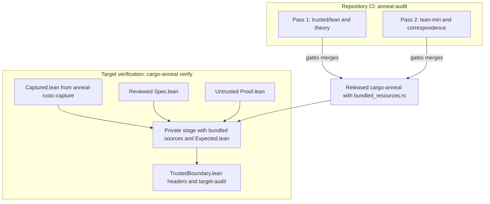

<!-- Copyright 2026 The Fuchsia Authors

Licensed under a BSD-style license <LICENSE-BSD>, Apache License, Version 2.0
<LICENSE-APACHE or https://www.apache.org/licenses/LICENSE-2.0>, or the MIT
license <LICENSE-MIT or https://opensource.org/licenses/MIT>, at your option.
This file may not be copied, modified, or distributed except according to
those terms. -->

# Trust Model and Boundary Enforcement

> **Note:** Anneal is under active development. Parts of the design and
> architecture described in this document are experimental (for example,
> host-level OS sandboxing of untrusted target Lean elaborators and complete
> review-surface reporting remain deferred, as recorded in `cargo-anneal
> verify` receipts).

[`META_PRINCIPLES.md`](../META_PRINCIPLES.md),
[`PRINCIPLES.md`](../PRINCIPLES.md), and [`THREAT_MODEL.md`](../THREAT_MODEL.md)
are the controlling documents for Anneal's correctness promise and threat
model: if the code in a verification result's Trusted Computing Base (TCB)
audit log is correct, its assumptions are valid, and Anneal emits no errors in
an uncompromised execution environment, then the verified code is sound and
satisfies any stated specifications.

A practical Rust verification framework needs substantial weakest-precondition
(WP) rules, program logics, correspondence proofs, and proof automation—much of
it written by untrusted contributors or AI coding agents. To keep the human
audit surface small, Anneal isolates all first-party trusted code inside
[`trusted/`](../trusted), places program logics and correspondence proofs
outside the TCB in `theory/` and `correspondence/`, and enforces boundary
invariants mechanically across **three audit passes** driven by
[`TrustedBoundary.lean`](../trusted/audit/TrustedBoundary.lean).

For related architectural details, see:

- [`docs/design.md`](design.md) for an overview of Anneal's verification
  workflow and specification modes.
- [`docs/architecture.md`](architecture.md) for the three-stage MIR pipeline
  and how untrusted program logics in `theory/` connect to `trusted/lean/`.
- [`docs/mir-correspondence-design.md`](mir-correspondence-design.md) for how
  Pass 2 anchors `Trusted.MirSemantics` against `vendor/lean-miri/`.

## 1. Repository zones and the three verification contexts

Anneal divides its repository into three strictly separated zones:

| Zone | Directory | Role | Trust status |
| :--- | :--- | :--- | :--- |
| **Trusted foundation** | [`trusted/`](../trusted) | Extracts `Runtime(PostCleanup)` MIR into `Captured.lean` (`trusted/rustc-capture/`), defines MIR syntax and operational semantics (`trusted/lean/`), states MIR correspondence claims (`trusted/correspondence/`), orchestrates toolchain setup and target verification (`trusted/cargo-anneal/`), and audits Anneal's repository in CI (`trusted/audit/`). | **In the TCB.** Audited by humans (alongside external files pinned by SHA-256 manifests inside `trusted/`). |
| **Proof theory & correspondence** | `theory/`, `correspondence/` | Provides fuel-bounded MIR WP and adequacy lemmas (`theory/Anneal/MirWp.lean`), `PureLift` program logics (`theory/Anneal/PureLift/`), and MIR correspondence proofs and canaries (`correspondence/`). | **Outside the TCB.** Treated as untrusted; verified in Anneal's CI by `anneal-audit` (`trusted/audit/`) and checked by the Lean 4 kernel (`correspondence/` runs in CI only and is not shipped to users). |
| **Vendored reference model** | `vendor/lean-miri/` | Pinned snapshot of `proofs-rs/lean-miri` with a human-audited 10-file opt-in `deinitMovedPlace` delta ([`docs/mir-correspondence-design.md`](mir-correspondence-design.md)). Never shipped in the user toolchain archive or `cargo-anneal`. | **In the correspondence TCB.** Pinned byte-for-byte in `vendor/lean-miri/UPSTREAM_PIN.json` (locked by `LOCKED_UPSTREAM_PIN_SHA256` and `LOCKED_PATCHED_MIRI_FILES` in `trusted/audit/`). Only the 160-module `Miri.Interpreter.ExecutionMachine` slice (excluding `Miri.Input.NativeMathHost`) is compiled inside an OS-level `bwrap` sandbox (or restored from a digest-gated cache outside the checkout) and verified by `.olean` SHA-256; every non-`isPartial` vendored declaration (38,728 declarations) is replayed from scratch through the standalone Lean 4 kernel (`toKernelEnv.replay`) onto the authenticated sysroot base on every run, followed directly by replaying `Trusted.Correspondence`, `Anneal.MirCorrespondenceBase`, and `Anneal.MirCorrespondenceProof` on top of that replayed base and checking cone purity. |

### How repository CI auditing and target verification fit together

Anneal splits mechanical boundary enforcement across **Anneal's repository CI**
(`anneal-audit`) and **external target verification** (`cargo-anneal verify`):

1. **In Anneal's repository CI (`anneal-audit` in `trusted/audit/`):**
   - Before any change to Anneal merges or ships, `anneal-audit` verifies that
     every Rust crate lives inside `trusted/`, that root build files and
     `bundled_resources.rs` match their canonical sources, that `trusted/lean/`,
     `theory/`, `trusted/correspondence/`, and `correspondence/` obey closed
     syntactic preflight rules (preventing `#eval`, `run_tac`, `by_elab`,
     `native_decide`, `sorry`, custom `axiom`s, and compiler overrides during CI
     compilation), and that Pass 1 (`"audit"`) and Pass 2
     (`"correspondence-audit"`) pass fresh kernel replay (`toKernelEnv.replay`).
   - `anneal-audit` itself is a repository-only CI binary (`publish = false`);
     its repository policies (`Cargo.toml` containment, `UPSTREAM_PIN.json`, and
     Pass 1 / Pass 2 orchestration) are never shipped in `cargo-anneal`.
     Vendored reference-model sources under `vendor/lean-miri/` are never
     packaged into the user toolchain archive and are admitted under Pass 2 by
     content-addressed SHA-256 pinning, OS-sandboxed compilation and Pass 2
     preflight, standalone kernel replay, and cone-purity enforcement, while
     `ci/` and `.github/` are human-audited CI configuration.
2. **During target verification (`cargo-anneal verify` in
   `trusted/cargo-anneal/`):**
   - Unlike repository CI, target verification accepts Lean specifications
     (`Spec.lean`) and Lean proofs (`Proof.lean`) authored by external users or
     untrusted AI coding agents (under [`THREAT_MODEL.md`](../THREAT_MODEL.md)
     Section 2.1's uncompromised-environment assumption, such as an isolated CI
     runner).
   - Compiling target sources elaborates authored tactics, macros, and other
     metaprograms as ordinary code on the host, and the `lean` frontend also
     runs the initializers of imported target modules. The acceptance
     inspector (`"target-audit"`) runs no target-provided Lean code: it imports
     every environment with `loadExts := false` and never calls
     `enableInitializersExecution`, so neither imported `[init]` declarations
     nor extension import callbacks (including builtin callbacks that would
     evaluate imported declarations) execute inside it. It compares
     `@[implemented_by]`, `@[extern]`, and `@[csimp]` metadata using the
     serialized extension entries that the pinned Lean 4.34.1 importer
     attaches regardless of `loadExts`. The inspector still parses the
     compiled `.olean` artifacts with the pinned importer, so its verdict also
     depends on the compilation phase not having been subverted.
     `cargo-anneal verify` stages and authenticates its inputs but does not
     sandbox compilation at the OS level, so run it only in an environment
     that satisfies that assumption.
   - Toolchain admission authenticates only part of the selected toolchain. It
     hashes the selected `lean` executable against `foundation-lock.json`,
     every `foundation-lock.json` module, and each `library-lock.json` module
     in the target's import closure, and the receipt records the capture
     executable's SHA-256 (`capture_binary_sha256`). It does not hash the Lean
     shared libraries (such as `libleanshared.so`, which holds the kernel and
     elaborator), the `Lean.*` and `Std.*` sysroot modules that the inspector
     loads, or the Rust compiler and sysroot; only `lean --version` and the
     compiler commit that capture checks identify them. These components
     rely on [`THREAT_MODEL.md`](../THREAT_MODEL.md) Section 2.1's intact-host
     assumption, and the receipt's `toolchain_identity` field lists them as
     `unhashed`.
   - `anneal-rustc-capture` extracts the Rust crate's MIR into `Captured.lean`
     (`Captured.program : Trusted.MirAst.Program`). `cargo-anneal verify` stages
     its compiled-in `BUNDLE` (`Trusted.*`, `Anneal.MirWp`,
     `foundation-lock.json`, `library-lock.json`, and `TrustedBoundary.lean`)
     into a private `0o700` directory so target checkouts cannot shadow TCB
     files, generates `Expected.lean` (`Expected.claim`), compiles the module
     DAG with `-DElab.async=false -Ddebug.skipKernelTC=false`, and invokes
     `TrustedBoundary.lean` in `"headers"` and `"target-audit"` modes.
   - Because `TrustedBoundary.lean` runs `"target-audit"` on the compiled
     `.olean` artifacts, authored proofs may freely use tactics, macros, and
     standard-library modules from `library-lock.json` while remaining unable
     (assuming an intact host) to introduce `sorryAx` or custom `axiom`s, leak
     `Proof` definitions into `Specification` meaning, or spoof
     `Expected.claim`. `"target-audit"` also rejects any `@[implemented_by]`,
     `@[extern]`, or `@[csimp]` metadata on a logically reached declaration that
     differs from the authenticated foundation and library metadata. This
     comparison covers only declarations reached from the checked theorem,
     `Expected`, and the canonical inputs.

### Statement-origin and role-authority separation

Within the Lean 4 kernel environment, every compiled theorem
(`ConstantInfo.thmInfo`) has two distinct components:

- **The theorem statement (`ConstantInfo.type`):** The proposition claiming
  *what* holds.
- **The proof term (`ConstantInfo.value?`):** The lambda term explaining *why*
  that proposition holds.

Anneal enforces strict origin separation across both repository CI and target
verification:

- **In repository CI (`RepoOrigin` and `CorrOrigin`):** Modules in `trusted/`
  may never import modules from `theory/` or `correspondence/` (`Anneal.*`),
  and constants in `trusted/` may never reference their constants.
  `anneal-audit` checks imports in Rust preflight and again in compiled `.olean`
  headers (`RepoOrigin.importViolation?` and `CorrOrigin.importViolation?`),
  and checks constant references over kernel declaration edges
  (`RepoOrigin.edgeViolation?` and `CorrOrigin.edgeViolation?`). Declarations
  in `theory/` therefore appear only inside proof terms, never inside primitive
  `Trusted.*` obligation definitions.
- **In target verification (`TargetRole` and `TargetOrigin`):** Every target
  source module is assigned an explicit `TargetRole` governed by
  `TargetRole.allows`, which the runner checks on parsed `import` headers
  before compilation and `"target-audit"` checks again on compiled kernel
  `declarationEdges`:

  - `Model` (`Trusted.*` from `bundled_resources.rs`): depends only on `Model`
    (plus `foundation`/`library`).
  - `Capture` (`Captured.lean` from `anneal-rustc-capture`): depends only on
    `Model` and `Capture` (never `Specification` or `Proof`).
  - `Specification` (human-reviewed `Spec.lean` and helpers): depends only on
    `Model` and `Specification` (never `Capture` or `Proof`, defeating indirect
    specification tampering from proof helpers).
  - `Expected` (runner-generated `Expected.lean`): depends on `Model`,
    `Capture`, `Specification`, and `Expected` (never `Proof`).
  - `Proof` (unreviewed `Proof.lean`, helpers, and bundled `Anneal.MirWp`): the
    strict top of the role lattice; may depend on all roles, while no reviewed
    or runner-owned role may depend on `Proof`.

  Finally, `"target-audit"` builds the canonical kernel application of
  `Trusted.MirSemantics.CrateTheorem` or `UnitTheorem` to
  `Crate.mk Captured.program Spec.specs` directly from authenticated kernel
  names, verifies `Kernel.isDefEq` against both `Expected.claim`'s body and the
  submitted proof theorem's type after fresh kernel replay onto
  `foundation-lock.json`, and reports exact `modelClosure`,
  `specificationClosure`, and `subjectClosure` identities.

### Staging TCB changes (`vetted` vs. `candidate:<feature>` modules)

Auditing a new semantic rule in `trusted/lean/` to full TCB standards—including
line-by-line Rust Reference citations and human review—takes deliberate effort.
Anneal assigns every `Trusted.*` module an explicit module-level trust tier via
a leading header comment directive:

- **`-- anneal-trust-tier: vetted`:** Modules whose definitions have completed
  full Rust Reference auditing.
- **`-- anneal-trust-tier: candidate:<feature>`:** Work-in-progress TCB modules
  belonging to a named subsystem feature `<feature>` (such as `refinement`,
  `step_result`, `memory`, `mir_ast`, `mir_semantics`, or `rustc_capture`) that
  have not yet completed human auditing.

Assigning trust tiers at the module boundary keeps `trusted/` free of custom
attribute macros: every constant compiled into a `Trusted` module's `.olean`
file—including constructors, recursors (`rec`, `casesOn`), pattern matchers
(`match_1`), equation lemmas (`eq_1`), and `where`/`private` helpers—inherits
its defining module's trust tier via `Environment.getModuleIdxFor?`. Across both
Pass 1 (`RepoOrigin.edgeViolation?`) and Pass 2 (`CorrOrigin.edgeViolation?`),
constants in a `vetted` module may reference only `foundation-lock.json` and
other `vetted` modules—never a `candidate:<feature>`, `vendorMiri`, or
`sysrootFoundation` module.

## 2. Repository CI boundary enforcement (`anneal-audit`)

[`trusted/audit/`](../trusted/audit) implements the repository CI gatekeeper
(`anneal-audit` and
[`TrustedBoundary.lean`](../trusted/audit/TrustedBoundary.lean)) that audits
the Anneal repository over an isolated `0o700` staging directory. It enforces
the boundary controls detailed below across Pass 1 (core repository
`trusted/lean/` and `theory/`) and Pass 2 (vendored `lean-miri`,
`trusted/correspondence/`, and `correspondence/`).

### Cargo workspace, pin, and bundle containment

Before inspecting Lean files, `anneal-audit` verifies the following whenever
the checkout contains a Cargo workspace, root manifest, or `vendor/` tree:

1. **Cargo DAG containment (`check_cargo_boundary`):** Rejects `.cargo*`,
   `rust-toolchain*`, and `.gitmodules` overrides at the repository root,
   verifies `trusted/root-manifest.sha256`, requires every Cargo workspace
   member and `path` dependency to reside under `trusted/` with no `build.rs`
   scripts, and checks that every external package in `Cargo.lock` comes from
   `crates.io-index` with a SHA-256 checksum. This check reads only Cargo
   manifests, `Cargo.lock`, `trusted/root-manifest.sha256`, and the root build
   files that the root manifest pins.
2. **Vendored reference pin (`verify_upstream_pin`):** Verifies
   `vendor/lean-miri/` against `UPSTREAM_PIN.json` (Section 2 Pass 2).
3. **Embedded bundle parity (`verify_bundled_resources`):** When
   `require_mir_wp` is enabled (the default for `anneal-audit`), verifies that
   `trusted/cargo-anneal/src/bundled_resources.rs` and every canonical
   `trusted/`, `theory/`, `trusted/correspondence/`, and `correspondence/`
   source in `cargo_anneal::bundle` are regular files under regular directories,
   that the scanned `.lean` files under `trusted/correspondence/` and
   `correspondence/` match the provenance inventory exactly, and that the bundle
   matches the exact deterministic rendering (`cargo_anneal::bundle`) of those
   sources. The source inventory lives in `cargo_anneal::bundle` rather than
   in `examples/regenerate_bundle.rs`, so deleting the generator together
   with its output still fails closed.

### Syntactic source preflight (`"preflight"` & `"correspondence-preflight"`)

Before compiling any repository `.lean` file in Pass 1 or Pass 2,
`anneal-audit` stages regular source files into a private temporary directory,
verifies that no symlinks or pre-existing `.olean`/`.ilean`/`.ir` artifacts
exist in the source tree, and parses every file using `Parser.parseHeader` and
`Parser.parseCommand` against the locked `Init.*` foundation parser environment
(`"preflight"`, without invoking Lean's Turing-complete elaborator). For Pass 2
(`trusted/correspondence/` and `correspondence/`), `anneal-audit` additionally
runs `"correspondence-preflight"` after staging the authenticated `Miri.*`
closure and before compiling any Pass 2 source: it re-parses every Pass 2
source file under the Pass 2 union compile parser environment (importing
authenticated `Init.*`/`Std.*`/`Lean.*`, Pass 1 `Trusted.*`, compiled untrusted
Pass 1 `theory/`, and pinned `Miri.*` modules with `loadExts := true`,
`level := .private`, and `enableInitializersExecution`). Because
`level := .private` enables runtime `[init]` phases and `loadExts := true`
executes `finalizePersistentExtensions` -> `runInitAttrs` and
`KeyedDeclsAttribute.ofOLeanEntry` (`evalConstCheck`), importing this
environment inside the inspector process runs pinned vendored `[init]`
initializers (for example `Miri.Input.DecoderValues`'s `initialize
runtimeSummaryKeys`, which can also register user-defined environment
extensions), evaluates pinned vendored tactic `elab`s (such as
`DedupRangeMap.lean` and `TreeState.lean`), and deserializes compiled Pass 1
`theory/` extension data. Human review of the pinned vendored and patched
compile-time code is the safeguard against vendored compile-time and preflight
side effects, while Pass 1's closed attribute allowlist restricts compiled
`theory/` `.olean`s to plain-data extension entries. Both `"preflight"` and
`"correspondence-preflight"` track lexical `namespace`/`section`/`end`/`open`
scopes in `parseAndInspectCommands` and fail closed if any `namespace` or
multi-component declaration enters—or any `open`, `open ... in`, or `mutual`
preamble `open` has *any* candidate resolution (across every prefix of
`currNamespace` including root and every conservatively tracked open namespace,
regardless of whether an unimported decoy namespace exists in the union parser
environment) matching—a namespace that registers scoped entries in any
`ScopedEnvExtension` (including scoped syntax, notations, macros, elaborators,
instances, and attributes). Unscoped syntax registered by `Lean`/`Std` or
vendored `Miri.*` modules (such as `throwError "x"` -> `Lean.termThrowError__`,
`m! "x"` -> `Lean.termM!_`, or custom Miri tactic `elab`s) is parsed into its
true `SyntaxNodeKind` and rejected before elaboration, while scoped extensions
cannot be activated across `open`/`namespace` boundaries. Rather than relying on
an open-ended blocklist of dangerous Lean features, `TrustedBoundary.lean`
classifies each source file into a `SourceRole` (`trusted (tier : TrustTier)`
vs. `theory`) and validates the module header and every top-level command in a
single top-down traversal (`inspectSyntax` and `inspectNodeKind`) against a
closed, role-aware `SyntaxNodeKind` allowlist in every applicable preflight
environment:

- **`SourceRole.trusted` (`trusted/lean/` and `trusted/correspondence/`):**
  Restricted to `allowedTrustedSyntaxKinds`—pure declarations, types, and
  term-mode proofs only, excluding `byTactic` so TCB specifications remain
  tactic-free—and required to declare one valid `-- anneal-trust-tier:`
  directive.
- **`SourceRole.theory` (`theory/` and `correspondence/`):** Restricted to
  `allowedTheorySyntaxKinds`, which extends `allowedTrustedSyntaxKinds` with a
  closed allowlist of pure proof tactics (`allowedTheoryTacticKinds`) while
  rejecting trust-tier directives and any unallowlisted syntax node, command,
  modifier, attribute, or tactic configuration (excluding `unsafe`, `partial`,
  `noncomputable section`, `meta`, `axiom`, `macro`, `syntax`, `elab`, `sorry`,
  `native_decide`, `decide!`, `bv_decide`, `rfl'`, `grind`, tactic `configItem`
  flags such as `+native` and `+kernel`, `by_elab`, `run_tac`, `#eval`,
  `include_str`, `set_option`, `@[implemented_by]`, `@[extern]`, `@[csimp]`,
  and `initialize` hooks; `noncomputable` declaration modifiers are admitted
  mechanically across all roles and both passes by `allowedCommandSyntaxKinds`
  (which `trusted/lean/` and Pass 2 modules rely on), while `noncomputable
  section` is forbidden mechanically and repository policy keeps `theory/` free
  of `noncomputable` definitions; unlike `theory/`, `correspondence/` modules
  may use `noncomputable def`).

### Pass 1: Core repository kernel replay (`"audit"` JSON IPC mode)

After compiling `trusted/lean/` and `theory/` synchronously via `lean --setup`
with `-t0 -DElab.async=false -Ddebug.skipKernelTC=false`, `anneal-audit` loads
the `.olean` files with `trustLevel := 0`, `plugins := #[]`, and
`loadExts := false`, partitions every module into `RepoOrigin` (`.foundation` or
`.repo role`, with `library-lock.json` excluded), and enforces:

1. **Inventory, imports, namespace, and constant safety
   (`verifyAndCollectLocals`):** Checks `.olean` inventory completeness across
   `env.checked.get.constants`, rejects compiled `.olean` header imports that
   violate `RepoOrigin.importViolation?` (for example, a `Trusted` module
   importing a `theory/` module), forbids non-`Trusted` constants in the
   `Trusted` root namespace and non-`Trusted` `opaque` declarations, and
   rejects `unsafe`, `partial`, `axiom`, and quotient declarations across all
   repository modules.
2. **Origin and tier separation (`checkDeclarationEdges`):** Enforces
   `RepoOrigin.edgeViolation?` across every kernel dependency edge.
3. **MIR WP non-backsliding (`verifyMirWpCoreTheorems`):** Enabled by default
   (`require_mir_wp = true`); requires `Trusted.MirAst`, `Trusted.MirSemantics`,
   and `Anneal.MirWp` to be present and verifies that `wpProg` soundness,
   `wpFaultProg` soundness, and all 19 Pass 1 canaries prove the exact
   `Trusted.MirSemantics` claims.
4. **Axiom closure and fresh kernel replay (`closure` and `replayOntoBase`):**
   Checks that every reachable axiom belongs to `foundation-lock.json`'s
   `{Classical.choice, Quot.sound, propext}`, replays all repository constants
   from scratch onto a clean `foundation-lock.json` kernel environment
   (`base.toKernelEnv.replay`), and checks any alternate foundation theorem
   bodies under fresh names.

### Pass 2: MIR correspondence and `lean-miri` cone audit

When `--require-correspondence` is passed in CI (or correspondence directories
or `vendor/lean-miri/` are present), `anneal-audit` executes Pass 2
(`"correspondence-preflight"` and `"correspondence-audit"` JSON IPC modes):

1. **Pin and sysroot authentication (`verify_upstream_pin`,
   `ensure_sysroot_foundation`):** `trusted/audit` reads
   `vendor/lean-miri/UPSTREAM_PIN.json` once and verifies its SHA-256 digest
   against `LOCKED_UPSTREAM_PIN_SHA256` before JSON parsing, then checks its
   `commit` against `LOCKED_MIRI_COMMIT`, `build_lean_toolchain` against
   Anneal's locked `leanprover/lean4:v4.34.1`, and `patched_files` against
   `LOCKED_PATCHED_MIRI_FILES`. It verifies all 616 vendored files (608 `.lean`
   files in `vendor_tree`, including `Miri.Input.NativeMathHost`, plus 8
   auxiliary files in `vendor_aux_files`) and `UPSTREAM_PIN.json` itself
   against their SHA-256 digests (rejecting symlinks, missing or unlisted files,
   and pre-existing `.olean`/`.ir` artifacts); `Miri.Input.NativeMathHost` is
   excluded only from the 160-module compiled `execution_machine_closure`.
   Before any vendor module is compiled, `anneal-audit` also authenticates the
   pinned Lean toolchain's `Init`/`Std`/`Lean` `.olean` companions against
   `LOCKED_SYSROOT_FOUNDATION_MANIFEST_SHA256`. Note that upstream
   `proofs-rs/lean-miri` targets `leanprover/lean4:v4.35.0`
   (`upstream_lean_toolchain`), whereas Anneal compiles and pins `.olean`
   digests under its locked `leanprover/lean4:v4.34.1` (`build_lean_toolchain`):
   upstream's `v4.35.0` test results do not automatically carry over to
   Anneal's `v4.34.1` build, and correspondence proofs validate reference-model
   behavior under `v4.34.1`.
2. **Digest-gated cache restore or OS-sandboxed cold compilation:** Every
   closure source file is staged and re-hashed against its pinned SHA-256
   digest before use. For each of the 160 modules in
   `execution_machine_closure`, `anneal-audit` either restores `.olean`
   companions from `--miri-cache-dir` (or `ANNEAL_MIRI_CACHE_DIR`) after
   verifying their SHA-256 digests against `UPSTREAM_PIN.json` (and rejecting
   symlinks) or compiles the staged source synchronously with
   `-t0 -DElab.async=false -Ddebug.skipKernelTC=false` inside a per-module
   OS-level sandbox. On Linux (including CI `ubuntu-latest`), cold vendor
   compilation invokes `/usr/bin/bwrap` (`bubblewrap`) with
   `--unshare-all --die-with-parent --new-session --clearenv --tmpfs /` so
   unpreflighted compile-time metaprograms (`run_cmd`, `initialize`, custom
   `elab`s) run in isolated user, mount, PID, IPC, UTS, and network namespaces
   with zero credentials, zero network access, read-only toolchain/source/
   `miri-lib` mounts, no access to the checkout, `$HOME`, cache, or auditor
   staging root, and writes confined strictly to an isolated owner-only
   per-module output directory (`/work/out`); platforms without a supported OS
   sandbox fail closed on cold vendor compilation. Before staging any output
   into `miri-lib` or writing back to the cache, the outer auditor rejects any
   symlink, unexpected file, or unexpected directory in `/work/out` and
   verifies every `.olean`, `.olean.server`, and `.olean.private` SHA-256
   digest against `UPSTREAM_PIN.json` (write-after-verify).
   `--miri-cache-dir` (and `ANNEAL_MIRI_CACHE_DIR`) **must reside outside the
   repository checkout**; `anneal-audit` rejects any path inside the checkout
   (lexically or after resolving symlinks) as a policy error so a PR cannot
   commit pre-built `.olean` files to satisfy cache hits. A digest-matching
   cache hit skips only re-elaborating the pinned `.lean` source; it does
   **not** skip kernel typechecking, because step 4 below unconditionally runs
   full standalone kernel replay over all 160 vendored closure modules on every
   run (cold build and warm cache hit alike). In CI, the cache lives in
   `${{ runner.temp }}/anneal-miri-olean-cache` keyed on
   `trusted/lean/lean-toolchain` and `vendor/lean-miri/UPSTREAM_PIN.json` (so pin
   or toolchain updates automatically miss and compile cold inside `bwrap`),
   and merge-queue (`merge_group`), `main`-branch (`push`), and manual
   `workflow_dispatch` runs skip the cache action and omit `--miri-cache-dir`
   so every landed or manually dispatched revision performs a cold,
   OS-sandboxed from-source build as well as standalone kernel replay.
3. **Dual Pass 2 preflight, OS-sandboxed Pass 2 elaboration, and `LEAN_PATH`
   isolation:** Pass 2 first runs foundation `"preflight"` to validate imports,
   cycles, trust tiers, and syntax—admitting imports in
   `trusted/correspondence/` only from `foundation-lock.json`, Pass 1
   `Trusted.*` modules, other `trusted/correspondence/` modules, and the pinned
   `Miri.*` closure, while rejecting imports of `theory/` and `correspondence/`
   modules. Once the 160 `Miri.*` modules are staged, Pass 2 runs
   `"correspondence-preflight"` inside the same isolated `bwrap --unshare-all`
   sandbox (read-only toolchain, staged sources, and compiled libraries, with
   writes restricted to an isolated per-request output directory) to re-parse
   every `trusted/correspondence/` and `correspondence/` file under the Pass 2
   union compile parser environment (including `Miri.*` and `Lean`/`Std` parser
   extensions) against `allowedTrustedSyntaxKinds` and
   `allowedTheorySyntaxKinds`—tracking lexical scopes and failing closed if any
   `namespace`/namespaced declaration enters or any `open` candidate resolution
   (resisting decoy namespaces in unimported modules) matches a namespace with
   scoped `ScopedEnvExtension` entries—before any Pass 2 module compiles. Each
   Pass 2 module (`trusted/correspondence/` and `correspondence/`) is likewise
   compiled inside a per-module `bwrap --unshare-all` sandbox with `LEAN_PATH`
   omitting compiled `theory/` and `correspondence/` artifacts when compiling
   `trusted/correspondence/`, confining any vendored `[init]` initializers or
   tactic `elab`s loaded during Pass 2 elaboration and rejecting unexpected
   files before staging into `lib/` or `theory-lib/`.
4. **Four-origin `CorrOrigin` classification, standalone vendor + correspondence
   kernel replay, cone purity, and claims (`auditCorrespondence`):** Unlike
   `trusted/` and `correspondence/`, vendored `Miri.*` sources are not passed
   through syntactic preflight because upstream `Miri.Input.*` and proof helpers
   contain compile-time metaprograms (`run_cmd`, `initialize`), custom tactic
   `elab`s, and 24 `partial def`s that execute inside the isolated OS sandbox
   during cold Pass 2 builds, `"correspondence-preflight"`, and Pass 2
   compilation. The SHA-256 `UPSTREAM_PIN.json` pin and `patched_files`
   allowlist in `trusted/audit/` authenticate the exact source bytes, the OS
   sandbox confines compile-time side effects, and human review of the pinned
   vendored and patched compile-time code—and of the resolved old-to-new
   reference-model semantic diff on any pin update—guards against malicious
   metaprograms and upstream semantic regressions (consistent with
   [`THREAT_MODEL.md`](../THREAT_MODEL.md) Section 2.1). To eliminate both any
   `.olean` cache-hit kernel trust assumption and any scoped `set_option
   debug.skipKernelTC true` bypass inside a vendored or patched `.lean` file,
   `TrustedBoundary.lean` loads the verified `.olean` environment with
   `trustLevel := 0`, `plugins := #[]`, and `loadExts := false`, partitions
   modules into `CorrOrigin` (`.foundation`, `.sysrootFoundation`,
   `.vendorMiri`, `.repo (.trusted tier | .theory)`), checks header imports
   (`CorrOrigin.importViolation?`), declaration edges
   (`CorrOrigin.edgeViolation?`), and `.vendorMiri` global inventory and purity
   (forbidding same-module duplicates, non-identical cross-module duplicates,
   external declarations in `Trusted` or `Anneal`, and any `axiom`, `unsafe`,
   `.quotInfo`, missing body, direct `sorryAx`, or compiler-reflection
   primitive `Lean.ofReduceBool`/`Lean.ofReduceNat`/`Lean.trustCompiler`/
   `Lean.reduceBool`/`Lean.reduceNat` across all 160 `.vendorMiri` modules). It
   then resets the Lean search path strictly to the authenticated sysroot,
   builds a clean `baseEnv` containing only the authenticated `.foundation` and
   `.sysrootFoundation` modules, and replays **every** non-`isPartial`
   `.vendorMiri` declaration (38,728 declarations across the 160 closure
   modules, including all 27 `.opaqueInfo` declarations and omitting
   compiler-generated `isPartial` `*._unsafe_rec` helpers so any reference to
   them fails replay with `unknown constant`) from scratch through the
   standalone Lean 4 kernel (`baseEnv.toKernelEnv.replay`) on every run—cold
   build and warm cache hit alike—followed directly by replaying all repository
   declarations (Pass 1 plus Pass 2 `Trusted.Correspondence`,
   `Anneal.MirCorrespondenceBase`, and `Anneal.MirCorrespondenceProof`) onto
   that replayed vendor kernel environment. Before that repository replay, it
   rejects any repository constant whose name already exists in the replayed
   vendor or sysroot environment, so replay never skips a repository
   declaration as a duplicate theorem. The report counts the correspondence
   declarations present in the resulting kernel environment
   (`correspondenceReplayedDeclarations`), and `anneal-audit` fails closed
   unless `correspondenceReplay` is `true` and that count equals
   `correspondenceDeclarations`. Finally, it verifies the 21-root
   `Miri.Interpreter.ExecutionMachine` cone (`verifyMiriExecutionMachineCone`)
   and correspondence dependency cone (`closureCorr`) for purity (rejecting any
   reachable `unsafe`, `isPartial`, `.vendorMiri` `opaque`, or unapproved
   axiom), verifies all 30 correspondence, wiring, and canary (`D6`–`D13`)
   claims (`verifyCorrespondenceClaims`, enforcing universe monomorphism on
   every claim and proof and a mechanically checked non-empty
   required-constants list on every claim), and runs
   `verifyRefEvaluatorIndependence` (21 required `Miri.*` primitives and
   rejection of 25 named `Trusted.MirSemantics` evaluator entry points, with
   human review of `trusted/correspondence/` remaining the semantic boundary).

## 3. Cryptographic lock manifests and embedded bundle resources

To keep external root files, pre-built toolchain binaries, and self-contained
verifier inputs inside `trusted/`'s effective audit boundary, `trusted/` pins
them via six non-overlapping pins:

- **[`trusted/root-manifest.sha256`](../trusted/root-manifest.sha256):** Pins
  the SHA-256 digests of `Cargo.toml`, `Cargo.lock`, `flake.nix`, and
  `flake.lock`, verified by CI (`sha256sum --check --strict`) and
  `anneal-audit`.
- **[`foundation-lock.json`](../trusted/lean/foundation-lock.json)**
  (`trusted/lean/foundation-lock.json`): Pins the SHA-256 digests of the `lean`
  4.34.1 executable across all four supported platforms (the executable file
  only, not the Lean shared libraries it loads), the 3 permitted foundation
  axioms, and all 51 core `Init.*` prelude source and `.olean`/`.ir` companion
  files. These files are the whole unreplayed logical base of Pass 1
  and Target Pass, and (together with `.sysrootFoundation`) Pass 2's unreplayed
  base (Section 2). A `null` companion digest means that the companion must be
  absent; both `cargo-anneal` and `flake.nix` (when it unpacks the Lean
  toolchain for the omnibus archive) enforce these digests and absences.
- **[`library-lock.json`](../trusted/audit/library-lock.json)**
  (`trusted/audit/library-lock.json`): Pins the SHA-256 digests of additional
  `Init.*` standard-library modules admitted **exclusively** during external
  target verification (`targetAudit`). Repository Pass 1 and Pass 2 modules
  cannot import `library-lock.json` modules; target proofs that import them have
  every logically reached declaration (and any diamond alternate theorem proof)
  replayed onto `foundation-lock.json` without adding axioms.
- **[`UPSTREAM_PIN.json`](../vendor/lean-miri/UPSTREAM_PIN.json)**
  (`vendor/lean-miri/UPSTREAM_PIN.json`): Pins the upstream
  `proofs-rs/lean-miri` commit, every `.lean` and auxiliary file digest in
  `vendor/lean-miri/`, the human-audited 10-file `deinitMovedPlace` patch
  records (`upstream_sha256`/`patched_sha256` in `patched_files`, closed by
  `LOCKED_PATCHED_MIRI_FILES` in `trusted/audit/src/miri_pin.rs`), and the
  160-module `ExecutionMachine` `.olean` digests, locked by
  `LOCKED_UPSTREAM_PIN_SHA256` in `trusted/audit/src/miri_pin.rs`.
- **`LOCKED_SYSROOT_FOUNDATION_MANIFEST_SHA256`** (defined in
  `trusted/cargo-anneal/src/toolchain.rs` and re-exported in
  `trusted/audit/src/miri_pin.rs`): Pins one SHA-256 digest over the sorted
  `"{rel_path}:{sha256}"` lines of every `{Init,Std,Lean}*` `.olean`,
  `.olean.server`, and `.olean.private` file in the pinned toolchain's
  `lib/lean/`. Pass 2 verifies it before loading the `.sysrootFoundation`
  modules that `vendor/lean-miri/` imports beyond `foundation-lock.json`, and
  it must be updated alongside `foundation-lock.json` and `UPSTREAM_PIN.json`
  (plus `LOCKED_UPSTREAM_PIN_SHA256`) on any Lean toolchain bump.
- **[`bundled_resources.rs`](../trusted/cargo-anneal/src/bundled_resources.rs)**
  (`trusted/cargo-anneal/src/bundled_resources.rs`): Embeds canonical UTF-8
  copies of `TrustedBoundary.lean`, `library-lock.json`, `foundation-lock.json`,
  `lean-toolchain`, `Trusted.lean`, `Trusted/MirAst.lean`,
  `Trusted/MirSemantics.lean`, and `Anneal/MirWp.lean`—plus a digest-bound
  `CORRESPONDENCE_PROVENANCE_JSON` record emitted into every `cargo-anneal
  verify` receipt (`result.json`) and copied verbatim from
  `bundled_resources.rs` into `share/anneal/correspondence-provenance.json` by
  `flake.nix` (checked for JSON equality by `mvp_e2e.rs`)—directly into the
  `cargo-anneal` binary. It is maintained via `examples/regenerate_bundle.rs`
  and verified fail-closed by both CI (`--check`) and `anneal-audit`
  (`verify_bundled_resources`). `cargo_anneal::bundle` defines the single
  inventory (`BUNDLE_SOURCES` and `PROVENANCE_SOURCES`, selecting `trusted_lean`
  by the `trusted/lean/` prefix), and rendering fails closed if the scanned
  `.lean` files under `trusted/correspondence/` or `correspondence/` differ from
  that inventory. Of `theory/`, it embeds only `Anneal/MirWp.lean`, which target
  verification stages with the `Proof` role; the repository's `Anneal.PureLift`
  libraries are not embedded, so target proofs cannot import them from the
  installed verifier.

## 4. External dependencies and commenting in `trusted/`

Because every file in [`trusted/`](../trusted) must be auditable by humans,
Anneal optimizes `trusted/` for **human comprehension and review accuracy**, not
merely minimum dependency count:

- **Standard libraries over hand-rolled plumbing:** `trusted/` uses widely
  audited Rust ecosystem crates (such as `serde`, `clap`, `toml`, and `sha2`,
  all pinned with SHA-256 checksums in `Cargo.lock`) for serialization, CLI
  parsing, and hashing rather than hand-rolling security-critical parsers.
- **Mandatory provenance citations:** Any code in `trusted/` that models Rust
  semantics or extracts `rustc` internal structures must explain the
  correspondence in its comments and both quote and cite the relevant Rust
  Reference section (`rust-lang/reference`) or compiler source file
  (`rust-lang/rust`) at a pinned commit hash.

## Vendored source provenance

The [lean-miri provenance guide](lean-miri-provenance.md) locates
the upstream reference source and acquisition artifacts.
