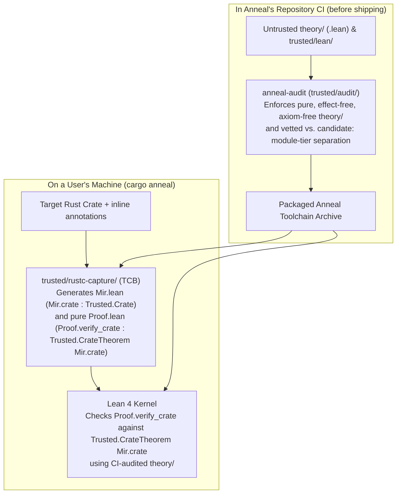

<!-- Copyright 2026 The Fuchsia Authors

Licensed under a BSD-style license <LICENSE-BSD>, Apache License, Version 2.0
<LICENSE-APACHE or https://www.apache.org/licenses/LICENSE-2.0>, or the MIT
license <LICENSE-MIT or https://opensource.org/licenses/MIT>, at your option.
This file may not be copied, modified, or distributed except according to
those terms. -->

# Trust Model and Boundary Enforcement

> **Note:** Anneal is under active development. Parts of the design and
> architecture described in this document are not yet implemented or may be
> implemented differently; this document may be aspirational or stale relative
> to the codebase.

[`META_PRINCIPLES.md`](../META_PRINCIPLES.md),
[`PRINCIPLES.md`](../PRINCIPLES.md), and [`THREAT_MODEL.md`](../THREAT_MODEL.md)
are the controlling documents for Anneal's correctness promise and threat
model: if the code in a verification result's Trusted Computing Base (TCB)
audit log is correct, its assumptions are valid, and Anneal emits no errors in
an uncompromised execution environment, then the verified code is sound and
satisfies any stated specifications.

A modern verification tool needs tens of thousands of lines of intermediate
representation (IR) lowering passes, weakest-precondition (WP) rules,
separation-logic lemmas, and proof automation—much of it written by untrusted
AI agents. To keep the human audit surface small, Anneal isolates all
first-party trusted code inside [`trusted/`](../trusted) and places all
lowering passes, program logics, and tactics outside the TCB in `theory/`. To
ensure that adversarial or buggy code in `theory/` cannot use side effects, OS
APIs, or custom axioms to undermine the guarantees established by `trusted/`,
Anneal runs a standalone boundary auditor ([`trusted/audit/`](../trusted/audit))
**in Anneal's own repository CI**.

For related architectural details, see:

- [`docs/design.md`](design.md) for an overview of Anneal's verification
  workflow and specification modes.
- [`docs/architecture.md`](architecture.md) for the three-stage MIR pipeline
  and how untrusted lowering passes in `theory/` connect to `trusted/lean/`.

## 1. The `trusted/` boundary and how verification stays sound

Anneal divides its repository into three active zones with strictly separated
roles, augmented by planned Pass 2 zones (`trusted/correspondence/` and
`correspondence/`) for the full MIR correspondence audit (see
[`docs/architecture.md`](architecture.md) and
[`docs/mir-correspondence-design.md`](mir-correspondence-design.md)):

| Zone | Directory | Role | Trust status |
| :--- | :--- | :--- | :--- |
| **Trusted foundation** | [`trusted/`](../trusted) (plus planned `trusted/correspondence/`) | Extracts MIR and emits pure proof scripts (`trusted/rustc-capture/`), defines captured MIR syntax and verification operational semantics (`trusted/lean/`), orchestrates CLI invocation (`trusted/cargo-anneal/`), audits the Anneal repository in CI (`trusted/audit/`), and—in planned Pass 2—states MIR correspondence claims and reference-adapter specifications (`trusted/correspondence/`). | **In the TCB.** Audited by humans (alongside external files pinned by hash manifests inside `trusted/`). |
| **Proof theory** (and planned **correspondence proofs**) | `theory/` (and planned `correspondence/`) | Defines the normalized `StableAst`, proves lowering passes (`Abstracts`), provides WP calculi, separation logic, and proof tactics invoked by generated proof scripts (`theory/`), and—in planned Pass 2—proves the MIR correspondence theorems and canaries (`correspondence/`, CI-only and never shipped in the user toolchain archive). | **Outside the TCB.** Treated as potentially adversarial; audited mechanically in Anneal's CI via syntactic preflight and Lean 4 kernel replay. |
| **Vendored reference model** | `vendor/lean-miri/` | Pinned snapshot of `proofs-rs/lean-miri` (plus any human-audited local delta) serving as the MIR correspondence reference model in repository CI. Never shipped in the user toolchain archive. | **In the correspondence TCB (Pass 2 / Phase 3).** Exempt from `theory/` syntactic preflight because upstream contains compile-time metaprograms and `partial` definitions; pinned byte-for-byte in `vendor/lean-miri/UPSTREAM_PIN.json` (locked by SHA-256 in `trusted/audit/`), with 10 `Miri/Interpreter/*.lean` files carrying Anneal's human-audited opt-in `deinitMovedPlace` patch pinned in `patched_files` and `LOCKED_PATCHED_MIRI_FILES`; admitted by human semantic and compile-time review of upstream pin diffs and local patches, OS-sandboxed cold compilation, standalone kernel replay of every non-`isPartial` declaration across the 160-module `Miri.Interpreter.ExecutionMachine` slice, and execution-cone purity checks. |

### How CI auditing and user-machine verification fit together

A key design question is how Anneal guarantees soundness without requiring a
human to audit `theory/` and without running a heavy repository auditor on
every user's machine.

Anneal splits the enforcement across **Anneal's repository CI** and **the
user's machine**:

1. **On the user's machine (`trusted/rustc-capture/` + Lean 4 kernel):**
   - Users do not write raw Lean files that could spoof the theorem statement or
     introduce `sorry`. Instead, users annotate their Rust source code, and
     `trusted/rustc-capture/` (which is part of the human-audited TCB)
     deterministically generates both `Mir.lean` (defining
     `Mir.crate : Trusted.Crate`) and `Proof.lean` (a pure proof script that
     states `theorem Proof.verify_crate : Trusted.CrateTheorem Mir.crate` and
     calls into `theory/` to prove it).
   - Because `trusted/rustc-capture/` generates `Mir.lean` and `Proof.lean`
     directly, the theorem *statement* (`ConstantInfo.type`) is guaranteed to
     be `Trusted.CrateTheorem Mir.crate` over the extracted crate, and
     `Proof.lean` is guaranteed to contain no axioms or effectful code.
   - The Lean 4 kernel on the user's machine then typechecks `Proof.lean`,
     verifying that the proof term (`ConstantInfo.value?`) constructed by
     `theory/` is a valid proof of `Trusted.CrateTheorem Mir.crate`.
2. **In Anneal's repository CI (`trusted/audit/`):**
   - For the Lean 4 kernel check on the user's machine to be sufficient, the
     `theory/` library shipped with Anneal must not be able to cheat the kernel
     or subvert the host process when `lean` imports and elaborates `theory/`.
   - In raw Lean 4, an unrestricted `.lean` file in `theory/` could execute
     arbitrary OS and filesystem operations during elaboration (`#eval`,
     `run_cmd`, `initialize`), attach compiler overrides (`@[implemented_by]`,
     `@[extern]`, `@[csimp]`), introduce custom `axiom`s or `sorryAx`, or
     inject spoofed definitions into the `Trusted` namespace. Similarly, a Rust
     crate outside `trusted/` could run arbitrary code via `build.rs` or
     procedural macros.
   - Therefore, **Anneal's CI runs `anneal-audit` (`trusted/audit/`)** on the
     Anneal repository before any commit can merge or be packaged into the
     toolchain archive. `anneal-audit` does **not** run on a user's machine; its
     job is to verify in CI that all first-party Lean code outside `trusted/`
     (`theory/`, and planned Pass 2 `correspondence/`) is pure, effect-free, and
     within the locked foundation axiom allowlist (and that no Rust crate
     resides outside `trusted/`). Vendored reference-model sources under
     `vendor/lean-miri/` are never packaged into the user toolchain archive and
     are admitted under Phase 3 (rather than Phase 1 syntactic preflight) by
     content-addressed SHA-256 pinning, human semantic and compile-time review
     of upstream pin diffs and local patches, standalone kernel replay, and
     cone-purity enforcement (to be joined by planned Pass 2 correspondence
     proofs and archive-bound correspondence provenance verification).

### Statement-Origin Separation (`ConstantInfo.type` vs. `ConstantInfo.value?`)

Within the Lean 4 kernel environment, every compiled theorem
(`ConstantInfo.thmInfo`) has two distinct components:

- **The theorem statement (`ConstantInfo.type`):** The proposition claiming
  *what* holds.
- **The proof term (`ConstantInfo.value?`):** The lambda term explaining *why*
  that proposition holds.

Anneal's architecture enforces **Statement-Origin Separation** between the two:

- Every constant referenced in the *statement* (`ConstantInfo.type`) of
  `Trusted.CrateTheorem Mir.crate` originates in `Trusted.*` (or the allowlisted
  Lean `Init.*` foundation) and the generated `Mir.crate`. No definition from
  `theory/` ever appears in the theorem statement.
- Declarations from `theory/` appear only inside the *proof term*
  (`ConstantInfo.value?`). Because `anneal-audit` verifies in CI that `theory/`
  is pure, effect-free, and free of custom axioms, and the Lean 4 kernel checks
  that `ConstantInfo.value?` inhabits `ConstantInfo.type`, `theory/` can supply
  arbitrarily rich lowering passes and tactics without being able to weaken the
  theorem statement.

### Staging TCB changes (`vetted` vs. `candidate:<feature>` modules)

Auditing a new semantic rule in `trusted/lean/` to full TCB standards—including
line-by-line Rust Reference citations and human review—takes deliberate effort.
If `trusted/lean/` treated all merged code as equally trusted, contributors
would face an unproductive tradeoff when adding support for a new Rust feature:

- **Block downstream work:** Hold back the `trusted/lean/` definitions until
  full human auditing is complete, blocking contributors and agents from
  building the corresponding lowering passes and WP lemmas in `theory/` or
  testing the feature on real crates; or
- **Dilute the TCB guarantee:** Merge unreviewed definitions into
  `trusted/lean/` immediately, making it impossible to tell whether a
  verification result depends only on audited rules or also on work-in-progress
  semantics.

Anneal resolves this by assigning every module in `trusted/lean/` an explicit
module-level trust tier via a leading header comment directive:

- **`-- anneal-trust-tier: vetted`:** Modules whose definitions have completed
  full Rust Reference auditing.
- **`-- anneal-trust-tier: candidate:<feature>`:** Work-in-progress TCB modules
  belonging to a named subsystem feature `<feature>` (such as `refinement`,
  `step_result`, `memory`, `mir_ast`, `mir_semantics`, or `rustc_capture`) that
  have not yet completed human auditing.

Assigning trust tiers at the module boundary rather than via per-declaration
attributes keeps `trusted/lean/` completely free of custom attribute macros or
metaprogramming: every constant compiled into a `Trusted` module's `.olean`
file—including constructors, recursors (`rec`, `casesOn`), pattern matchers
(`match_1`), equational lemmas (`eq_1`), and `where`/`private` helpers—
automatically inherits its defining module's trust tier via
`Environment.getModuleIdxFor?`.

To prevent unreviewed candidate modules from contaminating audited definitions,
`TrustedBoundary.lean` enforces a strict one-way dependency rule across all
compiled constants: constants in a `vetted` module may reference only the
locked `Init.*` foundation and other `vetted` modules, never a
`candidate:<feature>` module.

## 2. Repository CI boundary enforcement (`anneal-audit`)

[`trusted/audit/`](../trusted/audit) implements the CI gatekeeper
(`anneal-audit` and
[`TrustedBoundary.lean`](../trusted/audit/TrustedBoundary.lean)) that audits
the Anneal repository. It classifies every module into a closed role partition—
the four-role `ModuleRole` (`.foundation`, `.trusted .vetted`,
`.trusted (.candidate f)`, `.theory`) in Phase 2, and the five-role
`CorrModuleRole` (`.foundation`, `.sysrootFoundation`, `.vendorMiri`,
`.trusted <tier>`, `.theory`) in Phase 3—and enforces its invariants across
three internal phases within an audit run (Phase 1 syntactic preflight, Phase 2
core kernel replay, and Phase 3 vendored `lean-miri` closure verification—run
unconditionally by `Checker::run` whenever `vendor/lean-miri/` is present until
the Pass 2 `--require-correspondence` split lands) over an isolated staging
directory; the governing Pass 2 correspondence controls (including remaining
planned items) are summarized below.

### Cargo workspace containment

Before inspecting Lean files, `anneal-audit` verifies the repository's root
manifests against [`root-manifest.sha256`](../trusted/root-manifest.sha256)
(`trusted/root-manifest.sha256`) and checks that every Cargo workspace member
and `path` dependency resides under `trusted/`. Because Rust code (including
`build.rs` scripts and proc-macros) is effectful and not checked by the Lean
kernel, no Rust crate is permitted outside `trusted/`.

### Phase 1: Syntactic source preflight (`--mode preflight`)

Before compiling any `.lean` file in `trusted/lean/` or `theory/`,
`anneal-audit` stages the source files into a private temporary directory,
verifies that no pre-existing `.olean` or `.ir` files exist in the source tree,
and parses every file using `Parser.parseHeader` and `Parser.parseCommand`
against the locked `Init.*` foundation parser environment (without invoking
Lean's Turing-complete elaborator). Rather than relying on an open-ended
blocklist of dangerous Lean features, `TrustedBoundary.lean` classifies each
source file into a `SourceRole` (`trusted (tier : TrustTier)` vs. `theory`) and
validates the module header and every top-level command in a single top-down
traversal (`inspectSyntax` and `inspectNodeKind`) against a closed, role-aware
`SyntaxNodeKind` allowlist:

- **`SourceRole.trusted` (`trusted/lean/`):** Restricted to
  `allowedTrustedSyntaxKinds`—pure declarations, types, and term-mode proofs
  only, excluding `byTactic` and all tactic syntax so TCB specifications remain
  direct, tactic-free definitions—and required to carry exactly one valid
  `-- anneal-trust-tier: vetted` or `-- anneal-trust-tier: candidate:<feature>`
  directive.
- **`SourceRole.theory` (`theory/`):** Restricted to
  `allowedTheorySyntaxKinds`, which extends `allowedTrustedSyntaxKinds` with a
  closed allowlist of pure proof tactics (`allowedTheoryTacticKinds`) while
  rejecting trust-tier directives and any unallowlisted syntax node, command,
  modifier, attribute, or tactic configuration (excluding `unsafe`, `partial`,
  `noncomputable section`, `meta`, `axiom`, `macro`, `syntax`, `elab`, `sorry`,
  `native_decide`, `decide!`, `bv_decide`, `rfl'`, `grind`, tactic `configItem`
  flags such as `+native` and `+kernel`, `by_elab`, `run_tac`, `#eval`,
  `include_str`, `set_option`, `@[implemented_by]`, `@[extern]`, `@[csimp]`,
  and `initialize` hooks; `noncomputable` declaration modifiers are admitted
  mechanically by `allowedCommandSyntaxKinds`, while repository policy keeps
  `theory/` free of `noncomputable` definitions).

### Phase 2: Standalone kernel replay and DAG audit (`--mode audit`)

After compiling the staged `.lean` modules synchronously with kernel checking
enabled (`-t0 -DElab.async=false -Ddebug.skipKernelTC=false`), `anneal-audit`
loads the resulting `.olean` files with `trustLevel := 0`, `plugins := #[]`,
and `loadExts := false` (so no `[init]` initializers or persistent environment
extensions from audited modules are deserialized or executed) and performs a
full kernel-level audit:

1. **Module, namespace, and axiom verification (`verifyAndCollectLocals`):**
   Verifies that only allowlisted modules are loaded; that every constant's
   recorded module origin (`env.getModuleIdxFor?`) matches its module's
   `ModuleRole`; that non-`Trusted` modules declare no constants in the
   `Trusted` root namespace (`(privateToUserName ci.name).getRoot == `Trusted`)
   and no `opaque` definitions; that no non-foundation declaration in
   `Trusted.*` or `theory/` is `unsafe`, `partial`, an `axiom`, or a quotient
   primitive (`.quotInfo`); and that the transitive dependency closure reaches
   only the locked foundation axiom allowlist
   (`{Classical.choice, Quot.sound, propext}`).
2. **Origin and trust-tier separation (`checkTierReferences`):** Traverses
   every kernel dependency edge `c → dep` (`declarationEdges`) across all
   `Trusted.*` constants and enforces two rules:
   - **Origin rule:** A `.trusted _` constant may reference only `.foundation`
     or `.trusted _` constants (never `.theory`).
   - **Vetted rule:** A `.trusted .vetted` constant may reference only
     `.foundation` or `.trusted .vetted` constants (never
     `.trusted (.candidate _)`).
3. **Fresh kernel replay (`base.toKernelEnv.replay locals`):** Finally,
   `TrustedBoundary.lean` constructs a clean kernel environment containing only
   the pinned `Init.*` foundation (`base`) and replays every non-foundation
   constant (`Trusted.*` and `theory/`) through the standalone Lean 4 kernel
   typechecker from scratch.

### Phase 3: Vendored `lean-miri` verification (`--mode correspondence-audit`)

Whenever `vendor/lean-miri/` is present, `anneal-audit` verifies the vendored
reference model before succeeding:

1. **Pin and sysroot authentication (`verify_upstream_pin`,
   `ensure_sysroot_foundation`):** `trusted/audit` hashes
   `vendor/lean-miri/UPSTREAM_PIN.json` against `LOCKED_UPSTREAM_PIN_SHA256`,
   verifies its `commit` against `LOCKED_MIRI_COMMIT`, `build_lean_toolchain`
   against Anneal's locked `leanprover/lean4:v4.34.1`, and `patched_files`
   against `LOCKED_PATCHED_MIRI_FILES`. It verifies all 616 vendored files
   (608 `.lean` files in `vendor_tree`, including `Miri.Input.NativeMathHost`,
   plus 8 auxiliary files in `vendor_aux_files`) and `UPSTREAM_PIN.json` itself
   against their SHA-256 digests (rejecting symlinks, missing or unlisted files,
   and pre-existing `.olean`/`.ir` artifacts); `Miri.Input.NativeMathHost` is
   excluded only from the 160-module compiled `execution_machine_closure`.
   Before any vendor module is compiled, `anneal-audit` also authenticates the
   pinned Lean toolchain's `Init`/`Std`/`Lean` `.olean` companions against
   `LOCKED_SYSROOT_FOUNDATION_MANIFEST_SHA256`. Note that upstream
   `proofs-rs/lean-miri` targets `leanprover/lean4:v4.35.0`
   (`upstream_lean_toolchain`), whereas Anneal compiles and pins `.olean`
   digests under its locked `leanprover/lean4:v4.34.1` (`build_lean_toolchain`):
   upstream's `v4.35.0` test results therefore do not automatically carry over
   to Anneal's `v4.34.1` build, and correspondence proofs must validate
   reference-model behavior under the `v4.34.1` toolchain.
2. **Digest-gated cache restore or OS-sandboxed cold compilation:** Every
   closure source file is staged and re-hashed against its pinned SHA-256
   digest before use. For each of the 160 modules in
   `execution_machine_closure`, `anneal-audit` either restores `.olean`
   companions from `--miri-cache-dir` (or `ANNEAL_MIRI_CACHE_DIR`) after
   verifying their SHA-256 digests against `UPSTREAM_PIN.json` (and rejecting
   symlinks) or compiles the staged source synchronously with
   `-t0 -DElab.async=false -Ddebug.skipKernelTC=false` inside a per-module
   OS-level sandbox. On Linux (including CI `ubuntu-latest`), cold vendor
   compilation invokes `/usr/bin/bwrap` (`bubblewrap`) with
   `--unshare-all --die-with-parent --new-session --clearenv --tmpfs /` so
   unpreflighted compile-time metaprograms (`run_cmd`, `initialize`, custom
   `elab`s) run in isolated user, mount, PID, IPC, UTS, and network namespaces
   with zero credentials, zero network access, read-only toolchain/source/
   `miri-lib` mounts, no access to the checkout, `$HOME`, cache, or auditor
   staging root, and writes confined strictly to an isolated owner-only
   per-module output directory (`/work/out`); platforms without a supported OS
   sandbox fail closed on cold vendor compilation. Before staging any output
   into `miri-lib` or writing back to the cache, the outer auditor rejects any
   symlink, unexpected file, or unexpected directory in `/work/out` and
   verifies every `.olean`, `.olean.server`, and `.olean.private` SHA-256
   digest against `UPSTREAM_PIN.json` (write-after-verify).
   `--miri-cache-dir` (and `ANNEAL_MIRI_CACHE_DIR`) **must reside outside the
   repository checkout**; `anneal-audit` rejects any path inside the checkout
   (lexically or after resolving symlinks) as a policy error so a PR cannot
   commit pre-built `.olean` files to satisfy cache hits. A digest-matching
   cache hit skips only re-elaborating the pinned `.lean` source; it does
   **not** skip kernel typechecking, because step 3 below unconditionally runs
   full standalone kernel replay over all 160 vendored closure modules on every
   run (cold build and warm cache hit alike). In CI, the cache lives in
   `${{ runner.temp }}/anneal-miri-olean-cache` keyed on
   `trusted/lean/lean-toolchain` and `vendor/lean-miri/UPSTREAM_PIN.json` (so pin
   or toolchain updates automatically miss and compile cold inside `bwrap`),
   and merge-queue (`merge_group`), `main`-branch (`push`), and manual
   `workflow_dispatch` runs skip the cache action and omit `--miri-cache-dir`
   so every landed or manually dispatched revision performs a cold,
   OS-sandboxed from-source build as well as standalone kernel replay.
3. **Standalone vendor kernel replay and dependency-cone audit
   (`auditCorrespondence`):** Unlike `trusted/lean/` and `theory/`, vendored
   `Miri.*` sources are **not** passed through Phase 1 syntactic preflight:
   upstream `Miri.Input.*` and proof helpers contain compile-time metaprograms
   (`run_cmd`, `initialize`), custom tactic `elab`s, and 24 `partial def`s that
   execute during cold Phase 3 builds inside the per-module OS sandbox. The
   SHA-256 `UPSTREAM_PIN.json` pin and `patched_files` allowlist in
   `trusted/audit/` authenticate the exact source bytes, the OS sandbox
   confines compile-time side effects, and human review of the pinned vendored
   and patched compile-time code—and of the resolved old-to-new reference-model
   semantic diff on any pin update—guards against malicious metaprograms and
   upstream semantic regressions (consistent with
   [`THREAT_MODEL.md`](../THREAT_MODEL.md) Section 2.1).
   To eliminate both any `.olean` cache-hit kernel trust assumption and any
   scoped `set_option debug.skipKernelTC true` bypass inside a vendored or
   patched `.lean` file (which overrides CLI `-Ddebug.skipKernelTC=false`
   during elaboration), `TrustedBoundary.lean` loads the verified `.olean`
   closure with `trustLevel := 0`, `plugins := #[]`, and `loadExts := false`,
   verifies module classification (`classifyCorrModules`), enforces inventory
   and origin integrity across `.vendorMiri`, `.trusted`, and `.theory`
   declarations, rejects any `.vendorMiri` or `.sysrootFoundation` declaration
   in the reserved `Trusted` or `Anneal` namespaces, and rejects any `axiom`
   (including stripped-body declarations), `unsafe` declaration, quotient
   primitive, direct `sorryAx` reference, or direct compiler-reflection
   primitive (`Lean.ofReduceBool`, `Lean.ofReduceNat`, `Lean.trustCompiler`,
   `Lean.reduceBool`, `Lean.reduceNat`) across all 160 `.vendorMiri` modules
   (`verifyAndCollectCorrLocals`). After enforcing trust-tier separation
   (`checkCorrTierReferences`), it resets the Lean search path strictly to the
   authenticated sysroot, constructs a clean `baseEnv` containing only the
   authenticated `.foundation` and `.sysrootFoundation` modules (`trustLevel :=
   0`, `plugins := #[]`, `loadExts := false`), and replays every non-`isPartial`
   declaration in the 160 compiled vendored modules (38,728 declarations,
   including all 27 `.opaqueInfo` declarations) from scratch through the
   standalone Lean kernel (`baseEnv.toKernelEnv.replay vendorReplayLocals`) on
   every run—cold build and warm cache hit alike. The 75 compiler-generated
   `isPartial` (`*._unsafe_rec`) runtime codegen helpers are omitted from the
   replay map (matching `Kernel.Environment.replay`), so any reference to them
   from a replayed declaration fails replay with `unknown constant`. Finally,
   `verifyMiriExecutionMachineCone` (`closureCorr`) traverses from its 21 cone
   roots to reject any reachable `unsafe` or `isPartial` constant, any
   reachable `.vendorMiri` `.opaqueInfo` constant (which rejects vendored
   `Miri.*` `partial def`s, as Lean elaborates `partial def` into an `opaque`
   constant), and any unapproved axiom (while permitting `opaque`
   constants—including toolchain `partial def`s—from the pinned toolchain's
   `.foundation` and `.sysrootFoundation` modules).

### Pass 2 governance and remaining correspondence controls (`trusted/correspondence/` and `correspondence/`)

To mechanically anchor `Trusted.MirSemantics` against `vendor/lean-miri/`
without expanding the user-machine TCB or weakening Pass 1's pure `theory/`
gate, Anneal's complete Pass 2 correspondence audit (detailed in
[`docs/architecture.md`](architecture.md) and
[`docs/mir-correspondence-design.md`](mir-correspondence-design.md)) governs
five controls—combining the active Phase 3 vendor controls above with remaining
planned controls tracked for follow-up PRs:

1. **Content-addressed vendor pinning, semantic diff review, OS-level
   candidate sandboxing, and source-to-`.olean` provenance binding:** Pin
   authentication, sysroot locking, external `.olean` caching, OS-level
   `bwrap` process sandboxing of cold vendor elaboration (with fail-closed
   isolation on platforms without bubblewrap), and cold builds on
   `merge_group`, `push` to `main`, `workflow_dispatch`, and
   `UPSTREAM_PIN.json`/`lean-toolchain` changes are active in Phase 3 above.
   Every future `vendor/lean-miri/` pin update must expose and receive human
   semantic review of the resolved old-to-new reference-model diff—not only
   compile-time metaprograms and local patches—so pure, well-typed upstream
   semantic regressions (such as removed UB checks or miscomputed operations)
   cannot pass silently through hash checks and kernel replay. Any future Pass
   2 preflight or build step that executes vendored metaprograms must likewise
   remain confined to an OS-level isolated sandbox with no credentials or
   writable access to the repository worktree, home directory, or auditor
   state (restricting writes strictly to an isolated build output directory,
   after which the outer auditor checks `.olean` SHA-256 digests and runs
   standalone kernel replay in a separate `loadExts := false` process).
2. **Pass 2 syntactic preflight and isolation *(planned)*:** Before compiling
   `trusted/correspondence/` or `correspondence/`, `anneal-audit` will run
   syntactic preflight on both first-party directories—requiring
   `trusted/correspondence/` to follow trusted declaration rules and restricting
   `correspondence/` to pure, effect-free proof syntax while preventing
   untrusted declarations from injecting into `Trusted.*` or `Miri.*` or
   importing scoped metaprogramming extensions.
3. **Standalone vendor and correspondence kernel replay plus cone purity:**
   Standalone vendor kernel replay and 21-root `ExecutionMachine` cone purity
   are active in Phase 3 above; extending standalone replay and cone purity to
   `trusted/correspondence/` and `correspondence/` lands with the
   correspondence proofs.
4. **Correspondence witness locks and evaluator independence *(planned)*:**
   `anneal-audit` will mechanically verify that every required correspondence,
   fault-equivalence, wiring, and canary claim in `trusted/correspondence/` is
   inhabited by a universe-monomorphic theorem in `correspondence/` with the
   exact expected kernel type and required constants. To prevent a shared
   helper bug or narrowing from making both models silently agree on
   `unsupported`, `anneal-audit` will check that the reference evaluator and
   staged support gate depend on the expected `Miri.*` primitives and reject
   dependencies from them into the entire Anneal execution and support-rule
   cone (permitting only explicitly allowlisted shared boundary data types such
   as AST, value, query, and behavior types).
5. **Archive-embedded correspondence provenance and fail-closed digest
   verification *(planned)*:** To uphold [`THREAT_MODEL.md`](../THREAT_MODEL.md)'s
   bounded human-review guarantee without shipping `vendor/lean-miri/` or
   `correspondence/` in user toolchain archives, every packaged user toolchain
   archive and `cargo-anneal` bundle will embed a compact, CI-checked,
   digest-bound **correspondence provenance record** (pinned Anneal revision,
   `trusted/lean/` source and `.olean` digests, `vendor/lean-miri/` upstream
   commit, `UPSTREAM_PIN.json` SHA-256, `patched_files` allowlist and digests,
   `Trusted/Correspondence.lean` digest, and Pass 2 attestation metadata).
   Archive construction and `cargo anneal verify` will hash the actual packaged
   `trusted/lean/` artifacts and fail closed unless those computed digests
   exactly match the attested provenance record (as well as failing closed if
   the embedded provenance is missing or malformed), and `cargo anneal verify`
   will surface the verified provenance record in every verification result's
   TCB audit log so an auditor inspecting only stated specifications and the
   TCB audit log can identify and audit every certifying Pass 2 artifact.

Introducing `vendor/lean-miri/` and (later) `correspondence/` into the
repository—and later treating Pass 2 correspondence certification as a
substitute for human semantic audit of `initState` and `evalStep` inside
`trusted/lean/` (which otherwise remains governed by standard `trusted/lean/`
semantic-review rules)—requires updating `AGENTS.md`, `.gemini/styleguide.md`,
and `skills/trust-review/SKILL.md` in lockstep with `trusted/audit/` so
code-review and TCB rules reflect both the active Pass 2 roots and the exact
boundary between human-audited definitions and Pass 2-certified step rules.

### Including external files in the `trusted/` boundary via hashes

The invariant of [`trusted/`](../trusted) is that an auditor only needs to
inspect `trusted/` to verify that Anneal upholds
[`META_PRINCIPLES.md`](../META_PRINCIPLES.md),
[`PRINCIPLES.md`](../PRINCIPLES.md), and
[`THREAT_MODEL.md`](../THREAT_MODEL.md). However, some files that belong to the
effective TCB cannot practically reside inside the `trusted/` subdirectory:

- Standard tooling expects workspace and environment manifests (`Cargo.toml`,
  `Cargo.lock`, `flake.nix`, and `flake.lock`) to sit at the current verifier's workspace root;
  moving them into `trusted/` would require symlinks or custom wrapper flags
  for every Cargo and Nix command.
- Pre-built upstream toolchain artifacts (the `lean` binary and its
  `Init`/`Std`/`Lean` sysroot `.olean` artifacts) live outside the repository
  altogether.

To include these files in `trusted/`'s effective TCB without relocating them,
`trusted/` stores their SHA-256 digests in checked-in lock manifests:

- **[`trusted/root-manifest.sha256`](../trusted/root-manifest.sha256):** Pins
  the SHA-256 digests of the repository's root build files (`Cargo.toml`,
  `Cargo.lock`, `flake.nix`, and `flake.lock`), verified by CI and
  `anneal-audit`.
- **[`foundation-lock.json`](../trusted/lean/foundation-lock.json)**
  (`trusted/lean/foundation-lock.json`): Pins the SHA-256 digests of the `lean`
  executable and all `Init.*` prelude source and `.olean` companion files,
  verified by both the Nix toolchain build (`flake.nix`) and `anneal-audit`.
- **`LOCKED_SYSROOT_FOUNDATION_MANIFEST_SHA256`** (in
  [`trusted/audit/src/lib.rs`](../trusted/audit/src/lib.rs)): Pins the SHA-256
  manifest digest over all `Init`/`Std`/`Lean` `.olean`, `.olean.server`, and
  `.olean.private` sysroot companions loaded during Phase 3 correspondence
  auditing, and must be updated alongside `foundation-lock.json` and
  `UPSTREAM_PIN.json` (plus `LOCKED_UPSTREAM_PIN_SHA256`) on any Lean toolchain
  bump.
- **[`UPSTREAM_PIN.json`](../vendor/lean-miri/UPSTREAM_PIN.json)**
  (`vendor/lean-miri/UPSTREAM_PIN.json`):
  Pins the upstream commit and SHA-256 digest of every file in
  `vendor/lean-miri/` (together with any consumer-side patch records and the
  160-module `Miri.Interpreter.ExecutionMachine` slice), verified against
  `LOCKED_UPSTREAM_PIN_SHA256` inside `trusted/audit/src/lib.rs`. After the
  unmodified initial vendor import, 10 `Miri/Interpreter/*.lean` files carry
  Anneal's human-audited opt-in `deinitMovedPlace` patch, pinned by explicit
  `upstream_sha256`/`patched_sha256` records in `patched_files` and the closed
  `LOCKED_PATCHED_MIRI_FILES` allowlist.

Because CI and `anneal-audit` reject any mismatch against these files, changing
a root manifest or toolchain artifact requires a corresponding diff inside
`trusted/`, ensuring an auditor inspecting `trusted/` sees every change to the
effective TCB.

## 3. External dependencies and commenting in `trusted/`

Because every file in [`trusted/`](../trusted) must be auditable by humans,
Anneal optimizes `trusted/` for **human comprehension and review accuracy**, not
merely minimum dependency count:

- **Standard libraries over hand-rolled plumbing:** `trusted/` uses widely
  audited Rust ecosystem crates (such as `serde`, `clap`, and `sha2`, all
  pinned with SHA-256 checksums in `Cargo.lock`) for generic utilities like
  serialization, CLI parsing, and hashing. Hand-rolling bespoke parsers or
  cryptographic primitives inside `trusted/` would add hundreds of lines of
  security-critical code and increase audit burden.
- **Mandatory provenance citations:** Any code in `trusted/` that models Rust
  semantics or extracts `rustc` internal structures must explain the
  correspondence in its comments and both quote and cite the relevant Rust
  Reference section (`rust-lang/reference`) or compiler source file
  (`rust-lang/rust`) at a pinned commit hash.

## Vendored source provenance

The [lean-miri provenance guide](lean-miri-provenance.md) locates
the upstream reference source and acquisition artifacts.
