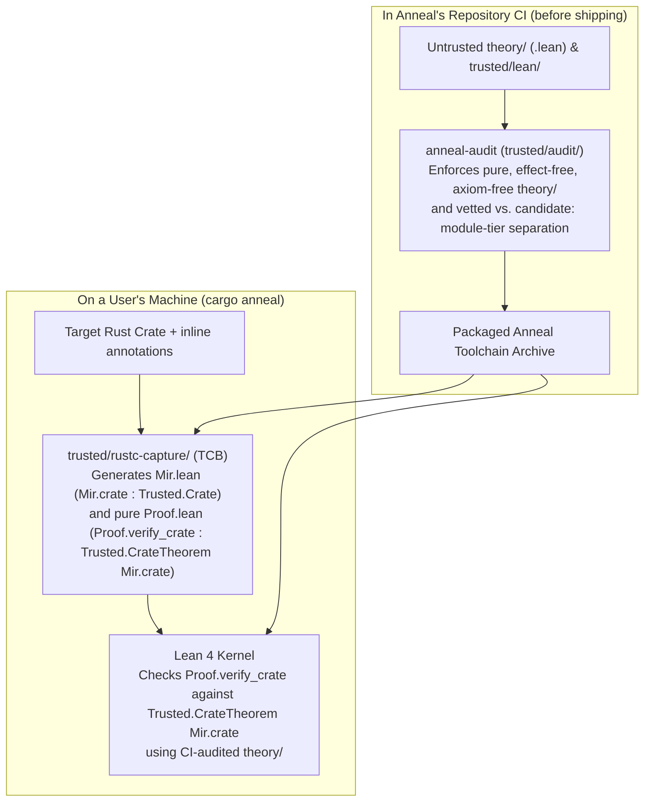

<!-- Copyright 2026 The Fuchsia Authors

Licensed under a BSD-style license <LICENSE-BSD>, Apache License, Version 2.0
<LICENSE-APACHE or https://www.apache.org/licenses/LICENSE-2.0>, or the MIT
license <LICENSE-MIT or https://opensource.org/licenses/MIT>, at your option.
This file may not be copied, modified, or distributed except according to
those terms. -->

# Trust Model and Boundary Enforcement

> **Note:** Anneal is under active development. Parts of the design and
> architecture described in this document are not yet implemented or may be
> implemented differently; this document may be aspirational or stale relative
> to the codebase.

[`META_PRINCIPLES.md`](../META_PRINCIPLES.md),
[`PRINCIPLES.md`](../PRINCIPLES.md), and [`THREAT_MODEL.md`](../THREAT_MODEL.md)
are the controlling documents for Anneal's correctness promise and threat
model: if the code in a verification result's Trusted Computing Base (TCB)
audit log is correct, its assumptions are valid, and Anneal emits no errors in
an uncompromised execution environment, then the verified code is sound and
satisfies any stated specifications.

A modern verification tool needs tens of thousands of lines of intermediate
representation (IR) lowering passes, weakest-precondition (WP) rules,
correspondence proofs, separation-logic lemmas, and proof automation—much of
it written by untrusted AI agents. To keep the human audit surface small,
Anneal isolates all first-party trusted code inside [`trusted/`](../trusted)
and places all lowering passes, program logics, tactics, and correspondence
proofs outside the TCB in `theory/` and `correspondence/`. To ensure that
adversarial or buggy code in `theory/` or `correspondence/` cannot use side
effects, OS APIs, or custom axioms to undermine the guarantees established by
`trusted/`, Anneal runs a standalone boundary auditor
([`trusted/audit/`](../trusted/audit)) **in Anneal's own repository CI**.

For related architectural details, see:

- [`docs/design.md`](design.md) for an overview of Anneal's verification
  workflow and specification modes.
- [`docs/architecture.md`](architecture.md) for the three-stage MIR pipeline
  and how untrusted lowering passes in `theory/` connect to `trusted/lean/`.
- [`docs/mir-correspondence-design.md`](mir-correspondence-design.md) for how
  Pass 2 anchors `Trusted.MirSemantics` against `vendor/lean-miri/`.
- [`docs/elaborator-containment-design.md`](elaborator-containment-design.md)
  for target `ExecSeal` containment, `"spec-preflight"` admission, two-phase
  `"target-audit"` replay, and Receipt Schema v3 taint accounting.

## 1. The `trusted/` boundary and how verification stays sound

The [correctness promise](../PRINCIPLES.md#anneals-promise-to-its-users)
defines the contract a verification result must meet. The result asserts
that its TCB satisfies its trust policy. It also asserts that the covered
code is free of undefined behavior and satisfies its stated specifications
if the trusted code is correct and the logged assumptions are jointly valid.

First-party verifier code on which those assertions rely without checked
evidence belongs in `trusted/`. The build manifests and external toolchain
inputs are pinned. The repository audit also relies on reviewed enforcement
code in `ci/` and the
[`ci-core` check graph](../../ci/checks.toml).
The vendored reference model and its replay support the correspondence audit.

The current workspace divides verification, test, tool, and audit code into
five zones.

| Zone | Directory | Role | Trust status |
| :--- | :--- | :--- | :--- |
| **Trusted foundation** | [`trusted/`](../trusted) | Extracts MIR and emits pure proof scripts (`trusted/rustc-capture/`), defines captured MIR syntax and verification operational semantics (`trusted/lean/`), states MIR correspondence claims and reference-adapter specifications (`trusted/correspondence/`), orchestrates CLI invocation (`trusted/cargo-anneal/`), and audits the Anneal repository in CI (`trusted/audit/`). | **In the TCB.** Audited by humans (alongside external files pinned by hash manifests inside `trusted/`). |
| **Integration test suites** | [`tests/`](../tests) | Hosts shared test scaffolding (`tests/testkit/`), workspace integration test suites and fixtures for `anneal-audit`, `cargo-anneal`, `anneal-rustc-capture`, and `anneal-differential-tests` (`tests/audit/`, `tests/cargo-anneal/`, `tests/rustc-capture/`, `tests/differential/`, `tests/corpora/differential/`), and the multi-call observable-trace differential fuzzer (`tests/itree_diff/`). | **Outside the production TCB.** Enforced as `publish = false` crates under the monotonic lattice (`trusted/` = zone 0 < `tests/` = zone 1 < `tools/` = zone 2: `tests/` may depend on `trusted/` or shared `tests/` helpers such as `tests/testkit/`, while `trusted/` may never depend on `tests/` or `tools/`) with no `build.rs` or proc-macros. |
| **Developer tools** | [`tools/`](../tools) | Hosts untrusted standalone developer tools such as [`tools/anneal-spec/`](../tools/anneal-spec) that lower Rust-syntax surface contracts into reviewable `Spec.lean` modules. | **Outside the TCB.** Enforced as `publish = false`, `build.rs`-free crates in zone 2 (`proc-macro` targets allowed here only; neither `trusted/` nor `tests/` may depend on `tools/`). |
| **Proof theory & correspondence** | `theory/`, `correspondence/` | Defines the normalized `StableAst`, proves lowering passes (`Abstracts`), provides WP calculi (`theory/Anneal/MirWp.lean`), separation logic, and proof tactics (`theory/`), and proves the MIR correspondence theorems and canaries (`correspondence/Anneal/MirCorrespondence*`, discharging locked `Trusted.Correspondence` claims, and the `10` unlocked MiniRust witness modules `correspondence/Anneal/MiniRust/*` + `MiniRustProof.lean`). | **Outside the TCB.** Treated as potentially adversarial; audited mechanically in Anneal's CI and checked by the Lean 4 kernel (`correspondence/` is checked by the `anneal-audit` correspondence stage in CI only, hashed into correspondence provenance, and excluded from the user toolchain archive; unlocked MiniRust claim statements in `correspondence/` have theorem-name, hygiene, and `SpecAnchor` checks in `ci/check_minirust_pin.py` and rely on `CODEOWNERS`-gated per-PR human review of statement bodies). |
| **Vendored reference models** | `vendor/lean-miri/`, `vendor/minirust/` | `vendor/lean-miri/` is a pinned snapshot of `proofs-rs/lean-miri` with a human-audited 10-file opt-in `deinitMovedPlace` delta and 3-file theorem-only memory specification patch ([#4009](https://github.com/google/zerocopy/issues/4009); [`docs/mir-correspondence-design.md`](mir-correspondence-design.md)); `vendor/minirust/` pins `30` upstream files (`27` `spec/**/*.md` specification files, `LICENSE-APACHE`, `LICENSE-MIT`, and `README.md`) at `minirust/minirust@d821c6e3a3d3`, linked by `58` `SpecAnchor` records in `correspondence/Anneal/MiniRust/Anchors.lean` (`ci/check_minirust_pin.py`). Never shipped in the user toolchain archive. | **In the correspondence TCB (`vendor/lean-miri/`) / pinned spec anchor (`vendor/minirust/`).** `vendor/lean-miri/UPSTREAM_PIN.json` is locked by `LOCKED_UPSTREAM_PIN_SHA256` and `LOCKED_PATCHED_MIRI_FILES` in `trusted/audit/`; its 160-module `Miri.Interpreter.ExecutionMachine` slice is compiled inside `bwrap`, verified by `.olean` SHA-256, and replayed from scratch through the standalone Lean 4 kernel (`toKernelEnv.replay`) onto the authenticated sysroot base, followed by replaying `Trusted.Correspondence*`, `Anneal.MirCorrespondence*`, and `Anneal.MiniRust*` (`Anneal.MiniRustProof`; `anneal-audit` permits `Classical.choice`, while local/manual `ci/check_minirust_pin.py --check-axioms` verifies `{propext, Quot.sound}` purity). |

### How CI auditing and user-machine verification fit together

A key design question is how Anneal guarantees soundness without requiring a
human to audit `theory/` and without running a heavy repository auditor on
every user's machine.

Anneal splits the enforcement across **Anneal's repository CI** and **the
user's machine**:

1. **On the user's machine (`trusted/rustc-capture/` + Lean 4 kernel):**
   - Users do not write raw Lean files that could spoof the theorem statement or
     introduce `sorry`. Instead, users annotate their Rust source code, and
     `trusted/rustc-capture/` (which is part of the human-audited TCB)
     deterministically generates both `Mir.lean` (defining
     `Mir.crate : Trusted.Crate`) and `Proof.lean` (a pure proof script that
     states `theorem Proof.verify_crate : Trusted.CrateTheorem Mir.crate` for
     whole-crate `.crate` captures, or the corresponding `Trusted.UnitTheorem`
     obligation for selected proof-unit `.unit` captures, and calls into
     `theory/` to prove it).
   - Because `trusted/rustc-capture/` generates `Mir.lean` and `Proof.lean`
     directly, the theorem *statement* (`ConstantInfo.type`) is guaranteed to
     be `Trusted.CrateTheorem Mir.crate` (or `Trusted.UnitTheorem Mir.crate`
     for `.unit` captures) over the extracted artifact, and `Proof.lean` is
     guaranteed to contain no axioms or effectful code.
   - When capture emits MIR Profile v2 (`mirProfileVersion = 2`, used for
     bodies with references, raw pointers, slices, or other Profile v2
     constructs), `cargo anneal verify` selects the Profile v2 roots instead:
     `Trusted.CrateTheoremV2` or `Trusted.UnitTheoremV2` over
     `Trusted.CrateV2` (captured program plus `Trusted.MirSemantics.SpecsV2`).
     They check the same scope condition but quantify over caller memory and
     use the Profile v2 rules (`initStateV2`, `evalStepV2`). The capture's
     profile version, not the authored proof package, chooses the root, and
     `targetAudit` accepts only these four canonical roots.
   - The Lean 4 kernel on the user's machine then typechecks `Proof.lean`,
     verifying that the proof term (`ConstantInfo.value?`) constructed by
     `theory/` is a valid proof of that trusted obligation.
2. **In Anneal's repository CI (`trusted/audit/`):**
   - For the Lean 4 kernel check on the user's machine to be sufficient, the
     `theory/` library shipped with Anneal must not be able to cheat the kernel
     or subvert the host process when `lean` imports and elaborates `theory/`.
   - In raw Lean 4, an unrestricted `.lean` file in `theory/` could execute
     arbitrary OS and filesystem operations during elaboration (`#eval`,
     `run_cmd`, `initialize`), attach compiler overrides (`@[implemented_by]`,
     `@[extern]`, `@[csimp]`), introduce custom `axiom`s or `sorryAx`, or
     inject spoofed definitions into the `Trusted` namespace. Similarly, a Rust
     crate outside `trusted/` could run arbitrary code via `build.rs` or
     procedural macros.
   - Therefore, **Anneal's CI runs `anneal-audit` (`trusted/audit/`)** on the
     Anneal repository before any commit can merge or be packaged into the
     toolchain archive. `anneal-audit` does **not** run on a user's machine; its
     job is to verify in CI that all first-party Lean code outside `trusted/`
     (`theory/` and `correspondence/`) is pure, effect-free, and within the
     locked foundation axiom allowlist (and that Cargo workspace crates reside
     only under `trusted/`, `tests/`, or `tools/` under the monotonic
     `zone(dst) <= zone(src)` boundary prohibiting `trusted/` ->
     `{tests/, tools/}` and `tests/` -> `tools/` dependencies). Vendored
     reference-model sources under `vendor/lean-miri/` are
     never packaged into the user toolchain archive and are admitted under Pass
     2 by content-addressed SHA-256 pinning, human semantic and compile-time
     review of upstream pin diffs and local patches, OS-sandboxed compilation
     and Pass 2 preflight, standalone kernel replay, and cone-purity
     enforcement, while `ci/` and `.github/` are human-audited CI configuration.

### Statement-Origin Separation (`ConstantInfo.type` vs. `ConstantInfo.value?`)

Within the Lean 4 kernel environment, every compiled theorem
(`ConstantInfo.thmInfo`) has two distinct components:

- **The theorem statement (`ConstantInfo.type`):** The proposition claiming
  *what* holds.
- **The proof term (`ConstantInfo.value?`):** The lambda term explaining *why*
  that proposition holds.

Anneal's architecture enforces **Statement-Origin Separation** between the two:

- Every constant referenced in the *statement* (`ConstantInfo.type`) of
  `Trusted.CrateTheorem Mir.crate` (or `Trusted.UnitTheorem Mir.crate`, or
  their Profile v2 counterparts `Trusted.CrateTheoremV2` and
  `Trusted.UnitTheoremV2` over `Trusted.CrateV2`)
  originates in `Trusted.*` (or the allowlisted Lean `Init.*` foundation) and
  the generated `Mir.crate`. No definition from `theory/` ever appears in the
  theorem statement.
- Declarations from `theory/` appear only inside the *proof term*
  (`ConstantInfo.value?`). Because `anneal-audit` verifies in CI that `theory/`
  is pure, effect-free, and free of custom axioms, and the Lean 4 kernel checks
  that `ConstantInfo.value?` inhabits `ConstantInfo.type`, `theory/` can supply
  arbitrarily rich lowering passes and tactics without being able to weaken the
  theorem statement.

### Profile-parametric verification envelopes (`Trusted.Framework`)

`Trusted.Framework` (`candidate:refinement`), `Trusted.Framework.Instances`,
and `Trusted.Framework.Bridge` (`candidate:mir_semantics`) wrap Anneal's outer
verification claim boundary without wrapping inner small-step execution rules:

- **`VerificationEnvelope` and `EnvelopeTheorem` (`Trusted.Framework`):**
  Provides a closed two-constructor envelope (`structured` via `mkEnvelope` and
  `legacy` via `mkLegacyEnvelope`) parameterized by `ExecutionModel`, binding
  `FnContract`, `AssumedStub` (`StubRealizable`, gated by
  `ExecutionModel.bodyIsExternal body = true` so captured local bodies can
  never be waived as assumed external callees), `RefutationEntry`,
  constructive parameter-domain non-vacuity (`NonVacuousEntry`), explicit
  3-bit `EffectMask` guarantees (no field defaults), `OracleGrade.licenses`
  claim-shape licensing, and explicit `DisclosedGap` accounting
  (`unbridgedSemantics`, `callerRawPtrAliasing`,
  `callerMemoryThreadIsolation`, `configuredReferenceScope`,
  `assumedExternalCallee`, `waivedInhabitation`, `selectedUnitScope`,
  `rawLegacySpec`, and `unverifiedDownstream`). `MirProfileV1` and
  `MirProfileV2` enforce `defaultMirDownstreamGaps` (`rustc_mir_opt`,
  `llvm_codegen`, `linker`, and `microarch_timing`) mechanically via
  `ExecutionModel.modelGaps` in `EnvelopeTheorem`. Receipt-level `assumptions`
  / `deferred` entries outside `DisclosedGap` carry the pinned capture
  environment and build-reproducibility provenance (toolchain, target, profile
  pinning, `rustc` frontend/MIR extraction fidelity, and audit-time-to-deploy
  drift; see [Capture profile and the binary
  seam](#capture-profile-and-the-binary-seam) below).
- **MIR instances & compatibility bridges (`Trusted.Framework.Instances` and
  `Trusted.Framework.Bridge`):** Instantiates `MirProfileV1`
  (`.biFaultEquiv "lean_miri_v1_deinit_moved_place"`, requiring
  `defaultMirDownstreamGaps` unconditionally and
  `.configuredReferenceScope "lean_miri_v1_deinit_moved_place"` whenever
  `existsWitness` is claimed because `Operand.move` deinitialization is a
  conservative over-approximation of upstream `rustc_const_eval` certified
  against the patched `deinitMovedPlace := true` reference) and `MirProfileV2`
  (`.unbridged "mir_profile_v2"`, requiring `defaultMirDownstreamGaps` and
  `.callerMemoryThreadIsolation` on every Profile v2 result plus
  `.callerRawPtrAliasing` on bodies with raw-pointer locals) over existing
  `WellFormed` / `WellFormedV2`, `Behavior` / `BehaviorV2`, and `Diverges` /
  `DivergesV2` (with `bodyIsExternal := fun _ => false` so every captured local
  MIR body in Profile v1 and Profile v2 must be verified or refuted rather than
  stubbed), exposes MIR entry aliases (`MirVerifiedEntry`, `MirAssumedStub`,
  `MirRefutationEntry`) used by `MirEnvelopeTheoremV1` and
  `MirEnvelopeTheoremV2`, defines `OracleCertificate` for offline Pass-2
  correspondence, and exposes model-pinned Pass-1 roots
  (`Trusted.MirEnvelopeTheoremV1`, `Trusted.MirEnvelopeTheoremV2`, and
  `@[reducible]` `CrateEnvelopeTheorem`, `UnitEnvelopeTheorem`,
  `CrateEnvelopeTheoremV2`, and `UnitEnvelopeTheoremV2` compatibility roots
  proved equivalent to `CrateTheorem`, `UnitTheorem`, `CrateTheoremV2`, and
  `UnitTheoremV2` in `Anneal.Framework`, with Pass-1 canaries audited in
  `Anneal.Framework.Canaries`). Every Pass-1 target verification root pins
  `ExecutionModel` inside `Trusted.*` (to `Trusted.Framework.MirProfileV1` or
  `Trusted.Framework.MirProfileV2`), and `Expected.lean` emission and
  `TrustedBoundary.lean` auditing must accept only those model-pinned roots so
  neither `Specification` nor `Proof` modules can supply a synthetic
  `ExecutionModel` or `VerificationEnvelope`.

### Staging TCB changes (`vetted` vs. `candidate:<feature>` modules)

Auditing a new semantic rule in `trusted/lean/` to full TCB standards—including
line-by-line Rust Reference citations and human review—takes deliberate effort.
If `trusted/lean/` treated all merged code as equally trusted, contributors
would face an unproductive tradeoff when adding support for a new Rust feature:

- **Block downstream work:** Hold back the `trusted/lean/` definitions until
  full human auditing is complete, blocking contributors and agents from
  building the corresponding lowering passes and WP lemmas in `theory/` or
  testing the feature on real crates; or
- **Dilute the TCB guarantee:** Merge unreviewed definitions into
  `trusted/lean/` immediately, making it impossible to tell whether a
  verification result depends only on audited rules or also on work-in-progress
  semantics.

Anneal resolves this by assigning every module in `trusted/lean/` an explicit
module-level trust tier via a leading header comment directive:

- **`-- anneal-trust-tier: vetted`:** Modules whose definitions have completed
  full Rust Reference auditing.
- **`-- anneal-trust-tier: candidate:<feature>`:** Work-in-progress TCB modules
  belonging to a named subsystem feature `<feature>` (such as `refinement`,
  `step_result`, `memory`, `mir_ast`, `mir_semantics`, or `rustc_capture`) that
  have not yet completed human auditing.

Assigning trust tiers at the module boundary rather than via per-declaration
attributes keeps `trusted/lean/` completely free of custom attribute macros or
metaprogramming: every constant compiled into a `Trusted` module's `.olean`
file—including constructors, recursors (`rec`, `casesOn`), pattern matchers
(`match_1`), equational lemmas (`eq_1`), and `where`/`private` helpers—
automatically inherits its defining module's trust tier via
`Environment.getModuleIdxFor?`.

To prevent unreviewed candidate modules from contaminating audited definitions,
`TrustedBoundary.lean` enforces a strict one-way dependency rule across both
Pass 1 (`RepoOrigin.edgeViolation?`) and Pass 2 (`CorrOrigin.edgeViolation?`):
constants in a `vetted` module may reference only the locked `Init.*`
foundation and other `vetted` modules, never a `candidate:<feature>`,
`vendorMiri`, or `sysrootFoundation` module.

### Capture profile and the binary seam

A verification result covers the MIR that `trusted/rustc-capture/` extracts
with the pinned toolchain under a fixed profile: `-Copt-level=0`,
`-Cdebug-assertions=no`, `-Coverflow-checks=no` (or `-Coverflow-checks=yes`
when the capture requests `--overflow-checks`), and `-Cpanic=unwind` (or
`-Cpanic=abort` when the capture requests `--panic abort`). Capture refuses any
compilation in which debug assertions are on, in which overflow checks disagree
with `--overflow-checks`, or in which `-Cpanic` disagrees with `--panic`. As a
result:

- `cfg(debug_assertions)` is false. Verified MIR contains no checks from
  `debug_assert!`, `debug_assert_eq!`, or `debug_assert_ne!`, and wherever
  code depends on `cfg(debug_assertions)`, capture sees the variant selected
  with debug assertions off.
- Without `--overflow-checks`, verified MIR contains none of the overflow
  checks that `-Coverflow-checks` controls (for `+`, `-`, `*`, unary negation,
  and shifts): those operations wrap, and shift amounts are masked. With
  `--overflow-checks`, each such operation is guarded by an overflow `Assert`.
  A failed check faults under `--panic unwind`, so a verified function never
  reaches one. Under `--panic abort` it aborts like the other safe panics,
  which a contract with `EffectMaskV2.noAbort` rules out.
- Under default `--panic unwind`, every failing `Assert` faults
  (`.unsupported` or `.undefined`), so a verified function never reaches a
  failing assertion. Under `--panic abort` (when the crate defines no
  crate-local `#[panic_handler]`), failing non-optional safe `Assert`s, and
  failing overflow checks under `--overflow-checks`, terminate as `.aborted`
  carrying post-mutation caller memory; this satisfies
  `WellFormed`/`BodyVerified`/`BodyVerifiedV2` without ruling out panics and
  leaves panic hooks and handlers (including downstream `#![no_std]` binary
  `#[panic_handler]`s) unverified. Proving panic-freedom under `--panic abort`
  requires an explicit `EffectMaskV2.noAbort` `SafeContractV2` obligation in
  `SpecsV2.property`.
- `cfg(miri)` is refused on every capture (both normal crates and
  `--stdlib-crate core`) so `#[cfg(miri)]` branches cannot substitute Miri-only
  implementations for compiled target code.
- Crate-level `#![feature(...)]` gates are enforced through a closed positive
  allowlist across three layers: pre-expansion active-attribute validation
  (preserving inactive `#![cfg_attr(..., feature(...))]` lines other than
  `rustc_private` while failing closed on active disallowed features),
  `-Zallow-features=...` at compiler invocation/validation, and post-analysis
  `tcx.features()` inspection covering unstable language features, unstable
  library features, and already-stabilized `ACCEPTED_LANG_FEATURES`. Normal
  crates admit the empty allowlist (`[]`, zero active unstable features)
  unless the operator names features with `--allow-unstable-feature`, which
  taints the receipt (`unmodeled_unstable_features`) because `rustc` cannot
  attribute a crate-level feature's effects to a selected unit;
  compiler-internal features, `ergonomic_clones`, and `rustc_private` stay
  refused regardless. Already-stabilized language features activate nothing
  unstable and are admitted untainted (recorded in
  `stabilized_features_present`). `--stdlib-crate core` admits only `core`'s
  version-pinned feature set.

The capture manifest's `configuration` records this profile (including `panic`
and `overflow_checks`), and `Captured.lean` records `Program.overflowChecks`,
`Program.panicStrategy`, and `Program.hasLocalPanicHandler`.

A production build of the same source can use different settings, such as
`-Cdebug-assertions=yes`, `-Coverflow-checks=yes` (Cargo's
`debug-assertions = true` and `overflow-checks = true`, both on in Cargo's
default `dev` profile), `-Cpanic=unwind` (Cargo's default panic strategy) when
capture used `--panic abort`, a higher optimization level, or a different
`rustc`. Such a build can compile a different program—or attach different
runtime behavior to the same panicking paths—than the one Anneal verified:

- With debug assertions on, `debug_assert!` and its variants become runtime
  checks that panic, and `cfg(debug_assertions)` can select different code,
  including entirely different function bodies.
- With overflow checks on, the compiler inserts overflow checks that panic,
  unless the capture also used `--overflow-checks`.
- With overflow checks off when capture used `--overflow-checks --panic abort`
  (without an explicit panic-freedom obligation such as
  `EffectMaskV2.noAbort`), an overflow that Anneal admitted as terminal
  `.aborted` instead wraps (shift amounts are masked) and execution
  continues, which the verified result does not describe. Cargo's default
  `release` profile turns overflow checks off. The same applies when a
  downstream crate built without overflow checks generates code for an
  `#[inline]` body that capture admitted.
- With `-Cpanic=unwind` in production when capture used `--panic abort`
  (without an explicit panic-freedom obligation such as
  `EffectMaskV2.noAbort`), failing non-optional safe assertions (and, under
  `--overflow-checks`, failing overflow checks) that Anneal admitted as
  terminal `.aborted` instead unwind across callers and run `Drop`
  glue, which Anneal does not model; `cfg(panic = ...)` can also select
  different code.

The production binary can therefore contain panic sites, unwinding paths, or
other code that the verified MIR does not cover, and the proof says nothing
about whether that code is reachable or how it behaves.

Anneal does not verify that the deployed binary corresponds to the captured
MIR. The receipt lists "faithful pinned compiler capture" among its
`assumptions` and "source-to-deployed-binary correspondence" under
`deferred`. Code built for production with debug assertions on, with overflow
checks on when capture ran without `--overflow-checks`, with overflow checks
off when capture ran with `--overflow-checks --panic abort`, or with
`-Cpanic=unwind` when capture ran with `--panic abort` (without an explicit
panic-freedom proof) should not treat a verification result as evidence that
those checks never fire, that overflows abort rather than wrap, that panics
abort rather than unwind, or as covering code that only such a build
compiles.

### Concurrency

Anneal's MIR semantics model a single thread of execution, with no other
threads, atomics, or weak-memory effects. Verification therefore assumes that
the memory the verified function touches is isolated from every other thread
while the function runs: no other thread writes memory that the function
reads or writes, or reads memory that the function writes, including memory
reachable from caller-provided arguments. This is stronger than data-race
freedom. A data-race-free program can still access that memory from another
thread through atomic operations or properly synchronized accesses while the
function runs, and the model does not cover such executions. A verification
result says nothing about behavior under concurrent access. Profile v1 admits
no reference or raw-pointer types, so its functions cannot receive
caller-provided memory. The experimental [Profile
v2](alpha.md#experimental-mir-profile-v2-borrowed-slices-and-raw-pointers) can:
its functions take reference and raw-pointer arguments into caller memory
(`callerMem`), so the assumption applies to every Profile v2 result.

## 2. Repository CI boundary enforcement (`anneal-audit`)

[`trusted/audit/`](../trusted/audit) implements the CI gatekeeper
(`anneal-audit` and
[`TrustedBoundary.lean`](../trusted/audit/TrustedBoundary.lean)) that audits
the Anneal repository over an isolated `0o700` staging directory. It enforces
the boundary controls detailed below across Pass 1 (core repository
`trusted/lean/` and `theory/`) and Pass 2 (vendored `lean-miri`,
`trusted/correspondence/`, and `correspondence/`).

The repository auditor and the target verifier share toolchain admission,
staging, and `ExecSeal` OS-sandboxing code
(`trusted/cargo-anneal/src/sandbox.rs`) in
[`trusted/cargo-anneal/`](../trusted/cargo-anneal) together with `ClaimAudit`
in [`TrustedBoundary.lean`](../trusted/audit/TrustedBoundary.lean). In pinned
mode, tool admission authenticates the `Init`/`Std`/`Lean` sysroot `.olean`,
`.olean.server`, `.olean.private`, `.ir`, and `.ir.sig` companion manifest
(`LOCKED_SYSROOT_FOUNDATION_MANIFEST_SHA256`) and, on `x86_64` Linux, the Lean
runtime shared libraries under `lib/` and `lib/lean/`
(`LOCKED_LEAN_X86_64_LINUX_RUNTIME_LIBS`), while leaving shared libraries on
uncatalogued triples unhashed (`lean --version` only), and the target checker
additionally verifies the 4-tree recursive `Init`/`Std` source and binary
digests in `library-lock.json` before resolving `Init.*`/`Std.*` imports (or
dynamically discovers and records the `Init`/`Std` sysroot import closure when
opted in with `--allow-unpinned-lean`), enforces pre-elaboration declarative
`"spec-preflight"` over `Specification` modules, verifies bundled
`trusted/lean/` module trust tiers (`vetted -/-> candidate:*`) and records
reached `"candidate_features"` from `modelClosure` in Receipt v3, promotes
single-file `.olean` outputs through Door 1 with pre-audit `ArtifactLedger`
hashing, and checks the bound obligation with two-phase standalone
`"target-audit"` kernel replay or, on `--allow-unpinned-lean` runs whose
sysroot bundles the comparator binaries, with the NDJSON comparator and its
external kernels ([auditing-and-comparator.md](auditing-and-comparator.md)).
On Linux, target Lean preflight, compilation, and audit run inside `ExecSeal`
(`linux_bwrap` or `linux_landlock_seccomp`, failing closed unless
`--allow-unsandboxed-elaboration` is explicitly passed with Receipt v3
taint), while Repository Pass 2 requires `linux_bwrap` and CI release validation
executes on `x86_64-unknown-linux-gnu` (non-Linux platforms such as Darwin are
cross-evaluated in `flake.nix` and lack physical macOS runner execution); Rust
compilation (`rustc`) remains under the intact-host assumption in
[`THREAT_MODEL.md`](../THREAT_MODEL.md) Section 2.1 (see
[`docs/elaborator-containment-design.md`](elaborator-containment-design.md)).

### Cargo workspace containment

Before inspecting Lean files, `anneal-audit` verifies the repository's root
manifests against [`root-manifest.sha256`](../trusted/root-manifest.sha256)
(`trusted/root-manifest.sha256`) and checks that every root Cargo workspace
member resides under `trusted/` (production TCB, zone 0) or `tests/` (fenced
`publish = false` test/harness crates, zone 1), that crates under `tools/`
(untrusted standalone tools with `publish = false`, zone 2, where `proc-macro`
targets are permitted) are listed in `workspace.exclude` rather than
`workspace.members` so they never build in the root workspace, that no
workspace crate declares `package.build`, `[patch]`, `[replace]`, or
non-`crates.io` dependencies, that no workspace crate other than
`cargo-anneal` includes a `build.rs` script (only
`trusted/cargo-anneal/build.rs`, which deterministically emits
`$OUT_DIR/bundled_resources.rs` and `$OUT_DIR/bundled_theory.json` from
canonical sources, is allowed and required), and that every `path` dependency
targets a registered workspace member satisfying `zone(dst) <= zone(src)`. This
enforces a three-zone monotonic lattice: `tests/` suites may exercise
`trusted/` crates and share `tests/` helpers (`tests/testkit`) without
inflating `trusted/`, production TCB crates under `trusted/` can never depend
on `tests/` or `tools/`, and `tests/` crates can never depend on `tools/`.
Excluded standalone tool workspaces and all `Cargo.toml` manifests under
`tools/` undergo the same containment and `Cargo.lock` provenance checks, and
each `Cargo.lock` may list without a `source` only the crates it resolves and
their transitive `path` dependencies.

### Syntactic source preflight (`"preflight"` & `"correspondence-preflight"`)

Before compiling any repository `.lean` file in Pass 1 or Pass 2,
`anneal-audit` stages regular source files into a private temporary directory,
verifies that no symlinks or pre-existing `.olean`/`.ilean`/`.ir` artifacts
exist in the source tree, and parses every file using `Parser.parseHeader` and
`Parser.parseCommand` against the locked `Init.*` foundation parser environment
(`"preflight"`, without invoking Lean's Turing-complete elaborator). For Pass 2
(`trusted/correspondence/` and `correspondence/`), `anneal-audit` additionally
runs `"correspondence-preflight"` after staging the authenticated `Miri.*`
closure and before compiling any Pass 2 source: it re-parses every Pass 2
source file under the Pass 2 union compile parser environment (importing
authenticated `Init.*`/`Std.*`/`Lean.*`, Pass 1 `Trusted.*`, compiled untrusted
Pass 1 `theory/`, and pinned `Miri.*` modules with `loadExts := true`,
`level := .private`, and `enableInitializersExecution`). Because
`level := .private` enables runtime `[init]` phases and `loadExts := true`
executes `finalizePersistentExtensions` -> `runInitAttrs` and
`KeyedDeclsAttribute.ofOLeanEntry` (`evalConstCheck`), importing this
environment inside the inspector process runs pinned vendored `[init]`
initializers (for example `Miri.Input.DecoderValues`'s `initialize
runtimeSummaryKeys`, which can also register user-defined environment
extensions), evaluates pinned vendored tactic `elab`s (such as
`DedupRangeMap.lean` and `TreeState.lean`), and deserializes compiled Pass 1
`theory/` extension data. Human review of the pinned vendored and patched
compile-time code is the safeguard against vendored compile-time and preflight
side effects, while Pass 1's closed attribute allowlist restricts compiled
`theory/` `.olean`s to plain-data extension entries. Both `"preflight"` and
`"correspondence-preflight"` track lexical `namespace`/`section`/`end`/`open`
scopes in `parseAndInspectCommands` and fail closed if any `namespace` or
multi-component declaration enters—or any `open`, `open ... in`, or `mutual`
preamble `open` has *any* candidate resolution (across every prefix of
`currNamespace` including root and every conservatively tracked open namespace,
regardless of whether an unimported decoy namespace exists in the union parser
environment) matching—a namespace that registers scoped entries in any
`ScopedEnvExtension` (including scoped syntax, notations, macros, elaborators,
instances, and attributes). Unscoped syntax registered by `Lean`/`Std` or
vendored `Miri.*` modules (such as `throwError "x"` -> `Lean.termThrowError__`,
`m! "x"` -> `Lean.termM!_`, or custom Miri tactic `elab`s) is parsed into its
true `SyntaxNodeKind` and rejected before elaboration, while scoped extensions
cannot be activated across `open`/`namespace` boundaries. Rather than relying on
an open-ended blocklist of dangerous Lean features, `TrustedBoundary.lean`
classifies each source file into a `SourceRole` (`trusted (tier : TrustTier)`
vs. `theory`) and validates the module header and every top-level command in a
single top-down traversal (`inspectSyntax` and `inspectNodeKind`) against a
closed, role-aware `SyntaxNodeKind` allowlist in every applicable preflight
environment, while `checkPreflightTierImports` (mirrored by Rust
`check_preflight_tier_imports` in Pass 1 and Pass 2 preflight, with Pass 1
base `Trusted` source files authenticated directly from disk via
`"baseSources"` across both `"preflight"` and `"correspondence-preflight"`
and duplicate, missing/extra, or base-colliding module names rejected before
compilation) enforces a positive allowlist for `vetted` modules: a `vetted`
module may import only locked foundation modules and other `vetted` modules,
rejecting `candidate:<feature>`, `.repo .theory`, `.vendorMiri`,
`.sysrootFoundation`, and any unknown non-foundation module before compilation:

- **`SourceRole.trusted` (`trusted/lean/` and `trusted/correspondence/`):**
  Restricted to `allowedTrustedSyntaxKinds`—pure declarations, types, and
  term-mode proofs only, excluding `byTactic` and all tactic syntax so TCB
  specifications remain direct, tactic-free definitions—and required to carry
  exactly one valid `-- anneal-trust-tier: vetted` or
  `-- anneal-trust-tier: candidate:<feature>` directive.
- **`SourceRole.theory` (`theory/` and `correspondence/`):** Restricted to
  `allowedTheorySyntaxKinds`, which extends `allowedTrustedSyntaxKinds` with a
  closed allowlist of pure proof tactics (`allowedTheoryTacticKinds`) while
  rejecting trust-tier directives and any unallowlisted syntax node, command,
  modifier, attribute, or tactic configuration (excluding `unsafe`, `partial`,
  `noncomputable section`, `meta`, `axiom`, `macro`, `syntax`, `elab`, `sorry`,
  `native_decide`, `decide!`, `bv_decide`, `rfl'`, `grind`, tactic `configItem`
  flags such as `+native` and `+kernel`, `by_elab`, `run_tac`, `#eval`,
  `include_str`, `set_option`, `@[implemented_by]`, `@[extern]`, `@[csimp]`,
  and `initialize` hooks; `noncomputable` declaration modifiers are admitted
  mechanically across all roles and both passes by `allowedCommandSyntaxKinds`
  (which `trusted/lean/` and Pass 2 modules rely on), while `noncomputable
  section` is forbidden mechanically and repository policy keeps `theory/` free
  of `noncomputable` definitions; unlike `theory/`, `correspondence/` modules
  may use `noncomputable def`).

### Pass 1: Core repository kernel replay (`"audit"` JSON IPC mode)

After compiling the staged `trusted/lean/` and `theory/` modules synchronously
with kernel checking enabled (`-t0 -DElab.async=false
-Ddebug.skipKernelTC=false`), `anneal-audit` loads the resulting `.olean` files
with `trustLevel := 0`, `plugins := #[]`, and `loadExts := false` (so no
`[init]` initializers or persistent environment extensions from audited modules
are deserialized or executed), partitions every loaded module into `RepoOrigin`
(`.foundation` or `.repo (.trusted tier | .theory)`), and performs a full
kernel-level audit:

1. **Inventory, imports, namespace, and constant safety
   (`verifyAndCollectLocals`):** Verifies that only allowlisted modules are
   loaded; rejects compiled `.olean` header imports violating
   `RepoOrigin.importViolation?` (for example, a `Trusted` module importing a
   `theory/` module, or a `vetted` `Trusted` module importing a `candidate:*`
   module); verifies that every constant's recorded module origin
   (`env.getModuleIdxFor?`) matches its module's `RepoOrigin`; forbids
   non-`Trusted` modules from declaring constants in the `Trusted` root
   namespace (`(privateToUserName ci.name).getRoot == `Trusted`) or `opaque`
   definitions; rejects any `unsafe`, `partial`, `axiom`, or quotient primitive
   (`.quotInfo`) across repository declarations; and checks that the transitive
   dependency closure reaches only the locked foundation axiom allowlist
   (`{Classical.choice, Quot.sound, propext}`).
2. **Origin and trust-tier separation (`checkDeclarationEdges`):** Traverses
   every kernel dependency edge (`declarationEdges`) across repository
   constants and enforces `RepoOrigin.edgeViolation?`:
   - **Origin rule:** A `.trusted _` constant may reference only `.foundation`
     or `.trusted _` constants (never `.theory`).
   - **Vetted rule:** A `.trusted .vetted` constant may reference only
     `.foundation` or `.trusted .vetted` constants (never
     `.trusted (.candidate _)`).
3. **MIR WP non-backsliding (`verifyMirWpCoreTheorems`):** Enabled by default
   (`require_mir_wp = true`); requires `Trusted.MirAst`,
   `Trusted.MirSemantics`, `Anneal.MirWp`, and `Anneal.MirWp.Canaries` to be
   present, verifies that `wpProg` soundness and `wpFaultProg` soundness in
   `Anneal.MirWp` and all 26 Pass 1 canaries in decoupled
   `Anneal.MirWp.Canaries` (including `CanaryMemoryLifecycleAnnealClaim`, which
   exercises `forceAllocation`, `.indirect` locals, and `MemoryState`, and the
   `char`, `BinOp.cmp`, `BinOp.*WithOverflow`, and `CastKind.intToInt`
   canaries) prove their exact `Trusted.MirSemantics` `*Claim` propositions,
   verifies that `Anneal.MirWp.wellFormed_and_spec_of_execV2` proves
   `ExecSoundnessClaimV2 execProgV2` (whose body must name `SatisfiesPostV2`,
   `DivergesV2`, and `BehaviorV2`, the Profile v2 result predicates that
   `SpecsV2.property` statements use), and verifies via
   `requireMirPublicAlias` that `Trusted.{Crate, CrateTheorem, UnitTheorem,
   CrateV2, CrateTheoremV2, UnitTheoremV2}` in
   `Trusted.MirSemantics` are universe-monomorphic `abbrev` declarations
   (kernel `ReducibilityHints.abbrev`) directly aliasing
   `Trusted.MirSemantics.{Crate, CrateTheorem, UnitTheorem, CrateV2,
   CrateTheoremV2, UnitTheoremV2}`.
4. **Fresh kernel replay (`replayOntoBase`):** Constructs a clean kernel
   environment containing only the pinned `Init.*` foundation (`base`),
   replays every non-foundation constant (`Trusted.*` and `theory/`) through
   the standalone Lean 4 kernel typechecker (`base.toKernelEnv.replay`) from
   scratch, and checks any alternate foundation theorem proofs under fresh
   names.

### Pass 2: MIR correspondence and `lean-miri` cone audit

When `--require-correspondence` is passed in CI (or correspondence directories
or `vendor/lean-miri/` are present), `anneal-audit` executes Pass 2
(`"correspondence-preflight"` and `"correspondence-audit"` JSON IPC modes):

1. **Pin and sysroot authentication (`verify_upstream_pin`,
   `ensure_sysroot_foundation`):** `trusted/audit` hashes
   `vendor/lean-miri/UPSTREAM_PIN.json` against `LOCKED_UPSTREAM_PIN_SHA256`,
   verifies its `commit` against `LOCKED_MIRI_COMMIT`, `build_lean_toolchain`
   against Anneal's locked `leanprover/lean4:v4.34.1`, and `patched_files`
   against `LOCKED_PATCHED_MIRI_FILES`. It verifies all 616 vendored files
   (608 `.lean` files in `vendor_tree`, including `Miri.Input.NativeMathHost`,
   plus 8 auxiliary files in `vendor_aux_files`) and `UPSTREAM_PIN.json` itself
   against their SHA-256 digests (rejecting symlinks, missing or unlisted files,
   and pre-existing `.olean`/`.ir` artifacts); `Miri.Input.NativeMathHost` is
   excluded only from the 160-module compiled `execution_machine_closure`.
   It also validates `upstream/source-lock.json` against its closed schema and
   `UPSTREAM_PIN.json` pin digests (admitting only the upstream `c92d1d97`
   legacy `null` `"**HASH**"` key on `upstream/rustc-source/Cargo.lock`).
   Before any vendor module is compiled, `anneal-audit` also authenticates the
   pinned Lean toolchain's `Init`/`Std`/`Lean` `.olean` and `.ir`/`.ir.sig`
   companions against `LOCKED_SYSROOT_FOUNDATION_MANIFEST_SHA256`. Note that
   upstream `proofs-rs/lean-miri` targets `leanprover/lean4:v4.35.0`
   (`upstream_lean_toolchain`), whereas Anneal compiles and pins `.olean`
   digests under its locked `leanprover/lean4:v4.34.1` (`build_lean_toolchain`):
   upstream's `v4.35.0` test results therefore do not automatically carry over
   to Anneal's `v4.34.1` build, and correspondence proofs validate
   reference-model behavior under the `v4.34.1` toolchain.
2. **Digest-gated cache restore or OS-sandboxed cold compilation:** Every
   closure source file is staged and re-hashed against its pinned SHA-256
   digest before use. For each of the 160 modules in
   `execution_machine_closure`, `anneal-audit` either restores `.olean`
   companions from `--miri-cache-dir` (or `ANNEAL_MIRI_CACHE_DIR`) after
   verifying their SHA-256 digests against `UPSTREAM_PIN.json` (and rejecting
   symlinks) or compiles the staged source synchronously with
   `-t0 -DElab.async=false -Ddebug.skipKernelTC=false` inside a per-module
   OS-level sandbox (`ExecSeal`). On Linux (including CI `ubuntu-latest`), cold
   vendor compilation invokes `/usr/bin/bwrap` (`bubblewrap`) with
   `--unshare-all --as-pid-1 --die-with-parent --clearenv --tmpfs /` (after
   detaching the session via `setsid()` in `pre_exec`) so unpreflighted
   compile-time metaprograms (`run_cmd`, `initialize`, custom `elab`s) run in isolated user, mount, PID, IPC, UTS, and network namespaces
   with zero credentials, zero network access, read-only toolchain/source/
   `miri-lib` mounts, no access to the checkout, `$HOME`, cache, or auditor
   staging root, and writes confined strictly to an isolated owner-only
   per-module output directory (`/work/out`); platforms without a supported OS
   sandbox fail closed on cold vendor compilation. Before staging any output
   into `miri-lib` or writing back to the cache, the outer auditor rejects any
   symlink, unexpected file, or unexpected directory in `/work/out` and
   verifies every `.olean`, `.olean.server`, and `.olean.private` SHA-256
   digest against `UPSTREAM_PIN.json` (write-after-verify).
   `--miri-cache-dir` (and `ANNEAL_MIRI_CACHE_DIR`) **must reside outside the
   repository checkout**; `anneal-audit` rejects any path inside the checkout
   (lexically or after resolving symlinks) as a policy error so a PR cannot
   commit pre-built `.olean` files to satisfy cache hits. A digest-matching
   cache hit skips only re-elaborating the pinned `.lean` source; it does
   **not** skip kernel typechecking, because step 4 below unconditionally runs
   full standalone kernel replay over all 160 vendored closure modules on every
   run (cold build and warm cache hit alike). In CI, `ci-core` runs
   `anneal-audit` with a `miri-v1` cache slot outside the checkout, keyed
   on the `anneal-tc` image manifest digest, `flake.nix`, `flake.lock`,
   `trusted/lean/lean-toolchain`, `trusted/lean/foundation-lock.json`, and
   `UPSTREAM_PIN.json` (so pin or toolchain updates automatically miss and
   compile cold inside `bwrap`). Only the checkout-free `publish` job of
   `merge_group` and `main`-branch `push` runs can
   push and keyless-sign (Sigstore) `miri-v1` entries; pull-request runs cannot
   write them. Runs may restore an entry instead of compiling cold, but
   `anneal-audit` still verifies every restored file against
   `UPSTREAM_PIN.json` and runs full standalone kernel replay.
3. **Dual Pass 2 preflight, OS-sandboxed Pass 2 elaboration, and `LEAN_PATH`
   isolation:** Pass 2 first runs foundation `"preflight"` to validate imports,
   cycles, trust tiers, and syntax—admitting imports in
   `trusted/correspondence/` only from `foundation-lock.json`, Pass 1
   `Trusted.*` modules, other `trusted/correspondence/` modules, and the pinned
   `Miri.*` closure, while rejecting imports of `theory/` and `correspondence/`
   modules. Once the 160 `Miri.*` modules are staged, Pass 2 runs
   `"correspondence-preflight"` inside the same isolated `bwrap --unshare-all`
   sandbox (read-only toolchain, staged sources, and compiled libraries, with
   writes restricted to an isolated per-request output directory) to re-parse
   every `trusted/correspondence/` and `correspondence/` file under the Pass 2
   union compile parser environment (including `Miri.*` and `Lean`/`Std` parser
   extensions) against `allowedTrustedSyntaxKinds` and
   `allowedTheorySyntaxKinds`—tracking lexical scopes and failing closed if any
   `namespace`/namespaced declaration enters or any `open` candidate resolution
   (resisting decoy namespaces in unimported modules) matches a namespace with
   scoped `ScopedEnvExtension` entries—before any Pass 2 module compiles. Each
   Pass 2 module (`trusted/correspondence/` and `correspondence/`) is likewise
   compiled inside a per-module `bwrap --unshare-all` sandbox with `LEAN_PATH`
   omitting compiled `theory/` and `correspondence/` artifacts when compiling
   `trusted/correspondence/`, confining any vendored `[init]` initializers or
   tactic `elab`s loaded during Pass 2 elaboration and rejecting unexpected
   files before staging into `lib/` or `theory-lib/`.
4. **Four-origin `CorrOrigin` classification, standalone vendor + correspondence
   kernel replay, cone purity, and claims (`auditCorrespondence`):** Unlike
   `trusted/` and `correspondence/`, vendored `Miri.*` sources are not passed
   through syntactic preflight because upstream `Miri.Input.*` and proof helpers
   contain compile-time metaprograms (`run_cmd`, `initialize`), custom tactic
   `elab`s, and 24 `partial def`s that execute inside the isolated OS sandbox
   during cold Pass 2 builds, `"correspondence-preflight"`, and Pass 2
   compilation. The SHA-256 `UPSTREAM_PIN.json` pin and `patched_files`
   allowlist in `trusted/audit/` authenticate the exact source bytes, the OS
   sandbox confines compile-time side effects, and human review of the pinned
   vendored and patched compile-time code—and of the resolved old-to-new
   reference-model semantic diff on any pin update—guards against malicious
   metaprograms and upstream semantic regressions (consistent with
   [`THREAT_MODEL.md`](../THREAT_MODEL.md) Section 2.1). To eliminate both any
   `.olean` cache-hit kernel trust assumption and any scoped `set_option
   debug.skipKernelTC true` bypass inside a vendored or patched `.lean` file,
   `TrustedBoundary.lean` loads the verified `.olean` environment with
   `trustLevel := 0`, `plugins := #[]`, and `loadExts := false`, partitions
   modules into `CorrOrigin` (`.foundation`, `.sysrootFoundation`,
   `.vendorMiri`, `.repo (.trusted tier | .theory)`), checks header imports
   (`CorrOrigin.importViolation?`, rejecting `vetted` imports of
   `candidate:*`, `vendor/lean-miri/`, or non-foundation sysroot modules,
   besides `Trusted` -> `theory/` imports), declaration edges
   (`CorrOrigin.edgeViolation?`), and `.vendorMiri` global inventory and purity
   (forbidding same-module duplicates, non-identical cross-module duplicates,
   external declarations in `Trusted` or `Anneal`, and any `axiom`, `unsafe`,
   `.quotInfo`, missing body, direct `sorryAx`, or compiler-reflection
   primitive `Lean.ofReduceBool`/`Lean.ofReduceNat`/`Lean.trustCompiler`/
   `Lean.reduceBool`/`Lean.reduceNat` across all 160 `.vendorMiri` modules). It
   then resets the Lean search path strictly to the authenticated sysroot,
   builds a clean `baseEnv` containing only the authenticated `.foundation` and
   `.sysrootFoundation` modules, and replays **every** non-`isPartial`
   `.vendorMiri` declaration (39,088 declarations across the 160 closure
   modules, including all 27 `.opaqueInfo` declarations and omitting
   compiler-generated `isPartial` `*._unsafe_rec` helpers so any reference to
   them fails replay with `unknown constant`) from scratch through the
   standalone Lean 4 kernel (`baseEnv.toKernelEnv.replay`) on every run—cold
   build and warm cache hit alike—followed directly by replaying all Pass 2
   repository declarations (`Trusted.*`, the Pass 1 `theory/` transitive import
   closure of `correspondence/`, `Trusted.Correspondence*`,
   `Anneal.MirCorrespondence.*`, `Anneal.MirCorrespondenceProof`,
   `Anneal.MiniRust.*`, and `Anneal.MiniRustProof`) onto
   that replayed vendor kernel environment. Before that repository replay, it
   rejects any repository constant whose name already exists in the replayed
   vendor or sysroot environment, so replay never skips a repository
   declaration as a duplicate theorem. The report counts the correspondence
   declarations present in the resulting kernel environment
   (`correspondenceReplayedDeclarations`), and `anneal-audit` fails closed
   unless `correspondenceReplay` is `true` and that count equals
   `correspondenceDeclarations`. Finally, it verifies the 36-root
   `Miri.Interpreter.ExecutionMachine` cone (`verifyMiriExecutionMachineCone`)
   and correspondence dependency cone (`closureCorr`) for purity (rejecting any
   reachable `unsafe`, `isPartial`, `.vendorMiri` `opaque`, or unapproved
   axiom), verifies all 38 correspondence, choice-coupled, wiring,
   `AllowedStep` soundness, byte-codec (`BytesCodecMatchesMiriClaim`, pinning
   `Trusted.MirSemantics.{encodeVal,decodeVal}` against `lean-miri`'s
   `Allocation` scalar accesses), and canary (`D6`–`D17`) claims
   (`verifyCorrespondenceClaims`, enforcing universe monomorphism on every
   claim and proof and a mechanically checked non-empty required-constants list
   on every claim), and runs `verifyRefEvaluatorIndependence` (39 required live
   `ExecutionMachine` `Miri.*` primitives on `[evalRefStep, initRefState]`
   without relying on `RefAllowedStep`, `ExecutionMachine.AllowedStep` checked
   separately on `RefAllowedStep`, fail-closed transitive module-level import
   isolation and modular placement checking on every isolated
   `Trusted.Correspondence.*` evaluator submodule rejecting any disallowed
   `Trusted` import—such as `Trusted`, `Trusted.MirSemantics*`,
   `Trusted.Correspondence`, `Trusted.Correspondence.Simulation`,
   `Trusted.Correspondence.CanaryFixtures`, or sibling `Trusted.*` modules—and
   closed module-origin isolation restricting `Trusted` dependencies in both
   cones to `Trusted.MirAst*`, `Trusted.MirModel`, and
   `Trusted.Correspondence*`, with human review of `trusted/correspondence/`
   and `Trusted.MirModel` remaining the semantic boundary).

### Pass 2 governance and remaining correspondence controls (`trusted/correspondence/` and `correspondence/`)

To mechanically anchor `Trusted.MirSemantics` against `vendor/lean-miri/`
without expanding the user-machine TCB or weakening Pass 1's pure `theory/`
gate, Anneal's Pass 2 correspondence audit (detailed in
[`docs/architecture.md`](architecture.md) and
[`docs/mir-correspondence-design.md`](mir-correspondence-design.md)) governs
five controls: four active in Pass 2 above, and a fifth whose record embedding
is active (enforced by bundle CI and `cargo anneal verify`, not Pass 2) and
whose re-hashing remains planned:

1. **Content-addressed vendor pinning, semantic diff review, and OS-level
   sandboxing (active):** Pin authentication, sysroot locking, external
   `.olean` caching, OS-level `bwrap` process sandboxing of cold vendor
   elaboration, `"correspondence-preflight"`, and Pass 2 module compilation
   (with fail-closed isolation on platforms without bubblewrap),
   SHA-256-verified `.olean` restoration (alongside unconditional standalone
   kernel replay), and cold builds on `UPSTREAM_PIN.json`/`lean-toolchain`
   changes are active in Pass 2 above.
   Every future `vendor/lean-miri/` pin update must expose and receive human
   semantic review of the resolved old-to-new reference-model diff—not only
   compile-time metaprograms and local patches—so pure, well-typed upstream
   semantic regressions cannot pass silently through hash checks and kernel
   replay.
2. **Pass 2 syntactic preflight and isolation (active):** Foundation
   `"preflight"`, sandboxed union-parser `"correspondence-preflight"` with
   decoy-resistant scoped-namespace rejection, and `LEAN_PATH` isolation are
   active in Pass 2 above.
3. **Standalone vendor and correspondence kernel replay plus cone purity
   (active):** Full standalone kernel replay over all 160 vendored closure
   modules plus `trusted/lean/`, the Pass 1 `theory/` transitive import closure
   of `correspondence/`, and all Pass 2 correspondence modules, together with
   36-root cone purity checks, are active in Pass 2 above.
4. **Correspondence witness locks and evaluator independence (active):**
   Universe-monomorphic claim/proof checking with non-empty required-constants
   lists (`verifyCorrespondenceClaims`) and `verifyRefEvaluatorIndependence`
   are active in Pass 2 above.
5. **Archive-embedded correspondence provenance (active); fail-closed
   re-hashing of packaged artifacts *(planned)*:** To uphold
   [`THREAT_MODEL.md`](../THREAT_MODEL.md)'s bounded human-review guarantee
   without shipping `vendor/lean-miri/`, `vendor/minirust/`, or
   `correspondence/` in user toolchain
   archives, every packaged user toolchain archive and `cargo-anneal` bundle
   embeds a CI-checked, digest-bound **correspondence provenance record**
   (`CORRESPONDENCE_PROVENANCE_JSON` and
   `share/anneal/correspondence-provenance.json`, recording pinned toolchain
   metadata, `trusted/lean/` and `trusted/correspondence/` source digests,
   `vendor/lean-miri/` upstream commit and `UPSTREAM_PIN.json` SHA-256, the
   13-file `patched_files` digests, `vendor/minirust/UPSTREAM_PIN.json`
   provenance and 30-file digests (`minirust_upstream`), and `correspondence/`
   proof digests).
   - *Active:* `trusted/cargo-anneal/build.rs` renders the record into
     `$OUT_DIR/bundled_resources.rs` from the same canonical `trusted/` bytes
     that it embeds there, and the `anneal-audit` bundled-resources parity
     check fails closed if the compiled-in record or bundle drifts from the
     canonical sources. `omnibus-archive` renders the record from the same
     canonical inputs with `ci/render_correspondence_provenance.py` (which CI
     checks byte-for-byte against the compiled-in record) and checks only
     that it parses as a `schema_version` 1 object. `cargo anneal verify`
     fails closed if the embedded record does not parse, and copies it into
     every verification receipt as `correspondence_provenance` (replaced by an
     explicit non-applicability disclaimer when `--allow-unpinned-lean` is
     used or the capture uses Profile v2, which Pass 2 does not certify)
     alongside `model_manifest_sha256` over the bundled model bytes it
     actually stages, so an auditor inspecting only stated specifications and
     the receipt can identify every certifying Pass 2 artifact.
   - *Planned:* Neither archive construction nor `cargo anneal verify` yet
     recomputes the digests of the packaged or staged `trusted/lean/`
     artifacts and fails closed unless they exactly match the record. Until
     that comparison lands, the binding between the record and the shipped
     model rests on the CI parity checks above.

Introducing `vendor/lean-miri/` and (later) `correspondence/` into the
repository—and later treating Pass 2 correspondence certification as a
substitute for human semantic audit of `initState` and `evalStep` inside
`trusted/lean/` (which otherwise remains governed by standard `trusted/lean/`
semantic-review rules)—requires updating `AGENTS.md`, `.gemini/styleguide.md`,
and `skills/trust-review/SKILL.md` in lockstep with `trusted/audit/` so
code-review and TCB rules reflect both the active Pass 2 roots and the exact
boundary between human-audited definitions and Pass 2-certified step rules.

### Including external files in the `trusted/` boundary via hashes

The invariant of [`trusted/`](../trusted) is that an auditor only needs to
inspect `trusted/` to verify that Anneal upholds
[`META_PRINCIPLES.md`](../META_PRINCIPLES.md),
[`PRINCIPLES.md`](../PRINCIPLES.md), and
[`THREAT_MODEL.md`](../THREAT_MODEL.md). However, some files that belong to the
effective TCB cannot practically reside inside the `trusted/` subdirectory:

- Standard tooling expects workspace and environment manifests (`Cargo.toml`,
  `Cargo.lock`, `flake.nix`, and `flake.lock`) to sit at the current verifier's workspace root;
  moving them into `trusted/` would require symlinks or custom wrapper flags
  for every Cargo and Nix command.
- Pre-built upstream toolchain artifacts (the `lean` binary and its `Init.*`,
  `Std.*`, and `Lean.*` libraries) live outside the repository altogether.

To include these files in `trusted/`'s effective TCB without relocating them,
`trusted/` stores their SHA-256 digests in checked-in lock manifests:

- **[`trusted/root-manifest.sha256`](../trusted/root-manifest.sha256):** Pins
  the SHA-256 digests of the repository's root build files (`Cargo.toml`,
  `Cargo.lock`, `flake.nix`, and `flake.lock`), verified by CI and
  `anneal-audit`.
- **[`foundation-lock.json`](../trusted/lean/foundation-lock.json)**
  (`trusted/lean/foundation-lock.json`): Pins the SHA-256 digests of the `lean`
  executable and all `Init.*` prelude source and `.olean` companion files,
  verified by both the Nix toolchain build (`flake.nix`) and `anneal-audit`.
- **`LOCKED_SYSROOT_FOUNDATION_MANIFEST_SHA256`**
  (`trusted/cargo-anneal/src/trusted_bundle.rs`, re-exported by
  `toolchain.rs`) **and `LOCKED_LEAN_X86_64_LINUX_RUNTIME_LIBS`**
  (`trusted/cargo-anneal/src/toolchain.rs`): Pins one SHA-256 digest over the
  sorted `"{rel_path}:{sha256}"` lines of every `{Init,Std,Lean}*` `.olean`,
  `.olean.server`, `.olean.private`, `.ir.sig`, and `.ir` file in the pinned
  toolchain's `lib/lean/`, and (on `x86_64` Linux) pins the 34 runtime shared
  libraries and linker scripts under `lib/` and `lib/lean/`, verified by
  `Checker::tool_admission()` before invoking `TrustedBoundary.lean`
  (protecting both `anneal-audit` and pinned `cargo-anneal verify`) and reused
  by Pass 2 before compiling or loading `.vendorMiri` and `.sysrootFoundation`
  modules.
- **[`UPSTREAM_PIN.json`](../vendor/lean-miri/UPSTREAM_PIN.json)**
  (`vendor/lean-miri/UPSTREAM_PIN.json`):
  Pins the upstream commit and SHA-256 digest of every file in
  `vendor/lean-miri/`, the human-audited 13-file consumer patch records
  (10-file `deinitMovedPlace` delta plus 3-file theorem-only memory
  specifications tracked in
  [#4009](https://github.com/google/zerocopy/issues/4009);
  `upstream_sha256`/`patched_sha256` in `patched_files`, closed by
  `LOCKED_PATCHED_MIRI_FILES` in `trusted/audit/src/miri_pin.rs`), and the
  160-module `Miri.Interpreter.ExecutionMachine` `.olean` digests, verified
  against `LOCKED_UPSTREAM_PIN_SHA256` inside `trusted/audit/src/miri_pin.rs`.

Because CI and `anneal-audit` reject any mismatch against these files, changing
a root manifest or toolchain artifact requires a corresponding diff inside
`trusted/`, ensuring an auditor inspecting `trusted/` sees every change to the
effective TCB.

### Merge governance

Merging to `main` requires two checks, `ci-core / gate` and `PR hygiene`, as
[`ci/README.md`](../../ci/README.md) describes. `ci-core / gate`
requires owner approval, bound to the PR's head SHA, for changes to
`ci/checks.toml`, check scripts, images, and pins. GitHub reads the caller
workflows `ci-core-pr.yml` and `ci-core-trusted.yml` from the PR's own tree,
so `ci-core / gate` cannot stop a PR from replacing them with a job that
always passes. A second ruleset contains that: it requires `CODEOWNERS`
review and dismisses stale approvals on push, so an approval of one commit
never carries over to a later commit that swaps a caller workflow.

`anneal-pr-hygiene.yml` clears `ACTIONS_CACHE_URL`, `ACTIONS_RESULTS_URL`,
`ACTIONS_RUNTIME_TOKEN`, and `ACTIONS_RUNTIME_URL` before running
`check_pr_hygiene.py`. That is defense in depth, not an isolation boundary:
the primary controls are the job's `contents: read` token and GitHub's
scoping of pull-request caches to the pull request's ref.

Repository administrators are exempt from the review ruleset, and GitHub logs
no ruleset-bypass entry when an exempt actor enqueues a PR; only the PR
timeline and review history record it. Autonomous agents may act under a
repository administrator's credentials. Until agents use a dedicated
identity, nothing but policy (Gate 5 in
[`docs/codex-review.md`](codex-review.md)) and that audit trail stops such
an agent from using these surfaces:

| # | Surface | Effect under an administrator's credentials |
| :--- | :--- | :--- |
| 1 | `/ci-core approve <sha>` comments | Satisfies `ci-core / gate` owner approval on TCB PRs, including the account's own |
| 2 | Edits to `.github/workflows/**` | Swaps a caller workflow on a PR that the administrator enqueues, bypassing `CODEOWNERS` review |
| 3 | Enqueuing another author's PR | Satisfies the review ruleset without any human `APPROVE`, including on non-TCB PRs |
| 4 | Dismissing a `CHANGES_REQUESTED` review | Clears a co-owner's veto, which otherwise blocks `/ci-core approve` |
| 5 | `Skip-pr-hygiene:` trailers | Waives `PR hygiene` findings (loudly, in the commit and step summary) |
| 6 | `release` and `anneal-release` deployments | Approves a crates.io publication that the same account dispatched |
| 7 | Rulesets, settings, environments, and Actions secrets | Changes any of the controls above |

## 3. External dependencies and commenting in `trusted/`

Because every file in [`trusted/`](../trusted) must be auditable by humans,
Anneal optimizes `trusted/` for **human comprehension and review accuracy**, not
merely minimum dependency count:

- **Standard libraries over hand-rolled plumbing:** `trusted/` uses widely
  audited Rust ecosystem crates (such as `serde`, `clap`, and `sha2`, all
  pinned with SHA-256 checksums in `Cargo.lock`) for generic utilities like
  serialization, CLI parsing, and hashing. Hand-rolling bespoke parsers or
  cryptographic primitives inside `trusted/` would add hundreds of lines of
  security-critical code and increase audit burden.
- **Mandatory provenance citations:** Any code in `trusted/` that models Rust
  semantics or extracts `rustc` internal structures must explain the
  correspondence in its comments and both quote and cite the relevant Rust
  Reference section (`rust-lang/reference`) or compiler source file
  (`rust-lang/rust`) at a pinned commit hash.

## Vendored source provenance

The [lean-miri provenance guide](lean-miri-provenance.md) locates
the upstream reference source and acquisition artifacts.
