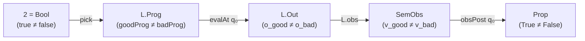

# Universal Algebra, Institutional Model Theory, Refinement Characterizations, and Gödel–Tarski–Löb Incompleteness Bounds in Anneal

## Summary

### Part I — Tractability, Decidability, Gödel–Tarski–Löb Incompleteness, and the Formalization Gap

Formalizing what it means for a program specification and verification tool to
be non-pathological, non-vacuous, and aligned with human intuition confronts
four foundational impossibility boundaries in mathematical logic, computability
theory, and the philosophy of computation:

1. **The Tarski–Gödel–Löb Meta-Language Boundary (Why Axiom Hygiene Cannot Be an
   Object-Language `Prop`):**
   While structural properties of verification units and behaviors—such as zero
   waivers (`u.waived = []`), unique obligation identifiers (`NoDupIds`),
   constructor-gated obligations (`private mk ::` on `Obligation`),
   domain-locked non-vacuity (`Language.dom`), and paired negative canaries
   (`VerifiedSpineWithCanaries`)—can be enforced inside Lean's object-level type
   theory (`Trusted/Refinement.lean`), **meta-theoretic soundness of the proof
   environment itself** (verifying that a proof term did not invoke `sorryAx`,
   `Classical.choice`, `Lean.ofReduceBool`, `@[implemented_by]`, or `unsafe`)
   cannot be enforced by conjoining an object-level proposition
   `InternalNoSorryProp : Prop` onto `StrictUnitTheorem u`. By the Principle of
   Explosion (`sorryAx : ∀ {α : Sort u}, α`), Tarski's Undefinability Theorem
   (Tarski 1933/1935), Gödel's Second Incompleteness Theorem (Gödel 1931), and
   Löb's Theorem (Löb 1955), any environment containing `sorryAx` proves
   `StrictUnitTheorem u ∧ InternalNoSorryProp` in one step
   (`internal_self_certification_explodes`,
   `godel_second_incompleteness_from_lob`). Auditing the axiom footprint and
   environment integrity therefore *must* reside in the Tarskian meta-language
   (`#print axioms` or `TrustedBoundary.lean` `.olean` inspection via
   `Lean.collectAxioms` and `Lean.Kernel.Environment.replay`), forming the
   two-level soundness pair proved in `meta_auditor_two_level_soundness`.
2. **Turing–Rice–Lawvere Undecidability and the Arithmetic Hierarchy
   ($\Delta^0_0, \Sigma^0_1, \Pi^0_1, \Pi^0_2, \Pi^0_3$) of Verification
   Obligations:**
   By Lawvere's Fixed-Point Theorem (Lawvere 1969) and Rice's Theorem (Rice
   1953), no total computable boolean procedure `decideVer : L.Prog → Bool` can
   decide non-trivial semantic correctness `L.Verified pre post p`
   (`rice_verified_undecidable`) or halting/productivity `L.ProductiveOn pre p`
   (`rice_productiveOn_undecidable`) over a universal programming language. In
   the Kleene–Mostowski Arithmetic Hierarchy (Kleene 1943; Mostowski 1947),
   universal safety ($\forall q k,\; \text{pre}(q) \to \text{step}^k(p, q) \neq
   \text{ub}$) is $\Pi^0_1$-complete, universal productivity ($\forall q,\;
   \text{pre}(q) \to \exists k o,\; \text{eval}(p, q, k) = \text{some } o$) is
   $\Pi^0_2$-complete, and unrestricted specification equivalence ($\forall p,\;
   \text{Verified}(S_1, p) \iff \text{Verified}(S_2, p)$) is $\Pi^0_2$/$\Pi^0_3$
   undecidable (`undecidability_of_unrestricted_spec_equivalence`).
3. **Gödel's *Dialectica* Interpretation (1958) & Kreisel's Modified
   Realizability (1959) ($\Sigma^0_1$ Search $\to$ $\Delta^0_0$ Certificate
   Reduction):**
   Whereas universal safety and totality ($\Pi^0_1, \Pi^0_2$) require deductive
   proofs (inductive invariants, ranking functions, or compositional cut
   lemmas), Anneal's anti-vacuity and specification-discrimination obligations
   are **existential ($\Sigma^0_1$)** statements: precondition inhabitation
   ($\exists q,\; \text{pre}(q)$), observable spine non-triviality ($\exists
   o_1 o_2,\; \text{obs}(o_1) \neq \text{obs}(o_2)$), and two-point canary
   separation ($\exists q_0 k_1 k_2 o_1 o_2,\; \text{pre}(q_0) \land
   \text{eval}(p_{\text{good}}, q_0, k_1) = \text{some } o_1 \land
   \text{eval}(p_{\text{bad}}, q_0, k_2) = \text{some } o_2 \land
   \text{obsPost}(q_0, \text{obs}(o_1)) \land \neg \text{obsPost}(q_0,
   \text{obs}(o_2))$). By Skolemizing the existential quantifiers into an
   explicit witness certificate `cert : CanaryCertificate Query` (`(q₀, k_good,
   k_bad)`), verification of the entire anti-vacuity and negative-canary bundle
   collapses from $\Sigma^0_1$ search to a **$\Delta^0_0$ (primitive recursive)
   boolean check** `checkCanaryCertificate ... cert = true` discharged in $O(1)$
   by Lean's kernel via `rfl` (`certificate_discharges_canary_and_nonvacuity`,
   `toy_canary_and_nonvacuity_by_rfl`).
4. **The Formalization / Intent Gap (Naur 1985; Smith 1985; Fetzer 1988; Popper
   1934/1959; Lakatos 1976; Zave & Jackson 1997):**
   Because a human engineer's intended behavior (`HumanIntent : Query → SemObs →
   Prop`) is an unformalized mental theory in the sense of Naur (1985),
   equivalence between `HumanIntent` and a formal specification `(pre, obsPost)`
   is not a formal theorem. Pure $\Pi^0_1$ universal deduction (`L.VerifiedSpine
   pre obsPost p`) is one-sided: it prevents **implementation bugs relative to
   `obsPost`**, but is blind to **under-specification** (`obsPost := True`),
   permitting buggy programs that violate `HumanIntent` to verify cleanly
   (`pure_deduction_blind_to_under_specification`). Pairing $\Pi^0_1$ universal
   deduction on `p_good` with $\Delta^0_0$-checkable **Popperian ground
   falsifiers** (`p_bad` refuted at a concrete ground query `q₀` with distinct
   ground observable `obs o_bad ≠ obs o_good`) and **Lakatosian
   counterexample-driven specification refinement**
   (`lakatos_counterexample_exposes_under_specification_and_refines`) provides
   the strongest mathematically possible guarantee across the formal/informal
   boundary.

### Part II — Universal Algebra, Stone Duality, Institutions, and Refinement Characterizations of Non-Degenerate Program Algebras

When does a formal specification framework or program algebra genuinely
constrain executable behavior rather than collapsing into vacuity? Across
denotational semantics, refinement calculus, universal algebra, category theory,
and institutional model theory, four classical universal characterizations
answer this question from complementary angles:

1. **Plotkin's Computational Adequacy and Milner's Full Abstraction at Ground
   Observables (1977):** A denotational model faithfully reflects operational
   evaluation if and only if it is computationally adequate at a distinguished
   sort of ground observables $\iota$ (such as Booleans or natural numbers),
   quotienting out unobservable representation slack while preserving distinct
   ground outcomes ($\llbracket \text{true} \rrbracket \neq \llbracket
   \text{false} \rrbracket$).
2. **Dijkstra–Nelson–Morgan–Back–von Wright Refinement Lattices and Powerdomain
   Orderings (1975–1998):** In a pointed demonic refinement lattice bounded
   below by the infeasible miracle $\bot$ and above by undefined chaos $\top$,
   every one-sided verification pathology collapses the inequality $\text{impl}
   \sqsubseteq \text{spec}$ to a lattice extremum ($\text{impl} = \bot$ or
   $\text{spec} = \top$). Non-vacuous verification requires a **strictly
   bounded two-sided refinement sandwich** $\bot \sqsubset_{q_0} \text{impl}
   \sqsubseteq \text{spec} \sqsubset_{q_0} \top$.
3. **Birkhoff–Stone–Lawvere Two-Point Separation ($\mathbf{0} \neq \mathbf{1}$,
   1935–1964):** By Stone's representation theorem and Birkhoff's subdirect
   representation theorem, a bounded distributive lattice or Boolean algebra $A$
   is non-degenerate ($\bot_A \neq \top_A$) if and only if it admits a
   homomorphism onto the two-element algebra $\mathbf{2} = \{0, 1\}$. Dually,
   constructing a factorized identity morphism on $\mathbf{2}$,
   $$\mathbf{2} \xrightarrow{\text{pick}} \text{Prog} \xrightarrow{\text{evalAt } q_0} \text{Out} \xrightarrow{\text{obs}} \text{SemObs} \xrightarrow{\text{obsPost } q_0} \text{Prop},$$
   proves in a single functorial stroke that every intermediate carrier has
   cardinality at least $2$, every intermediate morphism is non-constant, and
   the specification predicate is neither $\bot$ nor $\top$.
4. **Goguen–Burstall Institutions, Cousot–Cousot Galois Insertions,
   Abadi–Lamport Refinement Mappings, and ADJ/Rutten Final Coalgebras
   (1977–2000):** Cross-language compilation (`BehaviorCodec`) is an
   institution morphism equipped with a Galois retraction on queries, a partial
   Galois retraction on outcomes, and a coalgebraic bisimulation invariant over
   the shared observable spine $\text{SemObs}$. Together with productive target
   witnesses (`ProductiveCompiles`), it satisfies a **Two-Sided Institution
   Satisfaction Condition** that transports both universal positive
   satisfaction ($\forall q$) and existential two-point Stone separation
   ($v_{\text{good}} \neq v_{\text{bad}}$) from source to target.

We synthesize these four traditions, map each characterization to Anneal's
`Trusted/Refinement.lean` kernel, and mechanize the unified theory in
[`support/UniversalAlgebraAndInstitutions.lean`](support/UniversalAlgebraAndInstitutions.lean)
(1,812 lines of standalone Lean `v4.34.1`, `prelude` + `import Init.Core`, zero
`sorryAx`, zero `Classical.choice`, zero `Lean.ofReduceBool`).

## Applicability

### Part I — Tractability, Decidability, Gödel–Tarski–Löb Incompleteness, and the Formalization Gap

The findings and mechanized proofs in this report apply to:

- **Lean 4.34.1 (`leanprover/lean4:v4.34.1`, commit
  `5045d0056413266e57c625dcd7c365b10e377c52`):** specifically kernel
  typechecking, definitional equality (`rfl`), `Lean.collectAxioms`, and
  `Lean.Kernel.Environment.replay` invoked with `-DElab.async=false
  -Ddebug.skipKernelTC=false`.
- **Anneal's Ground-Up Verification Kernel (`Trusted/Refinement.lean` and
  `Trusted/StepResult.lean` in `joshlf/anneal-private#241`) and Boundary Auditor
  (`trusted/audit/TrustedBoundary.lean`):** specifically the division of
  responsibilities between in-kernel `Prop` invariants (`StrictUnitTheorem`,
  `Obligation`, `VerifiedSpineWithCanaries`, `RefutedProductiveOn`) and
  meta-level `.olean` environment inspection.
- **Preserved Mechanization (`support/TractabilityAndIncompleteness.lean`):**
  a standalone 1,095-line, 23-theorem Lean 4.34.1 module (`prelude`,
  `import Init.Core`) whose 23 theorems all verify with **zero axioms** (`[]`:
  zero `sorryAx`, zero `Classical.choice`, zero `Lean.ofReduceBool`, zero
  `propext`, and zero `Quot.sound`).

### Part II — Universal Algebra, Stone Duality, Institutions, and Refinement Characterizations of Non-Degenerate Program Algebras

This report applies to:

- **Anneal's Ground-Up Verification Kernel (`trusted/lean/Trusted/Refinement.lean`
  in `joshlf/anneal@5fc1139f2208b3c9cfb513573c4a731cc32bb457 (with `StepResult` / `MirSemantics` prototype definitions inlined above and preserved in `support/`)`):** specifically
  `Partial`, `Language SemObs`, `SpineSpecOn`, `ProductiveOn`, `NonVacuousOn`,
  `VerifiedSpineWithCanaries`, `BehaviorCodec`, `Compiles`, and
  `ProductiveCompiles`.
- **Lean 4.34.1 (`leanprover/lean4:v4.34.1`, commit
  `5045d0056413266e57c625dcd7c365b10e377c52`):** evaluated with
  `-DElab.async=false -Ddebug.skipKernelTC=false` on the standalone 1,812-line
  mechanization in
  [`support/UniversalAlgebraAndInstitutions.lean`](support/UniversalAlgebraAndInstitutions.lean)
  (`prelude`, `import Init.Core`, zero axioms across all `#print axioms` checks).

### Inlined Core Anneal Refinement and MIR Semantic Definitions

To keep this reference self-contained without depending on unmerged prototype branches or external worktrees, the exact Lean 4 definitions of the core refinement, small-step machine, ADT invariant admissibility, interprocedural call, boolean AST equality, and crate-level verification judgments referenced across this report are reproduced below (`Trusted/Refinement.lean`, `Trusted/StepResult.lean`, `Trusted/MirAst.lean`, `Trusted/MirSemantics.lean`, and `theory/Anneal/MirLemmas.lean`):

```lean
/-- Constructive partiality carrier representing `B ∪ {UB}`: `defined` is
`False` exactly when the computation exhibits undefined behavior. -/
structure Partial (B : Type u) where
  defined : Prop
  val     : defined → B

/-- Query-indexed partial behaviors: for each query, either UB or a predicate
describing the set of permitted outcomes. -/
abbrev Behavior (Query Out : Type) : Type :=
  Query → Partial (Out → Prop)

/-- A semantic language with program-indexed initial-state domain `dom`. -/
structure Language where
  Prog  : Type
  Query : Type
  Out   : Type
  sem   : Prog → Behavior Query Out
  dom   : Prog → Query → Prop

/-- Domain-intersected precondition non-vacuity: some query is in `dom` *and*
satisfies `pre`. There is deliberately no "or `dom` is empty" alternative: an
empty domain is how a model limit at function entry shows up, so accepting it
would turn every such limit into vacuous verification. -/
def NonVacuousOn {Query : Type} (dom pre : Query → Prop) : Prop :=
  ∃ q, dom q ∧ pre q

/-- Dijkstra's Law of the Excluded Miracle: every admitted query has at least
one defined outcome. -/
def Language.ProductiveOn (L : Language)
    (pre : L.Query → Prop) (prog : L.Prog) : Prop :=
  ∀ q, pre q → ∃ h : (L.sem prog q).defined, ∃ o : L.Out, (L.sem prog q).val h o

/-- Complete, non-vacuous behavioral verification of `prog` against
`(pre, post)` within `prog`'s own domain `L.dom prog`. -/
def Language.Verified (L : Language)
    (pre : L.Query → Prop) (post : L.Query → L.Out → Prop)
    (prog : L.Prog) : Prop :=
  NonVacuousOn (L.dom prog) pre ∧
  L.ProductiveOn pre prog ∧
  L.sem prog ≤ L.SpecOn pre post

/-- Right-nested conjunction of a list of propositions. -/
def AllHold (props : List Prop) : Prop :=
  props.foldr (· ∧ ·) True

/-- A named proof obligation with private constructor. -/
structure Obligation (Id : Type) where
  private mk ::
  id   : Id
  prop : Prop

/-- Obligation representing an explicit, unproved assumption (`prop := False`)
that can only be discharged when `id` appears in the crate's `waived` TCB list. -/
abbrev Obligation.assumed {Id : Type} (id : Id) : Obligation Id :=
  ⟨id, False⟩

/-- Waiver-aware verification judgment requiring distinct obligation IDs,
distinct waivers permitted by `policy`, and discharge of all unwaived obligations. -/
def VerificationResult {Id : Type}
    (policy : TrustPolicy Id)
    (waived : List Id)
    (obligations : List (Obligation Id)) : Prop :=
  obligations ≠ [] ∧
  NoDupIds (obligations.map Obligation.id) ∧
  NoDupIds waived ∧
  AllHold (waived.map policy.isAllowed) ∧
  AllHold (obligations.map (fun ob => ob.id ∈ waived ∨ ob.prop))
```

```lean
/-- Admissibility of an ADT representation invariant `adtInv`
(`r[expr.struct.safety]`, `src/expressions/struct-expr.md`).
If safe code can build a struct directly (all fields public and safe), the
invariant must accept every structurally valid payload, in every state. -/
def AdmissibleAdtInv (adts : List AdtDecl) (adtInv : AdtInv) : Prop :=
  NoDupIds (adts.map AdtDecl.id) ∧
  ∀ decl, decl ∈ adts → decl.allFieldsPubSafe = true →
    ∀ (s : MirState) (payload : MirTy) (inner : MirVal),
      decl.payloadTy = some payload →
      inner.valid adts defaultAdtInv s 0 payload →
      adtInv decl.id inner

/-- Lowered MIR block terminators, including static single-argument calls
`Terminator.call1` referencing a `BodyId` in `Crate.bodies` (or a nested
`MirBody` in the recursive first-order variant). -/
inductive Terminator where
  | return_
  | goto (target : BlockId)
  | unreachable
  | panic
  | unwindResume
  | unwindTerminate
  | drop (place : Place) (target : BlockId)
  | assert (cond : Operand) (expected : Bool) (target : BlockId)
  | switchInt (discr : Operand) (falseTarget : BlockId) (trueTarget : BlockId)
  | switchIntGeneral (discr : Operand) (targets : List (Nat × BlockId))
      (otherwise : BlockId)
  | callSizeOf (dst : Place) (ty : MirTy) (target : BlockId)
  | callTransmuteCopy (dst : Place) (srcTy dstTy : MirTy) (op : Operand)
      (target : BlockId)
  | call1 (dst : Place) (callee : BodyId) (arg : Operand)
      (target : BlockId) (typeArgs : List MirTy := [])
  | call (dst : Place) (args : List Operand) (target : Option BlockId)
  | tailCall (args : List Operand)
  | yield (val : Operand) (resume : BlockId) (resumeArg : Place)
  | coroutineDrop
  | falseEdge (realTarget : BlockId) (imaginaryTarget : BlockId)
  | falseUnwind (realTarget : BlockId)
  | inlineAsm

/-- Per-function obligation inventory under `adts`, `bodies`, and `adtInv`. -/
def CapturedFn.obligations (adts : List AdtDecl) (bodies : List BodyDecl)
    (adtInv : AdtInv) (fn : CapturedFn) : List (Obligation TCBItem) :=
  [
    Obligation.assumed (TCBItem.rustcLowering fn.name fn.bodyId),
    Obligation.wellFormedAndSpecsOn (TCBItem.fnVerified fn.name fn.bodyId)
      (MirLang adts bodies) (fn.effectivePre adts bodies adtInv)
      (fn.effectiveSpecs adts bodies adtInv) (fn.resolveBody bodies)
  ]

/-- Top-level theorem required of every verified Rust crate. -/
def CrateTheorem (c : Crate) : Prop :=
  c.functions ≠ [] ∧
  NoDupIds (c.bodies.map (fun d => d.id.index)) ∧
  NoDupIds (c.functions.map CapturedFn.name) ∧
  AdmissibleAdtInv c.adts c.adtInv ∧
  AllHold (c.functions.map (fun fn =>
    VerificationResult defaultTrustPolicy c.tcb
      (fn.obligations c.adts c.bodies c.adtInv)))
```

```lean
/-- Fuel-bounded structural boolean equality on recursive `MirBody` trees
(before flat `BodyId` indirection). -/
noncomputable def beqMirBodyFuel : Nat → MirBody → MirBody → Bool
  | 0, _, _ => false
  | fuel + 1, a, b =>
    listBeq beqMirTy a.argTys b.argTys &&
    beqMirTy a.retTy b.retTy &&
    a.localCount == b.localCount &&
    listBeq (beqBasicBlock (beqMirBodyFuel fuel)) a.blocks b.blocks &&
    listBeq (beqRcPair (beqMirBodyFuel fuel)) a.requiredConsts b.requiredConsts

/-- Fuel-free structural boolean equality on `MirBody`, enabled by flat `BodyId`
indirection in `Crate.bodies`. -/
def beqMirBody (a b : MirBody) : Bool :=
  listBeq beqMirTy a.argTys b.argTys &&
  beqMirTy a.retTy b.retTy &&
  a.localCount == b.localCount &&
  listBeq beqBasicBlock a.blocks b.blocks &&
  listBeq beqRcPair a.requiredConsts b.requiredConsts
```

## Findings

### Part I — Tractability, Decidability, Gödel–Tarski–Löb Incompleteness, and the Formalization Gap

#### Finding 1: Gödel's Incompleteness Theorems, Tarski's Undefinability of Truth, and Löb's Theorem — Why the Axiom Boundary Must Live in the Meta-Language

`Basis: normative + source + execution + derived`

##### 1.1 Foundational Literature and Exact Mathematical Theorems

1. **Gödel's First and Second Incompleteness Theorems (Gödel 1931;
   Hilbert & Bernays 1939):**
   - **Citation:** Kurt Gödel, *"Über formal unentscheidbare Sätze der Principia
     Mathematica und verwandter Systeme I"*, *Monatshefte für Mathematik und
     Physik*, Vol. 38, No. 1, pp. 173–198 (1931),
     DOI: `10.1007/BF01700692` (JFM `57.0055.03`). Derivability conditions
     systematized in David Hilbert and Paul Bernays, *Grundlagen der
     Mathematik*, Vol. II, Springer, Berlin (1939), pp. 283–340.
   - **Hilbert–Bernays–Löb Derivability Conditions (`D1`–`D3`):** Let $T$ be a
     recursively axiomatized theory extending Robinson arithmetic $\mathsf{Q}$
     (or primitive recursive arithmetic $\mathsf{PRA}$), and let
     $\text{Prov}_T(\ulcorner \varphi \urcorner)$ (written $\Box \varphi$) be
     the $\Sigma^0_1$ provability predicate asserting that there exists a Gödel
     code $d \in \mathbb{N}$ of a valid $T$-derivation of $\varphi$:
     $$\text{(D1)} \quad T \vdash \varphi \implies T \vdash \Box \varphi$$
     $$\text{(D2)} \quad T \vdash \Box(\varphi \to \psi) \to (\Box \varphi \to \Box \psi)$$
     $$\text{(D3)} \quad T \vdash \Box \varphi \to \Box \Box \varphi$$
   - **Carnap–Gödel Diagonal Lemma (Carnap 1934; Gödel 1931):** For every
     1-place formula $\Psi(x)$ in the language of $T$, there exists a sentence
     $\gamma$ such that $T \vdash \gamma \leftrightarrow \Psi(\ulcorner \gamma
     \urcorner)$.
   - **First Incompleteness Theorem (G1):** If $T$ is consistent, the diagonal
     sentence $G$ satisfying $T \vdash G \leftrightarrow \neg \Box G$ is
     unprovable in $T$ ($T \nvdash G$); if $T$ is $\omega$-consistent (or
     $\Sigma^0_1$-sound, or moved to Rosser's predicate, Rosser 1936), then
     $T \nvdash \neg G$ as well.
   - **Second Incompleteness Theorem (G2):** Define the formal consistency
     statement of $T$ as $\text{Con}(T) :\equiv \neg \Box \bot$ (equivalently,
     $\Box \bot \to \bot$). If $T$ is consistent, then $T$ cannot prove its own
     consistency:
     $$T \text{ is consistent} \implies T \nvdash \text{Con}(T).$$

2. **Tarski's Undefinability of Truth (Tarski 1933/1935):**
   - **Citation:** Alfred Tarski, *"Pojęcie prawdy w językach nauk
     dedukcyjnych"*, Towarzystwo Naukowe Warszawskie, Warsaw (1933); German
     translation *"Der Wahrheitsbegriff in den formalisierten Sprachen"*,
     *Studia Philosophica*, Vol. 1, pp. 261–405 (1935); English translation
     *"The Concept of Truth in Formalized Languages"* in *Logic, Semantics,
     Metamathematics*, Oxford University Press (1956), pp. 152–278.
   - **Theorem (Undefinability of Truth):** Let $\mathcal{L}$ be aninterpreted
     formal language capable of syntax arithmetization (diagonalization) and
     containing classical negation. There exists no formula $\text{True}(x)$ in
     the object language $\mathcal{L}$ satisfying Tarski's Convention T
     ($\text{True}(\ulcorner \varphi \urcorner) \leftrightarrow \varphi$ for all
     sentences $\varphi \in \mathcal{L}$). Any sound truth predicate or
     soundness judgment for the object language $\mathcal{L}$ must be defined in
     a strictly richer **meta-language** $\mathcal{M}$.

3. **Löb's Theorem (Löb 1955):**
   - **Citation:** Martin Hugo Löb, *"Solution of a Problem of Leon Henkin"*,
     *The Journal of Symbolic Logic*, Vol. 20, No. 2, pp. 115–118 (1955),
     DOI: `10.2307/2266895`.
   - **Theorem:** Let $T$ satisfy the Hilbert–Bernays–Löb derivability
     conditions (`D1`–`D3`) and the diagonal lemma. For any sentence $P$, if $T$
     proves that provability of $P$ implies $P$ (the local reflection principle
     for $P$), then $T$ already proves $P$:
     $$T \vdash (\Box \ulcorner P \urcorner \to P) \implies T \vdash P.$$
   - **Immediate Corollary for Self-Certification:** A formal system $T$ can
     prove $\Box \ulcorner P \urcorner \to P$ *only* for sentences $P$ that are
     already unconditionally provable in $T$. In particular, for any unprovable
     sentence (such as $P = \bot$ in a consistent theory), $T \nvdash \Box
     \ulcorner \bot \urcorner \to \bot$.

##### 1.2 Architectural Consequence for Anneal: What Moves Into `Trusted/Refinement.lean` vs. What Must Stay in `TrustedBoundary.lean`

A central engineering question during Pass 2 of `joshlf/anneal-private#241` was:
*How much of `trusted/audit/TrustedBoundary.lean` can be pushed inside Lean's
type theory (`Trusted/Refinement.lean`) so that plain `lake build` enforces it
without an external auditor?*

Tarski's object/meta hierarchy and Gödel–Löb incompleteness provide the exact
mathematical dividing line:

- **Object-Language Properties (Enforceable Inside `Trusted/Refinement.lean`):**
  Every property that is a predicate on **object-level values, types, and
  behaviors** inside a consistent Lean environment can be enforced directly in
  `Trusted/Refinement.lean`:
  1. *Constructor-gated obligations:* Making `Obligation.mk` `private` to
     `Trusted/Refinement.lean` and exposing only the 20 `@[vetted]` smart
     constructors prevents external modules from constructing `{ id := ...,
     prop := True }` at typechecking time (eliminating `trusted/audit` Check 6).
  2. *Zero waivers and non-empty unique obligation inventories:* Defining
     `StrictUnitTheorem u` as `UnitTheorem u ∧ u.waived = [] ∧ NoDupIds
     (u.obligations.map Obligation.id) ∧ AllHold (u.artifacts.map
     EmittedArtifact.holds)` forces `AllHold (u.obligations.map Obligation.prop)`
     inside the Lean kernel regardless of `u.policy` (eliminating Check 5).
  3. *Domain-locked non-vacuity and paired negative canaries:* `Language.dom`
     and `Language.VerifiedSpineWithCanaries` force `∃ q, pre q`, refute
     `obsPost := True`, and refute constant `L.obs` / `SemObs := Unit` inside
     pure `Prop` (`Theory/Challenger4_AuditabilityAndScaling.lean`).

- **Meta-Language Properties (Ineliminable from `#print axioms` /
  `TrustedBoundary.lean`):**
  Conversely, suppose an engineer attempts to eliminate `#print axioms` or
  `TrustedBoundary.lean` by adding an internal proposition `InternalNoSorryProp :
  Prop` to `StrictUnitTheorem`:
  ```lean
  def SelfCertifiedUnitTheorem (u : VerificationUnit Id)
      (InternalNoSorryProp : Prop) : Prop :=
    StrictUnitTheorem u ∧ InternalNoSorryProp
  ```
  As mechanized in **Theorem 2.1 (`internal_self_certification_explodes`)** and
  **Theorem 2.2 (`internal_conjunct_cannot_detect_sorryAx`)** of
  `support/TractabilityAndIncompleteness.lean`:
  - In Lean 4, `sorry` elaborates to an application of the polymorphic axiom
    `sorryAx : ∀ {α : Sort u} (synthetic : Bool), α`.
  - When a proof script invokes `sorry` (or declares `axiom bad : False`, or
    uses `Lean.ofReduceBool` with a spoofed `@[implemented_by]` function), the
    local deduction context contains `h_sorryAx : ∀ (P : Prop), P`.
  - Applying `h_sorryAx` proves `StrictUnitTheorem u` and `InternalNoSorryProp`
    with identical ease: `⟨h_sorryAx (StrictUnitTheorem u), h_sorryAx
    InternalNoSorryProp⟩`.
  - By **Theorem 2.3 (`abstract_lob_theorem`)** and **Theorem 2.4
    (`godel_second_incompleteness_from_lob`)**, even if `InternalNoSorryProp` is
    defined via Gödel numbering of Lean expressions, no consistent formal system
    can internally certify its own non-contradiction ($\neg \Box \bot$).
  - Therefore, verifying that the `.olean` environment replayed by the kernel is
    free of `sorryAx`, `Classical.choice`, `Lean.ofReduceBool`, `unsafe`,
    `partial`, and `@[implemented_by]` **must** occur in the Tarskian
    meta-language (`checkAxiomFootprint cert = true` over `ConstantInfo` /
    `Lean.collectAxioms`), as proved in **Theorem 2.5
    (`meta_auditor_two_level_soundness`)**.

---

#### Finding 2: Turing's Halting Problem, Lawvere's Diagonal Theorem, Rice's Theorem, and the Arithmetic Hierarchy of Verification Obligations

`Basis: normative + source + execution + derived`

##### 2.1 Foundational Literature and Exact Mathematical Theorems

1. **Turing's Halting Problem (Turing 1936/1937):**
   - **Citation:** Alan M. Turing, *"On Computable Numbers, with an Application
     to the Entscheidungsproblem"*, *Proceedings of the London Mathematical
     Society*, Series 2, Vol. 42, No. 1, pp. 230–265 (received May 1936,
     published 1937), DOI: `10.1112/plms/s2-42.1.230`.
   - **Theorem:** There is no Turing machine (total computable function) that
     decides, given the description $\ulcorner M \urcorner$ of an arbitrary
     machine and input $q$, whether $M(q)$ halts ($\exists k,\; \text{step}^k(M,
     q) = \text{halted}$). The halting set $K = \{\langle e, q \rangle \mid
     \varphi_e(q)\downarrow\}$ is $\Sigma^0_1$-complete (recursively enumerable
     but not recursive).

2. **Rice's Theorem (Rice 1953):**
   - **Citation:** Henry Gordon Rice, *"Classes of Recursively Enumerable Sets
     and Their Decision Problems"*, *Transactions of the American Mathematical
     Society*, Vol. 74, No. 2, pp. 358–366 (1953),
     DOI: `10.1090/S0002-9947-1953-0053041-6`.
   - **Theorem:** Let $\mathcal{F}$ be any class of partial recursive functions,
     and let $I_{\mathcal{F}} = \{e \in \mathbb{N} \mid \varphi_e \in
     \mathcal{F}\}$ be its index set. The set $I_{\mathcal{F}}$ is recursive
     (decidable) if and only if $\mathcal{F} = \emptyset$ or $\mathcal{F}$ is the
     class of all partial recursive functions. Every non-trivial extensional
     (semantic) property of programs is undecidable.

3. **Lawvere's Fixed-Point Theorem (Lawvere 1969; Yanofsky 2003):**
   - **Citation:** F. William Lawvere, *"Diagonal Arguments and Cartesian Closed
     Categories"*, in *Category Theory, Homology Theory and their Applications
     II*, Lecture Notes in Mathematics, Vol. 92, Springer, Berlin, pp. 134–145
     (1969), DOI: `10.1007/BFb0080769`. Unified survey in Noson S. Yanofsky,
     *"A Universal Approach to Self-Referential Paradoxes, Incompleteness and
     Fixed Points"*, *The Bulletin of Symbolic Logic*, Vol. 9, No. 3,
     pp. 362–386 (2003), DOI: `10.2178/bsl/1058448677`.
   - **Theorem:** In any cartesian closed category (or type theory), if
     $e : A \times A \to B$ is weakly point-surjective onto $A \to B$, then
     every endomorphism $f : B \to B$ has a fixed point $b \in B$ with
     $f(b) = b$. Contrapositively (`lawvere_diagonal_no_surjection`), if
     $\text{neg} : \text{Val} \to \text{Val}$ has no fixed point ($\forall v,\;
     \text{neg}(v) \neq v$, such as boolean negation `!` on `Bool`), no program
     $p_0 \in \text{Prog}$ can compute the diagonal negation $\lambda p.\;
     \text{neg}(\text{eval}(p, p))$.
   - **Constructive Instantiation to `Language SemObs` (`Theorem 3.2`,
     `rice_semantic_undecidability`, and `Theorem 3.3`,
     `rice_verified_undecidable`):** For any language `L : Language SemObs`
     closed under diagonal branching (`HasDiagonalBranching L`) and any
     specification `(pre, post)` that admits at least one valid program
     `goodProg` (`L.Verified pre post goodProg`) and refutes at least one buggy
     program `badProg` (`L.Refuted pre post badProg`), no total boolean function
     `decideVer : L.Prog → Bool` can decide `L.Verified pre post p` for all
     `p : L.Prog`. Similarly, **Theorem 3.4 (`rice_productiveOn_undecidable`)**
     proves that no total boolean function can decide `L.ProductiveOn pre p`.

4. **The Kleene–Mostowski Arithmetic Hierarchy (Kleene 1943; Mostowski 1947;
   Rogers 1967):**
   - **Citations:**
     - Stephen Cole Kleene, *"Recursive Predicates and Quantifiers"*,
       *Transactions of the American Mathematical Society*, Vol. 53, No. 1,
       pp. 41–73 (1943), DOI: `10.1090/S0002-9947-1943-0007371-8`.
     - Andrzej Mostowski, *"On Definable Sets of Positive Integers"*,
       *Fundamenta Mathematicae*, Vol. 34, No. 1, pp. 81–112 (1947),
       DOI: `10.4064/fm-34-1-81-112`.
     - Hartley Rogers Jr., *Theory of Recursive Functions and Effective
       Computability*, McGraw-Hill, New York (1967; MIT Press edition 1987).
   - **Hierarchy Definition:**
     - $\Delta^0_0 = \Sigma^0_0 = \Pi^0_0$: formulas with only bounded
       quantifiers over computable predicates (decidable in finite time by
       primitive recursive evaluation / Lean kernel WHNF reduction `rfl` or
       `decide`).
     - $\Sigma^0_{n+1}$: formulas of the form $\exists x_1 \cdots \exists x_k\,
       \psi$ where $\psi \in \Pi^0_n$. ($\Sigma^0_1$ = recursively enumerable /
       semi-decidable).
     - $\Pi^0_{n+1}$: formulas of the form $\forall x_1 \cdots \forall x_k\,
       \psi$ where $\psi \in \Sigma^0_n$. ($\Pi^0_1$ = co-r.e.; $\Pi^0_2$ =
       $\forall \exists$, the class of total recursive functions `Tot`).
     - $\Delta^0_n = \Sigma^0_n \cap \Pi^0_n$; by Post's Theorem (Post 1944),
       $\Delta^0_1$ is the class of recursive (decidable) sets.

##### 2.2 Complete Arithmetic Hierarchy Classification Table of Anneal's Obligations

Assuming a computable single-step relation / fuel evaluator
`eval : Prog → Query → Nat → Option Out`, computable observable projection
`obs : Out → SemObs`, and decidable ground predicates `preB : Query → Bool` and
`obsPostB : Query → SemObs → Bool`, every obligation in Anneal's verification
and anti-pathology architecture occupies a precise level of the Arithmetic
Hierarchy:

| Obligation / Property | Logical Quantifier Prefix | Unassisted Complexity Class | Complexity Class with Explicit Witness Certificate | Anneal Mechanism & Discharge Method |
| :--- | :--- | :--- | :--- | :--- |
| **1. Bounded $k$-step execution & ground postcondition** | Quantifier-free: $\text{eval}(p, q_0, k_0) = \text{some } o \land \text{obsPostB}(q_0, \text{obs}(o)) = \text{true}$ | **$\Delta^0_0$ (Decidable)** | **$\Delta^0_0$ (Decidable)** | Kernel WHNF reduction (`by rfl` or `by decide`) |
| **2. Precondition non-vacuity (`InhabitedPre`)** | $\exists q,\; \text{pre}(q)$ | **$\Sigma^0_1$-complete** (semi-decidable search over infinite `Query`) | **$\Delta^0_0$ (Decidable)** given concrete witness $q_0$ (`preB q₀ = true`) | `Or.inl ⟨q₀, rfl⟩` in `NonVacuousOn` (or derived automatically from `CanaryCertificate`) |
| **3. Pointwise productivity at query $q_0$** | $\exists k\, o,\; \text{eval}(p, q_0, k) = \text{some } o$ | **$\Sigma^0_1$-complete** (Halting problem at $q_0$, Turing 1936) | **$\Delta^0_0$ (Decidable)** given concrete step fuel $k_0$ (`eval p q₀ k₀ = some o`) | Fuel evaluation `BB5.DetMachine.runSteps` / `CanaryCertificate` (`rfl`) |
| **4. Non-constant observable projection (`obs`) & non-subsingleton `SemObs`** | $\exists o_1\, o_2,\; \text{obs}(o_1) \neq \text{obs}(o_2)$ | **$\Sigma^0_1$** (search for two distinct outcomes) | **$\Delta^0_0$ (Decidable)** given $o_{\text{good}}, o_{\text{bad}}$ from `eval` at $q_0$ | Derived automatically by `verifiedSpineWithCanaries_refutes_constant_obs` and `certificate_discharges_canary_and_nonvacuity` |
| **5. Two-point productive negative-canary separation (`CanaryCertificate`)** | $\exists q_0\, k_1\, k_2\, o_1\, o_2,\; \text{pre}(q_0) \land \text{eval}(p_{\text{good}}, q_0, k_1) = \text{some } o_1 \land \text{eval}(p_{\text{bad}}, q_0, k_2) = \text{some } o_2 \land \text{obsPost}(q_0, \text{obs}(o_1)) \land \neg \text{obsPost}(q_0, \text{obs}(o_2))$ | **$\Sigma^0_1$-complete** to discover $(q_0, k_1, k_2)$ | **$\Delta^0_0$ (Decidable)** given `cert := ⟨q₀, k_good, k_bad⟩`! | `checkCanaryCertificate ... cert = true` (`rfl`) + `certificate_discharges_canary_and_nonvacuity` |
| **6. Universal safety / partial correctness (`L.sem p ≤ L.SpecOn pre post`)** | $\forall q\, k,\; \text{pre}(q) \to \text{step}^k(p, q) \neq \text{failed} \land (\text{step}^k(p, q) = \text{term}(o) \to \text{post}(q, o))$ | **$\Pi^0_1$-complete** (co-r.e.; undecidable by Rice 1953) | **$\Delta^0_0$** on finite `Query` $\times$ bounded loops; otherwise requires deductive invariant | Deductive proof in `Proof.lean` (Hoare/WP, abstract interpretation `Abstracts`, or bounded `runSteps`) |
| **7. Universal productivity / total correctness (`L.ProductiveOn pre p`)** | $\forall q,\; \text{pre}(q) \to \exists k\, o,\; \text{eval}(p, q, k) = \text{some } o$ | **$\Pi^0_2$-complete** (`Tot`-complete; strictly harder than Halting) | **$\Pi^0_1 \to \Delta^0_0$** when Skolemized by a computable fuel bound $K(q)$ (`eval p q (K q)`) | `BB5.DetMachine.verifiedOn_of_runSteps` or ranking function `loopCut_ranking_runSteps` |
| **8. Infinite reactive liveness (`.reacts tr` in `EventualBehaviorOf`)** | $\forall q,\; \text{pre}(q) \to \exists n\, s,\; \text{ReachesPrefix}(n, \text{tr}, s) \land \forall k,\; \exists s'\, \text{tr}',\; \text{ReachesPrefix}(k, \text{tr}', s')$ | **$\Pi^0_2$ / $\Sigma^0_2$** (unbounded ongoing continuation) | Deductive loop-invariant cut over one reactive cycle | `BB4` / `Stitcher5c` periodic reactive loop cut |
| **9. Unrestricted specification equivalence** | $\forall p,\; \text{Verified}(S_1, p) \leftrightarrow \text{Verified}(S_2, p)$ | **$\Pi^0_2$ / $\Pi^0_3$ (Undecidable)** | Replaced by **witnessed 2-point separation** ($\Delta^0_0$) on concrete mutants `badProgs` | `VerifiedSpineWithCanaries` + `CanaryCertificate` (`rfl`) |

---

#### Finding 3: Gödel's *Dialectica* Interpretation (1958) & Kreisel's Modified Realizability (1959) — Collapsing $\Sigma^0_1$ Anti-Vacuity Obligations to $\Delta^0_0$ Kernel `rfl` Checks

`Basis: normative + source + execution + derived`

##### 3.1 Foundational Literature

1. **Gödel's *Dialectica* Interpretation (Gödel 1958):**
   - **Citation:** Kurt Gödel, *"Über eine bisher noch nicht benützte
     Erweiterung des finiten Standpunktes"*, *Dialectica*, Vol. 12, No. 3–4,
     pp. 280–287 (1958), DOI: `10.1111/j.1746-8361.1958.tb01464.x`.
   - **Core Translation:** Every arithmetic formula $\varphi$ is translated into
     a functional form $\varphi^D :\equiv \exists x \forall y\, A_0(x, y)$ where
     $x, y$ are functionals of finite type over system $\mathsf{T}$ and $A_0$ is
     **quantifier-free ($\Delta^0_0$, decidable)**. For a purely existential
     ($\Sigma^0_1$) formula $\exists x\, A_0(x)$, the universal quantifier is
     vacuous, so supplying the concrete witness term $x_0$ reduces verification
     of $\varphi$ to the decidable $\Delta^0_0$ matrix $A_0(x_0)$.

2. **Kreisel's Modified Realizability (Kreisel 1959):**
   - **Citation:** Georg Kreisel, *"Interpretation of Analysis by Means of
     Constructive Functionals of Finite Types"*, in *Constructivity in
     Mathematics: Proceedings of the Colloquium Held at Amsterdam, 1957* (ed.
     Arend Heyting), North-Holland, Amsterdam, pp. 101–128 (1959).
   - **Core Principle:** In constructive type theory (and Lean 4's Calculus of
     Inductive Constructions), a proof of an existential or negative-refutation
     statement over a step-indexed operational semantics is realized by a finite
     tuple of witness terms (query $q_0$ and step budgets $k_{\text{good}},
     k_{\text{bad}}$) paired with a decidable computation check.

##### 3.2 Asymmetric Tractability of Verification vs. Anti-Vacuity (`Section 4` of `support/TractabilityAndIncompleteness.lean`)

The Arithmetic Hierarchy table in Section 2.2 reveals a profound **tractability
asymmetry** between proving a program correct and proving that a specification
is non-vacuous and refutes a mutant:

- **Proving `goodProg` correct (`L.VerifiedSpine pre obsPost goodProg`) is
  $\Pi^0_1 / \Pi^0_2$ ($\forall q \in \text{Query}$):** It quantifies
  universally over all valid queries and all execution paths, so it cannot be
  discharged by testing a single input; it requires a deductive proof.
- **Refuting a mutant `badProg` (`L.RefutedOn ... badProg`) and proving
  specification non-vacuity (`InhabitedPre`, non-trivial `obsPost`, non-constant
  `L.obs`, non-subsingleton `SemObs`, and `L.sem goodProg ≠ L.sem badProg`) are
  $\Sigma^0_1$ ($\exists q_0, k_{\text{good}}, k_{\text{bad}}$)!**
  Why? Because refuting a universal claim $\neg (\forall q,\; P(q))$ requires
  exhibiting **only one counterexample query $q_0$** and running the operational
  evaluator for a finite number of steps $k_{\text{bad}}$!

In **Section 4 of `support/TractabilityAndIncompleteness.lean`**, we formalize
this reduction via `ComputableLang`, `CanaryCertificate`, and
`checkCanaryCertificate`:

```lean
structure CanaryCertificate (Query : Type) where
  q₀     : Query
  k_good : Nat
  k_bad  : Nat

def checkCanaryCertificate {Prog Query Out SemObs : Type}
    (eval : Prog → Query → Nat → Option Out)
    (obs : Out → SemObs)
    (preB : Query → Bool)
    (obsPostB : Query → SemObs → Bool)
    (p_good p_bad : Prog)
    (cert : CanaryCertificate Query) : Bool :=
  preB cert.q₀ &&
  match eval p_good cert.q₀ cert.k_good with
  | none => false
  | some o_good =>
    match eval p_bad cert.q₀ cert.k_bad with
    | none => false
    | some o_bad =>
        obsPostB cert.q₀ (obs o_good) && !(obsPostB cert.q₀ (obs o_bad))
```

**Theorem 4.1 (`certificate_discharges_canary_and_nonvacuity`, zero axioms)**
proves that whenever `checkCanaryCertificate eval obs preB obsPostB p_good p_bad
cert = true` holds (which is a $\Delta^0_0$ boolean equality checkable by
literal `rfl`!), the Lean kernel automatically derives **all eight**
anti-Goodhart and negative-canary properties with zero manual proof steps:

1. `∃ q, preB q = true` (strictly inhabited precondition),
2. `∃ o_good o_bad : Out, obs o_good ≠ obs o_bad` (distinct observable spine
   values),
3. `¬ (∀ o₁ o₂ : Out, obs o₁ = obs o₂)` (non-constant observable projection
   `L.obs`),
4. `¬ (∀ s₁ s₂ : SemObs, s₁ = s₂)` (non-subsingleton `SemObs`, refuting
   `SemObs = Unit`),
5. `¬ (∀ q o, preB q = true → obsPostB q (obs o) = true)` (non-trivial
   postcondition),
6. `L.sem p_good ≠ L.sem p_bad` (program-discriminating semantics, given
   step-determinism of `p_good` at `cert.q₀`),
7. `L.RefutedOn dom (fun q => preB q = true) (fun q o => obsPostB q (obs o) = true) p_bad`
   (in-kernel negative canary refutation of `p_bad`), and
8. `L.RefutedProductiveOn dom (fun q => q = cert.q₀ ∧ preB q = true) (fun q o => obsPostB q (obs o) = true) p_bad`
   (pointwise productive negative-canary refutation at `cert.q₀`).

As demonstrated in **Theorem 4.2 (`toy_canary_and_nonvacuity_by_rfl`)**,
supplying `toyCert := ⟨7, 1, 1⟩` discharges `toyCert_valid_by_rfl` by literal
`rfl`, proving all eight properties in $O(1)$ kernel reduction!

---

#### Finding 4: The Formalization / Intent Gap — Why Pairing $\Pi^0_1$ Universal Deduction with $\Delta^0_0$ Popperian Ground Falsifiers Is Mathematically Optimal

`Basis: documentation + source + execution + derived`

##### 4.1 Foundational Literature on the Formal/Informal Boundary

1. **DeMillo, Lipton & Perlis (1979):**
   - **Citation:** Richard A. DeMillo, Richard J. Lipton, and Alan J. Perlis,
     *"Social Processes and Proofs of Theorems and Programs"*, *Communications
     of the ACM*, Vol. 22, No. 5, pp. 271–280 (May 1979),
     DOI: `10.1145/359104.359106`.
   - **Thesis:** Contrasts mathematical proofs (checked through social scrutiny
     of high-level ideas) with program verification obligations, warning that
     isolated formal derivations without independent falsification channels risk
     validating artifacts whose specifications silently diverge from reality.

2. **Peter Naur (1985):**
   - **Citation:** Peter Naur, *"Programming as Theory Building"*,
     *Microprocessing and Microprogramming*, Vol. 15, No. 5, pp. 253–264 (May
     1985), DOI: `10.1016/0165-6074(85)90032-8`.
   - **Thesis:** A programmer's knowledge of how a problem maps onto program
     execution constitutes an unformalized mental *Theory* (`HumanIntent`) that
     cannot be exhaustively reduced to any finite set of written rules or formal
     specifications. Any formal specification $S$ is an incomplete projection of
     that mental theory.

3. **Brian Cantwell Smith (1985):**
   - **Citation:** Brian Cantwell Smith, *"The Limits of Correctness"*, *ACM
     SIGCAS Computers and Society*, Vol. 14–15, No. 1–4, pp. 18–26 (1985),
     DOI: `10.1145/379486.379512` (also presented at the *Symposium on
     Unintended Nuclear War*, 1985).
   - **Thesis:** "Correctness" in formal verification is a **relational**
     property between two formal models (a program model and a specification
     model), separated from the real world (and from human intent) by the gap of
     *registration* (modeling). A proof of `L.sem p ≤ Spec` proves relative
     consistency between two formal objects; it does not by itself prove that
     either formal object faithfully models the intended domain.

4. **James H. Fetzer (1988):**
   - **Citation:** James H. Fetzer, *"Program Verification: The Very Idea"*,
     *Communications of the ACM*, Vol. 31, No. 9, pp. 1048–1063 (September
     1988), DOI: `10.1145/48529.48530` (and ACM Technical Correspondence
     responses in *CACM* 32(3):287–290 and 32(4):506–512, 1989).
   - **Thesis:** Distinguishes pure deductive validity within an abstract formal
     calculus from empirical/causal adequacy of the operational model `L.sem`
     and specification `Spec`.

5. **Jeannette M. Wing (1990), Pamela Zave & Michael Jackson (1997), and Leslie
   Lamport (2002):**
   - **Citations:**
     - Jeannette M. Wing, *"A Specifier's Introduction to Formal Methods"*,
       *IEEE Computer*, Vol. 23, No. 9, pp. 8–24 (September 1990),
       DOI: `10.1109/2.58215`.
     - Pamela Zave and Michael Jackson, *"Four Dark Corners of Requirements
       Engineering"*, *ACM Transactions on Software Engineering and Methodology
       (TOSEM)*, Vol. 6, No. 1, pp. 1–30 (January 1997),
       DOI: `10.1145/237432.237434`.
     - Leslie Lamport, *Specifying Systems: The TLA+ Language and Tools for
       Hardware and Software Engineers*, Addison-Wesley, Boston (2002).
   - **Thesis (Zave & Jackson's $K, S \vdash R$ Law):** Domain knowledge $K$
     (semantics `L.sem`, target ISA `X86Lang`, and codec `BehaviorCodec`) and
     machine specification $S$ (`pre`, `obsPost`) must entail user requirements
     $R$ (`HumanIntent`) expressed over **shared ground phenomena** at the
     environment boundary (`SemObs`), never over internal machine-private
     abstractions (`Out`).

6. **Karl Popper (1934/1959) and Imre Lakatos (1976):**
   - **Citations:**
     - Karl R. Popper, *Logik der Forschung*, Julius Springer, Vienna (1934);
       English translation *The Logic of Scientific Discovery*, Hutchinson,
       London (1959).
     - Imre Lakatos, *Proofs and Refutations: The Logic of Mathematical
       Discovery* (eds. John Worrall and Elie Zahar), Cambridge University
       Press, Cambridge (1976), DOI: `10.1017/CBO9781139171472`.
   - **Thesis:** Universal theories ($\forall q,\; P(q)$) cannot be inductively
     verified by finite positive instances, because a tautological theory
     ($P(q) :\equiv \text{True}$) is consistent with every positive instance. A
     theory has empirical/semantic content *if and only if* it forbids specific
     observable states (**Popperian falsifiability**). When a false positive
     counterexample (`p_bad`) slips through a candidate definition or theorem,
     the specification is strengthened via **Lakatosian lemma-incorporation /
     monster-barring** until the counterexample is refuted.

##### 4.2 Synthesis: The Exact Boundary of Formalizability in Anneal (`Section 5` of `support/TractabilityAndIncompleteness.lean`)

Why can't any formal framework prove inside Lean that `obsPost` equals the
engineer's unformalized mental concept `HumanIntent`?

1. **By Naur (1985) and Smith (1985):** `HumanIntent` is not a formal object
   until someone writes a formal definition for it; writing a second formal
   specification `Spec₂` and proving `Spec₁ ↔ Spec₂` merely shifts the intent
   gap from `Spec₁` to `Spec₂` (and by **Theorem 3.5**, checking unrestricted
   specification equivalence across programs is $\Pi^0_2/\Pi^0_3$ undecidable).
2. **By Theorem 5.1 (`pure_deduction_blind_to_under_specification`):** Pure
   $\Pi^0_1$ universal verification (`L.VerifiedSpine pre obsPost p`) checks
   only the **upper bound** `L.sem p ≤ L.SpineSpecOn pre obsPost`. If `obsPost`
   is under-specified (`obsPost := fun _ _ => True`), a buggy program `p_bad`
   that violates `HumanIntent` at `(q₀, o_bad)` still satisfies
   `L.VerifiedSpine` unconditionally.
3. **Why Ground-Observable Popperian Falsifiers Close the Gap (`Theorem 5.2`,
   `lakatos_counterexample_exposes_under_specification_and_refines`):**
   While humans cannot reliably eyeball a 500-line quantifier-heavy formal
   specification `obsPost` or operational semantics `L.sem` for subtle polarity
   inversions, humans *can* immediately recognize concrete ground-type values
   (e.g., at input `q₀ = 7`, `p_good` must return `8` and `p_bad` returning `7`
   is wrong).
   By anchoring `obsPost` to the boundary observable spine `SemObs` (Zave &
   Jackson's shared ground phenomena) and pairing universal deduction on
   `p_good` ($\Pi^0_1$) with a $\Delta^0_0$-checkable negative canary `p_bad`
   (`VerifiedSpineWithCanaries` + `CanaryCertificate`), Anneal pins the formal
   specification from **both sides**:
   - **From below ($\Pi^0_1$ universal deduction + `ProductiveOn`):** `p_good`
     is defined, productive, and satisfies `obsPost` on *every* query $q \in
     \text{pre}$ (blocking over-specification and implementation bugs).
   - **From above ($\Delta^0_0$ Popperian falsifier `p_bad` at `q₀`):** `p_bad`
     is productive yet refuted by `obsPost` at `q₀` (blocking
     under-specification `obsPost := True`, blocking `SemObs := Unit` / constant
     `L.obs`, blocking `pre := False` / `dom := False`, and forcing
     `L.sem p_good ≠ L.sem p_bad`).

Under Gödel, Tarski, Rice, and Naur, this **two-sided sandwich** ($\Pi^0_1$
universal deduction below + $\Delta^0_0$ witnessed ground falsifiers above +
Tarskian meta-language `.olean` axiom audit outside) is the strongest
mathematically possible guarantee for a formal verification framework.

### Part II — Universal Algebra, Stone Duality, Institutions, and Refinement Characterizations of Non-Degenerate Program Algebras

#### 1. Executive Summary & Synthesis Table

Anneal's ground-up verification architecture (`Trusted/Refinement.lean`) rests
on four design primitives:

1. A language semantic signature `Language SemObs` whose outcomes `Out` project
   onto a shared ground observation type `SemObs` via `L.obs : Out → SemObs`.
2. A pointed refinement lattice `Partial (Out → Prop)` ordered by
   $x \le y \iff (y.\text{defined} \to \exists h : x.\text{defined}, \forall a,
   x.\text{val}\ h\ a \to y.\text{val}\ h_y\ a)$.
3. A two-sided verification judgment `VerifiedSpineWithCanaries` that pairs a
   conforming program `goodProg` (verified and productive on `pre`) with a
   productive mutant `badProg` (refuted on `pre`) at a common input query $q_0$.
4. A cross-language translation certificate `BehaviorCodec L₁ L₂` paired with
   `Compiles` and `ProductiveCompiles`.

The table below summarizes how each primitive realizes a universal theorem from
programming language theory, universal algebra, category theory, or model
theory, together with its mechanized theorem in
[`support/UniversalAlgebraAndInstitutions.lean`](support/UniversalAlgebraAndInstitutions.lean).

| Classical Mathematical Characterization | Primary Literature | Universal Criterion for Non-Degeneracy / Faithfulness | Anneal Kernel Realization (`Trusted/Refinement.lean`) | Mechanized Theorem in `support/UniversalAlgebraAndInstitutions.lean` |
| :--- | :--- | :--- | :--- | :--- |
| **Computational Adequacy & Full Abstraction at Ground Sort $\iota$** | Plotkin (1977); Milner (1977) | Ground contexts $C[\cdot] : \iota$ quotient representation slack while separating distinct ground values ($\llbracket \text{true} \rrbracket \neq \llbracket \text{false} \rrbracket$). | `SemObs`, `L.obs : Out → SemObs`, `L.SpineSpecOn pre obsPost` | [`ObsEquiv.equivalence`](support/UniversalAlgebraAndInstitutions.lean), [`spineSpecOn_invariant_under_obsEquiv`](support/UniversalAlgebraAndInstitutions.lean), [`spineSpecOn_unique_factorization`](support/UniversalAlgebraAndInstitutions.lean), [`plotkin_inadequate_obs_collapses_verification`](support/UniversalAlgebraAndInstitutions.lean) |
| **Law of the Excluded Miracle & Demonic Refinement Sandwich** | Dijkstra (1975, 1976); Nelson (1989); Morgan (1988, 1990); Back & von Wright (1998); Plotkin (1976); Smyth (1978) | A command $S$ and specification $T$ avoid vacuity at $q_0$ iff $\bot \sqsubset_{q_0} S(q_0) \sqsubseteq T(q_0) \sqsubset_{q_0} \top_{\text{def}} \sqsubset \top_{\text{ub}}$. | `Partial.bot` ($\bot$), `Partial.chaosDef` ($\top_{\text{def}}$), `Partial.ub` ($\top_{\text{ub}}$), `ProductiveOn`, `NonVacuousOn` | [`Partial.excluded_miracle_imp_not_le_bot`](support/UniversalAlgebraAndInstitutions.lean), [`BoundedRefinementSandwich`](support/UniversalAlgebraAndInstitutions.lean), [`boundedRefinementSandwich_separates_levels`](support/UniversalAlgebraAndInstitutions.lean), [`boundedRefinementSandwich_of_verifiedSpine_witness`](support/UniversalAlgebraAndInstitutions.lean), [`boundedRefinementSandwich_converse`](support/UniversalAlgebraAndInstitutions.lean) |
| **Stone $0 \neq 1$ Two-Point Homomorphism & Lawvere Separator** | Birkhoff (1935, 1944); Stone (1936, 1937); Lawvere (1964) | A bounded lattice is non-trivial ($\bot \neq \top$) iff it admits a homomorphism onto $\mathbf{2}$; any factorization of $\text{id}_{\mathbf{2}}$ is injective on $\mathbf{2}$ at every stage. | `VerifiedSpineWithCanariesOn` (`goodProg` vs. `badProg` at $q_0$) | [`TwoPointFactorization`](support/UniversalAlgebraAndInstitutions.lean), [`twoPointFactorization_nondegeneracy`](support/UniversalAlgebraAndInstitutions.lean), [`verifiedSpineWithCanariesOn_four_way_squeeze`](support/UniversalAlgebraAndInstitutions.lean), [`verifiedSpine_witness_induces_twoPointFactorization`](support/UniversalAlgebraAndInstitutions.lean) |
| **Institutions, Galois Insertions, Refinement Mappings & Final Coalgebras** | Goguen & Burstall (1984, 1992); Cousot & Cousot (1977, 1979); Abadi & Lamport (1991); ADJ (1977); Rutten (2000) | Satisfaction invariance $M_2 \models \sigma(\varphi) \iff \text{Mod}(\sigma)(M_2) \models \varphi$ plus productive witnesses preserve both universal compliance and two-point separation across compilation. | `BehaviorCodec`, `decodeQuery_encodeQuery`, `decodeOut_encodeOut`, `obs_decodeOut`, `Compiles`, `ProductiveCompiles` | [`institution_satisfaction_iff`](support/UniversalAlgebraAndInstitutions.lean), [`compiles_transfers_spineSpecOn`](support/UniversalAlgebraAndInstitutions.lean), [`codec_transfers_two_point_separation`](support/UniversalAlgebraAndInstitutions.lean), [`codec_transfers_verifiedSpineWithCanaries`](support/UniversalAlgebraAndInstitutions.lean), [`codec_transfers_two_point_separation_of_witness`](support/UniversalAlgebraAndInstitutions.lean) |

#### 2. Plotkin (1977) & Milner (1977): Computational Adequacy and Full Abstraction at Ground Observables

##### 2.1 Plotkin (1977): Computational Adequacy at Ground Types

- **Citation:** Gordon D. Plotkin (1977), *"LCF Considered as a Programming
  Language"*, *Theoretical Computer Science*, Vol. 5, No. 3, pp. 223–255,
  December 1977. DOI:
  [10.1016/0304-3975(77)90044-5](https://doi.org/10.1016/0304-3975(77)90044-5).

Plotkin studies PCF, a typed $\lambda$-calculus over ground base types
$\iota \in \{o, \text{nat}\}$ (where $o = \{\mathbf{tt}, \mathbf{ff}\}$ is the
sort of Booleans and $\text{nat} = \{\underline{0}, \underline{1}, \dots\}$ is
the sort of natural numbers), equipped with a small-step operational evaluation
relation $M \xrightarrow{*} c$ for ground constants $c : \iota$ and a
Scott-continuous denotational semantics $\llbracket - \rrbracket$.

- **Exact Mathematical Definition (Computational Adequacy at Ground Sort
  $\iota$, Plotkin 1977, Section 3, Theorem 3.1, pp. 232–236):** A denotational
  semantics $\llbracket - \rrbracket$ is **computationally adequate** at ground
  type $\iota$ if for every closed term $M : \iota$ and every ground constant
  $c : \iota$,
  $$M \xrightarrow{*} c \iff \llbracket M \rrbracket = \llbracket c \rrbracket,$$
  where the ground flat domain $D_\iota = V_\iota \cup \{\bot\}$ interprets
  distinct ground constants as distinct non-bottom elements ($\llbracket c_1
  \rrbracket \neq \llbracket c_2 \rrbracket$ for $c_1 \neq c_2$, and $\llbracket
  c \rrbracket \neq \bot$).
- **Why Ground-Type Adequacy Is Necessary:** At higher types $\sigma \to \tau$,
  programs are compared only by how they behave when supplied with arguments and
  projected down to a ground type $\iota$. If the semantic domain or observation
  projection at $\iota$ collapses distinct ground constants ($\llbracket
  \mathbf{tt} \rrbracket = \llbracket \mathbf{ff} \rrbracket$) or conflates
  divergence with termination ($\llbracket \Omega \rrbracket = \llbracket c
  \rrbracket$), then the denotational model becomes trivial: inequivalent
  computations receive identical denotations, and equational or refinement
  proofs in the model no longer entail operational correctness.

##### 2.2 Milner (1977): Contextual Equivalence via Ground Observable Contexts

- **Citation:** Robin Milner (1977), *"Fully Abstract Models of Typed
  $\lambda$-Calculi"*, *Theoretical Computer Science*, Vol. 4, No. 1, pp. 1–22,
  February 1977. DOI:
  [10.1016/0304-3975(77)90053-6](https://doi.org/10.1016/0304-3975(77)90053-6).

Milner complements Plotkin's adequacy theorem by characterizing the coarsest
congruence on programs that respects ground observations.

- **Exact Mathematical Definition (Contextual Preorder and Equivalence, Milner
  1977, Section 2, pp. 3–6; Plotkin 1977, Section 4, p. 236):** Two terms
  $M, N : \sigma$ are **contextually equivalent** ($M \approx_{\text{ctx}} N$)
  if for every closing program context $C[\cdot] : \iota$ of ground observable
  type $\iota$ and every ground constant $c : \iota$,
  $$C[M] \xrightarrow{*} c \iff C[N] \xrightarrow{*} c.$$
  A model $\mathcal{M}$ is **inequationally fully abstract** if
  $$\llbracket M \rrbracket_{\mathcal{M}} \sqsubseteq \llbracket N \rrbracket_{\mathcal{M}} \iff M \lesssim_{\text{ctx}} N,$$
  and **equationally fully abstract** if
  $\llbracket M \rrbracket_{\mathcal{M}} = \llbracket N \rrbracket_{\mathcal{M}}
  \iff M \approx_{\text{ctx}} N$.
- **Role of Ground Observables as a Quotient:** Contextual equivalence
  deliberately ignores internal representation details (closure layouts,
  register allocations, intermediate reductions) that cannot be detected by any
  ground context $C[\cdot] : \iota$. Simultaneously, it strictly separates any
  two programs whose outcomes map to distinct ground values in $\iota$.

##### 2.3 Mapping to Anneal: `SemObs`, `L.obs`, and `ObsEquiv`

Anneal's `Language SemObs` structure in `Trusted/Refinement.lean` internalizes
Plotkin's and Milner's ground observation discipline directly in its signature:

```lean
structure Language (SemObs : Type u) where
  Prog  : Type u
  Query : Type u
  Out   : Type u
  obs   : Out → SemObs
  sem   : Prog → Query → Partial (Out → Prop)
```

1. **Representation Slack vs. Observable Spine:** Concrete execution outcomes
   `o : L.Out` in a low-level language (such as x86-64 machine states or MIR
   frames) contain unobservable representation slack: caller-saved scratch
   registers (`r11`, `xmm0`), stack spill slots, uninitialized struct padding
   bytes, or allocator metadata. Requiring cross-language compilers to preserve
   `L.Out` on the nose would violate full abstraction by exposing implementation
   slack.
2. **Ground Observation Quotient (`ObsEquiv`):** The projection `L.obs : Out →
   SemObs` maps each concrete outcome to Plotkin's ground observation sort
   `SemObs`. In
   [`support/UniversalAlgebraAndInstitutions.lean`](support/UniversalAlgebraAndInstitutions.lean),
   we define the kernel equivalence relation:
   $$\text{ObsEquiv}\ L\ o_1\ o_2 :\iff L.\text{obs}(o_1) = L.\text{obs}(o_2).$$
   Theorem
   [`spineSpecOn_invariant_under_obsEquiv`](support/UniversalAlgebraAndInstitutions.lean)
   and Theorem
   [`spineSpecOn_unique_factorization`](support/UniversalAlgebraAndInstitutions.lean)
   prove that every spine specification `L.SpineSpecOn pre obsPost` is invariant
   under `ObsEquiv L` and factors uniquely through `SemObs`.
3. **Computational Adequacy via Canary Separation:** Conversely, if `L.obs` is
   computationally inadequate—collapsing the concrete outcome $o_{\text{good}}$
   of `goodProg` and the concrete outcome $o_{\text{bad}}$ of a mutant `badProg`
   to the same ground observation $L.\text{obs}(o_{\text{good}}) =
   L.\text{obs}(o_{\text{bad}})$—then Theorem
   [`plotkin_inadequate_obs_collapses_verification`](support/UniversalAlgebraAndInstitutions.lean)
   proves that *no* spine specification `L.SpineSpecOn pre obsPost` can
   simultaneously verify `goodProg` and refute `badProg` at $q_0$. Thus,
   Anneal's `VerifiedSpineWithCanariesOn` enforces Plotkin's ground adequacy at
   every witnessed query $q_0$: $L.\text{obs}(o_{\text{good}}) \neq
   L.\text{obs}(o_{\text{bad}})$.

#### 3. Refinement Algebras, Predicate Transformer Lattices, and Demonic/Angelic Duality

##### 3.1 Dijkstra (1975, 1976): Healthiness Conditions and the Law of the Excluded Miracle

- **Citations:**
  - Edsger W. Dijkstra (1975), *"Guarded Commands, Nondeterminacy and Formal
    Derivation of Programs"*, *Communications of the ACM*, Vol. 18, No. 8,
    pp. 453–457, August 1975. DOI:
    [10.1145/360933.360975](https://doi.org/10.1145/360933.360975).
  - Edsger W. Dijkstra (1976), *A Discipline of Programming*, Prentice-Hall
    Series in Automatic Computation, Englewood Cliffs, NJ, 1976, xvii + 217 pp.,
    ISBN: `0-13-215871-X` (Chapter 3, *"The Characterization of Semantics"*,
    pp. 15–23).

Dijkstra defines the semantics of a statement $S$ via its weakest precondition
predicate transformer $wp(S, -) : \text{Pred}(\Sigma) \to \text{Pred}(\Sigma)$,
mapping any postcondition $R$ to the weakest precondition $wp(S, R)$ that
guarantees $S$ terminates in a state satisfying $R$.

- **Exact Mathematical Statement (Dijkstra's Four Healthiness Laws, 1976,
  Chapter 3, pp. 18–19):**
  1. **Law 1 (Law of the Excluded Miracle):** For every command $S$,
     $$wp(S, \text{false}) = \text{false}.$$
     No executable command can establish the empty postcondition $\text{false}$.
  2. **Law 2 (Monotonicity):** For all postconditions $Q, R$,
     $$(Q \Rightarrow R) \implies (wp(S, Q) \Rightarrow wp(S, R)).$$
  3. **Law 3 (Conjunctivity):** For all postconditions $Q, R$,
     $$wp(S, Q) \land wp(S, R) = wp(S, Q \land R).$$
  4. **Law 4 (Continuity / Or-Continuity):** For any ascending chain $R_0
     \Rightarrow R_1 \Rightarrow \cdots$,
     $$wp\left(S, \exists k \ge 0,\ R_k\right) = \exists k \ge 0,\ wp(S, R_k).$$

##### 3.2 Nelson (1989): Partial Commands, Guarded Miracles, and Vacuous Refinement

- **Citation:** Greg Nelson (1989), *"A Generalization of Dijkstra's Calculus"*,
  *ACM Transactions on Programming Languages and Systems (TOPLAS)*, Vol. 11,
  No. 4, pp. 517–561, October 1989. DOI:
  [10.1145/69562.69564](https://doi.org/10.1145/69562.69564).

Nelson drops Dijkstra's Law 1 to obtain a calculus of **partial commands** where
guards $P \to S$ and unbounded choice behave uniformly.

- **Exact Mathematical Definitions (Nelson 1989, Section 2, pp. 519–525):**
  - The **guard** of a command $S$ is the set of initial states from which $S$
    cannot miraculously succeed with an empty outcome set:
    $$\text{grd}(S) := \neg wp(S, \text{false}).$$
  - A guarded command $P \to S$ has weakest precondition $wp(P \to S, R) = P
    \Rightarrow wp(S, R)$.
  - The **unguarded miracle** (`fail` / `magic`, $\text{false} \to S$) satisfies
    $$wp(\text{magic}, R) = \text{true} \quad \text{for every } R, \quad \text{so} \quad \text{grd}(\text{magic}) = \text{false}.$$
  - In the demonic refinement order $S_1 \sqsubseteq S_2 :\iff \forall R,\
    wp(S_1, R) \Rightarrow wp(S_2, R)$, `magic` is the top element in the
    implementability order (or bottom element $\bot$ in Anneal's behavioral
    inclusion order $\text{impl} \le \text{spec}$): it refines *every*
    specification vacuously because its set of reachable outcomes at $q_0$ is
    empty ($\emptyset \subseteq P$).

##### 3.3 Morgan (1988, 1990) & Back and von Wright (1998): Predicate Transformer Lattices

- **Citations:**
  - Carroll Morgan (1988), *"The Specification Statement"*, *ACM Transactions on
    Programming Languages and Systems (TOPLAS)*, Vol. 10, No. 3, pp. 403–419,
    July 1988. DOI: [10.1145/44501.44503](https://doi.org/10.1145/44501.44503).
  - Carroll Morgan (1990; 2nd ed. 1994), *Programming from Specifications*,
    Prentice Hall International Series in Computer Science, Hemel Hempstead, UK,
    ISBN: `0-13-726225-6` (1st ed.) / `0-13-123274-6` (2nd ed.).
  - Ralph-Johan Back and Joakim von Wright (1998), *Refinement Calculus: A
    Systematic Introduction*, Graduate Texts in Computer Science,
    Springer-Verlag, New York, xvi + 519 pp., ISBN: `978-0-387-98417-9`, DOI:
    [10.1007/978-1-4612-1674-2](https://doi.org/10.1007/978-1-4612-1674-2).

Back and von Wright (1998, Chapters 3, 11, and 15) formalize predicate
transformers over a complete Boolean lattice $\text{Pred}(\Sigma)$ as a complete
lattice equipped with two dual extremes and two dual forms of nondeterminism:

- **Lattice Extrema (Back & von Wright 1998, Section 3.3, pp. 53–58):**
  - **Chaos ($\text{abort}$):** $wp(\text{abort}, R) = \text{false}$ for all
    $R$. Operationally, $\text{abort}$ is undefined behavior
    (`defined = False`): no postcondition is guaranteed.
  - **Miracle ($\text{magic}$):** $wp(\text{magic}, R) = \text{true}$ for all
    $R$. Operationally, $\text{magic}$ has `defined = True` and outcome set
    $\emptyset$.
- **Strictness vs. Co-Strictness (Feasibility vs. Termination):**
  - A predicate transformer $f$ is **strict** (satisfies the Law of the Excluded
    Miracle / is *feasible*, Morgan 1988, Definition 2, p. 406) iff $f(\bot) =
    \bot$.
  - A predicate transformer $f$ is **co-strict** (always *terminating* /
    defined) iff $f(\top) = \top$.
- **Demonic vs. Angelic Nondeterminism (Back & von Wright 1998, Chapter 15):**
  Demonic choice $S_1 \sqcap S_2$ takes the meet of weakest preconditions
  $wp(S_1 \sqcap S_2, R) = wp(S_1, R) \land wp(S_2, R)$ (every demonically
  reachable outcome must satisfy $R$), whereas angelic choice $S_1 \sqcup S_2$
  takes the join $wp(S_1 \sqcup S_2, R) = wp(S_1, R) \lor wp(S_2, R)$ (at least
  one reachable outcome satisfies $R$).

##### 3.4 Plotkin (1976) & Smyth (1978): Powerdomain Orderings

- **Citations:**
  - Gordon D. Plotkin (1976), *"A Powerdomain Construction"*, *SIAM Journal on
    Computing*, Vol. 5, No. 3, pp. 452–487, September 1976. DOI:
    [10.1137/0205035](https://doi.org/10.1137/0205035).
  - Michael B. Smyth (1978), *"Power Domains"*, *Journal of Computer and System
    Sciences*, Vol. 16, No. 1, pp. 23–36, February 1978. DOI:
    [10.1016/0022-0000(78)90048-X](https://doi.org/10.1016/0022-0000(78)90048-X).

In domain theory, nondeterministic computations over a flat domain $D_\bot = X
\cup \{\bot\}$ are ordered by three classical powerdomain preorders on subsets
$A, B \subseteq D_\bot$:

1. **Hoare (Lower) Powerdomain ($\sqsubseteq_H$):** $A \sqsubseteq_H B \iff
   \forall x \in A, \exists y \in B,\ x \sqsubseteq y$. Captures partial
   correctness only; ignores divergence ($\bot \in A$).
2. **Smyth (Upper / Demonic) Powerdomain ($\sqsubseteq_S$, Smyth 1978, Section
   2, pp. 25–28):**
   $$A \sqsubseteq_S B \iff \forall y \in B, \exists x \in A,\ x \sqsubseteq y.$$
   On flat domains where $x \sqsubseteq y \iff (x = \bot \lor x = y)$, reversing
   the direction from "more deterministic" to behavioral inclusion ($\text{impl}
   \le \text{spec}$) yields: if $\text{spec}$ forbids $\bot$ ($\bot \notin
   \text{spec}$, i.e., `spec.defined`), then $\text{impl}$ must also forbid
   $\bot$ (`impl.defined`) and every outcome of $\text{impl}$ must belong to
   $\text{spec}$ ($\text{impl.val} \subseteq \text{spec.val}$).
3. **Plotkin (Convex / Egli-Milner) Powerdomain ($\sqsubseteq_{EM}$, Plotkin
   1976, Section 3, p. 462):** $A \sqsubseteq_{EM} B \iff (A \sqsubseteq_H B)
   \land (A \sqsubseteq_S B)$. Combines demonic safety ($\sqsubseteq_S$) with
   existential liveness ($\sqsubseteq_H$: non-empty witness existence).

##### 3.5 Mapping to Anneal: `Partial (Out → Prop)` and the Bounded Refinement Sandwich

Anneal's `Partial (Out → Prop)` (`Trusted/Refinement.lean`) is the pointed
demonic refinement lattice on outcome predicates:

```lean
structure Partial (α : Sort u) : Type (max 1 u) where
  defined : Prop
  val     : defined → α

instance [LE α] : LE (Partial α) where
  le x y := y.defined → ∃ hx : x.defined, ∀ hy : y.defined, x.val hx ≤ y.val hy
```

Note that Anneal writes $x \le y$ (`impl ≤ spec`) in the **behavioral subset /
refinement order** (dual to Back & von Wright's $S_1 \sqsubseteq S_2$): smaller
elements are *more constrained* implementations, and larger elements are *more
permissive* specifications. In this lattice (mechanized in Section 2 of
[`support/UniversalAlgebraAndInstitutions.lean`](support/UniversalAlgebraAndInstitutions.lean)):

- **Bottom ($\bot = \text{Partial.bot}$):** `defined := True`, `val := fun _ _
  => False` (Nelson's unguarded miracle `magic`). By Theorem
  [`Partial.bot_le`](support/UniversalAlgebraAndInstitutions.lean),
  $\forall x,\ \bot \le x$.
- **Defined Chaos ($\top_{\text{def}} = \text{Partial.chaosDef}$):**
  `defined := True`, `val := fun _ _ => True` (defined execution with an
  unconstrained postcondition `True`). By Theorem
  [`Partial.le_chaosDef_of_defined`](support/UniversalAlgebraAndInstitutions.lean),
  every defined behavior satisfies $x \le \top_{\text{def}}$.
- **Undefined Chaos ($\top_{\text{ub}} = \text{Partial.ub}$):** `defined :=
  False`, `val := False.elim` (Dijkstra/Back–von Wright's $\text{abort}$). By
  Theorem [`Partial.le_ub`](support/UniversalAlgebraAndInstitutions.lean),
  $\forall x,\ x \le \top_{\text{ub}}$, and by Theorem
  [`Partial.chaosDef_strictlyRefines_ub`](support/UniversalAlgebraAndInstitutions.lean),
  $\top_{\text{def}} <_{\text{r}} \top_{\text{ub}}$.

Every one-sided formal verification failure mode is a collapse of
$\text{impl}(q_0) \le \text{spec}(q_0)$ to one of these lattice extrema:

1. **Infeasible / Dead Semantics ($\text{impl}(q_0) = \bot$):** The semantics
   produces no outcomes at $q_0$, satisfying any defined specification via
   $\bot \le \text{spec}(q_0)$. Excluded by Dijkstra's Law 1 (`ProductiveOn`),
   which by Theorem
   [`Partial.strictly_above_bot_of_productive`](support/UniversalAlgebraAndInstitutions.lean)
   enforces $\bot <_{\text{r}} L.\text{sem}(\text{goodProg}, q_0)$.
2. **Vacuous Precondition ($\text{spec}(q_0) = \top_{\text{ub}}$):** `pre q₀` is
   `False`, so `spec(q₀) = Partial.ub` and
   $\text{impl}(q_0) \le \top_{\text{ub}}$ holds trivially. Excluded by
   `NonVacuousOn` (`pre q₀`), which by Theorem
   [`Partial.defined_imp_not_ub_le`](support/UniversalAlgebraAndInstitutions.lean)
   enforces $\text{spec}(q_0) <_{\text{r}} \top_{\text{ub}}$.
3. **Trivial Postcondition ($\text{spec}(q_0) = \top_{\text{def}}$):** `obsPost
   q₀` is universally `True`, so `spec(q₀) = Partial.chaosDef` and any defined
   program satisfies $\text{impl}(q_0) \le \top_{\text{def}}$. Excluded by the
   refuted productive canary `badProg`, which produces a concrete outcome
   $o_{\text{bad}}$ with
   $\neg \text{obsPost}(q_0, L.\text{obs}(o_{\text{bad}}))$ and therefore by
   Theorem
   [`Partial.strictly_below_chaosDef_of_refuted_outcome`](support/UniversalAlgebraAndInstitutions.lean)
   enforces $\text{spec}(q_0) <_{\text{r}} \top_{\text{def}}$.

Combining all three bounds yields the **Four-Level Bounded Refinement Sandwich**
(`BoundedRefinementSandwich`, mechanized in
[`boundedRefinementSandwich_of_verifiedSpine_witness`](support/UniversalAlgebraAndInstitutions.lean)
and its converse
[`boundedRefinementSandwich_converse`](support/UniversalAlgebraAndInstitutions.lean)):

$$\bot \;<\!_{\text{r}}\; L.\text{sem}(\text{goodProg}, q_0) \;\le\; L.\text{SpineSpecOn}(\text{pre}, \text{obsPost}, q_0) \;<\!_{\text{r}}\; \top_{\text{def}} \;<\!_{\text{r}}\; \top_{\text{ub}}.$$

#### 4. Universal Algebra, Stone Duality, and Birkhoff Subdirect Representation (The 0 ≠ 1 Two-Point Separation Characterization)

##### 4.1 Birkhoff (1935, 1944): Variety Degeneracy and Subdirect Representation

- **Citations:**
  - Garrett Birkhoff (1935), *"On the Structure of Abstract Algebras"*,
    *Mathematical Proceedings of the Cambridge Philosophical Society*, Vol. 31,
    No. 4, pp. 433–454, October 1935. DOI:
    [10.1017/S0305004100013463](https://doi.org/10.1017/S0305004100013463).
  - Garrett Birkhoff (1944), *"Subdirect Unions in Universal Algebra"*,
    *Bulletin of the American Mathematical Society*, Vol. 50, No. 10,
    pp. 764–768, October 1944. DOI:
    [10.1090/S0002-9904-1944-08235-9](https://doi.org/10.1090/S0002-9904-1944-08235-9).

Birkhoff establishes the foundational theorems of universal algebra:

- **Exact Mathematical Statement (Birkhoff's HSP Theorem, 1935, Theorem 10,
  p. 441; Degenerate Varieties):** An equational class (variety) $\mathcal{V}$
  of $\Sigma$-algebras is **degenerate** (every $A \in \mathcal{V}$ has $|A| \le
  1$) if and only if $\mathcal{V} \models x = y$. Equivalently, an algebra $A$
  is non-trivial ($|A| \ge 2$) if and only if it possesses at least one pair of
  distinct elements $a_0 \neq a_1$.
- **Exact Mathematical Statement (Birkhoff's Subdirect Representation Theorem,
  1944, Theorem 1, p. 765):** Every algebra $A$ is isomorphic to a subdirect
  product of subdirectly irreducible quotient algebras $A / \theta_i$, where
  $\bigcap_{i \in I} \theta_i = \Delta_A$. In the variety of bounded
  distributive lattices (or Boolean algebras), the **unique non-trivial
  subdirectly irreducible algebra** is the two-element algebra
  $\mathbf{2} = \{0, 1\}$. Consequently, a bounded distributive lattice $A$ has
  $\bot_A \neq \top_A$ if and only if $A$ admits at least one surjective lattice
  homomorphism $h : A \twoheadrightarrow \mathbf{2}$.

##### 4.2 Stone (1936, 1937): Two-Element Homomorphisms and Prime Filter Separation

- **Citations:**
  - Marshall H. Stone (1936), *"The Theory of Representations for Boolean
    Algebras"*, *Transactions of the American Mathematical Society*, Vol. 40,
    No. 1, pp. 37–111, July 1936. DOI:
    [10.1090/S0002-9947-1936-1501865-8](https://doi.org/10.1090/S0002-9947-1936-1501865-8).
  - Marshall H. Stone (1937), *"Topological Representations of Distributive
    Lattices and Brouwerian Logics"*, *Časopis pro pěstování matematiky a
    fysiky*, Vol. 67, No. 1, pp. 1–25, 1937. DOI:
    [10.21136/CPMF.1937.124080](https://doi.org/10.21136/CPMF.1937.124080).

- **Exact Mathematical Statement (Stone's Prime Ideal / Homomorphism Separation
  Theorem, Stone 1936, Theorem 64, p. 97; Stone 1937, Theorem 4, p. 7):** Let
  $A$ be a bounded distributive lattice with bottom $0_A$ and top $1_A$. Then:
  1. For any $a, b \in A$ with $a \not\le b$, there exists a bounded lattice
     homomorphism $\chi : A \to \mathbf{2}$ (equivalently, a prime filter $F
     \subseteq A$) such that $\chi(a) = 1$ and $\chi(b) = 0$.
  2. In particular, $A$ is **non-degenerate** ($0_A \neq 1_A$) if and only if
     $\text{Hom}_{\mathbf{BDLat}}(A, \mathbf{2}) \neq \emptyset$.

##### 4.3 Lawvere (1964): Generators, Separators, and Two-Value Coseparators

- **Citation:** F. William Lawvere (1964), *"An Elementary Theory of the
  Category of Sets"*, *Proceedings of the National Academy of Sciences of the
  United States of America (PNAS)*, Vol. 52, No. 6, pp. 1506–1511, December
  1964. DOI: [10.1073/pnas.52.6.1506](https://doi.org/10.1073/pnas.52.6.1506).

Lawvere axiomatizes $\mathbf{Set}$ and Boolean-valued classification using the
terminal object $\mathbf{1}$ (a generator / separator) and the two-element
truth-value object $\mathbf{2} = \mathbf{1} + \mathbf{1}$ (a coseparator):

- **Exact Mathematical Statement (Two-Point Factorization Lemma):** In any
  category $\mathcal{C}$ with a two-point object $\mathbf{2} = \{\mathbf{tt},
  \mathbf{ff}\}$ ($\mathbf{tt} \neq \mathbf{ff}$), suppose a chain of morphisms
  $$\mathbf{2} \xrightarrow{f_1} X_1 \xrightarrow{f_2} X_2 \xrightarrow{f_3} \cdots \xrightarrow{f_n} X_n \xrightarrow{p} \Omega$$
  separates the two points of $\mathbf{2}$ at the end of the chain:
  $$p(f_n(\cdots f_1(\mathbf{tt})\cdots)) \neq p(f_n(\cdots f_1(\mathbf{ff})\cdots)).$$
  Then by congruence of function application (contrapositive of $x = y \implies
  g(x) = g(y)$), **every intermediate prefix and suffix is non-degenerate**:
  1. Every intermediate object $X_k$ contains at least two distinct elements
     $x_k^+ \neq x_k^-$ (so $\neg \text{Subsingleton}(X_k)$).
  2. Every morphism $f_k : X_{k-1} \to X_k$ ($k \ge 2$) and the classifier $p :
     X_n \to \Omega$ is **non-constant** ($\neg \exists c, \forall x,\ f_k(x) =
     c$).
  3. When $\Omega = \text{Prop}$ with $p(x_n^+) = \text{True}$ and $p(x_n^-) =
     \text{False}$, the predicate $p$ is neither universally $\text{True}$
     ($\top$) nor universally $\text{False}$ ($\bot$).

##### 4.4 Mapping to Anneal: `TwoPointFactorization` and `VerifiedSpineWithCanaries`

Anneal's `VerifiedSpineWithCanaries` (`Trusted/Refinement.lean`) pairs a
verified, productive program `goodProg` with a refuted, productive mutant
`badProg` at a common precondition witness $q_0$:



At the witnessed query $q_0$, `goodProg` yields a concrete outcome
$o_{\text{good}} : L.\text{Out}$ with $\text{obsPost}(q_0,
L.\text{obs}(o_{\text{good}})) = \text{True}$, while `badProg` yields a concrete
outcome $o_{\text{bad}} : L.\text{Out}$ with $\neg \text{obsPost}(q_0,
L.\text{obs}(o_{\text{bad}}))$.

In Section 1 of
[`support/UniversalAlgebraAndInstitutions.lean`](support/UniversalAlgebraAndInstitutions.lean),
we formalize this as the structure `TwoPointFactorization P O S` and prove the
universal theorem
[`twoPointFactorization_nondegeneracy`](support/UniversalAlgebraAndInstitutions.lean)
and its specialization
[`verifiedSpineWithCanariesOn_four_way_squeeze`](support/UniversalAlgebraAndInstitutions.lean).
Because the composite $\text{Bool} \to L.\text{Prog} \to L.\text{Out} \to
\text{SemObs} \to \text{Prop}$ maps `true` to a true proposition and `false` to
a false proposition, **one single factorization proof** simultaneously
establishes:

1. **Program Diversity:** $\text{goodProg} \neq \text{badProg}$, $\neg
   \text{Subsingleton}(L.\text{Prog})$, and $L.\text{sem}(\text{goodProg}) \neq
   L.\text{sem}(\text{badProg})$.
2. **Concrete Outcome Diversity:** $o_{\text{good}} \neq o_{\text{bad}}$ and
   $\neg \text{Subsingleton}(L.\text{Out})$.
3. **Observable Spine Diversity:** $L.\text{obs}(o_{\text{good}}) \neq
   L.\text{obs}(o_{\text{bad}})$, $\neg \text{Subsingleton}(\text{SemObs})$
   (ruling out `SemObs = Unit`), and `L.obs` is non-constant.
4. **Postcondition Non-Triviality ($0 \neq 1$):** $\text{obsPost}(q_0)$ is
   non-constant, neither universally `True` ($\top$) nor universally `False`
   ($\bot$).

#### 5. Institutional Model Theory, Galois Connections, Refinement Mappings, and Final Coalgebra Semantics

##### 5.1 Goguen & Burstall (1984, 1992): Institutions and the Satisfaction Condition

- **Citations:**
  - Joseph A. Goguen and Rod M. Burstall (1984), *"Introducing Institutions"*,
    in *Logics of Programs (Workshop, Carnegie Mellon University, Pittsburgh,
    PA, June 6–8, 1983)*, ed. Edmund Clarke and Dexter Kozen, Lecture Notes in
    Computer Science (LNCS), Vol. 164, Springer, Berlin, Heidelberg,
    pp. 221–256. DOI:
    [10.1007/3-540-12896-4_366](https://doi.org/10.1007/3-540-12896-4_366).
  - Joseph A. Goguen and Rod M. Burstall (1992), *"Institutions: Abstract Model
    Theory for Specification and Programming"*, *Journal of the ACM (JACM)*,
    Vol. 39, No. 1, pp. 95–146, January 1992. DOI:
    [10.1145/147508.147524](https://doi.org/10.1145/147508.147524).

Goguen and Burstall abstract Tarski's semantic definition of truth across
arbitrary logical systems and programming languages:

- **Exact Mathematical Definition (Institution, Goguen & Burstall 1992,
  Definition 1, p. 102):** An **institution** $\mathcal{I} = (\mathbf{Sign},
  \text{Sen}, \text{Mod}, \models)$ consists of:
  1. A category of signatures $\mathbf{Sign}$,
  2. A covariant sentence functor $\text{Sen} : \mathbf{Sign} \to \mathbf{Set}$,
  3. A contravariant model functor $\text{Mod} : \mathbf{Sign}^{\text{op}} \to
     \mathbf{Cat}$, and
  4. For each signature $\Sigma \in |\mathbf{Sign}|$, a satisfaction relation
     $\models_\Sigma \subseteq |\text{Mod}(\Sigma)| \times \text{Sen}(\Sigma)$,
  such that for every signature morphism $\sigma : \Sigma \to \Sigma'$, every
  target model $M' \in |\text{Mod}(\Sigma')|$, and every source sentence
  $\varphi \in \text{Sen}(\Sigma)$, the **Satisfaction Condition** holds:
  $$M' \models_{\Sigma'} \text{Sen}(\sigma)(\varphi) \iff \text{Mod}(\sigma)(M') \models_\Sigma \varphi.$$
  *"Truth is invariant under change of notation."*

##### 5.2 Cousot & Cousot (1977, 1979): Galois Connections and Galois Insertions

- **Citations:**
  - Patrick Cousot and Radhia Cousot (1977), *"Abstract Interpretation: A
    Unified Lattice Model for Static Analysis of Programs by Construction or
    Approximation of Fixpoints"*, in *Conference Record of the Fourth Annual ACM
    SIGPLAN-SIGACT Symposium on Principles of Programming Languages (POPL '77)*,
    Los Angeles, CA, January 1977, pp. 238–252. DOI:
    [10.1145/512950.512973](https://doi.org/10.1145/512950.512973).
  - Patrick Cousot and Radhia Cousot (1979), *"Systematic Design of Program
    Analysis Frameworks"*, in *Conference Record of the Sixth Annual ACM
    SIGPLAN-SIGACT Symposium on Principles of Programming Languages (POPL '79)*,
    San Antonio, TX, January 1979, pp. 269–282. DOI:
    [10.1145/567752.567778](https://doi.org/10.1145/567752.567778).

- **Exact Mathematical Definition (Galois Connection and Galois Insertion,
  Cousot & Cousot 1979, Section 4, p. 272):** Let $(C, \sqsubseteq_C)$ and $(A,
  \sqsubseteq_A)$ be posets. A pair of monotone maps $\alpha : C \to A$
  (abstraction) and $\gamma : A \to C$ (concretization) forms a **Galois
  connection** $(C, \alpha, \gamma, A)$ if $\forall c \in C, \forall a \in A,\
  \alpha(c) \sqsubseteq_A a \iff c \sqsubseteq_C \gamma(a)$. It is a **Galois
  insertion** (or retraction at the discrete set level) if
  $$\alpha \circ \gamma = \text{id}_A,$$
  which implies that $\gamma$ is injective, $\alpha$ is surjective, and the
  abstract domain $A$ embeds faithfully into $C$ without unrepresented junk in
  $A$.

##### 5.3 Abadi & Lamport (1991): Refinement Mappings, History Variables, and Prophecy Variables

- **Citation:** Martín Abadi and Leslie Lamport (1991), *"The Existence of
  Refinement Mappings"*, *Theoretical Computer Science*, Vol. 82, No. 2,
  pp. 253–284, May 1991. DOI:
  [10.1016/0304-3975(91)90224-P](https://doi.org/10.1016/0304-3975(91)90224-P).

Abadi and Lamport analyze when an implementation state machine $S_2 = (\Sigma_2,
F_2, N_2)$ implements a specification state machine $S_1 = (\Sigma_1, F_1, N_1)$
that shares the same externally visible state component $\Sigma_E$:

- **Exact Mathematical Statement (Observable-Preserving Refinement Mappings,
  Abadi & Lamport 1991, Section 2.4, p. 260, and Theorem 1, p. 270):** A
  **refinement mapping** $f : \Sigma_2 \to \Sigma_1$ must preserve the
  externally visible projection $\Pi_E : \Sigma_i \to \Sigma_E$:
  $$\forall s_2 \in \Sigma_2,\ \Pi_E(f(s_2)) = \Pi_E(s_2).$$
  Internal state components are forgotten by $\Pi_E$, while externally visible
  behaviors are preserved identically across $f$.

##### 5.4 ADJ Group (1977) & Rutten (2000): Initial Algebra vs. Final Coalgebra Semantics

- **Citations:**
  - J. A. Goguen, J. W. Thatcher, E. G. Wagner, and J. B. Wright [ADJ Group]
    (1977), *"Initial Algebra Semantics and Continuous Algebras"*, *Journal of
    the ACM (JACM)*, Vol. 24, No. 1, pp. 68–95, January 1977. DOI:
    [10.1145/321992.321997](https://doi.org/10.1145/321992.321997).
  - Jan J. M. M. Rutten (2000), *"Universal Coalgebra: A Theory of Systems"*,
    *Theoretical Computer Science*, Vol. 249, No. 1, pp. 3–80, October 2000.
    DOI:
    [10.1016/S0304-3975(00)00056-6](https://doi.org/10.1016/S0304-3975(00)00056-6).

While ADJ's initial algebra semantics characterizes syntax by unique inductive
homomorphisms *out of* an initial algebra, Rutten's universal coalgebra
characterizes observable behavior by unique coinductive morphisms *into* a final
coalgebra:

- **Exact Mathematical Statement (Final Observation Coalgebra & Bisimulation
  Quotients, Rutten 2000, Section 2 & Theorem 9.3, pp. 10–15, 39):** For the
  constant observation functor $B(X) = \text{SemObs}$, the final $B$-coalgebra
  is $\text{SemObs}$ itself with $\text{id}_{\text{SemObs}}$. Each outcome type
  `L.Out` equipped with `L.obs : L.Out → SemObs` is a $B$-coalgebra whose unique
  final coalgebra morphism is `L.obs`. A partial decoding map $\text{decodeOut}
  : L_2.\text{Out} \to \text{Option}\ L_1.\text{Out}$ is a **coalgebraic
  morphism** if and only if whenever $\text{decodeOut}(o_2) = \text{some}\ o_1$,
  $$L_2.\text{obs}(o_2) = L_1.\text{obs}(o_1).$$

##### 5.5 Mapping to Anneal: `BehaviorCodec`, `Compiles`, and `ProductiveCompiles`

Anneal's `BehaviorCodec L₁ L₂` (`Trusted/Refinement.lean`) synthesizes these
four cross-language structures into a single compact certificate:

```lean
structure BehaviorCodec (L₁ L₂ : Language SemObs) where
  encodeQuery             : L₁.Query → L₂.Query
  decodeQuery             : L₂.Query → L₁.Query
  decodeQuery_encodeQuery : ∀ q₁, decodeQuery (encodeQuery q₁) = q₁
  encodeOut               : L₁.Out → L₂.Out
  decodeOut               : L₂.Out → Option L₁.Out
  decodeOut_encodeOut     : ∀ o₁, decodeOut (encodeOut o₁) = some o₁
  obs_decodeOut           : ∀ o₂ o₁, decodeOut o₂ = some o₁ → L₂.obs o₂ = L₁.obs o₁
```

In Section 4 of
[`support/UniversalAlgebraAndInstitutions.lean`](support/UniversalAlgebraAndInstitutions.lean),
we prove how `BehaviorCodec` unifies all four characterizations:

1. **Cousot–Cousot Galois Retractions:**
   - [`encodeQuery_injective`](support/UniversalAlgebraAndInstitutions.lean)
     and
     [`decodeQuery_surjective`](support/UniversalAlgebraAndInstitutions.lean)
     follow from `decodeQuery_encodeQuery`.
   - [`encodeOut_injective`](support/UniversalAlgebraAndInstitutions.lean)
     follows from `decodeOut_encodeOut`.
2. **Abadi–Lamport & Rutten Coalgebraic Spine Invariance:**
   - [`obs_encodeOut`](support/UniversalAlgebraAndInstitutions.lean)
     proves $\forall o_1,\ L_2.\text{obs}(c.\text{encodeOut}(o_1)) =
     L_1.\text{obs}(o_1)$ from `decodeOut_encodeOut` and `obs_decodeOut`.
   - [`obsEquiv_encodeOut_of_decodeOut`](support/UniversalAlgebraAndInstitutions.lean)
     proves that any target outcome $o_2$ decoding to $o_1$ is Plotkin/Milner
     observationally equivalent (`ObsEquiv L₂`) to $c.\text{encodeOut}(o_1)$,
     differing only in target-level representation slack.
3. **Goguen–Burstall Institution Satisfaction Condition:**
   Defining the translated spine sentence `c.translateSpineSpec pre obsPost` on
   $L_2$ as `L₂.SpineSpecOn (fun q₂ => pre (c.decodeQuery q₂)) (fun q₂ v =>
   obsPost (c.decodeQuery q₂) v)`, Theorem
   [`institution_satisfaction_iff`](support/UniversalAlgebraAndInstitutions.lean)
   proves the exact biconditional Satisfaction Condition: whenever
   $c.\text{decodeOut}(o_2) = \text{some}\ o_1$,
   $$(c.\text{translateSpineSpec}\ \text{pre}\ \text{obsPost}\ q_2).\text{val}\ h_2\ o_2 \iff (L_1.\text{SpineSpecOn}\ \text{pre}\ \text{obsPost}\ (c.\text{decodeQuery}\ q_2)).\text{val}\ h_1\ o_1.$$
4. **Two-Sided Institution Satisfaction Transfer (Universal Compliance +
   Existential Stone Separation):**
   - Theorem
     [`compiles_transfers_spineSpecOn`](support/UniversalAlgebraAndInstitutions.lean)
     transfers universal positive compliance ($\forall q_2$).
   - Theorems
     [`codec_transfers_two_point_separation`](support/UniversalAlgebraAndInstitutions.lean),
     [`codec_transfers_verifiedSpineWithCanaries`](support/UniversalAlgebraAndInstitutions.lean),
     and
     [`codec_transfers_two_point_separation_of_witness`](support/UniversalAlgebraAndInstitutions.lean)
     prove that `ProductiveCompiles` transfers the entire two-point Stone
     factorization (`TwoPointFactorization L₂.Prog L₂.Out SemObs`) and the
     four-level `BoundedRefinementSandwich` from $L_1$ to $L_2$ at the encoded
     query $q_2 = c.\text{encodeQuery}(q_0)$.

#### 6. Mechanized Theorems in `support/UniversalAlgebraAndInstitutions.lean`

- **File:**
  [`support/UniversalAlgebraAndInstitutions.lean`](support/UniversalAlgebraAndInstitutions.lean)
- **Lines:** 1,812
- **SHA-256:**
  `489a95aad9197d934c75216255cf258ae7195b0b2ce82cbaaec86bbbe9082f5d`
- **Verification Command:**
  `lean -DElab.async=false -Ddebug.skipKernelTC=false support/UniversalAlgebraAndInstitutions.lean`
- **Axiom Footprint:** Zero axioms (`does not depend on any axioms` across all
  13 `#print axioms` checks: `0` `sorryAx`, `0` `Classical.choice`, `0`
  `Lean.ofReduceBool`, `0` `propext`, `0` `Quot.sound`).

| Section | Declaration | Lines | Mathematical Statement Mechanized |
| :--- | :--- | :--- | :--- |
| **0. Trusted Kernel** | `Trusted.Partial`, `Trusted.Language`, `Trusted.BehaviorCodec`, `Trusted.Compiles`, `Trusted.ProductiveCompiles` | [lines 81–335](support/UniversalAlgebraAndInstitutions.lean) | Full self-contained kernel definitions from `Trusted/Refinement.lean` plus `Partial.chaosDef` ($\top_{\text{def}}$). |
| **1. Stone / Lawvere Two-Point Separation** | [`TwoPointFactorization`](support/UniversalAlgebraAndInstitutions.lean) | [L363–L402](support/UniversalAlgebraAndInstitutions.lean) | Categorical factorization $\mathbf{2} \xrightarrow{\text{pick}} P \xrightarrow{\text{eval}} O \xrightarrow{\text{obs}} S \xrightarrow{\text{pred}} \text{Prop}$ separating `true` and `false`. |
| **1. Stone / Lawvere Two-Point Separation** | [`twoPointFactorization_nondegeneracy`](support/UniversalAlgebraAndInstitutions.lean) | [L419–L465](support/UniversalAlgebraAndInstitutions.lean) | Single-stroke proof that `goodProg ≠ badProg`, `goodOut ≠ badOut`, `goodObs ≠ badObs`, `¬ Subsingleton P/O/S`, `eval`/`obs`/`pred` are non-constant, and `pred` is neither $\top$ nor $\bot$. |
| **1. Stone / Lawvere Two-Point Separation** | [`verifiedSpineWithCanariesOn_four_way_squeeze`](support/UniversalAlgebraAndInstitutions.lean) | [L556–L624](support/UniversalAlgebraAndInstitutions.lean) | Constructive extraction of concrete outcomes $o_{\text{good}} \neq o_{\text{bad}}$ and spine values $v_{\text{good}} \neq v_{\text{bad}}$ from `VerifiedSpineWithCanariesOn`. |
| **1. Stone / Lawvere Two-Point Separation** | [`verifiedSpine_witness_induces_twoPointFactorization`](support/UniversalAlgebraAndInstitutions.lean) | [L634–L664](support/UniversalAlgebraAndInstitutions.lean) | Equivalence between witnessed `VerifiedSpineWithCanariesOn` and `TwoPointFactorization L.Prog L.Out SemObs`. |
| **2. Dijkstra–Nelson–Morgan–Smyth Sandwich** | [`Partial.excluded_miracle_imp_not_le_bot`](support/UniversalAlgebraAndInstitutions.lean), [`Partial.not_le_bot_and_defined_iff_productive`](support/UniversalAlgebraAndInstitutions.lean) | [L740–L784](support/UniversalAlgebraAndInstitutions.lean) | Dijkstra's Law 1: `ProductiveOn` holds at $q_0$ iff $L.\text{sem}(p, q_0)$ is defined and strictly above $\bot$ ($\neg(L.\text{sem}(p, q_0) \le \bot)$). |
| **2. Dijkstra–Nelson–Morgan–Smyth Sandwich** | [`Partial.ub_le_iff_not_defined`](support/UniversalAlgebraAndInstitutions.lean), [`Partial.strictly_below_chaosDef_iff`](support/UniversalAlgebraAndInstitutions.lean) | [L799–L859](support/UniversalAlgebraAndInstitutions.lean) | Characterization of $\top_{\text{ub}}$ (`Partial.ub`) via precondition vacuity and $\top_{\text{def}}$ (`Partial.chaosDef`) via refuted outcomes. |
| **2. Dijkstra–Nelson–Morgan–Smyth Sandwich** | [`BoundedRefinementSandwich`](support/UniversalAlgebraAndInstitutions.lean), [`boundedRefinementSandwich_separates_levels`](support/UniversalAlgebraAndInstitutions.lean) | [L903–L962](support/UniversalAlgebraAndInstitutions.lean) | The 4-level chain $\bot <_{\text{r}} \text{sem}(q_0) \le \text{spec}(q_0) <_{\text{r}} \top_{\text{def}} <_{\text{r}} \top_{\text{ub}}$ and pairwise inequivalence of all bounds. |
| **2. Dijkstra–Nelson–Morgan–Smyth Sandwich** | [`boundedRefinementSandwich_of_verifiedSpine_witness`](support/UniversalAlgebraAndInstitutions.lean), [`boundedRefinementSandwich_converse`](support/UniversalAlgebraAndInstitutions.lean) | [L972–L1026](support/UniversalAlgebraAndInstitutions.lean) | Forward and converse soundness of the bounded refinement sandwich. |
| **3. Plotkin & Milner Ground Adequacy** | [`ObsEquiv.equivalence`](support/UniversalAlgebraAndInstitutions.lean), [`spineSpecOn_invariant_under_obsEquiv`](support/UniversalAlgebraAndInstitutions.lean), [`spineSpecOn_unique_factorization`](support/UniversalAlgebraAndInstitutions.lean) | [L1042–L1094](support/UniversalAlgebraAndInstitutions.lean) | `ObsEquiv L` is an equivalence relation; `SpineSpecOn` is invariant under `ObsEquiv L` and factors uniquely on the image of `L.obs`. |
| **3. Plotkin & Milner Ground Adequacy** | [`plotkin_inadequate_obs_collapses_verification`](support/UniversalAlgebraAndInstitutions.lean) | [L1107–L1142](support/UniversalAlgebraAndInstitutions.lean) | If `L.obs` collapses $o_{\text{good}}$ and $o_{\text{bad}}$, no `SpineSpecOn` can simultaneously verify `goodProg` and refute `badProg`. |
| **4. Institutions, Galois & Coalgebra** | [`institution_satisfaction_iff`](support/UniversalAlgebraAndInstitutions.lean), [`compiles_transfers_spineSpecOn`](support/UniversalAlgebraAndInstitutions.lean) | [L1157–L1278](support/UniversalAlgebraAndInstitutions.lean) | Galois retraction properties of `BehaviorCodec`, Goguen–Burstall Satisfaction Condition, and positive compilation transfer. |
| **4. Institutions, Galois & Coalgebra** | [`codec_transfers_two_point_separation`](support/UniversalAlgebraAndInstitutions.lean), [`codec_transfers_verifiedSpineWithCanaries`](support/UniversalAlgebraAndInstitutions.lean), [`codec_transfers_two_point_separation_of_witness`](support/UniversalAlgebraAndInstitutions.lean) | [L1295–L1664](support/UniversalAlgebraAndInstitutions.lean) | Full transfer of `VerifiedSpineWithCanaries`, `TwoPointFactorization L₂.Prog L₂.Out SemObs`, and `BoundedRefinementSandwich` across `ProductiveCompiles`. |
| **5. Concrete MIR-to-x86 Demo** | [`mirToX86SlackCodec`](support/UniversalAlgebraAndInstitutions.lean), [`demo_x86_inherits_canaries_and_sandwich`](support/UniversalAlgebraAndInstitutions.lean) | [L1666–L1798](support/UniversalAlgebraAndInstitutions.lean) | Concrete end-to-end instantiation from `MirDemoLang` to `X86SlackDemoLang` (with unobservable `Nat` scratch register slack) inheriting canaries and the 4-level refinement sandwich. |

#### 7. Complete Bibliography

1. **Martín Abadi and Leslie Lamport (1991).** *"The Existence of Refinement
   Mappings."* *Theoretical Computer Science*, Vol. 82, No. 2, pp. 253–284, May
   1991. DOI:
   [10.1016/0304-3975(91)90224-P](https://doi.org/10.1016/0304-3975(91)90224-P).
2. **Ralph-Johan Back and Joakim von Wright (1998).** *Refinement Calculus: A
   Systematic Introduction.* Graduate Texts in Computer Science,
   Springer-Verlag, New York, 1998, xvi + 519 pp. ISBN: `978-0-387-98417-9`.
   DOI: [10.1007/978-1-4612-1674-2](https://doi.org/10.1007/978-1-4612-1674-2).
3. **Garrett Birkhoff (1935).** *"On the Structure of Abstract Algebras."*
   *Mathematical Proceedings of the Cambridge Philosophical Society*, Vol. 31,
   No. 4, pp. 433–454, October 1935. DOI:
   [10.1017/S0305004100013463](https://doi.org/10.1017/S0305004100013463).
4. **Garrett Birkhoff (1944).** *"Subdirect Unions in Universal Algebra."*
   *Bulletin of the American Mathematical Society*, Vol. 50, No. 10,
   pp. 764–768, October 1944. DOI:
   [10.1090/S0002-9904-1944-08235-9](https://doi.org/10.1090/S0002-9904-1944-08235-9).
5. **Patrick Cousot and Radhia Cousot (1977).** *"Abstract Interpretation: A
   Unified Lattice Model for Static Analysis of Programs by Construction or
   Approximation of Fixpoints."* In *Conference Record of the Fourth Annual ACM
   SIGPLAN-SIGACT Symposium on Principles of Programming Languages (POPL '77)*,
   Los Angeles, California, January 1977, pp. 238–252. ACM Press. DOI:
   [10.1145/512950.512973](https://doi.org/10.1145/512950.512973).
6. **Patrick Cousot and Radhia Cousot (1979).** *"Systematic Design of Program
   Analysis Frameworks."* In *Conference Record of the Sixth Annual ACM
   SIGPLAN-SIGACT Symposium on Principles of Programming Languages (POPL '79)*,
   San Antonio, Texas, January 1979, pp. 269–282. ACM Press. DOI:
   [10.1145/567752.567778](https://doi.org/10.1145/567752.567778).
7. **Edsger W. Dijkstra (1975).** *"Guarded Commands, Nondeterminacy and Formal
   Derivation of Programs."* *Communications of the ACM*, Vol. 18, No. 8,
   pp. 453–457, August 1975. DOI:
   [10.1145/360933.360975](https://doi.org/10.1145/360933.360975).
8. **Edsger W. Dijkstra (1976).** *A Discipline of Programming.* Prentice-Hall
   Series in Automatic Computation, Prentice-Hall, Englewood Cliffs, New Jersey,
   1976, xvii + 217 pp. ISBN: `0-13-215871-X`.
9. **Joseph A. Goguen and Rod M. Burstall (1984).** *"Introducing
   Institutions."* In *Logics of Programs (Workshop, Carnegie Mellon University,
   Pittsburgh, PA, June 6–8, 1983)*, edited by Edmund Clarke and Dexter Kozen,
   Lecture Notes in Computer Science (LNCS), Vol. 164, pp. 221–256. Springer,
   Berlin, Heidelberg. DOI:
   [10.1007/3-540-12896-4_366](https://doi.org/10.1007/3-540-12896-4_366).
10. **Joseph A. Goguen and Rod M. Burstall (1992).** *"Institutions: Abstract
    Model Theory for Specification and Programming."* *Journal of the ACM
    (JACM)*, Vol. 39, No. 1, pp. 95–146, January 1992. DOI:
    [10.1145/147508.147524](https://doi.org/10.1145/147508.147524).
11. **Joseph A. Goguen, James W. Thatcher, Eric G. Wagner, and Jesse B. Wright
    [ADJ Group] (1977).** *"Initial Algebra Semantics and Continuous Algebras."*
    *Journal of the ACM (JACM)*, Vol. 24, No. 1, pp. 68–95, January 1977. DOI:
    [10.1145/321992.321997](https://doi.org/10.1145/321992.321997).
12. **F. William Lawvere (1964).** *"An Elementary Theory of the Category of
    Sets."* *Proceedings of the National Academy of Sciences of the United
    States of America (PNAS)*, Vol. 52, No. 6, pp. 1506–1511, December 1964.
    DOI: [10.1073/pnas.52.6.1506](https://doi.org/10.1073/pnas.52.6.1506).
13. **Robin Milner (1977).** *"Fully Abstract Models of Typed
    $\lambda$-Calculi."* *Theoretical Computer Science*, Vol. 4, No. 1,
    pp. 1–22, February 1977. DOI:
    [10.1016/0304-3975(77)90053-6](https://doi.org/10.1016/0304-3975(77)90053-6).
14. **Carroll Morgan (1988).** *"The Specification Statement."* *ACM
    Transactions on Programming Languages and Systems (TOPLAS)*, Vol. 10, No. 3,
    pp. 403–419, July 1988. DOI:
    [10.1145/44501.44503](https://doi.org/10.1145/44501.44503).
15. **Carroll Morgan (1990; 2nd ed. 1994).** *Programming from Specifications.*
    Prentice Hall International Series in Computer Science, Prentice Hall, Hemel
    Hempstead, UK, 1990 (2nd ed. 1994). ISBN: `0-13-726225-6` (1st ed.),
    `0-13-123274-6` (2nd ed.).
16. **Greg Nelson (1989).** *"A Generalization of Dijkstra's Calculus."* *ACM
    Transactions on Programming Languages and Systems (TOPLAS)*, Vol. 11, No. 4,
    pp. 517–561, October 1989. DOI:
    [10.1145/69562.69564](https://doi.org/10.1145/69562.69564).
17. **Gordon D. Plotkin (1976).** *"A Powerdomain Construction."* *SIAM Journal
    on Computing*, Vol. 5, No. 3, pp. 452–487, September 1976. DOI:
    [10.1137/0205035](https://doi.org/10.1137/0205035).
18. **Gordon D. Plotkin (1977).** *"LCF Considered as a Programming Language."*
    *Theoretical Computer Science*, Vol. 5, No. 3, pp. 223–255, December 1977.
    DOI:
    [10.1016/0304-3975(77)90044-5](https://doi.org/10.1016/0304-3975(77)90044-5).
19. **Jan J. M. M. Rutten (2000).** *"Universal Coalgebra: A Theory of
    Systems."* *Theoretical Computer Science*, Vol. 249, No. 1, pp. 3–80,
    October 2000. DOI:
    [10.1016/S0304-3975(00)00056-6](https://doi.org/10.1016/S0304-3975(00)00056-6).
20. **Michael B. Smyth (1978).** *"Power Domains."* *Journal of Computer and
    System Sciences*, Vol. 16, No. 1, pp. 23–36, February 1978. DOI:
    [10.1016/0022-0000(78)90048-X](https://doi.org/10.1016/0022-0000(78)90048-X).
21. **Marshall H. Stone (1936).** *"The Theory of Representations for Boolean
    Algebras."* *Transactions of the American Mathematical Society*, Vol. 40,
    No. 1, pp. 37–111, July 1936. DOI:
    [10.1090/S0002-9947-1936-1501865-8](https://doi.org/10.1090/S0002-9947-1936-1501865-8).
22. **Marshall H. Stone (1937).** *"Topological Representations of Distributive
    Lattices and Brouwerian Logics."* *Časopis pro pěstování matematiky a
    fysiky*, Vol. 67, No. 1, pp. 1–25, 1937. DOI:
    [10.21136/CPMF.1937.124080](https://doi.org/10.21136/CPMF.1937.124080).

## Boundaries

### Part I — Tractability, Decidability, Gödel–Tarski–Löb Incompleteness, and the Formalization Gap

- **Known not to apply (In-Kernel Detection of `sorryAx` or Unsound Axioms):**
  By Theorems 2.1–2.4, no object-language `Prop` modification to
  `StrictUnitTheorem` can replace the meta-language check (`#print axioms` or
  `TrustedBoundary.lean`) that the proof environment is free of `sorryAx`,
  `Classical.choice`, `Lean.ofReduceBool`, `@[implemented_by]`, and `unsafe`.
- **Known not to apply (Unassisted Decidability of `L.Verified` or
  `L.ProductiveOn`):**
  By Theorems 3.2–3.5, no total computable decision procedure can decide
  `L.Verified pre post p` or `L.ProductiveOn pre p` for arbitrary programs in a
  Turing-complete language without deductive invariants or fuel bounds.
- **Known not to apply (Pointwise Canary Sufficiency for Universal Alignment):**
  A finite set of negative canaries `badProgs` refutes under-specification along
  every tested mutation axis (and unconditionally refutes `pre := False`,
  `obsPost := True`, and constant `L.obs`), but because `Query` is in general
  infinite, a finite canary list cannot by itself prove that `obsPost` matches
  an unformalized `HumanIntent` on untested mutation axes outside `badProgs`.

### Part II — Universal Algebra, Stone Duality, Institutions, and Refinement Characterizations of Non-Degenerate Program Algebras

1. **Pointwise vs. Universal Separation across Queries:**
   `TwoPointFactorization` and `BoundedRefinementSandwich` certify non-degeneracy
   of the specification lattice and observable spine at the witnessed query
   $q_0 \in \text{pre}$, while universal safety and postcondition compliance
    across all $q \in \text{pre}$ are supplied by the positive half of
   `VerifiedSpineWithCanaries` (`L.sem goodProg ≤ L.SpineSpecOn pre obsPost` and
   `L.ProductiveOn pre goodProg`).
2. **Productive Target Witness Requirement for Separation Transfer:**
   Transferring two-point Stone separation (`v_good ≠ v_bad`) across a compiler
   pass `c : BehaviorCodec L₁ L₂` requires `ProductiveCompiles` (which rules out
   target-level $\bot$ collapse) together with a productive target mutant
   exhibiting the refuted behavior at `c.encodeQuery q₀`
   (`codec_transfers_two_point_separation`).

## Evidence

### Part I — Tractability, Decidability, Gödel–Tarski–Löb Incompleteness, and the Formalization Gap

- **Mechanized Lean 4.34.1 Artifact:**
  `support/TractabilityAndIncompleteness.lean` (1,095 lines, 23 theorems,
  compiled with `lean -DElab.async=false -Ddebug.skipKernelTC=false`,
  exit code `0`, 0 warnings, and `#print axioms` confirming `does not depend on
  any axioms` for all 23 theorems):
  - *Section 2 (Tarski / Gödel / Löb Meta-Boundary):*
    `internal_self_certification_explodes` (lines 345–350),
    `internal_conjunct_cannot_detect_sorryAx` (lines 359–364),
    `HBLSystem.d2_box` / `d3_box` / `lift2` (lines 384–401),
    `abstract_lob_theorem` (lines 422–443),
    `godel_second_incompleteness_from_lob` (lines 451–456),
    `meta_auditor_two_level_soundness` (lines 515–555).
  - *Section 3 (Lawvere & Constructive Rice Undecidability):*
    `lawvere_diagonal_no_surjection` (lines 573–580),
    `rice_semantic_undecidability` (lines 598–626),
    `rice_verified_undecidable` (lines 634–647),
    `rice_productiveOn_undecidable` (lines 656–668),
    `undecidability_of_unrestricted_spec_equivalence` (lines 674–685).
  - *Section 4 (Dialectica / Realizability $\Sigma^0_1 \to \Delta^0_0$
    Certificate Reduction):*
    `ComputableLang` (lines 705–718),
    `CanaryCertificate` & `checkCanaryCertificate` (lines 738–757),
    `certificate_discharges_canary_and_nonvacuity` (lines 793–889),
    `toyCert_valid_by_rfl` (lines 932–935),
    `toy_canary_and_nonvacuity_by_rfl` (lines 955–978).
  - *Section 5 (Formalization / Intent Gap, Popperian Falsifiers & Lakatosian
    Refinement):*
    `pure_deduction_blind_to_under_specification` (lines 1020–1039),
    `lakatos_counterexample_exposes_under_specification_and_refines` (lines
    1056–1091).
- **Cross-Referenced Corpus Reports & Ground-Up Framework Artifacts:**
  - `trusted/lean/Trusted/Refinement.lean` and `trusted/audit/TrustedBoundary.lean`.
  - `reports/anneal-tcb-realizability-proof-gated-compilation-and-audit-probes-2026/REPORT.md`
    (Findings 1, 4, 5, and 6 on `hTcb` vacuity, `ScopedVerificationResult`,
    `BoundaryCanarySuite`, and `TrustedBoundary.lean` elaboration probes).
  - `reports/anneal-two-stage-preaudit-olean-axiom-stubbing-and-conservativity-2026/REPORT.md`
    (Findings 1–5 on `Lean.Kernel.Environment.replay`, C++ kernel reducibility,
    and `ConservativityModel.lean`).

### Part II — Universal Algebra, Stone Duality, Institutions, and Refinement Characterizations of Non-Degenerate Program Algebras

- **Primary Mechanization Artifact:**
  [`support/UniversalAlgebraAndInstitutions.lean`](support/UniversalAlgebraAndInstitutions.lean)
  (1,812 lines, `prelude` + `import Init.Core`, zero `sorryAx`, zero
  `Classical.choice`, zero `Lean.ofReduceBool`, zero `propext`, zero
  `Quot.sound`).
- **Related Corpus Reports:**
  - `reports/anneal-behavior-codec-and-progress-refinement-2026/REPORT.md`
  - `reports/anneal-partial-compile-and-conditioning-refinement-algebra-2026/REPORT.md`

## Revalidation

### Part I — Tractability, Decidability, Gödel–Tarski–Löb Incompleteness, and the Formalization Gap

Run the standalone Lean 4.34.1 kernel check and zero-axiom verification script:

```bash
lean \
  -DElab.async=false -Ddebug.skipKernelTC=false \
  support/TractabilityAndIncompleteness.lean
```

A passing run exits with code `0` and zero warnings, confirming that all 23
theorems in Sections 2–5 elaborate and typecheck in the Lean 4.34.1 kernel
under `prelude` and `import Init.Core` with zero axioms.

### Part II — Universal Algebra, Stone Duality, Institutions, and Refinement Characterizations of Non-Degenerate Program Algebras

Run the standalone Lean `v4.34.1` kernel check from the package directory:

```bash
lean -DElab.async=false -Ddebug.skipKernelTC=false support/UniversalAlgebraAndInstitutions.lean
```

Verify that the command exits with code `0` and that all `#print axioms` checks
report `'...' does not depend on any axioms`.
