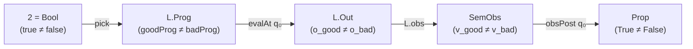

<!-- Copyright 2026 The Fuchsia Authors

Licensed under a BSD-style license <LICENSE-BSD>, Apache License, Version 2.0
<LICENSE-APACHE or https://www.apache.org/licenses/LICENSE-2.0>, or the MIT
license <LICENSE-MIT or https://opensource.org/licenses/MIT>, at your option.
This file may not be copied, modified, or distributed except according to
those terms. -->

# Universal Characterizations of Non-Degenerate Program Algebras from Model Theory, Universal Algebra, Category Theory, and PL Theory

## Summary

When does a formal specification framework or program algebra genuinely
constrain executable behavior rather than collapsing into vacuity? Across
denotational semantics, refinement calculus, universal algebra, category theory,
and institutional model theory, four classical universal characterizations
answer this question from complementary angles:

1. **Plotkin's Computational Adequacy and Milner's Full Abstraction at Ground
   Observables (1977):** A denotational model faithfully reflects operational
   evaluation if and only if it is computationally adequate at a distinguished
   sort of ground observables $\iota$ (such as Booleans or natural numbers),
   quotienting out unobservable representation slack while preserving distinct
   ground outcomes ($\llbracket \text{true} \rrbracket \neq \llbracket
   \text{false} \rrbracket$).
2. **Dijkstra–Nelson–Morgan–Back–von Wright Refinement Lattices and Powerdomain
   Orderings (1975–1998):** In a pointed demonic refinement lattice bounded
   below by the infeasible miracle $\bot$ and above by undefined chaos $\top$,
   every one-sided verification pathology collapses the inequality $\text{impl}
   \sqsubseteq \text{spec}$ to a lattice extremum ($\text{impl} = \bot$ or
   $\text{spec} = \top$). Non-vacuous verification requires a **strictly
   bounded two-sided refinement sandwich** $\bot \sqsubset_{q_0} \text{impl}
   \sqsubseteq \text{spec} \sqsubset_{q_0} \top$.
3. **Birkhoff–Stone–Lawvere Two-Point Separation ($\mathbf{0} \neq \mathbf{1}$,
   1935–1964):** By Stone's representation theorem and Birkhoff's subdirect
   representation theorem, a bounded distributive lattice or Boolean algebra $A$
   is non-degenerate ($\bot_A \neq \top_A$) if and only if it admits a
   homomorphism onto the two-element algebra $\mathbf{2} = \{0, 1\}$. Dually,
   constructing a factorized identity morphism on $\mathbf{2}$,
   $$\mathbf{2} \xrightarrow{\text{pick}} \text{Prog} \xrightarrow{\text{evalAt } q_0} \text{Out} \xrightarrow{\text{obs}} \text{SemObs} \xrightarrow{\text{obsPost } q_0} \text{Prop},$$
   proves in a single functorial stroke that every intermediate carrier has
   cardinality at least $2$, every intermediate morphism is non-constant, and
   the specification predicate is neither $\bot$ nor $\top$.
4. **Goguen–Burstall Institutions, Cousot–Cousot Galois Insertions,
   Abadi–Lamport Refinement Mappings, and ADJ/Rutten Final Coalgebras
   (1977–2000):** Cross-language compilation (`BehaviorCodec`) is an
   institution morphism equipped with a Galois retraction on queries, a partial
   Galois retraction on outcomes, and a coalgebraic bisimulation invariant over
   the shared observable spine $\text{SemObs}$. Together with productive target
   witnesses (`ProductiveCompiles`), it satisfies a **Two-Sided Institution
   Satisfaction Condition** that transports both universal positive
   satisfaction ($\forall q$) and existential two-point Stone separation
   ($v_{\text{good}} \neq v_{\text{bad}}$) from source to target.

We synthesize these four traditions, map each characterization to Anneal's
`Trusted/Refinement.lean` kernel, and mechanize the unified theory in
[`support/UniversalAlgebraAndInstitutions.lean`](support/UniversalAlgebraAndInstitutions.lean)
(1,812 lines of standalone Lean `v4.34.1`, `prelude` + `import Init.Core`, zero
`sorryAx`, zero `Classical.choice`, zero `Lean.ofReduceBool`).

## Applicability

This report applies to:

- **Anneal's Ground-Up Verification Kernel (`trusted/lean/Trusted/Refinement.lean`
  in `joshlf/anneal@e6a0b2da5ec39a4c0cfd22bf323885022837b5dc`):** specifically
  `Partial`, `Language SemObs`, `SpineSpecOn`, `ProductiveOn`, `NonVacuousOn`,
  `VerifiedSpineWithCanaries`, `BehaviorCodec`, `Compiles`, and
  `ProductiveCompiles`.
- **Lean 4.34.1 (`leanprover/lean4:v4.34.1`, commit
  `5045d0056413266e57c625dcd7c365b10e377c52`):** evaluated with
  `-DElab.async=false -Ddebug.skipKernelTC=false` on the standalone 1,812-line
  mechanization in
  [`support/UniversalAlgebraAndInstitutions.lean`](support/UniversalAlgebraAndInstitutions.lean)
  (`prelude`, `import Init.Core`, zero axioms across all `#print axioms` checks).

## Findings

### 1. Executive Summary & Synthesis Table

Anneal's ground-up verification architecture (`Trusted/Refinement.lean`) rests
on four design primitives:

1. A language semantic signature `Language SemObs` whose outcomes `Out` project
   onto a shared ground observation type `SemObs` via `L.obs : Out → SemObs`.
2. A pointed refinement lattice `Partial (Out → Prop)` ordered by
   $x \le y \iff (y.\text{defined} \to \exists h : x.\text{defined}, \forall a,
   x.\text{val}\ h\ a \to y.\text{val}\ h_y\ a)$.
3. A two-sided verification judgment `VerifiedSpineWithCanaries` that pairs a
   conforming program `goodProg` (verified and productive on `pre`) with a
   productive mutant `badProg` (refuted on `pre`) at a common input query $q_0$.
4. A cross-language translation certificate `BehaviorCodec L₁ L₂` paired with
   `Compiles` and `ProductiveCompiles`.

The table below summarizes how each primitive realizes a universal theorem from
programming language theory, universal algebra, category theory, or model
theory, together with its mechanized theorem in
[`support/UniversalAlgebraAndInstitutions.lean`](support/UniversalAlgebraAndInstitutions.lean).

| Classical Mathematical Characterization | Primary Literature | Universal Criterion for Non-Degeneracy / Faithfulness | Anneal Kernel Realization (`Trusted/Refinement.lean`) | Mechanized Theorem in `support/UniversalAlgebraAndInstitutions.lean` |
| :--- | :--- | :--- | :--- | :--- |
| **Computational Adequacy & Full Abstraction at Ground Sort $\iota$** | Plotkin (1977); Milner (1977) | Ground contexts $C[\cdot] : \iota$ quotient representation slack while separating distinct ground values ($\llbracket \text{true} \rrbracket \neq \llbracket \text{false} \rrbracket$). | `SemObs`, `L.obs : Out → SemObs`, `L.SpineSpecOn pre obsPost` | [`ObsEquiv.equivalence`](support/UniversalAlgebraAndInstitutions.lean#L1058), [`spineSpecOn_invariant_under_obsEquiv`](support/UniversalAlgebraAndInstitutions.lean#L1070), [`spineSpecOn_unique_factorization`](support/UniversalAlgebraAndInstitutions.lean#L1088), [`plotkin_inadequate_obs_collapses_verification`](support/UniversalAlgebraAndInstitutions.lean#L1107) |
| **Law of the Excluded Miracle & Demonic Refinement Sandwich** | Dijkstra (1975, 1976); Nelson (1989); Morgan (1988, 1990); Back & von Wright (1998); Plotkin (1976); Smyth (1978) | A command $S$ and specification $T$ avoid vacuity at $q_0$ iff $\bot \sqsubset_{q_0} S(q_0) \sqsubseteq T(q_0) \sqsubset_{q_0} \top_{\text{def}} \sqsubset \top_{\text{ub}}$. | `Partial.bot` ($\bot$), `Partial.chaosDef` ($\top_{\text{def}}$), `Partial.ub` ($\top_{\text{ub}}$), `ProductiveOn`, `NonVacuousOn` | [`Partial.excluded_miracle_imp_not_le_bot`](support/UniversalAlgebraAndInstitutions.lean#L759), [`BoundedRefinementSandwich`](support/UniversalAlgebraAndInstitutions.lean#L903), [`boundedRefinementSandwich_separates_levels`](support/UniversalAlgebraAndInstitutions.lean#L923), [`boundedRefinementSandwich_of_verifiedSpine_witness`](support/UniversalAlgebraAndInstitutions.lean#L972), [`boundedRefinementSandwich_converse`](support/UniversalAlgebraAndInstitutions.lean#L1002) |
| **Stone $0 \neq 1$ Two-Point Homomorphism & Lawvere Separator** | Birkhoff (1935, 1944); Stone (1936, 1937); Lawvere (1964) | A bounded lattice is non-trivial ($\bot \neq \top$) iff it admits a homomorphism onto $\mathbf{2}$; any factorization of $\text{id}_{\mathbf{2}}$ is injective on $\mathbf{2}$ at every stage. | `VerifiedSpineWithCanariesOn` (`goodProg` vs. `badProg` at $q_0$) | [`TwoPointFactorization`](support/UniversalAlgebraAndInstitutions.lean#L363), [`twoPointFactorization_nondegeneracy`](support/UniversalAlgebraAndInstitutions.lean#L419), [`verifiedSpineWithCanariesOn_four_way_squeeze`](support/UniversalAlgebraAndInstitutions.lean#L556), [`verifiedSpine_witness_induces_twoPointFactorization`](support/UniversalAlgebraAndInstitutions.lean#L634) |
| **Institutions, Galois Insertions, Refinement Mappings & Final Coalgebras** | Goguen & Burstall (1984, 1992); Cousot & Cousot (1977, 1979); Abadi & Lamport (1991); ADJ (1977); Rutten (2000) | Satisfaction invariance $M_2 \models \sigma(\varphi) \iff \text{Mod}(\sigma)(M_2) \models \varphi$ plus productive witnesses preserve both universal compliance and two-point separation across compilation. | `BehaviorCodec`, `decodeQuery_encodeQuery`, `decodeOut_encodeOut`, `obs_decodeOut`, `Compiles`, `ProductiveCompiles` | [`institution_satisfaction_iff`](support/UniversalAlgebraAndInstitutions.lean#L1214), [`compiles_transfers_spineSpecOn`](support/UniversalAlgebraAndInstitutions.lean#L1251), [`codec_transfers_two_point_separation`](support/UniversalAlgebraAndInstitutions.lean#L1295), [`codec_transfers_verifiedSpineWithCanaries`](support/UniversalAlgebraAndInstitutions.lean#L1487), [`codec_transfers_two_point_separation_of_witness`](support/UniversalAlgebraAndInstitutions.lean#L1543) |

### 2. Plotkin (1977) & Milner (1977): Computational Adequacy and Full Abstraction at Ground Observables

#### 2.1 Plotkin (1977): Computational Adequacy at Ground Types

- **Citation:** Gordon D. Plotkin (1977), *"LCF Considered as a Programming
  Language"*, *Theoretical Computer Science*, Vol. 5, No. 3, pp. 223–255,
  December 1977. DOI:
  [10.1016/0304-3975(77)90044-5](https://doi.org/10.1016/0304-3975(77)90044-5).

Plotkin studies PCF, a typed $\lambda$-calculus over ground base types
$\iota \in \{o, \text{nat}\}$ (where $o = \{\mathbf{tt}, \mathbf{ff}\}$ is the
sort of Booleans and $\text{nat} = \{\underline{0}, \underline{1}, \dots\}$ is
the sort of natural numbers), equipped with a small-step operational evaluation
relation $M \xrightarrow{*} c$ for ground constants $c : \iota$ and a
Scott-continuous denotational semantics $\llbracket - \rrbracket$.

- **Exact Mathematical Definition (Computational Adequacy at Ground Sort
  $\iota$, Plotkin 1977, Section 3, Theorem 3.1, pp. 232–236):** A denotational
  semantics $\llbracket - \rrbracket$ is **computationally adequate** at ground
  type $\iota$ if for every closed term $M : \iota$ and every ground constant
  $c : \iota$,
  $$M \xrightarrow{*} c \iff \llbracket M \rrbracket = \llbracket c \rrbracket,$$
  where the ground flat domain $D_\iota = V_\iota \cup \{\bot\}$ interprets
  distinct ground constants as distinct non-bottom elements ($\llbracket c_1
  \rrbracket \neq \llbracket c_2 \rrbracket$ for $c_1 \neq c_2$, and $\llbracket
  c \rrbracket \neq \bot$).
- **Why Ground-Type Adequacy Is Necessary:** At higher types $\sigma \to \tau$,
  programs are compared only by how they behave when supplied with arguments and
  projected down to a ground type $\iota$. If the semantic domain or observation
  projection at $\iota$ collapses distinct ground constants ($\llbracket
  \mathbf{tt} \rrbracket = \llbracket \mathbf{ff} \rrbracket$) or conflates
  divergence with termination ($\llbracket \Omega \rrbracket = \llbracket c
  \rrbracket$), then the denotational model becomes trivial: inequivalent
  computations receive identical denotations, and equational or refinement
  proofs in the model no longer entail operational correctness.

#### 2.2 Milner (1977): Contextual Equivalence via Ground Observable Contexts

- **Citation:** Robin Milner (1977), *"Fully Abstract Models of Typed
  $\lambda$-Calculi"*, *Theoretical Computer Science*, Vol. 4, No. 1, pp. 1–22,
  February 1977. DOI:
  [10.1016/0304-3975(77)90053-6](https://doi.org/10.1016/0304-3975(77)90053-6).

Milner complements Plotkin's adequacy theorem by characterizing the coarsest
congruence on programs that respects ground observations.

- **Exact Mathematical Definition (Contextual Preorder and Equivalence, Milner
  1977, Section 2, pp. 3–6; Plotkin 1977, Section 4, p. 236):** Two terms
  $M, N : \sigma$ are **contextually equivalent** ($M \approx_{\text{ctx}} N$)
  if for every closing program context $C[\cdot] : \iota$ of ground observable
  type $\iota$ and every ground constant $c : \iota$,
  $$C[M] \xrightarrow{*} c \iff C[N] \xrightarrow{*} c.$$
  A model $\mathcal{M}$ is **inequationally fully abstract** if
  $$\llbracket M \rrbracket_{\mathcal{M}} \sqsubseteq \llbracket N \rrbracket_{\mathcal{M}} \iff M \lesssim_{\text{ctx}} N,$$
  and **equationally fully abstract** if
  $\llbracket M \rrbracket_{\mathcal{M}} = \llbracket N \rrbracket_{\mathcal{M}}
  \iff M \approx_{\text{ctx}} N$.
- **Role of Ground Observables as a Quotient:** Contextual equivalence
  deliberately ignores internal representation details (closure layouts,
  register allocations, intermediate reductions) that cannot be detected by any
  ground context $C[\cdot] : \iota$. Simultaneously, it strictly separates any
  two programs whose outcomes map to distinct ground values in $\iota$.

#### 2.3 Mapping to Anneal: `SemObs`, `L.obs`, and `ObsEquiv`

Anneal's `Language SemObs` structure in `Trusted/Refinement.lean` internalizes
Plotkin's and Milner's ground observation discipline directly in its signature:

```lean
structure Language (SemObs : Type u) where
  Prog  : Type u
  Query : Type u
  Out   : Type u
  obs   : Out → SemObs
  sem   : Prog → Query → Partial (Out → Prop)
```

1. **Representation Slack vs. Observable Spine:** Concrete execution outcomes
   `o : L.Out` in a low-level language (such as x86-64 machine states or MIR
   frames) contain unobservable representation slack: caller-saved scratch
   registers (`r11`, `xmm0`), stack spill slots, uninitialized struct padding
   bytes, or allocator metadata. Requiring cross-language compilers to preserve
   `L.Out` on the nose would violate full abstraction by exposing implementation
   slack.
2. **Ground Observation Quotient (`ObsEquiv`):** The projection `L.obs : Out →
   SemObs` maps each concrete outcome to Plotkin's ground observation sort
   `SemObs`. In
   [`support/UniversalAlgebraAndInstitutions.lean`](support/UniversalAlgebraAndInstitutions.lean#L1042-L1063),
   we define the kernel equivalence relation:
   $$\text{ObsEquiv}\ L\ o_1\ o_2 :\iff L.\text{obs}(o_1) = L.\text{obs}(o_2).$$
   Theorem
   [`spineSpecOn_invariant_under_obsEquiv`](support/UniversalAlgebraAndInstitutions.lean#L1070-L1076)
   and Theorem
   [`spineSpecOn_unique_factorization`](support/UniversalAlgebraAndInstitutions.lean#L1088-L1094)
   prove that every spine specification `L.SpineSpecOn pre obsPost` is invariant
   under `ObsEquiv L` and factors uniquely through `SemObs`.
3. **Computational Adequacy via Canary Separation:** Conversely, if `L.obs` is
   computationally inadequate—collapsing the concrete outcome $o_{\text{good}}$
   of `goodProg` and the concrete outcome $o_{\text{bad}}$ of a mutant `badProg`
   to the same ground observation $L.\text{obs}(o_{\text{good}}) =
   L.\text{obs}(o_{\text{bad}})$—then Theorem
   [`plotkin_inadequate_obs_collapses_verification`](support/UniversalAlgebraAndInstitutions.lean#L1107-L1142)
   proves that *no* spine specification `L.SpineSpecOn pre obsPost` can
   simultaneously verify `goodProg` and refute `badProg` at $q_0$. Thus,
   Anneal's `VerifiedSpineWithCanariesOn` enforces Plotkin's ground adequacy at
   every witnessed query $q_0$: $L.\text{obs}(o_{\text{good}}) \neq
   L.\text{obs}(o_{\text{bad}})$.

### 3. Refinement Algebras, Predicate Transformer Lattices, and Demonic/Angelic Duality

#### 3.1 Dijkstra (1975, 1976): Healthiness Conditions and the Law of the Excluded Miracle

- **Citations:**
  - Edsger W. Dijkstra (1975), *"Guarded Commands, Nondeterminacy and Formal
    Derivation of Programs"*, *Communications of the ACM*, Vol. 18, No. 8,
    pp. 453–457, August 1975. DOI:
    [10.1145/360933.360975](https://doi.org/10.1145/360933.360975).
  - Edsger W. Dijkstra (1976), *A Discipline of Programming*, Prentice-Hall
    Series in Automatic Computation, Englewood Cliffs, NJ, 1976, xvii + 217 pp.,
    ISBN: `0-13-215871-X` (Chapter 3, *"The Characterization of Semantics"*,
    pp. 15–23).

Dijkstra defines the semantics of a statement $S$ via its weakest precondition
predicate transformer $wp(S, -) : \text{Pred}(\Sigma) \to \text{Pred}(\Sigma)$,
mapping any postcondition $R$ to the weakest precondition $wp(S, R)$ that
guarantees $S$ terminates in a state satisfying $R$.

- **Exact Mathematical Statement (Dijkstra's Four Healthiness Laws, 1976,
  Chapter 3, pp. 18–19):**
  1. **Law 1 (Law of the Excluded Miracle):** For every command $S$,
     $$wp(S, \text{false}) = \text{false}.$$
     No executable command can establish the empty postcondition $\text{false}$.
  2. **Law 2 (Monotonicity):** For all postconditions $Q, R$,
     $$(Q \Rightarrow R) \implies (wp(S, Q) \Rightarrow wp(S, R)).$$
  3. **Law 3 (Conjunctivity):** For all postconditions $Q, R$,
     $$wp(S, Q) \land wp(S, R) = wp(S, Q \land R).$$
  4. **Law 4 (Continuity / Or-Continuity):** For any ascending chain $R_0
     \Rightarrow R_1 \Rightarrow \cdots$,
     $$wp\left(S, \exists k \ge 0,\ R_k\right) = \exists k \ge 0,\ wp(S, R_k).$$

#### 3.2 Nelson (1989): Partial Commands, Guarded Miracles, and Vacuous Refinement

- **Citation:** Greg Nelson (1989), *"A Generalization of Dijkstra's Calculus"*,
  *ACM Transactions on Programming Languages and Systems (TOPLAS)*, Vol. 11,
  No. 4, pp. 517–561, October 1989. DOI:
  [10.1145/69562.69564](https://doi.org/10.1145/69562.69564).

Nelson drops Dijkstra's Law 1 to obtain a calculus of **partial commands** where
guards $P \to S$ and unbounded choice behave uniformly.

- **Exact Mathematical Definitions (Nelson 1989, Section 2, pp. 519–525):**
  - The **guard** of a command $S$ is the set of initial states from which $S$
    cannot miraculously succeed with an empty outcome set:
    $$\text{grd}(S) := \neg wp(S, \text{false}).$$
  - A guarded command $P \to S$ has weakest precondition $wp(P \to S, R) = P
    \Rightarrow wp(S, R)$.
  - The **unguarded miracle** (`fail` / `magic`, $\text{false} \to S$) satisfies
    $$wp(\text{magic}, R) = \text{true} \quad \text{for every } R, \quad \text{so} \quad \text{grd}(\text{magic}) = \text{false}.$$
  - In the demonic refinement order $S_1 \sqsubseteq S_2 :\iff \forall R,\
    wp(S_1, R) \Rightarrow wp(S_2, R)$, `magic` is the top element in the
    implementability order (or bottom element $\bot$ in Anneal's behavioral
    inclusion order $\text{impl} \le \text{spec}$): it refines *every*
    specification vacuously because its set of reachable outcomes at $q_0$ is
    empty ($\emptyset \subseteq P$).

#### 3.3 Morgan (1988, 1990) & Back and von Wright (1998): Predicate Transformer Lattices

- **Citations:**
  - Carroll Morgan (1988), *"The Specification Statement"*, *ACM Transactions on
    Programming Languages and Systems (TOPLAS)*, Vol. 10, No. 3, pp. 403–419,
    July 1988. DOI: [10.1145/44501.44503](https://doi.org/10.1145/44501.44503).
  - Carroll Morgan (1990; 2nd ed. 1994), *Programming from Specifications*,
    Prentice Hall International Series in Computer Science, Hemel Hempstead, UK,
    ISBN: `0-13-726225-6` (1st ed.) / `0-13-123274-6` (2nd ed.).
  - Ralph-Johan Back and Joakim von Wright (1998), *Refinement Calculus: A
    Systematic Introduction*, Graduate Texts in Computer Science,
    Springer-Verlag, New York, xvi + 519 pp., ISBN: `978-0-387-98417-9`, DOI:
    [10.1007/978-1-4612-1674-2](https://doi.org/10.1007/978-1-4612-1674-2).

Back and von Wright (1998, Chapters 3, 11, and 15) formalize predicate
transformers over a complete Boolean lattice $\text{Pred}(\Sigma)$ as a complete
lattice equipped with two dual extremes and two dual forms of nondeterminism:

- **Lattice Extrema (Back & von Wright 1998, Section 3.3, pp. 53–58):**
  - **Chaos ($\text{abort}$):** $wp(\text{abort}, R) = \text{false}$ for all
    $R$. Operationally, $\text{abort}$ is undefined behavior
    (`defined = False`): no postcondition is guaranteed.
  - **Miracle ($\text{magic}$):** $wp(\text{magic}, R) = \text{true}$ for all
    $R$. Operationally, $\text{magic}$ has `defined = True` and outcome set
    $\emptyset$.
- **Strictness vs. Co-Strictness (Feasibility vs. Termination):**
  - A predicate transformer $f$ is **strict** (satisfies the Law of the Excluded
    Miracle / is *feasible*, Morgan 1988, Definition 2, p. 406) iff $f(\bot) =
    \bot$.
  - A predicate transformer $f$ is **co-strict** (always *terminating* /
    defined) iff $f(\top) = \top$.
- **Demonic vs. Angelic Nondeterminism (Back & von Wright 1998, Chapter 15):**
  Demonic choice $S_1 \sqcap S_2$ takes the meet of weakest preconditions
  $wp(S_1 \sqcap S_2, R) = wp(S_1, R) \land wp(S_2, R)$ (every demonically
  reachable outcome must satisfy $R$), whereas angelic choice $S_1 \sqcup S_2$
  takes the join $wp(S_1 \sqcup S_2, R) = wp(S_1, R) \lor wp(S_2, R)$ (at least
  one reachable outcome satisfies $R$).

#### 3.4 Plotkin (1976) & Smyth (1978): Powerdomain Orderings

- **Citations:**
  - Gordon D. Plotkin (1976), *"A Powerdomain Construction"*, *SIAM Journal on
    Computing*, Vol. 5, No. 3, pp. 452–487, September 1976. DOI:
    [10.1137/0205035](https://doi.org/10.1137/0205035).
  - Michael B. Smyth (1978), *"Power Domains"*, *Journal of Computer and System
    Sciences*, Vol. 16, No. 1, pp. 23–36, February 1978. DOI:
    [10.1016/0022-0000(78)90048-X](https://doi.org/10.1016/0022-0000(78)90048-X).

In domain theory, nondeterministic computations over a flat domain $D_\bot = X
\cup \{\bot\}$ are ordered by three classical powerdomain preorders on subsets
$A, B \subseteq D_\bot$:

1. **Hoare (Lower) Powerdomain ($\sqsubseteq_H$):** $A \sqsubseteq_H B \iff
   \forall x \in A, \exists y \in B,\ x \sqsubseteq y$. Captures partial
   correctness only; ignores divergence ($\bot \in A$).
2. **Smyth (Upper / Demonic) Powerdomain ($\sqsubseteq_S$, Smyth 1978, Section
   2, pp. 25–28):**
   $$A \sqsubseteq_S B \iff \forall y \in B, \exists x \in A,\ x \sqsubseteq y.$$
   On flat domains where $x \sqsubseteq y \iff (x = \bot \lor x = y)$, reversing
   the direction from "more deterministic" to behavioral inclusion ($\text{impl}
   \le \text{spec}$) yields: if $\text{spec}$ forbids $\bot$ ($\bot \notin
   \text{spec}$, i.e., `spec.defined`), then $\text{impl}$ must also forbid
   $\bot$ (`impl.defined`) and every outcome of $\text{impl}$ must belong to
   $\text{spec}$ ($\text{impl.val} \subseteq \text{spec.val}$).
3. **Plotkin (Convex / Egli-Milner) Powerdomain ($\sqsubseteq_{EM}$, Plotkin
   1976, Section 3, p. 462):** $A \sqsubseteq_{EM} B \iff (A \sqsubseteq_H B)
   \land (A \sqsubseteq_S B)$. Combines demonic safety ($\sqsubseteq_S$) with
   existential liveness ($\sqsubseteq_H$: non-empty witness existence).

#### 3.5 Mapping to Anneal: `Partial (Out → Prop)` and the Bounded Refinement Sandwich

Anneal's `Partial (Out → Prop)` (`Trusted/Refinement.lean`) is the pointed
demonic refinement lattice on outcome predicates:

```lean
structure Partial (α : Sort u) : Type (max 1 u) where
  defined : Prop
  val     : defined → α

instance [LE α] : LE (Partial α) where
  le x y := y.defined → ∃ hx : x.defined, ∀ hy : y.defined, x.val hx ≤ y.val hy
```

Note that Anneal writes $x \le y$ (`impl ≤ spec`) in the **behavioral subset /
refinement order** (dual to Back & von Wright's $S_1 \sqsubseteq S_2$): smaller
elements are *more constrained* implementations, and larger elements are *more
permissive* specifications. In this lattice (mechanized in Section 2 of
[`support/UniversalAlgebraAndInstitutions.lean`](support/UniversalAlgebraAndInstitutions.lean#L111-L146)):

- **Bottom ($\bot = \text{Partial.bot}$):** `defined := True`, `val := fun _ _
  => False` (Nelson's unguarded miracle `magic`). By Theorem
  [`Partial.bot_le`](support/UniversalAlgebraAndInstitutions.lean#L713-L714),
  $\forall x,\ \bot \le x$.
- **Defined Chaos ($\top_{\text{def}} = \text{Partial.chaosDef}$):**
  `defined := True`, `val := fun _ _ => True` (defined execution with an
  unconstrained postcondition `True`). By Theorem
  [`Partial.le_chaosDef_of_defined`](support/UniversalAlgebraAndInstitutions.lean#L725-L727),
  every defined behavior satisfies $x \le \top_{\text{def}}$.
- **Undefined Chaos ($\top_{\text{ub}} = \text{Partial.ub}$):** `defined :=
  False`, `val := False.elim` (Dijkstra/Back–von Wright's $\text{abort}$). By
  Theorem [`Partial.le_ub`](support/UniversalAlgebraAndInstitutions.lean#L719-L720),
  $\forall x,\ x \le \top_{\text{ub}}$, and by Theorem
  [`Partial.chaosDef_strictlyRefines_ub`](support/UniversalAlgebraAndInstitutions.lean#L731-L734),
  $\top_{\text{def}} <_{\text{r}} \top_{\text{ub}}$.

Every one-sided formal verification failure mode is a collapse of
$\text{impl}(q_0) \le \text{spec}(q_0)$ to one of these lattice extrema:

1. **Infeasible / Dead Semantics ($\text{impl}(q_0) = \bot$):** The semantics
   produces no outcomes at $q_0$, satisfying any defined specification via
   $\bot \le \text{spec}(q_0)$. Excluded by Dijkstra's Law 1 (`ProductiveOn`),
   which by Theorem
   [`Partial.strictly_above_bot_of_productive`](support/UniversalAlgebraAndInstitutions.lean#L770-L772)
   enforces $\bot <_{\text{r}} L.\text{sem}(\text{goodProg}, q_0)$.
2. **Vacuous Precondition ($\text{spec}(q_0) = \top_{\text{ub}}$):** `pre q₀` is
   `False`, so `spec(q₀) = Partial.ub` and
   $\text{impl}(q_0) \le \top_{\text{ub}}$ holds trivially. Excluded by
   `NonVacuousOn` (`pre q₀`), which by Theorem
   [`Partial.defined_imp_not_ub_le`](support/UniversalAlgebraAndInstitutions.lean#L809-L810)
   enforces $\text{spec}(q_0) <_{\text{r}} \top_{\text{ub}}$.
3. **Trivial Postcondition ($\text{spec}(q_0) = \top_{\text{def}}$):** `obsPost
   q₀` is universally `True`, so `spec(q₀) = Partial.chaosDef` and any defined
   program satisfies $\text{impl}(q_0) \le \top_{\text{def}}$. Excluded by the
   refuted productive canary `badProg`, which produces a concrete outcome
   $o_{\text{bad}}$ with
   $\neg \text{obsPost}(q_0, L.\text{obs}(o_{\text{bad}}))$ and therefore by
   Theorem
   [`Partial.strictly_below_chaosDef_of_refuted_outcome`](support/UniversalAlgebraAndInstitutions.lean#L842-L846)
   enforces $\text{spec}(q_0) <_{\text{r}} \top_{\text{def}}$.

Combining all three bounds yields the **Four-Level Bounded Refinement Sandwich**
(`BoundedRefinementSandwich`, mechanized in
[`boundedRefinementSandwich_of_verifiedSpine_witness`](support/UniversalAlgebraAndInstitutions.lean#L972-L995)
and its converse
[`boundedRefinementSandwich_converse`](support/UniversalAlgebraAndInstitutions.lean#L1002-L1026)):

$$\bot \;<\!_{\text{r}}\; L.\text{sem}(\text{goodProg}, q_0) \;\le\; L.\text{SpineSpecOn}(\text{pre}, \text{obsPost}, q_0) \;<\!_{\text{r}}\; \top_{\text{def}} \;<\!_{\text{r}}\; \top_{\text{ub}}.$$

### 4. Universal Algebra, Stone Duality, and Birkhoff Subdirect Representation (The 0 ≠ 1 Two-Point Separation Characterization)

#### 4.1 Birkhoff (1935, 1944): Variety Degeneracy and Subdirect Representation

- **Citations:**
  - Garrett Birkhoff (1935), *"On the Structure of Abstract Algebras"*,
    *Mathematical Proceedings of the Cambridge Philosophical Society*, Vol. 31,
    No. 4, pp. 433–454, October 1935. DOI:
    [10.1017/S0305004100013463](https://doi.org/10.1017/S0305004100013463).
  - Garrett Birkhoff (1944), *"Subdirect Unions in Universal Algebra"*,
    *Bulletin of the American Mathematical Society*, Vol. 50, No. 10,
    pp. 764–768, October 1944. DOI:
    [10.1090/S0002-9904-1944-08235-9](https://doi.org/10.1090/S0002-9904-1944-08235-9).

Birkhoff establishes the foundational theorems of universal algebra:

- **Exact Mathematical Statement (Birkhoff's HSP Theorem, 1935, Theorem 10,
  p. 441; Degenerate Varieties):** An equational class (variety) $\mathcal{V}$
  of $\Sigma$-algebras is **degenerate** (every $A \in \mathcal{V}$ has $|A| \le
  1$) if and only if $\mathcal{V} \models x = y$. Equivalently, an algebra $A$
  is non-trivial ($|A| \ge 2$) if and only if it possesses at least one pair of
  distinct elements $a_0 \neq a_1$.
- **Exact Mathematical Statement (Birkhoff's Subdirect Representation Theorem,
  1944, Theorem 1, p. 765):** Every algebra $A$ is isomorphic to a subdirect
  product of subdirectly irreducible quotient algebras $A / \theta_i$, where
  $\bigcap_{i \in I} \theta_i = \Delta_A$. In the variety of bounded
  distributive lattices (or Boolean algebras), the **unique non-trivial
  subdirectly irreducible algebra** is the two-element algebra
  $\mathbf{2} = \{0, 1\}$. Consequently, a bounded distributive lattice $A$ has
  $\bot_A \neq \top_A$ if and only if $A$ admits at least one surjective lattice
  homomorphism $h : A \twoheadrightarrow \mathbf{2}$.

#### 4.2 Stone (1936, 1937): Two-Element Homomorphisms and Prime Filter Separation

- **Citations:**
  - Marshall H. Stone (1936), *"The Theory of Representations for Boolean
    Algebras"*, *Transactions of the American Mathematical Society*, Vol. 40,
    No. 1, pp. 37–111, July 1936. DOI:
    [10.1090/S0002-9947-1936-1501865-8](https://doi.org/10.1090/S0002-9947-1936-1501865-8).
  - Marshall H. Stone (1937), *"Topological Representations of Distributive
    Lattices and Brouwerian Logics"*, *Časopis pro pěstování matematiky a
    fysiky*, Vol. 67, No. 1, pp. 1–25, 1937. DOI:
    [10.21136/CPMF.1937.124080](https://doi.org/10.21136/CPMF.1937.124080).

- **Exact Mathematical Statement (Stone's Prime Ideal / Homomorphism Separation
  Theorem, Stone 1936, Theorem 64, p. 97; Stone 1937, Theorem 4, p. 7):** Let
  $A$ be a bounded distributive lattice with bottom $0_A$ and top $1_A$. Then:
  1. For any $a, b \in A$ with $a \not\le b$, there exists a bounded lattice
     homomorphism $\chi : A \to \mathbf{2}$ (equivalently, a prime filter $F
     \subseteq A$) such that $\chi(a) = 1$ and $\chi(b) = 0$.
  2. In particular, $A$ is **non-degenerate** ($0_A \neq 1_A$) if and only if
     $\text{Hom}_{\mathbf{BDLat}}(A, \mathbf{2}) \neq \emptyset$.

#### 4.3 Lawvere (1964): Generators, Separators, and Two-Value Coseparators

- **Citation:** F. William Lawvere (1964), *"An Elementary Theory of the
  Category of Sets"*, *Proceedings of the National Academy of Sciences of the
  United States of America (PNAS)*, Vol. 52, No. 6, pp. 1506–1511, December
  1964. DOI: [10.1073/pnas.52.6.1506](https://doi.org/10.1073/pnas.52.6.1506).

Lawvere axiomatizes $\mathbf{Set}$ and Boolean-valued classification using the
terminal object $\mathbf{1}$ (a generator / separator) and the two-element
truth-value object $\mathbf{2} = \mathbf{1} + \mathbf{1}$ (a coseparator):

- **Exact Mathematical Statement (Two-Point Factorization Lemma):** In any
  category $\mathcal{C}$ with a two-point object $\mathbf{2} = \{\mathbf{tt},
  \mathbf{ff}\}$ ($\mathbf{tt} \neq \mathbf{ff}$), suppose a chain of morphisms
  $$\mathbf{2} \xrightarrow{f_1} X_1 \xrightarrow{f_2} X_2 \xrightarrow{f_3} \cdots \xrightarrow{f_n} X_n \xrightarrow{p} \Omega$$
  separates the two points of $\mathbf{2}$ at the end of the chain:
  $$p(f_n(\cdots f_1(\mathbf{tt})\cdots)) \neq p(f_n(\cdots f_1(\mathbf{ff})\cdots)).$$
  Then by congruence of function application (contrapositive of $x = y \implies
  g(x) = g(y)$), **every intermediate prefix and suffix is non-degenerate**:
  1. Every intermediate object $X_k$ contains at least two distinct elements
     $x_k^+ \neq x_k^-$ (so $\neg \text{Subsingleton}(X_k)$).
  2. Every morphism $f_k : X_{k-1} \to X_k$ ($k \ge 2$) and the classifier $p :
     X_n \to \Omega$ is **non-constant** ($\neg \exists c, \forall x,\ f_k(x) =
     c$).
  3. When $\Omega = \text{Prop}$ with $p(x_n^+) = \text{True}$ and $p(x_n^-) =
     \text{False}$, the predicate $p$ is neither universally $\text{True}$
     ($\top$) nor universally $\text{False}$ ($\bot$).

#### 4.4 Mapping to Anneal: `TwoPointFactorization` and `VerifiedSpineWithCanaries`

Anneal's `VerifiedSpineWithCanaries` (`Trusted/Refinement.lean`) pairs a
verified, productive program `goodProg` with a refuted, productive mutant
`badProg` at a common precondition witness $q_0$:



At the witnessed query $q_0$, `goodProg` yields a concrete outcome
$o_{\text{good}} : L.\text{Out}$ with $\text{obsPost}(q_0,
L.\text{obs}(o_{\text{good}})) = \text{True}$, while `badProg` yields a concrete
outcome $o_{\text{bad}} : L.\text{Out}$ with $\neg \text{obsPost}(q_0,
L.\text{obs}(o_{\text{bad}}))$.

In Section 1 of
[`support/UniversalAlgebraAndInstitutions.lean`](support/UniversalAlgebraAndInstitutions.lean#L363-L664),
we formalize this as the structure `TwoPointFactorization P O S` and prove the
universal theorem
[`twoPointFactorization_nondegeneracy`](support/UniversalAlgebraAndInstitutions.lean#L419-L465)
and its specialization
[`verifiedSpineWithCanariesOn_four_way_squeeze`](support/UniversalAlgebraAndInstitutions.lean#L556-L624).
Because the composite $\text{Bool} \to L.\text{Prog} \to L.\text{Out} \to
\text{SemObs} \to \text{Prop}$ maps `true` to a true proposition and `false` to
a false proposition, **one single factorization proof** simultaneously
establishes:

1. **Program Diversity:** $\text{goodProg} \neq \text{badProg}$, $\neg
   \text{Subsingleton}(L.\text{Prog})$, and $L.\text{sem}(\text{goodProg}) \neq
   L.\text{sem}(\text{badProg})$.
2. **Concrete Outcome Diversity:** $o_{\text{good}} \neq o_{\text{bad}}$ and
   $\neg \text{Subsingleton}(L.\text{Out})$.
3. **Observable Spine Diversity:** $L.\text{obs}(o_{\text{good}}) \neq
   L.\text{obs}(o_{\text{bad}})$, $\neg \text{Subsingleton}(\text{SemObs})$
   (ruling out `SemObs = Unit`), and `L.obs` is non-constant.
4. **Postcondition Non-Triviality ($0 \neq 1$):** $\text{obsPost}(q_0)$ is
   non-constant, neither universally `True` ($\top$) nor universally `False`
   ($\bot$).

### 5. Institutional Model Theory, Galois Connections, Refinement Mappings, and Final Coalgebra Semantics

#### 5.1 Goguen & Burstall (1984, 1992): Institutions and the Satisfaction Condition

- **Citations:**
  - Joseph A. Goguen and Rod M. Burstall (1984), *"Introducing Institutions"*,
    in *Logics of Programs (Workshop, Carnegie Mellon University, Pittsburgh,
    PA, June 6–8, 1983)*, ed. Edmund Clarke and Dexter Kozen, Lecture Notes in
    Computer Science (LNCS), Vol. 164, Springer, Berlin, Heidelberg,
    pp. 221–256. DOI:
    [10.1007/3-540-12896-4_366](https://doi.org/10.1007/3-540-12896-4_366).
  - Joseph A. Goguen and Rod M. Burstall (1992), *"Institutions: Abstract Model
    Theory for Specification and Programming"*, *Journal of the ACM (JACM)*,
    Vol. 39, No. 1, pp. 95–146, January 1992. DOI:
    [10.1145/147508.147524](https://doi.org/10.1145/147508.147524).

Goguen and Burstall abstract Tarski's semantic definition of truth across
arbitrary logical systems and programming languages:

- **Exact Mathematical Definition (Institution, Goguen & Burstall 1992,
  Definition 1, p. 102):** An **institution** $\mathcal{I} = (\mathbf{Sign},
  \text{Sen}, \text{Mod}, \models)$ consists of:
  1. A category of signatures $\mathbf{Sign}$,
  2. A covariant sentence functor $\text{Sen} : \mathbf{Sign} \to \mathbf{Set}$,
  3. A contravariant model functor $\text{Mod} : \mathbf{Sign}^{\text{op}} \to
     \mathbf{Cat}$, and
  4. For each signature $\Sigma \in |\mathbf{Sign}|$, a satisfaction relation
     $\models_\Sigma \subseteq |\text{Mod}(\Sigma)| \times \text{Sen}(\Sigma)$,
  such that for every signature morphism $\sigma : \Sigma \to \Sigma'$, every
  target model $M' \in |\text{Mod}(\Sigma')|$, and every source sentence
  $\varphi \in \text{Sen}(\Sigma)$, the **Satisfaction Condition** holds:
  $$M' \models_{\Sigma'} \text{Sen}(\sigma)(\varphi) \iff \text{Mod}(\sigma)(M') \models_\Sigma \varphi.$$
  *"Truth is invariant under change of notation."*

#### 5.2 Cousot & Cousot (1977, 1979): Galois Connections and Galois Insertions

- **Citations:**
  - Patrick Cousot and Radhia Cousot (1977), *"Abstract Interpretation: A
    Unified Lattice Model for Static Analysis of Programs by Construction or
    Approximation of Fixpoints"*, in *Conference Record of the Fourth Annual ACM
    SIGPLAN-SIGACT Symposium on Principles of Programming Languages (POPL '77)*,
    Los Angeles, CA, January 1977, pp. 238–252. DOI:
    [10.1145/512950.512973](https://doi.org/10.1145/512950.512973).
  - Patrick Cousot and Radhia Cousot (1979), *"Systematic Design of Program
    Analysis Frameworks"*, in *Conference Record of the Sixth Annual ACM
    SIGPLAN-SIGACT Symposium on Principles of Programming Languages (POPL '79)*,
    San Antonio, TX, January 1979, pp. 269–282. DOI:
    [10.1145/567752.567778](https://doi.org/10.1145/567752.567778).

- **Exact Mathematical Definition (Galois Connection and Galois Insertion,
  Cousot & Cousot 1979, Section 4, p. 272):** Let $(C, \sqsubseteq_C)$ and $(A,
  \sqsubseteq_A)$ be posets. A pair of monotone maps $\alpha : C \to A$
  (abstraction) and $\gamma : A \to C$ (concretization) forms a **Galois
  connection** $(C, \alpha, \gamma, A)$ if $\forall c \in C, \forall a \in A,\
  \alpha(c) \sqsubseteq_A a \iff c \sqsubseteq_C \gamma(a)$. It is a **Galois
  insertion** (or retraction at the discrete set level) if
  $$\alpha \circ \gamma = \text{id}_A,$$
  which implies that $\gamma$ is injective, $\alpha$ is surjective, and the
  abstract domain $A$ embeds faithfully into $C$ without unrepresented junk in
  $A$.

#### 5.3 Abadi & Lamport (1991): Refinement Mappings, History Variables, and Prophecy Variables

- **Citation:** Martín Abadi and Leslie Lamport (1991), *"The Existence of
  Refinement Mappings"*, *Theoretical Computer Science*, Vol. 82, No. 2,
  pp. 253–284, May 1991. DOI:
  [10.1016/0304-3975(91)90224-P](https://doi.org/10.1016/0304-3975(91)90224-P).

Abadi and Lamport analyze when an implementation state machine $S_2 = (\Sigma_2,
F_2, N_2)$ implements a specification state machine $S_1 = (\Sigma_1, F_1, N_1)$
that shares the same externally visible state component $\Sigma_E$:

- **Exact Mathematical Statement (Observable-Preserving Refinement Mappings,
  Abadi & Lamport 1991, Section 2.4, p. 260, and Theorem 1, p. 270):** A
  **refinement mapping** $f : \Sigma_2 \to \Sigma_1$ must preserve the
  externally visible projection $\Pi_E : \Sigma_i \to \Sigma_E$:
  $$\forall s_2 \in \Sigma_2,\ \Pi_E(f(s_2)) = \Pi_E(s_2).$$
  Internal state components are forgotten by $\Pi_E$, while externally visible
  behaviors are preserved identically across $f$.

#### 5.4 ADJ Group (1977) & Rutten (2000): Initial Algebra vs. Final Coalgebra Semantics

- **Citations:**
  - J. A. Goguen, J. W. Thatcher, E. G. Wagner, and J. B. Wright [ADJ Group]
    (1977), *"Initial Algebra Semantics and Continuous Algebras"*, *Journal of
    the ACM (JACM)*, Vol. 24, No. 1, pp. 68–95, January 1977. DOI:
    [10.1145/321992.321997](https://doi.org/10.1145/321992.321997).
  - Jan J. M. M. Rutten (2000), *"Universal Coalgebra: A Theory of Systems"*,
    *Theoretical Computer Science*, Vol. 249, No. 1, pp. 3–80, October 2000.
    DOI:
    [10.1016/S0304-3975(00)00056-6](https://doi.org/10.1016/S0304-3975(00)00056-6).

While ADJ's initial algebra semantics characterizes syntax by unique inductive
homomorphisms *out of* an initial algebra, Rutten's universal coalgebra
characterizes observable behavior by unique coinductive morphisms *into* a final
coalgebra:

- **Exact Mathematical Statement (Final Observation Coalgebra & Bisimulation
  Quotients, Rutten 2000, Section 2 & Theorem 9.3, pp. 10–15, 39):** For the
  constant observation functor $B(X) = \text{SemObs}$, the final $B$-coalgebra
  is $\text{SemObs}$ itself with $\text{id}_{\text{SemObs}}$. Each outcome type
  `L.Out` equipped with `L.obs : L.Out → SemObs` is a $B$-coalgebra whose unique
  final coalgebra morphism is `L.obs`. A partial decoding map $\text{decodeOut}
  : L_2.\text{Out} \to \text{Option}\ L_1.\text{Out}$ is a **coalgebraic
  morphism** if and only if whenever $\text{decodeOut}(o_2) = \text{some}\ o_1$,
  $$L_2.\text{obs}(o_2) = L_1.\text{obs}(o_1).$$

#### 5.5 Mapping to Anneal: `BehaviorCodec`, `Compiles`, and `ProductiveCompiles`

Anneal's `BehaviorCodec L₁ L₂` (`Trusted/Refinement.lean`) synthesizes these
four cross-language structures into a single compact certificate:

```lean
structure BehaviorCodec (L₁ L₂ : Language SemObs) where
  encodeQuery             : L₁.Query → L₂.Query
  decodeQuery             : L₂.Query → L₁.Query
  decodeQuery_encodeQuery : ∀ q₁, decodeQuery (encodeQuery q₁) = q₁
  encodeOut               : L₁.Out → L₂.Out
  decodeOut               : L₂.Out → Option L₁.Out
  decodeOut_encodeOut     : ∀ o₁, decodeOut (encodeOut o₁) = some o₁
  obs_decodeOut           : ∀ o₂ o₁, decodeOut o₂ = some o₁ → L₂.obs o₂ = L₁.obs o₁
```

In Section 4 of
[`support/UniversalAlgebraAndInstitutions.lean`](support/UniversalAlgebraAndInstitutions.lean#L1144-L1664),
we prove how `BehaviorCodec` unifies all four characterizations:

1. **Cousot–Cousot Galois Retractions:**
   - [`encodeQuery_injective`](support/UniversalAlgebraAndInstitutions.lean#L1157-L1161)
     and
     [`decodeQuery_surjective`](support/UniversalAlgebraAndInstitutions.lean#L1165-L1166)
     follow from `decodeQuery_encodeQuery`.
   - [`encodeOut_injective`](support/UniversalAlgebraAndInstitutions.lean#L1172-L1176)
     follows from `decodeOut_encodeOut`.
2. **Abadi–Lamport & Rutten Coalgebraic Spine Invariance:**
   - [`obs_encodeOut`](support/UniversalAlgebraAndInstitutions.lean#L1180-L1182)
     proves $\forall o_1,\ L_2.\text{obs}(c.\text{encodeOut}(o_1)) =
     L_1.\text{obs}(o_1)$ from `decodeOut_encodeOut` and `obs_decodeOut`.
   - [`obsEquiv_encodeOut_of_decodeOut`](support/UniversalAlgebraAndInstitutions.lean#L1187-L1190)
     proves that any target outcome $o_2$ decoding to $o_1$ is Plotkin/Milner
     observationally equivalent (`ObsEquiv L₂`) to $c.\text{encodeOut}(o_1)$,
     differing only in target-level representation slack.
3. **Goguen–Burstall Institution Satisfaction Condition:**
   Defining the translated spine sentence `c.translateSpineSpec pre obsPost` on
   $L_2$ as `L₂.SpineSpecOn (fun q₂ => pre (c.decodeQuery q₂)) (fun q₂ v =>
   obsPost (c.decodeQuery q₂) v)`, Theorem
   [`institution_satisfaction_iff`](support/UniversalAlgebraAndInstitutions.lean#L1214-L1227)
   proves the exact biconditional Satisfaction Condition: whenever
   $c.\text{decodeOut}(o_2) = \text{some}\ o_1$,
   $$(c.\text{translateSpineSpec}\ \text{pre}\ \text{obsPost}\ q_2).\text{val}\ h_2\ o_2 \iff (L_1.\text{SpineSpecOn}\ \text{pre}\ \text{obsPost}\ (c.\text{decodeQuery}\ q_2)).\text{val}\ h_1\ o_1.$$
4. **Two-Sided Institution Satisfaction Transfer (Universal Compliance +
   Existential Stone Separation):**
   - Theorem
     [`compiles_transfers_spineSpecOn`](support/UniversalAlgebraAndInstitutions.lean#L1251-L1278)
     transfers universal positive compliance ($\forall q_2$).
   - Theorems
     [`codec_transfers_two_point_separation`](support/UniversalAlgebraAndInstitutions.lean#L1295-L1480),
     [`codec_transfers_verifiedSpineWithCanaries`](support/UniversalAlgebraAndInstitutions.lean#L1487-L1536),
     and
     [`codec_transfers_two_point_separation_of_witness`](support/UniversalAlgebraAndInstitutions.lean#L1543-L1664)
     prove that `ProductiveCompiles` transfers the entire two-point Stone
     factorization (`TwoPointFactorization L₂.Prog L₂.Out SemObs`) and the
     four-level `BoundedRefinementSandwich` from $L_1$ to $L_2$ at the encoded
     query $q_2 = c.\text{encodeQuery}(q_0)$.

### 6. Mechanized Theorems in `support/UniversalAlgebraAndInstitutions.lean`

- **File:**
  [`support/UniversalAlgebraAndInstitutions.lean`](support/UniversalAlgebraAndInstitutions.lean)
- **Lines:** 1,812
- **SHA-256:**
  `489a95aad9197d934c75216255cf258ae7195b0b2ce82cbaaec86bbbe9082f5d`
- **Verification Command:**
  `lean -DElab.async=false -Ddebug.skipKernelTC=false support/UniversalAlgebraAndInstitutions.lean`
- **Axiom Footprint:** Zero axioms (`does not depend on any axioms` across all
  13 `#print axioms` checks: `0` `sorryAx`, `0` `Classical.choice`, `0`
  `Lean.ofReduceBool`, `0` `propext`, `0` `Quot.sound`).

| Section | Declaration | Lines | Mathematical Statement Mechanized |
| :--- | :--- | :--- | :--- |
| **0. Trusted Kernel** | `Trusted.Partial`, `Trusted.Language`, `Trusted.BehaviorCodec`, `Trusted.Compiles`, `Trusted.ProductiveCompiles` | [L81–L335](support/UniversalAlgebraAndInstitutions.lean#L81-L335) | Full self-contained kernel definitions from `Trusted/Refinement.lean` plus `Partial.chaosDef` ($\top_{\text{def}}$). |
| **1. Stone / Lawvere Two-Point Separation** | [`TwoPointFactorization`](support/UniversalAlgebraAndInstitutions.lean#L363-L369) | [L363–L402](support/UniversalAlgebraAndInstitutions.lean#L363-L402) | Categorical factorization $\mathbf{2} \xrightarrow{\text{pick}} P \xrightarrow{\text{eval}} O \xrightarrow{\text{obs}} S \xrightarrow{\text{pred}} \text{Prop}$ separating `true` and `false`. |
| **1. Stone / Lawvere Two-Point Separation** | [`twoPointFactorization_nondegeneracy`](support/UniversalAlgebraAndInstitutions.lean#L419-L465) | [L419–L465](support/UniversalAlgebraAndInstitutions.lean#L419-L465) | Single-stroke proof that `goodProg ≠ badProg`, `goodOut ≠ badOut`, `goodObs ≠ badObs`, `¬ Subsingleton P/O/S`, `eval`/`obs`/`pred` are non-constant, and `pred` is neither $\top$ nor $\bot$. |
| **1. Stone / Lawvere Two-Point Separation** | [`verifiedSpineWithCanariesOn_four_way_squeeze`](support/UniversalAlgebraAndInstitutions.lean#L556-L624) | [L556–L624](support/UniversalAlgebraAndInstitutions.lean#L556-L624) | Constructive extraction of concrete outcomes $o_{\text{good}} \neq o_{\text{bad}}$ and spine values $v_{\text{good}} \neq v_{\text{bad}}$ from `VerifiedSpineWithCanariesOn`. |
| **1. Stone / Lawvere Two-Point Separation** | [`verifiedSpine_witness_induces_twoPointFactorization`](support/UniversalAlgebraAndInstitutions.lean#L634-L664) | [L634–L664](support/UniversalAlgebraAndInstitutions.lean#L634-L664) | Equivalence between witnessed `VerifiedSpineWithCanariesOn` and `TwoPointFactorization L.Prog L.Out SemObs`. |
| **2. Dijkstra–Nelson–Morgan–Smyth Sandwich** | [`Partial.excluded_miracle_imp_not_le_bot`](support/UniversalAlgebraAndInstitutions.lean#L759-L763), [`Partial.not_le_bot_and_defined_iff_productive`](support/UniversalAlgebraAndInstitutions.lean#L776-L784) | [L740–L784](support/UniversalAlgebraAndInstitutions.lean#L740-L784) | Dijkstra's Law 1: `ProductiveOn` holds at $q_0$ iff $L.\text{sem}(p, q_0)$ is defined and strictly above $\bot$ ($\neg(L.\text{sem}(p, q_0) \le \bot)$). |
| **2. Dijkstra–Nelson–Morgan–Smyth Sandwich** | [`Partial.ub_le_iff_not_defined`](support/UniversalAlgebraAndInstitutions.lean#L799-L804), [`Partial.strictly_below_chaosDef_iff`](support/UniversalAlgebraAndInstitutions.lean#L850-L859) | [L799–L859](support/UniversalAlgebraAndInstitutions.lean#L799-L859) | Characterization of $\top_{\text{ub}}$ (`Partial.ub`) via precondition vacuity and $\top_{\text{def}}$ (`Partial.chaosDef`) via refuted outcomes. |
| **2. Dijkstra–Nelson–Morgan–Smyth Sandwich** | [`BoundedRefinementSandwich`](support/UniversalAlgebraAndInstitutions.lean#L903-L915), [`boundedRefinementSandwich_separates_levels`](support/UniversalAlgebraAndInstitutions.lean#L923-L962) | [L903–L962](support/UniversalAlgebraAndInstitutions.lean#L903-L962) | The 4-level chain $\bot <_{\text{r}} \text{sem}(q_0) \le \text{spec}(q_0) <_{\text{r}} \top_{\text{def}} <_{\text{r}} \top_{\text{ub}}$ and pairwise inequivalence of all bounds. |
| **2. Dijkstra–Nelson–Morgan–Smyth Sandwich** | [`boundedRefinementSandwich_of_verifiedSpine_witness`](support/UniversalAlgebraAndInstitutions.lean#L972-L995), [`boundedRefinementSandwich_converse`](support/UniversalAlgebraAndInstitutions.lean#L1002-L1026) | [L972–L1026](support/UniversalAlgebraAndInstitutions.lean#L972-L1026) | Forward and converse soundness of the bounded refinement sandwich. |
| **3. Plotkin & Milner Ground Adequacy** | [`ObsEquiv.equivalence`](support/UniversalAlgebraAndInstitutions.lean#L1058-L1063), [`spineSpecOn_invariant_under_obsEquiv`](support/UniversalAlgebraAndInstitutions.lean#L1070-L1076), [`spineSpecOn_unique_factorization`](support/UniversalAlgebraAndInstitutions.lean#L1088-L1094) | [L1042–L1094](support/UniversalAlgebraAndInstitutions.lean#L1042-L1094) | `ObsEquiv L` is an equivalence relation; `SpineSpecOn` is invariant under `ObsEquiv L` and factors uniquely on the image of `L.obs`. |
| **3. Plotkin & Milner Ground Adequacy** | [`plotkin_inadequate_obs_collapses_verification`](support/UniversalAlgebraAndInstitutions.lean#L1107-L1142) | [L1107–L1142](support/UniversalAlgebraAndInstitutions.lean#L1107-L1142) | If `L.obs` collapses $o_{\text{good}}$ and $o_{\text{bad}}$, no `SpineSpecOn` can simultaneously verify `goodProg` and refute `badProg`. |
| **4. Institutions, Galois & Coalgebra** | [`institution_satisfaction_iff`](support/UniversalAlgebraAndInstitutions.lean#L1214-L1227), [`compiles_transfers_spineSpecOn`](support/UniversalAlgebraAndInstitutions.lean#L1251-L1278) | [L1157–L1278](support/UniversalAlgebraAndInstitutions.lean#L1157-L1278) | Galois retraction properties of `BehaviorCodec`, Goguen–Burstall Satisfaction Condition, and positive compilation transfer. |
| **4. Institutions, Galois & Coalgebra** | [`codec_transfers_two_point_separation`](support/UniversalAlgebraAndInstitutions.lean#L1295-L1480), [`codec_transfers_verifiedSpineWithCanaries`](support/UniversalAlgebraAndInstitutions.lean#L1487-L1536), [`codec_transfers_two_point_separation_of_witness`](support/UniversalAlgebraAndInstitutions.lean#L1543-L1664) | [L1295–L1664](support/UniversalAlgebraAndInstitutions.lean#L1295-L1664) | Full transfer of `VerifiedSpineWithCanaries`, `TwoPointFactorization L₂.Prog L₂.Out SemObs`, and `BoundedRefinementSandwich` across `ProductiveCompiles`. |
| **5. Concrete MIR-to-x86 Demo** | [`mirToX86SlackCodec`](support/UniversalAlgebraAndInstitutions.lean#L1699-L1706), [`demo_x86_inherits_canaries_and_sandwich`](support/UniversalAlgebraAndInstitutions.lean#L1763-L1781) | [L1666–L1798](support/UniversalAlgebraAndInstitutions.lean#L1666-L1798) | Concrete end-to-end instantiation from `MirDemoLang` to `X86SlackDemoLang` (with unobservable `Nat` scratch register slack) inheriting canaries and the 4-level refinement sandwich. |

### 7. Complete Bibliography

1. **Martín Abadi and Leslie Lamport (1991).** *"The Existence of Refinement
   Mappings."* *Theoretical Computer Science*, Vol. 82, No. 2, pp. 253–284, May
   1991. DOI:
   [10.1016/0304-3975(91)90224-P](https://doi.org/10.1016/0304-3975(91)90224-P).
2. **Ralph-Johan Back and Joakim von Wright (1998).** *Refinement Calculus: A
   Systematic Introduction.* Graduate Texts in Computer Science,
   Springer-Verlag, New York, 1998, xvi + 519 pp. ISBN: `978-0-387-98417-9`.
   DOI: [10.1007/978-1-4612-1674-2](https://doi.org/10.1007/978-1-4612-1674-2).
3. **Garrett Birkhoff (1935).** *"On the Structure of Abstract Algebras."*
   *Mathematical Proceedings of the Cambridge Philosophical Society*, Vol. 31,
   No. 4, pp. 433–454, October 1935. DOI:
   [10.1017/S0305004100013463](https://doi.org/10.1017/S0305004100013463).
4. **Garrett Birkhoff (1944).** *"Subdirect Unions in Universal Algebra."*
   *Bulletin of the American Mathematical Society*, Vol. 50, No. 10,
   pp. 764–768, October 1944. DOI:
   [10.1090/S0002-9904-1944-08235-9](https://doi.org/10.1090/S0002-9904-1944-08235-9).
5. **Patrick Cousot and Radhia Cousot (1977).** *"Abstract Interpretation: A
   Unified Lattice Model for Static Analysis of Programs by Construction or
   Approximation of Fixpoints."* In *Conference Record of the Fourth Annual ACM
   SIGPLAN-SIGACT Symposium on Principles of Programming Languages (POPL '77)*,
   Los Angeles, California, January 1977, pp. 238–252. ACM Press. DOI:
   [10.1145/512950.512973](https://doi.org/10.1145/512950.512973).
6. **Patrick Cousot and Radhia Cousot (1979).** *"Systematic Design of Program
   Analysis Frameworks."* In *Conference Record of the Sixth Annual ACM
   SIGPLAN-SIGACT Symposium on Principles of Programming Languages (POPL '79)*,
   San Antonio, Texas, January 1979, pp. 269–282. ACM Press. DOI:
   [10.1145/567752.567778](https://doi.org/10.1145/567752.567778).
7. **Edsger W. Dijkstra (1975).** *"Guarded Commands, Nondeterminacy and Formal
   Derivation of Programs."* *Communications of the ACM*, Vol. 18, No. 8,
   pp. 453–457, August 1975. DOI:
   [10.1145/360933.360975](https://doi.org/10.1145/360933.360975).
8. **Edsger W. Dijkstra (1976).** *A Discipline of Programming.* Prentice-Hall
   Series in Automatic Computation, Prentice-Hall, Englewood Cliffs, New Jersey,
   1976, xvii + 217 pp. ISBN: `0-13-215871-X`.
9. **Joseph A. Goguen and Rod M. Burstall (1984).** *"Introducing
   Institutions."* In *Logics of Programs (Workshop, Carnegie Mellon University,
   Pittsburgh, PA, June 6–8, 1983)*, edited by Edmund Clarke and Dexter Kozen,
   Lecture Notes in Computer Science (LNCS), Vol. 164, pp. 221–256. Springer,
   Berlin, Heidelberg. DOI:
   [10.1007/3-540-12896-4_366](https://doi.org/10.1007/3-540-12896-4_366).
10. **Joseph A. Goguen and Rod M. Burstall (1992).** *"Institutions: Abstract
    Model Theory for Specification and Programming."* *Journal of the ACM
    (JACM)*, Vol. 39, No. 1, pp. 95–146, January 1992. DOI:
    [10.1145/147508.147524](https://doi.org/10.1145/147508.147524).
11. **Joseph A. Goguen, James W. Thatcher, Eric G. Wagner, and Jesse B. Wright
    [ADJ Group] (1977).** *"Initial Algebra Semantics and Continuous Algebras."*
    *Journal of the ACM (JACM)*, Vol. 24, No. 1, pp. 68–95, January 1977. DOI:
    [10.1145/321992.321997](https://doi.org/10.1145/321992.321997).
12. **F. William Lawvere (1964).** *"An Elementary Theory of the Category of
    Sets."* *Proceedings of the National Academy of Sciences of the United
    States of America (PNAS)*, Vol. 52, No. 6, pp. 1506–1511, December 1964.
    DOI: [10.1073/pnas.52.6.1506](https://doi.org/10.1073/pnas.52.6.1506).
13. **Robin Milner (1977).** *"Fully Abstract Models of Typed
    $\lambda$-Calculi."* *Theoretical Computer Science*, Vol. 4, No. 1,
    pp. 1–22, February 1977. DOI:
    [10.1016/0304-3975(77)90053-6](https://doi.org/10.1016/0304-3975(77)90053-6).
14. **Carroll Morgan (1988).** *"The Specification Statement."* *ACM
    Transactions on Programming Languages and Systems (TOPLAS)*, Vol. 10, No. 3,
    pp. 403–419, July 1988. DOI:
    [10.1145/44501.44503](https://doi.org/10.1145/44501.44503).
15. **Carroll Morgan (1990; 2nd ed. 1994).** *Programming from Specifications.*
    Prentice Hall International Series in Computer Science, Prentice Hall, Hemel
    Hempstead, UK, 1990 (2nd ed. 1994). ISBN: `0-13-726225-6` (1st ed.),
    `0-13-123274-6` (2nd ed.).
16. **Greg Nelson (1989).** *"A Generalization of Dijkstra's Calculus."* *ACM
    Transactions on Programming Languages and Systems (TOPLAS)*, Vol. 11, No. 4,
    pp. 517–561, October 1989. DOI:
    [10.1145/69562.69564](https://doi.org/10.1145/69562.69564).
17. **Gordon D. Plotkin (1976).** *"A Powerdomain Construction."* *SIAM Journal
    on Computing*, Vol. 5, No. 3, pp. 452–487, September 1976. DOI:
    [10.1137/0205035](https://doi.org/10.1137/0205035).
18. **Gordon D. Plotkin (1977).** *"LCF Considered as a Programming Language."*
    *Theoretical Computer Science*, Vol. 5, No. 3, pp. 223–255, December 1977.
    DOI:
    [10.1016/0304-3975(77)90044-5](https://doi.org/10.1016/0304-3975(77)90044-5).
19. **Jan J. M. M. Rutten (2000).** *"Universal Coalgebra: A Theory of
    Systems."* *Theoretical Computer Science*, Vol. 249, No. 1, pp. 3–80,
    October 2000. DOI:
    [10.1016/S0304-3975(00)00056-6](https://doi.org/10.1016/S0304-3975(00)00056-6).
20. **Michael B. Smyth (1978).** *"Power Domains."* *Journal of Computer and
    System Sciences*, Vol. 16, No. 1, pp. 23–36, February 1978. DOI:
    [10.1016/0022-0000(78)90048-X](https://doi.org/10.1016/0022-0000(78)90048-X).
21. **Marshall H. Stone (1936).** *"The Theory of Representations for Boolean
    Algebras."* *Transactions of the American Mathematical Society*, Vol. 40,
    No. 1, pp. 37–111, July 1936. DOI:
    [10.1090/S0002-9947-1936-1501865-8](https://doi.org/10.1090/S0002-9947-1936-1501865-8).
22. **Marshall H. Stone (1937).** *"Topological Representations of Distributive
    Lattices and Brouwerian Logics."* *Časopis pro pěstování matematiky a
    fysiky*, Vol. 67, No. 1, pp. 1–25, 1937. DOI:
    [10.21136/CPMF.1937.124080](https://doi.org/10.21136/CPMF.1937.124080).


## Boundaries

1. **Pointwise vs. Universal Separation across Queries:**
   `TwoPointFactorization` and `BoundedRefinementSandwich` certify non-degeneracy
   of the specification lattice and observable spine at the witnessed query
   $q_0 \in \text{pre}$, while universal safety and postcondition compliance
    across all $q \in \text{pre}$ are supplied by the positive half of
   `VerifiedSpineWithCanaries` (`L.sem goodProg ≤ L.SpineSpecOn pre obsPost` and
   `L.ProductiveOn pre goodProg`).
2. **Productive Target Witness Requirement for Separation Transfer:**
   Transferring two-point Stone separation (`v_good ≠ v_bad`) across a compiler
   pass `c : BehaviorCodec L₁ L₂` requires `ProductiveCompiles` (which rules out
   target-level $\bot$ collapse) together with a productive target mutant
   exhibiting the refuted behavior at `c.encodeQuery q₀`
   (`codec_transfers_two_point_separation`).

## Evidence

- **Primary Mechanization Artifact:**
  [`support/UniversalAlgebraAndInstitutions.lean`](support/UniversalAlgebraAndInstitutions.lean)
  (1,812 lines, `prelude` + `import Init.Core`, zero `sorryAx`, zero
  `Classical.choice`, zero `Lean.ofReduceBool`, zero `propext`, zero
  `Quot.sound`).
- **Related Corpus Reports:**
  - `reports/anneal-behavior-codec-and-progress-refinement-2026/REPORT.md`
  - `reports/anneal-partial-compile-and-conditioning-refinement-algebra-2026/REPORT.md`

## Revalidation

Run the standalone Lean `v4.34.1` kernel check from the package directory:

```bash
lean -DElab.async=false -Ddebug.skipKernelTC=false support/UniversalAlgebraAndInstitutions.lean
```

Verify that the command exits with code `0` and that all `#print axioms` checks
report `'...' does not depend on any axioms`.
