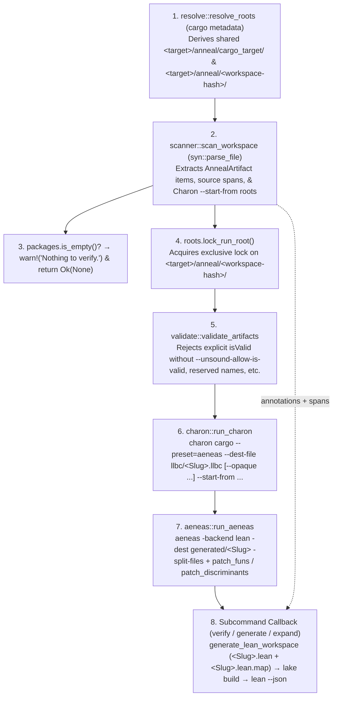

# Anneal V1 End-to-End Verification Pipeline, Soundness Boundaries, and Contract Adequacy

## Summary

Retained Anneal V1 (`anneal/v1` in `google/zerocopy` at revisions `bd0956be95c5f798f0c0484921b9b9d1fc6e9988` and `41f5b37afe7060fd9fe08c00b200672cd76d77b9`, moved under `anneal/v1` at `dbb81cc7759bb6b21b82a1ca98bb32e9676f8655`) is a staged Rust-to-Lean verification prototype (`cargo-anneal 0.1.0-alpha.24`) that combines a syntactic `syn`-based Rust doc-comment scanner with compiler-derived LLBC extraction (`AeneasVerif/charon@0c91ca1a8e002d6bfa8d8f1f452804fce2f92cf1`, `0.1.210`), pure functional Lean translation (`AeneasVerif/aeneas@42c0e90dacf486f7d3ed5b6cde3a9a81f04915a4`), and batch Lean 4 proof checking (`leanprover/lean4@3dc1a088b6d2d8eafe25a7cd7ec7b58d731bd7cc`, `v4.30.0-rc2`). Synthesizing source analysis and executed negative controls across 11 constituent investigations establishes the pipeline architecture and nine structural soundness and adequacy boundaries:

1. **Dual-View End-to-End Pipeline Spine (`prepare_and_run` in `anneal/v1/src/main.rs`):**
   - `verify`, `generate`, and `expand` share a sequential prefix: `resolve::resolve_roots` (`cargo metadata`) $\rightarrow$ `scanner::scan_workspace` (`syn::parse_file` over Rust source files to extract ```` ```anneal ```` blocks and Charon `--start-from` roots) $\rightarrow$ `roots.lock_run_root()` $\rightarrow$ `validate::validate_artifacts` $\rightarrow$ `charon::run_charon` (`charon cargo --preset=aeneas --dest-file llbc/<Slug>.llbc`) $\rightarrow$ `aeneas::run_aeneas` (`aeneas -backend lean -split-files`, post-translation patching of `Funs.lean` and `Types.lean`, and Lake workspace staging). `verify` then generates `<Slug>.lean` and `<Slug>.lean.map`, runs `lake --keep-toolchain --old build Generated Anneal`, checks each `<Slug>.lean` via `lake --keep-toolchain env lean --json`, and maps diagnostics back to Rust spans via `DiagnosticMapper`.
2. **Executed End-to-End Proof (`abs(i32)`) and Fail-Open No-Annotation Exit (`support/anneal-v1-abs-end-to-end-fail-closed-controls/`):**
   - Under a local path-manifest toolchain view (`prepare-toolchain-mirror.py`), `anneal/v1/examples/abs.rs` completes all pipeline stages (`exit 0`), generating `v1_abs_probe.abs.spec` with Lean axiom closure `[propext, Classical.choice, Quot.sound]`.
   - While a Rust type error (`E0308` in `abs-invalid-rust.rs`) fails during Charon (`exit 1`) and a false postcondition (`ret < 0` in `abs-invalid-postcondition.rs`) fails during Lean `scalar_tac` checking (`exit 1`), misspelling the opening fence as ```` ```leanx, anneal ```` (`abs-misspelled-annotation.rs`) or ```` ```aneal ```` causes the scanner to find zero annotations and return `Ok(None)` (`exit 0`, empty stdout/stderr at default log level), leaving stale `.llbc` and `.lean` artifacts from prior runs untouched on disk.
3. **Contract Mutation Adequacy and Precondition Vacuity (`support/anneal-v1-contract-mutation-adequacy/`):**
   - A 6-case mutation matrix over `abs.rs` demonstrates that `cargo-anneal verify` exits `0` when `requires` is strengthened to `False` with a false postcondition `ret < 0` (`false_precondition.rs`, closing both progress and correctness branches by eliminating `h_anon : False`), exits `0` when the negative-input equation is deleted (`omit_negative_equation.rs`), and exits `0` when the body is replaced by constant `0` under a weakened `ret >= 0` postcondition (`weak_relation_zero_body.rs`). Attaching the full `abs` contract to `identity(x) = x` (`wrong_attachment.rs`) fails (`exit 1`), confirming that generated theorems bind to the annotated function name (`v1_abs_probe.identity`).
4. **Annotation Parsing Grammar and Batch JSON Diagnostics History:**
   - Mainline V1 (`anneal/v1/src/parse/attr.rs`) extracts doc attributes (`///`, `//!`, `#[doc = "..."]`), matches fences starting with $\ge 3$ backticks whose comma-separated info string contains `anneal` (`spec` or `unsafe(axiom)`), and parses a line-oriented indentation grammar (`context`, `requires`, `ensures`, `proof context`, `proof`, `isValid`, `isSafe`) where indentation is measured in **byte length removed by `trim_start`** against the **section baseline** (not line-by-line Python off-side nesting as claimed in `04_specifications_and_syntax.md`). Historical commit `9b8b49e74` replaced the early `Diagnostics.lean` runner (`ec8639171`) with direct `lean --json` line parsing (`NativeLeanDiagnostic`).
5. **Coverage and Annotation-Totality Holes (`support/anneal-v1-coverage-totality-holes-41f5b37/`):**
   - V1 verifies an **annotation-selected root domain**, not a crate-wide unsafe inventory. Unannotated callees reachable from `--start-from` roots are translated by Charon into LLBC/Aeneas, but do not receive Anneal user contracts or automatic `unsafe(axiom)` leaf treatment; unannotated `unsafe fn` items outside the selected semantic closure are omitted entirely.
6. **Syntactic Source Scanner vs. `rustc` Discrepancies (`support/anneal-v1-source-scanner-versus-rustc-main-41f5b37/`):**
   - Because `scanner::scan_workspace` walks raw pre-expansion `syn` ASTs without `rustc` `DefId`s, six classes of divergence arise between the scanner and `rustc`/Charon: (a) the scanner is `#[cfg]`-agnostic and scans `cfg`-false items while missing `#[cfg_attr(..., path = "...")]` files; (b) `parse/mod.rs` drops the enclosing inline module path `current_path` when reporting an unloaded `mod child;` inside `mod outer { mod child; }`, resolving `child` relative to the outer file rather than `crate::outer::child`; (c) items generated by `macro_rules!`, proc macros, or `OUT_DIR`/`include!` are invisible to the scanner but visible to `rustc`/Charon; (d) `use` reexports and `type` aliases have no `ParsedItem` representation; and (e) block-local items (`inside_block = true`) are rejected by `process_item`.
7. **`isValid` Type Invariant Unsoundness (`support/anneal-v1-isvalid-unsoundness/`):**
   - Gated behind `--unsound-allow-is-valid` (`validate.rs:18-53`), V1's `isValid` injects `Anneal.IsValid.isValid` obligations only at **annotated function boundaries** (`Pre` for inputs, `Post` for non-unit return `ret` and post-state `<arg>'` of direct `&mut` parameters). It is unsound as a global type invariant for two independent reasons: (a) ordinary unannotated safe Rust functions can mutate invariant-bearing fields (`p.x = 0`) without crossing an Anneal boundary, and (b) `Anneal.lean:41-47` defines a low-priority fallback `instance (priority := low) defaultIsValid {α : Type} : IsValid α where isValid _ := True` with no recursive `IsValid` instances for `Option` or product types `(A × B)` in mainline V1, silently erasing nested invariants to `True` at compound type boundaries.
8. **`isSafe` Unsafe-Trait Enforcement Gaps (`support/anneal-v1-issafe-semantic-gaps-41f5b37/`):**
   - On an `unsafe trait`, `isSafe` generates a Lean typeclass `Trait.Safe Self ... (inst : Trait Self ...)` (`generate.rs:1041-1086`). However, `ImplAnnealBlock` (`parse/attr.rs:126-131, 660-669`) rejects `isSafe` on `impl` blocks and `generate.rs:204` ignores `ParsedItem::Impl` (`ParsedItem::Impl(_) => {}`), so `unsafe impl Trait for Type` generates **zero proof obligation**. Furthermore, `extract_generic_params` (`generate.rs:1101-1150`) lowers `T: Trait` to an Aeneas dictionary parameter `TraitInst : Trait T` without injecting `Trait.Safe T TraitInst`, requiring callers (`examples/anatomy.rs:45-50`) to add `requires (h_is_safe): Trait.Safe T Inst` manually.
9. **Lifetime Erasure and the `PtrInner<'a, T>` Soundness Counterexample (`support/anneal-v1-lifetime-erasure-soundness-main-41f5b37/`):**
   - `parse/hkd.rs` and `generate.rs` erase all lifetime parameters (`SafeGenericParam::Lifetime => {}`), reference lifetimes (`SafeType::Reference` has no lifetime field; `map_type` maps `&'a T` to `T`), path lifetime arguments (`PtrInner<'a, T>` becomes `PtrInner T`), and lifetime `where` clauses. Consequently, V1's `IsValid` and specification surface cannot distinguish the sound `fn from_ref<'a>(ptr: &'a T) -> PtrInner<'a, T>` (`src/pointer/inner.rs` at `c6b794933a8d49481b9dded6ed99bc339202b41d`) from an unsound `fn from_ref<'b>(ptr: &'b T) -> PtrInner<'a, T>` that fabricates `'a` without `'b: 'a`, leading to a safe use-after-free via `Ptr::from_ref` and `Ptr::as_ref` (`src/pointer/ptr.rs`).
10. **`unsafe(axiom)` Total-Correctness Trust Boundary and Orthogonal Progress/Correctness Split (`support/anneal-v1-unsafe-axiom-semantics-41f5b37/` and `support/anneal-v1-orthogonal-progress-correctness-41f5b37/`):**
    - `unsafe(axiom)` parses to `FunctionBlockInner::Axiom` (forbidding `proof`/`proof context`, and notably not checking `is_unsafe` on the Rust signature unless `requires` is present), passes `--opaque <name>` to Charon, copies Aeneas's `FunsExternal_Template.lean` to `FunsExternal.lean`, and emits a Lean `axiom spec ... : Aeneas.Std.WP.spec (f ...) ...` independently of `--allow-sorry`. Because `Aeneas.Std.WP.spec m P` (`Aeneas/Std/WP.lean`) is equivalent to `∃ y, m = .ok y ∧ P y` (mapping `.fail _` and `.div` to `False`), `unsafe(axiom)` axiomatically asserts **both termination/non-panicking progress and postcondition correctness**.
    - For proved `spec` functions, `Anneal.wp_prove_orthogonal` splits `WP.spec m P` into sibling subgoals `(∃ y, m = .ok y)` (progress) and `(∀ y, m = .ok y → P y)` (conditional correctness). While this allows per-field `Post` obligations to elaborate and report diagnostics even when progress is stuck, the correctness branch is vacuously true on `.fail`/`.div` (making `--allow-sorry` on progress a total-correctness trust hole), `proof context:` cannot invoke Aeneas's `progress` tactic because `h_returns : m = .ok ret` is an equality rather than a `WP.spec` goal, and each omitted `Post` field's `autoParam` tactic (`verify_user_bound` / `verify_is_valid`) independently re-unfolds and splits `h_returns`.

## Applicability

The findings in this report apply to the concrete repositories, revisions, and toolchains recorded in `REPORT.json`:

1. **`google/zerocopy` Retained Anneal V1 Implementation (`anneal/v1`):**
   - **Revision `bd0956be95c5f798f0c0484921b9b9d1fc6e9988`:** Used for the executed `abs.rs` end-to-end verification and fail-closed/fail-open controls (`cargo-anneal 0.1.0-alpha.24` binary SHA-256 `9f8283296b0150fbfe1043bbe3633879c900067915bb46aa293e55711564aee8`), the 6-case contract mutation adequacy matrix, and the annotation parser / diagnostic history analysis.
   - **Revision `41f5b37afe7060fd9fe08c00b200672cd76d77b9`:** Used for the source-level analysis of the end-to-end pipeline (`main.rs`, `resolve.rs`, `scanner.rs`, `charon.rs`, `aeneas.rs`, `generate.rs`, `diagnostics.rs`, `setup.rs`), coverage/totality holes, source scanner vs. `rustc` discrepancies, `isValid` unsoundness, `isSafe` semantic gaps, lifetime erasure, `unsafe(axiom)` semantics, and the `wp_prove_orthogonal` progress/correctness architecture.
   - **Revision `dbb81cc7759bb6b21b82a1ca98bb32e9676f8655` (PR #3487, `2026-07-31`):** The V1/V2 reorganization commit that moved the V1 prototype into `anneal/v1`. All core verification source blobs (`main.rs`, `resolve.rs`, `scanner.rs`, `charon.rs`, `aeneas.rs`, `generate.rs`, `diagnostics.rs`, `validate.rs`, `parse/mod.rs`, `parse/attr.rs`, `parse/hkd.rs`, `Anneal.lean`) are **byte-for-byte identical** across `dbb81cc7759bb6b21b82a1ca98bb32e9676f8655`, `bd0956be95c5f798f0c0484921b9b9d1fc6e9988`, and `41f5b37afe7060fd9fe08c00b200672cd76d77b9` (only `setup.rs` and `README.md` received subsequent maintenance, such as the historical status notice added in `7e9de53b88121c58588984437ac500a2d1449080`).
   - **Revision `c6b794933a8d49481b9dded6ed99bc339202b41d`:** Historical `google/zerocopy` revision defining `PtrInner<'a, T>` (`src/pointer/inner.rs`, blob `2f35d5a99d6b62ab40de995ba417b2c33f7634fd`) and `Ptr<'a, T, I>` (`src/pointer/ptr.rs`, blob `bb4bacb3fab78ba17584578d3cd214fd38c9c197`) used in the lifetime-erasure soundness counterexample.
2. **Pinned Translation and Verification Toolchain:**
   - **Charon (`AeneasVerif/charon@0c91ca1a8e002d6bfa8d8f1f452804fce2f92cf1`, version `0.1.210`, binary SHA-256 `51bb6d23beab3f97a684c25162d3e402fc820c891b57b21d2ca781c1da211a8b`)** and its pinned Rust compiler (`nightly`, `rust-lang/rust@14210df0e27ccd7d9e6a05b8085cbd438e4bbc65`).
   - **Aeneas (`AeneasVerif/aeneas@42c0e90dacf486f7d3ed5b6cde3a9a81f04915a4`, binary SHA-256 `f476001e1a8e8c5cb1d8a621a25716d8e15f0809c8a023c5349357acc0911d03`)**, specifically `backends/lean/Aeneas/Std/Primitives.lean` (blob `5a73ea5bfae575baf2f26e1d86ea00768d1bccea`) and `backends/lean/Aeneas/Std/WP.lean` (blob `a599b2b6632fbfdfadbe3dcfb68ee17a6048be5d`).
   - **Lean 4 (`leanprover/lean4@3dc1a088b6d2d8eafe25a7cd7ec7b58d731bd7cc`, version `v4.30.0-rc2`)** and **mathlib4 (`leanprover-community/mathlib4@5450b53e5ddc75d46418fabb605edbf36bd0beb6`)**.

All findings characterize the historical Anneal V1 prototype under `anneal/v1` and do not describe current Anneal V2 architecture.

## Findings

### 1. End-to-End Verification Pipeline Architecture (`prepare_and_run`)

#### 1.1 Stage Ordering, Target Resolution, and Artifact Slugs

In `anneal/v1/src/main.rs` (blob `3d363b977df790b266fe2a0635da1c294ec1b7c2`), user subcommands `verify`, `generate`, and `expand` all enter `prepare_and_run` (`support/anneal-v1-end-to-end-pipeline-41f5b37/pipeline-flow.json`), which executes eight sequential steps (`setup` in `anneal/v1/src/setup.rs`, blob `32216cedf11c5d6d4b5a4618d8d7bf2578e44b4d`, separately unpacks the Exocrate archive providing `aeneas/bin/{charon,aeneas}`, `aeneas/backends/lean`, `rust/`, `lean/`, and `lake-cache`):



Key architectural invariants of this pipeline:
- **Dual Filesystem Roots (`anneal/v1/src/resolve.rs`, blob `9a44f652961e0bfe62bc4c2efecd550dea361fab`):** `resolve_roots` flattens selected Cargo library, binary, example, and test targets (excluding build scripts and benchmarks) into `AnnealTarget` values and partitions `<target>/anneal/` into a shared `<target>/anneal/cargo_target/` directory (reused across runs as `CARGO_TARGET_DIR` for Charon) and a locked per-workspace `<target>/anneal/<workspace-root-hash>/` run root.
- **Deterministic Artifact Slugs (`anneal/v1/src/scanner.rs`, blob `44b66417a827192b87d4cad3e62421e8ca497d28`):** Each `AnnealArtifact` computes a Lean-valid `<Slug>` from the package name, target name, target kind, and a 64-bit prefix of the SHA-256 hash of `(package, target, kind, manifest_path)`, binding:
  - `llbc/<Slug>.llbc` (Charon output);
  - `lean/generated/<Slug>/Funs.lean`, `Types.lean`, `FunsExternal.lean`, `TypesExternal.lean` (Aeneas outputs after `patch_funs` wraps `Funs.lean` in `noncomputable section` and renames `ac_spec` keyword collisions, and `patch_discriminants` rewrites discriminant attributes in `Types.lean`);
  - `lean/generated/<Slug>/<Slug>.lean` and `<Slug>.lean.map` (Anneal specification/proof module and Rust-to-Lean byte-range source map).
- **Two-Phase Lean Verification (`anneal/v1/src/aeneas.rs`, blob `9b4618a20938315afc290744bbdfa498848620f4`):** Contrary to `docs/agent/01_philosophy_and_pipeline.md` (which describes specification generation as running "in parallel" with Aeneas), `generate_lean_workspace` runs strictly *after* `run_aeneas` swaps the staged Lake workspace into place (preserving any existing `.lake` directory). `verify_lean_workspace` then runs `lake --keep-toolchain --old build Generated Anneal` followed by `lake --keep-toolchain env lean --json generated/<Slug>/<Slug>.lean` on each specification module.

Basis: **source** + **documentation**.

### 2. Executed End-to-End Controls (`abs.rs`) and Contract Mutation Adequacy

#### 2.1 Positive `abs(i32)` Proof and Fail-Closed vs. Fail-Open Controls (`support/anneal-v1-abs-end-to-end-fail-closed-controls/`)

Executing the source-built `cargo-anneal` CLI (`bd0956be95c5f798f0c0484921b9b9d1fc6e9988`, binary SHA-256 `9f8283296b0150fbfe1043bbe3633879c900067915bb46aa293e55711564aee8`) over `support/anneal-v1-abs-end-to-end-fail-closed-controls/abs.rs` (adapted from `anneal/v1/examples/abs.rs` with local path dependencies prepared via `prepare-toolchain-mirror.py` because V1 rejects Git dependency entries in Aeneas's installed `lake-manifest.json`) produces the complete generated specification module `support/anneal-v1-abs-end-to-end-fail-closed-controls/anneal-generated-proof.lean`:

```lean
namespace v1_abs_probe
namespace abs

  structure Pre (x : Std.Isize) : Prop where
    h_x_is_valid : Anneal.IsValid.isValid x := by verify_is_valid h_x_is_valid _root_.v1_abs_probe.abs
    h_anon : x.val > -2147483648 := by verify_user_bound h_anon _root_.v1_abs_probe.abs

  structure Post (x : Std.Isize) (ret : Std.Isize) : Prop where
    h_ret_is_valid : Anneal.IsValid.isValid ret := by verify_is_valid h_ret_is_valid _root_.v1_abs_probe.abs
    h0 : ret >= 0 := by verify_user_bound h0 _root_.v1_abs_probe.abs
    h1 : (x : Int) >= 0 -> (ret : Int) = x := by verify_user_bound h1 _root_.v1_abs_probe.abs
    h2 : (x : Int) < 0 -> (ret : Int) = -x := by verify_user_bound h2 _root_.v1_abs_probe.abs

theorem spec (x : Std.Isize) (h_req : Pre x) :
  Aeneas.Std.WP.spec (abs x) (fun ret_ => Post x ret_) := by
  apply Anneal.wp_prove_orthogonal
  · unfold abs
    split <;> intros <;> ... <;> scalar_tac
  · rintro ret h_returns
    rcases h_req with ⟨h_x_is_valid, h_anon⟩
    exact { h0 := by ..., h1 := by ..., h2 := by ... }
```

Re-elaborating `anneal-generated-proof.lean` with `#print axioms v1_abs_probe.abs.spec` (`axioms-query.log`) exits `0` and reports `[propext, Classical.choice, Quot.sound]`. Running three negative controls (`observations.json`) isolates the exact failure and stale-artifact boundaries:

| Control Specimen (`support/anneal-v1-abs-end-to-end-fail-closed-controls/`) | Mutation | Exit Code | Stage & Artifact Persistence Behavior |
| :--- | :--- | ---: | :--- |
| `abs.rs` (`verify-success.log`) | Baseline `abs(x: i32) -> i32` with `x.val > -2147483648` | `0` | Generates `charon-llbc.json`, `aeneas-Funs.lean`, `aeneas-Types.lean`, and `anneal-generated-proof.lean`; Lean verification passes. |
| `abs-invalid-rust.rs` (`fail-rust.log`) | Body returns `"not an i32"` (`rustc` `E0308`) | `1` | Fails in Charon/`rustc`; **prior successful `.llbc` and `.lean` files remain on disk byte-identical**. |
| `abs-invalid-postcondition.rs` (`fail-postcondition.log`) | Postcondition `h0` mutated from `ret >= 0` to `ret < 0` | `1` | Aeneas model unchanged; Anneal regenerates `<Slug>.lean`; Lean fails in `scalar_tac` (`Lean verification failed`). |
| `abs-misspelled-annotation.rs` (`no-annotation-default.log`, `no-annotation-warning.log`) | Opening fence mutated from ```` ```lean, anneal ```` to ```` ```leanx, anneal ```` (or `anneal` misspelled) | `0` | **Silent no-op (`exit 0`, empty stdout/stderr at default log level; logs `No Anneal annotations ... Nothing to verify.` at `RUST_LOG=warn`)**, leaving all prior `.llbc` and `.lean` artifacts byte-identical on disk. |

*(Note: in `abs-misspelled-annotation.rs`, the annotation token `anneal` was replaced so no `anneal` token appeared in the info string.)*

Basis: **execution** + **source**.

#### 2.2 Six-Case Contract Mutation Adequacy Matrix (`support/anneal-v1-contract-mutation-adequacy/`)

Executing six contract and implementation mutations over `abs.rs` (`support/anneal-v1-contract-mutation-adequacy/observations.json`) establishes what a passing `cargo-anneal verify` exit does and does not guarantee about specification adequacy:

| Specimen (`support/anneal-v1-contract-mutation-adequacy/`) | Precondition & Postcondition | Rust Body | Exit | Generated Lean & Adequacy Consequence |
| :--- | :--- | :--- | ---: | :--- |
| `baseline.rs` (`baseline.generated.lean`, `baseline.stderr`) | `x.val > -2147483648`; `ret >= 0`, `x >= 0 -> ret = x`, `x < 0 -> ret = -x` | `if x < 0 { -x } else { x }` | `0` | Full `Pre` and 3-clause `Post` proved. |
| `satisfiable_pre_false_post.rs` (`satisfiable_pre_false_post.generated.lean`, `.stderr`) | `x.val > -2147483648`; `ret < 0` | `if x < 0 { -x } else { x }` | `1` | Rejected by Lean (`0 < ↑x` and `↑ret < 0` unsolved). |
| `false_precondition.rs` (`false_precondition.generated.lean`, `.stderr`) | `requires: False`; `ensures (h0): ret < 0` | `if x < 0 { -x } else { x }` | `0` | **Vacuous acceptance:** `Pre` contains `h_anon : False`; both progress and `Post` branches close via `False.elim` without checking `abs`. |
| `omit_negative_equation.rs` (`omit_negative_equation.generated.lean`, `.stderr`) | `x.val > -2147483648`; `h2` (`x < 0 -> ret = -x`) deleted | `if x < 0 { -x } else { x }` | `0` | **Under-specified postcondition:** `Post` omits `h2` and succeeds. |
| `wrong_attachment.rs` (`wrong_attachment.generated.lean`, `.Funs.lean`, `.stderr`) | Complete `abs` contract attached to `fn identity(x: i32) -> i32` | `x` (`identity x := ok x`) | `1` | Theorem binds to `v1_abs_probe.identity`; Lean rejects false goals `x ≥ 0` and `↑x < 0 → ↑x = -↑x`. |
| `weak_relation_zero_body.rs` (`weak_relation_zero_body.generated.lean`, `.Funs.lean`, `.stderr`) | `x.val > -2147483648`; only `ret >= 0` retained | `0` (`abs x := ok 0#i32`) | `0` | **Weak-contract adequacy failure:** buggy constant-zero body satisfies `ret >= 0` (`exit 0`) while violating `abs(1) = 1` and `abs(-1) = 1`. |

Basis: **execution** + **derived**.

### 3. Annotation Parsing Grammar and Batch JSON Diagnostics (`anneal/v1/src/parse/attr.rs` and `aeneas.rs`)

#### 3.1 Line-Oriented Indentation Grammar vs. Historical Alternatives

At `bd0956be95c5f798f0c0484921b9b9d1fc6e9988` (`anneal/v1/src/parse/mod.rs:260, 326` and `anneal/v1/src/parse/attr.rs:160-395, 874-1074, 1961-2225`):
- **Doc-Comment Span Recovery:** `attr.rs` extracts `///`, `//!`, block doc comments, and literal `#[doc = "..."]` via `syn` and attempts substring matching against the raw source file to recover line-level byte spans, falling back to the whole attribute span when escapes or macros prevent an exact match (`attr.rs:193-240`).
- **Fence Recognition:** A trimmed doc line opening with $N \ge 3$ backticks starts an Anneal block if its comma-separated info string contains the exact token `anneal` (tokens preceding `anneal`, such as `lean`, are ignored; tokens following `anneal` select default `spec`, explicit `spec`, or `unsafe(axiom)`). The block closes at the first subsequent trimmed line that **starts with** at least $N$ backticks (`attr.rs:328-395`).
- **Byte-Count Section-Baseline Indentation Rule:** Inside a recognized block, the first keyword (`context`, `requires`, `ensures`, `proof context`, `proof`, `isValid`, or `isSafe`) sets the baseline indentation, measured as **the number of leading bytes removed by `str::trim_start`** (where ASCII space and `\t` each count as `1` byte, while UTF-8 `U+2003` EM SPACE counts as `3` bytes). Subsequent section keywords must appear at **exactly** that baseline byte count, and continuation lines must have strictly greater leading byte count than the **section baseline** (contrary to `anneal/v1/docs/agent/04_specifications_and_syntax.md:36`, which claims each wrapped line is compared against the immediately preceding line). A Lean comment `-- ...` before the first keyword is rejected.
- **Historical Parser and Diagnostic Evolution (`google/zerocopy` Git history):**
  - Commit `ec8639171` (February 2026) ran a custom Lean script `tools/hermes/src/Diagnostics.lean` via `lake env lean --run Diagnostics.lean`.
  - Commits `6a4091cdb` and `dfc9ca8ee` (March 2026) fixed `///content` without a leading space and threaded opening fence width into `parse_block_lines`.
  - Commit `dc085f425` (March 2026) explored an unmerged Chumsky whole-document parser in `tools/hermes/src/parse/attr2.rs`.
  - Commit `9b8b49e74` (9 April 2026, renamed from Hermes to Anneal in `4bcec9bc9` on 13 April 2026) deleted `Diagnostics.lean` and switched to `lake --keep-toolchain env lean --json <Specs.lean>`, deserializing one `NativeLeanDiagnostic` JSON object per stdout line (`aeneas.rs:514-642, 776-900`) and mapping `pos`/`endPos` through `SourceMapping` (`Source`, `Synthetic`, `Keyword` in `generate.rs:13-30`) via `DiagnosticMapper` (`diagnostics.rs:227`). Notably, if `lean --json` exits `0` while emitting unparseable stdout lines, `aeneas.rs:612-642` logs and skips the unparseable lines without setting `has_errors`.
  - Unmerged commit `dc12610c8` (May 2026) prototyped replacing the indentation grammar with verbatim Lean (`Vec<SpannedLine>`) and substring checks (`contains("theorem spec")`), which never landed on `main`.

Basis: **source** + **documentation**.

### 4. Coverage, Annotation Totality, and Source-Scanner vs. `rustc` Discrepancies

#### 4.1 Opt-In Root Selection and Fail-Open Coverage Boundaries (`support/anneal-v1-coverage-totality-holes-41f5b37/`)

In `anneal/v1/src/main.rs`, `scanner.rs`, `charon.rs`, and `parse/attr.rs` (`support/anneal-v1-coverage-totality-holes-41f5b37/coverage-matrix.json` and `source-map.json`):
1. **No Unsafe Surface Inventory:** `scanner::scan_workspace` collects only items carrying a recognized `anneal` doc block and builds Charon `--start-from` roots from them. A target with zero recognized annotations is omitted, and if `packages.is_empty()`, `prepare_and_run` logs `"No Anneal annotations ... Nothing to verify."` and returns `Ok(None)` (`exit 0`). Mainline V1 implements no mandatory unsafe-annotation pass (listed only as future work "strict mode" in `anneal/v1/docs/design/design.md`).
2. **Reachable Unannotated Callees vs. `unsafe(axiom)` Leaves:** When an annotated function calls an unannotated helper or unannotated `unsafe fn`, Charon's semantic reachability from `--start-from` includes the callee in `<Slug>.llbc` and Aeneas's `Funs.lean` (unless marked opaque). However, Anneal generates specifications only for scanner-collected items and passes `--opaque <item>` to Charon **only** for functions explicitly annotated with `unsafe(axiom)`.
3. **Fail-Closed vs. Fail-Open Info-String Typos (`parse/attr.rs`):**
   - If the comma-separated fence info string contains the exact token `anneal`, unrecognized sibling tokens (`anneal, unsafe` or `anneal, unknown`) or malformed body clauses fail closed with a parse error.
   - If the token `anneal` itself is misspelled (e.g., ```` ```aneal ````), `parse_anneal_info_string` returns `Ok(None)` and `parse_anneal_block_common` silently ignores the block as ordinary documentation.

Basis: **source** + **documentation** + **derived**.

#### 4.2 Syntactic `syn` Scanner vs. `rustc`/Charon Semantic Program (`support/anneal-v1-source-scanner-versus-rustc-main-41f5b37/`)

Because `scanner::scan_workspace` (`anneal/v1/src/scanner.rs`) and `AnnealVisitor` (`anneal/v1/src/parse/mod.rs`) operate on raw pre-expansion `syn::File` ASTs without `rustc` configuration, macro expansion, or `DefId` resolution (`support/anneal-v1-source-scanner-versus-rustc-main-41f5b37/scanner-gap-matrix.json`), the scanner's view diverges from `rustc`/Charon across six concrete dimensions:

| Mechanism | V1 Syntactic Scanner (`scanner.rs`, `parse/mod.rs`) | `rustc` / Charon Compiler View (`charon.rs`) | Soundness / Coverage Consequence |
| :--- | :--- | :--- | :--- |
| **`#[cfg(...)]` predicates** | Explicitly `cfg`-agnostic; scans both `#[cfg(true)]` and `#[cfg(false)]` items if the file is visited. | Evaluates target, feature, and build-script `cfg` predicates; strips `cfg`-false items before HIR/MIR. | Scanner can emit `--start-from` roots and specs for `cfg`-false items absent from LLBC. |
| **`#[cfg_attr(..., path = "...")]`** | Emits warning `"Anneal does not currently evaluate conditional paths"` and ignores the conditional `path`. | Evaluates `cfg_attr` before module loading and loads the conditionally selected file. | False negative: `rustc` compiles an alternate module file whose annotations V1 never scans. |
| **Inline module with out-of-line child (`mod outer { mod child; }`)** | `parse/mod.rs` tracks inline `current_path` (`outer`), but its unloaded-module callback returns only `(name, path_attr, inside_block)` **without `current_path`**. `scanner.rs` resolves `child` as `crate::child` instead of `crate::outer::child`. | Resolves `child` relative to `outer` (`outer/child.rs`) at module path `crate::outer::child`. | Scanner looks in the wrong directory and constructs the wrong module path for `child`. |
| **Macros (`macro_rules!`, proc macros) & `include!(concat!(env!("OUT_DIR"), ...))`** | Parses pre-expansion syntax only; never expands macros or follows `include!`. | Runs full macro expansion before Charon's MIR callback. | Macro-generated items are invisible to V1 annotation discovery; attribute macros can rename/replace items that V1 scanned pre-expansion. |
| **Imports (`use ... as ...`) & `type` aliases** | `ParsedItem` has variants only for `Function`, `Type` (`struct`/`enum`/`union`), `Trait`, and `Impl`. | Resolves `use` reexports and `type` aliases to underlying `DefId`s. | Annotations on reexports or type aliases are ignored; scanner cannot match reexported paths. |
| **Block-local items (`fn outer() { fn inner() {} }`)** | Visitor sets `inside_block = true` and rejects annotations inside blocks (`"Move this item to the module level"`). | Assigns `DefId`s and MIR bodies to block-local items, closures, and anonymous constants. | Block-local definitions cannot carry V1 specifications even when reachable in LLBC. |

For items whose fully qualified syntactic name is unreliable (`impl` blocks, `impl` methods, trait methods, and `extern` foreign functions), `scanner.rs` falls back to passing the **containing module** as the Charon `--start-from` root.

Basis: **source** + **derived**.

### 5. Soundness Gaps in `isValid`, `isSafe`, and Lifetime Erasure (`PtrInner<'a, T>`)

#### 5.1 `isValid`: Function-Boundary Checking, Unannotated Field Mutation, and `defaultIsValid` Compound Erasure (`support/anneal-v1-isvalid-unsoundness/`)

In `anneal/v1/src/validate.rs:18-53` (blob `2259c939e4bba4b2c329b9751a2a3e86601c416c`), any type carrying an explicit `isValid` clause is rejected before Charon/Aeneas with `AnnealError::Unsoundness` (`` `isValid` annotations are unsound and require the --unsound-allow-is-valid flag ``) unless `--unsound-allow-is-valid` (`resolve.rs:53-67`) is passed.

When `--unsound-allow-is-valid` is enabled (`anneal/v1/src/generate.rs:703-740, 761-790, 946-1016`, blob `f087023d08011a90d56bcbdc759e6cbc90c344b5`, and `anneal/v1/src/Anneal.lean:41-47, 78-109`, blob `727199a54622d56dd429f2b3b178748f2cc5b7f1`):
- **Type Instance Generation (`generate_type`):** For an annotated struct/enum/union `T`, V1 emits a specific `instance : Anneal.IsValid T where isValid self := <user_expr>`.
- **Function-Boundary Injection (`generate_function`):** For an annotated function, V1 injects:
  - `h_<arg>_is_valid : Anneal.IsValid.isValid <arg> := by verify_is_valid ...` into `Pre` for every input parameter;
  - `h_ret_is_valid : Anneal.IsValid.isValid ret := by verify_is_valid ...` into `Post` for every non-unit return value;
  - `h_<arg>'_is_valid : Anneal.IsValid.isValid <arg>' := by verify_is_valid ...` into `Post` for the post-state of every direct `&mut` argument.

As summarized in `support/anneal-v1-isvalid-unsoundness/invariant-enforcement-matrix.json`, two independent soundness holes prevent `isValid` from acting as a sound global type invariant:
1. **Unannotated Safe Construction and Field Mutation (`resolve.rs:53-67`):** Because Rust fields are not `unsafe` to read or write, an unannotated safe function can directly construct or mutate an invariant-bearing struct without triggering any Anneal obligation:
   ```rust
   /// ```anneal
   /// isValid self := self.x.val > 0
   /// ```
   struct Positive { x: u32 }

   fn break_invariant(p: &mut Positive) {
       p.x = 0; // Safe, unannotated Rust: no Anneal check is generated
   }
   ```
2. **Compound-Type Invariant Erasure via Low-Priority `defaultIsValid` (`Anneal.lean:41-47`):** `Anneal.lean` defines:
   ```lean
   class IsValid (α : Type) where
     isValid : α → Prop

   instance (priority := low) defaultIsValid {α : Type} : IsValid α where
     isValid _ := True
   ```
   At `41f5b37afe7060fd9fe08c00b200672cd76d77b9`, `Anneal.lean` defines **no recursive `IsValid` instances** for `Option α`, `(α × β)`, or wrapper structs. Consequently, when an annotated function returns `Option<Positive>` or `(Positive, u32)`, the injected obligation `Anneal.IsValid.isValid ret` resolves to `defaultIsValid`, reducing the validity requirement to `True` and silently ignoring `Positive`'s invariant (an unmerged partial patch at commit `ef0b8ebe7011311bce0e8fa2fe4a3aa5d95c1e6c` added recursive `Option` and binary product instances while noting that struct and builtin holes remained).

Basis: **source** + **documentation** + **derived**.

#### 5.2 `isSafe`: Unsafe-Trait Predicate Generation Without `unsafe impl` Obligations or Bound Propagation (`support/anneal-v1-issafe-semantic-gaps-41f5b37/`)

Inspecting `anneal/v1/src/parse/attr.rs:126-131, 623-669`, `anneal/v1/src/parse/mod.rs:336-382, 467-510`, and `anneal/v1/src/generate.rs:204, 1041-1150, 2767-2788` (`support/anneal-v1-issafe-semantic-gaps-41f5b37/semantic-gap-matrix.json` and `source-map.json`) exposes a two-sided enforcement gap between V1's `isSafe` implementation and `anneal/v1/docs/design/design.md:256-259`:

| Contract Site | Intended Behavior (`docs/design/design.md:256-259`) | Actual Implementation at `41f5b37afe70` (`attr.rs`, `generate.rs`) | Soundness / Ergonomic Consequence |
| :--- | :--- | :--- | :--- |
| **`unsafe trait` declaration** | `isSafe` defines a safety proposition for the trait. | `generate_trait` (`generate.rs:1041-1086`) emits `class Trait.Safe (Self : Type) ... (inst : Trait Self ...) : Prop` containing the `isSafe` clauses. | Predicate exists in Lean, indexed by the explicit Aeneas trait dictionary `inst`. |
| **`unsafe impl Trait for Type` site** | Every `unsafe impl` must prove `Trait.Safe`. | `ImplAnnealBlock::parse_from_attrs` (`attr.rs:660-669`) **rejects `isSafe` on `impl` blocks**, and `generate_artifact` (`generate.rs:204`) **ignores `ParsedItem::Impl` entirely** (`ParsedItem::Impl(_) => {}`). Unannotated `unsafe impl` blocks are skipped by the scanner (`parse/mod.rs:336-382`). | **Zero proof obligation is generated for `unsafe impl` blocks.** Unsound `unsafe impl` declarations pass verification unchecked. |
| **Generic consumer `fn f<T: Trait>(...)`** | Trait bound `T: Trait` automatically provides `hSafe : Trait.Safe T inst` in `Pre`. | `extract_generic_params` (`generate.rs:1101-1150`) lowers `T: Trait` only to the Aeneas dictionary parameter `(TraitInst : Trait T)` (`generate.rs:2767-2788`). | Consumer proofs receive no automatic `Safe` hypothesis; as shown in `anneal/v1/examples/anatomy.rs:19-23, 45-50, 106-111`, users must manually write `requires (h_is_safe): Unaligned.Safe T Inst`. |

Basis: **source** + **documentation** + **derived**.

#### 5.3 Proof-Facing Lifetime Erasure and the `PtrInner<'a, T>` Soundness Failure (`support/anneal-v1-lifetime-erasure-soundness-main-41f5b37/`)

Although Charon preserves region variables in LLBC signatures and Aeneas uses regions to structure borrow abstractions before erasing lifetimes from its final pure Lean AST, Anneal V1's own syntax mirror (`anneal/v1/src/parse/hkd.rs`, blob `619d1e956ebc230aece4c13c34797d1322b1bb94`) and generator (`anneal/v1/src/generate.rs`, blob `f087023d08011a90d56bcbdc759e6cbc90c344b5`) independently erase all lifetime identity (`support/anneal-v1-lifetime-erasure-soundness-main-41f5b37/lifetime-erasure-counterexample.json` and `source-map.json`):

1. **Four-Point Erasure in `hkd.rs` and `generate.rs`:**
   - `SafeType::Reference` (`hkd.rs`) stores only `mutability: bool` and `elem: Box<SafeType>` (no lifetime field), and `map_type` (`generate.rs`) maps `&'a T` and `&'b T` identically to `map_type(T)`.
   - `Mirror for syn::PathArguments` (`hkd.rs`) retains only `syn::GenericArgument::Type`, filtering out all `syn::GenericArgument::Lifetime` arguments, so `PtrInner<'a, T>` and `PtrInner<'b, T>` produce the exact same `SafeType` and Lean type `(PtrInner T)` (asserted by unit test `test_gen_impl_generic_lifetimes` on `MyStruct<'a, T>`).
   - Generic lifetime parameters become payload-free `SafeGenericParam::Lifetime` markers (`hkd.rs`) that `extract_generic_params` ignores via `SafeGenericParam::Lifetime => {}` (`generate.rs`).
   - Lifetime outlives predicates (`'b: 'a`) become payload-free `SafeWherePredicate::Lifetime` markers that generate no Lean condition.
2. **Concrete `PtrInner<'a, T>` Counterexample (`google/zerocopy@c6b794933a8d49481b9dded6ed99bc339202b41d`, `src/pointer/inner.rs` and `src/pointer/ptr.rs`):**
   - In `zerocopy`, `PtrInner<'a, T>` carries the safety invariant that for any non-ZST `T`, the backing memory allocation remains live for at least `'a`.
   - The sound constructor `fn from_ref<'a>(ptr: &'a T) -> PtrInner<'a, T>` discharges this invariant because the input reference `ptr: &'a T` witnesses liveness for `'a`.
   - Consider the unsound variant with an independent input lifetime `'b`:
     ```rust
     fn from_ref<'b>(ptr: &'b T) -> PtrInner<'a, T> {
         // Uses unsafe PtrInner::new without 'b: 'a
     }
     ```
     In V1's proof-facing type and `IsValid` surface, both the sound and unsound signatures erase to the identical Lean signature `PtrInner.from_ref (T : Type) (ptr : T) : Result (PtrInner T)`, and `IsValid (PtrInner T)` has no `'a` parameter over which to state allocation liveness. Composing the unsound `PtrInner<'a, T>` into `Ptr::from_ref` and `Ptr::as_ref` (`src/pointer/ptr.rs`) materializes a dangling `&'a T` in safe Rust after `'b` expires.

Basis: **source** + **derived**.

### 6. `unsafe(axiom)` Semantics and the Orthogonal Progress/Correctness Architecture

#### 6.1 `unsafe(axiom)`: Opaque Extraction, Specification Axioms, Total Correctness (`WP.spec`), and the Safe-Function Edge (`support/anneal-v1-unsafe-axiom-semantics-41f5b37/`)

Inspecting `anneal/v1/src/parse/attr.rs`, `parse/mod.rs`, `validate.rs`, `charon.rs`, `aeneas.rs`, and `generate.rs` alongside pinned Aeneas `backends/lean/Aeneas/Std/Primitives.lean` and `WP.lean` (`support/anneal-v1-unsafe-axiom-semantics-41f5b37/trust-boundary-flow.json` and `source-map.json`) establishes the exact semantics of `unsafe(axiom)`:

1. **Five-Stage Trust Pipeline:**
   - **Stage 1 (Parser, `parse/attr.rs`):** `FunctionAttribute::UnsafeAxiom` rejects `proof context` and `proof` sections and builds `FunctionBlockInner::Axiom`.
   - **Stage 2 (Charon Opacity, `charon.rs`):** Every `FunctionBlockInner::Axiom` item is passed to Charon as `--opaque <module-qualified-name>`, instructing Charon not to extract its MIR body.
   - **Stage 3 (Aeneas External Declaration, `aeneas.rs`):** Aeneas emits an uninterpreted function signature in `FunsExternal_Template.lean`, which Anneal copies to `FunsExternal.lean` and wraps callers in `Funs.lean` in a `noncomputable section`.
   - **Stage 4 (Anneal Specification Axiom, `generate.rs`):** Instead of `theorem spec ... := by ...`, `generate_function` emits:
     ```lean
     axiom spec (args...) (h_req : Pre args...) :
       Aeneas.Std.WP.spec (f args...) (fun ret_ => Post args... ret_)
     ```
   - **Stage 5 (Independence from `--allow-sorry`, `validate.rs` and `aeneas.rs`):** `--allow-sorry` controls whether `eval_allow_sorry_or_fail` admits unsolved proof subgoals via `axiom Anneal.allow_sorry : True` in `FunctionBlockInner::Proof` items. Because `FunctionBlockInner::Axiom` emits `axiom spec` directly with no proof block, **a verification run with `--allow-sorry` disabled still accepts all `unsafe(axiom)` assumptions without warning**.
2. **`unsafe(axiom)` Asserts Total Correctness (Both Progress and Postcondition):**
   In `AeneasVerif/aeneas@42c0e90dacf486f7d3ed5b6cde3a9a81f04915a4`:
   - `backends/lean/Aeneas/Std/Primitives.lean` (blob `5a73ea5bfae575baf2f26e1d86ea00768d1bccea`) defines `inductive Result (α : Type u) | ok (v : α) | fail (e : Error) | div`.
   - `backends/lean/Aeneas/Std/WP.lean` (blob `a599b2b6632fbfdfadbe3dcfb68ee17a6048be5d`) defines `WP.theta` and `WP.spec`:
     ```lean
     def theta (m : Result α) (P : α → Prop) : Prop :=
       match m with
       | .ok x   => P x
       | .fail _ => False
       | .div    => False

     def spec (m : Result α) (P : α → Prop) : Prop := theta m P

     theorem spec_equiv_exists (m : Result α) (P : α → Prop) :
       spec m P ↔ ∃ y, m = .ok y ∧ P y
     ```
   Consequently, an Anneal `unsafe(axiom)` declaration asserts **not** partial correctness (`m = .ok y → P y`), but total correctness (`∃ y, m = .ok y ∧ P y`): under `Pre`, it axiomatically rules out both modeled panic/failure (`.fail`) and divergence (`.div`). If the hidden Rust implementation can panic or loop infinitely under `Pre`, the emitted Lean `axiom spec` is false.
3. **Source-Permitted Safe-Function `unsafe(axiom)` Edge (`parse/mod.rs` and `parse/attr.rs`):**
   `parse/mod.rs` passes `is_unsafe = i.sig.unsafety.is_some()` into `FunctionAnnealBlock::parse_from_attrs`. Inside `attr.rs`, `is_unsafe` is checked **only** to reject `requires` clauses on safe functions (`!is_unsafe && !requires.is_empty()`). Neither `attr.rs`, `validate.rs`, `charon.rs`, nor `generate.rs` checks `is_unsafe` for `FunctionAttribute::UnsafeAxiom` / `FunctionBlockInner::Axiom`. Thus, a safe `fn` annotated with `unsafe(axiom)` and no `requires` clause is permitted by the V1 source pipeline to discard its Rust body via `--opaque` and emit an unchecked `axiom spec`.

Basis: **source** + **documentation** + **derived**.

#### 6.2 Orthogonal Progress/Correctness Split (`Anneal.wp_prove_orthogonal`): Vacuity, `proof context:` Limits, and Normalization Duplication (`support/anneal-v1-orthogonal-progress-correctness-41f5b37/`)

In `anneal/v1/src/Anneal.lean` (blob `727199a54622d56dd429f2b3b178748f2cc5b7f1`) and `anneal/v1/src/generate.rs` (`support/anneal-v1-orthogonal-progress-correctness-41f5b37/experiment-observations.json` and `source-map.json`), V1 decomposes every proved function theorem `WP.spec m P` via:

```lean
theorem wp_prove_orthogonal {α} {m : Result α} {P : α → Prop} :
  (∃ y, m = .ok y) →
  (∀ y, m = .ok y → P y) →
  WP.spec m P
```

This decomposition creates four structural tradeoffs documented across `Anneal.lean`, `generate.rs`, and `anneal/v1/docs/design/named_bounds.md`:
1. **Diagnostic Independence vs. Conditional Vacuity:** Before the split, a stuck `WP.spec` step prevented Lean from elaborating individual `Post` fields. After applying `wp_prove_orthogonal`, the second subgoal introduces `ret` and `h_returns : m = .ok ret` and constructs `{ h0 := ..., h1 := ... }`. In isolation, `(∀ y, m = .ok y → P y)` is **vacuously true** whenever `m = .fail e` or `m = .div`. The combined theorem `WP.spec m P` remains sound only when the first subgoal (`∃ y, m = .ok y`) is also closed without `sorry`; when `--allow-sorry` is enabled, `eval_progress` falls back to `eval_allow_sorry_or_fail` (`sorry`), allowing a function that always panics (`m = .fail _`) to pass both progress (by `sorry`) and correctness (vacuously by contradiction on `h_returns : .fail _ = .ok ret`).
2. **No Fact Sharing Across Sibling Goals:** Tactic-local hypotheses established inside `proof (h_progress):` (first subgoal) are out of scope in the sibling correctness branch (second subgoal).
3. **Inability to Run Aeneas `progress` Inside `proof context:`:** Because `proof context:` is emitted inside the second subgoal *after* `rintro ret h_returns`, the context contains the equality hypothesis `h_returns : f args = .ok ret` rather than a `WP.spec` goal. Aeneas's `progress` tactic (which operates on `WP.spec` goals) therefore fails inside `proof context:`.
4. **Per-Field Normalization Duplication:** As visible in `support/anneal-v1-abs-end-to-end-fail-closed-controls/anneal-generated-proof.lean:42-51`, each omitted `Post` field (`h0`, `h1`, `h2`, `h_ret_is_valid`) invokes `verify_user_bound` or `verify_is_valid`, which independently unfolds `f` at `h_returns`, splits all match/if branches at `h_returns`, and runs `scalar_tac` $K$ separate times for $K$ postcondition fields.

Basis: **source** + **documentation** + **execution** (`anneal-generated-proof.lean`).

## Boundaries

- **Known not to apply (current Anneal V2 architecture):** All findings in this package govern the historical prototype under `anneal/v1` (`google/zerocopy@bd0956be95c5f798f0c0484921b9b9d1fc6e9988` and `41f5b37afe7060fd9fe08c00b200672cd76d77b9`). Current `anneal/PRINCIPLES.md` and `anneal/DESIGN.md` explicitly mark `anneal/v1` as historical and not current design authority.
- **Known not to apply (process exit `0` as a crate-wide soundness or freshness certificate):** A `0` exit status from `cargo-anneal verify` in V1 does not prove that annotations were found (misspelled fences exit `0`), does not prove that preexisting `.llbc`/`.lean` files were regenerated, does not prove that unannotated `unsafe fn` items or `unsafe impl` blocks were checked, and does not rule out `requires: False` vacuity or `unsafe(axiom)` assumptions.
- **Known not to apply (`isValid` without `--unsound-allow-is-valid`):** Default V1 invocations reject explicit `isValid` clauses; the boundary-only and `defaultIsValid` compound-erasure holes arise only when `--unsound-allow-is-valid` is passed.
- **Unsupported (in retained V1):** `#[cfg_attr(..., path = "...")]` module resolution, macro-generated or block-local Anneal annotations, `isSafe` proof obligations on `unsafe impl` blocks, automatic `Trait.Safe` injection from generic bounds, and lifetime parameters in `IsValid` or translated types.
- **Not examined:** Fresh runtime execution of the `PtrInner<'a, T>` use-after-free counterexample or the safe-function `unsafe(axiom)` edge (both are established directly from the retained parser/generator source and `c6b794933a8d49481b9dded6ed99bc339202b41d` source inspection).

## Evidence

All primary-source file coordinates, Git blob SHAs, executed Rust/Lean reproducers, and structured JSON matrices are preserved in the `support/` subdirectories of this package:

1. **Primary Source Files in `google/zerocopy` (`bd0956be95c5f798f0c0484921b9b9d1fc6e9988` and `41f5b37afe7060fd9fe08c00b200672cd76d77b9`) and `AeneasVerif/aeneas` (`42c0e90dacf486f7d3ed5b6cde3a9a81f04915a4`):**

| Repository & Path | Revision(s) | Blob SHA | Key Inspected Symbols / Lines |
| :--- | :--- | :--- | :--- |
| `google/zerocopy`: `anneal/v1/src/main.rs` | `bd0956be95` / `41f5b37afe` | `3d363b977df790b266fe2a0635da1c294ec1b7c2` | `main`, `prepare_and_run` (`165-183`), `packages.is_empty()` early return |
| `google/zerocopy`: `anneal/v1/src/resolve.rs` | `bd0956be95` / `41f5b37afe` | `9a44f652961e0bfe62bc4c2efecd550dea361fab` | `Roots`, `LockedRoots`, `resolve_roots`, `--unsound-allow-is-valid` (`53-67`) |
| `google/zerocopy`: `anneal/v1/src/scanner.rs` | `bd0956be95` / `41f5b37afe` | `44b66417a827192b87d4cad3e62421e8ca497d28` | `AnnealArtifact`, `artifact_slug`, `scan_workspace`, `process_file_recursive` |
| `google/zerocopy`: `anneal/v1/src/parse/mod.rs` | `bd0956be95` / `41f5b37afe` | `5f630310199c6abaafa6eee5ea674730bffd773f` | `AnnealVisitor`, `process_item` (`260-510`), `inside_block`, unloaded module callback |
| `google/zerocopy`: `anneal/v1/src/parse/attr.rs` | `bd0956be95` / `41f5b37afe` | `9f352d511ca964e8c58d24206a3088608cb8aaf6` | `parse_anneal_info_string` (`160-395`), `ImplAnnealBlock` (`126-131, 660-669`), indentation (`874-1074`) |
| `google/zerocopy`: `anneal/v1/src/parse/hkd.rs` | `bd0956be95` / `41f5b37afe` | `619d1e956ebc230aece4c13c34797d1322b1bb94` | `SafeType::Reference`, `SafeGenericParam::Lifetime`, `SafeWherePredicate::Lifetime` |
| `google/zerocopy`: `anneal/v1/src/validate.rs` | `bd0956be95` / `41f5b37afe` | `2259c939e4bba4b2c329b9751a2a3e86601c416c` | `validate_artifacts` (`18-53`), `AnnealError::Unsoundness` |
| `google/zerocopy`: `anneal/v1/src/charon.rs` | `bd0956be95` / `41f5b37afe` | `7e33bda392770d04397f7172296d9a7f25c6e180` | `run_charon`, `--start-from` (32,768-byte cap), `--opaque` for `FunctionBlockInner::Axiom` |
| `google/zerocopy`: `anneal/v1/src/aeneas.rs` | `bd0956be95` / `41f5b37afe` | `9b4618a20938315afc290744bbdfa498848620f4` | `run_aeneas`, `patch_funs`, `patch_discriminants`, `run_lake`, `NativeLeanDiagnostic` (`514-900`) |
| `google/zerocopy`: `anneal/v1/src/generate.rs` | `bd0956be95` / `41f5b37afe` | `f087023d08011a90d56bcbdc759e6cbc90c344b5` | `SourceMapping` (`13-30`), `ParsedItem::Impl` (`204`), `generate_function` (`703-790`), `generate_type` (`946-1016`), `generate_trait` (`1041-1086`), `extract_generic_params` (`1101-1150`) |
| `google/zerocopy`: `anneal/v1/src/diagnostics.rs` | `bd0956be95` / `41f5b37afe` | `cd27b771e2f22bdb104c5335a70cfde3207e8fdb` | `DiagnosticMapper` (`227`) |
| `google/zerocopy`: `anneal/v1/src/Anneal.lean` | `bd0956be95` / `41f5b37afe` | `727199a54622d56dd429f2b3b178748f2cc5b7f1` | `IsValid`, `defaultIsValid` (`41-47`), `wp_prove_orthogonal`, `verify_is_valid`, `verify_user_bound` |
| `google/zerocopy`: `src/pointer/inner.rs` & `ptr.rs` | `c6b794933a` | `2f35d5a99d6b62ab40de995ba417b2c33f7634fd`, `bb4bacb3fab78ba17584578d3cd214fd38c9c197` | `PtrInner<'a, T>`, `PtrInner::from_ref`, `Ptr::from_ref`, `Ptr::as_ref` |
| `AeneasVerif/aeneas`: `backends/lean/Aeneas/Std/Primitives.lean` & `WP.lean` | `42c0e90dacf` | `5a73ea5bfae575baf2f26e1d86ea00768d1bccea`, `a599b2b6632fbfdfadbe3dcfb68ee17a6048be5d` | `Result.ok`/`fail`/`div`, `WP.theta`, `WP.spec`, `spec_equiv_exists` |

2. **Preserved Support Artifacts Under `support/`:**
   - `support/anneal-v1-abs-end-to-end-fail-closed-controls/`: `Cargo.toml`, `Cargo.lock`, `prepare-toolchain-mirror.py`, `abs.rs`, `abs-invalid-rust.rs`, `abs-invalid-postcondition.rs`, `abs-misspelled-annotation.rs`, `charon-llbc.json`, `aeneas-Funs.lean`, `aeneas-Types.lean`, `anneal-generated-proof.lean`, `lake-manifest.json`, `cargo-build.log`, `verify-success.log`, `axioms-query.log`, `fail-rust.log`, `fail-postcondition.log`, `no-annotation-default.log`, `no-annotation-warning.log`, `observations.json`.
   - `support/anneal-v1-contract-mutation-adequacy/`: `Cargo.toml`, `Cargo.lock`, `prepare-toolchain-mirror.py`, `observations.json`, and `.rs` / `.generated.lean` / `.Funs.lean` / `.stderr` artifacts for `baseline`, `satisfiable_pre_false_post`, `false_precondition`, `omit_negative_equation`, `wrong_attachment`, and `weak_relation_zero_body`.
   - `support/anneal-v1-coverage-totality-holes-41f5b37/`: `coverage-matrix.json`, `source-map.json`.
   - `support/anneal-v1-end-to-end-pipeline-41f5b37/`: `pipeline-flow.json`, `source-map.json`.
   - `support/anneal-v1-issafe-semantic-gaps-41f5b37/`: `semantic-gap-matrix.json`, `source-map.json`.
   - `support/anneal-v1-isvalid-unsoundness/`: `invariant-enforcement-matrix.json`, `source-map.json`.
   - `support/anneal-v1-lifetime-erasure-soundness-main-41f5b37/`: `lifetime-erasure-counterexample.json`, `source-map.json`.
   - `support/anneal-v1-orthogonal-progress-correctness-41f5b37/`: `experiment-observations.json`, `source-map.json`.
   - `support/anneal-v1-source-scanner-versus-rustc-main-41f5b37/`: `scanner-gap-matrix.json`, `source-map.json`.
   - `support/anneal-v1-unsafe-axiom-semantics-41f5b37/`: `trust-boundary-flow.json`, `source-map.json`.

## Revalidation

1. **Revalidate the executed `abs(i32)` end-to-end proof and fail-closed/fail-open controls:**
   ```bash
   # Build cargo-anneal from google/zerocopy@bd0956be95c5f798f0c0484921b9b9d1fc6e9988
   cargo build --offline --locked --manifest-path /path/to/zerocopy/anneal/v1/Cargo.toml --bin cargo-anneal

   # Prepare disposable local-path Lake manifest view from installed toolchain
   python3 support/anneal-v1-abs-end-to-end-fail-closed-controls/prepare-toolchain-mirror.py \
     /path/to/installed-toolchain /path/to/scratch/toolchain-mirror

   # Run positive abs.rs and negative controls (abs-invalid-rust.rs, abs-invalid-postcondition.rs, abs-misspelled-annotation.rs)
   ANNEAL_TOOLCHAIN_DIR=/path/to/scratch/toolchain-mirror CHARON_TOOLCHAIN_IS_IN_PATH=1 \
     /path/to/cargo-anneal verify --manifest-path /path/to/scratch/probe/Cargo.toml
   ```
2. **Revalidate the 6-case contract mutation adequacy matrix:**
   - In the same Cargo fixture, copy each `support/anneal-v1-contract-mutation-adequacy/*.rs` specimen (`baseline.rs`, `satisfiable_pre_false_post.rs`, `false_precondition.rs`, `omit_negative_equation.rs`, `wrong_attachment.rs`, `weak_relation_zero_body.rs`) to `src/main.rs`, run `cargo-anneal verify`, and compare the exit statuses (`0, 1, 0, 0, 1, 0`) and generated `Pre`/`Post` structures against `support/anneal-v1-contract-mutation-adequacy/observations.json`.
3. **Revalidate source-level soundness boundaries on any future or modified V1 revision:**
   - **Coverage & Scanner vs. `rustc`:** Diff `main.rs::prepare_and_run` (`packages.is_empty()`), `parse/attr.rs::parse_anneal_info_string`, `parse/mod.rs` (`current_path` in unloaded-module callbacks and `inside_block`), and `scanner.rs` (`cfg` handling).
   - **`isValid`, `isSafe`, and Lifetime Erasure:** Inspect `Anneal.lean` (`defaultIsValid` and container instances), `validate.rs` (`--unsound-allow-is-valid`), `generate.rs` (`ParsedItem::Impl`, `generate_trait`, `extract_generic_params`, `map_type`), and `parse/hkd.rs` (`SafeType::Reference`, `SafeGenericParam::Lifetime`).
   - **`unsafe(axiom)` and `wp_prove_orthogonal`:** Inspect `parse/attr.rs` (`FunctionAttribute::UnsafeAxiom` and `is_unsafe`), `charon.rs` (`--opaque`), `generate.rs` (`axiom spec`), `Anneal.lean` (`wp_prove_orthogonal`), and `Aeneas/Std/WP.lean` (`spec_equiv_exists`).
