# Escrow Calculi for CRDT Collaborative Editing of Linear Capabilities

## Summary

Coordination-free replicated abstract syntax tree (AST) editing and strict linear ownership of live physical system capabilities cannot be combined by direct AST-to-capability binding. By the CALM theorem (Consistency as Logical Monotonicity; Ameloot et al., JACM 2013; Hellerstein and Alvaro, CACM 2020), maintaining exact unit conservation ($\mathrm{owners}(c) = 1$, neither $0$ nor $\ge 2$) is non-monotonic under concurrent edge insertions and permanent deletions. In the Grove collaborative structure editor calculus (Adams et al., POPL 2025), unconditionally commuting two-phase-set (2P-Set) edge patches deterministically produce three non-tree conflict topologies—**multiparent relocation conflicts** (`MP` roots), **unicycle relocation conflicts** (`U` roots), and **orphaned subtrees** (`NP` roots)—alongside **local conflicts**. If a live typed hole closure (as in Hazelnut Live, Omar et al., POPL 2019) directly owns an active hardware DMA token, mutex guard, or OS descriptor, concurrent `Multiparent` duplicates linear ownership to $2$ (double-reap or double-unlock undefined behavior), whereas concurrent `Delete` or `Unicycle` drops root-reachable ownership to $0$ (DMA use-after-free, dirty-invariant silent unlock, or permanent resource leak/deadlock). Furthermore, unlike divisible numeric escrow in Bounded Counter CRDTs (Balegas et al., EuroSys 2015; O'Neil, ACM TODS 1986), an indivisible unit capability ($R_0 = 1$) cannot be partitioned across $N \ge 2$ replicas without starving at least $N - 1$ replicas of local consumption rights.

Reconciling coordination-free AST convergence with inviolable hardware linearity requires **strict plane decoupling** via a **Linear-Grove Escrow Calculus**:
1. **Plane 1 (Replicated, Nonlinear, Commutative AST):** The Grove graph never holds a linear capability; live holes carry only copyable, weak, epoch-stamped tickets `CapTicket(lease_id, epoch)`. Editor copy/paste strips tickets and synthesizes fresh empty holes.
2. **Plane 2 (Host-Local, Strictly Linear Capability Escrow):** A single executing host's linear escrow table $\mathcal{E}[\text{lease\_id}]$ retains exclusive physical ownership ($\mathrm{owners}(c) = 1$) while a hole is suspended, driven locally without network consensus by Grove's deterministic graph-topology classifier $\chi(G, u) \in \{\mathsf{UniqueTree}, \mathsf{Multiparent}, \mathsf{Deleted}, \mathsf{Unicycle}\}$.
3. **Static `Escrowable(τ)` Quarantine Gating & Bounded Finalization:** Only capability types possessing a sound, bounded revocation mechanism enter live holes (`DmaInFlight` with IOMMU unmap + IOTLB sync + PCIe FLR; `MutexGuard` with undo-trail rollback or domain/lock poisoning akin to Rust `std::sync::poison`; `NurseryHandle`/socket with bounded shutdown + hard RST). Unrevocable capabilities (raw non-IOMMU DMA pointers, hard-real-time ISR ceiling locks) are statically barred from live hole quarantine. Exhaustive BFS model checking across 160 states and 248 transitions confirms zero violations of unit conservation, zero DMA use-after-free, zero dirty-invariant unlocks, zero multiparent claim races, and acyclic bounded teardown in $\le B_{\max} + 2$ steps.

## Applicability

This report synthesizes and formally relates nine durable primary sources examined as of `2026-11-19`:

- **Collaborative AST semantics:** The Grove calculus (`doi:10.1145/3704909`, POPL 2025; Agda artifact `doi:10.5281/zenodo.14026532`) defines the replicated labeled directed multigraph CmRDT, its 3-state edge lattice, graph decomposition into partitioned groves $(t_r, NP, MP, U)$, and total bidirectional marking for simply typed lambda calculus (STLC). Its design is contrasted with Kleppmann et al.'s log-undo replicated move tree (`doi:10.1109/TPDS.2021.3118603`).
- **Live evaluation around typed holes:** Hazelnut Live (`doi:10.1145/3290327`, `arXiv:1805.00155`, Agda mechanization at `hazelgrove/hazelnut-dynamics-agda@229dfb06ea51ebe91cb3b1c973c2f2792e66797c`) and the production Hazel evaluator (`hazelgrove/hazel@782249bbd08a6042b0f70f2baef61dc5a2cf60ac`) establish how hole closures capture environments and suspend indeterminate subexpressions while surrounding code continues executing.
- **Distributed consistency and escrow foundations:** The CALM theorem (`doi:10.1145/2450142.2450151`, `doi:10.1145/3369736`, `arXiv:1901.01930v2`), O'Neil's Escrow Transactional Method (`doi:10.1145/7239.7265`), and Indigo/Bounded Counter CRDTs (`doi:10.1145/2741948.2741972`, `arXiv:1503.09052v1`) establish the theoretical boundary between monotonic coordination-free updates, divisible numeric escrow rights, and non-monotonic conservation invariants.
- **Systems lock-abandonment semantics:** Rust's `std::sync::poison` (`rust-lang/rust@b0b600668bb9b4a897e2299b0a44289d42276545`, `library/std/src/sync/poison.rs`) provides a concrete reference implementation of poison-on-abandonment for exclusive mutual-exclusion guards protecting potentially half-mutated invariants.

**Scope of conclusions:**
- The impossibility theorems apply to *any* collaborative AST representation that permits offline concurrent relocation and deletion without global synchronous consensus (including 2P-Set multigraphs such as Grove, and—with respect to lost-update/silent-undo hazards—log-ordered move trees such as Kleppmann et al.).
- The Plane-Decoupled Linear-Grove Escrow Calculus applies to **single-host live execution** (one host kernel/runtime owns the live physical hardware resources while multiple remote peers collaboratively edit the replicated AST over asynchronous networks) where capabilities are linear/affine handles backed by hardware or OS revocation primitives (IOMMU-protected DMA, poisonable or rollback-capable locks, cancellable OS/network handles).
- Multi-host distributed hardware capability migration (transferring an active RDMA queue pair or hardware device lease across distinct physical hosts during a network partition) is explicitly outside the coordination-free guarantee and requires distributed consensus or hardware-enforced lease fencing (see **Boundaries**).

## Findings

### 1. Grove Graph CmRDT Semantics and Non-Tree Conflict Topologies

Basis: normative (Grove POPL 2025 §3.1–§3.2, §5.2) + execution (standalone Python 3.13 Grove CmRDT probe; see Evidence)

Grove eliminates heuristic diff synthesis and three-way operational transforms by modeling the collaborative repository directly as a labeled directed multigraph whose edit log forms a Commutative Replicated Data Type (CmRDT).

#### 1.1 Exact Formal Structure (Grove §3.1)

Let $U$ and $W$ be disjoint sets of globally unique identifiers (UIDs) for vertices and edges, each equipped with a total order $\le$. Let $K$ be the set of language constructors and $P$ the set of child positions, with finite $\mathrm{arity}(k) \subseteq P$ for every $k \in K$.
- **Vertex:** $v = (u, k) \in V = U \times K$.
- **Location:** $\ell = (v, p) \in L$ where $v = (u, k) \in V$ and $p \in \mathrm{arity}(k)$.
- **Edge:** $\varepsilon = (w, \ell, v) \in E = W \times L \times V$ (directed multi-edge with UID $w$ from location $\ell$ to vertex $v$).
- **Edge-State Lattice:** $\Sigma = \{\bot, \mathsf{Live}, \mathsf{Deleted}\}$ totally ordered by $\bot \sqsubset \mathsf{Live} \sqsubset \mathsf{Deleted}$, forming a join semilattice $(\Sigma, \sqcup)$ (Lemma 3.1).
- **Graph State:** $g : E \to \Sigma$ assigning all but finitely many edges to $\bot$ (operational equivalent of a Two-Phase Set, 2P-Set: edge creation and edge deletion are both permanent; once $g(\varepsilon) = \mathsf{Deleted}$, $\mathsf{Live} \sqcup \mathsf{Deleted} = \mathsf{Deleted}$ prevents resurrection).
- **Patch Commands:** $\pi = (s, \varepsilon) \in \{\mathsf{Live}, \mathsf{Deleted}\} \times E$, written $+\varepsilon$ (construct) and $-\varepsilon$ (destroy), with transition semantics:
  $$g \xrightarrow{(s, \varepsilon)} g[\varepsilon \mapsto s \sqcup g(\varepsilon)].$$

By join-semilattice associativity, commutativity, and idempotence, every pair of patch commands commutes unconditionally (Grove Theorem 3.2): if $g \xrightarrow{\pi_1 \pi_2} g'$, then $g \xrightarrow{\pi_2 \pi_1} g'$. User actions (`Construct(k)`, `Delete`, `Relocate(ℓ)`) translate to sequences of $+\varepsilon$ and $-\varepsilon$ commands; critically, `Relocate(ℓ)` deletes incoming edges to a vertex $v$ and inserts new edges from $\ell$ to the *same* vertex UID $v$ (Grove §3.3), preserving identity across moves.

#### 1.2 Decomposition Into Partitioned Groves and Conflict Taxonomy (Grove §3.2)

For the live subgraph $G = \{\varepsilon \in E \mid g(\varepsilon) = \mathsf{Live}\}$, define:
$$\mathrm{parents}_G(v) = \{v' \in V \mid \exists w, p.\; (w, (v', p), v) \in G\}, \qquad \mathrm{children}_G(\ell) = \{(w, v) \mid (w, \ell, v) \in G\}.$$

Every vertex $v \in V$ falls into **exactly one** of four mutually exclusive root classes (Grove Definitions 3.4–3.7, Lemma 3.8 *Unique Classification*):

| Root Class | Exact Formal Criterion in Live Subgraph $G$ | Decomposition Representation | Impact on Root-Reachable Occurrences of Enclosed Hole $u$ |
| :--- | :--- | :--- | :--- |
| **Not a root** | $|\mathrm{parents}_G(v)| = 1$ and $v$ is not on a unicycle | Inlined as ordinary tree child `w t` | Preserves parent path count (1 in clean tree) |
| **NP root** (`NP`) | $\mathrm{parents}_G(v) = \emptyset$ | Distinguished root $v_r$ (primary program $t_r$), or orphaned subtree in `NP` panel | If $v \neq v_r$: **drops to `0`** (disconnected by `Delete`) |
| **MP root** (`MP`) | $|\mathrm{parents}_G(v)| > 1$ | Separate tree in `MP` panel; each incoming edge becomes a relocation conflict reference $\mathsf{MPRef}(w, v)$ | **Jumps to $\ge 2$** (every parent branch reaches $v$ via $\mathsf{MPRef}$) |
| **U root** (`U`) | $\exists v_1, \dots, v_n$ with $v_1 = v_n = v$, $\mathrm{parents}_G(v_i) = \{v_{i+1}\}$ ($1 \le i < n$), and $\mathrm{uid}(v) = \min_i \mathrm{uid}(v_i)$ | Separate tree in `U` panel; cycle-closing edge becomes a unicycle conflict reference $\mathsf{URef}(w, v)$ | **Drops to `0`** (disconnected cycle unreachable from $v_r$) |

Additionally, at any location $\ell$:
- $|\mathrm{children}_G(\ell)| = 0$ decomposes to an **empty hole** $\ell\,\square$;
- $|\mathrm{children}_G(\ell)| = 1$ decomposes to an ordinary child term $w\,t$;
- $|\mathrm{children}_G(\ell)| > 1$ decomposes to a **local conflict** $\ell\{w_i\,t_i\}_{i < n}$ (Grove Definition 3.10).

Grove Theorem 3.18 (*Recomposability*) establishes $\mathrm{recomp}(\mathrm{decomp}(G)) = G$ losslessly. In Section 5, Grove instantiates total bidirectional marking over STLC (Theorem 5.1 *Marking Totality*): empty holes, local conflicts, relocation conflict references $\mathsf{MPRef}(w, v)$, and unicycle references $\mathsf{URef}(w, v)$ synthesize the gradual unknown type `?` with provenance tags (`typp(ℓ)`, `expp(ℓ)`, `ref(w)`, `mark(u)`), and references collect a **location conflict context** $L$ recording every candidate $(v, w, \Gamma, m)$ pair. Crucially, Grove §5 covers *only* static typing of unrestricted (nonlinear) STLC; it defines neither linear resource accounting nor live evaluation semantics.

**Execution check (standalone Python 3.13 Grove CmRDT probe; see Evidence):** Implementing Grove Definitions 3.3–3.21 and Theorem 3.18 directly in Python and exhaustively enumerating all permutations of concurrent patches confirms:
- **Multiparent relocation** (`3! = 6` permutations of `[-e_init, +e_AU, +e_BU]`): converges to `1` unique live subgraph with `mp_roots = [10]`, `recomp(decomp(G)) == G`, and `count_root_paths(HOLE_U) == 2`.
- **Unicycle relocation** (`4! = 24` permutations of `[-e_rA, +e_BA, -e_rB, +e_AB]`): converges to `1` unique live subgraph with `u_roots = [1]` (minimum UID in cycle `{1, 2}`), `recomp(decomp(G)) == G`, and `count_root_paths(HOLE_U) == 0`.
- **Concurrent delete** (`2! = 2` permutations): converges to `1` unique graph with orphaned `NP` root `1` and `count_root_paths(HOLE_U) == 0`.
- **Local conflict** (`2! = 2` permutations): converges to `1` unique graph with `local_conflicts = [(0, "slot")]`.

---

### 2. Why Hazelnut Live Hole Closures Violate Substructural Linearity

Basis: source (`hazelgrove/hazelnut-dynamics-agda@229dfb06ea51ebe91cb3b1c973c2f2792e66797c`, `core.agda:31-45,253-309`; `hazelgrove/hazel@782249bbd08a6042b0f70f2baef61dc5a2cf60ac`, `src/language/dynamics/transition/Transition.re:480-488,1200-1237`) + normative (Omar et al., POPL 2019)

In Hazelnut Live (Omar et al., POPL 2019, `doi:10.1145/3290327`), incomplete expressions evaluate around empty and non-empty holes by wrapping each hole in an explicit deferred substitution closure derived from Contextual Modal Type Theory (CMTT). Direct inspection of the Agda mechanization in `core.agda` exposes four structural incompatibilities with linear capabilities:

1. **Unrestricted Environment Capture (`core.agda:32-42, 239-245`):**
   ```agda
   data env : Set where
     Id    : (Γ : tctx) → env
     Subst : (d : ihexp) → (y : Nat) → env → env

   data ihexp : Set where
     ...
     ⦇-⦈⟨_⟩   : (Nat × env) → ihexp
     ⦇⌜_⌟⦈⟨_⟩  : ihexp → (Nat × env) → ihexp
   ```
   Elaboration rules `EAEHole` (`core.agda:239-240`) and `EANEHole` (`core.agda:241-244`) attach the *entire* ambient context `Id Γ` to every hole instance. When an expression contains two sibling holes `(⦇-⦈[u1], ⦇-⦈[u2])`, both holes capture the exact same linear variable `cap : DmaInFlight` from `Γ` (implicit contraction).
2. **Duplicating Substitution Into Non-Empty Hole Closures (`core.agda:305-306`):**
   ```agda
   [ d / y ] ⦇-⦈⟨ u , σ ⟩     = ⦇-⦈⟨ u , Subst d y σ ⟩
   [ d / y ] ⦇⌜ d' ⌟⦈⟨ u , σ ⟩ = ⦇⌜ [ d / y ] d' ⌟⦈⟨ u , Subst d y σ ⟩
   ```
   Line 306 substitutes `d` into **both** the inner expression `d'` and the deferred closure environment `σ`, syntactically duplicating `d` across two live runtime locations. While harmless for pure immutable values, duplicating an active linear hardware token violates single-owner safety immediately.
3. **Unbounded Closure Lifetime & Silent Weakening (`Transition.re:1223-1237`):**
   In Hazel's production evaluator (`src/language/dynamics/transition/Transition.re`), encountering `EmptyHole`, `MultiHole(_)`, or `DynamicErrorHole(d, err)` yields `Indet` (indeterminate final form), wrapping the current environment `env` in `Closure(env, d)`. If a subsequent edit deletes the hole, replaces a branch, or redirects execution, the captured closure is simply garbage-collected—silently dropping any linear hardware handle without running its mandatory protocol discharge (e.g., DMA reap, mutex release, socket close).
4. **Closure Instantiation Under Function Reuse:**
   A single syntactic hole `u` inside a lambda body `λx. ⦇-⦈[u]` can instantiate arbitrarily many live hole closures at runtime when the lambda is called multiple times, each with a distinct dynamic environment `σ_i`. Under collaborative editing, filling `u` once interacts with multiple distinct runtime closures, requiring per-dynamic-instance lease identities (`lease_id`), not merely per-syntactic-hole UIDs `u`.

---

### 3. Impossibility Theorems: CALM vs. Unit Linear Conservation & Divisible Escrow Breakdown

Basis: normative (Ameloot et al., JACM 2013; Hellerstein & Alvaro, CACM 2020; Balegas et al., EuroSys 2015) + derived + execution (standalone Python 3.13 Grove & Bounded Counter probes; see Evidence)

#### 3.1 Impossibility Theorem 1: Coordination-Free AST CmRDTs Cannot Preserve Direct Linear Binding

**Statement.** No collaborative live programming protocol can simultaneously satisfy all three properties:
1. **Coordination-Free CRDT Convergence:** Offline peers apply arbitrary Grove edge edits (`+ε`, `-ε`, including `Delete` and `Relocate`) and merge patches commutatively into $G_{\text{merged}}$ with zero distributed consensus;
2. **Direct AST-Node-to-Live-Capability Binding:** Every root-reachable occurrence of live hole $u$ in $\mathrm{decomp}(G_{\text{merged}})$ directly holds linear ownership of active physical capability $c$;
3. **Strict Physical Linear Conservation:** At every instant while hardware/OS resource $c$ is active, its active owner count satisfies $\mathrm{owners}(c) = 1$ (neither $0$—forbidding DMA use-after-free, dirty lock abandonment, and leaks—nor $\ge 2$—forbidding double-reap and double-unlock UB).

**Proof.** By the **CALM Theorem** (Ameloot, Neven, and Van den Bussche, JACM 2013, `doi:10.1145/2450142.2450151`; Hellerstein and Alvaro, CACM 2020, `doi:10.1145/3369736`), a distributed invariant or program admits a consistent, coordination-free implementation if and only if it is logically monotonic over growing sets of observations. Exact linear conservation is the conjunction of a lower bound ($\mathrm{owners}(c) \ge 1$) and an upper bound ($\mathrm{owners}(c) \le 1$):
- **Violation of $\mathrm{owners}(c) \le 1$ (non-monotonicity under edge insertion):** Starting from a clean tree with unique path $r \to u$ ($\mathrm{owners}(c) = 1$), Peer A offline executes `Relocate` moving $u$ under parent $A$ (`-e_init, +e_AU`), while Peer B offline executes `Relocate` moving $u$ under parent $B$ (`-e_init, +e_BU`). Each patch locally preserves $\mathrm{owners}(c) = 1$. Upon coordination-free merge, $G_{\text{merged}}$ makes $u$ an `MP` root with two root-reachable references (`count_root_paths(u) == 2`). Under Condition (2), both parent branches hold live ownership ($\mathrm{owners}(c) = 2$), permitting concurrent fill/evaluation to reap the same DMA buffer twice or unlock the same mutex twice.
- **Violation of $\mathrm{owners}(c) \ge 1$ (non-monotonicity under deletion and cyclic relocation):** Starting from $r \to A \to u$ and $r \to B$, Peer A offline moves $A$ under $B$ while Peer B offline moves $B$ under $A$ (or Peer B deletes $r \to A$ while Peer A edits inside $u$). Each patch locally preserves $\mathrm{owners}(c) = 1$ (or cleanly discharges $u$ only on Peer B's local view). Upon merge, $u$ falls inside a disconnected `U` root or orphaned `NP` root (`count_root_paths(u) == 0`). If the runtime eagerly frees $u$'s resources upon unreachability without hardware revocation, an in-flight PCIe DMA bus-master overwrites reallocated RAM (physical UAF); if it blindly unlocks a mutex, peers observe torn invariants; if it retains $u$ silently in background memory, hardware resources leak indefinitely or permanently deadlock waiters. $\square$

#### 3.2 Impossibility Theorem 2: Divisible Numeric Escrow (Bounded Counter CRDT) Degenerates for Unit Linear Capabilities

Basis: normative (O'Neil, ACM TODS 1986; Balegas et al., EuroSys 2015 / `arXiv:1503.09052v1`) + derived + execution (standalone Python 3.13 Bounded Counter partition probe; see Evidence)

A natural question is whether **Escrow Transactions** (O'Neil 1986, `doi:10.1145/7239.7265`) or **Bounded Counter CRDTs** (Balegas et al., EuroSys 2015, `doi:10.1145/2741948.2741972`; `arXiv:1503.09052v1`) solve the problem without plane decoupling.

In a Bounded Counter enforcing global invariant $V \ge 0$ across $N$ replicas, initial global headroom $V_0$ is partitioned into local non-negative integer rights $r_1, \dots, r_N \in \mathbb{N}$ such that $\sum_{i=1}^N r_i = V_0$. Replica $i$ can execute a local decrement by $\delta$ **without coordination** iff $r_i \ge \delta$; otherwise it must execute a synchronous rights-transfer protocol with another replica holding surplus rights.

For an **indivisible single-owner linear capability**, $V_0 = 1$ and the consumption quantum is $\delta = 1$ (ownership cannot be fractionally consumed to mutate/free an exclusive hardware resource—unlike fractional *read* permissions, exclusive write/consume requires the full permission $1$). Every valid integer partition of $V_0 = 1$ across $N \ge 2$ replicas is a standard basis vector $e_k$ ($r_k = 1$, and $r_j = 0$ for all $j \neq k$). As verified by exhaustive enumeration (see Evidence) across $N \in \{2, 3, 4, 8\}$:
- At most **1** replica (the unique host currently holding $r_k = 1$) can consume the capability without coordination.
- At least **$N - 1$** replicas hold $r_j = 0$ and *must* coordinate with host $k$ to consume or transfer the capability.

**Architectural Consequence:** Attempting to push linear capability rights into the replicated AST CRDT layer gains zero coordination-free concurrency for consumption while breaking AST edit commutativity. Instead, the **exact** place where $r_k = 1$ naturally lives is **the single executing host** that actually holds the physical DMA descriptor, OS lock, or kernel file descriptor! All AST editing across all $N$ peers stays 100% coordination-free on Plane 1, while exclusive consumption (`claim`) and bounded revocation execute atomically on Plane 2 at the unique capability-owning host $k$.

#### 3.3 Comparison Across Replicated Tree & Escrow Architectures

Basis: normative (Adams et al. 2025; Kleppmann et al. 2022; Balegas et al. 2015) + derived

| Architecture | Conflict Handling on Concurrent Move (`MP` / `U`) | Edit Commutativity Without Consensus | Direct Linear Capability Safety (`owners = 1`) | Behavior on Live Resource Inside Concurrent Conflict |
| :--- | :--- | :--- | :--- | :--- |
| **Grove (POPL 2025) + Direct Binding** | Explicit `MP` & `U` roots; lossless recomposition | Yes (2P-Set join semilattice) | **No** (`MP` $\to 2$, `U`/`Del` $\to 0$) | Double-reap/unlock UB (`MP`) or UAF/leak (`U`/`Del`) |
| **Kleppmann et al. (IEEE TPDS 2022) Move Tree** | Global Lamport-timestamp total order; later conflicting cycle-creating move becomes a no-op via log undo/redo | Yes (eventual convergence via undo/redo log) | **No** (undo/redo replay re-evaluates or silently discards an already-executed move) | A peer's local `UniqueTree` move can be retroactively undone when a higher-timestamp remote move arrives—breaking irreversible physical I/O & DMA commits! |
| **Bounded Counter / Indigo Escrow (EuroSys 2015)** | Partitioned local numeric rights $r_i \in \mathbb{N}$; synchronous transfer when $r_i < \delta$ | Only while $r_i \ge \delta$ | Degenerates at $V_0 = 1$ ($N-1$ replicas blocked) | Cannot split indivisible unit capability across AST peers; requires single-owner rights holder |
| **Plane-Decoupled Linear-Grove Escrow Calculus** | Plane 1 preserves exact Grove `MP`/`U`/`NP` graph; Plane 2 classifies topology locally into 6-state escrow FSM | **Yes** (100% coordination-free AST merges) | **Yes** (`escrow_owns + thread_owns == 1` invariant) | `MP` freezes `claim` until resolved; `Del`/`U`/timeout triggers verified bounded finalizer (`IOMMU+FLR` / `Poison` / `RST`) |

Notice the subtle hazard with Kleppmann et al.'s move tree (`doi:10.1109/TPDS.2021.3118603`): although Kleppmann's CRDT maintains a strict tree invariant (zero `MP` roots and zero `U` cycles) at every converged state by totally ordering moves by Lamport timestamp and undoing/redoing the operation log when out-of-order messages arrive, **log undo/redo is incompatible with irreversible physical effects**. If a host commits a physical hardware operation assuming its local tree placement won, and a later-arriving message with an earlier/conflicting Lamport timestamp retroactively undoes that move, the physical world cannot be undone. Plane decoupling solves this cleanly because Plane 2's atomic epoch-stamped `claim` is an irreversible single-host linear state transition, never replayed by AST log reordering.

---

### 4. The Plane-Decoupled Linear-Grove Escrow Calculus

Basis: derived + execution (standalone Python 3.13 BFS automaton probe; see Evidence) + source (`rust-lang/rust@b0b600668bb9b4a897e2299b0a44289d42276545`, `library/std/src/sync/poison.rs:82-152`)

#### 4.1 Two-Plane State Factorization

Let a live collaborative session on capability-owning host $H$ maintain the composite state $\langle G, \Sigma_{\text{run}}, \mathcal{E} \rangle$:
- **Plane 1 — Replicated Nonlinear Grove Graph ($G : E \to \Sigma$):** Identical to Grove POPL 2025 §3.1. Every live hole node $u$ in the AST carries at most an **unrestricted (copyable, droppable) weak reference** called a **Capability Ticket**:
  $$\mathsf{CapTicket}(\ell, e) : \mathsf{Unrestricted}$$
  where $\ell \in \mathsf{LeaseId}$ is a freshly minted host-scoped lease identifier (unique per dynamic hole suspension instance, solving §2.4's closure-instantiation problem!) and $e \in \mathbb{N}$ is a monotonic claim epoch. Because `CapTicket` is nonlinear, arbitrary Grove `Multiparent`, `Unicycle`, `Delete`, and `LocalConflict` graph topologies never duplicate or drop physical ownership.
- **Plane 2 — Host-Local Linear Escrow Table ($\mathcal{E} : \mathsf{LeaseId} \rightharpoonup_{\text{lin}} \mathsf{EscrowEntry}$):** Resident strictly in host $H$'s trusted runtime memory (never replicated over the network). Each active entry $\mathcal{E}[\ell]$ holds **exclusive linear ownership** of the live physical capability $c : \tau$, its target AST vertex UID $u$, current epoch $e$, current FSM phase, and bounded finalization budget $B \in \mathbb{N}$.

#### 4.2 Deterministic Local Topology Classifier $\chi(G, u)$

On every local or remote Grove patch arrival $G \xrightarrow{\bar{\pi}} G'$, host $H$ recomputes Grove's live subgraph classification (Definitions 3.4–3.6) and evaluates the deterministic, coordination-free classifier $\chi(G', u)$ for each active lease entry's vertex $u$:

$$\chi(G', u) \;=\; \begin{cases}
\mathsf{Deleted} & \text{if } u \text{ is an } \mathsf{NP}\text{-root } (u \neq v_r) \text{ or lies in the subtree of an } \mathsf{NP}\text{-root } w \neq v_r, \\
\mathsf{Unicycle} & \text{if } u \text{ lies in a } \mathsf{U}\text{-root cycle or its descendants (unreachable from } v_r\text{)}, \\
\mathsf{Multiparent} & \text{if } u \text{ is an } \mathsf{MP}\text{-root or has } \ge 2 \text{ distinct directed paths from } v_r \text{ (or an ancestor is an } \mathsf{MP}\text{-root)}, \\
\mathsf{UniqueTree} & \text{if there is a unique simple directed path from } v_r \text{ to } u \text{ with no } \mathsf{LocalConflict} \text{ ancestor duplicating } u.
\end{cases}$$

Evaluating $\chi(G', u)$ requires **zero network messages** and runs in $O(|V| + |E|)$ (or $O(\text{depth}(u))$ incrementally from the patched edges).

#### 4.3 Static Quarantine Gate (`Escrowable(τ)` Typeclass) and Copy/Paste Rule

Not every linear hardware capability can safely sit inside an interactive typed hole waiting for human edits. Entering a live hole closure with linear capability $c : \tau$ is statically gated by an **`Escrowable(τ)` witness**:

```text
[ENTER-HOLE-ESCROW]
  Γ_lin ⊢ c : τ     ⊢ Escrowable(τ) = ⟨B_max, reap_mech, lease_ttl⟩
  ⊢ SoundBoundedRevocation(reap_mech, B_max)     ℓ fresh
  ──────────────────────────────────────────────────────────────────────────────
  ⟨G, Σ, E⟩ ⊢ enter_hole(u, c)  ⇝
     ⟨G, Σ, E[ℓ ↦ Quarantined(u, c, epoch=0, ttl=lease_ttl)]⟩ ; H(u, CapTicket(ℓ, 0))

[COPY-PASTE-STRIP-TICKET]
  ast_sub contains H(u, CapTicket(ℓ, e))     u' fresh
  ──────────────────────────────────────────────────────────────────────────────
  clone_editor_subtree(ast_sub)  ⇝  ast_sub[ H(u, CapTicket(ℓ, e)) ↦ ⦇-⦈[u'] : τ ]
```

**Static Classification of Capabilities Under `Escrowable(τ)`:**

| Capability Class | `Escrowable(τ)` Admissible? | Bounded Revocation Mechanism (`reap_mech` at $B = 0$) | Physical Safety Invariant Enforced |
| :--- | :---: | :--- | :--- |
| **`DmaInFlight<IommuCap, CompTok, Buf>`** | **Yes** | Orphan-Reaper Ring waits up to $B$ ticks for completion IRQ; at $B = 0$ executes synchronous IOMMU (`SMMUv3`/`VT-d`) PTE unmap + IOTLB command-queue drain + PCIe Function Level Reset (FLR), **strictly before** freeing `Buf` RAM | $\neg(\mathsf{buf\_freed} \land \mathsf{dma\_hw\_active})$ and $\neg(\mathsf{buf\_freed} \land \mathsf{iommu\_mapped})$ |
| **`MutexGuard<L>` (Undo-Trail Logged)** | **Yes** | Replays undo-trail log to restore guarded invariant (`inv_dirty := false`), then releases OS/runtime mutex | $\neg\mathsf{lock\_held} \implies \neg\mathsf{inv\_dirty}$ |
| **`MutexGuard<L>` (Non-Logged / General)** | **Yes** | Sets poison/abandonment flag (`domain_poisoned := true`, analogous to Rust `std::sync::poison::Flag::done` setting `failed.store(true, Ordering::Relaxed)` in `library/std/src/sync/poison.rs:125-129`), then releases lock so no peer silently observes torn state and no waiter deadlocks | $\neg\mathsf{lock\_held} \implies (\neg\mathsf{inv\_dirty} \lor \mathsf{domain\_poisoned})$ |
| **`NurseryHandle<B>` / Socket / File Handle** | **Yes** | Executes session-typed cancel-safe close within $B$ ticks; at $B = 0$ escalates to hard `TCP RST` + kernel `close(fd)` | $\mathsf{Discharged} \implies \neg\mathsf{fd\_open}$ |
| **Raw Non-IOMMU Physical DMA Pointer** | **No (Statically Rejected)** | No hardware DMA isolation/revocation boundary exists | Prohibited from live holes; live editing substitutes a virtualized mock device, and real hardware binds only after static hole-freedom verification |
| **Hard-Real-Time ISR / Priority-Ceiling Lock** | **No (Statically Rejected)** | Human-scale edit pauses (seconds) violate hard-RT deadlines (microseconds/milliseconds) and priority-ceiling protocols | Prohibited from live holes; must compile hole-free |

#### 4.4 Six-State Host-Local Escrow Automaton & Atomic Single-Ticket Claim

```mermaid
stateDiagram-v2
    [*] --> Quarantined : enter_hole(u, c)\n[Escrowable(τ); escrow_owns=1, thread_owns=0, epoch=0]

    Quarantined --> Quarantined : Copy/Paste (strip ticket -> fresh hole)\nOR Stale-Epoch claim (rejected)
    Quarantined --> FrozenMultiparent : Grove merge => χ(G',u) = Multiparent\n[claim BLOCKED; escrow_owns=1]
    FrozenMultiparent --> FrozenMultiparent : claim attempt (BLOCKED)
    FrozenMultiparent --> Quarantined : User resolves MP -> χ(G',u) = UniqueTree

    Quarantined --> Running : χ(G',u) = UniqueTree AND user fills u\n[atomic claim(ℓ,e): epoch:=e+1, escrow_owns:=0, thread_owns:=1]
    Running --> Running : Stale-ticket replay (epoch mismatch -> REJECTED)
    Running --> Discharged : Normal linear discharge\n(DMA reap / clean unlock / graceful close; thread_owns:=0)

    Quarantined --> Detached : χ(G',u) ∈ {Deleted, Unicycle} OR LeaseTimeout
    FrozenMultiparent --> Detached : χ(G',u) ∈ {Deleted, Unicycle} OR LeaseTimeout

    Detached --> Reaping : Enter bounded finalizer (budget := B_max)
    Reaping --> Reaping : Wait tick (budget > 0 => budget := budget - 1)
    Reaping --> Discharged : Clean HW IRQ / Graceful ACK\nOR UndoTrail rollback / Poison unlock\nOR budget=0 escalation (IOMMU+IOTLB+FLR / Hard RST)\n[escrow_owns:=0]
```



**Atomic Claim Judgment (`CLAIM-UNIQUE-TREE`):**
```text
[CLAIM-UNIQUE-TREE]
  χ(G, u) = UniqueTree     E[ℓ] = Quarantined(u, c, e)     ticket = CapTicket(ℓ, e')     e' = e
  ───────────────────────────────────────────────────────────────────────────────────────────────
  ⟨G, E⟩ ⊢ claim(ticket)  ⇝  Ok(c),  ⟨G, E[ℓ ↦ Running(u, e + 1)]⟩
```

Every failure path is fail-closed:
- If $\chi(G, u) = \mathsf{Multiparent}$, `E[ℓ]` is in `FrozenMultiparent`, so `claim` returns `Err(ConflictFrozen)` on **every** parent branch until collaborative conflict resolution restores `UniqueTree` (or the edit lease expires and reaps $c$).
- If a stale ticket `CapTicket(ℓ, 0)` is replayed after `claim` already succeeded (bumping epoch $0 \to 1$) or after `Detached` began reaping, the epoch check $e' = e$ fails atomically with `Err(StaleTicket)`—making double-consumption impossible even under adversarial AST re-evaluation or race conditions between editor UI threads and patch-merge threads.

#### 4.5 Exhaustive BFS Verification Results

Basis: execution (standalone Python 3.13.15 BFS automaton probe; see Evidence)

Exhaustive breadth-first model checking of the 6-state escrow automaton (with bounded finalizer budget $B_{\max} = 2$) across all four capability configurations verified all five invariants (`I1` Strict Linear Conservation, `I2` Zero DMA UAF / IOMMU-before-free ordering, `I3` Zero Dirty-Invariant Silent Unlock, `I4` Zero FD Leak & UniqueTree-only claim, `I5` Acyclic Bounded Termination from `Detached`/`Reaping`):

| Capability Configuration | Reachable States | Transitions Explored | Discharged Terminal States | Max `Detached` $\to$ `Discharged` Steps | Invariant Violations |
| :--- | :---: | :---: | :---: | :---: | :---: |
| `DmaInFlight` (IRQ vs. `IOMMU+IOTLB+FLR`) | `48` | `82` | `10` | `4` ($= B_{\max} + 2$) | `0` |
| `MutexGuard_Poison` (Poison-on-Abandon) | `32` | `42` | `10` | `2` | `0` |
| `MutexGuard_UndoTrail` (Undo-Trail Rollback) | `32` | `42` | `10` | `2` | `0` |
| `NurseryHandle` (Graceful ACK vs. Hard `RST`) | `48` | `82` | `10` | `4` ($= B_{\max} + 2$) | `0` |
| **Total** | **`160`** | **`248`** | **`40`** | **$\le 4$ (acyclic)** | **`0`** |

Note on `Rust std::sync::poison` subtleties (`rust-lang/rust@b0b600668bb9b4a897e2299b0a44289d42276545`, `library/std/src/sync/poison.rs:72-145`): Rust's `Flag::done` sets `failed = true` *only* under `#[cfg(panic = "unwind")]` when `!guard.panicking && thread::panicking()`, and compiles to a no-op (`get() -> false`) under `panic = "abort"`. A Linear-Grove Escrow runtime **cannot** rely on Rust's unwind-only `Flag` heuristic for `Detached` lock abandonment because Grove `Delete`/`Unicycle` and `LeaseTimeout` are asynchronous non-panicking control-plane events; the escrow reaper MUST unconditionally set the poison bit inside the `Detached -> Reaping -> Discharged` transition regardless of unwind configuration.

---

## Boundaries

- **Multi-host distributed physical capability ownership (`known not to apply`):** The plane-decoupled escrow calculus guarantees coordination-free AST editing *only* when each physical capability's Plane-2 escrow table resides on a single authoritative executing host. If two physically separate hosts attempt to simultaneously claim and mutate the same physical hardware resource (e.g., a shared CXL memory region or remote RDMA queue pair) across a network partition, CALM and CAP impossibility re-emerge on Plane 2: cross-host ownership transfer requires consensus (e.g., Paxos/Raft) or hardware lease fencing (e.g., IOMMU/CXL epoch revocation).
- **Non-revocable hardware resources (`unsupported`):** Capabilities lacking bounded host-initiated revocation—such as raw physical DMA buffers behind a disabled or bypassed IOMMU, PCIe endpoints with broken FLR, or hardware-latched hard-real-time ISR priority-ceiling locks—cannot satisfy `SoundBoundedRevocation(reap_mech, B_max)` and are statically rejected from live hole quarantine.
- **Linear Grove static type error localization (`not examined`):** Grove POPL 2025 §5 proves *Marking Totality* (Theorem 5.1) for unrestricted STLC with gradual `?` types. Extending Grove's bidirectional marking and unification-based type-hole inference to a full substructural/linear type system (e.g., localizing linear-use errors across `LocalConflict` branches where Branch 1 consumes `x` and Branch 2 does not) was not mechanized in Agda in this investigation and remains an open type-system engineering problem.
- **Persistent storage / crash recovery of live escrow tables (`not examined`):** This report models volatile single-host execution where a host crash tears down the OS process and hardware handles via kernel/hypervisor cleanup. Persisting Plane-2 escrow leases across host reboots (e.g., durable NVMe/CXL leases) was not examined.
- **Exact IOMMU hardware timing bounds for $B_{\max}$ (`unknown`):** While `Reaping` guarantees termination in $\le B_{\max} + 2$ logical scheduler ticks and places hardware teardown strictly before buffer reclamation, concrete wall-clock worst-case latencies for PCIe FLR (nominally up to 100 ms per PCIe Base Spec, longer on defective endpoints) and SMMUv3/VT-d `CMD_SYNC` queues depend on specific silicon and firmware and were not empirically benchmarked on hardware.
- **Attractive stronger conclusion rejected (`known not to apply`):** Achieving tree-invariant CRDT convergence (as in Kleppmann et al.'s log-undo move tree) does *not* make direct AST-to-linear-capability binding safe; retroactive log undo/redo breaks physical irreversibility whenever an offline local move is later superseded by a higher-timestamp remote edit.

## Evidence

### Primary Specifications and Upstream Source Pinning (Observed `2026-11-19`)

1. **Grove POPL 2025 Paper & Artifact (`doi:10.1145/3704909`, `doi:10.5281/zenodo.14026532`, `https://hazel.org/papers/grove-popl25.pdf`):**
   - §3.1.1–§3.1.4 (pp. 73:12–73:13): Formal definitions of vertices $V = U \times K$, locations $L$, edges $E = W \times L \times V$, 3-state edge lattice $\Sigma = \{\bot \sqsubset \mathsf{Live} \sqsubset \mathsf{Deleted}\}$, 2P-Set patch commands $+\varepsilon / -\varepsilon$, Lemma 3.1 (*Join Semilattice*), and Theorem 3.2 (*Commutativity*).
   - §3.2.1–§3.2.3 (pp. 73:13–73:17): Definitions 3.3–3.21 (`parents_G`, `children_G`, `NP`/`MP`/`U` roots), Lemma 3.8 (*Unique Classification*), `decomp`/`recomp`, Theorem 3.18 (*Recomposability*), and partitioned grove $\gamma = (t_r, NP, MP, U)$.
   - §5.2–§5.3 (pp. 73:21–73:25): Marked Grove Calculus syntax (`MExp`, `ProvType`, location conflict context $L$), local/relocation/unicycle marking rules (`MKSLocalConflict`, `MKSRelocationConflict`, `MKSCycleLocationConflict`), and Theorem 5.1 (*Marking Totality*).
2. **Hazelnut Live Agda Mechanization (`hazelgrove/hazelnut-dynamics-agda`, commit `229dfb06ea51ebe91cb3b1c973c2f2792e66797c`; `doi:10.1145/3290327`, `arXiv:1805.00155`):**
   - `core.agda:31-45`: `env` (`Id Γ`, `Subst d y σ`) and `ihexp` hole closure constructors `⦇-⦈⟨ u , σ ⟩` and `⦇⌜ d ⌟⦈⟨ u , σ ⟩`.
   - `core.agda:239-245`: `EAEHole` / `EANEHole` capturing full ambient context `Id Γ`.
   - `core.agda:253-283`: `STAId`, `STASubst`, `TAAp`, `TAEHole`, `TANEHole` (unrestricted context sharing).
   - `core.agda:305-306`: `[ d / y ] ⦇⌜ d' ⌟⦈⟨ u , σ ⟩ = ⦇⌜ [ d / y ] d' ⌟⦈⟨ u , Subst d y σ ⟩` (syntactic duplication of `d` into both inner term and closure environment).
3. **Hazel Evaluator (`hazelgrove/hazel`, commit `782249bbd08a6042b0f70f2baef61dc5a2cf60ac`):**
   - `src/language/dynamics/Evaluator.re:92-260`: Trampolined evaluation with `EvaluatorState` and outbox streaming.
   - `src/language/dynamics/transition/Transition.re:480-488, 1200-1237`: `Closure(env, d)` environment wrapping and `Indet` return on `MultiHole(_)`, `EmptyHole`, `Invalid(_)`, and `DynamicErrorHole(d, err)`.
4. **CALM Theorem & Distributed Escrow Literature:**
   - Ameloot, Neven, and Van den Bussche (JACM 2013, `doi:10.1145/2450142.2450151`): Formal characterization of coordination-free consistency as monotonic relational transducer programs.
   - Hellerstein and Alvaro (CACM 2020, `doi:10.1145/3369736`, `arXiv:1901.01930v2`): Application-level CALM formulation linking coordination freedom strictly to logical monotonicity.
   - O'Neil (ACM TODS 1986, `doi:10.1145/7239.7265`): Original escrow reservation method for numeric aggregate fields.
   - Balegas et al. (EuroSys 2015, `doi:10.1145/2741948.2741972`; `arXiv:1503.09052v1`): Indigo middleware and Bounded Counter CRDT partitioning numeric invariant headroom across replicas.
   - Kleppmann, Mulligan, Gomes, and Beresford (IEEE TPDS 2022, `doi:10.1109/TPDS.2021.3118603`): Log-undo/redo tree move CRDT preserving tree acyclicity via Lamport-timestamp total order.
5. **Rust Lock Poisoning (`rust-lang/rust`, commit `b0b600668bb9b4a897e2299b0a44289d42276545`):**
   - `library/std/src/sync/poison.rs:82-152`: `Flag` atomic poison state, `guard()`, `done()` (gated on `#[cfg(panic = "unwind")]` and `thread::panicking()`), and `PoisonError`.

### Executable Verification Probe Receipt (`Basis: execution`, `2026-11-19`)

- **Environment:** Python `3.13.15` on Linux (`x86_64`), zero external dependencies (standard library `itertools`, `collections.deque`, `dataclasses`, `json`).
- **Probe summary (self-contained specification):**
  - **Part 1 (Grove CmRDT):** Implemented `apply_patch` ($\max$ over `{0: BOT, 1: LIVE, 2: DELETED}`), `classify_grove` (Definitions 3.3–3.21), `recomp(decomp(G)) == G` assertion (Theorem 3.18), and simple root-path counter `count_root_paths`. Checked all `6` multiparent permutations (`mp_roots=[10]`, `root_paths=2`), all `24` unicycle permutations (`u_roots=[1]`, `root_paths=0`), `2` concurrent-delete permutations (`orphaned_np_root=1`, `root_paths=0`), and `2` local-conflict permutations (`local_conflicts=[[0, "slot"]]`); every case converged to `1` unique live graph.
  - **Part 2 (Bounded Counter Unit Partition):** Enumerated all non-negative integer partitions of $V_0 = 1$ for $N \in \{2, 3, 4, 8\}$; confirmed `max_local_consumers_without_coord == 1` and `min_replicas_requiring_coord == N - 1` for every $N$.
  - **Part 3 (BFS Automaton Check):** Explored the full reachable state graph of `EscrowState` with `b_max = 2` across `DmaInFlight` (48 states, 82 transitions, max reap 4 steps), `MutexGuard_Poison` (32 states, 42 transitions, max reap 2 steps), `MutexGuard_UndoTrail` (32 states, 42 transitions, max reap 2 steps), and `NurseryHandle` (48 states, 82 transitions, max reap 4 steps) — **160 total states, 248 total transitions, 0 invariant violations** across `I1`–`I5`.

## Revalidation

To cheaply revalidate the core findings after upstream changes in Hazel/Grove, Rust, or a new capability runtime:

1. **Re-check Hazelnut/Hazel Closure Duplication Semantics (~10 s):**
   Diff `hazelgrove/hazel` `src/language/dynamics/transition/Transition.re` around `Closure`, `EmptyHole`, `MultiHole`, and `DynamicErrorHole` (from commit `782249bbd08a6042b0f70f2baef61dc5a2cf60ac`) to test whether Hazel introduces substructural/linear environments or explicit hole-finalizer hooks.
2. **Re-check Rust `std::sync::poison` Policy (~5 s):**
   Diff `rust-lang/rust` `library/std/src/sync/poison.rs` lines `82–152` (from commit `b0b600668bb9b4a897e2299b0a44289d42276545`) to confirm whether `Flag::done` remains `#[cfg(panic = "unwind")]`-gated.
3. **Minimal Discriminating Python Verification Probe (~0.1 s):**
   Run the following self-contained one-liner (or expand to the full 3-part automaton from **Findings §1 & §4**) to verify Grove commutativity, `MP`/`U` path-count collapse, and escrow invariant preservation after modifying transition rules or adding a new capability class:
   ```bash
   python3 -c '
   import itertools
   BOT, LIVE, DEL = 0, 1, 2
   ROOT, A, B, U = 0, 1, 2, 10
   # Unicycle: A->B and B->A concurrent relocation; U hangs off A
   base = [(LIVE,(1,(ROOT,"a"),A)), (LIVE,(2,(ROOT,"b"),B)), (LIVE,(3,(A,"h"),U))]
   conc = [(DEL,(1,(ROOT,"a"),A)), (LIVE,(4,(B,"c"),A)), (DEL,(2,(ROOT,"b"),B)), (LIVE,(5,(A,"c"),B))]
   graphs = {frozenset(e for e,s in {e:max(s2 for s2,e2 in base+list(p) if e2==e) for _,e in base+list(p)}.items() if s==LIVE) for p in itertools.permutations(conc)}
   assert len(graphs) == 1
   G = next(iter(graphs))
   # Verify ROOT has 0 outgoing edges -> U is unreachable (owners=0 under direct binding)
   assert not any(src == ROOT for _,(src,_),_ in G)
   print("OK: 24/24 unicycle perms converged; root_paths(U)=0")
   '
   ```
4. **Full Re-investigation Trigger:** If a target system introduces *multi-host* live capability migration or *substructural Grove marking* (e.g., an extension of Grove POPL 2025 §5 to affine/linear types), the single-host Plane-2 assumption and Marking Totality boundaries must be re-proved from scratch (via Agda/Lean mechanization or distributed TLA+/BFS model checking).
