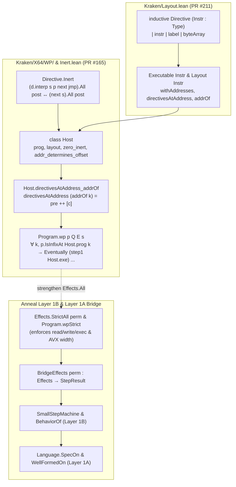

# Kraken Weakest-Precondition Foundation (`Program.wp`), Abstracted `Directive` Refactor, and X64 Syntax Elaborators at `c9aa45ee1`

## Summary

Between baseline commit `8af78062037bc237b341d20252aafd1797c1bcb7` and current `HEAD` `c9aa45ee1b273892d7efa7bbf8a8a9391e17b2c0` (41 commits, 29 files touched), `AeneasVerif/kraken` landed four architectural changes relevant to Anneal's assembly verification strategy:

1. **Weakest-Precondition (`Program.wp`) Foundation (PR #165, merged at `72f3a7a3a2d94ac51040815d692cd31a1d240a1d`):** `Kraken/X64/WP/Host.lean`, `Kraken/X64/WP/Basic.lean`, `Kraken/X64/Inert.lean`, and `Kraken/Data/List/Infix.lean` introduce a `Host` typeclass and a relational weakest precondition `Program.wp` defined directly over `Eventually (step1 Host.exe)`. By quantifying over every program index `k` at which a fragment `p` occurs as an infix of `Host.prog` (`p.IsInfixAt Host.prog k`), `Program.wp` achieves compositional sequential framing (`Program.wp_cons`) without intermediate step relations (`Executable.step'` and `Executable.fetch?` were tried and removed in `1b5c3e47bc8f2b75c6575be7f00904ea63d99bdd`).
2. **Architecture-Parametric `Directive`, `Executable`, and `Layout` Refactor (PR #211, merged at `c9aa45ee1b273892d7efa7bbf8a8a9391e17b2c0`):** `Kraken/Layout.lean` unifies `inductive Directive (Instr : Type)` (`instr | label | byteArray`) across X64 and AArch64 and re-parameterizes `Program Instr`, `Executable Instr`, and `Layout Instr` by instruction type `Instr` rather than `Directive`.
3. **Compile-Time X64 Lean Syntax Categories and `TermElabM` Elaborators (PR #196, merged at `a802e9bc1568efd3cbe87e9f93225def2900354b`):** `Kraken/SyntaxAffixed.lean`, `Kraken/Parser.lean`, `Kraken/X64/Parser/Syntax.lean`, and `Kraken/X64/Parser/Elab.lean` introduce an environment-extension-backed affix-grammar generator (`declare_affixes`, `syntax_affixed`) and a `TermElabM` elaborator (`X64ElabM`) supporting `[x64| ...]`, `parse(...)`, `parse("...")`, `elabX64`, `include_x64`, and typed Lean antiquotations (`%❰r❱`, `❰op❱`, `❰d❱`). Because elaboration constructs kernel `Expr` applications of `Directive`/`Instr` constructors directly, definitions using `[x64| ...]`, `parse("...")`, or `include_x64` leave zero parser invocations in kernel terms.
4. **X64 Condition-Code Expansion and Frontend Divergence (PR #192, `3e89f5a237ad4dd35ee3714ab77e4a7d74096557`):** `Kraken/X64/Syntax.lean`, `Kraken/X64/Semantics.lean`, and the legacy Parsec string parser `Kraken/X64/Parser/Basic.lean` were extended from 8 to all 16 x86-64 condition codes (`o, no, c, nc, z, nz, be, a, s, ns, p, np, l, ge, le, g`) plus width-suffixed `cmov<cc>[b|w|l|q]`. However, the new Lean syntax/elaborator in `Kraken/X64/Parser/Syntax.lean` and `Kraken/X64/Parser/Elab.lean` was not updated for `3e89f5a` and still accepts only the original 8 condition codes and unsuffixed `cmov<cc>`.

Crucially, two soundness-relevant semantic gaps identified at `8af78062037bc237b341d20252aafd1797c1bcb7` remain **unchanged** at `c9aa45ee1b273892d7efa7bbf8a8a9391e17b2c0`:
- `Effects.All` in both `Kraken/X64/OmniSemantics.lean:13-22` and `Kraken/AArch64/OmniSemantics.lean:13-22` still ignores `require_read_access`, `require_write_access`, and `require_exec_access` (`(cont ()).All post`), so `Program.wp` (which unfolds to `Eventually (step1 Host.exe)` where `step1` uses `Effects.All`) does not enforce memory or execution permissions.
- `MachineData.loadAvx` (`Kraken/X64/Semantics.lean:317-326`) and `MachineData.storeAvx` (`Kraken/X64/Semantics.lean:335-343`) still emit `require_read_access addr .W64` and `require_write_access addr .W64` (8 bytes) when reading or writing `w.bytes` (16, 32, or 64 bytes for `W128`, `W256`, `W512`).

In `support/kraken_wp_and_bridge_probe.lean`, we mechanize Kraken's new `Directive Instr`, `Host`, and `Program.wp` infrastructure alongside a strict permission-enforcing observer `Effects.StrictAll` (`Program.wpStrict`) and bridge it into Anneal's Layer 1B (`StepResult`, `SmallStepMachine`, `BehaviorOf`) and Layer 1A (`Partial`, `SpecOn`, `WellFormedOn`) in Lean 4.34.1 with zero `sorryAx` and zero custom axioms.

---

## Applicability

These findings apply to:
- **Upstream Kraken (`https://github.com/AeneasVerif/kraken`)** at commit `c9aa45ee1b273892d7efa7bbf8a8a9391e17b2c0` (tree `4462246ba04a358fb3ef52cc8d8bc78875367546`), compared against baseline commit `8af78062037bc237b341d20252aafd1797c1bcb7` (tree `ce03a1dbd830b9f04960bbcbdc65e46549ba87be`), under toolchain `leanprover/lean4:v4.34.1` (`lean-toolchain` blob `47f3fb4b4ce7ffd8ffe9ffe2fd7befcd7c2fa5da`).
- **Anneal (`https://github.com/joshlf/anneal-private`)** at commit `6a88de9da56e4d23c1b29927c44bc3c1733b0500` (tree `977fa339dd33290e5370ab754621896a3bbdd775`), specifically Layer 1A (`trusted/lean/Trusted/Refinement.lean` and `theory/Anneal/Refinement.lean`) and Layer 1B (`trusted/lean/Trusted/StepResult.lean` and `theory/Anneal/StepResult.lean`).

---

## Findings

### 1. Commit-by-Commit Evolution (`8af7806203..c9aa45ee1b`)

Between `8af78062037bc237b341d20252aafd1797c1bcb7` and `c9aa45ee1b273892d7efa7bbf8a8a9391e17b2c0`, 41 commits landed across four feature branches/PRs, modifying or adding 29 files:

| PR / Merge Commit | Tip Commit on Branch | Key Files Added or Modified | Architectural Role |
| :--- | :--- | :--- | :--- |
| PR #192 (`3e89f5a237ad4dd35ee3714ab77e4a7d74096557`) | `3e89f5a237ad4dd35ee3714ab77e4a7d74096557` | `Kraken/X64/Syntax.lean`, `Kraken/X64/Semantics.lean`, `Kraken/X64/Parser/Basic.lean`, `Kraken/X64/PrintIntel.lean`, `Kraken/X64/Test/asm/test_condcodes.S` | Expands `CondCode` from 8 to all 16 x86-64 condition codes (`o, no, c, nc, z, nz, be, a, s, ns, p, np, l, ge, le, g`, retaining `.b` and `.ae` as `abbrev` aliases) and adds optional width suffixes (`b`, `w`, `l`, `q`) on `cmov<cc>` in `Basic.lean`. |
| PR #165 (`72f3a7a3a2d94ac51040815d692cd31a1d240a1d`) | `1ddddcfbc84922473ce5ffee429cd1bb068b2eea` (via `1b5c3e47bc8f2b75c6575be7f00904ea63d99bdd`, `188cb1e8cf3802041b5732e8632252aa16a1192f`) | `Kraken/X64/WP.lean`, `Kraken/X64/WP/Host.lean`, `Kraken/X64/WP/Basic.lean`, `Kraken/X64/Inert.lean`, `Kraken/Data/List/Infix.lean`, `Kraken/ForLean.lean`, `Kraken/Layout.lean` | Introduces `Directive.Inert`, `List.IsInfixAt`, the `Host` typeclass (`zero_inert`, `addr_determines_offset`), `Host.directivesAtAddress_addrOf`, and `Program.wp` directly over `Eventually (step1 Host.exe)`. |
| PR #196 (`a802e9bc1568efd3cbe87e9f93225def2900354b`) | `6c3df650cec4baff0af7410ebd23f1e2bdc23936` | `Kraken/SyntaxAffixed.lean`, `Kraken/Parser.lean`, `Kraken/X64/Parser.lean`, `Kraken/X64/Parser/Syntax.lean`, `Kraken/X64/Parser/Elab.lean`, `Kraken/X64/ParserTests.lean` | Adds environment-extension-driven affixed syntax categories (`declare_affixes`, `syntax_affixed`) and `TermElabM` elaborators (`[x64| ...]`, `parse(...)`, `elabX64`, `include_x64`) with typed Lean antiquotations. |
| PR #211 (`c9aa45ee1b273892d7efa7bbf8a8a9391e17b2c0`) | `46e5fe90770d3e0e81313c357512dfd929ffb641` | `Kraken/Layout.lean`, `Kraken/X64/Syntax.lean`, `Kraken/AArch64/Syntax.lean`, `KrakenRunnerX64.lean`, `KrakenRunnerAArch64.lean` | Moves `inductive Directive (Instr : Type)` into `Kraken/Layout.lean` and parameterizes `Program Instr`, `Executable Instr`, and `Layout Instr` by `Instr`. |



---

### 2. Weakest-Precondition (`Program.wp`) Foundation (`Kraken/X64/WP/`)

#### 2.1 Why Intermediate `Executable.step'` and `Executable.fetch?` Were Dropped

During the development of PR #165, earlier commits introduced an intermediate step relation `Executable.step'` based on single-directive `Executable.fetch?`, together with separate `WP/Step.lean` and `WP/Adequacy.lean` modules. Commit `1b5c3e47bc8f2b75c6575be7f00904ea63d99bdd` removed `Executable.step'`, `Executable.fetch?`, `WP/Step.lean`, and `WP/Adequacy.lean`, building `Program.wp` directly on `step1 Host.exe`, and commit `188cb1e8cf3802041b5732e8632252aa16a1192f` consolidated layout validity into the `Host` typeclass.

The reason this direct formulation works is that Kraken's `Executable.directivesAtAddress pc` (`Kraken/Layout.lean:105-109`) does not fetch a single directive by list index; instead, it drops directives whose address is not `pc`, finds the first directive with `0 < size`, and takes everything up to and including that positive-sized directive:

```lean
def directivesAtAddress (e : Executable Instr) (pc : Int64) : List (Addressable (Directive Instr)) :=
  let suffix := e.withAddresses.dropWhile (·.addr ≠ pc)
  match suffix.findIdx? (0 < ·.size) with
  | some k => suffix.take (k + 1)
  | none => suffix.takeWhile (·.addr = pc)
```

When labels (`.label l`, size `0`) precede an instruction at the same address `pc`, `directivesAtAddress pc` returns the entire prefix of 0-sized directives at `pc` followed by the first positive-sized directive `c`.

#### 2.2 `Directive.Inert`, `Host`, and `Host.directivesAtAddress_addrOf`

To prove that any 0-sized directives preceding `c` at address `Host.addrOf k` do not alter the omni-semantics of `c`, `Kraken/X64/Inert.lean:13-15` defines:

```lean
def Directive.Inert (d : Directive) : Prop :=
  ∀ [Labels] (s : MachineData) (p : AddressRange)
    (next : MachineData → Effects) (jmp : Label → MachineData → Effects)
    (post : MachineState → Prop),
    (d.interp s p next jmp).All post ↔ (next s).All post
```

`Kraken/X64/Inert.lean` proves two constructors inert:
- `Directive.Inert.label` (`lines 17-19`): `(.label l).interp` is definitionally `next s`.
- `Directive.Inert.nop` (`lines 21-24`): `(.instr (.regular _ _ (.nop n))).interp` unfolds to `.require_exec_access p fun () => next s`, which under `Effects.All` reduces definitionally to `(next s).All post`.

`Kraken/X64/WP/Host.lean:25-33` then packages the ambient program, its layout, and two invariants into a typeclass `Host`:

```lean
class Host where
  prog : Program
  layout : Layout
  zero_inert : ∀ i d, prog[i]? = some d → @Kraken.Layout.size _ layout i = 0 → d.Inert
  addr_determines_offset :
    ∀ j k, (layout.apply prog).addrOf j = (layout.apply prog).addrOf k →
      (layout.apply prog).sizeBefore j = (layout.apply prog).sizeBefore k
```

Here:
- `zero_inert` guarantees that any directive assigned byte size `0` by `layout` (such as `.label l` or `.nop 0`) satisfies `Directive.Inert`.
- `addr_determines_offset` rules out `Int64` address wraparound collisions across the program (`addrOf j` is `Int64.ofNat (sizeBefore j)` in `Kraken/Layout.lean:141-142`, so if total program size wrapped mod $2^{64}$, two distinct cumulative offsets `sizeBefore j ≠ sizeBefore k` could alias to the same `Int64` address).

From these two fields, `Host.directivesAtAddress_addrOf` (`Kraken/X64/WP/Host.lean:77-105`) proves that for any directive `c` at index `k` (`Host.exe.program[k]? = some c`) with `0 < c.size`:

$$\exists \mathit{pre},\; \mathsf{Host.exe.directivesAtAddress}(\mathsf{Host.addrOf}\; k) = \mathit{pre} \mathbin{+\!+} [\langle\langle\mathsf{Host.addrOf}\; k, c.\mathsf{size}\rangle, c.\mathsf{directive}\rangle] \;\wedge\; \forall c' \in \mathit{pre},\; c'.\mathsf{size} = 0$$

and `Host.inert_of_size_zero` (`Kraken/X64/WP/Host.lean:64-72`) shows every $c' \in \mathit{pre}$ satisfies $c'.\mathsf{directive.Inert}$. Consequently, `Directives.interp_inert_append` (`Kraken/X64/Inert.lean:27-35`) collapses `(Directives.interp (pre ++ [c]) ...).All post` to `(c.directive.interp ...).All post`.

#### 2.3 `Program.wp`, Infix Quantification, and Compositional Sequencing

`Kraken/X64/WP/Basic.lean:27-33` defines `Program.wp` for a sub-program `p : Program`, a fallthrough postcondition `Q : MachineData → Prop`, an exit/jump postcondition `E : Int64 → MachineData → Prop`, and an initial data state `s : MachineData`:

```lean
def Program.wp [Host] (p : Program) (Q : MachineData → Prop)
    (E : Int64 → MachineData → Prop) (s : MachineData) : Prop :=
  ∀ k, p.IsInfixAt Host.prog k →
    Eventually (step1 Host.exe)
      (fun st => (st.pc = Host.addrOf (k + p.length) ∧ Q st.data) ∨ E st.pc st.data)
      ⟨s, Host.addrOf k⟩
```

where `p.IsInfixAt Host.prog k` (`Kraken/Data/List/Infix.lean:24-25`) is defined as `p <+: Host.prog.drop k`.

Quantifying universally over every index `k` at which `p` occurs as an infix of `Host.prog` provides **position-independent modularity** across sequential composition (`Program.wp_cons`, `Kraken/X64/WP/Basic.lean:40-53`):
- If `(d :: p).IsInfixAt Host.prog k`, then by `List.IsInfixAt.cons_iff` (`Kraken/Data/List/Infix.lean:45-47`), `[d].IsInfixAt Host.prog k` and `p.IsInfixAt Host.prog (k + 1)`.
- Executing `[d]` from `Host.addrOf k` reaches either an exit state satisfying `E st.pc st.data` or the fallthrough address `st.pc = Host.addrOf (k + 1)` with `Q st.data`.
- Instantiating `p.wp R E st.data` at index `k + 1` then continues from `Host.addrOf (k + 1)` to `Host.addrOf (k + 1 + p.length) = Host.addrOf (k + (d :: p).length)` via `Eventually.trans`.

Finally, `Kraken/X64/WP/Basic.lean` provides three adequacy entry points:
1. `Host.eventually_of_interp` (`lines 58-77`): lifts a single-directive `d.interp` proof (for a positive-sized directive `d` at `Host.prog[k]? = some d`, or a zero-sized inert directive) into `Eventually (step1 Host.exe)`.
2. `Program.step1_of_wp_at` (`lines 87-96`): instantiates `p.wp Q E s` at a specific index `k` where `hk : p.IsInfixAt Host.prog k`.
3. `Program.step1_of_wp` (`lines 103-113`): instantiates `p.wp Q E s` at the first infix occurrence `h : p <:+: Host.prog`, running from `Host.startAddr h` to `Host.endAddr h`.

Note that at `c9aa45ee1b273892d7efa7bbf8a8a9391e17b2c0`, `WP/` and `Inert.lean` exist only under `Kraken/X64/` (`Kraken/X64/WP.lean`, `Kraken/X64/WP/Host.lean`, `Kraken/X64/WP/Basic.lean`, `Kraken/X64/Inert.lean`); no `Kraken/AArch64/WP/` module has been created yet, even though nothing in `Host` or `Program.wp` is specific to X64 beyond `MachineData`, `MachineState`, and `Directive.interp`.

#### 2.4 Relationship Between `Program.wp` and Anneal Layer 1A / Layer 1B

Comparing Kraken's `Program.wp` against Anneal's Layer 1A (`trusted/lean/Trusted/Refinement.lean`) and Layer 1B (`trusted/lean/Trusted/StepResult.lean`) reveals four structural differences that any Anneal-to-Kraken bridge must mediate:

| Dimension | Kraken `Program.wp` (`Kraken/X64/WP/Basic.lean`) | Anneal Layer 1B (`StepResult.lean`) & Layer 1A (`Refinement.lean`) | Bridge Requirement |
| :--- | :--- | :--- | :--- |
| **Definedness vs. Postcondition** | Bundled into a single total-correctness predicate `Eventually (step1 Host.exe) post st`. | Separated in `Partial Out` (`defined : Prop` vs. `val : defined → Out → Prop`), with `BehaviorOf M p q` defining `defined := ∀ tr out, ReachesPrefix ... → out.isSafe`. | A single-step bridge `BridgeEffects` must map `.unimplemented` to `.failed .incomplete` and `.gp_unaligned` / `.nonmem_load` / `.nonmem_store` / permission failures to `.failed .ub`, so a strict single-step proof implies both `out.isSafe` (`defined`) and state transition inclusion (`val`). |
| **Step Budgeting vs. Eventual Termination** | Unbounded inductive fixpoint `Eventually (step1 Host.exe)`; requires termination at a state satisfying `(pc = endAddr ∧ Q) ∨ E`. | Step-indexed query `ExecQuery State := ⟨init, steps⟩`; requires prefix safety at every queried step budget `steps : Nat`, even for non-terminating loops. | Finite straight-line or bounded-loop `Program.wpStrict` derivations of $N$ steps discharge `BehaviorOf M p ⟨init, N⟩ ≤ (M.toLanguage).SpecOn pre Post`. |
| **Permission & Alignment Enforcement** | `step1` evaluates `Directives.interp` with `Effects.All`, which ignores `require_read_access`, `require_write_access`, and `require_exec_access`. | Unauthorized memory reads/writes/executes are architectural UB and must transition to `.failed .ub` (`isSafe = False`). | Replace `Effects.All` with a permission-enforcing observer `Effects.StrictAll perm` (`step1Strict`, `Program.wpStrict`). |
| **Zero-Sized Directive Inertness (`Directive.Inert`)** | Under `Effects.All`, both `.label l` and `.instr (.nop 0)` are unconditionally `Inert`. | Under `Effects.StrictAll perm`, `.label l` is unconditionally inert (`rfl`), whereas `.instr (.nop 0)` emits `require_exec_access ⟨pc, 0⟩` and is inert only if `perm.canExec ⟨pc, 0⟩ = true`. | Restrict 0-sized directives in `Host.zero_inert` to `.label l` (or require `perm.canExec ⟨pc, 0⟩ = true` at `pc = Host.addrOf k`). |

---

### 3. Abstracted `Directive Instr`, `Executable Instr`, and `Layout Instr` Refactor (`PR #211`)

At baseline `8af78062037bc237b341d20252aafd1797c1bcb7`, `Kraken/X64/Syntax.lean` and `Kraken/AArch64/Syntax.lean` each declared a separate `inductive Directive`, and `Kraken/Layout.lean` parameterized `Executable` and `Layout` by `(Directive : Type)` together with a `Layout.Classifier Directive` typeclass to distinguish instructions, labels, and byte arrays.

Commit `46e5fe90770d3e0e81313c357512dfd929ffb641` (merged in PR #211 at `c9aa45ee1b273892d7efa7bbf8a8a9391e17b2c0`) eliminated `Layout.Classifier` and moved `Directive` into `Kraken/Layout.lean:19-39`:

```lean
namespace Kraken

abbrev Label := String

inductive Directive (Instr : Type) where
  | instr (_ : Instr)
  | label (_ : Label)
  | byteArray (_ : ByteArray)
  deriving Repr, DecidableEq, Inhabited

abbrev Program (Instr : Type) := List (Directive Instr)
```

Both architecture syntax modules now define transparent abbreviations:
- `Kraken/X64/Syntax.lean:264-268`:
  ```lean
  abbrev Directive := Kraken.Directive Instr
  abbrev Program := List Directive
  abbrev Executable := Kraken.Executable Instr
  ```
- `Kraken/AArch64/Syntax.lean:482-486`:
  ```lean
  abbrev Directive := Kraken.Directive Instr
  abbrev Program := List Directive
  abbrev Executable := Kraken.Executable Instr
  ```

Two subtleties of this refactor are worth recording:
1. **`CoeFun (Layout Instr)` Typing (`Kraken/Layout.lean:51-52`):** The `CoeFun` instance is declared as `CoeFun (Layout Instr) (fun _ => List (Directive Instr) → Executable Instr)` rather than `Program Instr → Executable Instr` so that Lean's typeclass synthesizer matches architecture-local `Program` (`List Directive`) without unfolding across module namespaces.
2. **Semantics of `.label` and `.byteArray` (`Kraken/X64/Semantics.lean:790-808`, `Kraken/AArch64/Semantics.lean:947-965`):**
   - `Executable.labels` resolves a label `l` via `e.withAddresses.findSome?` (returning the address of the **first** `.label l` in `e.withAddresses`, or **`-1`** if `l` does not occur in `e`).
   - In `Directive.interp`, `.label _` is a zero-cost fallthrough (`next s`), while `.byteArray _` unconditionally returns `.unimplemented s!"Unimplemented: execution reached data block at {p.1}"`. Neither X64 nor AArch64 populates `.byteArray` contents into initial `DataMem` (`dmem`).

---

### 4. X64 Lean Syntax Categories, `SyntaxAffixed.lean`, and `TermElabM` Elaborators (`PR #196`)

#### 4.1 Architecture of `SyntaxAffixed.lean` and `X64ElabM`

PR #196 (`a802e9bc1568efd3cbe87e9f93225def2900354b`) replaced the macro wrapper around `Kraken.X64.Parser.Basic.parse` with a native Lean 4 syntax category and `TermElabM` elaborator split across four files:

1. **`Kraken/SyntaxAffixed.lean` (242 lines):** Implements a general-purpose affix combinator for Lean syntax categories:
   - `declare_affixes` (`lines 103-128`) registers named affix tables in a `SimplePersistentEnvExtension (Name × AffixSet) (NameMap AffixSet)` (`affixSetsExt`, `lines 49-53`), supporting `extends` inheritance (e.g., `lq` $\subset$ `wlq` $\subset$ `bwlq` in `Kraken/X64/Parser/Syntax.lean:166-176`).
   - `syntax_affixed` (`lines 193-209`) takes optional `prefixes` and `suffixes` affix-set names and a stem string (e.g., `syntax_affixed (suffixes := bwlq) "add" : x64_bin_op`) and generates a `@[ category_parser cat]` declaration whose `ParserDescr` is an `orelse` chain of `ParserDescr.node k prec (ParserDescr.nonReservedSymbol token false)` rules, sorted **longest-token-first** (`entries.qsort (fun a b => a.1.length > b.1.length)`, `line 161`) so longer suffixes like `"movslq"` match before shorter prefixes.
   - Each generated syntax node carries a structured syntax kind ``cat.affixed.«prefix|stem|suffix»`` (`affixedKind`, `lines 68-69`), which `splitAffixed` (`lines 213-225`) decomposes at elaboration time into `(prefix, stem, suffix)` in $O(1)$ without re-scanning strings.
2. **`Kraken/Parser.lean` (56 lines):** Provides `Lean.Parser.runSyntaxCategory` (`lines 21-46`), which initializes a `ParserContext` and `ParserModuleContext` from the current `TermElabM` environment and runs `categoryParser cat 0` over an input string, mapping parser byte offsets to line/column diagnostics.
3. **`Kraken/X64/Parser/Syntax.lean` (475 lines):** Declares syntax categories `x64_reg64`, `x64_reg32`, `x64_reg16`, `x64_reg8_low`, `x64_reg8_high`, `x64_xmm`, `x64_ymm`, `x64_zmm`, `x64_const`, `x64_addr`, `x64_operand`, `x64_instr`, `x64_directive`, and `x64_prog`, plus typed Lean antiquotations `%❰r:term❱` (register antiquotation) and `❰t:term❱` (operand/instruction/directive antiquotation).
4. **`Kraken/X64/Parser/Elab.lean` (773 lines):** Implements `X64ElabM := StateRefT X64ElabM.State TermElabM` (`lines 32-38`), where `X64ElabM.State` holds an optional `operandWidth : Option Expr` (`none` until constrained by a mnemonic suffix or register operand, or a Lean `Expr` of type `Width`, which may be a free variable `w : Width` when elaborating `%❰r❱` for `r : Reg w`). It exposes five user-facing entry points (`lines 697-770`):
   - `elabX64 (stx : TSyntax `x64_prog) : TermElabM Expr`
   - `[x64| $p:x64_prog]` (elaborates inline Lean syntax)
   - `parse($s:str)` and `parse($p:x64_prog)` (runs `elabCategory` on string literals or elaborates inline syntax)
   - `include_x64 $path:str` (reads an external `.S` file at elaboration time via `IO.FS.readFile`, registers it as a build dependency, and runs `elabCategory`).

#### 4.2 Impact on `partial def` Kernel Opacity Across X64 and AArch64

In the baseline report (`rust-inline-asm-macho-relocations-and-kraken-aarch64-bridge`), we identified how `partial def` functions in Lean 4 compile to opaque constants in the kernel environment that cannot be unfolded by `rfl`, `decide`, or `simp`. At `c9aa45ee1b273892d7efa7bbf8a8a9391e17b2c0`, the exact `partial def` inventory across the entire Kraken repository is:

| File & Line (`c9aa45ee1`) | Declaration | Status & Kernel Reducibility Impact |
| :--- | :--- | :--- |
| `Kraken/X64/Parser/Elab.lean:245` | `partial def elabConstExpr : TSyntax `x64_const → TermElabM Expr` | Runs in `TermElabM` **at elaboration time** to construct a concrete `Expr` application of `ConstExpr` constructors (`int64`, `name`, `add`, `sub`, `neg`, etc.). Never appears in the elaborated kernel term. |
| `Kraken/X64/Parser/Basic.lean` | *(none)* | Zero `partial def` declarations. Retained as the runtime `String → Except String Program` parser (`Kraken.X64.Parser.parse`) used by `KrakenRunnerX64.lean`. |
| `Kraken/AArch64/Parser/Basic.lean:138, 146` | `partial def parseConstExpr : Parser ConstExpr` (and `mutual` block `parseAddSub`, `parseAtom`) | Runtime `Parsec` parser `Kraken.AArch64.Parser.parse` remains opaque in the kernel if invoked as a runtime function `Parser.parse "..." = .ok prog`, **Wait:** when invoked via the compile-time macro `parseAArch64("...")` (`Kraken/AArch64/Parser.lean:12-20`), `TermElabM` evaluates `Parser.parse s.getString` at elaboration time and splices `Lean.toExpr p` into the kernel environment as a transparent constructor list! |
| `Kraken/X64/Semantics.lean:823` & `Kraken/AArch64/Semantics.lean:980` | `partial def Executable.eval` | Fuel-less runner used by `KrakenRunnerX64` / `KrakenRunnerAArch64`; remains opaque in the kernel (verification uses `step1` and `Program.wp`, which are completely total and inductive). |

Thus, any X64 program defined via `[x64| ...]`, `parse(...)`, `parse("...")`, or `include_x64` elaborates into an explicit `List (Kraken.Directive Instr)` literal in the Lean kernel with **zero parser references in the kernel term**.

#### 4.3 Primary-Source Divergence Between `Elab.lean` and `Basic.lean` on Condition Codes and `cmov`

Comparing PR #192 (`3e89f5a237ad4dd35ee3714ab77e4a7d74096557`) and PR #196 (`a802e9bc1568efd3cbe87e9f93225def2900354b`) reveals an unmerged feature gap between the two X64 parser frontends at `c9aa45ee1b273892d7efa7bbf8a8a9391e17b2c0`:

- **`Kraken/X64/Syntax.lean:176-206` and `Kraken/X64/Parser/Basic.lean:451-539`:** Support all 16 architectural condition codes (`o, no, c, nc, z, nz, be, a, s, ns, p, np, l, ge, le, g` and aliases `e, ne, b, nae, ae, nb, nbe, na, pe, po, nge, nl, ng, nle`) on `j<cc>`, `set<cc>`, and `cmov<cc>`, plus optional width suffixes (`b`, `w`, `l`, `q`) on `cmov<cc><w>`.
- **`Kraken/X64/Parser/Syntax.lean:178-196, 247` and `Kraken/X64/Parser/Elab.lean:445-455`:** `declare_affixes cc` and `evalCondCodeSuffix` list only the original 8 condition codes (`z/e`, `nz/ne`, `b/c/nae`, `ae/nc/nb`, `a/nbe`, `be/na`, `l/nge`, `le/ng`), omitting `o, no, s, ns, p/pe, np/po, ge/nl, g/nle`, and `syntax_affixed (suffixes := cc) "cmov" : x64_cmov_op` does not permit width suffixes (`b`, `w`, `l`, `q`).

Consequently, at `c9aa45ee1b273892d7efa7bbf8a8a9391e17b2c0`, `Kraken/X64/Test/asm/test_condcodes.S` parses and executes via `KrakenRunnerX64` (which calls `Kraken.X64.Parser.parse` in `Basic.lean`), but attempting to parse `test_condcodes.S` via `include_x64` or `[x64| seto %al; cmovo %r15, %rcx ]` fails in `Syntax.lean` / `Elab.lean`.

---

### 5. Persistent Semantic Gaps at `c9aa45ee1`: `Effects.All` Permission Erasure and `loadAvx`/`storeAvx` Width Mismatch

1. **`Effects.All` Still Erases Read, Write, and Execute Permissions:**
   In both `Kraken/X64/OmniSemantics.lean:13-22` (blob `03e9fa0ce0a449df89566e0c7cf35f7162b106d3`, untouched since `8af7806`) and `Kraken/AArch64/OmniSemantics.lean:13-22` (blob `dc55551b1fb08c11303f8498ddad70be4fa559bc`, untouched since `8af7806`), `Effects.All` defines:
   ```lean
   | .require_read_access _ _ cont => (cont ()).All post
   | .require_write_access _ _ cont => (cont ()).All post
   | .require_exec_access _ cont => (cont ()).All post
   ```
   Because `step1` (`Kraken/X64/OmniSemantics.lean:24-28`) wraps `Directives.interp` in `.All post`, and `Program.wp` (`Kraken/X64/WP/Basic.lean:27-33`) unfolds to `Eventually (step1 Host.exe)`, `Program.wp` inherits this permission erasure: so long as an address is initialized in `MachineData.dmem` (`readByte?` returns `some _`), `Program.wp` treats any read, write, or instruction fetch at that address as valid regardless of architectural page/object permissions.
2. **`MachineData.loadAvx` and `MachineData.storeAvx` Still Emit `.W64` (8-Byte) Access Checks for 16/32/64-Byte Vector Accesses:**
   In `Kraken/X64/Semantics.lean:317-326` and `335-343`:
   ```lean
   def MachineData.loadAvx (s : MachineData) (addr : UInt64) (w : AvxWidth)
       (cont : w.Value → Effects) : Effects :=
     .require_read_access addr .W64 fun () =>
       match s.dmem.readBytes? addr w.bytes with
       | some val => cont (BitVec.ofNat _ val)
       | none => .nonmem_load addr .W64
   ```
   Even if a consumer replaces `Effects.All` with a strict observer `Effects.StrictAll perm` that checks `perm.canRead addr w.bytes`, `loadAvx` and `storeAvx` pass `.W64` (8 bytes) instead of `w.bytes` (16, 32, or 64 bytes for `W128`, `W256`, `W512`). As mechanized in `vmovupsLoad256_passes_buggy_W64_perm_check` (`support/kraken_wp_and_bridge_probe.lean:486-490`), a 32-byte `vmovups` load at `0x1000` where only `[0x1000, 0x1008)` has read permission in `perm` (while `[0x1000, 0x1020)` is present in `dmem`) passes `Effects.StrictAll perm` unless either `loadAvx`/`storeAvx` is fixed upstream or an instruction-level footprint check (`checkAvxReadPerm`, `lines 493-498`) is applied.

---

### 6. Mechanized Lean 4.34.1 Verification (`support/kraken_wp_and_bridge_probe.lean`)

The standalone file `support/kraken_wp_and_bridge_probe.lean` (1,089 lines, checked with `/usr/local/google/home/joshlf/.elan/toolchains/leanprover--lean4---v4.34.1/bin/lean -j1 -M768`) mechanizes the entire stack from Kraken's `Directive Instr` and `Program.wp` to Anneal's `SmallStepMachine` and `SpecOn`:

| Theorem in `support/kraken_wp_and_bridge_probe.lean` | Lines | Verified Statement | Axioms (`#print axioms`) |
| :--- | :--- | :--- | :--- |
| `Program.wp_cons` | `358-381` | Compositional sequential framing: `Program.wp [d] Q E s` and `∀ s', Q s' → Program.wp p R E s'` imply `Program.wp (d :: p) R E s`. | `[propext, Quot.sound]` |
| `Host.eventually_of_interp_decomp` | `431-438` | Single-directive adequacy from `Host.directivesAtAddress_addrOf` decomposition `pre ++ [c]` with inert `pre` to `Eventually (step1 Host.exe)`. | `[propext, Quot.sound]` |
| `Program.step1_of_wp_at` | `442-449` | Instantiates `Program.wp p Q E s` at `hk : List.IsInfixAt p Host.prog k` to obtain `Eventually (step1 Host.exe) post ⟨s, Host.addrOf k⟩`. | `[propext]` |
| `nop0_not_strict_inert_when_unexec` | `460-472` | `.instr (.nop 0)` satisfies `Effects.All` unconditionally (and is `Directive.Inert`), but fails `Effects.StrictAll perm` when `perm.canExec ⟨0, 0⟩ = false`. | *(none)* |
| `vmovupsLoad256_passes_buggy_W64_perm_check` & `vmovupsLoad256_rejected_by_true_W256_width_check` | `486-498` | Proves that `loadAvx`'s `.W64` emission lets a 32-byte `.W256` read pass an 8-byte permission policy under `StrictAll`, whereas `checkAvxReadPerm` rejects it. | *(none)* |
| `BridgeEffects.sound_of_strictAll` & `KrakenMachineStep.sound_of_step1Strict` | `729-755`, `813-830` | If `step1Strict hp.perm hp.exe st post` holds at `st.pc ≠ hp.haltPc`, every `KrakenMachineStep hp st r` is `r = .next st' none` with `post st'` (never `.failed .ub` or `.failed .incomplete`). | `[propext]` |
| `demoHostedProg_refines_SpecOn` | `970-995` | Positive end-to-end refinement: for the 3-directive program `[.label "entry", .instr (.store64 0x1000 42), .instr (.load64 0x1000)]`, `demoProg_wpStrict_at_0` discharges both `BehaviorOf KrakenMachine demoHostedProg ≤ L.SpecOn pre Post` and `BehaviorOf KrakenMachine demoHostedProg ≤ L.WellFormedOn pre`. | `[propext]` |
| `unauthorizedWrite_passes_default_step1_but_fails_Strict_and_Anneal` | `1008-1033` | Negative Control 1: an out-of-policy store `.instr (.store64 0x9999 77)` satisfies Kraken's default `step1`, fails `step1Strict`, and drives `KrakenMachine` to `.failed .ub`, refuting `(BehaviorOf KrakenMachine ...).defined`. | `[propext]` |
| `byteArrayExec_fails_step1_and_Anneal_defined` | `1041-1060` | Negative Control 2: executing `.byteArray [0x90]` emits `.unimplemented`, refuting both `step1` and `(BehaviorOf KrakenMachine ...).defined` (`.failed .incomplete`). | `[propext]` |

---

## Boundaries

1. **`Kraken/AArch64/WP/` Not Yet Present Upstream:** At `c9aa45ee1b273892d7efa7bbf8a8a9391e17b2c0`, `WP/Host.lean`, `WP/Basic.lean`, and `Inert.lean` exist only under `Kraken/X64/`. Although PR #211 unified `Kraken.Directive Instr`, `Kraken.Executable Instr`, and `Kraken.Layout Instr` across X64 and AArch64, `Host` and `Program.wp` have not yet been moved to a shared `Kraken/WP/` module or instantiated for `Kraken.AArch64`.
2. **Concrete Single-Instruction Hoare Rules Not Yet Merged Upstream:** `Kraken/X64/WP/Basic.lean` provides the foundational definition `Program.wp`, monotonicity (`wp_mono`), empty-program rule (`wp_nil`), sequential composition (`wp_cons`), single-directive lifting (`Host.eventually_of_interp`), and adequacy (`step1_of_wp_at`, `step1_of_wp`), but per-instruction WP lemmas (`wp_mov`, `wp_add`, `wp_jcc`, etc.) are not yet present in `Kraken/X64/WP/` at `c9aa45ee1b273892d7efa7bbf8a8a9391e17b2c0`.
3. **AArch64 Syntax Elaborator Not Yet Migrated to `SyntaxAffixed`:** `Kraken/AArch64/Parser.lean` still wraps the Parsec string parser `Kraken.AArch64.Parser.parse` via `Lean.toExpr` rather than using `Kraken/SyntaxAffixed.lean` and `TermElabM` syntax categories.

---

## Evidence

All primary-source file identities at `AeneasVerif/kraken` commit `c9aa45ee1b273892d7efa7bbf8a8a9391e17b2c0` (tree `4462246ba04a358fb3ef52cc8d8bc78875367546`) and `joshlf/anneal-private` commit `6a88de9da56e4d23c1b29927c44bc3c1733b0500` (tree `977fa339dd33290e5370ab754621896a3bbdd775`) are recorded with full 40-character Git blob SHAs and SHA-256 digests in `support/source-manifest.json`. Key primary-source files cited in this report include:

| Repository & Path | Commit | Blob SHA | Lines |
| :--- | :--- | :--- | :--- |
| `AeneasVerif/kraken`: `Kraken/Layout.lean` | `c9aa45ee1b273892d7efa7bbf8a8a9391e17b2c0` | `84ffce14d28485ebba25923e8f61ef3cf0376d22` | 150 |
| `AeneasVerif/kraken`: `Kraken/Data/List/Infix.lean` | `c9aa45ee1b273892d7efa7bbf8a8a9391e17b2c0` | `21562f4b18f37fc98c973e5563d7f30d62297be7` | 73 |
| `AeneasVerif/kraken`: `Kraken/X64/Inert.lean` | `c9aa45ee1b273892d7efa7bbf8a8a9391e17b2c0` | `55fd27b25f137920726b0156ab748b2ef9ff5ff8` | 37 |
| `AeneasVerif/kraken`: `Kraken/X64/WP/Host.lean` | `c9aa45ee1b273892d7efa7bbf8a8a9391e17b2c0` | `c50966e0a5d62184c96150144c3ef75c887d7d38` | 107 |
| `AeneasVerif/kraken`: `Kraken/X64/WP/Basic.lean` | `c9aa45ee1b273892d7efa7bbf8a8a9391e17b2c0` | `ff8bc3674e6c959b024cb6e7927ab8bc80a35609` | 115 |
| `AeneasVerif/kraken`: `Kraken/SyntaxAffixed.lean` | `c9aa45ee1b273892d7efa7bbf8a8a9391e17b2c0` | `c9bf5a22ef865ffab4fd47a27e0a81f29a853c43` | 242 |
| `AeneasVerif/kraken`: `Kraken/Parser.lean` | `c9aa45ee1b273892d7efa7bbf8a8a9391e17b2c0` | `c7f0ca3b6593fa79db2e62e6e1bb129bb616575f` | 56 |
| `AeneasVerif/kraken`: `Kraken/X64/Parser/Syntax.lean` | `c9aa45ee1b273892d7efa7bbf8a8a9391e17b2c0` | `0dc8323e4f9b7ca4fa28de14e07314bbbe5437c6` | 475 |
| `AeneasVerif/kraken`: `Kraken/X64/Parser/Elab.lean` | `c9aa45ee1b273892d7efa7bbf8a8a9391e17b2c0` | `1a79d976cb52eb03b502300b89e4e83a14815548` | 773 |
| `AeneasVerif/kraken`: `Kraken/X64/Parser/Basic.lean` | `c9aa45ee1b273892d7efa7bbf8a8a9391e17b2c0` | `4c9cf022a988b031ebcb367a8a3e6ca5fb595605` | 817 |
| `AeneasVerif/kraken`: `Kraken/X64/Syntax.lean` | `c9aa45ee1b273892d7efa7bbf8a8a9391e17b2c0` | `51f21f99a3198744cfee939051cb18c38caad51c` | 269 |
| `AeneasVerif/kraken`: `Kraken/X64/Semantics.lean` | `c9aa45ee1b273892d7efa7bbf8a8a9391e17b2c0` | `3d26c1680778671fb788635a26db4aa4efae07dc` | 834 |
| `AeneasVerif/kraken`: `Kraken/X64/OmniSemantics.lean` | `c9aa45ee1b273892d7efa7bbf8a8a9391e17b2c0` | `03e9fa0ce0a449df89566e0c7cf35f7162b106d3` | 30 |
| `AeneasVerif/kraken`: `Kraken/AArch64/Syntax.lean` | `c9aa45ee1b273892d7efa7bbf8a8a9391e17b2c0` | `d138be6d544be00d3995baaf35fb3eb204c92539` | 487 |
| `AeneasVerif/kraken`: `Kraken/AArch64/Semantics.lean` | `c9aa45ee1b273892d7efa7bbf8a8a9391e17b2c0` | `7237705e11c52be892a9be2b8f5c71b16db5fbef` | 991 |
| `joshlf/anneal-private`: `trusted/lean/Trusted/Refinement.lean` | `6a88de9da56e4d23c1b29927c44bc3c1733b0500` | `1fa8657e636312046181f293cd12606794c4c397` | 150 |
| `joshlf/anneal-private`: `trusted/lean/Trusted/StepResult.lean` | `6a88de9da56e4d23c1b29927c44bc3c1733b0500` | `328df1a10260d55e14279cb9e32c9492f9da74d2` | 145 |

---

## Revalidation

To revalidate the mechanized Lean 4.34.1 probe and inspect the upstream commit range:

```bash
# 1. Typecheck the standalone mechanized probe under Lean 4.34.1 with resource caps
/usr/local/google/home/joshlf/.elan/toolchains/leanprover--lean4---v4.34.1/bin/lean -j1 -M768 \
  reports/kraken-wp-foundation-directive-refactor-and-syntax-elaborators-c9aa45e/support/kraken_wp_and_bridge_probe.lean

# 2. Verify the SHA-256 digest of support/kraken_wp_and_bridge_probe.lean against support/source-manifest.json
python3 -c '
import hashlib, json
with open("reports/kraken-wp-foundation-directive-refactor-and-syntax-elaborators-c9aa45e/support/source-manifest.json") as f:
    m = json.load(f)
expected = m["support_artifacts"][0]["sha256"]
with open("reports/kraken-wp-foundation-directive-refactor-and-syntax-elaborators-c9aa45e/support/kraken_wp_and_bridge_probe.lean", "rb") as f:
    actual = hashlib.sha256(f.read()).hexdigest()
assert expected == actual, f"Mismatch: {expected} != {actual}"
print("SHA-256 verified:", actual)
'
```

Revalidate this report when `AeneasVerif/kraken` advances past `c9aa45ee1b273892d7efa7bbf8a8a9391e17b2c0` (especially if `Kraken/X64/WP/` is generalized to `Kraken/AArch64/`, `Effects.All` or `loadAvx`/`storeAvx` is modified, or `Kraken/X64/Parser/Syntax.lean` and `Elab.lean` are updated to include the remaining 8 condition codes from `3e89f5a237ad4dd35ee3714ab77e4a7d74096557`) or when `joshlf/anneal-private` modifies `trusted/lean/Trusted/Refinement.lean` or `trusted/lean/Trusted/StepResult.lean`.

*Authored by an AI agent acting on joshlf's behalf.*
