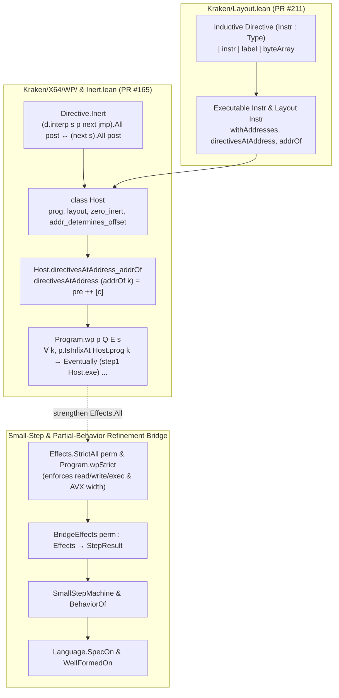

# Kraken Weakest-Precondition Foundation, Parser and Layout Boundaries, Selected Theorem Closure, and Certificate Checking

## Summary

Across baseline commit `8af78062037bc237b341d20252aafd1797c1bcb7` and subsequent commit `c9aa45ee1b273892d7efa7bbf8a8a9391e17b2c0` (41 commits, 29 files modified), `AeneasVerif/kraken` provides sequential omni-semantics (`Eventually`, `step1`, `straightlineStep`), byte-map separation logic (`SeparationMem`), parser and layout frontends, and (at `c9aa45ee1b273892d7efa7bbf8a8a9391e17b2c0`) a host-relative weakest-precondition foundation (`Program.wp`) for x86-64 and AArch64 assembly verification. Synthesizing source inspection, cross-toolchain compilation under both Lean `v4.34.1` (`5045d0056413266e57c625dcd7c365b10e377c52`) and Kraken's requested `4.36.0` (`ca39d2bc730f0382e4897ce314b93a4f168ff15e`), parser/layout negative controls, and mechanized Lean proof probes establishes five core reference findings:

1. **Weakest-Precondition (`Program.wp`) Foundation, Architecture-Parametric `Directive Instr`, and Compile-Time X64 Syntax Elaboration (`8af7806203..c9aa45ee1b`):**
   - **Host-Relative Weakest Preconditions (`PR #165`, merged at `72f3a7a3a2d94ac51040815d692cd31a1d240a1d`):** `Kraken/X64/WP/Host.lean`, `Kraken/X64/WP/Basic.lean`, `Kraken/X64/Inert.lean`, and `Kraken/Data/List/Infix.lean` introduce a `Host` typeclass (`zero_inert`, `addr_determines_offset`) and a relational weakest precondition `Program.wp` defined directly over `Eventually (step1 Host.exe)`. By quantifying universally over every program index `k` at which a fragment `p` occurs as an infix of `Host.prog` (`p.IsInfixAt Host.prog k`), `Program.wp` achieves compositional sequential framing (`Program.wp_cons`) without intermediate step relations (`Executable.step'` and `Executable.fetch?` were tried and removed in `1b5c3e47bc8f2b75c6575be7f00904ea63d99bdd`).
   - **Architecture-Parametric `Directive`, `Executable`, and `Layout` Refactor (`PR #211`, merged at `c9aa45ee1b273892d7efa7bbf8a8a9391e17b2c0`):** `Kraken/Layout.lean` unifies `inductive Directive (Instr : Type)` (`instr | label | byteArray`) across X64 and AArch64 and re-parameterizes `Program Instr`, `Executable Instr`, and `Layout Instr` by instruction type `Instr` rather than `Directive`, removing `Layout.Classifier`.
   - **Compile-Time X64 Lean Syntax Categories and `TermElabM` Elaborators (`PR #196`, merged at `a802e9bc1568efd3cbe87e9f93225def2900354b`):** `Kraken/SyntaxAffixed.lean`, `Kraken/Parser.lean`, `Kraken/X64/Parser/Syntax.lean`, and `Kraken/X64/Parser/Elab.lean` introduce an environment-extension-backed affix-grammar generator (`declare_affixes`, `syntax_affixed`) and a `TermElabM` elaborator (`X64ElabM`) supporting `[x64| ...]`, `parse(...)`, `parse("...")`, `elabX64`, `include_x64`, and typed Lean antiquotations (`%❰r❱`, `❰op❱`, `❰d❱`). Because elaboration constructs kernel `Expr` applications of `Directive`/`Instr` constructors directly, definitions using `[x64| ...]`, `parse("...")`, or `include_x64` leave zero parser invocations in kernel terms.
   - **X64 Condition-Code Expansion and Frontend Divergence (`PR #192`, `3e89f5a237ad4dd35ee3714ab77e4a7d74096557`):** `Kraken/X64/Syntax.lean`, `Kraken/X64/Semantics.lean`, and the runtime Parsec string parser `Kraken/X64/Parser/Basic.lean` were extended from 8 to all 16 x86-64 condition codes (`o, no, c, nc, z, nz, be, a, s, ns, p, np, l, ge, le, g`) plus width-suffixed `cmov<cc>[b|w|l|q]`. However, the new Lean syntax/elaborator in `Kraken/X64/Parser/Syntax.lean` and `Kraken/X64/Parser/Elab.lean` was not updated for `3e89f5a` and still accepts only the original 8 condition codes and unsuffixed `cmov<cc>`.
2. **Parser Preprocessing vs. Raw Parsing and External Layout Trust Boundaries (`8af7806203` and `c9aa45ee1b`):**
   - Kraken checks assembly AST semantics under an externally supplied `Layout`. Its X64 file parser (`parseFile` at `8af7806203`) first erases dot-directive lines via `stripDirectives`, including data (`.byte`), section (`.section`), alignment (`.p2align`, `.align`), and CFI directives. Fresh parser checks demonstrate that different data bytes (`.byte 1` vs. `.byte 2`) yield identical stripped ASTs, while the `Layout` interface admits zero-size instructions, duplicate labels (resolving to the first match), missing labels (resolving to `-1`), and signed `Int64` address wraparound. Those are correspondence obligations for an importer; successful AST proofs alone do not discharge them.
3. **Persistent Permission Erasure in `Effects.All` and Vector Width Under-Checking in `loadAvx`/`storeAvx` (`8af7806203` and `c9aa45ee1b`):**
   - `Effects.All` in both `Kraken/X64/OmniSemantics.lean:13-22` and `Kraken/AArch64/OmniSemantics.lean:13-22` ignores `require_read_access`, `require_write_access`, and `require_exec_access` (`(cont ()).All post`), so `step1`, `straightlineStep`, and `Program.wp` do not enforce memory or execution permissions.
   - `MachineData.loadAvx` (`Kraken/X64/Semantics.lean:317-326`) and `MachineData.storeAvx` (`Kraken/X64/Semantics.lean:335-343`) emit `require_read_access addr .W64` and `require_write_access addr .W64` (8 bytes) before reading or writing `w.bytes` (16, 32, or 64 bytes for `W128`, `W256`, `W512`). Even a strict permission interpreter (`Effects.StrictAll`) under-checks vector footprints unless `loadAvx`/`storeAvx` or an instruction-level footprint check supplies the true vector width.
4. **Selected Theorem Closure and Requested-Nightly Proof Replay (`8af7806203`):**
   - Both Lean `v4.34.1` (`5045d0056413266e57c625dcd7c365b10e377c52`) and Kraken's requested `4.36.0` (`ca39d2bc730f0382e4897ce314b93a4f168ff15e`) build all 40 Kraken library/example module targets from a clean 166-file source copy (`598,992` bytes) and replay selected theorem closures identically: X64 `swap_correct`, `move_2_regs_to_heap_correct`, `alu_mem_example_correct`, `Mem.loadInt_sep`, `Mem.storeInt_sep`, and AArch64 `swap_correct`, `move_2_regs_to_heap_correct`, `reg_offset_example_correct` depend only on `{propext, Classical.choice, Quot.sound}`; X64 `p3_correct` and `dynamic_stack_example_correct` depend on `sorryAx`; and AArch64 `arith_shift_correct` depends on the native certificate reflection axiom `arith_shift_correct._native.bv_decide.ax_1_10` (obtained via `LratCert.toReflectionProof` / `nativeEqTrue`).
   - Memory-tactic pretty-printer fallback diagnostics during example builds trace to `Kraken/Tactics.lean` logging subgoal expressions without installing `subGoal.mvarId.withContext`; this presentation defect is reproduced in `PrettyContext.lean` and does not affect kernel theorem closures.
5. **Consumer-Bound Scalar Certificate Checking and Small-Step Refinement Bridging:**
   - In `support/kraken-consumer-bound-scalar-certificate-checker-8af7806/Consumer.lean`, a pure Lean certificate checker with a 19-byte finite grammar (`KRC` magic, version 1, target/model/claim tags, 32-bit entry offset, 64-bit PC $< 2^{63}$) proves `parse_iff`, `closed_grammar`, `check_binding`, `consumer_sound`, and `accepted_sound` for an 8-byte AArch64 leaf (`00004039c0035fd6`, `ldrb w0, [x0]; ret`), binding the full candidate image, entry offset, PC, layout, strict read/execute permissions, and separated memory frame (`Eq(v.At base) ⋆ R`) using only foundational axioms.
   - In `support/kraken-wp-foundation-directive-refactor-and-syntax-elaborators-c9aa45e/kraken_wp_and_bridge_probe.lean`, Kraken's `Directive Instr`, `Host`, and `Program.wp` are mechanized alongside a strict permission-enforcing observer `Effects.StrictAll` (`Program.wpStrict`) and bridged into a step-indexed small-step machine (`StepResult`, `SmallStepMachine`, `BehaviorOf`) and partial-behavior refinement (`Partial`, `SpecOn`, `WellFormedOn`) in Lean 4.34.1 with zero `sorryAx` and zero custom axioms.

## Applicability

This report synthesizes evidence across two commits of `AeneasVerif/kraken` and two Lean 4 toolchains recorded in `REPORT.json`:

1. **`AeneasVerif/kraken` at baseline commit `8af78062037bc237b341d20252aafd1797c1bcb7` (tree `ce03a1dbd830b9f04960bbcbdc65e46549ba87be`):**
   - Examined for X64 parser directive stripping (`stripDirectives`), external `Layout` edge cases, byte-binding negative controls, X64 and AArch64 state/effect semantics (`Effects.All`, `loadAvx`/`storeAvx`), selected upstream theorem closures (`#print axioms`), memory-tactic pretty-printer diagnostics (`Kraken/Tactics.lean`), the 19-byte consumer-bound AArch64 scalar certificate checker (`Adapter.lean`, `Consumer.lean`, `ReviewControls.lean`), and the full 40-module build and 6-file proof replay under Kraken's requested nightly toolchain.
2. **`AeneasVerif/kraken` at commit `c9aa45ee1b273892d7efa7bbf8a8a9391e17b2c0` (tree `4462246ba04a358fb3ef52cc8d8bc78875367546`, 41 commits ahead of `8af78062037bc237b341d20252aafd1797c1bcb7`):**
   - Examined for the four architectural changes landed between `8af7806203` and `c9aa45ee1b`: the X64 condition-code expansion (`PR #192`, `3e89f5a237ad4dd35ee3714ab77e4a7d74096557`), the `Host` and `Program.wp` weakest-precondition foundation (`PR #165`, `72f3a7a3a2d94ac51040815d692cd31a1d240a1d`), the `SyntaxAffixed` and `X64ElabM` compile-time syntax elaborators (`PR #196`, `a802e9bc1568efd3cbe87e9f93225def2900354b`), and the unified `Directive (Instr : Type)` / `Executable Instr` / `Layout Instr` refactor (`PR #211`, `c9aa45ee1b273892d7efa7bbf8a8a9391e17b2c0`).
3. **Lean 4 toolchains (`leanprover/lean4`):**
   - **Lean `v4.34.1` (`5045d0056413266e57c625dcd7c365b10e377c52`):** Used to execute the standalone `Program.wp` and small-step refinement bridge probe (`kraken_wp_and_bridge_probe.lean`), the parser/layout probe (`ParserLayout.lean`), the selected theorem closure and permission-interpretation probes (`X64Closure.lean`, `AArch64Closure.lean`, `AArch64Add.lean`, `EffectsProbe.lean`, `PermissionInterpretation.lean`, `NativeAxiom.lean`, `MissingState.lean`), and the consumer-bound scalar certificate checker (`Adapter.lean`, `Consumer.lean`, `ReviewControls.lean`).
   - **Kraken's pinned Lean nightly `4.36.0` (`ca39d2bc730f0382e4897ce314b93a4f168ff15e`, binary SHA-256 `a4c5d3dfc1672faf014e59bd17724035259ff0d22a4ffbdf5a75e142f564817e`):** Specified by Kraken's `lean-toolchain` file (blob `47f3fb4b4ce7ffd8ffe9ffe2fd7befcd7c2fa5da`) at both `8af7806203` and `c9aa45ee1b`. Used to build all 40 Kraken library/example module targets from a clean copy of `8af78062037bc237b341d20252aafd1797c1bcb7` with `--no-cache` and replay 6 unchanged proof files (`Adapter.lean`, `BindingCertificates.lean`, `AArch64Pilot.lean`, `X64Pilot.lean`, `AArch64Closure.lean`, `X64Closure.lean`) plus `PrettyContext.lean`.

**Shared vs. Revision-Specific Behavior:**
- **Shared across `8af78062037bc237b341d20252aafd1797c1bcb7` and `c9aa45ee1b273892d7efa7bbf8a8a9391e17b2c0`:**
  - `Kraken/X64/OmniSemantics.lean` (blob `03e9fa0ce0a449df89566e0c7cf35f7162b106d3`) and `Kraken/AArch64/OmniSemantics.lean` (blob `dc55551b1fb08c11303f8498ddad70be4fa559bc`) are byte-for-byte identical across both commits: `Effects.All` erases `require_read_access`, `require_write_access`, and `require_exec_access`.
  - `MachineData.loadAvx` (`Kraken/X64/Semantics.lean:317-326`) and `MachineData.storeAvx` (`Kraken/X64/Semantics.lean:335-343`) emit `.W64` (8-byte) access requests for 16/32/64-byte AVX operations at both commits.
  - `Executable.directivesAtAddress`, `Executable.withAddresses`, `Executable.addrOf`, `Executable.sizeBefore`, duplicate-label first-match resolution (`findSome?` with `-1` fallback), `.byteArray` execution returning `.unimplemented`, and the absence of positive-size or no-wrap invariants on bare `Layout` hold at both commits.
- **Specific to `8af78062037bc237b341d20252aafd1797c1bcb7`:**
  - `Layout` and `Executable` are parameterized by `(Directive : Type)` with a `Layout.Classifier Directive` typeclass, and `Kraken/X64/Syntax.lean` and `Kraken/AArch64/Syntax.lean` define separate `inductive Directive` types.
  - X64 `CondCode` has only 8 constructors, and `Kraken/X64/Parser.lean` wraps `Kraken.X64.Parser.Basic.parse` (`parse("...")`) and `stripDirectives` (`parseFile("...")`).
  - `Kraken/X64/WP/` (`Host`, `Program.wp`) and `Kraken/X64/Inert.lean` are not yet merged (observed as open PR #165 at `9f2536e37b40e39245ce3b6d32804695e65e80e3` on `2026-10-14`).
- **Specific to `c9aa45ee1b273892d7efa7bbf8a8a9391e17b2c0`:**
  - `Kraken/Layout.lean` defines the unified `inductive Directive (Instr : Type)` and parameterizes `Program Instr`, `Executable Instr`, and `Layout Instr` by `Instr`.
  - `Kraken/X64/WP/Host.lean`, `Kraken/X64/WP/Basic.lean`, `Kraken/X64/Inert.lean`, and `Kraken/Data/List/Infix.lean` provide `Directive.Inert`, `Host`, `Host.directivesAtAddress_addrOf`, and `Program.wp`.
  - `Kraken/SyntaxAffixed.lean`, `Kraken/Parser.lean`, `Kraken/X64/Parser/Syntax.lean`, and `Kraken/X64/Parser/Elab.lean` provide native `TermElabM` syntax elaboration (`[x64| ...]`, `parse(...)`, `include_x64`), while `Kraken/X64/Syntax.lean` and `Kraken/X64/Parser/Basic.lean` support all 16 condition codes (creating the 8-vs-16 condition-code divergence between `Elab.lean` and `Basic.lean`).

## Findings

### 1. Commit-by-Commit Evolution (`8af7806203..c9aa45ee1b`) and Architectural Overview

Between `8af78062037bc237b341d20252aafd1797c1bcb7` and `c9aa45ee1b273892d7efa7bbf8a8a9391e17b2c0`, 41 commits landed across four feature merges, modifying or adding 29 files:

| Merge Commit | Tip Commit on Merged History | Key Files Added or Modified | Architectural Role |
| :--- | :--- | :--- | :--- |
| PR #192 (`3e89f5a237ad4dd35ee3714ab77e4a7d74096557`) | `3e89f5a237ad4dd35ee3714ab77e4a7d74096557` | `Kraken/X64/Syntax.lean`, `Kraken/X64/Semantics.lean`, `Kraken/X64/Parser/Basic.lean`, `Kraken/X64/PrintIntel.lean`, `Kraken/X64/Test/asm/test_condcodes.S` | Expands `CondCode` from 8 to all 16 x86-64 condition codes (`o, no, c, nc, z, nz, be, a, s, ns, p, np, l, ge, le, g`, retaining `.b` and `.ae` as `abbrev` aliases) and adds optional width suffixes (`b`, `w`, `l`, `q`) on `cmov<cc>` in `Basic.lean`. |
| PR #165 (`72f3a7a3a2d94ac51040815d692cd31a1d240a1d`) | `1ddddcfbc84922473ce5ffee429cd1bb068b2eea` (via `1b5c3e47bc8f2b75c6575be7f00904ea63d99bdd`, `188cb1e8cf3802041b5732e8632252aa16a1192f`) | `Kraken/X64/WP.lean`, `Kraken/X64/WP/Host.lean`, `Kraken/X64/WP/Basic.lean`, `Kraken/X64/Inert.lean`, `Kraken/Data/List/Infix.lean`, `Kraken/ForLean.lean`, `Kraken/Layout.lean` | Introduces `Directive.Inert`, `List.IsInfixAt`, the `Host` typeclass (`zero_inert`, `addr_determines_offset`), `Host.directivesAtAddress_addrOf`, and `Program.wp` directly over `Eventually (step1 Host.exe)`. |
| PR #196 (`a802e9bc1568efd3cbe87e9f93225def2900354b`) | `6c3df650cec4baff0af7410ebd23f1e2bdc23936` | `Kraken/SyntaxAffixed.lean`, `Kraken/Parser.lean`, `Kraken/X64/Parser.lean`, `Kraken/X64/Parser/Syntax.lean`, `Kraken/X64/Parser/Elab.lean`, `Kraken/X64/ParserTests.lean` | Adds environment-extension-driven affixed syntax categories (`declare_affixes`, `syntax_affixed`) and `TermElabM` elaborators (`[x64| ...]`, `parse(...)`, `elabX64`, `include_x64`) with typed Lean antiquotations. |
| PR #211 (`c9aa45ee1b273892d7efa7bbf8a8a9391e17b2c0`) | `46e5fe90770d3e0e81313c357512dfd929ffb641` | `Kraken/Layout.lean`, `Kraken/X64/Syntax.lean`, `Kraken/AArch64/Syntax.lean`, `KrakenRunnerX64.lean`, `KrakenRunnerAArch64.lean` | Moves `inductive Directive (Instr : Type)` into `Kraken/Layout.lean` and parameterizes `Program Instr`, `Executable Instr`, and `Layout Instr` by `Instr`. |



Basis: **source**.

### 2. Weakest-Precondition (`Program.wp`) Foundation (`Kraken/X64/WP/`)

#### 2.1 Why Intermediate `Executable.step'` and `Executable.fetch?` Were Dropped

During the development of PR #165, earlier commits introduced an intermediate step relation `Executable.step'` based on single-directive `Executable.fetch?`, together with separate `WP/Step.lean` and `WP/Adequacy.lean` modules. Commit `1b5c3e47bc8f2b75c6575be7f00904ea63d99bdd` removed `Executable.step'`, `Executable.fetch?`, `WP/Step.lean`, and `WP/Adequacy.lean`, building `Program.wp` directly on `step1 Host.exe`, and commit `188cb1e8cf3802041b5732e8632252aa16a1192f` consolidated layout validity into the `Host` typeclass.

The reason this direct formulation works is that Kraken's `Executable.directivesAtAddress pc` (`Kraken/Layout.lean:105-109`) does not fetch a single directive by list index; instead, it drops directives whose address is not `pc`, finds the first directive with `0 < size`, and takes everything up to and including that positive-sized directive:

```lean
def directivesAtAddress (e : Executable Instr) (pc : Int64) : List (Addressable (Directive Instr)) :=
  let suffix := e.withAddresses.dropWhile (·.addr ≠ pc)
  match suffix.findIdx? (0 < ·.size) with
  | some k => suffix.take (k + 1)
  | none => suffix.takeWhile (·.addr = pc)
```

When labels (`.label l`, size `0`) precede an instruction at the same address `pc`, `directivesAtAddress pc` returns the entire prefix of 0-sized directives at `pc` followed by the first positive-sized directive `c`.

Basis: **source** + **derived**.

#### 2.2 `Directive.Inert`, `Host`, and `Host.directivesAtAddress_addrOf`

To prove that any 0-sized directives preceding `c` at address `Host.addrOf k` do not alter the omni-semantics of `c`, `Kraken/X64/Inert.lean:13-15` defines:

```lean
def Directive.Inert (d : Directive) : Prop :=
  ∀ [Labels] (s : MachineData) (p : AddressRange)
    (next : MachineData → Effects) (jmp : Label → MachineData → Effects)
    (post : MachineState → Prop),
    (d.interp s p next jmp).All post ↔ (next s).All post
```

`Kraken/X64/Inert.lean` proves two constructors inert:
- `Directive.Inert.label` (`lines 17-19`): `(.label l).interp` is definitionally `next s`.
- `Directive.Inert.nop` (`lines 21-24`): `(.instr (.regular _ _ (.nop n))).interp` unfolds to `.require_exec_access p fun () => next s`, which under `Effects.All` reduces definitionally to `(next s).All post`.

`Kraken/X64/WP/Host.lean:25-33` then packages the ambient program, its layout, and two invariants into a typeclass `Host`:

```lean
class Host where
  prog : Program
  layout : Layout
  zero_inert : ∀ i d, prog[i]? = some d → @Kraken.Layout.size _ layout i = 0 → d.Inert
  addr_determines_offset :
    ∀ j k, (layout.apply prog).addrOf j = (layout.apply prog).addrOf k →
      (layout.apply prog).sizeBefore j = (layout.apply prog).sizeBefore k
```

Here:
- `zero_inert` guarantees that any directive assigned byte size `0` by `layout` (such as `.label l` or `.nop 0`) satisfies `Directive.Inert`.
- `addr_determines_offset` rules out `Int64` address wraparound collisions across the program (`addrOf j` is `Int64.ofNat (sizeBefore j)` in `Kraken/Layout.lean:141-142`, so if total program size wrapped mod $2^{64}$, two distinct cumulative offsets `sizeBefore j ≠ sizeBefore k` could alias to the same `Int64` address).

From these two fields, `Host.directivesAtAddress_addrOf` (`Kraken/X64/WP/Host.lean:77-105`) proves that for any directive `c` at index `k` (`Host.exe.program[k]? = some c`) with `0 < c.size`:

$$\exists \mathit{pre},\; \mathsf{Host.exe.directivesAtAddress}(\mathsf{Host.addrOf}\; k) = \mathit{pre} \mathbin{+\!+} [\langle\langle\mathsf{Host.addrOf}\; k, c.\mathsf{size}\rangle, c.\mathsf{directive}\rangle] \;\wedge\; \forall c' \in \mathit{pre},\; c'.\mathsf{size} = 0$$

and `Host.inert_of_size_zero` (`Kraken/X64/WP/Host.lean:64-72`) shows every $c' \in \mathit{pre}$ satisfies $c'.\mathsf{directive.Inert}$. Consequently, `Directives.interp_inert_append` (`Kraken/X64/Inert.lean:27-35`) collapses `(Directives.interp (pre ++ [c]) ...).All post` to `(c.directive.interp ...).All post`.

Basis: **source**.

#### 2.3 `Program.wp`, Infix Quantification, and Compositional Sequencing

`Kraken/X64/WP/Basic.lean:27-33` defines `Program.wp` for a sub-program `p : Program`, a fallthrough postcondition `Q : MachineData → Prop`, an exit/jump postcondition `E : Int64 → MachineData → Prop`, and an initial data state `s : MachineData`:

```lean
def Program.wp [Host] (p : Program) (Q : MachineData → Prop)
    (E : Int64 → MachineData → Prop) (s : MachineData) : Prop :=
  ∀ k, p.IsInfixAt Host.prog k →
    Eventually (step1 Host.exe)
      (fun st => (st.pc = Host.addrOf (k + p.length) ∧ Q st.data) ∨ E st.pc st.data)
      ⟨s, Host.addrOf k⟩
```

where `p.IsInfixAt Host.prog k` (`Kraken/Data/List/Infix.lean:24-25`) is defined as `p <+: Host.prog.drop k`.

Quantifying universally over every index `k` at which `p` occurs as an infix of `Host.prog` provides **position-independent modularity** across sequential composition (`Program.wp_cons`, `Kraken/X64/WP/Basic.lean:40-53`):
- If `(d :: p).IsInfixAt Host.prog k`, then by `List.IsInfixAt.cons_iff` (`Kraken/Data/List/Infix.lean:45-47`), `[d].IsInfixAt Host.prog k` and `p.IsInfixAt Host.prog (k + 1)`.
- Executing `[d]` from `Host.addrOf k` reaches either an exit state satisfying `E st.pc st.data` or the fallthrough address `st.pc = Host.addrOf (k + 1)` with `Q st.data`.
- Instantiating `p.wp R E st.data` at index `k + 1` then continues from `Host.addrOf (k + 1)` to `Host.addrOf (k + 1 + p.length) = Host.addrOf (k + (d :: p).length)` via `Eventually.trans`.

Finally, `Kraken/X64/WP/Basic.lean` provides three adequacy entry points:
1. `Host.eventually_of_interp` (`lines 58-77`): lifts a single-directive `d.interp` proof (for a positive-sized directive `d` at `Host.prog[k]? = some d`, or a zero-sized inert directive) into `Eventually (step1 Host.exe)`.
2. `Program.step1_of_wp_at` (`lines 87-96`): instantiates `p.wp Q E s` at a specific index `k` where `hk : p.IsInfixAt Host.prog k`.
3. `Program.step1_of_wp` (`lines 103-113`): instantiates `p.wp Q E s` at the first infix occurrence `h : p <:+: Host.prog`, running from `Host.startAddr h` to `Host.endAddr h`.

At `c9aa45ee1b273892d7efa7bbf8a8a9391e17b2c0`, `WP/` and `Inert.lean` exist only under `Kraken/X64/` (`Kraken/X64/WP.lean`, `Kraken/X64/WP/Host.lean`, `Kraken/X64/WP/Basic.lean`, `Kraken/X64/Inert.lean`); no `Kraken/AArch64/WP/` module has been created yet, even though nothing in `Host` or `Program.wp` is specific to X64 beyond `MachineData`, `MachineState`, and `Directive.interp`.

Basis: **source**.

#### 2.4 Bridging `Program.wp` to Step-Indexed Small-Step Machines and Partial-Behavior Refinement

To connect Kraken's `Program.wp` to a step-indexed small-step machine and partial-behavior refinement framework (mechanized self-contained in `support/kraken-wp-foundation-directive-refactor-and-syntax-elaborators-c9aa45e/kraken_wp_and_bridge_probe.lean`), we define the target partial-behavior refinement structures (`Partial`, `Behavior`, `Language`, `SpecOn`, `WellFormedOn`) and small-step prefix execution structures (`FailureKind`, `StepResult`, `ExecQuery`, `PrefixOutcome`, `SmallStepMachine`, `ReachesPrefix`, `BehaviorOf`) inline:

```lean
structure Partial (Out : Type) where
  defined : Prop
  val : defined → (Out → Prop)

instance {Out : Type} : LE (Partial Out) where
  le b₁ b₂ := ∀ h₂ : b₂.defined, ∃ h₁ : b₁.defined, ∀ o, b₁.val h₁ o → b₂.val h₂ o

def Behavior (In Out : Type) : Type := In → Partial Out

instance {In Out : Type} : LE (Behavior In Out) where
  le f g := ∀ i, f i ≤ g i

structure Language where
  Prog : Type
  In : Type
  Out : Type
  exec : Prog → Behavior In Out

def Language.SpecOn (L : Language) (pre : L.In → Prop) (Post : L.In → L.Out → Prop) :
    Behavior L.In L.Out :=
  fun i => { defined := pre i, val := fun _ o => Post i o }

def Language.WellFormedOn (L : Language) (pre : L.In → Prop) : Behavior L.In L.Out :=
  L.SpecOn pre (fun _ _ => True)

inductive FailureKind where
  | ub
  | incomplete
  deriving DecidableEq, Repr

inductive StepResult (State Obs : Type) where
  | next (s' : State) (o : Option Obs)
  | halted
  | failed (k : FailureKind)
  deriving DecidableEq, Repr

structure ExecQuery (State : Type) where
  init : State
  steps : Nat

inductive PrefixOutcome (State : Type) where
  | running (s : State)
  | halted (s : State)
  | failed (k : FailureKind)
  deriving DecidableEq, Repr

def PrefixOutcome.isSafe {State : Type} : PrefixOutcome State → Prop
  | .running _ => True
  | .halted _ => True
  | .failed _ => False

structure SmallStepMachine where
  Prog : Type
  State : Type
  Obs : Type
  step : Prog → State → StepResult State Obs → Prop
  step_nonempty : ∀ p s, ∃ r, step p s r

inductive ReachesPrefix (M : SmallStepMachine) (p : M.Prog) :
    Nat → M.State → List M.Obs → PrefixOutcome M.State → Prop where
  | zero (s : M.State) :
    ReachesPrefix M p 0 s [] (.running s)
  | step_next {n : Nat} {s s' : M.State} {tr : List M.Obs} {out : PrefixOutcome M.State} :
    M.step p s (.next s' none) →
    ReachesPrefix M p n s' tr out →
    ReachesPrefix M p (n + 1) s tr out
  | step_halted {n : Nat} {s : M.State} :
    M.step p s .halted →
    ReachesPrefix M p (n + 1) s [] (.halted s)
  | step_failed {n : Nat} {s : M.State} {k : FailureKind} :
    M.step p s (.failed k) →
    ReachesPrefix M p (n + 1) s [] (.failed k)

def BehaviorOf (M : SmallStepMachine) (p : M.Prog) :
    Behavior (ExecQuery M.State) (List M.Obs × PrefixOutcome M.State) :=
  fun q => {
    defined := ∀ tr out, ReachesPrefix M p q.steps q.init tr out → out.isSafe
    val := fun _ pair => ReachesPrefix M p q.steps q.init pair.1 pair.2
  }
```

Comparing Kraken's `Program.wp` against `BehaviorOf` and `Language.SpecOn` reveals four structural differences that the bridge mediates:

| Dimension | Kraken `Program.wp` (`Kraken/X64/WP/Basic.lean`) | Step-Indexed Small-Step & Partial-Behavior Refinement | Bridge Requirement |
| :--- | :--- | :--- | :--- |
| **Definedness vs. Postcondition** | Bundled into a single total-correctness predicate `Eventually (step1 Host.exe) post st`. | Separated in `Partial Out` (`defined : Prop` vs. `val : defined → Out → Prop`), with `BehaviorOf M p q` defining `defined := ∀ tr out, ReachesPrefix ... → out.isSafe`. | A single-step bridge `BridgeEffects` must map `.unimplemented` to `.failed .incomplete` and `.gp_unaligned` / `.nonmem_load` / `.nonmem_store` / permission failures to `.failed .ub`, so a strict single-step proof implies both `out.isSafe` (`defined`) and state transition inclusion (`val`). |
| **Step Budgeting vs. Eventual Termination** | Unbounded inductive fixpoint `Eventually (step1 Host.exe)`; requires termination at a state satisfying `(pc = endAddr ∧ Q) ∨ E`. | Step-indexed query `ExecQuery State := ⟨init, steps⟩`; requires prefix safety at every queried step budget `steps : Nat`, even for non-terminating loops. | Finite straight-line or bounded-loop `Program.wpStrict` derivations of $N$ steps discharge `BehaviorOf M p ⟨init, N⟩ ≤ (M.toLanguage).SpecOn pre Post`. |
| **Permission & Alignment Enforcement** | `step1` evaluates `Directives.interp` with `Effects.All`, which ignores `require_read_access`, `require_write_access`, and `require_exec_access`. | Unauthorized memory reads/writes/executes are architectural UB and must transition to `.failed .ub` (`isSafe = False`). | Replace `Effects.All` with a permission-enforcing observer `Effects.StrictAll perm` (`step1Strict`, `Program.wpStrict`). |
| **Zero-Sized Directive Inertness (`Directive.Inert`)** | Under `Effects.All`, both `.label l` and `.instr (.nop 0)` are unconditionally `Inert`. | Under `Effects.StrictAll perm`, `.label l` is unconditionally inert (`rfl`), whereas `.instr (.nop 0)` emits `require_exec_access ⟨pc, 0⟩` and is inert only if `perm.canExec ⟨pc, 0⟩ = true`. | Restrict 0-sized directives in `Host.zero_inert` to `.label l` (or require `perm.canExec ⟨pc, 0⟩ = true` at `pc = Host.addrOf k`). |

In `support/kraken-wp-foundation-directive-refactor-and-syntax-elaborators-c9aa45e/kraken_wp_and_bridge_probe.lean:454-849`, `PermPolicy`, `Effects.StrictAll`, `step1Strict`, `Program.wpStrict`, and `BridgeEffects` are defined as:

```lean
structure PermPolicy where
  canRead : Nat → Nat → Bool
  canWrite : Nat → Nat → Bool
  canExec : AddressRange → Bool

def Effects.StrictAll {State : Type} (perm : PermPolicy) (e : Effects State)
    (post : State → Prop) : Prop :=
  match e with
  | .done s => post s
  | .undefined T _ cont => ∀ v : T, (cont v).StrictAll perm post
  | .unimplemented _ => False
  | .gp_unaligned _ => False
  | .nonmem_load _ _ => False
  | .nonmem_store _ _ => False
  | .require_read_access addr w cont =>
    perm.canRead addr w.bytes = true ∧ (cont ()).StrictAll perm post
  | .require_write_access addr w cont =>
    perm.canWrite addr w.bytes = true ∧ (cont ()).StrictAll perm post
  | .require_exec_access range cont =>
    perm.canExec range = true ∧ (cont ()).StrictAll perm post

inductive BridgeEffects (perm : PermPolicy) :
    Effects MachineState → StepResult MachineState Unit → Prop where
  | done (st : MachineState) : BridgeEffects perm (.done st) (.next st none)
  | undefined {T : Type} {defaultVal : T} {cont : T → Effects MachineState}
      (v : T) {r : StepResult MachineState Unit} :
    BridgeEffects perm (cont v) r → BridgeEffects perm (.undefined T defaultVal cont) r
  | unimplemented (msg : String) : BridgeEffects perm (.unimplemented msg) (.failed .incomplete)
  | gp_unaligned (addr : Nat) : BridgeEffects perm (.gp_unaligned addr) (.failed .ub)
  | nonmem_load (addr : Nat) (w : Width) : BridgeEffects perm (.nonmem_load addr w) (.failed .ub)
  | nonmem_store (addr : Nat) (w : Width) : BridgeEffects perm (.nonmem_store addr w) (.failed .ub)
  | read_ok {addr : Nat} {w : Width} {cont : Unit → Effects MachineState} {r} :
    perm.canRead addr w.bytes = true → BridgeEffects perm (cont ()) r →
    BridgeEffects perm (.require_read_access addr w cont) r
  | read_fail {addr : Nat} {w : Width} {cont : Unit → Effects MachineState} :
    perm.canRead addr w.bytes = false →
    BridgeEffects perm (.require_read_access addr w cont) (.failed .ub)
  | write_ok {addr : Nat} {w : Width} {cont : Unit → Effects MachineState} {r} :
    perm.canWrite addr w.bytes = true → BridgeEffects perm (cont ()) r →
    BridgeEffects perm (.require_write_access addr w cont) r
  | write_fail {addr : Nat} {w : Width} {cont : Unit → Effects MachineState} :
    perm.canWrite addr w.bytes = false →
    BridgeEffects perm (.require_write_access addr w cont) (.failed .ub)
  | exec_ok {range : AddressRange} {cont : Unit → Effects MachineState} {r} :
    perm.canExec range = true → BridgeEffects perm (cont ()) r →
    BridgeEffects perm (.require_exec_access range cont) r
  | exec_fail {range : AddressRange} {cont : Unit → Effects MachineState} :
    perm.canExec range = false →
    BridgeEffects perm (.require_exec_access range cont) (.failed .ub)
```

Basis: **source** + **execution** + **derived**.

### 3. Abstracted `Directive Instr`, `Executable Instr`, and `Layout Instr` Refactor (`PR #211`)

At baseline `8af78062037bc237b341d20252aafd1797c1bcb7`, `Kraken/X64/Syntax.lean` and `Kraken/AArch64/Syntax.lean` each declared a separate `inductive Directive`, and `Kraken/Layout.lean` parameterized `Executable` and `Layout` by `(Directive : Type)` together with a `Layout.Classifier Directive` typeclass to distinguish instructions, labels, and byte arrays.

Commit `46e5fe90770d3e0e81313c357512dfd929ffb641` (merged in PR #211 at `c9aa45ee1b273892d7efa7bbf8a8a9391e17b2c0`) eliminated `Layout.Classifier` and moved `Directive` into `Kraken/Layout.lean:19-39`:

```lean
namespace Kraken

abbrev Label := String

inductive Directive (Instr : Type) where
  | instr (_ : Instr)
  | label (_ : Label)
  | byteArray (_ : ByteArray)
  deriving Repr, DecidableEq, Inhabited

abbrev Program (Instr : Type) := List (Directive Instr)
```

Both architecture syntax modules now define transparent abbreviations:
- `Kraken/X64/Syntax.lean:264-268`:
  ```lean
  abbrev Directive := Kraken.Directive Instr
  abbrev Program := List Directive
  abbrev Executable := Kraken.Executable Instr
  ```
- `Kraken/AArch64/Syntax.lean:482-486`:
  ```lean
  abbrev Directive := Kraken.Directive Instr
  abbrev Program := List Directive
  abbrev Executable := Kraken.Executable Instr
  ```

Two subtleties of this refactor are critical for downstream consumers:
1. **`CoeFun (Layout Instr)` Typing (`Kraken/Layout.lean:51-52`):** The `CoeFun` instance is declared as `CoeFun (Layout Instr) (fun _ => List (Directive Instr) → Executable Instr)` rather than `Program Instr → Executable Instr` so that Lean's typeclass synthesizer matches architecture-local `Program` (`List Directive`) without unfolding across module namespaces.
2. **Semantics of `.label` and `.byteArray` (`Kraken/X64/Semantics.lean:790-808`, `Kraken/AArch64/Semantics.lean:947-965`):**
   - `Executable.labels` resolves a label `l` via `e.withAddresses.findSome?` (returning the address of the **first** `.label l` in `e.withAddresses`, or **`-1`** if `l` does not occur in `e`).
   - In `Directive.interp`, `.label _` is a zero-cost fallthrough (`next s`), while `.byteArray _` unconditionally returns `.unimplemented s!"Unimplemented: execution reached data block at {p.1}"`. Neither X64 nor AArch64 populates `.byteArray` contents into initial `DataMem` (`dmem`).

Basis: **source**.

### 4. X64 Lean Syntax Categories, `SyntaxAffixed.lean`, and `TermElabM` Elaborators (`PR #196`) vs. Legacy Preprocessing

#### 4.1 Architecture of `SyntaxAffixed.lean` and `X64ElabM` at `c9aa45ee1b`

PR #196 (`a802e9bc1568efd3cbe87e9f93225def2900354b`) replaced the macro wrapper around `Kraken.X64.Parser.Basic.parse` with a native Lean 4 syntax category and `TermElabM` elaborator split across four files:

1. **`Kraken/SyntaxAffixed.lean` (242 lines):** Implements a general-purpose affix combinator for Lean syntax categories:
   - `declare_affixes` (`lines 103-128`) registers named affix tables in a `SimplePersistentEnvExtension (Name × AffixSet) (NameMap AffixSet)` (`affixSetsExt`, `lines 49-53`), supporting `extends` inheritance (e.g., `lq` $\subset$ `wlq` $\subset$ `bwlq` in `Kraken/X64/Parser/Syntax.lean:166-176`).
   - `syntax_affixed` (`lines 193-209`) takes optional `prefixes` and `suffixes` affix-set names and a stem string (e.g., `syntax_affixed (suffixes := bwlq) "add" : x64_bin_op`) and generates a `@[category_parser cat]` declaration whose `ParserDescr` is an `orelse` chain of `ParserDescr.node k prec (ParserDescr.nonReservedSymbol token false)` rules, sorted **longest-token-first** (`entries.qsort (fun a b => a.1.length > b.1.length)`, `line 161`) so longer suffixes like `"movslq"` match before shorter prefixes.
   - Each generated syntax node carries a structured syntax kind ``cat.affixed.«prefix|stem|suffix»`` (`affixedKind`, `lines 68-69`), which `splitAffixed` (`lines 213-225`) decomposes at elaboration time into `(prefix, stem, suffix)` in $O(1)$ without re-scanning strings.
2. **`Kraken/Parser.lean` (56 lines):** Provides `Lean.Parser.runSyntaxCategory` (`lines 21-46`), which initializes a `ParserContext` and `ParserModuleContext` from the current `TermElabM` environment and runs `categoryParser cat 0` over an input string, mapping parser byte offsets to line/column diagnostics.
3. **`Kraken/X64/Parser/Syntax.lean` (475 lines):** Declares syntax categories `x64_reg64`, `x64_reg32`, `x64_reg16`, `x64_reg8_low`, `x64_reg8_high`, `x64_xmm`, `x64_ymm`, `x64_zmm`, `x64_const`, `x64_addr`, `x64_operand`, `x64_instr`, `x64_directive`, and `x64_prog`, plus typed Lean antiquotations `%❰r:term❱` (register antiquotation) and `❰t:term❱` (operand/instruction/directive antiquotation).
4. **`Kraken/X64/Parser/Elab.lean` (773 lines):** Implements `X64ElabM := StateRefT X64ElabM.State TermElabM` (`lines 32-38`), where `X64ElabM.State` holds an optional `operandWidth : Option Expr` (`none` until constrained by a mnemonic suffix or register operand, or a Lean `Expr` of type `Width`, which may be a free variable `w : Width` when elaborating `%❰r❱` for `r : Reg w`). It exposes five user-facing entry points (`lines 697-770`):
   - `elabX64 (stx : TSyntax `x64_prog) : TermElabM Expr`
   - `[x64| $p:x64_prog]` (elaborates inline Lean syntax)
   - `parse($s:str)` and `parse($p:x64_prog)` (runs `elabCategory` on string literals or elaborates inline syntax)
   - `include_x64 $path:str` (reads an external `.S` file at elaboration time via `IO.FS.readFile`, registers it as a build dependency, and runs `elabCategory`).

Basis: **source**.

#### 4.2 Impact on `partial def` Kernel Opacity Across X64 and AArch64

In Lean 4, `partial def` functions compile to opaque constants in the kernel environment that cannot be unfolded by `rfl`, `decide`, or `simp`. At `c9aa45ee1b273892d7efa7bbf8a8a9391e17b2c0`, the exact `partial def` inventory across the entire Kraken repository is:

| File & Line (`c9aa45ee1`) | Declaration | Status & Kernel Reducibility Impact |
| :--- | :--- | :--- |
| `Kraken/X64/Parser/Elab.lean:245` | `partial def elabConstExpr : TSyntax `x64_const → TermElabM Expr` | Runs in `TermElabM` **at elaboration time** to construct a concrete `Expr` application of `ConstExpr` constructors (`int64`, `name`, `add`, `sub`, `neg`, etc.). Never appears in the elaborated kernel term. |
| `Kraken/X64/Parser/Basic.lean` | *(none)* | Zero `partial def` declarations. Retained as the runtime `String → Except String Program` parser (`Kraken.X64.Parser.parse`) used by `KrakenRunnerX64.lean`. |
| `Kraken/AArch64/Parser/Basic.lean:138, 146` | `partial def parseConstExpr : Parser ConstExpr` (and `mutual` block `parseAddSub`, `parseAtom`) | Runtime `Parsec` parser `Kraken.AArch64.Parser.parse` remains opaque in the kernel if invoked as a runtime function `Parser.parse "..." = .ok prog`, whereas when invoked via the compile-time macro `parseAArch64("...")` (`Kraken/AArch64/Parser.lean:12-20`), `TermElabM` evaluates `Parser.parse s.getString` at elaboration time and splices `Lean.toExpr p` into the kernel environment as a transparent constructor list. |
| `Kraken/X64/Semantics.lean:823` & `Kraken/AArch64/Semantics.lean:980` | `partial def Executable.eval` | Fuel-less runner used by `KrakenRunnerX64` / `KrakenRunnerAArch64`; remains opaque in the kernel (verification uses `step1` and `Program.wp`, which are completely total and inductive). |

Thus, any X64 program defined via `[x64| ...]`, `parse(...)`, `parse("...")`, or `include_x64` elaborates into an explicit `List (Kraken.Directive Instr)` literal in the Lean kernel with **zero parser references in the kernel term**.

Basis: **source**.

#### 4.3 Primary-Source Divergence Between `Elab.lean` and `Basic.lean` on Condition Codes and `cmov`

Comparing PR #192 (`3e89f5a237ad4dd35ee3714ab77e4a7d74096557`) and PR #196 (`a802e9bc1568efd3cbe87e9f93225def2900354b`) reveals an unmerged feature gap between the two X64 parser frontends at `c9aa45ee1b273892d7efa7bbf8a8a9391e17b2c0`:
- **`Kraken/X64/Syntax.lean:176-206` and `Kraken/X64/Parser/Basic.lean:451-539`:** Support all 16 architectural condition codes (`o, no, c, nc, z, nz, be, a, s, ns, p, np, l, ge, le, g` and aliases `e, ne, b, nae, ae, nb, nbe, na, pe, po, nge, nl, ng, nle`) on `j<cc>`, `set<cc>`, and `cmov<cc>`, plus optional width suffixes (`b`, `w`, `l`, `q`) on `cmov<cc><w>`.
- **`Kraken/X64/Parser/Syntax.lean:178-196, 247` and `Kraken/X64/Parser/Elab.lean:445-455`:** `declare_affixes cc` and `evalCondCodeSuffix` list only the original 8 condition codes (`z/e`, `nz/ne`, `b/c/nae`, `ae/nc/nb`, `a/nbe`, `be/na`, `l/nge`, `le/ng`), omitting `o, no, s, ns, p/pe, np/po, ge/nl, g/nle`, and `syntax_affixed (suffixes := cc) "cmov" : x64_cmov_op` does not permit width suffixes (`b`, `w`, `l`, `q`).

Consequently, at `c9aa45ee1b273892d7efa7bbf8a8a9391e17b2c0`, `Kraken/X64/Test/asm/test_condcodes.S` parses and executes via `KrakenRunnerX64` (which calls `Kraken.X64.Parser.parse` in `Basic.lean`), but attempting to parse `test_condcodes.S` via `include_x64` or `[x64| seto %al; cmovo %r15, %rcx ]` fails in `Syntax.lean` / `Elab.lean`.

Basis: **source**.

#### 4.4 Direct Parsing vs. File Preprocessing (`stripDirectives`) and External Layout Boundaries (`8af7806203`)

At `8af78062037bc237b341d20252aafd1797c1bcb7`, the `parse("...")` elaborator (`Kraken/X64/Parser.lean:26`) directly applies the X64 parser and constructs an AST at elaboration time, whereas `parseFile("...")` reads a file, calls `stripDirectives` (`Kraken/X64/Parser/Basic.lean:1167`), and then parses the retained text. `stripDirectives` retains blank/comment lines, lines not starting with a dot, and dot-prefixed lines containing a colon (`:` label syntax). It drops every other dot-prefixed line: the keyword list in `stripDirectives` does not restrict stripping because both the recognized-keyword and fallback branches return `false`. Thus its behavior drops unknown directives as well as `.data`, `.section`, `.byte`, `.p2align`, `.align`, and CFI lines.

Executing `support/kraken-parser-layout-fragment-boundaries-8af7806/ParserLayout.lean` (logged in `support/kraken-parser-layout-fragment-boundaries-8af7806/ParserLayout.log` and `support/kraken-parser-layout-fragment-boundaries-8af7806/parser-result.json`) establishes:

| Specimen | Observed result |
| :--- | :--- |
| Raw `.section .rodata` / label / `.byte 1` / alignment / text / MOV / RET | Direct parser rejects `.section` |
| Same input after `stripDirectives` | Four directives: two labels plus MOV and RET |
| Change `.byte 1` to `.byte 2`, then strip and parse | Resulting ASTs compare equal (`rfl`) |
| Raw `.align 16` | Direct parser accepts one directive |
| `.align 16` after `stripDirectives` | Stripped parser accepts zero directives |
| `movq (%rdi), (%rsi)` | Parser rejects two memory operands (even though Kraken's AST and README deliberately allow unencodable memory-to-memory MOV semantics) |
| `syscall` | Parser rejects unsupported instruction |
| `mov $1, (%rax)` | Parser rejects missing width annotation |

Similarly, Kraken's `Layout` representation contains a start `Int64` and an arbitrary function `Nat → Nat` from list index to directive size (`Kraken/Layout.lean:20`). Applying it pairs every directive with its supplied size, and `Executable.withAddresses` advances by `Int64.ofNat size`. The representation does not carry a positive-size theorem, encoder/decoder witness, label-uniqueness proof, no-wrap premise, or object-byte identity:
- Fresh executions in `ParserLayout.lean` construct two instructions of size `0` and observe both in `directivesAtAddress 4096`.
- A size-`1` instruction beginning at signed `Int64` maximum (`Int64.maxValue`) places the next directive at signed minimum (`Int64.minValue`).
- Duplicate labels resolve to the first matching laid-out label (`Kraken/X64/Semantics.lean:801`); an absent label resolves to `-1`.
- `Instr.interp` emits an execute-access range built from `pc` and the supplied `size`; the model does not fetch and decode instruction bytes from `dmem`.
- `Program.fakeLayout` (`Kraken/X64/Semantics.lean:833`) is a testing layout whose start address and instruction lengths come from hashes (with special cases for scalar NOP and data lengths), not actual x86-64 instruction encoding lengths.

To isolate what an importer certificate must check beyond AST proofs, `support/kraken-parser-layout-fragment-boundaries-8af7806/binding_probe.py` (results in `support/kraken-parser-layout-fragment-boundaries-8af7806/binding_probe.json` and `binding_probe.log`) tests a deliberately small 8-byte specimen (MOV-to-RAX signed-immediate and RET, sizes `[7, 1]`). Its local certificate binds a SHA-256 byte identity, decoded tuple, sizes `[7, 1]`, non-wrapping signed layout, and unique boundary labels. The positive specimen passes, while six negative mutants are rejected:
1. Changed bytes with a stale hash;
2. Changed immediate with a correspondingly updated hash but unchanged expected AST;
3. Wrong instruction sizes;
4. Duplicate or interior labels;
5. Extra embedded data;
6. Signed `Int64` layout overflow.

Furthermore, at `8af78062037bc237b341d20252aafd1797c1bcb7` (observed on `2026-10-14` in `support/kraken-parser-layout-fragment-boundaries-8af7806/pr-observation.json`), four upstream pull requests proposed fragment/WP extensions beyond baseline `eventually_trans`, `eventually_weaken`, and `reg_dec_loop` (`Kraken/OmniSemantics.lean:30`):

| Pull Request | Observed State on 2026-10-14 | Head Commit | Described Contribution |
| :--- | :--- | :--- | :--- |
| `AeneasVerif/kraken#140` | open, draft, unmerged | `5a23c15f7fba444b5016a4f625229c344455b433` | Relate `step1` and `straightline`; PR body notes final step missing |
| `AeneasVerif/kraken#165` | open, non-draft (subsequently merged at `72f3a7a3a2d94ac51040815d692cd31a1d240a1d`) | `9f2536e37b40e39245ce3b6d32804695e65e80e3` | Host-relative `Program.wp` and `Program.step1_of_wp` bridge |
| `AeneasVerif/kraken#166` | open, draft, unmerged | `4fae14b3e3d78b7c2df5959010b2e9c1a4c32e3e` | `kvcgen64`, instruction specs, scoped WP instance, and straightline bridge |
| `AeneasVerif/kraken#161` | open, draft, unmerged | `12371fd0e0f99fa692a0fe0f900b1e37293bfe9b` | Separation WP, frame closure, and memory-arithmetic example |

Basis: **source** + **execution** + **documentation** (`AeneasVerif/kraken#5` and PR snapshot metadata).

### 5. Persistent Semantic Gaps (`8af7806203` and `c9aa45ee1b`): `Effects.All` Permission Erasure and `loadAvx`/`storeAvx` Width Mismatch

1. **`Effects.All` Erases Read, Write, and Execute Permissions:**
   In both `Kraken/X64/OmniSemantics.lean:13-22` (blob `03e9fa0ce0a449df89566e0c7cf35f7162b106d3`, identical at `8af7806203` and `c9aa45ee1b`) and `Kraken/AArch64/OmniSemantics.lean:13-22` (blob `dc55551b1fb08c11303f8498ddad70be4fa559bc`, identical at `8af7806203` and `c9aa45ee1b`), `Effects.All` requires `post` at `.done`, universally quantifies over every continuation result for `.undefined` (modeling architectural undefined values as demonic nondeterminism, unlike `Executable.eval` in `Kraken/X64/Semantics.lean:818` which hashes register state), rejects `.unimplemented`, `.nonmem_load`, `.nonmem_store`, and `.gp_unaligned`, and ignores permission requests:
   ```lean
   | .require_read_access _ _ cont => (cont ()).All post
   | .require_write_access _ _ cont => (cont ()).All post
   | .require_exec_access _ cont => (cont ()).All post
   ```
   While `Mem.loadBytes m a n` (`Kraken/Mem.lean:23`) and scalar loads/stores (`Kraken/X64/Semantics.lean:300`) require every byte `a + i` ($i < n$) to be present in `MachineData.dmem` (routing unmapped bytes to `.nonmem_load` / `.nonmem_store`), presence in `dmem` does not establish page read/write/execute permissions, allocation lifetime, or Rust borrow provenance. Because `step1` (`Kraken/X64/OmniSemantics.lean:24-28`) wraps `Directives.interp` in `.All post`, and `Program.wp` (`Kraken/X64/WP/Basic.lean:27-33`) unfolds to `Eventually (step1 Host.exe)`, `Program.wp` inherits this permission erasure.
   - In `support/kraken-selected-theorem-closure-8af7806/EffectsProbe.lean` and `PermissionInterpretation.lean`, a stricter permission interpreter over `Kraken.X64.Effects` checks emitted read/write byte widths and execute ranges, and theorem `permission_erasure` proves that the strict interpretation implies default `Effects.All`.
2. **`MachineData.loadAvx` and `MachineData.storeAvx` Emit `.W64` (8-Byte) Access Checks for 16/32/64-Byte Vector Accesses:**
   In `Kraken/X64/Semantics.lean:317-326` and `335-343`:
   ```lean
   def MachineData.loadAvx (s : MachineData) (addr : UInt64) (w : AvxWidth)
       (cont : w.Value → Effects) : Effects :=
     .require_read_access addr .W64 fun () =>
       match s.dmem.readBytes? addr w.bytes with
       | some val => cont (BitVec.ofNat _ val)
       | none => .nonmem_load addr .W64
   ```
   Even when `Effects.All` is replaced by `Effects.StrictAll perm`, `loadAvx` and `storeAvx` pass `.W64` (8 bytes) instead of `w.bytes` (16, 32, or 64 bytes for `W128`, `W256`, `W512`). Both `EffectsProbe.lean` (at `8af7806203`) and `vmovupsLoad256_passes_buggy_W64_perm_check` (`support/kraken-wp-foundation-directive-refactor-and-syntax-elaborators-c9aa45e/kraken_wp_and_bridge_probe.lean:549-561` at `c9aa45ee1b`) prove that a 32-byte `.W256` load at `0x1000` where only `[0x1000, 0x1008)` has read permission in `perm` (while `[0x1000, 0x1020)` is mapped in `dmem`) passes `Effects.StrictAll perm` unless `loadAvx`/`storeAvx` is fixed or an instruction-level width check (`checkAvxReadPerm`) is enforced.

Basis: **source** + **execution**.

### 6. Selected Theorem Closure, `bv_decide` Native Reflection, and Requested-Nightly Replay (`8af7806203`)

#### 6.1 Model Scope and Selected Axiom Closures on Lean `v4.34.1`

At `8af78062037bc237b341d20252aafd1797c1bcb7`, X64 `MachineData` (`Kraken/X64/Semantics.lean:235`) models 64-bit general-purpose registers, a ZMM register bank, six status flags, and a finite byte map (`dmem`), with `MachineState` adding an `Int64` PC; its vector instruction family in `Kraken/X64/Syntax.lean:189` is restricted to `movups`, `vmovups`, `movaps`, `subps`, and `addps`, and `MXCSR` is explicitly unmodeled (confirmed by the expected elaboration failure in `support/kraken-selected-theorem-closure-8af7806/MissingState.lean`). AArch64 `MachineData` (`Kraken/AArch64/Semantics.lean:145`) models `X0`–`X30`/`SP`, `NZCV` flags, byte memory, and PC (`support/kraken-selected-theorem-closure-8af7806/capability-inventory.json`).

Let $B = \{\texttt{propext}, \texttt{Classical.choice}, \texttt{Quot.sound}\}$. Auditing `#print axioms` in `support/kraken-selected-theorem-closure-8af7806/X64Closure.lean`, `AArch64Closure.lean`, `AArch64Add.lean`, and `NativeAxiom.lean` on Lean `v4.34.1` (`5045d0056413266e57c625dcd7c365b10e377c52`) yields:

| Architecture & Declaration | Observed Axiom Dependencies | Exact Verified Scope |
| :--- | :--- | :--- |
| X64 `swap_correct` (`Kraken/X64/Examples/Examples.lean`) | $\subseteq B$ | XOR register swap, `Eventually straightlineStep`, any supplied layout |
| X64 `move_2_regs_to_heap_correct` (`Kraken/X64/Examples/Examples.lean:311`) | $\subseteq B$ | Two 8-byte owned map cells (`UInt64.At`); stores/loads establish `%r12`/`%r13` register results and retain `%rdi` |
| X64 `alu_mem_example_correct` | $\subseteq B$ | Bounded-memory arithmetic example's register postcondition |
| X64 `Mem.loadInt_sep`, `Mem.storeInt_sep` | $\subseteq B$ | Byte-map separation lemmas used by memory examples |
| X64 `p3_correct`, `dynamic_stack_example_correct` | $B \cup \{\texttt{sorryAx}\}$ | Admitted examples; unsuitable as closed certificates |
| AArch64 `swap_correct`, `move_2_regs_to_heap_correct`, `reg_offset_example_correct` | $\subseteq B$ | Register swap, heap store/load, and register-offset statements |
| AArch64 `arith_shift_correct` (`Kraken/AArch64/Examples/Examples.lean:66`) | $B \cup \{\texttt{arith\_shift\_correct.\_native.bv\_decide.ax\_1\_10}\}$ | Arithmetic/shift statement with native LRAT certificate reflection axiom |
| Owned AArch64 `addPilot_correct` (`AArch64Add.lean`) | $\subseteq B$ | For every initial `MachineData` and layout, `add x0, x1, #42` produces `x0 = x1 + 42` in `straightlineStep` without `bv_decide` |

`support/kraken-selected-theorem-closure-8af7806/NativeAxiom.log` prints the type of `arith_shift_correct._native.bv_decide.ax_1_10`: the Boolean certificate verifier `Std.Tactic.BVDecide.Reflect.verifyBVExpr` applied to the theorem's reflected expression and LRAT certificate equals `true`, introduced by `LratCert.toReflectionProof` (`Lean/Meta/Tactic/BVDecide/Prover/Bitblast.lean`) via `nativeEqTrue`.

Basis: **source** + **execution**.

#### 6.2 Full 40-Module Build and 6-File Proof Replay on Requested Nightly `4.36.0`

In `support/kraken-requested-nightly-adapter-and-selected-closure-replay-8af7806/`, all 166 upstream source files of `AeneasVerif/kraken` at `8af78062037bc237b341d20252aafd1797c1bcb7` (`598,992` bytes, verified in `source-copy-manifest.json`) were built from scratch under Kraken's requested toolchain `leanprover/lean4:4.36.0` (`ca39d2bc730f0382e4897ce314b93a4f168ff15e`, binary SHA-256 `a4c5d3dfc1672faf014e59bd17724035259ff0d22a4ffbdf5a75e142f564817e` in `tool-identities.json`). Forty Lake module targets (`build-order.json`, audited across 98 local dependency edges in `build-order-audit.json`) were built serially with `LEAN_NUM_THREADS=2` and `--no-cache` (`build-results.json`).

Six unchanged proof files (`selected-proof-sources.json`) were then replayed against the fresh `4.36.0` library (`proof-results.json`):

| Proof File (`support/kraken-requested-nightly-adapter-and-selected-closure-replay-8af7806/`) | Audited Declarations | Axiom Closure on `4.36.0` |
| :--- | ---: | :--- |
| `Adapter.lean` (byte/resource adapter) | 32 | Foundational axiom subset $\subseteq B$ only |
| `BindingCertificates.lean` (concrete byte binding certificates) | 8 | Foundational axiom subset $\subseteq B$ only |
| `AArch64Pilot.lean` (AArch64 addition leaf pilot) | 2 | Foundational axiom subset $\subseteq B$ only |
| `X64Pilot.lean` (X64 addition/return/frame/host pilot) | 19 | Foundational axiom subset $\subseteq B$ only |
| `AArch64Closure.lean` (upstream AArch64 closure audit) | 4 | 3 foundational ($\subseteq B$); `arith_shift_correct` retains `arith_shift_correct._native.bv_decide.ax_1_10` |
| `X64Closure.lean` (upstream X64 & separation-library audit) | 7 | 5 foundational ($\subseteq B$); `p3_correct` and `dynamic_stack_example_correct` retain `sorryAx` |

#### 6.3 Localization and Reproduction of the `Kraken/Tactics.lean` Pretty-Printer Diagnostic

Under both Lean `v4.34.1` and `4.36.0`, building `Kraken/X64/Examples/Examples.lean` and `Kraken/AArch64/Examples/Examples.lean` exits `0` but emits pretty-printer fallback messages for unknown free variables during memory-tactic logging (`support/kraken-selected-theorem-closure-8af7806/diagnostic-summary.json`). Source inspection of `Kraken/Tactics.lean:438-480` shows that the tactic obtains expressions from subgoal metavariables and logs them at `Found sep goal`, `Solved by exact`, and `Already solved` sites without wrapping the log call in `subGoal.mvarId.withContext`.

`support/kraken-requested-nightly-adapter-and-selected-closure-replay-8af7806/PrettyContext.lean` (logged in `logs/pretty-context-projection.log`) reproduces this exact mechanism using a detached local structure value: formatting its projection expression outside `goal.withContext` produces the same failed-pretty-print fallback, whereas wrapping it in `goal.withContext` prints the variable name cleanly. The diagnostic is strictly confined to tactic trace logging and has zero effect on kernel proof terms or `#print axioms` closures.

Basis: **source** + **execution**.

### 7. Consumer-Bound Scalar Certificate Checker (`8af7806203`) and `Program.wp` Mechanized Probe (`c9aa45ee1b`)

#### 7.1 Consumer-Bound 19-Byte Scalar Certificate Checker (`Consumer.lean`)

`support/kraken-consumer-bound-scalar-certificate-checker-8af7806/Consumer.lean` (built on top of `support/kraken-consumer-bound-scalar-certificate-checker-8af7806/Adapter.lean` and audited in `ReviewControls.lean`) implements and verifies a pure Lean certificate parser and checker for an 8-byte AArch64 leaf image (`00004039c0035fd6` in `support/kraken-consumer-bound-scalar-certificate-checker-8af7806/artifacts/read-byte-a64.bin`, representing `ldrb w0, [x0]; ret` at entry offset `0`, PC `4096`).

The serialized certificate (`support/kraken-consumer-bound-scalar-certificate-checker-8af7806/artifacts/read-byte-frame.cert`) has an exact 19-byte grammar:

| Bytes | Meaning |
| :--- | :--- |
| `0..2` | ASCII magic `"KRC"` |
| `3` | Format version `1` |
| `4` | AArch64 target tag `1` |
| `5` | Selected Kraken model tag `1` |
| `6` | Read-byte / full-modeled-frame claim tag `1` |
| `7..10` | Unsigned little-endian 32-bit entry offset ($< 2^{32}$) |
| `11..18` | Unsigned little-endian 64-bit PC ($< 2^{63}$) |

Key kernel-checked theorems in `Consumer.lean` and `Adapter.lean` (69 total declarations audited in `support/kraken-consumer-bound-scalar-certificate-checker-8af7806/logs/replay-results.json`, all depending only on subsets of $\{\texttt{propext}, \texttt{Classical.choice}, \texttt{Quot.sound}\}$ with zero `sorryAx` and zero native-evaluation axioms):
- **`parse_iff` and `closed_grammar`:** Prove that successful parsing of any raw byte list is equivalent to exact serialization of `(entry, pc)` with `entry < 2^32` and `pc < 2^63`. The parsed certificate type contains only two `Nat` fields—no Lean expression, proof term, axiom name, native-evaluation request, SMT obligation, or producer-chosen postcondition can be injected through the certificate.
- **`check_binding`:** Quantifies over arbitrary consumer `Request` values, candidate images, raw certificates, and returned executables, proving that checker acceptance implies whole-image equality between the candidate image and consumer-owned image, matching target/model/claim tags, matching `entry` and `pc` with an in-bounds 8-byte slice, and the adapter's `LayoutOK` condition for the generated Kraken executable at `pc`.
- **`consumer_sound` and `accepted_sound`:** Prove that for any `MachineData` `d`, byte `v`, 64-bit address `base`, disjoint memory frame predicate `R`, and execution permission predicate, if `X0 = base`, data memory satisfies `Eq(v.At base) ⋆ R`, and the two instruction ranges have execute permission, then actual Kraken execution under strict read/execute permission checking steps through `ldrb w0, [x0]` and `ret`, returns to original `X30`, sets `X0` to the zero-extended byte `v`, and preserves memory, `X1`–`X30`, `SP`, and `NZCV`.
- **`concrete_accept`, `concrete_meaning`, and 14 Negative Reductions (`Consumer.lean` and `ReviewControls.lean`):** Verify positive acceptance by `rfl` and reject 14 concrete and universal mutation classes: mutated instruction byte `0`, appended trailing byte in the candidate image (even when the 8-byte slice is unchanged), truncated/trailing certificate bytes, mismatched `entry` or `pc`, wrong magic/version/target/model/claim tags, `pc` with bit 63 set ($\ge 2^{63}$), wrong consumer target/model, and a weaker result-only request.

#### 7.2 Mechanized `Program.wp` and Small-Step Refinement Probe (`kraken_wp_and_bridge_probe.lean`)

`support/kraken-wp-foundation-directive-refactor-and-syntax-elaborators-c9aa45e/kraken_wp_and_bridge_probe.lean` (1,147 lines, typechecked under Lean `v4.34.1`) mechanizes the `c9aa45ee1b273892d7efa7bbf8a8a9391e17b2c0` `Program.wp` architecture and its strict small-step refinement bridge:

| Theorem in `support/kraken-wp-foundation-directive-refactor-and-syntax-elaborators-c9aa45e/kraken_wp_and_bridge_probe.lean` | Lines | Verified Statement | Axioms (`#print axioms`) |
| :--- | :--- | :--- | :--- |
| `Program.wp_cons` | `358-381` | Compositional sequential framing: `Program.wp [d] Q E s` and `∀ s', Q s' → Program.wp p R E s'` imply `Program.wp (d :: p) R E s`. | `[propext, Quot.sound]` |
| `Host.eventually_of_interp_decomp` | `431-438` | Single-directive adequacy from `Host.directivesAtAddress_addrOf` decomposition `pre ++ [c]` with inert `pre` to `Eventually (step1 Host.exe)`. | `[propext, Quot.sound]` |
| `Program.step1_of_wp_at` | `442-449` | Instantiates `Program.wp p Q E s` at `hk : List.IsInfixAt p Host.prog k` to obtain `Eventually (step1 Host.exe) post ⟨s, Host.addrOf k⟩`. | `[propext]` |
| `nop0_not_strict_inert_when_unexec` | `519-532` | `.instr (.nop 0)` satisfies `Effects.All` unconditionally (and is `Directive.Inert`), but fails `Effects.StrictAll perm` when `perm.canExec ⟨0, 0⟩ = false`. | *(none)* |
| `vmovupsLoad256_passes_buggy_W64_perm_check` & `vmovupsLoad256_rejected_by_true_W256_width_check` | `549-561` | Proves that `loadAvx`'s `.W64` emission lets a 32-byte `.W256` read pass an 8-byte permission policy under `StrictAll`, whereas `checkAvxReadPerm` rejects it. | *(none)* |
| `BridgeEffects.sound_of_strictAll` & `KrakenMachineStep.sound_of_step1Strict` | `788-814`, `865-882` | If `step1Strict hp.perm hp.exe st post` holds at `st.pc ≠ hp.haltPc`, every `KrakenMachineStep hp st r` is `r = .next st' none` with `post st'` (never `.failed .ub` or `.failed .incomplete`). | `[propext]` |
| `demoHostedProg_refines_SpecOn` | `1022-1047` | Positive end-to-end refinement: for the 3-directive program `[.label "entry", .instr (.store64 0x1000 42), .instr (.load64 0x1000)]`, `demoProg_wpStrict_at_0` discharges both `BehaviorOf KrakenMachine demoHostedProg ≤ L.SpecOn pre Post` and `BehaviorOf KrakenMachine demoHostedProg ≤ L.WellFormedOn pre`. | `[propext]` |
| `unauthorizedWrite_passes_default_step1_but_fails_Strict_and_Anneal` | `1060-1085` | Negative Control 1: an out-of-policy store `.instr (.store64 0x9999 77)` satisfies Kraken's default `step1`, fails `step1Strict`, and drives `KrakenMachine` to `.failed .ub`, refuting `(BehaviorOf KrakenMachine ...).defined`. | `[propext]` |
| `byteArrayExec_fails_step1_and_Anneal_defined` | `1093-1112` | Negative Control 2: executing `.byteArray [0x90]` emits `.unimplemented`, refuting both `step1` and `(BehaviorOf KrakenMachine ...).defined` (`.failed .incomplete`). | `[propext]` |

Basis: **execution** + **source**.

## Boundaries

- **Known not to apply (`stripDirectives` and `Layout` as byte certificates):** Stripped X64 file input (`parseFile` / `stripDirectives`) is not a byte-preserving representation of assembly files containing data or alignment directives (`.byte 1` and `.byte 2` parse to identical ASTs), and `Layout`, `Program.fakeLayout`, and `require_exec_access` effects do not constitute an independent instruction-decoding or object-layout certificate.
- **Known not to apply (`Effects.All` permission checking and `loadAvx`/`storeAvx` vector widths):** Default `Effects.All` does not enforce read, write, or execute permissions, and strengthening `Effects.All` to `Effects.StrictAll` at the effect-consumer boundary does not recover the upper 8, 24, or 56 bytes omitted by `loadAvx`/`storeAvx` emitting `.W64`.
- **Known not to apply (admitted upstream X64 examples):** Upstream X64 `p3_correct` and `dynamic_stack_example_correct` depend on `sorryAx` and are not closed proofs; upstream AArch64 `arith_shift_correct` depends on a native LRAT reflection axiom (`nativeEqTrue`).
- **Unsupported (`Kraken/AArch64/WP/`, per-instruction Hoare lemmas, and `Elab.lean` 16-condition-code parity at `c9aa45ee1b`):**
  1. At `c9aa45ee1b273892d7efa7bbf8a8a9391e17b2c0`, `WP/Host.lean`, `WP/Basic.lean`, and `Inert.lean` exist only under `Kraken/X64/` and have not yet been instantiated for `Kraken/AArch64/`.
  2. Concrete per-instruction WP lemmas (`wp_mov`, `wp_add`, `wp_jcc`, etc.) are not yet merged into `Kraken/X64/WP/` at `c9aa45ee1b273892d7efa7bbf8a8a9391e17b2c0`.
  3. `Kraken/AArch64/Parser.lean` still wraps the Parsec string parser via `Lean.toExpr` rather than `Kraken/SyntaxAffixed.lean`, and `Kraken/X64/Parser/Syntax.lean` + `Elab.lean` do not yet support the 8 additional condition codes (`o, no, s, ns, p, np, ge, g`) or width-suffixed `cmov<cc><w>` added to `Basic.lean` in `3e89f5a237ad4dd35ee3714ab77e4a7d74096557`.
- **Not examined:** A verified binary decoder/encoder, linker relocation resolution, Mach-O/ELF loader proofs, Arm Guarded Control Stack (GCS) / pointer authentication / address-translation hardware features, and compiled standalone execution of the pure Lean certificate checker `Consumer.lean` over OS filesystems.
- **Unknown:** Whether an application-specific assembly subset can prove all directives discarded by `stripDirectives` irrelevant without an object-byte importer.

## Evidence

All primary-source identities, support scripts, Lean probes, build logs, and SHA-256 digests are preserved in the five `support/` subdirectories of this package:

1. **`support/kraken-wp-foundation-directive-refactor-and-syntax-elaborators-c9aa45e/` (observed `2026-10-29`):**
   - `source-manifest.json`: Full 40-character Git blob SHAs and SHA-256 digests for `AeneasVerif/kraken` at `c9aa45ee1b273892d7efa7bbf8a8a9391e17b2c0` (tree `4462246ba04a358fb3ef52cc8d8bc78875367546`):

| Repository & Path | Commit | Blob SHA | Lines |
| :--- | :--- | :--- | :--- |
| `AeneasVerif/kraken`: `Kraken/Layout.lean` | `c9aa45ee1b273892d7efa7bbf8a8a9391e17b2c0` | `84ffce14d28485ebba25923e8f61ef3cf0376d22` | 150 |
| `AeneasVerif/kraken`: `Kraken/Data/List/Infix.lean` | `c9aa45ee1b273892d7efa7bbf8a8a9391e17b2c0` | `21562f4b18f37fc98c973e5563d7f30d62297be7` | 73 |
| `AeneasVerif/kraken`: `Kraken/X64/Inert.lean` | `c9aa45ee1b273892d7efa7bbf8a8a9391e17b2c0` | `55fd27b25f137920726b0156ab748b2ef9ff5ff8` | 37 |
| `AeneasVerif/kraken`: `Kraken/X64/WP/Host.lean` | `c9aa45ee1b273892d7efa7bbf8a8a9391e17b2c0` | `c50966e0a5d62184c96150144c3ef75c887d7d38` | 107 |
| `AeneasVerif/kraken`: `Kraken/X64/WP/Basic.lean` | `c9aa45ee1b273892d7efa7bbf8a8a9391e17b2c0` | `ff8bc3674e6c959b024cb6e7927ab8bc80a35609` | 115 |
| `AeneasVerif/kraken`: `Kraken/SyntaxAffixed.lean` | `c9aa45ee1b273892d7efa7bbf8a8a9391e17b2c0` | `c9bf5a22ef865ffab4fd47a27e0a81f29a853c43` | 242 |
| `AeneasVerif/kraken`: `Kraken/Parser.lean` | `c9aa45ee1b273892d7efa7bbf8a8a9391e17b2c0` | `c7f0ca3b6593fa79db2e62e6e1bb129bb616575f` | 56 |
| `AeneasVerif/kraken`: `Kraken/X64/Parser/Syntax.lean` | `c9aa45ee1b273892d7efa7bbf8a8a9391e17b2c0` | `0dc8323e4f9b7ca4fa28de14e07314bbbe5437c6` | 475 |
| `AeneasVerif/kraken`: `Kraken/X64/Parser/Elab.lean` | `c9aa45ee1b273892d7efa7bbf8a8a9391e17b2c0` | `1a79d976cb52eb03b502300b89e4e83a14815548` | 773 |
| `AeneasVerif/kraken`: `Kraken/X64/Parser/Basic.lean` | `c9aa45ee1b273892d7efa7bbf8a8a9391e17b2c0` | `4c9cf022a988b031ebcb367a8a3e6ca5fb595605` | 817 |
| `AeneasVerif/kraken`: `Kraken/X64/Syntax.lean` | `c9aa45ee1b273892d7efa7bbf8a8a9391e17b2c0` | `51f21f99a3198744cfee939051cb18c38caad51c` | 269 |
| `AeneasVerif/kraken`: `Kraken/X64/Semantics.lean` | `c9aa45ee1b273892d7efa7bbf8a8a9391e17b2c0` | `3d26c1680778671fb788635a26db4aa4efae07dc` | 834 |
| `AeneasVerif/kraken`: `Kraken/X64/OmniSemantics.lean` | `c9aa45ee1b273892d7efa7bbf8a8a9391e17b2c0` | `03e9fa0ce0a449df89566e0c7cf35f7162b106d3` | 30 |
| `AeneasVerif/kraken`: `Kraken/AArch64/Syntax.lean` | `c9aa45ee1b273892d7efa7bbf8a8a9391e17b2c0` | `d138be6d544be00d3995baaf35fb3eb204c92539` | 487 |
| `AeneasVerif/kraken`: `Kraken/AArch64/Semantics.lean` | `c9aa45ee1b273892d7efa7bbf8a8a9391e17b2c0` | `7237705e11c52be892a9be2b8f5c71b16db5fbef` | 991 |

   - `kraken_wp_and_bridge_probe.lean`: Self-contained 1,147-line Lean 4.34.1 mechanization of `Directive Instr`, `Host`, `Program.wp`, `Effects.StrictAll`, `Program.wpStrict`, `BridgeEffects`, `SmallStepMachine`, and `Language.SpecOn`.
2. **`support/kraken-parser-layout-fragment-boundaries-8af7806/` (observed `2026-10-14`):**
   - `source-manifest.json`, `package-manifest.json`, `public-path-projection.json`, `coverage.json`: Source and artifact manifests for `8af78062037bc237b341d20252aafd1797c1bcb7`.
   - `ParserLayout.lean`, `ParserLayout.log`, `ParserLayout.initial.log`, `parser-result.json`: Lean 4.34.1 parser directive-stripping and layout edge-case probes.
   - `binding_probe.py`, `binding_probe.json`, `binding_probe.log`: 8-byte importer certificate positive specimen and 6 negative mutation checks.
   - `pr-observation.json`: Snapshot metadata for upstream PRs #140, #161, #165, and #166.
3. **`support/kraken-selected-theorem-closure-8af7806/` (observed `2026-10-14`):**
   - `source-manifest.json`, `capability-inventory.json`, `results.json`, `closure-results.json`, `diagnostic-summary.json`, `initial-results.json`, `package-manifest.json`, `public-path-projection.json`, `coverage.json`, `run_lean.py`, `source_inventory.py`.
   - `X64Closure.lean`, `X64Closure.log`, `AArch64Closure.lean`, `AArch64Closure.log`, `NativeAxiom.lean`, `NativeAxiom.log`, `AArch64Add.lean`, `AArch64Add.log`, `EffectsProbe.lean`, `EffectsProbe.log`, `PermissionInterpretation.lean`, `PermissionInterpretation.log`, `MissingState.lean`, `MissingState.log`.
4. **`support/kraken-consumer-bound-scalar-certificate-checker-8af7806/` (observed `2026-10-14`):**
   - `Adapter.lean`, `Consumer.lean`, `ReviewControls.lean`, `replay.py`, `artifacts/read-byte-a64.bin`, `artifacts/read-byte-frame.cert`.
   - `artifact-data.json`, `source-evidence.json`, `validation.json`, `development-status.json`, `package-manifest.json`, `publication-projection.json`, `coverage.json`.
   - `logs/Adapter.log`, `logs/Consumer.log`, `logs/adapter-dependency.log`, `logs/independent-request-controls.stdout`, `logs/independent-request-controls.stderr`, `logs/replay-commands.json`, `logs/replay-driver.log`, `logs/replay-results.json`, `logs/version.log`, and `logs/consumer-attempt-01.log` through `logs/consumer-attempt-05.log`.
5. **`support/kraken-requested-nightly-adapter-and-selected-closure-replay-8af7806/` (observed `2026-10-14`):**
   - `prepare_source.py`, `build_nightly.py`, `replay_proofs.py`, `Adapter.lean`, `BindingCertificates.lean`, `AArch64Pilot.lean`, `X64Pilot.lean`, `AArch64Closure.lean`, `X64Closure.lean`, `PrettyContext.lean`, `PrettyContext-initial.lean`.
   - `source-copy-manifest.json`, `tool-identities.json`, `build-order.json`, `build-order-audit.json`, `build-results.json`, `selected-proof-sources.json`, `proof-results.json`, `validation.json`, `companion-manifest.json`, `invocation-provenance.json`, `coverage.json`, and 40 per-module build logs under `logs/`.

## Revalidation

Run all commands from this package's root directory (`reports/kraken-wp-foundation-parser-theorem-closure-and-certificate-checking/`):

1. **Revalidate the standalone `Program.wp` and small-step refinement probe (`c9aa45ee1b` model) under Lean `v4.34.1`:**
   ```bash
   lean -j1 -M768 \
     support/kraken-wp-foundation-directive-refactor-and-syntax-elaborators-c9aa45e/kraken_wp_and_bridge_probe.lean

   python3 - << 'EOF'
   import hashlib, json
   with open("support/kraken-wp-foundation-directive-refactor-and-syntax-elaborators-c9aa45e/source-manifest.json") as f:
       m = json.load(f)
   expected = m["support_artifacts"][0]["sha256"]
   with open("support/kraken-wp-foundation-directive-refactor-and-syntax-elaborators-c9aa45e/kraken_wp_and_bridge_probe.lean", "rb") as f:
       actual = hashlib.sha256(f.read()).hexdigest()
   assert expected == actual, f"Mismatch: {expected} != {actual}"
   print("SHA-256 verified:", actual)
   EOF
   ```
2. **Revalidate the parser/layout and byte-binding negative controls (`8af7806203` model):**
   ```bash
   LEAN_PATH=/path/to/kraken-8af7806/.lake/build/lib/lean \
     lean support/kraken-parser-layout-fragment-boundaries-8af7806/ParserLayout.lean
   python3 support/kraken-parser-layout-fragment-boundaries-8af7806/binding_probe.py
   ```
3. **Revalidate the selected theorem closure and permission-interpretation probes on Lean `v4.34.1`:**
   ```bash
   python3 support/kraken-selected-theorem-closure-8af7806/run_lean.py \
     --lean /path/to/lean-4.34.1 \
     --kraken-lib /path/to/kraken-8af7806/.lake/build/lib/lean
   ```
4. **Revalidate the 19-byte consumer-bound scalar certificate checker on Lean `v4.34.1`:**
   ```bash
   python3 support/kraken-consumer-bound-scalar-certificate-checker-8af7806/replay.py \
     --lean /path/to/lean-4.34.1 \
     --kraken-lib /path/to/kraken-8af7806/.lake/build/lib/lean
   ```
5. **Revalidate the 40-module build and 6-file proof replay on Kraken's requested nightly (`4.36.0`):**
   ```bash
   python3 support/kraken-requested-nightly-adapter-and-selected-closure-replay-8af7806/prepare_source.py /path/to/upstream-kraken-8af7806
   python3 support/kraken-requested-nightly-adapter-and-selected-closure-replay-8af7806/build_nightly.py /path/to/lean-4.36.0
   python3 support/kraken-requested-nightly-adapter-and-selected-closure-replay-8af7806/replay_proofs.py /path/to/lean-4.36.0
   ```
