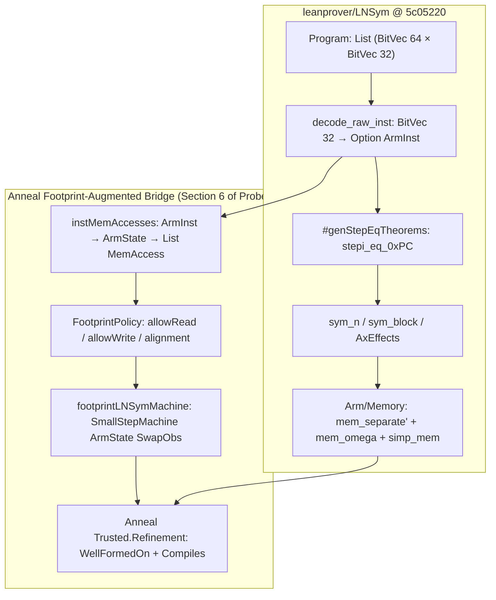

# LNSym AArch64 Symbolic Simulator, Tactic Architecture, and Memory Framing (`leanprover/LNSym` @ `5c05220`)

## Summary

`leanprover/LNSym` (`5c05220ff970e3bdd7813ad0c9ef3741522c8b92`, tree `1f2abe7b0830756e9b33e9bb5e722fc5bd681c13`, 199 tracked files, 82,256 lines of Lean/script/test artifacts) is a native Lean 4 formalization of the user-level AArch64 (`Armv8-A`) instruction set and symbolic simulation framework developed to verify cryptographic routines (`SHA-512` and `AES-GCM` from AWS-LC) and system micro-benchmarks (`popcount32`, `abs`, `memcpy`). Unlike `Sail` or `ASL`-translated semantics (`sail-lean`, `arch-arm`), `LNSym` is hand-authored directly in Lean 4 (`leanprover/lean4:nightly-2024-10-07`) with **zero `Mathlib` dependency** (`Arm/FromMathlib.lean` vendors 295 lines of basic `Nat`/`List` lemmas) and only two external Lake dependencies (`draperlaboratory/ELFSage` for ELF symbol extraction in `Tests/ELFParser/` and `leanprover/doc-gen4`).

Our primary-source audit and standalone Lean 4.34.1 mechanization (`support/lnsym_architecture_and_bridge_probe.lean`, 1,390 lines, zero `sorry`, zero custom axioms) establish six concrete architectural findings for Anneal (`joshlf/anneal-private` @ `d9a8fe179923d4fe4f4ca76a5cd040ccbf8be196`):

1. **Harvard State Split & Unified `r`/`w` Algebra (`Arm/State.lean`, `Arm/Exec.lean`):** `ArmState` separates instruction storage (`program : Map (BitVec 64) (BitVec 32)`, a flat association list `List (BitVec 64 × BitVec 32)`) from data memory (`mem : BitVec 64 → BitVec 8`). All non-memory state components (`32` 64-bit GPRs, `32` 128-bit SIMD/FP registers, `PC`, `4` `PState` flags, and `StateError`) are accessed and updated through a single pair of `@[irreducible]` functions `r (fld : StateField) (s : ArmState) : state_value fld` and `w (fld : StateField) (v : state_value fld) (s : ArmState) : ArmState` backed by an injective index `StateField.toNat : StateField → Fin 70`. Because `(w fld v s).program = s.program` (`w_program`) and `(write_mem_bytes n addr val s).program = s.program` (`write_mem_bytes_program`) hold unconditionally, data stores can never overwrite instruction words in `s.program`, eliminating code-vs-data separation hypotheses from every symbolic execution step at the cost of forbidding self-modifying code and inline literal pools fetched through `s.mem`.
2. **Word-Level Bitfield Decoding & Crypto-Focused ISA Coverage (`Arm/Decode/`, `Arm/Insts/`):** `decode_raw_inst (i : BitVec 32) : Option ArmInst` (`Arm/Decode.lean:315-326`) decodes 32-bit instruction words by direct `extractLsb'` slicing across 5 top-level instruction classes (`DPI`, `BR`, `DPR`, `LDST`, `DPSFP`) comprising 41 encoding subclasses and 28 execution semantics modules. Coverage is deep on user-mode integer, bitfield, conditional-select, and 128-bit SIMD/crypto instructions (`AESE`/`AESD`/`AESMC`/`AESIMC`, `PMULL`/`PMULL2`, `SHA512H`/`SHA512H2`/`SHA512SU0`/`SHA512SU1`, `EOR3`/`BCAX`/`RAX1`/`XAR`, `LD1`/`ST1`, `TBL`/`TBX`, `EXT`, `REV64`, `UZP`/`TRN`/`ZIP`), but omits exclusive/atomic accesses (`LDXR`/`STXR`, `LDAR`/`STLR`, `CAS`), barriers (`DMB`/`DSB`/`ISB`), system registers (`MRS`/`MSR`), exceptions (`SVC`), and 3 of the 8 decoded `LDST` subclasses (`Literal`, `Reg_unsigned_imm`, `Reg_reg_offset`).
3. **Four Primary-Source Bugs/Anomalies in Decoding, Fault Handling, and ELF Loading:**
   - **Bug 1 (`LDST.mayModifiedRegs` load/store polarity inversion, `Arm/Decode.lean:260-308`):** `LDST.mayModifiedRegs` inverts the AArch64 load/store bit (`opc[0]` in `Reg_imm_cls` and `L` in `Reg_pair_cls` / `Advanced_simd_multiple_struct_cls`), returning `[]` for loads (`LDR`/`LDP`/`LD1`) and `[Rt, Rn]` / `[Rt, Rt2, Rn]` for stores (`STR`/`STP`/`ST1`). We machine-check this inversion on concrete `ldr x2, [x0]` (`0xf9400002#32`) and `str x1, [x0]` (`0xf9000001#32`) encodings in `bug1a_ldst_mayModifiedRegs_omits_ldr_destination` and `bug1b_ldst_mayModifiedRegs_falsely_reports_str_registers`.
   - **Bug 2 (`BR.mayModifiedRegs` omits `x30` on `BL`, `Arm/Decode.lean:103-109`):** `BR.mayModifiedRegs` unconditionally returns `.ok []` with the comment `"None of the branch instructions modify any GPR or SFP registers"`, even though `exec_uncond_branch_imm` (`Arm/Insts/BR/Uncond_branch_imm.lean:31-33`) writes `orig_pc + 4#64` to `.GPR 30#5` (`LR`) when `inst.op = 1#1` (`BL`). We machine-check this on `bl #4` (`0x94000001#32`) in `bug2_br_mayModifiedRegs_omits_bl_link_register`.
   - **Anomaly 3 (`StateError.Fault` vs `write_pc` ordering across `LDST`, `Arm/Insts/LDST/`):** `Reg_imm.lean:109-113` and `Reg_pair.lean:103-105` execute `write_pc ((read_pc s) + 4#64)` unconditionally after `reg_imm_operation` / `reg_pair_operation`, advancing `PC` by `4` even when `CheckSPAlignment` fails and sets `StateError.Fault`, whereas `Reg_unscaled_imm.lean:28-42` and `Advanced_simd_multiple_struct.lean:46-120` guard `write_pc` in the `else` branch.
   - **Bug 4 (`BitVec.enumFrom` increments instruction addresses by `+1` instead of `+4`, `Tests/ELFParser/SymbolContents.lean:46-50`):** `getSymbolMap` pairs 32-bit ELF instruction words with addresses generated by `BitVec.enumFrom`, which advances addresses by `m + 1` bytes rather than `m + 4` bytes; all working program definitions in `Tests/` therefore bypass `getSymbolMap` and use `def_program` with explicit `(addr, word)` literals or `Program.ofList_from_start_address` (`Arm/Map.lean:178`).
4. **Two-Phase Symbolic Simulation (`#genStepEqTheorems` + `sym_n` / `AxEffects` / `sym_block`):** `LNSym` avoids re-evaluating `fetch_inst`, `decode_raw_inst`, and `exec_inst` during interactive proofs. First, `#genStepEqTheorems <program>` (`Tactics/StepThms.lean`) pre-evaluates `fetch_inst` and `decode_raw_inst` via kernel `Eq.refl` (`fetch_and_decode` in `Tactics/FetchAndDecode.lean`) and simplifies `exec_inst` into a flat per-PC theorem `<program>.stepi_eq_0x<pc> : stepi s = w ... s`. Second, `sym_n` (`Tactics/Sym.lean`) applies `<program>.stepi_eq_0x<pc>` and runs `explodeStep` (`Tactics/Sym/AxEffects.lean`) to decompose the nested `w`/`write_mem_bytes` chain into individual hypotheses `r fld s_i = val`, a non-effect frame theorem `∀ f ∉ modified, r f s_i = r f s_{i-1}`, and a subgoal `h_s{i}_sp_aligned : CheckSPAlignment s_i` whenever `SP` (`GPR 31#5`) is modified. For long loops (such as the 485-instruction `SHA-512` inner loop in `Proofs/SHA512/SHA512LoopBlocks.lean`), `sym_block` (`Tactics/SymBlock.lean`) steps across 5–12 instructions at once using pre-proved block lemmas (`blocki_eq_0x<pc>`) that fold low-level crypto instructions into specification functions at block boundaries.
5. **Half-Open Region Memory Framing (`Arm/Memory/Separate.lean`, `MemOmega.lean`, `SeparateAutomation.lean`):** `LNSym` provides a self-contained byte-slice memory framing library over `Memory := BitVec 64 → BitVec 8` with recursive little-endian `Memory.read_bytes` / `Memory.write_bytes`, half-open legality (`mem_legal' a n := a.toNat + n ≤ 2^64`), disjointness (`mem_separate'`), inclusion (`mem_subset'`), `pairwiseSeparate`, `mem_omega` (reducing region obligations to `Nat` `omega`), and `simp_mem` (automatically rewriting `read_bytes` over `write_bytes`).
6. **Negative Control & Positive Bridge into Anneal's `SmallStepMachine` and `Compiles`:** Because `LNSym`'s `ArmState` uses a total byte map `BitVec 64 → BitVec 8` with no allocation permissions or memory-event trace, pure initial-to-final `ArmState` theorems (`s_final = run n s_init`) **cannot** enforce Anneal's UB-freedom (`WellFormedOn`) or write-footprint contracts: our negative-control theorem `lnsym_unaugmented_state_blind_to_dead_load_and_self_store` proves that a dead out-of-bounds load (`ldr x2, [x0, #8]` before overwriting `x2`) and an unauthorized self-store (`ldr x2, [x0, #8]; str x2, [x0, #8]`) yield the **exact same** final `ArmState` (including extensionally equal `mem` by `Memory.write_bytes_read_bytes_eq` and `error = .None`) as a valid 8-byte swap leaf. However, wrapping `LNSym`'s `exec_inst` with an instruction-level access-footprint observer (`instMemAccesses` + `FootprintPolicy`) into Anneal's `SmallStepMachine` (`footprintLNSymMachine`) cleanly rejects both the dead out-of-bounds load (`footprint_machine_rejects_dead_oob_load`) and the unauthorized self-store (`footprint_machine_rejects_redundant_oob_store`) with `.failed .ub`, while proving `swap_tgt_well_formed` and end-to-end `Compiles` refinement (`swap_compiles`) on the valid 8-byte swap leaf using `LNSym`'s `Memory.read_bytes_write_bytes_eq_read_bytes_of_mem_separate'`.

## Applicability

This report applies to:

- **`joshlf/anneal-private` (`d9a8fe179923d4fe4f4ca76a5cd040ccbf8be196`)**:
  - `trusted/lean/Trusted/Refinement.lean` (blob `c80455fa8f73517eb84c650932592964204cf133`): `Preorder`, `Partial`, `Behavior`, `Language`, `Language.WellFormedOn`, `Compiles`.
  - `trusted/lean/Trusted/StepResult.lean` (blob `6217121e5b44ff54e9b647e1bf8a85c0de9a3a41`): `FailureKind`, `StepResult`, `SmallStepMachine`, `ReachesPrefix`, `BehaviorOf`.
  - `PRINCIPLES.md` (blob `e4918c525fc275b80d163226c0c14f70aa3060a0`) and `DESIGN.md` (blob `ac53adff7be46a34730be8df864df526510b6ac1`): machine-code target verification, TCB minimization, and baseline UB-freedom (`WellFormedOn`) requirements.
- **`leanprover/LNSym` (`5c05220ff970e3bdd7813ad0c9ef3741522c8b92`)**:
  - `Arm/State.lean`, `Arm/Exec.lean`, `Arm/Decode.lean`, `Arm/Decode/*.lean`, `Arm/Insts/**/*.lean`, `Arm/Memory/*.lean`, `Tactics/**/*.lean`, `Correctness/*.lean`, `Proofs/**/*.lean`, `Tests/**/*.lean`.



## Findings

### 1. Repository Architecture, Toolchain, and Dependency Audit

`leanprover/LNSym` at `5c05220ff970e3bdd7813ad0c9ef3741522c8b92` is organized into 6 Lean library roots and 199 tracked files:

| Subsystem | Files | Lines | Primary Role |
|---|---:|---:|---|
| `Arm/` (core state, decode, semantics, memory, CFG, cosim) | 56 | 15,826 | `ArmState`, 5-class decoder, 28 instruction semantics files, byte-slice memory framing, random cosimulation harness |
| `Tactics/` (symbolic simulator, step generation, CSE, pruning) | 16 | 3,879 | `#genStepEqTheorems`, `sym_n`, `sym_block`, `AxEffects`, `MemoryEffects`, `sym_aggregate`, `prune_updates`, `cse` |
| `Correctness/` (VCG & partial correctness over `Iterate`) | 4 | 864 | ACL2-style `Iterate` tail-recursion combinator, stepwise invariants, Floyd-Hoare cutpoints (`cassert`), ranking termination |
| `Specs/` (`SHA512.lean`, `GCM.lean`, `AESSubroutines.lean`) | 3 | 720 | Pure functional bitvector specifications of SHA-512 and AES-GCM |
| `Proofs/` (correctness proofs & `.lrat` certificates) | 71 | 31,490 | Symbolic simulation proofs for `Simple`, `Popcount32`, `Bit_twiddling`, `SHA512`, `AES-GCM`, `Abs`, `Memcpy` (including 47 `.lrat` files) |
| `Tests/` (programs, ELF loader, cosimulation runners) | 28 | 27,894 | Concrete `Program` definitions, `ELFSage` integration, and native AArch64 hardware cosimulation tests |
| Root & scripts (`lakefile.lean`, `lean-toolchain`, `scripts/`) | 21 | 1,583 | Build configuration, CI scripts, and hardware cosimulation C/shell wrappers |

Key build and TCB properties:
- **Lean Toolchain (`lean-toolchain`, blob `ef4c16f0c9cd390fbcb1ff6870ffacbc8fc5efba`):** `leanprover/lean4:nightly-2024-10-07`. Updating `LNSym` to Anneal's `leanprover/lean4:v4.34.1` requires migrating `BitVec` lemma names (e.g., `BitVec.eq_of_getLsbD_eq` in Lean 4.34.1 takes `∀ i, i < w → ...` rather than `Fin w`, and `Std.Simp.Simprocs` APIs in `Tactics/Simp.lean`).
- **Zero `Mathlib` Dependency (`lakefile.lean`, blob `dc38c67f0606b65e641db9f482441f86650932eb`):** `LNSym` does not depend on `Mathlib` or `Batteries`. Instead, `Arm/FromMathlib.lean` (295 lines, blob `f120fd18b16a68d4a02d0040a480fbffbe34d81b`) vendors basic `Nat` and `List` lemmas.
- **`ELFSage` Isolation (`lakefile.lean:12-13`, `Tests/ELFParser/`):** `require ELFSage from git "https://github.com/draperlaboratory/ELFSage.git" @ "main"` is imported **only** in `Tests/ELFParser/SymbolContents.lean` and `Tests/ELFParser/AWSLCSHA2.lean`. None of `Arm/`, `Tactics/`, `Correctness/`, `Specs/`, or `Proofs/` import `ELFSage`.

---

### 2. `ArmState`, Harvard Program/Memory Split, and the `r`/`w` State Algebra

In `Arm/State.lean` (852 lines, blob `2554b62aa658f65d858697da6ec34d64dc9158a2`) and `Arm/Map.lean` (186 lines, blob `b9888cf9b76f3f6c915ef400f3c3347a89fc4f60`), `LNSym` defines:

```lean
abbrev Store (α : Type) (β : Type) := α → β
abbrev Memory := Store (BitVec 64) (BitVec 8)
abbrev Program := Map (BitVec 64) (BitVec 32) -- List (BitVec 64 × BitVec 32)

structure ArmState where
  gpr     : Store (BitVec 5) (BitVec 64)   -- 31 GPRs + SP at index 31#5
  sfp     : Store (BitVec 5) (BitVec 128)  -- 32 128-bit SIMD&FP registers
  pc      : BitVec 64
  pstate  : PState                         -- N, Z, C, V : BitVec 1
  mem     : Memory
  program : Program
  error   : StateError
```

1. **Harvard Separation of `program` and `mem`:**
   - `fetch_inst (addr : BitVec 64) (s : ArmState) : Option (BitVec 32)` (`Arm/State.lean:794-796`) looks up `addr` in `s.program` (`Map.find? s.program addr`), **never** in `s.mem`.
   - `w_program` (`Arm/State.lean:488`) and `write_mem_bytes_program` (`Arm/State.lean:779`) prove that neither register/flag/PC/error updates (`w`) nor memory writes (`write_mem_bytes`) ever alter `s.program`.
   - *Implication for Anneal:* Instruction fetch is immune to data memory stores without requiring code/stack/heap disjointness premises, but functions that read PC-relative read-only tables (`ADRP` + `LDR`) must either duplicate those tables into `s.program` or initialize them in `s.mem` alongside a `mem_separate'` frame assumption.
2. **Unified `StateField` Accessor (`r`) and Updater (`w`):**
   - `StateField` (`Arm/State.lean:155-161`) sums non-memory fields: `.GPR (BitVec 5) | .SFP (BitVec 5) | .PC | .FLAG PFlag | .ERR`, with an injective mapping `StateField.toNat : StateField → Fin 70` (`Arm/State.lean:199-215`).
   - Both `r` and `w` are marked `@[irreducible]` (`Arm/State.lean:337, 353`) after proving the four algebraic rewrite rules registered in `@[state_simp_rules]`:
     - `r_of_w_same : r fld (w fld v s) = v` (`Arm/State.lean:409`)
     - `r_of_w_different : fld₁ ≠ fld₂ → r fld₁ (w fld₂ v s) = r fld₁ s` (`Arm/State.lean:419`)
     - `w_of_w_shadow : w fld v₂ (w fld v₁ s) = w fld v₂ s` (`Arm/State.lean:447`)
     - `r_of_write_mem_bytes : r fld (write_mem_bytes n addr val s) = r fld s` (`Arm/State.lean:767`)
   - Register `31#5` overloading (`XZR` vs `SP`): `ArmState.gpr 31#5` stores `SP`. Instructions that treat register 31 as `XZR` call `read_gpr_zr` / `write_gpr_zr` (`Arm/State.lean:375-384`), whereas instructions that treat register 31 as `SP` call `read_gpr` / `write_gpr` (`r (.GPR 31#5)` / `w (.GPR 31#5)`).
3. **`CheckSPAlignment` and `StateError` Stuttering (`Arm/State.lean:503-505`, `Arm/Exec.lean:105-125`):**
   - `CheckSPAlignment (s : ArmState) : Bool := Aligned (read_gpr 64 31#5 s) 4` checks `extractLsb' 0 4 sp = 0#4` (16-byte alignment).
   - `StateError` has 6 constructors: `None`, `NotFound (pc : BitVec 64)`, `Unimplemented (inst : String)`, `Illegal (inst : String)`, `Fault (msg : String)`, and `Other (msg : String)`.
   - `stepi (s : ArmState) : ArmState` (`Arm/Exec.lean:105-125`) pattern-matches on `read_err s`: if `.None`, it fetches, decodes, and executes one instruction; for any other `StateError`, `stepi s = s` (stuttering).

---

### 3. Instruction Decoding, ISA Coverage, and Primary-Source Bugs

#### 3.1 Top-Level Decoder (`Arm/Decode.lean`) and 41 Encoding Subclasses

`decode_raw_inst (i : BitVec 32) : Option ArmInst` (`Arm/Decode.lean:315-326`, blob `30d586e1c4a9c4693bcdfedbcddfa910035370e5`) slices `[op0:1, _x:2, op1:4, _y:25]` and dispatches to five class decoders:

| Class | Header (`Arm/Decode/`) | Decoded Subclasses | Semantics Files (`Arm/Insts/`) | Supported Instructions & Modes | Unimplemented / Omitted within Class |
|---|---|---:|---:|---|---|
| `DPI` | `DPI.lean` (115 lines) | 5 | 5 | `ADR`, `ADRP`; `ADD`/`ADDS`/`SUB`/`SUBS` (imm12, shift `0`/`12`); `AND`/`ORR`/`EOR`/`ANDS` (`DecodeBitMasks`); `MOVN`/`MOVZ`/`MOVK`; `SBFM`/`BFM`/`UBFM` (`ASR`/`LSL`/`LSR`/`SXTB`/`SXTH`/`SXTW`/`UXTB`/`UXTH`) | Tag manipulation (`ADDG`/`SUBG`) |
| `BR` | `BR.lean` (68 lines) | 5 | 5 | `B.cond` (all 16 condition codes via `ConditionHolds`); `NOP` (`Hints`); `CBZ`/`CBNZ` (32/64-bit); `B`/`BL`; `RET` (only when `opc=0010, op2=11111, op3=0, op4=0`) | `BR Xn`, `BLR Xn` (`Uncond_branch_reg` returns `Unimplemented` for `opc ≠ 0010`), `TBZ`/`TBNZ`, `SVC`/`BRK` |
| `DPR` | `DPR.lean` (154 lines) | 7 | 7 | `LSLV`/`LSRV`/`ASRV`/`RORV`; `RBIT`/`REV16`/`REV32`/`REV`/`CLZ`; `AND`/`BIC`/`ORR`/`ORN`/`EOR`/`EON`/`ANDS`/`BICS` (shifted reg); `ADD`/`ADDS`/`SUB`/`SUBS` (shifted reg, **not** extended reg); `ADC`/`ADCS`/`SBC`/`SBCS`; `CSEL`/`CSINC`/`CSINV`/`CSNEG`; `MADD`/`MSUB`/`UMADDL`/`UMULH` | `Add_sub_extended_reg` (`ADD Xd, SP, Wm, UXTW`), `SDIV`/`UDIV`, `SMADDL`/`SMULH`, `CRC32*` |
| `LDST` | `LDST.lean` (201 lines) | 8 decoded (4 executed) | 4 | `Reg_imm` (post-index, pre-index, unsigned offset: 32/64-bit `LDR`/`STR`, `LDRB`/`STRB`, `LDRH`/`STRH`, `LDRSB`/`LDRSH`/`LDRSW`, SIMD 8/16/32/64/128-bit `LDR`/`STR`); `Reg_pair` (post-index, pre-index, signed offset: 32/64-bit `STP`/`LDP`, `LDPSW`, SIMD 32/64/128-bit `STP`/`LDP`); `Reg_unscaled_imm` (`LDUR`/`STUR`/`LDURB`/`STURB`/`LDURH`/`STURH`, SIMD `LDUR`/`STUR`); `Advanced_simd_multiple_struct` + `_post_indexed` (`LD1`/`ST1` 1–4 regs, `.16b`/`.8h`/`.4s`/`.2d`) | `Literal` (`LDR Xt, label`), `Reg_unsigned_imm`, `Reg_reg_offset` (`LDR Xt, [Xn, Xm, LSL #3]`) all return `none` in `decode_ldst_inst` (`Arm/Decode.lean:245-253`); all atomics/exclusives (`LDXR`/`STXR`, `LDAR`/`STLR`, `CAS`, `LDADD`) |
| `DPSFP` | `DPSFP.lean` (427 lines) | 16 | 7 | `AESE`/`AESD`/`AESMC`/`AESIMC`; `SHA512H`/`SHA512H2`/`SHA512SU0`/`SHA512SU1`; `EOR3`/`BCAX`/`RAX1`/`XAR`; `PMULL`/`PMULL2`; `ADD`/`SUB`/`AND`/`BIC`/`ORR`/`ORN`/`EOR`/`BSL`/`BIT`/`BIF` (vector); `REV64`/`REV32`/`REV16` (vector); `DUP`/`MOV`/`INS`/`UMOV` (element/general/scalar); `EXT`; `UZP1`/`UZP2`/`TRN1`/`TRN2`/`ZIP1`/`ZIP2`; `MOVI`/`MVNI`/`ORR`/`BIC` (modified imm); `SHL`/`SSHR`/`USHR`/`SSRA`/`USRA`/`SRSHR`/`URSHR`/`SRSRA`/`URSRA` (vector & scalar); `TBL`/`TBX` (1–4 regs); `FMOV` (GPR ↔ SIMD) | IEEE-754 floating-point arithmetic (`FADD`/`FMUL`/`FDIV`/`FCMP`), `SHA256*`, `SHA1*`, `LD2`–`LD4`/`ST2`–`ST4` |

#### 3.2 Four Primary-Source Bugs and Anomalies Uncovered

1. **Bug 1 — `LDST.mayModifiedRegs` Load/Store Polarity Inversion (`Arm/Decode.lean:256-312`):**
   - In `Arm/Insts/LDST/Reg_imm.lean:48-55`, `lsb x.opc 0 = 0#1` is `STORE` and `lsb x.opc 0 = 1#1` is `LOAD`.
   - However, in `LDST.mayModifiedRegs` (`Arm/Decode.lean:260-274`):
     ```lean
     | .Reg_imm x | .Reg_unscaled_imm x | .Reg_unsigned_imm x =>
       if getLsbD x.opc 0 then .ok [] -- Load
       else -- Store
         if mayModifyRn x.imm9 then
           if x.V = 0#1 then .ok [.GPR x.Rt, .GPR x.Rn]
           else .ok [.SFP x.Rt, .GPR x.Rn]
         else
           if x.V = 0#1 then .ok [.GPR x.Rt]
           else .ok [.SFP x.Rt]
     ```
     Because `getLsbD x.opc 0` is `true` on `LDR` and `false` on `STR` (and similarly in `Reg_pair` at lines 275–289 and `Advanced_simd_multiple_struct` at lines 290–308, where `x.L = 0#1` is `STORE` and `x.L = 1#1` is `LOAD`, yet `if x.L = 0#1 then -- Store` returns `[Rt, Rt2, ...]` and `else .ok [] -- Load`), `LDST.mayModifiedRegs` reports **zero modified registers for every load** (even post/pre-indexed loads that write both `Rt` and `Rn`!) and falsely reports `Rt` (and `Rt2`) as modified for stores!
   - Why hasn't this broken `LNSym`'s existing proofs? Because `#genStepEqTheorems` and `sym_n` derive modified fields directly from the unfolded `w` chain in `exec_inst` (`AxEffects.fromExpr`), whereas `mayModifiedRegs` is only called by the experimental `Arm/Cfg/Cfg.lean` control-flow graph analyzer.
   - Checked in `support/lnsym_architecture_and_bridge_probe.lean`: `bug1a_ldst_mayModifiedRegs_omits_ldr_destination` and `bug1b_ldst_mayModifiedRegs_falsely_reports_str_registers`.
2. **Bug 2 — `BR.mayModifiedRegs` Omits `x30` (`LR`) on `BL` (`Arm/Decode.lean:103-109`):**
   - `BR.mayModifiedRegs` unconditionally returns `.ok []` with the comment `"None of the branch instructions modify any GPR or SFP registers"`, contradicting `exec_uncond_branch_imm` (`Arm/Insts/BR/Uncond_branch_imm.lean:31-33`), which executes `if inst.op = 0#1 then s else write_gpr 64 30#5 (orig_pc + 4#64) s`.
   - Checked in `support/lnsym_architecture_and_bridge_probe.lean`: `bug2_br_mayModifiedRegs_omits_bl_link_register`.
3. **Anomaly 3 — `StateError.Fault` vs `write_pc` Ordering Across `LDST` (`Arm/Insts/LDST/`):**
   - In `Reg_imm.lean:109-113` and `Reg_pair.lean:103-105`, `write_pc ((read_pc s) + 4#64)` executes **after** `reg_imm_operation` / `reg_pair_operation` outside the `if x.Rn == 31#5 && !(CheckSPAlignment s)` check, so `PC` advances by `4` even when `StateError.Fault` is raised.
   - In contrast, `Reg_unscaled_imm.lean:28-42` and `Advanced_simd_multiple_struct.lean:46-120` place `write_pc` inside the `else` branch of the `CheckSPAlignment` check, leaving `PC` unchanged when `StateError.Fault` is raised.
   - Checked in `support/lnsym_architecture_and_bridge_probe.lean`: `anomaly3_ldst_reg_imm_fault_still_advances_pc`.
4. **Bug 4 — `BitVec.enumFrom` Address Stride in `Tests/ELFParser/SymbolContents.lean:46-50`:**
   - `BitVec.enumFrom` increments the address accumulator by `m + 1` (`1` byte per 32-bit word) instead of `m + 4` (`4` bytes per 32-bit word) when constructing `List (BitVec 64 × BitVec 32)` from ELF symbol contents. All working program definitions in `Tests/` instead use `def_program` or `Program.ofList_from_start_address` (`Arm/Map.lean:178`, which adds `4#64`).

---

### 4. Symbolic Simulation, Tactic Architecture (`Tactics/`), and Verification Conditions (`Correctness/`)

`LNSym`'s verification workflow separates instruction decoding/unfolding from symbolic state propagation across four tactic layers:

| Layer | Implementation File(s) | Entry Point | Mechanism & Soundness Basis |
|---|---|---|---|
| **1. Per-PC Step Generation** | `Tactics/StepThms.lean` (280 lines), `Tactics/FetchAndDecode.lean` (90 lines) | `#genStepEqTheorems <prog>` | Iterates over `(pc, rawInst) ∈ <prog>`, reflects `fetch_inst` and `decode_raw_inst` by kernel `Eq.refl`, and runs `Simp.simp` with `@[minimal_theory]`, `@[bitvec_rules]`, `@[state_simp_rules]` to synthesize `<prog>.stepi_eq_0x<pc> : r .ERR s = .None → r .PC s = pc → s.program = <prog> → stepi s = w ... s`. |
| **2. Single-Step & Multi-Step Symbolic Execution** | `Tactics/Sym.lean` (427 lines), `Tactics/Sym/AxEffects.lean` (774 lines), `Tactics/Sym/MemoryEffects.lean` (201 lines) | `sym_n n` / `sym_i_n i n (s_init)` | Rewrites `run (k+1) s` via `run_onestep`, applies `<prog>.stepi_eq_0x<pc>`, discharges `CheckSPAlignment` from context (`h_s{i}_sp_aligned`), and runs `explodeStep` to convert the nested `w`/`write_mem_bytes` term into an `AxEffects` map of per-field hypotheses `r fld s_{i+1} = ...`, a non-effect frame theorem, and `s_{i+1}.mem = ...`. |
| **3. Block-Level & Loop-Body Aggregation** | `Tactics/SymBlock.lean` (154 lines), `Tactics/Aggregate.lean` (226 lines), `Tactics/PruneUpdates.lean` (111 lines), `Tactics/PruneUpdatesLogic.lean` (688 lines), `Tactics/CSE.lean` (381 lines) | `sym_block k` / `sym_aggregate` / `prune_updates` / `cse` | `sym_block` steps by `k` instructions at once (`run_oneblock`) using pre-proved `<prog>.blocki_eq_0x<pc>` lemmas (`Proofs/SHA512/SHA512LoopBlocks.lean`). `prune_updates` sorts and prunes shadowed `w` writes via `List.mergeSort` over `Update.regIndexLe` and `Lean.ofReduceBool` reflection (note: `PruneUpdatesLogic.lean` has 2 `sorry`s at lines 624–625). |
| **4. Inductive VCG & Partial Correctness** | `Correctness/Iterate.lean` (219 lines), `Correctness/Correctness.lean` (457 lines), `Correctness/ArmSpec.lean` (167 lines) | `Correctness.by_the_method` | Defines ACL2-style tail recursion `Iterate.iterate` (`Classical.choose` over fuel, `@[implemented_by iterate_impl]`) and proves partial correctness from Floyd-Hoare cutpoint assertions (`cassert`, `csteps`, `nextc`) and termination from ranking functions (`termination_from_decreasing_rank`). |

---

### 5. Memory Region Framing (`Arm/Memory/`) and Repository Proof/Axiom Audit

#### 5.1 Half-Open Region Framing and `mem_omega` / `simp_mem`

`Arm/Memory/Separate.lean` (580 lines, blob `f1cb59fa5a0649e059368186ffbb97797bc75ca6`), `Arm/Memory/MemOmega.lean` (298 lines, blob `4a9923f67be383037e1080c92c3e97128593c987`), `Arm/Memory/SeparateAutomation.lean` (774 lines, blob `4cb87f359029754bfde0973ed631e02fb5931523`), and `Arm/Memory/AddressNormalization.lean` (131 lines, blob `bd5dd29e1268b86128a5c3faab164345a3d7b3a9`) provide two memory region models linked by equivalence theorems:
- **Legacy wrap-around boolean model:** `mem_legal a b : Bool`, `mem_overlap`, `mem_separate`, `mem_subset` over closed byte intervals `[a, b]` (`a` to `b` inclusive).
- **Half-open propositional model (used by automation):**
  - `mem_legal' (a : BitVec 64) (n : Nat) : Prop := a.toNat + n ≤ 2 ^ 64`
  - `mem_separate' a an b bn : Prop` (`mem_legal' a an ∧ mem_legal' b bn ∧ (a.toNat + an ≤ b.toNat ∨ b.toNat + bn ≤ a.toNat)`)
  - `mem_subset' a an b bn : Prop` (`mem_legal' a an ∧ mem_legal' b bn ∧ b.toNat ≤ a.toNat ∧ a.toNat + an ≤ b.toNat + bn`)
  - `Memory.Region.pairwiseSeparate : List (BitVec 64 × Nat) → Prop`
- **Core Framing & Forwarding Theorems (`Arm/Memory/Separate.lean:511-579`):**
  - `read_bytes_write_bytes_eq_read_bytes_of_mem_separate'` (`Separate.lean:537`): reading `[a, a+an)` from `write_bytes bn b val m` under `mem_separate' a an b bn` equals `read_bytes an a m`.
  - `read_bytes_write_bytes_eq_of_mem_subset'` (`Separate.lean:558`): reading `[a, a+an)` from `write_bytes bn b val m` under `mem_subset' a an b bn` extracts the sub-slice `extractLsBytes ((a - b).toNat) an val`.
- **Automation (`mem_omega` and `simp_mem`):**
  - `mem_omega` (`MemOmega.lean:274`) unfolds `mem_legal'`, `mem_separate'`, `mem_subset'`, and `pairwiseSeparate`, normalizes bitvector address arithmetic to `Nat` via `@[bv_toNat]`, and invokes `omega`.
  - `simp_mem` (`SeparateAutomation.lean:725`) traverses the goal for `Memory.read_bytes ... (Memory.write_bytes ...)` and automatically applies `read_bytes_write_bytes_eq_read_bytes_of_mem_separate'` or `read_bytes_write_bytes_eq_of_mem_subset'`, discharging the side conditions with `mem_omega`.

#### 5.2 Complete Audit of `Proofs/` and Custom Axioms in `LNSym`

Our full-repository scan across all 199 files in `leanprover/LNSym` (`5c05220`) found:
- **Custom axioms:** Exactly 1 declaration in the entire repository: `axiom skipProofAx : ∀ {P : Prop}, P` in `Tactics/SkipProof.lean:16` (blob `c6161401fb22bb6ca2d028750213eb948db9a21f`), gated behind the `LNSym.skipProof` option and used only in `Proofs/Experiments/Memcpy/MemCpyVCG.lean`.
- **Kernel reflection (`Lean.ofReduceBool`):** 4 occurrences: `Tactics/PruneUpdatesLogic.lean:679` and `Proofs/SHA512/SHA512_block_armv8_rules.lean` (via `bv_check` with `.lrat` certificates).
- **Proof completion status across `Proofs/`:**

| Proof Target | File(s) | Instructions | Status at `5c05220` |
|---|---|---:|---|
| Straight-line & bit-twiddling | `Proofs/Simple.lean`, `Proofs/Bit_twiddling.lean`, `Proofs/Popcount32.lean` | 4–15 | **Complete (`sorry`-free)** |
| `Abs` VCG tandem verification | `Proofs/Experiments/Abs/AbsVCGTandem.lean` | 4 | **Complete (`sorry`-free)** (`correctness` proved via `Correctness.by_the_method`) |
| `GCMInitV8` (Htable setup) | `Proofs/AES-GCM/GCMInitV8Sym.lean` | 152 | **Complete (`sorry`-free)** for GPR/SFP/PC/ERR postconditions; note that the `read_mem_bytes` Htable memory postcondition and disjoint memory frame conjuncts are commented out at lines 54–71 |
| `SHA-512` prelude & 42 loop blocks | `Proofs/SHA512/SHA512Prelude.lean`, `Proofs/SHA512/SHA512LoopBlocks.lean`, `Proofs/SHA512/SHA512_block_armv8_rules.lean` | 16 + 485 | **Complete (`sorry`-free)** (all 42 `blocki_eq_0x...` lemmas and `.lrat`-checked bitvector identities proved) |
| `SHA-512` end-to-end loop stitch | `Proofs/SHA512/SHA512BlockSym.lean`, `Proofs/SHA512/SHA512Loop.lean` | 509 | **Incomplete** (`sorry` at `SHA512BlockSym.lean:47, 241` and `SHA512Loop.lean:216, 221, 224, 227, 230`) |
| `AES-GCM` encrypt kernel & `GCMGmultV8` | `Proofs/AES-GCM/AESGCMEncKernelSym.lean`, `Proofs/AES-GCM/GCMGmultV8Sym.lean` | 265 / 44 | **Incomplete** (`sorry` at `AESGCMEncKernelSym.lean:52` at data-dependent `b.lt` branch on `rounds`, and `GCMGmultV8Sym.lean:52, 172, 325`) |
| `Memcpy` VCG experiment | `Proofs/Experiments/Memcpy/MemCpyVCG.lean` | 38 | **Incomplete** (uses `skip_proof` / `skipProofAx` and `sorry` at line 785) |

---

### 6. Bridging LNSym to Anneal's `SmallStepMachine`, `WellFormedOn`, and `Compiles`

In `support/lnsym_architecture_and_bridge_probe.lean` (Sections 5 and 6), we evaluate whether `LNSym`'s state machine and memory framing can serve as an AArch64 target semantics for Anneal's `Trusted.Refinement` and `Trusted.StepResult` contracts:

1. **Why Unaugmented `ArmState` Fails Anneal's UB-Freedom and Write-Footprint Contracts (Negative Control, Section 5):**
   - In `LNSym`, `ArmState.mem : BitVec 64 → BitVec 8` is a total function over all $2^{64}$ addresses, and `read_mem_bytes` / `write_mem_bytes` never check allocation liveness, read/write permissions, or natural pointer alignment (only `SP` 16-byte alignment when `Rn = 31#5`), nor does `ArmState` record a trace of accessed addresses.
   - We define three concrete AArch64 leaf programs in `support/lnsym_architecture_and_bridge_probe.lean`:
     - `prog_valid_swap`: 4-instruction 64-bit swap (`ldr x2, [x0]; str x1, [x0]; add x0, x2, #0; ret`).
     - `prog_dead_oob_load`: 5-instruction leaf that first executes an unauthorized out-of-bounds read `ldr x2, [x0, #8]` (`0xf9400402#32`) before overwriting `x2` with `ldr x2, [x0]`.
     - `prog_redundant_oob_store`: 6-instruction leaf that reads `[x0, #8]` into `x2` and writes `x2` back to `[x0, #8]` (`str x2, [x0, #8]`, `0xf9000402#32`—a data-race / read-only-memory UB store!) before performing the valid swap on `[x0]`.
   - Theorem `lnsym_unaugmented_state_blind_to_dead_load_and_self_store` proves that for **every** initial `ArmState` `s`, running `prog_valid_swap` (`run 4`), `prog_dead_oob_load` (`run 5`), and `prog_redundant_oob_store` (`run 6`) produces the **exact same** final `gpr`, `sfp`, `pc`, `pstate`, `mem` (extensionally equal across all $2^{64}$ addresses via `Memory.write_bytes_read_bytes_eq`), and `error = .None`.
2. **How an Instruction-Level Footprint Wrapper Bridges LNSym into Anneal (`footprintLNSymMachine`, Section 6):**
   - Rather than modifying `LNSym`'s `ArmState` or breaking its `r`/`w` and `Memory.read_bytes`/`Memory.write_bytes` rewrite rules, we define an external observer `instMemAccesses : ArmInst → ArmState → List MemAccess` that extracts the address, byte width, read/write kind, and natural alignment of each memory instruction prior to `exec_inst`.
   - `footprintLNSymMachine (policy : FootprintPolicy) (retPC : BitVec 64) : SmallStepMachine ArmState SwapObs` checks `(instMemAccesses inst s).all (checkAccess policy)` at every step:
     - If any access violates `policy` (or if fetch/decode/`exec_inst` sets `r .ERR ≠ .None`), the machine transitions to `.failed .ub` (`¬ (BehaviorOf M s₀).defined`).
     - On `prog_dead_oob_load`, `footprint_machine_rejects_dead_oob_load` proves `ReachesPrefix M 0 s₀ (.failed .ub)` and `¬ (BehaviorOf M s₀).defined`.
     - On `prog_redundant_oob_store` under `readTwoWriteOnePolicy` (where `[base+8, base+16)` is readable but read-only), `footprint_machine_rejects_redundant_oob_store` proves `ReachesPrefix M 1 s₀ (.failed .ub)` and `¬ (BehaviorOf M s₀).defined`.
     - On `prog_valid_swap`, `footprint_machine_valid_swap_halts`, `swap_tgt_well_formed`, and `swap_compiles` prove unconditional UB-freedom on `ValidSwapInput` and end-to-end `Compiles SwapSrcLanguage SwapTgtLanguage id () prog_valid_swap`, using `LNSym`'s `Memory.read_bytes_write_bytes_same` for the updated slot and `Memory.read_bytes_write_bytes_eq_read_bytes_of_mem_separate'` for all disjoint memory regions.

## Boundaries

1. **Privileged, Concurrent, and System-Level AArch64 Semantics Are Out of Scope of `LNSym`:** `LNSym` models sequential user-space (`EL0`) execution with a flat 64-bit virtual address space. It does not model page tables, MMU translation, cache maintenance, weak memory ordering, exclusive/atomic instructions (`LDXR`/`STXR`, `LDAR`/`STLR`, `CAS`), or exceptions (`SVC`).
2. **Missing General-Purpose Compiler-Emit Instructions in `LNSym` (`5c05220`):** While `LNSym` has extensive 128-bit SIMD/crypto coverage, general `rustc`/LLVM AArch64 codegen frequently emits instructions that `LNSym` currently rejects or leaves unimplemented:
   - `BR Xn` and `BLR Xn` (`Uncond_branch_reg.lean:24` only implements `RET`), `TBZ`/`TBNZ`;
   - `ADD`/`SUB` (extended register, e.g., `add x0, sp, w1, uxtw #2` in `DPR`);
   - `SDIV`/`UDIV`, `SMADDL`/`SMULH`;
   - `LDR`/`STR` (register offset, e.g., `ldr x0, [x1, x2, lsl #3]`) and `LDR` (literal).
3. **`PruneUpdatesLogic.lean` Contains Two Unfinished Lemmas:** If Anneal reuses `LNSym`'s tactics, `prune_updates` should not be included in Anneal's TCB until the two `sorry` placeholders in `Tactics/PruneUpdatesLogic.lean:624-625` (`evalUpdate_prune_2` and `evalUpdates_prune_aux`) are closed; `#genStepEqTheorems` and `sym_n` (`Tactics/StepThms.lean`, `Tactics/Sym.lean`, `Tactics/Sym/AxEffects.lean`) do **not** depend on `PruneUpdatesLogic.lean` and are `sorry`-free.

## Evidence

All claims in this report are backed by primary-source inspection recorded in `support/source-manifest.json` and machine-checked in `support/lnsym_architecture_and_bridge_probe.lean` (`SHA-256: 75a3236e94f24593dd5f5f41800e8c8fba2048874c3ad4b0c8ab32dff136477a`, verified with `/usr/local/google/home/joshlf/.elan/toolchains/leanprover--lean4---v4.34.1/bin/lean -j1 -M768`):

| Claim / Finding | Primary Source (`leanprover/LNSym` @ `5c05220`) | Checked Declaration in `support/lnsym_architecture_and_bridge_probe.lean` |
|---|---|---|
| Anneal `Partial`, `Preorder`, `Language`, `WellFormedOn`, `Compiles`, `SmallStepMachine`, `BehaviorOf` | `Trusted/Refinement.lean:262-435`, `Trusted/StepResult.lean:45-120` (`joshlf/anneal-private` @ `d9a8fe1`) | `Preorder`, `Partial`, `Language`, `Compiles`, `SmallStepMachine`, `ReachesPrefix.deterministic`, `ReachesPrefix.TerminalNoStepFurther`, `BehaviorOf` (lines 49–192) |
| `ArmState`, Harvard `program`/`mem` split, `r`/`w` algebra (`r_of_w_same`, `r_of_w_different`, `w_of_w_shadow`) | `Arm/State.lean:155-495, 767-796`, `Arm/Exec.lean:105-156` | `ArmState`, `r`, `w`, `r_of_w_same`, `r_of_w_different`, `w_of_w_shadow`, `w_program`, `write_mem_bytes_program`, `r_of_write_mem_bytes`, `stepi_error_stutter`, `stepi_preserves_program` (lines 194–413, 755–800) |
| Half-open memory region framing & self-store identity | `Arm/Memory/Separate.lean:64-95, 511-579` | `mem_legal'`, `mem_separate'`, `mem_subset'`, `Memory.read_bytes_write_bytes_eq_read_bytes_of_mem_separate'`, `Memory.read_bytes_write_bytes_same`, `Memory.write_bytes_read_bytes_eq` (lines 415–581) |
| Bug 1: `LDST.mayModifiedRegs` load/store polarity inversion (`LDR` vs `STR`) | `Arm/Decode.lean:260-308`, `Arm/Insts/LDST/Reg_imm.lean:48-55` | `lnsym_mayModifiedRegs`, `bug1a_ldst_mayModifiedRegs_omits_ldr_destination`, `bug1b_ldst_mayModifiedRegs_falsely_reports_str_registers` (lines 674–837) |
| Bug 2: `BR.mayModifiedRegs` omits `x30` (`LR`) on `BL` | `Arm/Decode.lean:103-109`, `Arm/Insts/BR/Uncond_branch_imm.lean:31-33` | `bug2_br_mayModifiedRegs_omits_bl_link_register` (lines 839–850) |
| Anomaly 3: `LDST.Reg_imm` advances `PC` by `4` even on `StateError.Fault` | `Arm/Insts/LDST/Reg_imm.lean:109-113` | `anomaly3_ldst_reg_imm_fault_still_advances_pc` (lines 852–860) |
| Negative Control: Unaugmented `ArmState` cannot distinguish valid swap from dead OOB load or unauthorized self-store | `Arm/State.lean:234-242, 740-780` | `lnsym_unaugmented_state_blind_to_dead_load_and_self_store` (lines 875–977) |
| Positive Bridge: Footprint-augmented `SmallStepMachine` rejects dead OOB load & self-store and proves `WellFormedOn` + `Compiles` | `Arm/Memory/Separate.lean:537` + `Trusted/Refinement.lean:409-435` | `footprintLNSymMachine`, `footprint_machine_valid_swap_halts`, `footprint_machine_rejects_dead_oob_load`, `footprint_machine_rejects_redundant_oob_store`, `swap_tgt_well_formed`, `swap_compiles` (lines 979–1328) |

## Revalidation

To revalidate the standalone Lean 4.34.1 probe and verify that all proofs elaborate with zero `sorry` and zero custom axioms under strict single-process memory bounds:

```bash
/usr/local/google/home/joshlf/.elan/toolchains/leanprover--lean4---v4.34.1/bin/lean \
  -j1 -M768 \
  reports/lnsym-armv8-symbolic-simulator-and-tactic-architecture-5c05220/support/lnsym_architecture_and_bridge_probe.lean
```

To inspect the pinned primary-source commit and blob SHAs recorded in `support/source-manifest.json`:

```bash
python3 -m json.tool \
  reports/lnsym-armv8-symbolic-simulator-and-tactic-architecture-5c05220/support/source-manifest.json > /dev/null
```

*Authored by an AI agent acting on joshlf's behalf.*
