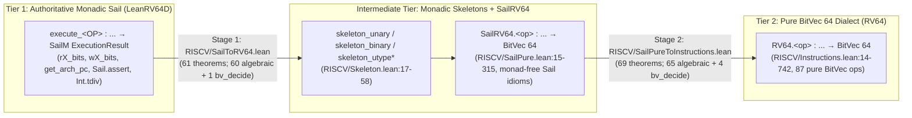
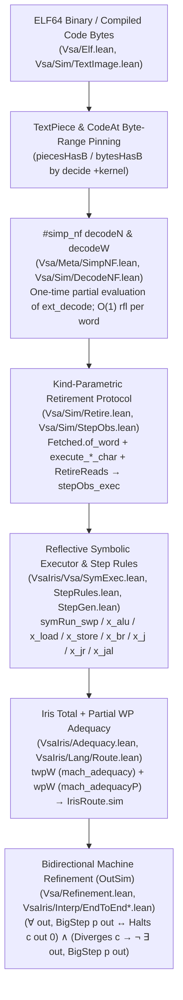

# Two-Tier ISA Purification, Hybrid Dialect Lowering, and End-to-End ELF Refinement in `opencompl/riscv-lean`, `opencompl/lean-mlir`, and `BasisResearch/ship-your-interpreter`

## Summary

This report analyzes three interdependent Lean 4 repositories that connect authoritative Sail-generated RISC-V 64-bit (`RV64D`) machine semantics to pure bitvector compiler dialects and end-to-end verified ELF binaries, and synthesizes their architecture with Anneal's (`joshlf/anneal-private@42f4571d761b46c7142815f38b69c3781b3555e3`) Layer 1A / Layer 1B refinement algebra and `TrustedBoundary.lean` audit rules:

1. **`opencompl/riscv-lean` (`7c6b500c1744f40d928fb131125cd06edf9f4fce`):** Implements a **two-stage, three-tier ISA purification pipeline** (2,768 lines across 8 Lean files) that bridges `opencompl/sail-riscv-lean`'s monadic `LeanRV64D.Functions.execute_<OP> : ... → SailM ExecutionResult` to a pure, bit-blastable `BitVec 64` instruction dialect (`RV64` in `RISCV/Instructions.lean`, 87 operations across `RV64I`, `M`, `Zba`, `Zbb`, `Zbs`, `Zbkb`, `Zicond`, and 11 pseudo-instructions):
   - **Stage 1 (`RISCV/Skeleton.lean`, `RISCV/SailPure.lean`, `RISCV/SailToRV64.lean`, 61 theorems):** Factors monadic register reads/writes (`rX_bits`, `wX_bits`, `get_arch_pc`) into uniform monadic wrappers (`skeleton_unary`, `skeleton_binary`, `skeleton_utype`, `skeleton_utype_lui`, `skeleton_utype_auipc`) around monad-free `SailRV64.<op>` functions that still retain Sail's unbounded `Int` arithmetic (`Int.tdiv`/`Int.tmod`), slice operations (`Sail.get_slice_int`), and `Id.run` loops.
   - **Stage 2 (`RISCV/Instructions.lean`, `RISCV/SailPureToInstructions.lean`, 69 theorems):** Proves pointwise functional equivalence (`SailRV64.<op> = RV64.<op>`) between Sail's `Int`/loop idioms and pure `BitVec 64` operations. Crucially, because 64-bit `M` multiplication/division (`mulh`, `div`, `rem`) and `Zbb` popcount loops (`cpop`, `cpopw`) are intractable or awkward for SAT bit-blasting, **125 of the 130 theorems across `SailToRV64.lean` and `SailPureToInstructions.lean` are proved algebraically or inductively (`simp`, `omega`, `grind`, `IntRange.forIn'` loop invariants) without `bv_decide`**; only **5 theorems** invoke `bv_decide`.
   - **Three Stage-1 purification subtleties:** (a) `execute_CPOP`, `execute_CPOPW`, and `execute_ORCB` execute `Sail.assert` inside monadic `IntRange.forIn'` loops and require an explicit loop-invariant theorem (`IntRange.forIn'_loop_eq_pure`, `SailToRV64.lean:274-354`); (b) `execute_ZICOND_RTYPE` reads `rs2` first and short-circuits `rX_bits rs1` when `rs2` zeroes the output, making unconditional `SailM` equality with `skeleton_binary` **false** when `rs1` is uninitialized (`zicond_rtype_eq` at `SailToRV64.lean:428-437` requires `(h : (rX_bits rs1).run s = .ok (rX_pure s rs1) s)`); and (c) unifying `LUI` and `AUIPC` in `skeleton_utype` requires `h_pc : s.regs.get? Register.PC = some valt` (`utype_eq`, `SailToRV64.lean:27-37`), whereas splitting `skeleton_utype_lui` and `skeleton_utype_auipc` restores unconditional equality.
2. **`opencompl/lean-mlir` (`b8c4a771319a044854a4bbb49b8821381ef86ff8`):** Embeds `riscv-lean`'s pure `RV64` functions as an MLIR SSA dialect `RISCV64.RV64 : Dialect` (`SSA/Projects/RISCV64/Base.lean`, 85 `Op` constructors over `Ty.bv` where `⟦.bv⟧ = BitVec 64`) and couples it to `LeanMLIR.LLVM` (`PoisonOr (BitVec w)`) via the hybrid dialect `LLVMPlusRiscV` (`SSA/Projects/LLVMRiscV/LLVMAndRiscv.lean`) with unrealized conversion casts `castLLVM w` (`castLLVMToriscv : PoisonOr (BitVec w) → BitVec 64`, mapping `.poison ↦ 0#64`) and `castRiscv w` (`castriscvToLLVM : BitVec 64 → PoisonOr (BitVec w)`).
   - **Two critical TCB findings for Anneal:** First, while individual instruction-lowering and peephole rewrite obligations (`LLVMPeepholeRewriteRefine.correct`) are discharged via `simp_lowering <;> bv_decide`, `LeanMLIR`'s generic pass runner (`multiRewritePeephole`) requires symmetric denotation equality (`lhs.denote = rhs.denote`) rather than directional `PoisonOr.IsRefinedBy` (`⊑`). To bridge that type mismatch, `SSA/Projects/LLVMRiscV/PeepholeRefine.lean:34-46` declares an **inconsistent global axiom `axiom refinement_correctness {p: Prop} : p`** (`False`-equivalent) inside `LLVMToRiscvPeepholeRewriteRefine.toPeepholeUNSOUND`! Second, every `bv_decide` proof injects `Lean.ofReduceBool` (plus a theorem-specific `_native.bv_decide.*` constant) into the theorem's axiom footprint, which Anneal's `trusted/audit/TrustedBoundary.lean` (`lines 154, 165-167, 621, 665, 748`) and `trusted/lean/foundation-lock.json` explicitly reject (`allowedAxioms = {propext, Quot.sound, Classical.choice}`).
3. **`BasisResearch/ship-your-interpreter` (`fb07094cff916318c34b07494a7d739f1e53989b`):** Proves end-to-end binary-level bidirectional refinement (`endToEnd_refinement` in `VsaIris/Interp/EndToEnd.lean:159-163`, `endToEnd_trichotomy` in `VsaIris/Interp/EndToEndTrichotomy.lean:61-75`, `endToEnd_checked` in `VsaIris/Interp/EndToEndChecked.lean:12-18`, and `compileChecked_correct` in `Vsa/Compiler/Checked.lean:41-55`) for a 27,828-byte `riscv64-unknown-elf-gcc -O2` ELF binary and a direct While-to-RV64 compiler running on the full monadic Sail `LeanRV64DExecutable` model (`try_step` / `stepOnce`, virtual memory, PMA/PMP, machine-mode trap/interrupt checks, 2-instruction timer ticks, and HTIF MMIO console output) using **only `[propext, Classical.choice, Quot.sound]`**—zero `sorryAx`, zero `bv_decide`, and zero `Lean.ofReduceBool`.
   - It achieves kernel-checkable performance without `native_decide`/`bv_decide` through four mechanisms: (a) `#simp_nf decodeN` (`Vsa/Meta/SimpNF.lean`, `Vsa/Sim/DecodeNF.lean:20-43`), which partially evaluates `(ext_decode w).run σ` once under pinned CSRs (`misa`, `cur_privilege`, `mseccfg`) so that decoding any concrete 32-bit word `w` costs a single `rfl` (`decodeW`); (b) `TextPiece` / `piecesHasB` (`Vsa/Sim/TextImage.lean`, `VsaIris/Vsa/SymExec.lean:39-101`), which discharges 4-byte little-endian instruction-fetch obligations over loaded ELF segments by kernel `decide`; (c) a kind-parametric retirement protocol (`Fetched`, `RetireReads`, `try_step_retire`, `stepObs_exec` in `Vsa/Sim/Retire.lean` and `Vsa/Sim/StepObs.lean`, documented in `abstractions/ROUND-5-isa.md`); and (d) `IrisRoute.sim` (`VsaIris/Lang/Route.lean`, `VsaIris/Adequacy.lean`), which pairs a total weakest precondition (`twpW` $\to$ `mach_adequacy`) with a partial weakest precondition (`wpW` $\to$ `mach_adequacyP`) to turn forward simulation + machine determinism (`Halts.deterministic`, `Diverges.not_halts`) into bidirectional refinement (`OutSim`).

---

## Applicability

This report applies directly to Anneal's (`joshlf/anneal-private@42f4571d761b46c7142815f38b69c3781b3555e3`) machine-code and ISA verification roadmap across `trusted/lean/Trusted/` and `theory/Anneal/`:

1. **Adopting the Two-Tier ISA Purification Split (`SailM` $\to$ `SailPure` $\to$ `BitVec` Dialect):**
   When extending Anneal below Rust MIR (`Trusted/MirSemantics.lean`) to RISC-V 64-bit or AArch64 machine code, Anneal should adopt `opencompl/riscv-lean`'s separation between:
   - **Tier 1 (Authoritative Monadic ISA Semantics):** The small-step architectural state machine (`SmallStepMachine` in `Trusted/StepResult.lean`) that fetches bytes from memory, decodes 32-bit instruction words, and updates architectural registers/memory.
   - **Tier 2 (Pure `BitVec 64` Block/Instruction Dialect):** Pure `BitVec 64` functions (`RV64.<op>`) over which compiler lowering (`MIR → Dialect`) and algebraic/symbolic block execution are proved.
   Composing `MIR → Tier 2 Dialect` (`mirToDialect_compiles`) with `Tier 2 Dialect → Tier 1 ELF Machine` (`dialectToElf_compiles`) via Anneal's `pass_trans` (`Trusted/Refinement.lean:345-356`) isolates monadic state-frame reasoning (`rX_bits`, `wX_bits`, `PC`, `nextPC`, memory byte pins) from dataflow/arithmetic reasoning.
2. **Replacing `lean-mlir`'s Unsound `toPeepholeUNSOUND` with Anneal's Directional `Compiles` / `Partial.refines`:**
   In `opencompl/lean-mlir`, `PoisonOr.IsRefinedBy` (`src ⊑ tgt`) is directional (`.poison ⊑ .value v`, i.e., replacing poison-producing IR with defined machine instructions is sound, but not vice versa). Because `lean-mlir`'s `multiRewritePeephole` demanded symmetric equality (`lhs.denote = rhs.denote`), `PeepholeRefine.lean:34-46` introduced `axiom refinement_correctness {p : Prop} : p`. Anneal's Layer 1A (`Partial.refines` / `Compiles` / `Abstracts` in `Trusted/Refinement.lean`) is natively a directional preorder (`s ≤ t` where `Partial.ub` is top), so poison/UB-erasing instruction selection composes via `pass_trans` with zero extra axioms.
3. **Complying with `trusted/audit/TrustedBoundary.lean` (Eliminating `bv_decide` / `Lean.ofReduceBool`):**
   Anneal's TCB auditor (`trusted/audit/TrustedBoundary.lean:154, 165-167, 621, 665, 748`) rejects `Lean.Parser.Tactic.nativeDecide` in surface syntax and rejects any constant in the transitive closure of `VerificationResult` whose axiom footprint exceeds `{propext, Quot.sound, Classical.choice}` (`trusted/lean/foundation-lock.json`). Because Lean 4's `bv_decide` compiles an LRAT certificate evaluator into native code via `Lean.ofReduceBool`, `bv_decide` proofs **cannot** cross into Anneal's audited proof closure unless either (a) LRAT reflection is checked by the kernel (`decide +kernel`) rather than `ofReduceBool`, or (b) instruction-lowering and Stage 1/Stage 2 ISA equivalences are proved algebraically (`simp`, `omega`, `BitVec` lemmas, `decide +kernel`), as `riscv-lean` already does for 125/130 of its theorems and as `ship-your-interpreter` does for 100% of its repository.

---

## Findings

### Finding 1: `opencompl/riscv-lean`'s Two-Stage, Three-Tier Purification Architecture

At commit `7c6b500c1744f40d928fb131125cd06edf9f4fce` (tree `c98b4248872a5b15c680515cd7135b3444479ed3`, Lean `v4.32.2`), `opencompl/riscv-lean` depends on `opencompl/sail-riscv-lean@11d8fa212a60c05dcc9fe5db925dd4d06dad65b5` (`Lean_RV64D`) and `rems-project/lean-sail@079463134b9c50450b8393e1566a09fc492a34d9` (`Sail`, branch `v5`). Rather than attempting to prove equivalence between Sail's monadic instruction executors (`LeanRV64D.Functions.execute_<OP> : ... → SailM ExecutionResult`) and pure `BitVec 64` operations in a single leap, `riscv-lean` splits the bridge into **two stages across three semantic tiers**:



#### 1.1 Stage 1 (`RISCV/Skeleton.lean`, `RISCV/SailPure.lean`, `RISCV/SailToRV64.lean`)

`RISCV/Skeleton.lean` (`lines 1-58`, blob `f3021952aa024aca5326f771c4010a4744c1ae81`) defines total register lookup `rX_pure` (`lines 8-15`) and five monadic wrappers that isolate state interaction (`rX_bits`, `wX_bits`, `get_arch_pc`, `RETIRE_SUCCESS`) from pure value computation:

- `skeleton_unary (rs1 : regidx) (rd : regidx) (f : BitVec 64 → BitVec 64) : SailM ExecutionResult` (`lines 17-20`)
- `skeleton_binary (rs2 : regidx) (rs1 : regidx) (rd : regidx) (f : BitVec 64 → BitVec 64 → BitVec 64) : SailM ExecutionResult` (`lines 22-26`)
- `skeleton_utype` (`lines 28-32`), `skeleton_utype_lui` (`lines 34-37`), and `skeleton_utype_auipc` (`lines 39-43`)

`RISCV/SailPure.lean` (`lines 1-315`, blob `d4c985aeffa1802ee91ee703bc6a143832dbaac4`) defines the `SailRV64` namespace containing monad-free transcriptions of Sail's computation bodies, preserving Sail's internal `Int` conversions (`BitVec.toInt`, `Int.tdiv`, `Int.tmod`, `Sail.get_slice_int`) and `Id.run` loops (`IntRange.forIn'.loop (m := Id)` for `cpop`, `cpopw`, and `orcb`).

`RISCV/SailToRV64.lean` (`lines 1-493`, blob `bbf5645ee0246723de21abe91367748b9793e5d9`) proves 61 Stage-1 equivalence theorems across `UTYPE`, `ITYPE`, `SHIFTIOP`, `RTYPE`, `SHIFTIWOP`, `RTYPEW`, `MUL`, `DIV`, `REM`, `MULW`, `DIVW`, `REMW`, `Zba` (`RTYPEUW`, `RTYPE`), `Zbb` (`RTYPE`, `RTYPEW`, `EXTOP`, `CLZ`, `CLZW`, `CTZ`, `CTZW`, `CPOP`, `CPOPW`, `ORCB`, `REV8`), `Zbs` (`RTYPE`, `IOP`), `Zbkb` (`PACK`, `PACKH`, `PACKW`), `Zicond` (`RTYPE`), and 11 pseudo-instructions (`mv`, `not`, `neg`, `negw`, `sext.w`, `zext.b`, `seqz`, `snez`, `sltz`, `sgtz`, `bexti`).

Three non-trivial Stage-1 phenomena emerge from the primary source:

1. **Monadic `IntRange` Loops with Embedded `Sail.assert` (`execute_CPOP`, `execute_CPOPW`, `execute_ORCB`, `SailToRV64.lean:274-354`):**
   In the Sail-generated RV64D specification, `execute_CPOP` (`SailToRV64.lean:295-314`) and `execute_CPOPW` (`lines 316-335`) iterate `i` from `0` to `63` (or `31`) using `IntRange.forIn'.loop` in `SailM`. Whenever bit `i` is `1`, the loop body executes `Sail.assert (b + 1 ≤ 64) ...` inside `SailM`, meaning a naive unfolding cannot factor `SailM` out of the loop! To purify the loop without unrolling 64 monadic binds, `SailToRV64.lean:274-293` proves a parametric invariant-carrying loop purification lemma `IntRange.forIn'_loop_eq_pure`:
   ```lean
   theorem IntRange.forIn'_loop_eq_pure
       (P : Int → β → Prop)
       (f_sail : (i : Int) → i ∈ range → β → SailM (ForInStep β))
       (f_pure : (i : Int) → i ∈ range → β → Id (ForInStep β))
       (h_step : ∀ i h b s, P i b → (f_sail i h b).run s = .ok (f_pure i h b).run s)
       (h_inv : ∀ i h b val, P i b → (f_pure i h b).run = ForInStep.yield val → P (i + step) val)
       ... :
       (IntRange.forIn'.loop range f_sail n i h init).run s
       = .ok (IntRange.forIn'.loop (m := Id) range f_pure n i h init).run s
   ```
   Instantiating `P := fun i (b : Nat) => 0 ≤ i ∧ (b : Int) ≤ i` discharges the assertion `b + 1 ≤ 64` at step `i < 64` via `omega` (`SailToRV64.lean:300-313`).
2. **Short-Circuit Register Read in `Zicond` (`execute_ZICOND_RTYPE`, `SailToRV64.lean:428-437`):**
   Every theorem in `SailToRV64.lean` except `utype_eq` and `zicond_rtype_eq` is proved as an unconditional monadic function equality `execute_<OP> ... = skeleton_* ...`. For `Zicond` (`czero.eqz` / `czero.nez`), Sail's `execute_ZICOND_RTYPE` reads `rs2` first (`let rs2_val ← rX_bits rs2`) and evaluates `if condition then pure (zeros ()) else rX_bits rs1`. By contrast, `skeleton_binary rs2 rs1 rd` unconditionally executes `let rs1_val ← rX_bits rs1` before `let rs2_val ← rX_bits rs2`. If `rs2` holds `0#64` (under `CZERO_EQZ`) and `rs1` (`x1..x31`) is uninitialized in `s.regs` (`s.regs.get? rs1 = none`), `execute_ZICOND_RTYPE` succeeds with `.ok RETIRE_SUCCESS`, whereas `skeleton_binary` fails with `.error .Unreachable`! Consequently, `zicond_rtype_eq` (`SailToRV64.lean:428-437`) must be stated at a concrete state `s` under the register-initialization hypothesis `(h : (rX_bits rs1).run s = .ok (rX_pure s rs1) s)`. We mechanize both the formal counterexample (`zicond_not_unconditional_skeleton_binary`) and the conditional equality (`zicond_rtype_eq`) in `support/two_tier_isa_dialect_and_elf_refinement_probe.lean`.
3. **Unconditional vs. Conditional `UTYPE` Purification (`utype_eq` vs. `utype_lui_eq` / `utype_auipc_eq`, `SailToRV64.lean:27-57`):**
   Sail's `execute_UTYPE imm rd op` only executes `get_arch_pc ()` when `op = uop.RISCV_AUIPC`; for `RISCV_LUI` it returns `off` without reading `Register.PC`. Because the unified `skeleton_utype` (`RISCV/Skeleton.lean:28-32`) unconditionally calls `let pc_val ← get_arch_pc ()`, `utype_eq` (`SailToRV64.lean:27-37`) requires `(h_pc : s.regs.get? Register.PC = some valt)` (as we verify via `utype_lui_not_unconditional_skeleton_utype` in our probe), whereas `utype_lui_eq` (`lines 43-49`) and `utype_auipc_eq` (`lines 51-57`) restore unconditional equality by splitting `skeleton_utype` into `skeleton_utype_lui` and `skeleton_utype_auipc`.

#### 1.2 Stage 2 (`RISCV/Instructions.lean`, `RISCV/SailPureToInstructions.lean`) and Operand-Order Convention

`RISCV/Instructions.lean` (`lines 1-742`, blob `0a6739a94100cfc61c4a6c61304b0a0662f000f0`) defines the pure `RV64` `BitVec 64` dialect (87 definitions across RV64I, M, Zba, Zbb, Zbs, Zbkb, Zicond, and 11 pseudo-instructions), and `RISCV/SailPureToInstructions.lean` (`lines 1-949`, blob `fec690ebf4028cbf63bf8629e0646833a5f14622`) proves 69 Stage-2 equivalence theorems (`SailRV64.<op> = RV64.<op>`) plus `BitVec`/`Int` lemmas in `RISCV/ForLean.lean` (`lines 1-141`, blob `634afd1dc1cf6f338c571c849806b404ad226e35`).

Two architectural details in Stage 2 are essential when integrating `riscv-lean`:

- **Reversed Binary Operand Convention (`(rs2_val, rs1_val)`):**
  Following Sail's AST tuple order `(rs2, rs1, rd, op)` in `instruction.RTYPE`, **every binary function in `RISCV/Instructions.lean` and `RISCV/SailPure.lean` takes `(rs2_val : BitVec 64)` as its FIRST parameter and `(rs1_val : BitVec 64)` as its SECOND parameter** (e.g., `def sub (rs2_val : BitVec 64) (rs1_val : BitVec 64) : BitVec 64 := rs1_val - rs2_val` at `Instructions.lean:98-100`, `def sh2add (rs2_val : BitVec 64) (rs1_val : BitVec 64) : BitVec 64 := (rs1_val <<< 2) + rs2_val` at `lines 404-406`, and `def andn (rs2_val : BitVec 64) (rs1_val : BitVec 64) : BitVec 64 := rs1_val &&& ~~~rs2_val` at `lines 429-431`). In `RISCV/Skeleton.lean:22-26`, `skeleton_binary rs2 rs1 rd f` passes `f rs1_val rs2_val`, so `RISCV/SailToRV64.lean` supplies `(fun val1 val2 => SailRV64.rtype val2 val1 op)` to swap them (`line 113`). Likewise, `lean-mlir`'s `SSA/Projects/RISCV64/Base.lean:338-455` calls `RV64.<op> (regs.getN 1) (regs.getN 0)` so that MLIR operand 0 is `rs1` and MLIR operand 1 is `rs2`.
- **Algebraic Proof Footprint vs. `bv_decide` (125 Algebraic vs. 5 `bv_decide`):**
  Across all 130 theorems in `RISCV/SailToRV64.lean` (61 theorems) and `RISCV/SailPureToInstructions.lean` (69 theorems), **only 5 theorems use `bv_decide`**:
  1. `shiftiop_srai_eq` (`RISCV/SailToRV64.lean:100-106`), equating Sail's `Sail.get_slice_int 64 (BitVec.toInt rs1_val / 2 ^ shamt.toNat) 0` to `SailRV64.shiftiop`;
  2. `zbb_orcb_eq` (`RISCV/SailPureToInstructions.lean:714-718`);
  3. `zbb_rev8_eq` (`RISCV/SailPureToInstructions.lean:724-728`);
  4. `not_eq` (`RISCV/SailPureToInstructions.lean:870-873`);
  5. `zextb_eq` (`RISCV/SailPureToInstructions.lean:938-941`).
  All 125 remaining theorems—including 64-bit `M` signed/unsigned/mixed multiplication and division (`mul`, `mulh`, `mulhsu`, `mulhu`, `div`, `divu`, `rem`, `remu`, `mulw`, `divw`, `divuw`, `remw`, `remuw` at `SailPureToInstructions.lean:243-506`, proved via `BitVec.toInt_sdiv`, `Int.tdiv_emod`, and `RISCV/ForLean.lean`), `Zbb` leading/trailing zero counts (`clz`, `clzw`, `ctz`, `ctzw` at `lines 571-646`), and `cpop`/`cpopw` (`lines 648-712`)—are proved **without `bv_decide`**.

---

### Finding 2: `opencompl/lean-mlir`'s `RISCV64` and `LLVMPlusRiscV` Dialects and the `PeepholeRefine.lean` Soundness Gap

At commit `b8c4a771319a044854a4bbb49b8821381ef86ff8` (tree `0430455881cf5c717c38cb2250ebe7566b785196`), `opencompl/lean-mlir` pins `SailRV64` (`opencompl/riscv-lean@99b86fee3af9ab6a04345e58cb933be23c9d573e`) and `Lean_RV64D` (`opencompl/sail-riscv-lean@c02420a8a248c95883a676a40de12cf773aa1fc4`) in `lake-manifest.json:25-43`:

1. **The `RISCV64.RV64` Dialect (`SSA/Projects/RISCV64/Base.lean:1-639`):**
   - Defines a single-sorted SSA type system `inductive Ty | bv` with `TyDenote.toType | .bv => BitVec 64` (`lines 19-33`).
   - Defines `inductive Op` (`lines 36-135`, 85 constructors covering `RV64I`, `M`, `Zba`, `Zbb` `sext.b`/`sext.h`/`zext.h`/`rol`/`ror`/`rolw`/`rorw`/`rori`/`roriw`, `Zbs`, and `Zbkb` `pack`/`packh`/`packw`). Note that because `lean-mlir` pins `riscv-lean@99b86fee` (prior to `riscv-lean@7c6b500c`), `Zicond` (`czero.eqz`/`czero.nez`) and `Zbb` `andn`/`orn`/`xnor`/`max`/`maxu`/`min`/`minu`/`clz`/`ctz`/`cpop`/`orcb`/`rev8` are present in `riscv-lean@7c6b500c` (`RISCV/Instructions.lean`) but not yet wired into `SSA/Projects/RISCV64/Base.lean`.
   - `DialectDenote.denote` (`Base.lean:338-455`) delegates every `Op` directly to `RV64.<op>` from `RISCV/Instructions.lean`, reversing binary operands via `(regs.getN 1) (regs.getN 0)`.
2. **The `LLVMPlusRiscV` Hybrid Dialect (`SSA/Projects/LLVMRiscV/LLVMAndRiscv.lean:1-327`):**
   - Combines `LeanMLIR.LLVM.Ty` (`bitvec w`, denoted `PoisonOr (BitVec w)`) and `RISCV64.Ty` (`bv`, denoted `BitVec 64`) in a sum type `inductive Ty | llvm : LLVM.Ty → Ty | riscv : RISCV64.Ty → Ty` (`lines 36-41`).
   - Bridges the two type systems via two unrealized conversion operations (`lines 24-34, 48-55`):
     - `castLLVMToriscv (w : Nat) : PoisonOr (BitVec w) → BitVec 64`, mapping `.value v ↦ BitVec.signExtend 64 v` and `.poison ↦ 0#64`.
     - `castriscvToLLVM (w : Nat) : BitVec 64 → PoisonOr (BitVec w)`, mapping `x ↦ .value (BitVec.signExtend w x)`.
3. **Critical Soundness Finding — The Unsound Global Axiom in `SSA/Projects/LLVMRiscV/PeepholeRefine.lean:34-46`:**
   Individual instruction-selection and peephole rules in `SSA/Projects/LLVMRiscV/Pipeline/` (`InstructionLowering.lean`, `SelectionDAG.lean`, `MIRCombines.lean`, `Combiners.lean`, `add.lean`) are instances of `LLVMPeepholeRewriteRefine w Γ` (`PeepholeRefine.lean:17-23`), whose `correct` field proves directional refinement:
   $$\forall V,\; \llbracket \text{lhs} \rrbracket(V) \sqsubseteq_{\text{PoisonOr}} \llbracket \text{rhs} \rrbracket(V)$$
   discharged by `by simp_lowering <;> bv_decide` (`SimpLowering.lean:18-32`).
   However, `LeanMLIR`'s generic rewrite driver `multiRewritePeephole` (`SSA/Core/Framework.lean`) requires `PeepholeRewrite`, whose soundness obligation is **symmetric equality** `lhs.denote V = rhs.denote V`. Because `.poison ⊑ .value v` is strictly one-way (`PoisonOr.IsRefinedBy` is a preorder, not an equivalence relation, as mechanized in `poison_refines_value_not_symm` in `support/two_tier_isa_dialect_and_elf_refinement_probe.lean`), `SSA/Projects/LLVMRiscV/PeepholeRefine.lean:34-46` defines:
   ```lean
   axiom refinement_correctness {p: Prop} : p

   def LLVMToRiscvPeepholeRewriteRefine.toPeepholeUNSOUND
       (self : LLVMPeepholeRewriteRefine w Γ) :
       PeepholeRewrite LLVMPlusRiscV Γ (.llvm (.bitvec w)) :=
     { lhs := self.lhs, rhs := self.rhs, correct := refinement_correctness }
   ```
   Because `axiom refinement_correctness {p : Prop} : p` is declared at module scope in `PeepholeRefine.lean` (imported by `InstructionLowering.lean`, `SelectionDAG.lean`, `MIRCombines.lean`, and `Combiners.lean`), importing `PeepholeRefine.lean` makes the Lean environment logically inconsistent (`refinement_correctness (p := False)` proves `False`) and taints every pass bundled through `toPeepholeUNSOUND`.
4. **Incompatibility of `bv_decide` with Anneal's `TrustedBoundary.lean`:**
   Even for individual `LLVMPeepholeRewriteRefine` lemmas that do not use `toPeepholeUNSOUND`, `by simp_lowering <;> bv_decide` emits a proof term that depends on `Lean.ofReduceBool` (the native-evaluation trust axiom used to run the compiled LRAT checker). In `joshlf/anneal-private@42f4571d761b46c7142815f38b69c3781b3555e3`, `trusted/audit/TrustedBoundary.lean` enforces two independent checks:
   - **Surface AST check (`lines 154, 165-167`):** `forbiddenSyntaxKinds` rejects `Lean.Parser.Tactic.nativeDecide` (`native_decide`).
   - **Environment closure & kernel replay check (`lines 621, 665, 748`):** `auditClosure` walks every constant in the transitive closure of `VerificationResult` (`collectClosure`) and rejects any `.axiomInfo` not in `foundationLock.allowedAxioms` (`{"propext", "Quot.sound", "Classical.choice"}` in `trusted/lean/foundation-lock.json:3-7`), then replays all non-foundation constants through `base.toKernelEnv.replay`. Any theorem proved via `bv_decide` brings `Lean.ofReduceBool` into `collectClosure`, causing `TrustedBoundary.lean` to fail with `unauthorized axiom 'Lean.ofReduceBool'`.

---

### Finding 3: `BasisResearch/ship-your-interpreter`'s Axiom-Clean End-to-End ELF Verification Architecture

At commit `fb07094cff916318c34b07494a7d739f1e53989b` (tree `b27318f677aacd3acc9ffa75907b591ed3e90d07`, Lean `v4.34.0`), `BasisResearch/ship-your-interpreter` proves end-to-end machine-code refinement over the Sail RV64 model (`LeanRV64DExecutable`, vendored under `riscv-lean/Lean_RV64D_executable`) with **zero `bv_decide`, zero `Lean.ofReduceBool`, and zero `sorryAx`**, using only `[propext, Classical.choice, Quot.sound]` (`Vsa/Sim/Boot/Audit.lean:142-175`). Its architecture solves the exact scalability bottlenecks that otherwise tempt developers to use `native_decide` or `bv_decide`:



1. **One-Time Partial Evaluation of Sail's Decoder via `#simp_nf decodeN` (`Vsa/Meta/SimpNF.lean:1-84`, `Vsa/Sim/DecodeNF.lean:1-45`):**
   Sail's generated `ext_decode : BitVec 32 → SailM instruction` is a giant monadic decision tree that repeatedly reads `Register.misa`, `Register.cur_privilege`, and `Register.mseccfg`. Running `simp` through `ext_decode` at every instruction site in a 27 KB binary would be prohibitively slow. Instead, `Vsa/Meta/SimpNF.lean` defines a 40-line command elaborator `#simp_nf F (x : X) (h : P x) : t x using [...]` that runs `simp` **once** on the symbolic term `(ext_decode w).run σ` under the three CSR hypotheses (`hmisa : σ.regs.get? .misa = some 0x800000000014112d#64`, `hpriv : σ.regs.get? .cur_privilege = some .Machine`, `hmsec : σ.regs.get? .mseccfg = some 0#64`), checks that no `Prop` binders remain in the simplified normal form (`SimpNF.lean:63-64`), and emits both:
   - `def decodeN (w : BitVec 32) (σ : SequentialState ...) : EStateM.Result ... := <normal form>`
   - `theorem decodeN.eq (w : BitVec 32) (σ : ...) (hmisa ...) (hpriv ...) (hmsec ...) : (ext_decode w).run σ = decodeN w σ`
   At any concrete 32-bit instruction word `w` (e.g., `0x20a5c533#32`), `decodeN w σ` reduces along a single branch of bit extractions in $O(1)$ time by kernel `rfl` (`Vsa/Sim/StepObs.lean:64`).
2. **Range-Indexed ELF Segment Pinning (`Vsa/Sim/TextImage.lean:1-182`, `VsaIris/Vsa/SymExec.lean:39-101`):**
   Rather than storing an ELF image as a flat list of 27,828 `(addr, byte)` pairs (which would require $O(N)$ list-membership proofs at every instruction fetch), `TextPiece` (`TextImage.lean:15-27`) pairs a lookup function `img : Nat → BitVec 8` with a short list of `[lo, hi)` address ranges. `piecesHasB ps a b` and `bytesHasB ps a bs` (`TextImage.lean:41-59`) check range membership and byte equality in `Bool`, bridged to `TextLoaded (piecesText ps) m → m[a]? = some b` via `TextIn.pin` (`lines 69-77`). Thus, fetching 4 instruction bytes at any literal `pc` costs a single `by decide` over `Pins4OK` (`SymExec.lean:62-90`).
3. **Kind-Parametric Retirement Protocol (`Vsa/Sim/Retire.lean:1-208`, `Vsa/Sim/StepObs.lean:1-96`, `abstractions/ROUND-5-isa.md`):**
   In Sail's RV64 model, `stepOnce` (`Vsa/Elf.lean:22-36`) checks `htif_done`, runs `try_step` (which checks interrupts `dispatch_none`, fetches 4 bytes via `fetch_F_Base` with virtual-memory/PMA/PMP checks, decodes the 32-bit word via `ext_decode`, checks `is_landing_pad_expected_false`, runs `execute ast`, and on `RETIRE_SUCCESS σ3` reads `hart_state`, `nextPC`, `minstret_increment`, and `minstret` from `σ3` before writing `PC := npc` and `minstret := vm + 1`), and every `plat_insns_per_tick = 2` instructions runs `tick_clock ()` (modifying `mcycle`, `mtime`, and `mip`).
   `Retire.lean` and `StepObs.lean` factor this entire front-and-back machine cycle into a single theorem `stepObs_exec` (`StepObs.lean:44-51`) parameterized over an abstract post-execute state `σ3`:
   - `Fetched σ pc ast` (`Retire.lean:48-70`) packages the 4 fetched bytes and `decodeW`;
   - `RetireReads σ3 npc vm` (`Retire.lean:41-45, 159-182`) packages the 4 post-execute CSR reads with compositional combinators `RetireReads.prelude`, `.write`, and `.jump`;
   - `ReadsLikePost σ' (retirePost σ3 npc vm)` (`StepObs.lean:17-20`) quotients out the 2-instruction timer tick on `mcycle`/`mtime`/`mip` so that callers see a uniform state update regardless of whether the clock ticked.
4. **Total + Partial Weakest-Precondition Adequacy (`VsaIris/Adequacy.lean:1-230`, `VsaIris/Lang/Route.lean:1-60`, `Vsa/Lang/Basic.lean:1-159`):**
   `Vsa/Lang/Basic.lean` defines `OutSim Sem Load` (`lines 25-27`), which requires two forward properties:
   - `term_sim`: if `Load p c` and `Sem p out`, then `Halts c out 0`;
   - `stuck_sim`: if `Load p c` and `¬ ∃ out, Sem p out`, then `Diverges c ∨ ∃ out e, Halts c out e ∧ e ≠ 0`.
   From those two forward obligations alone, `OutSim.refinement` (`Basic.lean:34-55`) uses machine determinism (`Halts.deterministic` and `Diverges.not_halts` in `Vsa/Machine.lean:69-105`) to derive the full bidirectional refinement `(∀ out, Sem p out ↔ Halts c out 0) ∧ (Diverges c → ¬ ∃ out, Sem p out)`. `IrisRoute.sim` (`VsaIris/Lang/Route.lean:47-58`) discharges `term_sim` via a step-indexed **total** weakest precondition (`twpW` $\to$ `mach_adequacy`, `Adequacy.lean:105-128`) and `stuck_sim` via a step-indexed **partial** weakest precondition (`wpW` $\to$ `mach_adequacyP`, `Adequacy.lean:206-228`).

---

## Boundaries

1. **Scope of `opencompl/riscv-lean` (`7c6b500c1744f40d928fb131125cd06edf9f4fce`):**
   - `riscv-lean` covers **87 pure register-to-register and immediate operations** (`RV64I` arithmetic/logical/shifts/`lui`/`auipc`, `M` multiply/divide/remainder, `Zba`, `Zbb`, `Zbs`, `Zbkb` `pack`/`packh`/`packw`, `Zicond`, and 11 pseudo-instructions).
   - It does **not** purify memory load/store instructions (`lb`/`lh`/`lw`/`ld`/`lbu`/`lhu`/`lwu`, `sb`/`sh`/`sw`/`sd`), control-flow instructions (`jal`, `jalr`, `beq`/`bne`/`blt`/`bge`/`bltu`/`bgeu`), CSR accesses, or system instructions (`ecall`, `ebreak`, `mret`), because those operations mutate `nextPC` or memory (`SailM` effects outside `skeleton_unary`/`skeleton_binary`). In `BasisResearch/ship-your-interpreter`, memory and control-flow instructions are handled directly by the `Retire` / `StepObs` / `BlockMem` / `StepRules` layer (`Vsa/Sim/Retire.lean`, `Vsa/Sim/BlockMem.lean`, `VsaIris/Vsa/StepRules.lean`).
2. **Dialect Lag and Unsound Glue in `opencompl/lean-mlir` (`b8c4a771319a044854a4bbb49b8821381ef86ff8`):**
   - `lean-mlir` pins an older commit of `riscv-lean` (`99b86fee3af9ab6a04345e58cb933be23c9d573e`), so `Zicond` and several `Zbb` operations (`andn`, `orn`, `xnor`, `max`, `maxu`, `min`, `minu`, `clz`, `ctz`, `cpop`, `orcb`, `rev8`) proved in `riscv-lean@7c6b500c` are not yet exposed as `RISCV64.Op` constructors in `SSA/Projects/RISCV64/Base.lean`.
   - `SSA/Projects/LLVMRiscV/PeepholeRefine.lean:34-46` postulates `axiom refinement_correctness {p: Prop} : p`. Any Anneal integration must **never** import `PeepholeRefine.lean` or use `toPeepholeUNSOUND`, and must replace `by simp_lowering <;> bv_decide` with algebraic or kernel-reflected proofs to pass `trusted/audit/TrustedBoundary.lean`.
3. **Transparency Option in `BasisResearch/ship-your-interpreter` (`fb07094cff916318c34b07494a7d739f1e53989b`):**
   - While `ship-your-interpreter`'s headline theorems (`endToEnd_refinement`, `endToEnd_trichotomy`, `endToEnd_checked`, `compile_correct`, `compileChecked_correct`) depend only on `[propext, Classical.choice, Quot.sound]` in the Lean kernel, its `lakefile.toml:12` sets `leanOptions = { "backward.isDefEq.respectTransparency" = false }` for the `Vsa` library (`abstractions/ROUND-5-isa.md:178`). In Anneal, `trusted/audit/TrustedBoundary.lean:105-120` locks `trustedLeanFlags = #["-DwarningAsError=true"]` and forbids `set_option` in surface syntax (`lines 154, 166`). Note that `backward.isDefEq.respectTransparency` is an elaborator heuristic (not a kernel rule—`base.toKernelEnv.replay` checks all proof terms with full kernel soundness), and our standalone Lean 4.34.1 probe (`support/two_tier_isa_dialect_and_elf_refinement_probe.lean`) compiles cleanly under default Lean 4.34.1 transparency without any `set_option` or `-D` flags.

---

## Evidence

### 1. Primary-Source Repository & File Inventory

All primary-source commits, tree hashes, and file blob hashes are recorded in [`support/source-manifest.json`](support/source-manifest.json):

| Repository | Commit (`HEAD`) | Tree SHA-1 | Key Examined Files & Line Counts |
|---|---|---|---|
| `opencompl/riscv-lean` | `7c6b500c1744f40d928fb131125cd06edf9f4fce` | `c98b4248872a5b15c680515cd7135b3444479ed3` | `RISCV/Skeleton.lean` (58 lines), `RISCV/SailPure.lean` (315 lines), `RISCV/SailToRV64.lean` (493 lines), `RISCV/Instructions.lean` (742 lines), `RISCV/SailPureToInstructions.lean` (949 lines), `RISCV/ForLean.lean` (141 lines) |
| `opencompl/lean-mlir` | `b8c4a771319a044854a4bbb49b8821381ef86ff8` | `0430455881cf5c717c38cb2250ebe7566b785196` | `SSA/Projects/RISCV64/Base.lean` (639 lines), `SSA/Projects/RISCV64/PseudoOpSemantics.lean` (63 lines), `SSA/Projects/RISCV64/Tactic/SimpRiscV.lean` (107 lines), `SSA/Projects/LLVMRiscV/LLVMAndRiscv.lean` (327 lines), `SSA/Projects/LLVMRiscV/PeepholeRefine.lean` (60 lines), `SSA/Projects/LLVMRiscV/Pipeline/InstructionLowering.lean` (283 lines), `SelectionDAG.lean` (940 lines), `MIRCombines.lean` (528 lines), `Combiners.lean` (1,877 lines) |
| `BasisResearch/ship-your-interpreter` | `fb07094cff916318c34b07494a7d739f1e53989b` | `b27318f677aacd3acc9ffa75907b591ed3e90d07` | `Vsa/Elf.lean` (38 lines), `Vsa/Machine.lean` (122 lines), `Vsa/Refinement.lean` (27 lines), `Vsa/Lang/Basic.lean` (159 lines), `Vsa/Meta/SimpNF.lean` (84 lines), `Vsa/Sim/DecodeNF.lean` (45 lines), `Vsa/Sim/TextImage.lean` (182 lines), `Vsa/Sim/Retire.lean` (208 lines), `Vsa/Sim/StepObs.lean` (96 lines), `Vsa/Sim/RegAccess.lean` (177 lines), `Vsa/Sim/BlockMem.lean` (894 lines), `Vsa/Sim/Boot/Audit.lean` (175 lines), `Vsa/Compiler/Correct.lean` (130 lines), `Vsa/Compiler/Checked.lean` (81 lines), `VsaIris/Adequacy.lean` (230 lines), `VsaIris/Lang/Route.lean` (60 lines), `VsaIris/Interp/EndToEnd.lean` (165 lines), `EndToEndTrichotomy.lean` (103 lines), `EndToEndChecked.lean` (20 lines), `VsaIris/Vsa/StepRules.lean` (367 lines), `StepGen.lean` (1,128 lines), `SymExec.lean` (2,633 lines), `abstractions/ROUND-5-isa.md` (692 lines) |
| `joshlf/anneal-private` | `42f4571d761b46c7142815f38b69c3781b3555e3` | `219dfb9655e7b1a2754d35590cdbbec224ac790a0` | `trusted/lean/Trusted/Refinement.lean` (438 lines), `trusted/lean/Trusted/StepResult.lean` (175 lines), `trusted/lean/Trusted/MirSemantics.lean` (806 lines), `trusted/audit/TrustedBoundary.lean` (534 lines), `trusted/lean/foundation-lock.json` (1,333 lines) |

### 2. Standalone Lean 4.34.1 Mechanization (`support/two_tier_isa_dialect_and_elf_refinement_probe.lean`)

The accompanying 1,343-line Lean 4.34.1 file [`support/two_tier_isa_dialect_and_elf_refinement_probe.lean`](support/two_tier_isa_dialect_and_elf_refinement_probe.lean) (SHA-256 `b630c303c3723a30908bc760a33eb06309d340693d13c5893179807e6fed4b20`) mechanizes and machine-checks all four components of this study with **zero `sorry`/`sorryAx`**, **zero warnings**, and **zero non-standard axioms**:

| Section in Probe | Mechanized Definitions & Theorems | Verified Axiom Footprint (`#guard_msgs in #print axioms`) |
|---|---|---|
| **Section 1** (`lines 32-240`) | Anneal Layer 1A (`Partial`, `Partial.refines`, `Language`, `Compiles`, `Abstracts`, `abstracts_id_iff`, `Compiler`, `Compiler.Verified`, `pass_trans`) and Layer 1B (`StepResult`, `SmallStepMachine`, `ReachesIn`, `ReachesPrefix`, `ReachesIn_deterministic`, `DivergesFrom`, `BehaviorOf`, `toLanguage`) | `[propext, Quot.sound]` |
| **Section 2** (`lines 242-770`) | `riscv-lean` Tier 1 (`SailM := EStateM SailError SeqState`, `rX_bits`, `wX_bits`, `get_arch_pc`, `execute_ITYPE`, `execute_RTYPE`, `execute_UTYPE`, `execute_ZBA_RTYPEUW`, `execute_ZBA_RTYPE`, `execute_ZBB_RTYPE`, `execute_ZBB_EXTOP`, `execute_ZICOND_RTYPE`), Stage 1 skeletons & `SailRV64` (`itype_eq`, `rtype_eq`, `zba_rtypeuw_eq`, `zba_rtype_eq`, `zbb_rtype_eq`, `zbb_extop_eq`, `utype_eq`, `utype_lui_eq`, `utype_auipc_eq`, `utype_lui_not_unconditional_skeleton_utype`, `zicond_not_unconditional_skeleton_binary`, `zicond_rtype_eq`, `cpopLoopSail_eq_pure`), and Stage 2 pure `RV64` dialect (`sailPure_sh2add_eq`, `sailPure_andn_eq`, `sailPure_maxu_eq`, `sailPure_czeroeqz_eq`) | `zicond_not_unconditional_skeleton_binary`: `[]` (no axioms)<br/>`zicond_rtype_eq`: `[propext, Quot.sound]`<br/>`cpopLoopSail_eq_pure`: `[propext, Quot.sound]` |
| **Section 3** (`lines 772-880`) | `lean-mlir` `PoisonOr`, `PoisonOr.IsRefinedBy` (`⊑_llvm`), `IsRefinedBy.refl`, `IsRefinedBy.trans`, directional asymmetry proof `poison_refines_value_not_symm`, hybrid dialect casts `castLLVMToriscv` / `castriscvToLLVM`, and `bv_decide`-free lowering proofs `llvm_zba_sh2add_peephole_refine` and `llvm_zbb_andn_peephole_refine` | `[propext, Classical.choice, Quot.sound]` (zero `Lean.ofReduceBool`) |
| **Section 4 & 5** (`lines 882-1343`) | `ship-your-interpreter` `TextLoaded`, `TextPiece`, `piecesText`, `piecesHasB`, `textLoaded_pin`, `wordBytesHasB`, `fetchWord32_of_wordBytesHasB`, normal-form decoder `decodeN` (`decode_insn0`..`decode_insn3` by `rfl`), 4-instruction RV64I+Zba+Zbb ELF leaf at `0x80000000` (`sh2add a0, a1, a0`; `andn a0, a0, a2`; `addi a0, a0, 16`; `ret`), `mirToDialect_compiles`, `elfLeaf_reaches_term`, `elfLeaf_behavior_unique`, `dialectToElf_compiles`, and end-to-end `mirToRiscv64ElfCompiler_verified` via `pass_trans` | `mirToRiscv64ElfCompiler_verified`: `[propext, Classical.choice, Quot.sound]` |

---

## Revalidation

1. **Re-verify the standalone Lean 4.34.1 probe (`support/two_tier_isa_dialect_and_elf_refinement_probe.lean`):**
   ```bash
   /usr/local/google/home/joshlf/.elan/toolchains/leanprover--lean4---v4.34.1/bin/lean \
     -j1 -M768 \
     support/two_tier_isa_dialect_and_elf_refinement_probe.lean
   ```
   Expected result: exit code `0` with empty stdout/stderr (all `#guard_msgs in #print axioms` assertions pass).
2. **Audit upstream repository commits against [`support/source-manifest.json`](support/source-manifest.json):**
   - `opencompl/riscv-lean`: check whether `RISCV/Instructions.lean` and `RISCV/SailToRV64.lean` have expanded beyond the 87 register-to-register operations observed at `7c6b500c1744f40d928fb131125cd06edf9f4fce`.
   - `opencompl/lean-mlir`: check `SSA/Projects/LLVMRiscV/PeepholeRefine.lean` (`b8c4a771319a044854a4bbb49b8821381ef86ff8`) to see whether `axiom refinement_correctness {p: Prop} : p` and `toPeepholeUNSOUND` have been replaced by a refinement-aware rewrite driver, and check `lake-manifest.json` to see whether `SailRV64` has been bumped from `99b86fee3af9ab6a04345e58cb933be23c9d573e` to expose `Zicond` and the remaining `Zbb` operations in `SSA/Projects/RISCV64/Base.lean`.
   - `BasisResearch/ship-your-interpreter`: check `Vsa/Sim/Boot/Audit.lean` and `abstractions/ROUND-5-isa.md` (`fb07094cff916318c34b07494a7d739f1e53989b`) for updates to `Retire.lean`, `StepObs.lean`, `SymExec.lean`, or `DecodeNF.lean`.

*Authored by an AI agent acting on joshlf's behalf.*
