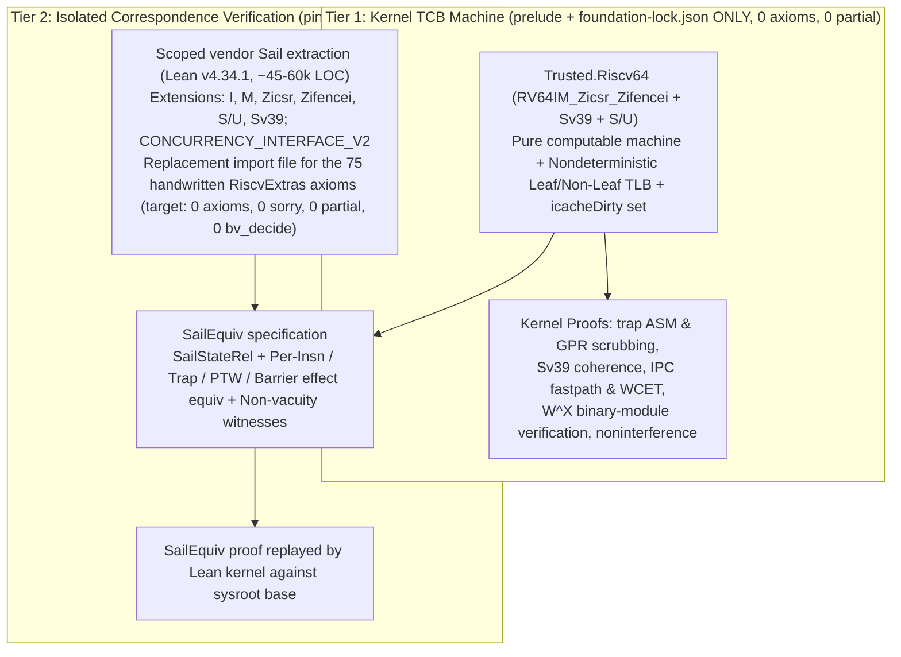

# RISC-V RV64IM_Zicsr_Zifencei Privileged Architecture, Sv39, OpenSBI/QEMU Boot, W^X Barriers, and Sail-to-Lean Verification Semantics

## Summary

This report documents primary-source and execution-verified architectural, firmware, compiler, and Lean 4 mechanization facts for single-hart `RV64IM_Zicsr_Zifencei` + `Sv39` S/U-mode systems running under OpenSBI and QEMU `virt` and verified against Sail RISC-V semantics in Lean 4:

1. **`opencompl/sail-riscv-lean` (`51c635c460125ac87955d061fcd902ce03b8011f`) cannot be imported directly under Anneal's `TrustedBoundary.lean` (`joshlf/anneal@5c960dd3f1b94321307d4500a4e180c753bfaad0`) and exhibits two sequential-semantics blind spots:**
   - **Direct import rejections (`TrustedBoundary.lean` + `trusted/audit/src/lib.rs`):** Upstream `opencompl/sail-riscv-lean` pins Lean `v4.29.0` (versus Anneal's SHA-256-locked `v4.34.1`), contains `0` `prelude` modules, imports `Sail` (`rems-project/lean-sail@07946313`, which pulls in `Lean`, `Lean.Elab.Term`, `Lean.Meta.Reduce`, `Std.Tactic.BVDecide`, `Std.Data.ExtDHashMap`, and `Std.Data.ExtHashMap` outside the 51 locked `Init.*` modules in `foundation-lock.json`), declares **75 `axiom`s** in `LeanRV64D/RiscvExtras.lean:31-112` (rejected by `validateLocalConstant` and `closure`), and contains 632 `set_option` commands, 1 `macro_rules`, 11 `termination_by` clauses, and 14,664 `do` blocks (all excluded from `preflight`'s closed `SyntaxNodeKind` allowlists).
   - **Sequential Sail soundness gaps:** Both `rems-project/lean-sail@07946313` (`ConcurrencyInterfaceV1.lean:265-277`, used by `opencompl/sail-riscv-lean@51c635c4`) and `rems-project/lean-sail@1e5b216b` (`v8` `ArchSemSequential.lean:51-90`) implement `sail_barrier`, `sail_cache_op`, `sail_tlbi`, `sail_translation_start/end`, and `sail_take/return_exception` as **`pure ()`** (and deterministically hardcode `FinChoice` to index `0`). Consequently, `execute_FENCEI` (`InstsEnd.lean:71339-71341`) is a silent no-op over unified RAM (unable to catch a missing `fence.i`), and `Register.tlb` (`VmemTlb.lean:246-350`) is a concrete 64-entry direct-mapped leaf-only cache rather than the normative unbounded leaf + non-leaf address-translation cache.
   - **Two-tier `SailEquiv` resolution:** Keep the authoritative kernel TCB machine (`Trusted.Riscv64`) as a pure, `prelude`-only, `foundation-lock.json`-only small-step model strengthened with (a) a nondeterministic leaf + non-leaf `Sv39` translation cache flushed only by matching `sfence.vma` and (b) an explicit `icacheDirty : PA → Bool` set cleared only by `fence.i`; discharge `SailEquiv` separately against a SHA-256-pinned, scoped (~45–60k LOC) Sail extraction whose handwritten axioms have been replaced, emitting `CONCURRENCY_INTERFACE_V2` effect trees, plus constructive non-vacuity witnesses. Upstream `riscv/sail-riscv` already emits the V2 interface by default since `4f8ce828fcacd6f392cb4f9be9046d46ce4bec07` (2026-10-01). Both published Lean extractions examined (`opencompl/sail-riscv-lean@51c635c4`, `Verified-zkEVM/riscv-zkvm@6810fc14`) are V1. Every examined extraction declares the same 75 handwritten axioms, so "zero-axiom" requires replacing the `--lean-import-file` (see §2.3).

2. **Eleven hardware `Sv39`, OpenSBI, QEMU `virt`, trap-entry, and single-hart `W^X` invariants and hazards:**
   - **`Sv39` `A`/`D` determinism vs. mandatory non-leaf `A=D=U=0`:** Setting `A = 1` on every valid leaf PTE and `D = 1` iff `W = 1` makes `Sv39` translation zero-PTE-write and identical across `Svade`, `Svadu` (`menvcfg.ADUE = 0` or `1`), and legacy hardware-update modes. Conversely, non-leaf (interior) PTEs (`V=1, R=W=X=0`) **must** have `A = 0, D = 0, U = 0, PTE[63:54] = 0` or every implementation raises a Page Fault (`G = 1` is legal on non-leaf PTEs and propagates downward).
   - **Built-in `Sv39` SMEP:** S-mode instruction fetch from any `U = 1` page **always** raises `Fetch Page Fault`, even when `sstatus.SUM == 1`.
   - **OpenSBI boot defaults (`scounteren = 0x02`, `mstatus.FS = Initial`):** OpenSBI hands control to S-mode with U-mode `rdtime` enabled (`scounteren = 0x02`) and floating-point state `Initial` on RV64GC harts. Kernel `_start` must zero `scounteren`, `sstatus`, `sie`, and `sscratch` before entering U-mode.
   - **OpenSBI `medeleg` omissions vs. direct fastpath delegation:** OpenSBI delegates `USER_ECALL` (`scause = 8`) directly to S-mode (zero M-mode bounce). It also delegates all three page faults (`12`, `13`, `15`) only on platforms with the `SBI_PLATFORM_HAS_MFAULTS_DELEGATION` feature, which is part of `SBI_PLATFORM_DEFAULT_FEATURES` and is used by `platform/generic`. It omits `Illegal Instruction` (`2`), misaligned load/store (`4`, `6`), and access faults (`1`, `5`, `7`), which bounce through M-mode `sbi_trap_redirect` (and `sbi_emulate_csr.c` honors `scounteren == 0` by redirecting U-mode `rdtime` as `scause = 2`).
   - **QEMU ELF boot ignores `e_entry`:** `qemu/hw/riscv/boot.c:279-293` passes the lowest `PT_LOAD` physical address (`image_low_addr`), not `e_entry`, to OpenSBI `fw_dynamic`. `.text.boot` (`_start`) must be the first `PT_LOAD` segment at LMA `0x8020_0000`.
   - **OpenSBI PMP lock over `[0x8000_0000, 0x8000_0000 + fw_size)`:** Mapping boot RAM with an aligned 2 MiB megapage at `0x8020_0000` (`L1[1]`) leaves OpenSBI's M-mode PMP region unmapped in `Sv39`.
   - **SBI `DBCN` physical-address pitfall:** `SBI_EXT_DBCN_CONSOLE_WRITE` (`FID = 0`) requires a physical address in `a1` (failing on high-half VAs); `SBI_EXT_DBCN_CONSOLE_WRITE_BYTE` (`FID = 2`) passes the byte in `a0` and works identically in Bare and `Sv39` modes.
   - **Trap entry `sscratch` guard + `wfi` with `SIE = 0`:** Maintaining `sscratch == TrapFrame*` in U-mode and `sscratch == 0` in S-mode enables a 2-instruction `csrrw sp, sscratch, sp; beqz sp, s_mode_trap_panic` guard against recursive kernel faults, while `wfi` must wake when `(mip & mie) != 0` even with `sstatus.SIE == 0`. That set includes M-level interrupts such as the `MTIP` that OpenSBI arms for SBI timers on harts without Sstc. `wfi` may also return spuriously (a NOP `wfi` is legal), so the idle loop must re-check `sip`. Full GPR-scrubbing entry/exit (`support/traps_minimal.S`) takes `45 + 37 = 82` 32-bit instructions.
   - **Single-hart `W^X` activation needs both `sfence.vma va, zero` and `fence.i` before the jump:** First an atomic 8-byte leaf PTE update (`RW -> RX`). Then `sfence.vma va, zero` (`rs2 = x0` mandatory for global `G = 1` pages) and `fence.i`. This package issues them in that order, but either order is normatively sufficient on a single hart (§5.2). Then `jalr`.

3. **Bare-metal Rust/LLVM 22 RV64 cross-compilation pitfalls and verified clean target:**
   - Passing `-C target-feature=-c` alone on `rustc 1.98.0-nightly` (`f8a08b688` / `14210df0e`, LLVM `22.1.6`) against `riscv64gc-unknown-none-elf` or `riscv64imac-unknown-none-elf` **fails to disable 16-bit compressed instructions** because LLVM retains `+zca` (emitting `c.li`, `c.addi`, `c.jr`, `c.j` and setting `EF_RISCV_RVC = 0x1`). Even with `-c,-zca`, linking prebuilt `riscv64gc` `libcore` injects **317 16-bit RVC instructions** on non-inlined `core` calls and keeps hard-float `lp64d` (`-f,-d` triggers `issue #116344` deprecation warnings). Meanwhile `riscv64imac-unknown-none-elf` defaults to `medlow` (`-C code-model=small`), failing in `ld.lld` with `R_RISCV_HI20 out of range` at `0x8020_0000` unless `-C code-model=medium` (`medany`) is specified.
   - **Clean verified target:** `--target riscv64im-unknown-none-elf -C target-feature=+zicsr,+zifencei` (paired with `-Z build-std=core` and `rust-src` for crates using `core`) defaults to soft-float `lp64`, `medany`, `panic-strategy = "abort"`, and `rust-lld`, producing `Flags [ (0x0) ]` (`EF_RISCV_RVC = 0x0`) and **`0` 16-bit instructions** (`250` 32-bit instructions in `support/smoke_boot.rs` + `support/link.ld`; `99` in `support/traps_minimal.S`).

4. **Live QEMU `11.0.2` + OpenSBI `v1.7` (Runtime SBI `3.0`) execution verification:**
   - Direct `-bios .../opensbi-riscv64-generic-fw_dynamic.bin` hangs (missing `fw_dynamic_info` in `a2`), and bare `-nographic` without `</dev/null` hangs in non-TTY subshells. Running `qemu-system-riscv64 -L <qemu_share> -M virt -m 128M -smp 1 -display none -serial stdio -bios default -kernel <elf> </dev/null` with OpenSBI `SRST` shutdown terminates deterministically (`EXIT=0` in `~0.3 s`), emitting `SV`, `OK`, `EXIT=0` identically under both `-cpu rv64,svade=true,svadu=false` and default `-cpu rv64` (`Svadu` `menvcfg.ADUE = 1`), and confirms live S-mode `W^X` execution (`RW -> RX -> sfence.vma vaddr, zero -> fence.i -> jalr`) before `sret` to U-mode (`SPP=0, SUM=0, scounteren=0`).

---

## Applicability

These findings characterize the combination and comparison of the following directly examined specifications, repositories, and toolchains, observed on `2026-11-19`:

| Subject | Identity / Revision | Relationship / Role |
|---|---|---|
| RISC-V ISA Manual (Priv + Unpriv) | `riscv/riscv-isa-manual@5f1104a0613af80219232b1e4bc108f9ec2bd6b2` | Normative specification for `S/U-mode`, `Sv39`, `Svade`/`Svadu`, `SFENCE.VMA`, `Zifencei`, and `WFI` |
| Sail RISC-V Lean 4 extraction | `opencompl/sail-riscv-lean@51c635c460125ac87955d061fcd902ce03b8011f` | Extracted RV64D Lean 4 model (`161` files, `174,112` LOC, Lean `v4.29.0`) audited for privileged semantics and Anneal boundary compatibility |
| Sail RISC-V specification | `riscv/sail-riscv@dda378c60fa0ad1bf13af5929bebee344a2e0a75` | Upstream normative Sail source compared against `opencompl/sail-riscv-lean@51c635c4` |
| `lean-sail` (`v5` & `v8`) | `rems-project/lean-sail@079463134b9c50450b8393e1566a09fc492a34d9` (`v5`) and `1e5b216bf881ef08da160db63b44ecda430802d6` (`v8`) | Sail Lean runtime monads (`ConcurrencyInterfaceV1` in `v5` pinned by `sail-riscv-lean`; `ArchSemSequential` in `v8`) |
| OpenSBI (source & runtime) | `riscv-software-src/opensbi@ed70256dd22c09962d146e433834239825ef0616` (source); `OpenSBI v1.7` / SBI `3.0` (QEMU-bundled runtime) | M-mode boot handoff, PMP setup, `medeleg`/`mideleg`/`scounteren`/`menvcfg`, `DBCN`/`SRST` ECALLs |
| QEMU (source & runtime) | `qemu/qemu@08c9bbb825148dec9669f5184ecf18823bb6d631` (source); `qemu-system-riscv64 11.0.2` (runtime) | `virt` memory map, ELF `-kernel` loader, TCG `Sv39` walker, live headless boot and `W^X` execution |
| Anneal | `joshlf/anneal@5c960dd3f1b94321307d4500a4e180c753bfaad0` (`main`) | `trusted/audit/TrustedBoundary.lean`, `trusted/audit/src/lib.rs`, `trusted/lean/foundation-lock.json`, `flake.nix`, `flake.lock` |
| Lean 4 | `leanprover/lean4@5045d0056413266e57c625dcd7c365b10e377c52` (`v4.34.1`) | Anneal locked Lean kernel and `TrustedBoundary.lean` execution engine |
| Rust nightly toolchains | `rust-lang/rust@f8a08b688cbe60acc386ed1fbd1b7cbaaf5576b1` (`nightly-2026-05-31`: `rustc 1.98.0-nightly (f8a08b688 2026-05-30)`) and `nightly-2026-06-01` (`rustc 1.98.0-nightly (14210df0e 2026-05-31)`, LLVM `22.1.6`) | Empirical RV64 cross-compilation, `+zca`/RVC/ABI/`medlow` probes, and ELF disassembly audits |
| Nixpkgs | `nixos/nixpkgs@549bd84d6279f9852cae6225e372cc67fb91a4c1` | Pinned `flake.lock` revision for single-target `qemu-riscv64` derivation |

**Target ISA profile and scope:** All kernel, trap, `Sv39`, and `W^X` invariants apply to **single-hart** systems running fixed 32-bit `RV64IM_Zicsr_Zifencei` + `Sv39` in S-mode and U-mode, with compressed instructions (`C`/`Zca`), floating-point (`F`/`D`), vector (`V`), hypervisor (`H`), control-flow integrity (`Zicfilp`/`Zicfiss`), and page-table extensions (`Svpbmt`, `Svnapot`, `Svinval`) disabled or unused.

**Version distinctions across subjects:**
- The two adjacent Rust nightlies (`nightly-2026-05-31` at commit `f8a08b688cbe60acc386ed1fbd1b7cbaaf5576b1`, pinned in `joshlf/anneal@5c960dd3f:flake.nix:18`, and `nightly-2026-06-01` at `14210df0e` / LLVM `22.1.6`) share the same LLVM `+zca` behavior when passing `-C target-feature=-c`. The `riscv64imac` `medlow` relocation probe and Edition 2024 attribute checks were executed on `nightly-2026-05-31` (`f8a08b688`), while the `riscv64gc` 317-RVC-instruction `libcore` audit and the `support/smoke_boot.rs` / `support/traps_minimal.S` `llvm-readobj` + `llvm-objdump` receipts were captured on `nightly-2026-06-01` (`14210df0e`, LLVM `22.1.6`).
- OpenSBI and QEMU source line citations come from `opensbi@ed70256dd22c` and `qemu@08c9bbb82514`, while live bare-metal execution was verified on `qemu-system-riscv64 11.0.2` with its bundled `OpenSBI v1.7` (Runtime SBI `3.0`).
- Upstream `riscv/sail-riscv@dda378c6` adds Hypervisor (`H`) two-stage translation relative to `opencompl/sail-riscv-lean@51c635c4`; single-stage `S_Stage` `Sv39` checks are identical across both revisions.

---

## Findings

### 1. Sail RISC-V Privileged Semantics (`S/U-mode`, 10 S-Mode CSRs, `Sv39`, and Barriers)

Basis: `source` (`opencompl/sail-riscv-lean@51c635c460125ac87955d061fcd902ce03b8011f`, `riscv/sail-riscv@dda378c60fa0ad1bf13af5929bebee344a2e0a75`) + `normative` (`riscv/riscv-isa-manual@5f1104a0613af80219232b1e4bc108f9ec2bd6b2`).

#### 1.1 Trap Entry, Exception Delegation, `ECALL`, and `SRET`

| Mechanism | `opencompl/sail-riscv-lean@51c635c4` | `riscv/sail-riscv@dda378c6` | Exact Semantics |
|---|---|---|---|
| `trap_handler` (Supervisor arm) | `LeanRV64D/SysControl.lean:647-710` (S-mode: `680-706`) | `model/sys/sys_control.sail:268-488` | Asserts `currentlyEnabled Ext_S`; sets `scause[63] := is_interrupt`, `scause[62:0] := zero_extend cause`; sets `mstatus.SPIE (bit 5) := mstatus.SIE (bit 1)`, `mstatus.SIE (bit 1) := 0`, `mstatus.SPP (bit 8) := (cur_priv == Supervisor ? 1 : 0)` (rejects trapping from `Machine` to `Supervisor`); writes `stval := tval info`, `sepc := pc`, `cur_privilege := Supervisor`; computes target PC via `prepare_trap_vector Supervisor scause` (`SysExceptions.lean:226-240`: Direct mode `stvec[63:2] << 2`, Vectored mode adds `4 * cause` only on interrupts). |
| `exception_handler` | `LeanRV64D/SysControl.lean:712-723` | `model/sys/sys_control.sail:490-510` | Computes `del_priv ← exception_delegatee exc.trap cur_priv` (`SysControl.lean:556-565`: delegates to `Supervisor` iff `Ext_S && medeleg[cause_idx] == 1 && cur_priv <= Supervisor`, never downward from `Machine`), then invokes `trap_handler del_priv (Exception exc.trap) pc exc.excinfo`. |
| `xtval_exception_value` | `LeanRV64D/SysControl.lean:725-754` | `model/sys/sys_control.sail` | Explicitly sets `stval := 0` (`false` -> `none`) for `E_U_EnvCall`, `E_S_EnvCall`, `E_M_EnvCall` (`lines 744-747`), and writes faulting VA or instruction bits for page, access, and illegal faults according to platform configuration. |
| `execute_ECALL` | `LeanRV64D/InstsEnd.lean:71390-71405` | `model/extensions/I/base_insts.sail:544-555` | Maps `User → E_U_EnvCall ()` (`cause = 8`), `Supervisor → E_S_EnvCall ()` (`cause = 9`), `Machine → E_M_EnvCall ()` (`cause = 11`), constructs `{ trap := exc_type, excinfo := none, ext := none }`, and invokes `trap t`. Does **not** advance `sepc`; software must add `4` before returning past a 32-bit `ecall`. |
| `execute_SRET` | `LeanRV64D/InstsEnd.lean:67504-67549` | `model/extensions/I/base_insts.sail:666-715` | Raises `Illegal_Instruction` if `cur_privilege == User`, or (`Supervisor` and (`!Ext_S || mstatus.TSR == 1`)), or (`Machine` and `!Ext_S`). Otherwise: sets `mstatus.SIE (1) := mstatus.SPIE (5)`, `mstatus.SPIE (5) := 1`, `cur_privilege := (mstatus.SPP (8) == 1 ? Supervisor : User)`, `mstatus.SPP (8) := 0`, and if the new `cur_privilege != Machine` clears `mstatus.MPRV (17) := 0` (`lines 67533-67535`); optionally restores `Zicfilp` ELP; sets `nextPC ← prepare_xret_target Supervisor` (`SysExceptions.lean:242-250`: `align_pc sepc`, masking `sepc[1:0] = 00` when `!Ext_Zca` per `SysRegs.lean:1306-1309`). |

#### 1.2 CSR Access Semantics and the 10 S-Mode CSRs

`execute_CSRReg` (`InstsEnd.lean:71721-71723`) and `execute_CSRImm` (`lines 71725-71727`) compute `access_type := csr_access_type op (rd == zreg) (rs1_or_imm == 0)` (`ZicsrInsts.lean:259-266`): `CSRRW` with `rd == x0` performs `CSRWrite` (suppressing side-effectful reads), while `CSRRS`/`CSRRC` with `rs1`/`uimm == 0` performs `CSRRead` (suppressing writes). `doCSR` (`ZicsrInsts.lean:22241-22279`) then runs `check_CSR_result csr cur_priv access_type` (`SysControl.lean:526-554`), enforcing privilege level `csr[9:8] <= priv`, read-only bits `csr[11:10] != 0b11` on write, `is_CSR_accessible`, and `stateen_allows_CSR_access`.

| CSR (Addr) | `read_CSR` (`ZicsrInsts.lean`) | `write_CSR` (`ZicsrInsts.lean`) | Legalization and Architectural Subtleties |
|---|---|---|---|
| `sstatus` (`0x100`) | `L7199`: `lower_mstatus mstatus` (`SysRegs.lean:1418-1432`) | `L18136-18139`: `legalize_sstatus mstatus val` (`SysRegs.lean:1434-1453`) | Projected view of `mstatus`: exposes `SIE(1)`, `SPIE(5)`, `SPP(8)`, `VS(10:9)`, `FS(14:13)`, `XS(16:15)`, `SUM(18)`, `MXR(19)`, `SPELP(23)`, `UXL(33:32)`, `SD(63)`. `lift_sstatus` recomputes `SD` from `FS`/`XS`/`VS == Dirty`. |
| `sie` (`0x104`) | `L9490`: `lower_mie mie mideleg` | `L20300-20303`: `legalize_sie mie mideleg val` | Masked strictly by `mideleg` (`SSIE(1)`, `STIE(5)`, `SEIE(9)`). |
| `stvec` (`0x105`) | `L9491`: `get_stvec ()` (`SysExceptions.lean:270`) | `L20304`: `set_stvec val` (`SysExceptions.lean:279`, `SysRegs.lean:1236-1268`) | `legalize_tvec`: bits `[1:0]` encode `Direct (0)` or `Vectored (1)`; reserved modes `2`/`3` either preserve the prior mode (`Xtvec_Ignore`) or trap (`Xtvec_Fatal`). Base alignment enforced to `>= 4` bytes. |
| `scounteren` (`0x106`) | `L7191`: `zero_extend 64 scounteren` (32-bit CSR) | `L18124-18127`: `legalize_scounteren` (`SysRegs.lean:1394`) | Gates U-mode reads of `cycle (0xC00)`, `time (0xC01)`, `instret (0xC02)`, and `hpmcounter3..31` (`SysControl.lean:455-511`, `SysRegs.lean:1557-1590`). When `scounteren == 0`, `counter_enabled index User = false` (all U-mode counter reads trap `Illegal_Instruction`), while S-mode checks `mcounteren` only. |
| `sscratch` (`0x140`) | `L7200`: `readReg sscratch` | `L18140-18143`: `writeReg sscratch val` | Unconstrained 64-bit read/write scratch register. |
| `sepc` (`0x141`) | `L9492`: `get_xepc Supervisor` (`SysExceptions.lean:242`) | `L20305`: `set_xepc Supervisor val` (`SysExceptions.lean:252`, `SysRegs.lean:1306-1309`) | `legalize_xepc` masks `sepc[1:0] := 00` when `!Ext_Zca` (4-byte aligned), or `sepc[0] := 0` when `Ext_Zca` is enabled. |
| `scause` (`0x142`) | `L7201`: `readReg scause` | `L18144-18147`: `writeReg scause val` | 64-bit R/W (`bit 63 = interrupt`, `bits [62:0] = code`). |
| `stval` (`0x143`) | `L7202`: `readReg stval` | `L18148-18151`: `writeReg stval val` | 64-bit R/W (faulting VA, faulting instruction, or `0`). |
| `sip` (`0x144`) | `L9489`: `read_sip ExcludePlatformInterrupts`; `doCSR L22258`: `read_sip IncludePlatformInterrupts` | `L20296-20299`: `write_sip val` | **Read-modify-write subtlety (`ZicsrInsts.lean:22255-22260`):** `doCSR` uses `ExcludePlatformInterrupts` for the read-modify-write input of `CSRRS`/`CSRRC`, while returning `IncludePlatformInterrupts` in `rd`, preventing external platform interrupt lines from being spuriously latched into software-writable bits. |
| `satp` (`0x180`) | `L2443`: `readReg satp` (`satp_accessible`: traps `Illegal_Instruction` in S-mode if `mstatus.TVM == 1`, `SysControl.lean:288-294`) | `L13704`: `legalize_satp` (`SysRegs.lean:1507-1539`) | Truncates `PPN` to `min(physaddr_bits - 12, 44)` bits. If `MODE` is unsupported or reserved, returns `prev_value` unchanged (entire write ignored per `norm:satp_mode_op_unsupported`). **Does not flush the TLB** (`ZicsrInsts.lean:13704-13709`). |

#### 1.3 `Sv39` Translation, Barriers, and Upstream Sail Delta

- **`translateAddr` (`Vmem.lean:518-555`):** Computes `effPriv ← effectivePrivilege` (applying `mstatus.MPRV` for non-fetches), checks `mode ← translationMode effPriv`, checks canonical sign-extension `vAddr == sign_extend 64 vAddr[38:0]` (`lines 537-539`), extracts `mxr`, `do_sum`, `asid`, and `base_ppn`, probes the 64-entry direct-mapped `tlb` (`VmemTlb.lean:246-298`), and on miss runs `pt_walk` (`Vmem.lean:261-370`, `initial_level = 2`, structurally terminating on `level.toNat`), followed by `update_and_write_pte` (`Vmem.lean:242-254`) and `add_to_TLB` (`VmemTlb.lean:305-329`).
- **`execute_SFENCE_VMA` (`InstsEnd.lean:67724-67749`):** Traps `Illegal_Instruction` in U-mode or in S-mode when `mstatus.TVM == 1`; otherwise computes `addr := (rs1 != x0 ? some rX(rs1) : none)` and `asid := (rs2 != x0 ? some rX(rs2)[15:0] : none)` and calls `flush_TLB asid addr` (`VmemTlb.lean:331-350`), iterating `i ∈ 0..63` and clearing entries matching `flush_TLB_Entry` (`lines 276-288`: when `asid = some a`, requires `ent.asid == a && !ent.global` — global entries are **never** flushed unless `asid = none`, i.e., `rs2 == x0`).
- **`execute_FENCEI` (`InstsEnd.lean:71339-71341`, `model/extensions/Zifencei/zifencei_insts.sail:24-31`):** Calls `sail_barrier Barrier_RISCV_i` and returns `RETIRE_SUCCESS` (carrying the upstream comment `// fence.i is a nop for the memory model`).
- **`execute_FENCE` (`InstsEnd.lean:71343-71359`, `model/extensions/I/base_insts.sail:463-485`):** Maps `(pred[1:0], succ[1:0])` (after `effective_fence_set` with `FIOM`) to `sail_barrier Barrier_RISCV_*` and returns `RETIRE_SUCCESS`.
- **Upstream `riscv/sail-riscv` delta (`51c635c4` vs. `dda378c6`):** Upstream `riscv/sail-riscv@dda378c6` adds Hypervisor `H`-extension two-stage translation (`stage : TranslationStage`, `vmid : vmidbits`) across `model/sys/vmem.sail`, `vmem_pte.sail:90-175`, and `vmem_tlb.sail:135-245`, whereas `opencompl/sail-riscv-lean@51c635c4` raises `internal_error "Hypervisor extension not supported"` on `VirtualUser`/`VirtualSupervisor`. All single-stage `S_Stage` `Sv39` checks (non-leaf `A`/`D`/`U` rejection, `SUM` non-execution, misaligned superpages, `update_and_write_pte`) are semantically identical across both revisions.

---

### 2. Anneal `TrustedBoundary.lean` Incompatibility, Sequential Sail Soundness Gaps, and Two-Tier `SailEquiv` Architecture

Basis: `source` (`joshlf/anneal@5c960dd3f1b94321307d4500a4e180c753bfaad0`, `opencompl/sail-riscv-lean@51c635c460125ac87955d061fcd902ce03b8011f`, `rems-project/lean-sail@079463134b9c50450b8393e1566a09fc492a34d9`, `rems-project/lean-sail@1e5b216bf881ef08da160db63b44ecda430802d6`) + `derived`.

#### 2.1 Concrete Rejection Matrix Under `TrustedBoundary.lean` (`joshlf/anneal@5c960dd3f`)

`joshlf/anneal@5c960dd3f` enforces two sequential stages in `trusted/audit/TrustedBoundary.lean` and `trusted/audit/src/lib.rs`: `"preflight"` (purely syntactic admission before elaboration against the locked `Init.*` parser environment) and `"audit"` (loading compiled `.olean`s with `trustLevel := 0, plugins := #[], loadExts := false`, checking axiom closure, and replaying every non-foundation constant via `base.toKernelEnv.replay locals`). Importing `opencompl/sail-riscv-lean@51c635c4` directly fails every gate:

| Gate / Policy Rule | Anneal Requirement (`joshlf/anneal@5c960dd3f`) | Observed in `opencompl/sail-riscv-lean@51c635c4` + `lean-sail@07946313` | Outcome |
|---|---|---|---|
| **Toolchain & binary SHA-256** | `leanprover/lean4:v4.34.1` (`5045d005...`), binary + `Init.*` SHA-256 locked in `trusted/lean/foundation-lock.json` (`trusted/audit/src/lib.rs:1548-1624`) | `lean-toolchain:1` pins `leanprover/lean4:v4.29.0` | **REJECT** |
| **Module import closure** | `trusted/audit/src/lib.rs:1741-1756` admits only the 51 locked `Init.*` modules in `foundation-lock.json` plus `Trusted.*` (and `Anneal.*` in `theory/`); `Trusted.lean:10` starts with `prelude` | `0` `prelude` files; `65` `import Sail` edges into `lean-sail@07946313`, which imports `Lean` (`Sail/Attr.lean:1`), `Lean.Elab.Term`, `Lean.Meta.Reduce`, `Std.Tactic.BVDecide` (`Sail/BitVec.lean:9-11`), `Std.Data.ExtDHashMap`, and `Std.Data.ExtHashMap` (`Sail/ConcurrencyInterfaceV1.lean:4-5`) | **REJECT** (`foreign/missing import`) |
| **Axiom closure** | Strictly `{Classical.choice (Init.Prelude), Quot.sound (Init.Prelude), propext (Init.Core)}` (`foundation-lock.json`, `TrustedBoundary.lean:600-603, 656-660`) | **75 `axiom` declarations** in `LeanRV64D/RiscvExtras.lean:31-112` (8 platform/reservation/RNG + 67 SoftFloat) | **REJECT** (`validateLocalConstant` & `closure`) |
| **Syntax allowlist (`preflight`)** | `allowedCommandKinds` (`L201-206`), `allowedDeclarationKinds` (`L211-215`), `allowedCommandSyntaxKinds` (`L222-238`), `allowedTermSyntaxKinds` (`L246-270`), and `allowedTheoryTacticKinds` (`L289-310`) exclude `set_option`, `macro_rules`, `syntax`, `notation`, `terminationBy`, `do`, `axiom`, and `bv_decide` | **632** `set_option`, **1** `macro_rules` (`RiscvExtras.lean:118`), **11** `termination_by`, **14,664** `do` blocks; `lean-sail` adds `syntax`, `notation`, `macro_rules` | **REJECT** (`inspectSyntax`, `L446-479`) |
| **`partial` / `unsafe` / `sorry` / `ofReduceBool`** | Zero `partial`, `unsafe`, `sorryAx`, `Lean.ofReduceBool` (`TrustedBoundary.lean:285, 651-655`) | `0` `partial`, `0` `unsafe`, `0` `sorry` in `LeanRV64D/` (`RiscvExtras.lean:118` uses `decide`, not `sorry`), but `Sail/BitVec.lean:11` imports `Std.Tactic.BVDecide` (risk of `Lean.ofReduceBool` if invoked) | Conditional (`0` `ofReduceBool` must be audited in cone) |
| **Kernel replay memory budget** | `trusted/audit/src/lib.rs:1429-1430` invokes `TrustedBoundary.lean` with `-j1 -M2048` (`TrustedBoundary.lean:770-771`) | `161` `.lean` files, `174,112` LOC (`InstsEnd.lean` `72,377` LOC, `ZicsrInsts.lean` `22,300` LOC; unimported `RvfiDii` ~14 GiB RSS) | Exceeds `-M2048` unless scoped |

#### 2.2 Two Sequential Soundness Blind Spots in `lean-sail` (`ConcurrencyInterfaceV1` and `ArchSemSequential`)

1. **No-op architectural barriers and deterministic choice (`rems-project/lean-sail@07946313`, `Sail/ConcurrencyInterfaceV1.lean:14-25, 265-277`):** Every synchronization primitive in the v5 concurrency interface used by `opencompl/sail-riscv-lean@51c635c4` evaluates to `pure ()`:
   ```lean
   def sail_barrier (_ : α) : PreSailM RegisterType c ue Unit := pure ()
   def sail_cache_op [Arch] (_ : Arch.cache_op) : PreSailM RegisterType c ue Unit := pure ()
   def sail_tlbi [Arch] (_ : Arch.tlb_op) : PreSailM RegisterType c ue Unit := pure ()
   def sail_translation_start [Arch] (_ : Arch.trans_start) : PreSailM RegisterType c ue Unit := pure ()
   def sail_translation_end [Arch] (_ : Arch.trans_end) : PreSailM RegisterType c ue Unit := pure ()
   def sail_take_exception [Arch] (_ : Arch.fault) : PreSailM RegisterType c ue Unit := pure ()
   def sail_return_exception [Arch] (_ : Arch.pa) : PreSailM RegisterType c ue Unit := pure ()
   ```
   `trivialChoiceSource` (`lines 14-25`) deterministically maps every `undefined_*` choice to `0`/`false`/`""`. In `rems-project/lean-sail@1e5b216b` (`v8` `CONCURRENCY_INTERFACE_V2`), `Sail/ArchSemSequential.lean:51-90` exhibits the exact same two blind spots: `.memWriteAnnounce`, `.barrier`, `.archException`, `.cacheOp`, `.tlbOp`, `.translationStart`, `.translationEnd`, and `.returnException` all reduce to `pure ()`, and `.inr choice` (`FinChoice`) hardcodes index `⟨0, h⟩`.
2. **Concrete weak TLB vs. normative unbounded address-translation cache (`VmemTlb.lean:246-350`):** `sail-riscv` models `Register.tlb` as a 64-entry direct-mapped cache indexed by `vpn[5:0]` that caches **leaf PTEs only**, never caches non-leaf (interior) page-table entries, and automatically evicts colliding indices.
   - The same design is present at `riscv/sail-riscv@ec5200bd`. Package `mmu-page-table-walks-tlb-shootdowns-and-icache-barrier-refinement` analyses it as an under-approximation, with a cross-ISA comparison.
   - Package `riscv-smode-kernel-sound-nondeterminism-and-spec-permitted-behaviors` documents that the specification caches each level's PTE read, including V=0 entries.
   - It also documents that Sail's TLB-hit A/D write-back skips the compare that the specification's step 9 requires.
3. **Consequence for kernel verification:** Proofs over sequential `sail-riscv` execution **cannot detect a missing `fence.i`** (unified RAM + `sail_barrier Barrier_RISCV_i = pure ()`) and **under-approximate hardware TLB caching** (failing to catch missing `sfence.vma` after non-leaf page-table modifications or across more than 64 mappings).

#### 2.3 Derived Two-Tier `SailEquiv` Architecture Compatible with `TrustedBoundary.lean`

Basis: `derived` from `joshlf/anneal@5c960dd3f` (`TrustedBoundary.lean`), `rems-project/lean-sail` (`v5`/`v8`), and published scoped/executable Sail extraction practices in `Verified-zkEVM/riscv-zkvm@6810fc14d9c40373101321cefaec59df8d82e3e7` and `axiom-crypto/sail-riscv-lean@82afed87c9d6827d3691acbe66d5395fa37dc41d`.



- **Tier 1 (`Trusted.Riscv64`, admitted directly by `TrustedBoundary.lean`):** Pure, `prelude`-only, `foundation-lock.json`-only small-step machine for fixed 32-bit `RV64IM_Zicsr_Zifencei` + `Sv39` + S/U (`!Ext_C`, `!Ext_Zca`), modeling 32 GPRs (`x0 = 0`), `pc`, `priv ∈ {User, Supervisor}`, the 10 S-mode CSRs, byte-addressed physical RAM, and PMP denial over `[0x8000_0000, 0x8020_0000)`. To close the two sequential Sail blind spots, Tier 1 adds:
  1. **Nondeterministic leaf + non-leaf `Sv39` TLB (`tlb : Set CachedTranslation`):** Any valid leaf or non-leaf PTE reachable from active `satp` may be cached at any time (demonic choice) and persists indefinitely until invalidated by a matching `SFENCE.VMA` (honoring the `G` bit and `rs1`/`rs2` rules).
  2. **Explicit instruction-fetch dirty set (`icacheDirty : PA → Bool`):** Every physical store marks its written byte addresses dirty; instruction fetch from any dirty physical byte faults/produces UB unless **`FENCE.I`** has cleared `icacheDirty := fun _ => false`, forcing every `W^X` activation proof to emit `sfence.vma` and `fence.i` in order before `jalr`.
- **Tier 2 (`SailEquiv` correspondence check):** Performed in an isolated correspondence pass (outside `Trusted.Riscv64`'s `foundation-lock.json` closure) against a SHA-256-pinned, scoped Sail extraction (`~45–60k` LOC retaining `I`, `M`, `Zicsr`, `Zifencei`, `S/U`, and `Sv39`, pruning `F`/`D`/`V`/`H`/`K`/crypto/`RvfiDii`, following `Verified-zkEVM/riscv-zkvm@6810fc14` `sail-import/PROVENANCE.toml`):
  1. Replace all 75 `axiom` declarations in `RiscvExtras.lean` with total executable definitions (following `axiom-crypto/sail-riscv-lean@82afed87` `RiscvExtrasExecutable.lean`, omitting `--lean-noncomputable`).
     - The axioms are not emitted by the Sail backend. They live in the handwritten `--lean-import-file`: at `riscv/sail-riscv@ec5200bdfe0c10afa6dbb1f7b0980db2d236236e`, `handwritten_support/RiscvExtras.lean:31-112`, 75 `axiom` lines from `plat_term_write` to `riscv_f64roundToInt`.
     - The same 75 appear in both published extractions examined (`opencompl/sail-riscv-lean@51c635c4` `LeanRV64D/RiscvExtras.lean`; `Verified-zkEVM/riscv-zkvm@6810fc14` `RiscvZkvm/Sail/RiscvExtras.lean`).
     - A zero-axiom extraction therefore requires substituting the import file; no backend change is needed.
     - Upstream's own substitute, `handwritten_support/RiscvExtrasExecutable.lean` (wired in at `model/CMakeLists.txt:452-454`), uses `panic` stubs. For example, `def match_reservation : BitVec Arch.addr_size → Bool := λ _ => panic "TODO: match_reservation"` and `def valid_reservation … := λ _ => false`.
     - In the kernel these stubs denote `default` values. That is a specific, not a faithful, semantics: for instance, SC can never succeed.
  2. Use the `CONCURRENCY_INTERFACE_V2` (`PreSailM` free-monad effect trees) output so `SailEquiv` proves effect-tree equivalence *before* sequential interpretation, verifying that `execute_FENCEI` emits the exact `Barrier_RISCV_i` constructor rather than reducing to `pure ()`.
     - This is no longer a design choice to be made. Upstream sail-riscv emits V2 by default since `4f8ce828fcacd6f392cb4f9be9046d46ce4bec07` (2026-10-01, "Port to v2 of the Sail concurrency interface (#1871)"): `model/core/phys_mem_interface.sail:16` reads `$define CONCURRENCY_INTERFACE_V2`.
     - At `ec5200bdfe0c10afa6dbb1f7b0980db2d236236e`, `handwritten_support/RiscvExtras.lean:13` reads `open Sail.ArchSem`.
     - Both published extractions examined are still V1 (`RiscvExtras.lean:13` reads `open ConcurrencyInterfaceV1` in each). Using V2 means regenerating from a post-`4f8ce828` sail-riscv, not reusing either published extraction.
  3. Include constructive non-vacuity canaries exhibiting concrete reachable S-mode and U-mode `SailStateRel` witness states where `ext_decode >>= execute` succeeds, preventing hidden extension traps (such as `Zicfilp` `get_xLPE` reading `cur_privilege`/`mseccfg` during `ext_decode`) from making conditional refinement hypotheses vacuously true.

---

### 3. `Sv39` Virtual Memory Invariants and Translation-Fault Landmines

Basis: `normative` (`riscv/riscv-isa-manual@5f1104a0`: `src/priv/supervisor.adoc:177-194, 1493-1755, 1872-1951`, `src/priv/svadu.adoc:1-14`) + `source` (`opencompl/sail-riscv-lean@51c635c4`: `Vmem.lean:242-324, 455, 537-539`, `VmemPte.lean:274-305, 379-400`; `qemu/qemu@08c9bbb8`: `target/riscv/tcg/cpu_helper.c:1196-1218, 1310-1560`, `target/riscv/cpu.c:1029-1031, 3603`; `opensbi@ed70256d`: `lib/sbi/sbi_hart.c:135-167`) + `execution` (`QEMU 11.0.2` + `OpenSBI v1.7`).

#### 3.1 `A`/`D` Bit Hardware Divergence and Mandatory Non-Leaf `A=D=U=0` Invariant

- **Divergence between `Svade` and `Svadu`:** Both Sail (`Vmem.lean:247-248`) and QEMU (`cpu_helper.c:1218`) compute `adue = svadu ? menvcfg.ADUE : !svade`. On QEMU `-cpu rv64`, `ext_svadu = true` (`cpu.c:3603`), and OpenSBI v1.7 enables `menvcfg.ADUE = 1` when `Svadu` is present without `Svade` (`sbi_hart.c:136, 166-167`). If a leaf PTE has `A == 0` (on any load/fetch/store) or `D == 0` (on any store/AMO):
  - Under `Svade` (or `Svadu` with `ADUE = 0`), hardware raises a **Page Fault** (`PTW_PTE_Needs_Update` in Sail `Vmem.lean:254`; `TRANSLATE_FAIL` in QEMU `cpu_helper.c:1518`).
  - Under `Svadu` with `ADUE = 1` (or legacy `!Svade && !Svadu`), hardware performs an **implicit atomic write** to the PTE in RAM (`write_pte` in Sail `Vmem.lean:251`; CAS in QEMU `cpu_helper.c:1557-1560`), mutating page-table memory behind software's back (and raising an Access Fault if the page table is read-only/PMP-protected).
- **Deterministic leaf PTE rule:** Always set **`A = 1`** (bit 6) on every valid leaf PTE (`R=1` or `X=1`), and set **`D = 1`** (bit 7) iff **`W = 1`** (bit 2). Because Step 8 (permission check `R`/`W`/`X`) executes strictly before Step 9 (`A`/`D` check) (`supervisor.adoc:1737-1739`, `Vmem.lean:324, 455`, `cpu_helper.c:1493, 1514`), any store to a `W = 0` page already traps at Step 8 regardless of `D`. On every permitted access, `update_PTE_Bits` returns `none` (Sail `VmemPte.lean:379-400`), `updated_pte == pte` (QEMU `cpu_helper.c:1522`), and Step 9 performs zero PTE writes — making execution **100% identical** across `Svade`, `Svadu` (`ADUE=0` or `1`), and legacy hardware-update modes (empirically verified on QEMU `11.0.2` + OpenSBI `v1.7`).
- **Mandatory non-leaf PTE rule (critical trap hazard):** Every non-leaf (interior) PTE (`V=1, R=0, W=0, X=0`) **must** have **`A = 0, D = 0, U = 0, PTE[63:54] = 0`**. Setting `A=1`, `D=1`, or `U=1` on a non-leaf PTE triggers an immediate Page Fault in all three authorities:
  - Normative (`supervisor.adoc:1697-1699`): `D`, `A`, and `U` are reserved on non-leaf PTEs and must be cleared by software.
  - Sail (`VmemPte.lean:280-282`): `pte_is_non_leaf pte_flags && (A == 1#1 || D == 1#1 || U == 1#1 || pte_ext != 0)`.
  - QEMU (`cpu_helper.c:1366-1372`): `if (pte & (PTE_D | PTE_A | PTE_U | PTE_ATTR)) return TRANSLATE_FAIL;`.
  - By contrast, **`G = 1`** (bit 5) **is** legal on non-leaf PTEs and propagates downward to all child leaf translations (`supervisor.adoc:1576-1579`, `Vmem.lean:294`).

#### 3.2 Canonical Addresses, Reserved PTE Bits, Built-In SMEP, and Superpage Alignment

| Rule | Exact Specification & Bit Check | Fault Raised on Violation |
|---|---|---|
| **Canonical VA** | `va[63:39]` must all equal `va[38]`. User half (`va[38] = 0`): `0x0000_0000_0000_0000 ..= 0x0000_003F_FFFF_FFFF` (`VPN[2] ∈ 0..255`). Non-canonical hole: `0x0000_0040_0000_0000 ..= 0xFFFF_FFBF_FFFF_FFFF`. Kernel half (`va[38] = 1`): `0xFFFF_FFC0_0000_0000 ..= 0xFFFF_FFFF_FFFF_FFFF` (`VPN[2] ∈ 256..511`). | Page Fault (`Fetch`/`Load`/`Store-AMO`) prior to PTW (`PTW_Invalid_Addr`) |
| **Reserved RWX** | `V=1, R=0, W=1, X=0` (invalid whenever `Zicfiss` `menvcfg.SSE == 0`) and `V=1, R=0, W=1, X=1` (always invalid). | Page Fault (`PTW_Invalid_PTE`) |
| **Reserved high PTE bits** | `PTE[63:54]` (`N` bit 63, `PBMT` bits 62–61, reserved bits 60–54) must be `0` on both leaf and non-leaf PTEs when `Svnapot`/`Svpbmt`/`Svrsw60t59b` are unused. `RSW` (`PTE[9:8]`) is ignored by hardware. | Page Fault (`PTW_Invalid_PTE`) |
| **L0 non-leaf PTE** | At level `0`, `V=1, R=0, W=0, X=0` has no next level (`i - 1 < 0`). | Page Fault (`PTW_Invalid_PTE`) |
| **`U` bit & `sstatus.SUM` (Built-In SMEP)** | U-mode requires `U = 1`. S-mode load/store to `U = 1` requires `sstatus.SUM == 1`. **S-mode instruction fetch from any `U = 1` page is unconditionally forbidden even when `SUM == 1`** (`supervisor.adoc:191-193, 1566-1567` `norm:pte_u_no_s_exec`; Sail `VmemPte.lean:301`: `(!pte_U) || (do_sum && is_load_store access)`; QEMU `cpu_helper.c:1485-1486`: `prot &= PAGE_READ | PAGE_WRITE`). Changes to `SUM` and `MXR` take effect **immediately** without `sfence.vma` (`norm:sfence_vma_sum_mxr_effect`). | Page Fault (`PTW_No_Permission`; `Fetch Page Fault` on S-exec of `U = 1`) |
| **Superpage PPN alignment** | Level 2 (1 GiB gigapage): leaf `ppn[1:0] == 0` (`PTE[27:10] == 0`, PA multiple of `0x4000_0000`). Level 1 (2 MiB megapage): leaf `ppn[0] == 0` (`PTE[18:10] == 0`, PA multiple of `0x0020_0000`). Level 0 (4 KiB): 4 KiB alignment only. | Page Fault (`PTW_Misaligned`) |

---

### 4. OpenSBI and QEMU `virt` Boot Handoff, PMP, Delegation, and Trampoline Landmines

Basis: `normative` (`supervisor.adoc:1122-1128, 1344-1356`) + `source` (`qemu/qemu@08c9bbb8`: `hw/riscv/virt.c:95-115, 627-708`, `hw/riscv/boot.c:96-102, 266-360`; `opensbi@ed70256d`: `lib/sbi/sbi_domain.c:973-1055`, `lib/sbi/sbi_hart.c:27-186, 768-845`, `lib/sbi/sbi_trap.c:305-464`, `lib/sbi/sbi_emulate_csr.c:21-80`, `lib/sbi/sbi_ecall_dbcn.c:24-66`, `lib/sbi/sbi_ecall_srst.c:18-48`) + `execution` (`support/smoke_boot.rs`, `support/link.ld`, `QEMU 11.0.2` + `OpenSBI v1.7`).

#### 4.1 OpenSBI S-Mode Handoff State and QEMU `virt` Physical Memory Map

- **Entry registers:** `a0 = hartid` (`0` on `-smp 1`), `a1 = dtb_paddr` (FDT placed near top of DRAM, `boot.c:350-359`).
- **Entry CSRs (`sbi_hart.c:27-186, 821-844`):** `cur_priv = Supervisor`, `satp = 0` (`Bare`), `sstatus.SIE = 0`, `sie = 0`, `sscratch = 0`, `stvec = next_addr & ~3`, **`scounteren = 0x02` (`TM = 1`)**, **`mstatus.FS = Initial`** (when FPU is present), `mcounteren = -1`.
- **QEMU `virt` physical addresses (`hw/riscv/virt.c:95-115`):** `VIRT_TEST = 0x0010_0000` (4 KiB, SiFive finisher used by SBI `SRST`), `VIRT_CLINT = 0x0200_0000` (64 KiB), `VIRT_PLIC = 0x0C00_0000`, `VIRT_UART0 = 0x1000_0000` (256 B), `VIRT_DRAM = 0x8000_0000`. OpenSBI occupies `[0x8000_0000, 0x8000_0000 + fw_size)` (`< 2 MiB`); QEMU loads the kernel at `QEMU_ALIGN_UP(firmware_end_addr, 2 MiB) = 0x8020_0000` (`boot.c:96-102`).

#### 4.2 Seven Concrete Boot, Delegation, Firmware, and Headless QEMU Landmines

1. **QEMU jumps to lowest `PT_LOAD` `p_paddr`, not `e_entry` (`hw/riscv/boot.c:279-293`):** `riscv_load_kernel` passes `&info->image_low_addr` (ignoring ELF `e_entry`) to OpenSBI `fw_dynamic`. Placing `.rodata` or page tables before `.text.boot` causes OpenSBI to jump into data. **Mitigation:** Place `.text.boot` (`_start`) as the first `PT_LOAD` segment at exact LMA `0x8020_0000` (enforced in [support/link.ld](support/link.ld)).
2. **OpenSBI boots with `scounteren = 0x02` (`TM = 1`) and `mstatus.FS = Initial` (`sbi_hart.c:36-48`):** Leaving these intact permits U-mode `rdtime` reads and leaves 32 floating-point registers active as an architectural covert channel on RV64GC hardware. **Mitigation:** `_start` immediately executes `csrw scounteren, zero; csrw sstatus, zero; csrw sie, zero; csrw sscratch, zero`. Source inspection of `opensbi/lib/sbi/sbi_emulate_csr.c:21-40` confirms OpenSBI's M-mode `time` emulator checks `CSR_SCOUNTEREN` for `PRV_U` and redirects `Illegal Instruction` (`scause = 2`) to S-mode when `scounteren == 0`.
3. **OpenSBI `medeleg` omits `Illegal Instruction` (`2`), misaligned load/store (`4`/`6`), and access faults (`1`/`5`/`7`) (`sbi_trap.c:437-443`):** Only `MISALIGNED_FETCH (0)`, `BREAKPOINT (3)`, `USER_ECALL (8)`, page faults (`12`, `13`, `15`), and `SW_CHECK (18)` are hardware-delegated in `medeleg` (`mideleg = SSIP | STIP | SEIP`).
   - The last four are delegated only when `sbi_platform_has_mfaults_delegation(plat)` holds (`sbi_trap.c:439-443`).
   - The flag `SBI_PLATFORM_HAS_MFAULTS_DELEGATION` is the whole of `SBI_PLATFORM_DEFAULT_FEATURES` (`include/sbi/sbi_platform.h:63, 73-74`), which `platform/generic/platform.c:359` uses.
   - On a platform without the flag, page faults also enter M-mode and reach S-mode through the `default:` case of `sbi_trap_handler`, which calls `sbi_trap_redirect`.
   - The same code is present at `opensbi@61f1973bd50338b36c52dc34006f76d464ca4f34` (observed 2026-11-20). Un-delegated exceptions bounce through OpenSBI M-mode before `sbi_trap_redirect` delivers them to S-mode (adding M-mode latency to illegal/access-fault paths, while U-mode `ecall` IPC, and page faults on platforms with the delegation flag, incur **zero** M-mode bounce).
4. **OpenSBI M-mode PMP locks `[0x8000_0000, 0x8000_0000 + fw_size)` (`sbi_domain.c:1016-1047`):** OpenSBI installs higher-priority M-only locked PMP entries over its firmware region plus a catch-all SU RWX entry for remaining physical addresses. Mapping a 1 GiB gigapage at `0x8000_0000` relies on S-mode never touching `< 0x8020_0000` (speculative walks cannot fault per `norm:sfence_vma_implicit_access`, `supervisor.adoc:1344-1349`). **Defense-in-depth pattern ([support/smoke_boot.rs](support/smoke_boot.rs)):** Map boot kernel RAM via an aligned **2 MiB megapage** at `0x8020_0000` (`L1[1]`, `ppn[0] = 0`), leaving `[0x8000_0000, 0x8020_0000)` completely unmapped in `Sv39`.
5. **Immediate next-instruction fetch after `csrw satp` (`norm:satp_mode_effect`, `supervisor.adoc:1353-1355`):** Writing `satp = (8 << 60) | (root_pa >> 12)` activates `Sv39` on the immediately following instruction fetch (`PC + 4` at physical `0x8020_0xxx`). **Zero-fault high-half trampoline ([support/link.ld](support/link.ld) + [support/smoke_boot.rs](support/smoke_boot.rs)):**
   - Link every section at `VMA = LMA + 0xFFFF_FFC0_0000_0000` (`LMA` starting at `0x8020_0000`). With `-C code-model=medium` (`medany`, PC-relative `auipc` + `addi`), `la` evaluates to **exact physical addresses** while PC is in Bare mode (`0x8020_0xxx`) and **exact high-half virtual addresses** after jumping to `0xFFFF_FFC0_8020_xxxx`.
   - Install both temporary identity `L2[2]` (`VA 0x8020_0000`) and permanent high-half `L2[258]` (`VA 0xFFFF_FFC0_8020_0000`) pointing to `L1_kern` (`V = 1` only, `A = D = U = 0`).
   - Execute `sfence.vma zero, zero` $\to$ `csrw satp, t4` $\to$ `sfence.vma zero, zero` $\to$ `jr t6` (`PA(high_half_entry) + 0xFFFF_FFC0_0000_0000`).
   - At `high_half_entry`: load high-half `sp`, clear `L2[2]`, execute `sfence.vma zero, zero`, and install high-half `stvec`.
6. **SBI `DBCN` physical-address pitfall & `SRST` shutdown (`sbi_ecall_dbcn.c:42-57`, `sbi_ecall_srst.c:18-48`):** `SBI_EXT_DBCN_CONSOLE_WRITE` (`EID = 0x4442434E, FID = 0`) validates `a1` (`a2 = 0`) as a **physical** address against domain physical memory ranges and returns `SBI_ERR_INVALID_PARAM` on high-half VAs. Use `SBI_EXT_DBCN_CONSOLE_WRITE_BYTE` (`FID = 2`, byte in `a0`), which works identically in Bare and `Sv39` modes, or translate buffer VAs to PAs. For deterministic exit code `0` on QEMU `virt`, invoke `SBI_EXT_SRST` (`EID = 0x53525354, FID = 0, a0 = 0 [SHUTDOWN], a1 = 0 [NONE]`).
7. **Headless non-TTY QEMU `11.0.2` invocation traps (`Basis: execution`):** Passing `-bios .../opensbi-riscv64-generic-fw_dynamic.bin` directly hangs because QEMU omits populating `fw_dynamic_info` in `a2`; bare `-nographic` without `</dev/null` hangs in non-TTY subshells waiting on stdin. Always invoke `-display none -serial stdio -bios default -kernel <elf> </dev/null` (with `-L <qemu_share>` if running from a non-default prefix).

---

### 5. Minimal Trap Entry/Exit (`sscratch` Guard, `wfi` with `SIE = 0`) and Single-Hart `W^X` Activation

Basis: `normative` (`supervisor.adoc:531-540, 1185-1390, 1757-1767`; `machine.adoc:2679-2715`; `src/unpriv/zifencei.adoc:65-115`) + `source` (`SysControl.lean:611-612, 680-706`; `InstsEnd.lean:67504-67549, 67724-67749, 71339-71341`; `VmemTlb.lean:276-288, 331-350`) + `execution` ([support/traps_minimal.S](support/traps_minimal.S), [support/smoke_boot_build_receipt.txt](support/smoke_boot_build_receipt.txt), `QEMU 11.0.2` + `OpenSBI v1.7`).

#### 5.1 Two-Mode `sscratch` Invariant, `wfi` with `SIE = 0`, and Minimal Register-Scrubbing `traps_minimal.S`

- **Hardware trap entry modifies zero GPRs:** `sp` (`x2`) still holds the untrusted user stack pointer upon reaching `stvec`, while hardware atomically updates `scause`, `stval`, `sepc`, `sstatus.{SPIE, SIE=0, SPP}`, `cur_privilege := Supervisor`, and `PC := stvec & ~3`.
- **Two-mode `sscratch` invariant:**
  - **U-mode:** `sscratch == TrapFrame*` (non-zero, 8-byte aligned kernel high-half pointer to the active thread's `TrapFrame`).
  - **S-mode:** `sscratch == 0` and `sstatus.SIE == 0` (non-preemptive kernel; no asynchronous S-mode re-entrancy).
- **Why idle `wfi` does not require `sstatus.SIE == 1`:** Both `SysControl.lean:611-612` (`shouldWakeForInterrupt := ((mip & mie) != 0)`) and `machine.adoc:2681-2707` (`norm:wfi_op`) guarantee that `wfi` resumes whenever a locally enabled interrupt is pending in `mip & mie` **even while `sstatus.SIE == 0`**. Thus a non-preemptive idle loop never needs to enable S-mode interrupts or support nested S-mode interrupt frames. Three qualifications (`riscv/riscv-isa-manual@c05f1725f25526dd8463bac6ca75cfcfbee17d05`, observed 2026-11-20):
  - The wake set is `mip & mie`, not `sip & sie`. It includes M-level interrupts. On harts without Sstc, OpenSBI implements SBI TIME by arming `MTIP` and setting `mip.STIP` from its M-mode handler (`opensbi@61f1973b` `lib/sbi/sbi_timer.c:265-300`). An S-mode `wfi` therefore resumes after OpenSBI's M-mode timer trap returns to the instruction after `wfi`.
  - `machine.adoc:2705-2707` (`norm:wfi_resume_reason`): "Implementations are permitted to resume execution for any reason, even if an enabled interrupt has not become pending. Hence, a legal implementation is to simply implement the WFI instruction as a NOP." Honoring individual enables is only a "should" (`norm:wfi_unaffected_conditions`, `machine.adoc:2718-2727`).
  - Consequently the idle loop must re-check `sip` after every `wfi` and loop if nothing actionable is pending.
- **Preventing recursive S-mode double-faults:** On entry, `csrrw sp, sscratch, sp` swaps `sp` and `sscratch`. If an unexpected S-mode trap ever occurs, `sscratch` was `0`, leaving `sp == 0` and `sscratch == kernel_sp`. Without an immediate `beqz sp, s_mode_trap_panic` check, `sd x1, 8(sp)` faults on `0x8` while `sscratch == kernel_sp`, triggering an unrecoverable recursive fault or stack corruption. With `beqz sp, s_mode_trap_panic`, the fault handler recovers `kernel_sp` and restores `sscratch == 0` atomically via `csrrw sp, sscratch, zero`.
- **Verified minimal footprint ([support/traps_minimal.S](support/traps_minimal.S)):**
  - `trap_entry`: **45** 32-bit instructions (`csrrw sp, sscratch, sp` + `beqz sp` guard + 29 `sd` stores for `x1, x3..x31` + atomic `csrrw t0, sscratch, zero; sd t0, 16(sp)` restoring `sscratch == 0` + 4 CSR saves `sepc`/`sstatus`/`scause`/`stval` + switch to `kernel_sp` + `tail rust_trap_handler`).
  - `return_to_user`: **37** branch-free 32-bit instructions (load and write `sepc`, `sstatus` enforcing `SPP=0, SPIE=1, SIE=0, SUM=0, MXR=0, FS=0, VS=0`, arm `sscratch := TrapFrame*`, overwrite **all 31 GPRs `x1..x31`** from the target `TrapFrame` with `a0` (`x10`) loaded last, and execute `sret`). Overwriting every GPR from the target thread's `TrapFrame` leaves zero kernel register residue across context switches.

#### 5.2 Exact Single-Hart `W^X` Activation Sequence (`sfence.vma` and `fence.i` Before the Jump)

To load, verify, activate, and invoke an S-mode binary extension at virtual address `V` (leaf PTE pointer `pte_ptr`) on a single hart while maintaining strict `W^X` (`¬(W ∧ X)`) at every architectural state:

1. **Quiesce prior `RX` mapping (when reusing a slot):** Atomically (`sd`) clear leaf PTE(s) to `0` (`V = 0`), then execute **`sfence.vma V, zero`** (per page, or `sfence.vma zero, zero` for multi-page regions) so no stale `X = 1` TLB entry coexists when the slot becomes writable.
2. **Map `RW` (`X = 0`) and write code bytes:** Write leaf PTE `V|R|W|G|A|D` (`X=0, U=0, PTE[63:54]=0`) and issue `sfence.vma V, zero` (or write through a dedicated non-executable `RW` kernel alias while `V` remains `V = 0`), then write the 32-bit machine code words.
3. **Verify code bytes before execution** while `sstatus.SIE == 0` (no concurrent writer on a single hart).
4. **Atomic `RW -> RX` PTE update:** Issue a **single aligned 64-bit store (`sd`)** writing `V|R|X|G|A` (`W=0, D=0, U=0, PTE[63:54]=0`) to `*pte_ptr` (mandatory atomic `PTESIZE = 8` store per `supervisor.adoc:1331-1334, 1757-1767`). If a separate `RW` alias was used and physical-frame `W^X` is enforced, unmap/clear `W` on the alias as well.
5. **Barrier #1 — `sfence.vma V, zero` (`0x1206_0073` for `V` in `a2`):**
   - **Mandatory `rs2 = x0` (`zero`) for global kernel slots:** By `norm:sfence_vma_va_asid` (`supervisor.adoc:1252-1259, 1380-1383`) and Sail `VmemTlb.lean:279`, `sfence.vma va, asid` with `rs2 != x0` **does not invalidate `G = 1` global mappings**. Passing `rs2 = zero` flushes both global and non-global leaf entries for `V` (use `sfence.vma zero, zero` for multi-page or non-leaf updates).
   - Orders the prior `sd` to `*pte_ptr` before subsequent implicit PTW reads (`norm:sfence_vma_ordering`) and evicts any stale `RW` (`X = 0`) or prior `RX` TLB entry (`norm:sfence_vma_invalidation`).
6. **Barrier #2 — `fence.i` (`0x0000_100F`), issued here after `sfence.vma`:**
   - By `norm:fence-i_op` (`zifencei.adoc:69-80`), `fence.i` orders prior explicit data stores (code bytes and PTE store) before subsequent instruction fetches on the local hart and flushes the local I-cache and fetch pipeline.
   - **Ordering proof:** (a) `sfence.vma` does **not** synchronize instruction fetches with data stores (`supervisor.adoc:1185-1196, 1285-1298`), so omitting `fence.i` exposes stale I-cache/prefetch lines; (b) both barriers are required, but their relative order is not normatively constrained on a single hart (corrected 2026-11-20).
     - A fetch that follows both instructions in program order receives the `fence.i` guarantee ("orders all explicit memory accesses and instruction fetches that precede the fence.i … before all instruction fetches that follow", `zifencei.adoc:77-80`).
     - It also receives the `sfence.vma` guarantee (prior stores ordered before subsequent implicit translation reads, and matching cache entries invalidated, `supervisor.adoc:1190-1196`). Neither clause depends on the relative order.
     - An instruction cache refilled between the two through a stale translation and left valid by `sfence.vma` would violate the `fence.i` guarantee for that later fetch.
     - Issuing `sfence.vma` first, as this package does, is a conservative choice, not a specification requirement. The earlier claim that `fence.i` must come strictly after `sfence.vma` is not supported by the normative text (`riscv/riscv-isa-manual@c05f1725f25526dd8463bac6ca75cfcfbee17d05`).
7. **Invoke module:** Execute **`jalr ra, a2, 0`** (`0x0006_00E7`, 4-byte aligned entry `V`).

**Live QEMU `11.0.2` + OpenSBI `v1.7` confirmation (`Basis: execution`):** Writing 32-bit `RV64I` machine words to an S-mode `RW` (`X = 0`) page, flipping the `Sv39` leaf PTE to `RX` (`W = 0, X = 1, A = 1, D = 0`), executing `sfence.vma vaddr, zero` followed by `fence.i`, and calling via `jalr` in S-mode executed the dynamically activated instructions natively and returned cleanly prior to `sret` into U-mode (`SPP = 0, SUM = 0, scounteren = 0`).

---

### 6. Bare-Metal RV64 Rust/LLVM Cross-Compilation, RVC/ABI Pitfalls, and Headless QEMU Execution Receipt

Basis: `execution` (`rustc 1.98.0-nightly (f8a08b688 2026-05-30)` [`nightly-2026-05-31`], `rustc 1.98.0-nightly (14210df0e 2026-05-31)` / LLVM `22.1.6` [`nightly-2026-06-01`], `qemu-system-riscv64 11.0.2` + `OpenSBI v1.7`) + `source` (`joshlf/anneal@5c960dd3f:flake.nix:161-172`, `flake.lock`).

#### 6.1 Empirical Compiler, RVC (`+zca`), `libcore`, and `medlow` Audit Matrix

| Compiler Invocation | Exit | ELF `e_flags` | 16-bit RVC Insns | Observed Behavior / Hazard |
|---|---|---|---|---|
| `rustc --target riscv64gc-unknown-none-elf -C target-feature=-c -O --emit=obj` (`nightly-2026-06-01` / LLVM `22.1.6`) | `0` | `0x5` (`FLOAT_ABI_DOUBLE \| RVC`) | **Present** (`a001` `c.j`, `0505` `c.addi`, `8082` `c.jr`) | **LLVM `+zca` trap:** LLVM 19+/22 expands `+c` into `+zca,+zcd`; passing `-C target-feature=-c` alone leaves `+zca` enabled and silently emits 16-bit compressed instructions. |
| `rustc --target riscv64imac-unknown-none-elf -C target-feature=-c` (`nightly-2026-05-31` / `f8a08b688`) | `0` (obj) / link fail at `0x8020_0000` | `RVC` set | **Present** (`4585` `c.li`, `4809` `c.li`) | Same `+zca` trap, **plus `medlow` relocation failure:** `riscv64imac-unknown-none-elf` defaults to `-C code-model=small` (`[-2 GiB, +2 GiB)`), failing in `ld.lld` with `relocation R_RISCV_HI20 out of range: 524877 is not in [-524288, 524287]` at `0x8020_0000`. |
| `rustc --target riscv64gc-unknown-none-elf -C target-feature=-c,-zca -O` (linked with prebuilt `libcore`, calling slice indexing `s[i]`) | `0` | `0x5` (`FLOAT_ABI_DOUBLE \| RVC`) | **317** 16-bit RVC insns | **Precompiled `libcore` contamination:** Prebuilt `libcore-bec7a679dc4707aa.rlib` carries `EF_RISCV_RVC \| EF_RISCV_FLOAT_ABI_DOUBLE`; any non-inlined `core` call (such as a bounds-check panic path) injects hundreds of 16-bit RVC instructions into the linked ELF. |
| `rustc --target riscv64gc-unknown-none-elf -C target-feature=-c,-zca,-zcd,-a,-f,-d` | `0` (4 warnings) | Hard-float ABI mismatch | — | Emits future-incompatible deprecation warnings (`issue #116344`: `target feature d must be enabled` for `lp64d`). |
| `rustc --target riscv64imac-unknown-none-elf -C target-feature=-a,-c,-zca -C code-model=medium` + `.option norvc` in `global_asm!` (`--crate-type=bin -C linker=ld.lld -C link-arg=-Tlinker.ld`) | `0` | `0x0` (`lp64`, `RVC = 0`) | `0` (without prebuilt `libcore` calls) | Verified clean workaround for `#![no_core]` / `build-std` builds (never pass `--whole-archive` on a `staticlib`, which pulls unreferenced `medlow` builtins). |
| **`rustc --target riscv64im-unknown-none-elf -C target-feature=+zicsr,+zifencei`** (with `-Z build-std=core` for full kernels; `#![no_core]` in `support/smoke_boot.rs`) | **`0`** | **`0x0` (`lp64` soft-float, `RVC = 0`)** | **`0`** (`0` of `250` in `smoke_boot.elf`; `0` of `99` in `traps_minimal.S`) | **Recommended built-in target:** Tier-3 `RV64IM` soft-float target defaulting to `llvm-abiname: "lp64"`, `code-model: "medium"` (`medany`), `linker: "rust-lld"`, `panic-strategy: "abort"`, `features: "+m,+forced-atomics"`. Pairs cleanly with `-Z build-std=core` using `rust-src` already bundled in `joshlf/anneal@5c960dd3f:flake.nix:167-172`. |

Additional verified bare-metal build findings:
- **Rust Edition 2024 attribute syntax (`nightly-2026-05-31`):** `#[no_mangle]` and `#[link_section = "..."]` are hard compile errors; use `#[unsafe(no_mangle)]`, `#[unsafe(link_section = "...")]`, and `unsafe extern "C"`.
- **Linker section-glob pitfall ([support/link.ld](support/link.ld)):** Naming a user payload section `.text.user` causes `*(.text .text.*)` inside `.text` to absorb user instructions onto a kernel `RX` page. Naming the section `.user_text` isolates it into its own 4 KiB `PT_LOAD` segment (`LMA = 0x8020_2000`, `VMA = 0xFFFF_FFC0_8020_2000`).

#### 6.2 Verified ELF Audit, QEMU `11.0.2` + OpenSBI `v1.7` Execution Receipt, and Nix `flake.nix` Derivation

- **Binary audit ([support/smoke_boot_build_receipt.txt](support/smoke_boot_build_receipt.txt)):** Compiling [support/smoke_boot.rs](support/smoke_boot.rs) with [support/link.ld](support/link.ld) yields `Flags [ (0x0) ]`, `0` 16-bit instructions, `250` 32-bit instructions, and 4 page-aligned `PT_LOAD` segments starting at `PhysicalAddress: 0x80200000` (`.text.boot`, `.text`, `.user_text`, `.bss`). Assembling [support/traps_minimal.S](support/traps_minimal.S) yields `Flags [ (0x0) ]`, `0` 16-bit instructions, `99` 32-bit instructions, and verified encodings `sfence.vma a2, zero = 0x12060073`, `fence.i = 0x0000100f`, and `jalr a2 = 0x000600e7`.
- **Live QEMU `11.0.2` + OpenSBI `v1.7` execution receipt:** Running under both strict `-cpu rv64,svade=true,svadu=false` and default `-cpu rv64` (where OpenSBI enables `menvcfg.ADUE = 1` / `Svadu`) with `-display none -serial stdio -bios default -kernel <elf> </dev/null` transitions cleanly into high-half `Sv39` (`SV`), round-trips a U-mode `ecall` (`scause = 8`) with `fence.i` (`OK`), and exits cleanly via OpenSBI `SRST` (`EXIT=0`, `~0.3 s`).
- **Hermetic single-target Nix derivation (`nixos/nixpkgs@549bd84d6279f9852cae6225e372cc67fb91a4c1`, bundles `share/qemu/opensbi-riscv64-generic-fw_dynamic.bin`):**
  ```nix
  qemu-riscv64 = pkgs.qemu.override {
    hostCpuTargets = [ "riscv64-softmmu" ];
    sdlSupport = false;
    gtkSupport = false;
    spiceSupport = false;
    pulseSupport = false;
    alsaSupport = false;
    pipewireSupport = false;
    smartcardSupport = false;
    usbredirSupport = false;
    guestAgentSupport = false;
  };
  ```

---

## Boundaries

1. **Scoped zero-axiom `sail-riscv` Lean `v4.34.1` regeneration and replay (`not examined`):** Actually running `sail --lean` to generate and kernel-replay the scoped ~45–60k LOC `RV64IM_Zicsr_Zifencei` + `Sv39` Sail extraction under Lean `v4.34.1` was not executed in this investigation; feasibility is derived from the audited `opencompl/sail-riscv-lean@51c635c4` source and published extraction workflows in `Verified-zkEVM/riscv-zkvm@6810fc14` and `axiom-crypto/sail-riscv-lean@82afed87`.
2. **Multi-hart TLB and I-cache shootdown (`known not to apply`):** Both `sfence.vma` (`norm:sfence_vma_local_only`) and `fence.i` (`zifencei.adoc:71-75`) operate strictly on the executing hart. The single-hart `W^X` activation sequence in §5.2 does not generalize to multi-hart systems, which additionally require `fence rw, rw` and cross-hart SBI `RFENCE` (`REMOTE_SFENCE_VMA` and `REMOTE_FENCE_I`).
3. **Excluded RISC-V extensions (`unsupported` / `known not to apply`):** All invariants assume `H`, `C`/`Zca`, `F`/`D`, `V`, `Zicfilp`, `Zicfiss`, `Svpbmt`, `Svnapot`, and `Svinval` are disabled or unused. In particular, enabling `Zicfiss` (`menvcfg.SSE = 1`) turns `V=1, R=0, W=1, X=0` from an invalid PTE into a valid shadow-stack leaf PTE, and enabling `Zicfilp` adds `get_xLPE` privilege/CSR checks into `ext_decode`, `JALR`, and `SRET`.
4. **Microarchitectural timing side channels (`known not to apply`):** Overwriting all 31 GPRs in `return_to_user`, zeroing `scounteren`, and clearing `sstatus.FS`/`VS` close architectural covert channels only; cache, TLB, and branch-predictor timing channels are outside this contract.
5. **Source-vs-release delta between QEMU/OpenSBI `master` audits and executed releases (`unknown`):** Source line references cite `qemu/qemu@08c9bbb82514` and `riscv-software-src/opensbi@ed70256dd22c`, while live execution used `qemu-system-riscv64 11.0.2` and `OpenSBI v1.7` (SBI `3.0`). Behavior beyond the empirically exercised boot, `Sv39` `Svade`/`Svadu`, `DBCN`/`SRST`, `W^X`, and U-mode `ecall` paths could differ between release tags and `master`.
6. **Boot megapage permissions in `support/smoke_boot.rs` (`known not to apply` to production kernels):** [support/smoke_boot.rs](support/smoke_boot.rs) maps the initial 2 MiB boot megapage `[0x8020_0000, 0x8040_0000)` as `RWX` solely to keep the standalone smoke probe compact; production kernels must refine kernel mappings into 4 KiB `W^X` pages (`.text` `RX`, `.rodata` `R`, `.data`/`.bss` `RW`) and keep user pages non-executable in S-mode.
7. **Full 40-character commit SHA for `nightly-2026-06-01` (`unknown`):** Only the 9-character `rustc --version` commit prefix (`14210df0e`, dated `2026-05-31`, LLVM `22.1.6`) was recorded for the `nightly-2026-06-01` toolchain; the adjacent `nightly-2026-05-31` toolchain has full 40-character SHA `f8a08b688cbe60acc386ed1fbd1b7cbaaf5576b1` and exhibited the same LLVM `+zca` behavior.

---

## Evidence

### 1. Primary-Source Repositories and Specifications

Rows below were observed on 2026-11-19 unless marked 2026-11-20.

| Repository | 40-Char Commit SHA | Inspected Paths & Line Ranges | Evidence Role |
|---|---|---|---|
| `riscv/riscv-isa-manual` | `5f1104a0613af80219232b1e4bc108f9ec2bd6b2` | `src/priv/supervisor.adoc:165-230, 500-542, 964-1960`; `src/priv/svadu.adoc:1-14`; `src/priv/machine.adoc:2679-2715`; `src/unpriv/zifencei.adoc:1-125` | `normative` |
| `opencompl/sail-riscv-lean` | `51c635c460125ac87955d061fcd902ce03b8011f` | `lean-toolchain:1`; `lakefile.toml`; `lake-manifest.json`; `build_log.txt`; `LeanRV64D/RiscvExtras.lean:1-118`; `LeanRV64D/SysControl.lean:233-820`; `LeanRV64D/SysExceptions.lean:226-285`; `LeanRV64D/SysRegs.lean:1236-1595`; `LeanRV64D/Vmem.lean:232-559`; `LeanRV64D/VmemPte.lean:251-400`; `LeanRV64D/VmemPtw.lean:217-280`; `LeanRV64D/VmemTlb.lean:219-351`; `LeanRV64D/ZicsrInsts.lean:259-267, 2443, 7191-7203, 9489-9493, 13704-13709, 18124-18151, 20296-20306, 22241-22280`; `LeanRV64D/InstsEnd.lean:67504-67549, 67724-67749, 71335-71406, 71721-71728` | `source` |
| `riscv/sail-riscv` | `dda378c60fa0ad1bf13af5929bebee344a2e0a75` | `model/extensions/I/base_insts.sail:463, 544, 666, 778`; `model/extensions/Zicsr/zicsr_insts.sail:43, 99, 104`; `model/extensions/Zifencei/zifencei_insts.sail:1-38`; `model/sys/sys_control.sail:268-510`; `model/sys/vmem.sail:95-137, 699`; `model/sys/vmem_pte.sail:90-175`; `model/sys/vmem_tlb.sail:135-255` | `source` |
| `rems-project/lean-sail` (`v5`) | `079463134b9c50450b8393e1566a09fc492a34d9` | `Sail/Attr.lean:1`; `Sail/BitVec.lean:9-11`; `Sail/ConcurrencyInterfaceV1.lean:1-343` (`lines 14-25, 265-277`) | `source` |
| `rems-project/lean-sail` (`v8`) | `1e5b216bf881ef08da160db63b44ecda430802d6` | `Sail/ArchSemSequential.lean:51-90` (cross-checked via corpus report `sail-isa-models-lean-backend-and-rv64d-decoding-framing`) | `source` / `documentation` |
| `riscv-software-src/opensbi` | `ed70256dd22c09962d146e433834239825ef0616` | `include/sbi/sbi_ecall_interface.h:19-330`; `lib/sbi/sbi_domain.c:201-277, 973-1055`; `lib/sbi/sbi_hart.c:27-260, 680-845`; `lib/sbi/sbi_trap.c:230-469`; `lib/sbi/sbi_illegal_insn.c:1-120`; `lib/sbi/sbi_emulate_csr.c:1-170`; `lib/sbi/sbi_ecall_dbcn.c:1-82`; `lib/sbi/sbi_ecall_srst.c:1-83` | `source` |
| `qemu/qemu` | `08c9bbb825148dec9669f5184ecf18823bb6d631` | `hw/riscv/virt.c:95-115, 625-740`; `hw/riscv/boot.c:1-360`; `target/riscv/cpu.c:295-303, 1029-1032, 3580-3610, 3875`; `target/riscv/tcg/cpu_helper.c:1185-1560`; `target/riscv/tcg/op_helper.c:303-310, 663-710` | `source` |
| `joshlf/anneal` (`main`) | `5c960dd3f1b94321307d4500a4e180c753bfaad0` | `trusted/audit/TrustedBoundary.lean:1-823` (`L201-310, 446-479, 600-665, 746-780`); `trusted/audit/src/lib.rs:1428-1435, 1548-1624, 1741-1756`; `trusted/lean/Trusted.lean:1-19`; `trusted/lean/foundation-lock.json`; `flake.nix:1-180`; `flake.lock:1-27` | `source` |
| `nixos/nixpkgs` | `549bd84d6279f9852cae6225e372cc67fb91a4c1` | Pinned in `joshlf/anneal@5c960dd3f:flake.lock` for `pkgs.qemu.override` | `source` |
| `riscv/riscv-isa-manual` (2026-11-20) | `c05f1725f25526dd8463bac6ca75cfcfbee17d05` | `src/priv/machine.adoc:2694-2729` (WFI resume rules); `src/unpriv/zifencei.adoc:77-80`; `src/priv/supervisor.adoc:1190-1196` (basis for the §5.1 and §5.2 corrections) | `normative` |
| `riscv/sail-riscv` (2026-11-20) | `ec5200bdfe0c10afa6dbb1f7b0980db2d236236e` | `model/core/phys_mem_interface.sail:16` (`$define CONCURRENCY_INTERFACE_V2`); `handwritten_support/RiscvExtras.lean:13` (`open Sail.ArchSem`), `:31-112` (75 `axiom`s); `handwritten_support/RiscvExtrasExecutable.lean:35-38` (`panic`/`false` stubs, 0 `axiom`s); `model/CMakeLists.txt:448-454` | `source` |
| `riscv/sail-riscv` V2 port (2026-11-20) | `4f8ce828fcacd6f392cb4f9be9046d46ce4bec07` | Commit dated 2026-10-01, "Port to v2 of the Sail concurrency interface (#1871)"; ancestor of `ec5200bd` | `source` |
| `Verified-zkEVM/riscv-zkvm` (2026-11-20) | `6810fc14d9c40373101321cefaec59df8d82e3e7` | `RiscvZkvm/Sail/RiscvExtras.lean:13` (`open ConcurrencyInterfaceV1`), 75 `axiom` lines | `source` |
| `opencompl/sail-riscv-lean` (2026-11-20 recheck) | `51c635c460125ac87955d061fcd902ce03b8011f` | `LeanRV64D/RiscvExtras.lean:13` (`open ConcurrencyInterfaceV1`), 75 `axiom` lines | `source` |
| `riscv-software-src/opensbi` (2026-11-20) | `ed70256dd22c09962d146e433834239825ef0616` and `61f1973bd50338b36c52dc34006f76d464ca4f34` | `lib/sbi/sbi_trap.c:424-464` (`delegate_traps`, `if (sbi_platform_has_mfaults_delegation(plat))` at L439); `include/sbi/sbi_platform.h:63, 73-74, 253-254`; `platform/generic/platform.c:359`; at `61f1973b` also `lib/sbi/sbi_timer.c:265-300` | `source` |

Comparative Sail extraction design patterns referenced in §2.3 are documented in upstream repositories `Verified-zkEVM/riscv-zkvm@6810fc14d9c40373101321cefaec59df8d82e3e7` (`sail-import/PROVENANCE.toml`, `RiscvZkvm/Rv64/SailEquiv/`) and `axiom-crypto/sail-riscv-lean@82afed87c9d6827d3691acbe66d5395fa37dc41d` (`Lean_RV32D/LeanRV32D/RiscvExtrasExecutable.lean`), and synthesized in sibling corpus reports `sail-isa-models-lean-backend-and-rv64d-decoding-framing` and `opencompl-riscv-lean-lean-mlir-and-ship-your-interpreter-2026` (`documentation`).

### 2. Executed Toolchains and Runtimes (`2026-11-19`, `Basis: execution`)

- `rustc 1.98.0-nightly (f8a08b688 2026-05-30)` (`rust-lang/rust@f8a08b688cbe60acc386ed1fbd1b7cbaaf5576b1`, `nightly-2026-05-31`): empirical `riscv64imac-unknown-none-elf` `-C target-feature=-c` `+zca`, `medlow` `R_RISCV_HI20` failure at `0x8020_0000`, `-C code-model=medium` fix, and Edition 2024 attribute checks.
- `rustc 1.98.0-nightly (14210df0e 2026-05-31)` / LLVM `22.1.6` (`nightly-2026-06-01`): empirical `riscv64gc-unknown-none-elf` `-C target-feature=-c` (`+zca`), 317-RVC-instruction prebuilt `libcore` audit, `issue #116344` warning check, and `riscv64im-unknown-none-elf` build/disassembly audit of [support/smoke_boot.rs](support/smoke_boot.rs), [support/link.ld](support/link.ld), and [support/traps_minimal.S](support/traps_minimal.S).
- `qemu-system-riscv64 11.0.2` + `OpenSBI v1.7` (Runtime SBI `3.0`): headless non-TTY boot verification (`SV`, `OK`, `EXIT=0` under both `-cpu rv64,svade=true,svadu=false` and default `-cpu rv64`) and live S-mode `W^X` `RW -> RX -> sfence.vma vaddr, zero -> fence.i -> jalr -> sret` execution.
- `Lean (version 4.34.1, x86_64-unknown-linux-gnu, commit 5045d0056413266e57c625dcd7c365b10e377c52, Release)`.

### 3. Preserved Support Artifacts (`support/`)

| File | SHA-256 | Purpose |
|---|---|---|
| [support/link.ld](support/link.ld) | `4e39ce864e42210b78a19d1a4dfd383c3c46ef0feaa8bee4d8fe5102c92efda9` | High-half `Sv39` linker script placing `.text.boot` as first `PT_LOAD` at LMA `0x8020_0000` with isolated 4 KiB `.user_text` segment |
| [support/smoke_boot.rs](support/smoke_boot.rs) | `e9bfa346b9b4b575cda769e2b7b7e2df9b4d3a4118965882938983c611134a58` | Standalone `#![no_core]` `RV64IM_Zicsr_Zifencei` + `Sv39` trampoline + `trap_entry`/`return_to_user` + U-mode `ecall` + `fence.i` + SBI `DBCN`/`SRST` probe |
| [support/traps_minimal.S](support/traps_minimal.S) | `419416e0b95f43ece6c22d40554c7e2c399251cf03b48a915173563123647a47` | Standalone 45-insn trap entry with `sscratch` S-mode guard, 37-insn GPR-scrubbing `return_to_user`, and `wx_activate_and_call` (`sd` + `sfence.vma a2, zero` + `fence.i` + `jalr`) |
| [support/smoke_boot_build_receipt.txt](support/smoke_boot_build_receipt.txt) | `d3f2ad7d5d92b07b993e28081731fe8d934c217d27e9c5d030b581591ef21459` | Complete `llvm-readobj -h -l`, `llvm-objdump -h`, 0-RVC instruction-width audit, `wx_activate_and_call` disassembly, and QEMU `11.0.2` + OpenSBI `v1.7` execution receipt |

---

## Revalidation

1. **Re-verify RVC/ABI compliance and ELF layout locally (< 2 s, from the package directory):**
   ```bash
   mkdir -p /tmp/rv64_smoke_check
   rustc --target riscv64im-unknown-none-elf \
     -C target-feature=+zicsr,+zifencei \
     -C link-arg=-Tsupport/link.ld \
     -C opt-level=2 \
     -o /tmp/rv64_smoke_check/smoke_boot.elf \
     support/smoke_boot.rs
   TC_BIN="$(rustc --print sysroot)/lib/rustlib/x86_64-unknown-linux-gnu/bin"
   "$TC_BIN/llvm-readobj" -h -l /tmp/rv64_smoke_check/smoke_boot.elf
   "$TC_BIN/llvm-objdump" -d /tmp/rv64_smoke_check/smoke_boot.elf \
     | grep -cE '^\s*[0-9a-f]+:\s+[0-9a-f]{4}\s'
   # Expected: Flags [ (0x0) ], first PT_LOAD PhysicalAddress: 0x80200000, 16-bit RVC count = 0
   ```
2. **Re-verify headless QEMU + OpenSBI `Svade`/`Svadu` parity (~1 s):**
   ```bash
   for CPU in "rv64,c=false,f=false,d=false,v=false,svade=true,svadu=false" "rv64"; do
     timeout 10s qemu-system-riscv64 \
       -M virt -m 128M -smp 1 -cpu "$CPU" \
       -display none -serial stdio -bios default \
       -kernel /tmp/rv64_smoke_check/smoke_boot.elf </dev/null
     echo "CPU=$CPU EXIT=$?"
   done
   # Expected for both CPU modes: stdout contains RV:B, SV, OK and EXIT=0
   ```
3. **Re-check upstream Sail Lean extraction drift before pinning:** Diff `opencompl/sail-riscv-lean` against `51c635c460125ac87955d061fcd902ce03b8011f` for (a) `lean-toolchain` upgrade past `v4.29.0`, (b) removal of the 75 `axiom` declarations in `LeanRV64D/RiscvExtras.lean`, and (c) migration from `ConcurrencyInterfaceV1` to `CONCURRENCY_INTERFACE_V2`; diff `rems-project/lean-sail` `Sail/ArchSemSequential.lean` for barrier/TLB handling; diff `riscv/sail-riscv` `model/sys/{sys_control,vmem,vmem_pte,vmem_tlb}.sail` against `dda378c60fa0ad1bf13af5929bebee344a2e0a75`.
4. **Re-check Anneal `TrustedBoundary.lean` admission gates:** Diff `trusted/audit/TrustedBoundary.lean`, `trusted/audit/src/lib.rs`, and `trusted/lean/foundation-lock.json` against `joshlf/anneal@5c960dd3f1b94321307d4500a4e180c753bfaad0` to check whether a dedicated correspondence verification mode or expanded sysroot manifest has been merged onto `main`.
