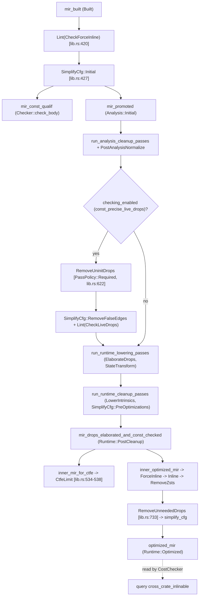

# `rustc` MIR Inlining Eligibility, Const-Eval Termination Counters, and Pre-Const-Check Drop Pruning (`CtfeLimit`, `CheckForceInline`, `CrossCrateInline`, `RemoveUninitDrops`, and `RemoveUnneededDrops`)

## Summary

Five small, load-bearing components in `compiler/rustc_mir_transform/src/` govern three distinct trust boundaries between `rustc`'s MIR pipeline, compile-time evaluation (CTFE), cross-crate codegen/inlining metadata, and downstream MIR verifiers such as `Anneal` (`joshlf/anneal`):

1. **`CtfeLimit` (`ctfe_limit.rs:1-58`) — Dominator Back-Edge Omission on Irreducible CFGs & Live `#![deny(long_running_const_eval)]` Bypass:** `CtfeLimit` runs inside `inner_mir_for_ctfe` (`lib.rs:534-538`) and inserts `StatementKind::ConstEvalCounter` ONLY into basic blocks whose terminator is `Call` or `TailCall`, or whose `has_back_edge(doms, node, node_data)` finds a successor `succ` satisfying `doms.dominates(succ, node)`. Because a dominator back edge exists ONLY for reducible loops (single-entry strongly connected components), any **non-collapsible two-header irreducible cycle** (`bb0` branches to `bb1` or `bb2`; `bb1` executes `_2 = Add(_2, 1); Goto(bb2)`; `bb2` executes `_2 = Add(_2, 3); Goto(bb1)`) has `doms.dominates(bb2, bb1) == false` and `doms.dominates(bb1, bb2) == false`. Even when entered through `#[custom_mir(dialect = "built")]` (running the entire `built -> analysis -> runtime -> CtfeLimit` pipeline) with `#![deny(long_running_const_eval)]` AND `-Ztiny-const-eval-limit` (`limit = 20`), `CtfeLimit` emits **`0` `StatementKind::ConstEvalCounter` statements**, `SimplifyCfg` cannot merge `bb1`/`bb2` (non-empty statement lists prevent `take_terminator_if_simple_goto`, and `pred_count == 2` prevents `merge_successor`), and `rustc` hangs indefinitely until killed externally. By contrast, an empty-body irreducible cycle (`bb1 = { Goto(bb2) }; bb2 = { Goto(bb1) }`) IS collapsed by `SimplifyCfg::Initial`'s `collapse_goto_chain` (`simplify.rs:226-265`) into a self-loop `bb1 -> bb1`, restoring `doms.dominates(bb1, bb1) == true`, emitting `1` `ConstEvalCounter`, and triggering `long_running_const_eval`. Replacing dominator back edges with **DFS retreating edges** (`finish(u) ≤ finish(v)`) strictly subsumes dominator back edges (`dominatorBackEdge_is_dfsRetreatingEdge`) and provably bounds every counter-free execution path on **all** reducible and irreducible finite CFGs by `|V|` (`dfsRetreatingEdge_bounds_counterFree_path_by_numBlocks`).
2. **`CheckForceInline` (`check_inline.rs:1-85`) — Definition-Site Rejection Matrix & Short-Circuit Priority:** Executed as a `MirLint` inside `mir_built` (`lib.rs:420`, BEFORE `SimplifyCfg::Initial`, `mir_const_qualif`, and `mir_drops_elaborated_and_const_checked`), `CheckForceInline` inspects local `fn`/closure bodies carrying `InlineAttr::Force` (`#[rustc_force_inline]`) and short-circuits `is_inline_valid_on_fn(tcx, def_id).and_then(|_| is_inline_valid_on_body(tcx, body))` in exact order: (1) `#[rustc_no_mir_inline]`, (2) `C variadic`, (3) `cold` (`CodegenFnAttrFlags::COLD`), (4) `callee is an intrinsic without fallback body` (`intrinsic.must_be_overridden`), and (5) `can't inline functions with tail calls` (`TerminatorKind::TailCall` / `become`). Both `is_inline_valid_on_fn` and `is_inline_valid_on_body` are reused directly at call sites inside `inline.rs:620, 635`.
3. **`CrossCrateInline` (`cross_crate_inline.rs:1-202`) — Twelve-Stage Priority Lattice, Revision Delta (`1.98` vs. HEAD), & `CostChecker` Intrinsic Exemption:** The `cross_crate_inlinable` query is the master gate for both cross-crate MIR metadata export and non-generic MIR inlining (`inline.rs:832`). Its exact precedence order places `contains_extern_indicator()` (`#[no_mangle]`/`#[export_name]` -> `false`, mirroring Rust Reference `r[attributes.codegen.inline.externally-exported]`) strictly first, followed by `DefKind::{Ctor, Closure, SyntheticCoroutineBody}` (`true`), `InliningThreshold::Always` (`true`), `#[rustc_intrinsic]` (`true`), `hir::Constness::Const { always: true }` (`false`, newly added at HEAD `ce66487eb`), explicit `InlineAttr::{Never, Hint, Always, Force}`, `-Zhint-mostly-unused` (`true`), the `f16`/`f128` signature bypass (`true` — unconditional at `1.98.0-nightly`, gated on `!target_has_reliable_f16` / `!target_has_reliable_f128` at HEAD `ce66487eb`), incremental suppression (`incremental.is_some() -> false`), `OptLevel::No && !inliner_will_run`, `is_mir_available`, and `CostChecker` (`calls == 0 && resumes == 0 && landing_pads == 0 && statements <= threshold`, default `threshold = 100`). Inside `CostChecker`: `StorageLive`/`StorageDead`/`Nop` contribute `0`; every terminator unconditionally adds `statements += 1` (line 147); `#[rustc_intrinsic]` `Call`s (such as 20-byte `raw_eq::<[u32; 5]>` which survives `LowerIntrinsics` as a `Call` terminator in `optimized_mir`) are exempted from `calls` and `landing_pads`; and `Drop` terminators on types with `!ty.is_trivially_pure_clone_copy()` increment `calls += 1` (and `landing_pads += 1` on `UnwindAction::Cleanup`).
4. **`RemoveUninitDrops` (`remove_uninit_drops.rs:1-160`) & `RemoveUnneededDrops` (`remove_unneeded_drops.rs:1-46`) — Pre-Const-Check vs. Post-Inline Drop Pruning:** `RemoveUninitDrops` carries `PassPolicy::Required` and runs inside `run_analysis_to_runtime_passes` (`lib.rs:617-628`) ONLY when `check_consts::post_drop_elaboration::checking_enabled` is true (`#![feature(const_precise_live_drops)]` or `rustc_allow_const_fn_unstable(const_precise_live_drops)`), immediately BEFORE `SimplifyCfg::RemoveFalseEdges`, `Lint(CheckLiveDrops)`, and `ElaborateDrops`. Running before `ElaborateDrops` (rather than after) guarantees optimization-level-independent const-checking (`rust-lang/rust#90770`). It computes `MaybeInitializedPlaces::exclude_inactive_in_otherwise()` over `MoveData` filtered to `ty.needs_drop`, recursively descends through ADT variants (`Downcast`), struct fields, and tuple fields via `is_needs_drop_and_init`, and rewrites provably uninitialized `Drop { target, .. }` terminators to `Goto { target }` WITHOUT invoking `simplify_cfg`. Conversely, `RemoveUnneededDrops` (`PassPolicy::optional(true)` at HEAD; `is_required() -> true` at `1.98`) runs inside `run_optimization_passes` (`lib.rs:733`, immediately after `Inline`, `RemoveStorageMarkers`, and `RemoveZsts`), uses `TypingMode::PostAnalysis` to eliminate `Drop`s whose type satisfies `!ty.needs_drop` (e.g., polymorphic `fn f<T>(x: T)` inlined at `T = u32`), and DOES invoke `simplify_cfg` whenever at least one `Drop` is rewritten.
5. **Constructive Lean v4.34.1 Mechanization & `Anneal` Trusted-Boundary Alignment:** A standalone 1,859-line Lean `v4.34.1` formalization (`support/CheckInlineCtfeLimitAndDropPruningSoundness.lean`) kernel-checks 18 top-level theorems covering all five passes with `0` `sorry`, `0` `Classical.choice`, `0` `omega`, `0` `bv_decide`, `0` `native_decide`, `0` `partial def`, and **`0` `._unsafe_rec` / `isUnsafe` / `isPartial` constants** across all 898 environment declarations (axioms strictly within `[]`, `[propext]`, or `[propext, Quot.sound]`). Cross-checking `joshlf/anneal` (`c131b320eeeb26ef692e5afd5ec8db49ee518613`) confirms that `Trusted.MirAst` maps `ConstEvalCounter`, `Drop`, and `TailCall` to `.unsupported` (`Trusted/MirAst.lean:654-656, 782-784`) while `Trusted.Correspondence.refStepHooksFor` treats `incrementConstEvalCounter` as a silent no-op (`Trusted/Correspondence.lean:2264`), making pass-boundary selection (`mir_drops_elaborated_and_const_checked` vs. `mir_for_ctfe` vs. `optimized_mir`) load-bearing for sound capture.

---

## Applicability

This report characterizes five pinned upstream subjects and their mutual relationships:

| Subject | Repository | Full Immutable Revision | Version / Role in This Report |
| :--- | :--- | :--- | :--- |
| `rust-lang/rust` HEAD source reference | `rust-lang/rust` | `ce66487ebbd7541212d22d01c39a808057d69f1f` | Primary compiler source reference (`2026-11-22`, `Auto merge of #166350`) for all five passes, `lib.rs` pipeline wiring, `pass_manager.rs`, `simplify.rs`, `inline.rs`, `const_eval/machine.rs`, `check_consts/{check,post_drop_elaboration}.rs`, `impls/initialized.rs`, `ty/sty.rs`, and `rustc_session/src/options.rs` |
| `rustc` host execution toolchain | `rust-lang/rust` | `14210df0e27ccd7d9e6a05b8085cbd438e4bbc65` | `rustc 1.98.0-nightly (14210df0e 2026-05-31)`, LLVM `22.1.6`, `x86_64-unknown-linux-gnu`; executed live for every probe in `support/probe_inline_ctfe_limit_and_drop_pruning.py` and diffed line-by-line against `ce66487eb` |
| The Rust Reference | `rust-lang/reference` | `c9cc32825b03fc206d9c6fe73e9ca6a2f3576d6c` | Normative specification (`2026-11-17`) for `#[inline]`, `#[cold]`, constant expressions / `const fn`, and destructor/partial-initialization drop semantics |
| `Anneal` trusted boundary & capture driver | `joshlf/anneal` | `c131b320eeeb26ef692e5afd5ec8db49ee518613` | `trusted/lean/Trusted/{MirAst,MirSemantics}.lean`, `trusted/correspondence/Trusted/Correspondence.lean`, `trusted/audit/TrustedBoundary.lean`, `theory/Anneal/MirWp.lean`, and `trusted/rustc-capture/src/driver.rs` (`2026-11-19`) |
| Lean 4 theorem prover kernel | `leanprover/lean4` | `5045d0056413266e57c625dcd7c365b10e377c52` | `v4.34.1` Release (`x86_64-unknown-linux-gnu`); kernel-checked `support/CheckInlineCtfeLimitAndDropPruningSoundness.lean` |

### Shared Invariants vs. Revision-Specific Differences (`14210df0e` vs. `ce66487eb`)

Direct unified diffs across all five `rustc_mir_transform` source files between `14210df0e27ccd7d9e6a05b8085cbd438e4bbc65` (`1.98.0-nightly`) and `ce66487ebbd7541212d22d01c39a808057d69f1f` (`main` HEAD) establish exact behavioral continuity and four concrete semantic shifts:

| Component | Shared Across `14210df0e` (`1.98.0-nightly`) and `ce66487eb` (`HEAD`) | Specific to `14210df0e` (`1.98.0-nightly`) | Specific to `ce66487eb` (`HEAD`) |
| :--- | :--- | :--- | :--- |
| **`CtfeLimit`** (`ctfe_limit.rs`) | Identical `has_back_edge` dominator check (`doms.is_reachable(node)` + `successors().any(\|succ\| doms.dominates(succ, node))`), identical `Call \| TailCall` match, identical `ConstEvalCounter` append at block end. Both omit counters on non-collapsible irreducible CFGs. | `fn is_required(&self) -> bool { true }` (cannot be disabled via `-Zmir-enable-passes=-CtfeLimit`). 55 lines. | `fn policy(&self, _ctx: &PassCtx<'_>) -> PassPolicy { PassPolicy::optional(true) }` (`ctfe_limit.rs:42-45`): enabled by default at all opt levels, but overridable via `-Zmir-enable-passes=-CtfeLimit` (`pass_manager.rs:272-282`). 58 lines. |
| **`CheckForceInline`** (`check_inline.rs`) | Identical 5-stage short-circuit rejection predicate (`RustcNoMirInline` -> `c_variadic` -> `COLD` -> `must_be_overridden` intrinsic -> `TailCall`), identical diagnostic reason strings, identical placement in `mir_built` before `SimplifyCfg::Initial`. | Uses `rustc_hir::attrs::InlineAttr`, `rustc_hir::find_attr`, and `crate::errors::InvalidForceInline`. 86 lines. | Migrated imports to `rustc_attr_ir::{InlineAttr, find_attr}` and `crate::diagnostics::InvalidForceInline`. 85 lines. |
| **`CrossCrateInline`** (`cross_crate_inline.rs`) | Identical `contains_extern_indicator`, `DefKind` handling, `InliningThreshold::Always` / `Sometimes(100)` / `Never`, `#[rustc_intrinsic]` override, `InlineAttr` handling, `-Zhint-mostly-unused`, `incremental.is_some()` gate, `OptLevel::No && !inliner_will_run`, and identical `CostChecker` counter logic (`StorageLive`/`StorageDead`/`Nop` ignored; `Drop` on `!is_trivially_pure_clone_copy`; `RustcIntrinsic` `Call` exemption). | (1) **No** `hir::Constness::Const { always: true }` check. (2) **`f16`/`f128` signature bypass is unconditional** on all targets (`ty == &tcx.types.f16 \|\| ty == &tcx.types.f128`, lines 61-69). 189 lines. | (1) **Adds comptime gate** (`lines 46-50`): `hir::Constness::Const { always: true } => return false`. (2) **Target-gates `f16`/`f128` bypass** (`lines 67-81`): only returns `true` when `!target_has_reliable_f16` (for `f16`) or `!target_has_reliable_f128` (for `f128`). 202 lines. |
| **`RemoveUninitDrops`** (`remove_uninit_drops.rs`) | Identical `MoveData::gather_moves(..., \|ty\| ty.needs_drop(...))`, `MaybeInitializedPlaces::exclude_inactive_in_otherwise()`, `is_needs_drop_and_init` recursive ADT/enum/tuple traversal, `Drop -> Goto` rewrite without `simplify_cfg`, and gating on `post_drop_elaboration::checking_enabled` (`const_precise_live_drops`). | `fn is_required(&self) -> bool { true }`; `TerminatorKind::Goto { target: *target }`; `GenericArgsRef<'tcx>`. 157 lines. | `fn policy(...) -> PassPolicy { PassPolicy::Required }`; `TerminatorKind::goto(*target)`; `GenericArgs<'tcx>` with `*args` derefs. 160 lines. |
| **`RemoveUnneededDrops`** (`remove_unneeded_drops.rs`) | Identical `TypingMode::PostAnalysis` `!ty.needs_drop` check, `Drop -> Goto` rewrite, and conditional `if should_simplify { simplify_cfg(tcx, body); }`, placed in `run_optimization_passes` immediately after `RemoveZsts`. | `fn is_required(&self) -> bool { true }`. 45 lines. | `fn policy(...) -> PassPolicy { PassPolicy::optional(true) }`: enabled by default even at `-Zmir-opt-level=0`, but overridable via `-Zmir-enable-passes=-RemoveUnneededDrops`. 46 lines. |

### Invocation & Scope Conditions

- All live `rustc` executions ran on `x86_64-unknown-linux-gnu` (`rustc 1.98.0-nightly`, `14210df0e27ccd7d9e6a05b8085cbd438e4bbc65`, default unwinding `panic = "unwind"`).
- `CtfeLimit`, `CheckForceInline`, `RemoveUninitDrops`, and `RemoveUnneededDrops` operate on target-independent MIR CFGs and type/dataflow structures, so their algorithmic properties generalize across all `rustc` targets.
- `CrossCrateInline`'s `f16`/`f128` bypass is target-dependent at HEAD (`ce66487eb`): its behavior depends on whether the target specification populates `cfg(target_has_reliable_f16)` / `cfg(target_has_reliable_f128)` in `tcx.sess.config`.
- Surface Rust syntax (`loop`, `while`, `for`, `break 'label`, `continue 'label`) lowers to reducible MIR CFGs; reaching the `CtfeLimit` irreducible-CFG bypass requires either `#[custom_mir]` or an upstream/internal MIR transform or language lowering that constructs a multi-entry strongly connected component before `mir_for_ctfe`.

---

## Findings

### 1. Pipeline Placement and Pass-Policy Taxonomy Across `rustc_mir_transform`

Basis: source + derived

The five passes occupy four completely distinct phases of the `rustc` MIR query graph (`compiler/rustc_mir_transform/src/lib.rs`, line numbers for `ce66487eb` with `14210df0e` in parentheses):

| Pass / Query | Enclosing Query / Function | Pipeline Line (`HEAD` / `1.98`) | MIR Phase at Entry | `PassPolicy` (`HEAD` / `1.98`) | Invokes `simplify_cfg`? |
| :--- | :--- | :--- | :--- | :--- | :--- |
| **`CheckForceInline`** | `mir_built` | `lib.rs:420` / `:406` | `MirPhase::Built` (before `SimplifyCfg::Initial`) | `MirLint` (runs unconditionally unless `body.should_skip()`) | No |
| **`RemoveUninitDrops`** | `mir_drops_elaborated_and_const_checked` -> `run_analysis_to_runtime_passes` | `lib.rs:622` / `:586` | `MirPhase::Analysis(PostCleanup)` (after `PostAnalysisNormalize`, gated by `const_precise_live_drops`, **before** `CheckLiveDrops` & `ElaborateDrops`) | `PassPolicy::Required` / `is_required() -> true` | No (immediately followed in pass list by `SimplifyCfg::RemoveFalseEdges`, `lib.rs:623`) |
| **`CtfeLimit`** | `mir_for_ctfe` -> `inner_mir_for_ctfe` | `lib.rs:534, 536` / `:508` | `MirPhase::Runtime(PostCleanup)` (cloned/stolen from `mir_drops_elaborated_and_const_checked`, after `remap_mir_for_const_eval_select`) | `PassPolicy::optional(true)` / `is_required() -> true` | No (mutates via `as_mut_preserves_cfg()`) |
| **`RemoveUnneededDrops`** | `optimized_mir` -> `inner_optimized_mir` -> `run_optimization_passes` | `lib.rs:733` / `:717` | `MirPhase::Runtime(PostCleanup)` -> `Runtime(Optimized)` (after `ForceInline`, `Inline`, `RemoveStorageMarkers`, `RemoveZsts`) | `PassPolicy::optional(true)` / `is_required() -> true` | **Yes** (`if should_simplify { simplify_cfg(tcx, body); }`, `remove_unneeded_drops.rs:38-40`) |
| **`cross_crate_inlinable`** | Query provider `providers.cross_crate_inlinable` | `lib.rs:220` / `:215` | On-demand query; reads `tcx.optimized_mir(def_id)` when reaching `CostChecker` (`cross_crate_inline.rs:109`) | Query (not a `MirPass`) | No (read-only `Visitor`) |



A subtle policy nuance introduced between `14210df0e` and `ce66487eb` appears in `compiler/rustc_mir_transform/src/pass_manager.rs:88-107, 256-285`:
- `PassPolicy::Required` (`RemoveUninitDrops`, `ForceInline`) unconditionally returns `true` from `should_run_pass` and **cannot** be suppressed by `-Zmir-opt-level=0` or `-Zmir-enable-passes=-<Name>`.
- `PassPolicy::optional(true)` (`CtfeLimit`, `RemoveUnneededDrops` at HEAD) returns `true` by default even at `-Zmir-opt-level=0`, **unless** explicitly negated by `-Zmir-enable-passes=-CtfeLimit` or `-Zmir-enable-passes=-RemoveUnneededDrops` (`pass_manager.rs:272-282`). Notably, `PassPolicy::Required`'s doc comment (`pass_manager.rs:89-92`) restricts `Required` to passes that implement MIR semantics or mandatory lowering invariants and must not remove UB (as they run in Miri), which is why `RemoveUninitDrops` stays `PassPolicy::Required` ("Const checking relies on uninitialized drops being removed before drop elaboration") while `CtfeLimit` ("part of CTFE diagnostics rather than an optimization") and `RemoveUnneededDrops` were reclassified to `PassPolicy::optional(true)`.

---

### 2. `CtfeLimit`: Dominator Back-Edge Omission on Irreducible CFGs vs. `SimplifyCfg` Collapse and DFS Retreating-Edge Completeness

Basis: source + execution + derived

#### 2.1 Upstream Mechanism and Exact Termination-Lint Plumbing

In `compiler/rustc_mir_transform/src/ctfe_limit.rs:17-58` (HEAD `ce66487eb`; identical logic at `14210df0e` lines 15-55):

```rust
fn run_pass(&self, _tcx: TyCtxt<'tcx>, body: &mut Body<'tcx>) {
    let doms = body.basic_blocks.dominators();
    let indices: Vec<BasicBlock> = body
        .basic_blocks
        .iter_enumerated()
        .filter_map(|(node, node_data)| {
            if matches!(node_data.terminator().kind, TerminatorKind::Call { .. } | TerminatorKind::TailCall { .. })
                // Back edges in a CFG indicate loops
                || has_back_edge(doms, node, node_data)
            {
                Some(node)
            } else {
                None
            }
        })
        .collect();

    let basic_blocks = body.basic_blocks.as_mut_preserves_cfg();
    for index in indices {
        let bbdata = &mut basic_blocks[index];
        let source_info = bbdata.terminator().source_info;
        bbdata.statements.push(Statement::new(source_info, StatementKind::ConstEvalCounter));
    }
}

fn has_back_edge(
    doms: &Dominators<BasicBlock>,
    node: BasicBlock,
    node_data: &BasicBlockData<'_>,
) -> bool {
    if !doms.is_reachable(node) {
        return false;
    }
    // Check if any of the dominators of the node are also the node's successor.
    node_data.terminator().successors().any(|succ| doms.dominates(succ, node))
}
```

During CTFE interpretation, `compiler/rustc_const_eval/src/interpret/step.rs:141-143` dispatches ONLY `StatementKind::ConstEvalCounter` to `M::increment_const_eval_counter(self)?`. Inside `compiler/rustc_const_eval/src/const_eval/machine.rs:35-41, 582-637`:
- `LINT_TERMINATOR_LIMIT = 2_000_000` (default) and `TINY_LINT_TERMINATOR_LIMIT = 20` (with `-Ztiny-const-eval-limit`).
- `PROGRESS_INDICATOR_START = 4_000_000` (power-of-two progress warnings if `long_running_const_eval` is allowed/warned).
- When `ecx.machine.num_evaluated_steps` hits `limit`, `rustc` emits the `LONG_RUNNING_CONST_EVAL` lint; if the lint level is an error (default `deny` or explicit `#![deny(long_running_const_eval)]`), evaluation aborts via `throw_inval!(AlreadyReported(...))`.
- **Crucial consequence:** Because `increment_const_eval_counter` is invoked **exclusively** by executing `StatementKind::ConstEvalCounter` statements (and NOT per basic block or per terminator in the interpreter loop), any reachable cycle containing zero `Call`/`TailCall` terminators and zero `ConstEvalCounter` statements executes with `num_evaluated_steps` frozen at `0` forever.

#### 2.2 Graph-Theoretic Root Cause: Dominator Back Edges Only Cover Reducible Cycles

A directed CFG edge `(u, v)` is a **dominator back edge** iff `v` dominates `u` (`v` appears on *every* path from entry `bb0` to `u`). By Tarjan's and Hecht-Ullman's classical reducibility characterization, a strongly connected component (SCC) contains a dominator back edge **only if** it has a unique entry vertex (loop header) that dominates all vertices in the SCC. In a **two-header irreducible cycle**:

- `bb0` has edges `bb0 -> bb1` and `bb0 -> bb2`.
- `bb1` has edge `bb1 -> bb2`.
- `bb2` has edge `bb2 -> bb1`.

Here `bb0` dominates `{bb0, bb1, bb2}`, `bb1` dominates only `{bb1}` (path `[bb0, bb2]` bypasses `bb1`), and `bb2` dominates only `{bb2}` (path `[bb0, bb1]` bypasses `bb2`). Thus:
- For `bb0`: successors `bb1, bb2` do not dominate `bb0`.
- For `bb1`: successor `bb2` does not dominate `bb1`.
- For `bb2`: successor `bb1` does not dominate `bb2`.
- `has_back_edge` returns `false` for **every** basic block.

#### 2.3 Why Trivial Empty-Body Irreducible Cycles Collapse in `SimplifyCfg`, While Non-Empty Cycles Survive `dialect = "built"`

In `compiler/rustc_mir_transform/src/simplify.rs:226-303`, `SimplifyCfg` (which runs four times before `mir_for_ctfe`: `SimplifyCfg::Initial` at `lib.rs:427`, `PromoteConsts` at `:484`, `PostAnalysis` at `:647`, and `PreOptimizations` at `:688`) can eliminate a two-block cycle ONLY via two transforms:
1. **`collapse_goto_chain` (`simplify.rs:226-265`)**: Calls `take_terminator_if_simple_goto(bb)`, which returns `Some(...)` **if and only if** `statements.is_empty()` AND `terminator.kind` is `TerminatorKind::Goto`. On `bb1 = { Goto(bb2) }; bb2 = { Goto(bb1) }`, both blocks have empty `statements`: `collapse_goto_chain` steals `bb1` and `bb2`, detects the cycle when hitting `bb1`'s dummy terminator, sets `last = bb1`, rewrites `bb1`'s target to `bb1` (a self-loop!), and redirects `bb0`'s arms to `bb1`. Once `bb1 -> bb1` exists, `doms.dominates(bb1, bb1)` is trivially `true`, restoring `CtfeLimit`!
2. **`merge_successor` (`simplify.rs:293-303`)**: Merges a `Goto { target }` successor into its predecessor **if and only if** `self.pred_count[target] == 1`. On the non-collapsible cycle (`bb1: _2 = Add(_2, 1); Goto(bb2)` and `bb2: _2 = Add(_2, 3); Goto(bb1)`), BOTH blocks have non-empty statement lists (blocking `take_terminator_if_simple_goto`) AND BOTH blocks have `pred_count == 2` (`bb1` from `{bb0, bb2}`, `bb2` from `{bb0, bb1}`, blocking `merge_successor`).

#### 2.4 Live `rustc` Differential Execution (`dialect = "built"`, `#![deny(long_running_const_eval)]`, `-Ztiny-const-eval-limit`)

Executing `support/probe_inline_ctfe_limit_and_drop_pruning.py` on `rustc 1.98.0-nightly (14210df0e 2026-05-31)` across five `#[custom_mir(dialect = "built")]` cases confirms every prediction:

| Probe Case (`dialect = "built"`) | Flags | `ConstEvalCounter` Count After `CtfeLimit` | Timed Out? | Exit Code | Observed Outcome |
| :--- | :--- | ---: | :--- | ---: | :--- |
| `reducible_bounded_built` (10 iters, `bb1 -> bb1`) | default (`deny`) | **`1`** | `False` | `0` | `ConstEvalCounter` inserted in `bb1`; evaluates cleanly |
| `reducible_infinite_caught` (`bb1 -> bb1`) | `-Ztiny-const-eval-limit` | **`1`** | `False` | `1` | Caught immediately: `error: constant evaluation is taking a long time` |
| `irreducible_bounded_built` (50 iters = 100 steps, `bb1 <-> bb2`) | `-Ztiny-const-eval-limit` (`limit = 20`) | **`0`** | `False` | `0` | **0 counters emitted**; 50 iterations bypass `limit = 20` silently and compile cleanly! |
| `irreducible_collapsible_built_caught` (empty `bb1 <-> bb2`) | `-Ztiny-const-eval-limit` | **`1`** | `False` | `1` | `SimplifyCfg-initial` collapses `bb1`/`bb2` to `bb1 -> bb1`; `CtfeLimit` inserts `1` counter; lint fires! |
| `irreducible_noncollapsible_built_hang` (`+1` / `+3` in `bb1 <-> bb2`) | `-Ztiny-const-eval-limit`, `timeout = 2.5s` | **`0`** | **`True`** | `None` (killed) | **0 counters emitted**; `rustc` hangs indefinitely despite `#![deny(long_running_const_eval)]` and `limit = 20`! |

Verbatim MIR dumps from the live execution confirm the exact `SimplifyCfg-initial` collapse vs. survival contrast:

```text
// 1. Collapsible empty cycle BEFORE SimplifyCfg-initial:
bb0: { switchInt(copy _1) -> [1: bb1, otherwise: bb2]; }
bb1: { goto -> bb2; }
bb2: { goto -> bb1; }

// 2. Collapsible empty cycle AFTER SimplifyCfg-initial (merged into self-loop):
bb0: { switchInt(copy _1) -> [1: bb1, otherwise: bb1]; }
bb1: { goto -> bb1; }

// 3. Collapsible empty cycle AFTER CtfeLimit (counter restored -> lint fires):
bb0: { goto -> bb1; }
bb1: { ConstEvalCounter; goto -> bb1; }

// 4. Non-collapsible cycle AFTER CtfeLimit (0 ConstEvalCounter -> hangs rustc!):
fn noncollapsible_inf_irr(_1: bool) -> u32 {
    let mut _0: u32;
    let mut _2: u32;
    bb0: { _2 = const 0_u32; switchInt(copy _1) -> [1: bb1, otherwise: bb2]; }
    bb1: { _2 = Add(copy _2, const 1_u32); goto -> bb2; }
    bb2: { _2 = Add(copy _2, const 3_u32); goto -> bb1; }
}
```

Note also `irreducible_bounded_built`: even without triggering a hang, setting `-Ztiny-const-eval-limit` (`limit = 20`) while executing 50 full iterations (100 block transitions) succeeds with `rc = 0`, providing an instant non-hanging discriminator proving `num_evaluated_steps == 0` throughout the loop!

#### 2.5 Mechanized Counterexample & DFS Retreating-Edge Feedback-Set Fix (Lean v4.34.1)

In `support/CheckInlineCtfeLimitAndDropPruningSoundness.lean` (Part I, lines 113–655):
- **`ctfeLimit_dominator_irreducible_counterexample`** (axioms: `[propext, Quot.sound]`): Over the constructive `MirCfg` `irreducibleTwoHeaderCfg` (`numBlocks = 3`), proves (1) all three blocks `0, 1, 2` are reachable from `0`, (2) `∀ u, ¬ CtfeLimitMarks irreducibleTwoHeaderCfg u` (exact witness paths `[0, 1]` and `[0, 2]` refute `Dominates 2 1` and `Dominates 1 2`), and (3) for every `k : Nat`, there exists a valid execution path from `0` of length `k + 2` visiting zero marked blocks.
- **`collapsedSelfLoop_caught_by_ctfeLimit`** (axioms: `[propext, Quot.sound]`): Proves that on `collapsedSelfLoopCfg` (`0 -> [1], 1 -> [1]`), `CtfeLimitMarks collapsedSelfLoopCfg 1` holds via `dominates_refl`.
- **`dfsRetreatingEdge_bounds_counterFree_path_by_numBlocks`** (axioms: **none** `[]`!): Defines `ValidDfsNumbering cfg` via the DFS Parenthesis Theorem edge dichotomy (`∀ u v, CfgEdge cfg u v → (disc v ≤ disc u ∧ finish u ≤ finish v) ∨ finish v < finish u`) with `finish u < cfg.numBlocks`. Instrumenting every block with a DFS retreating outgoing edge (`IsDfsRetreatingEdge`: `finish u ≤ finish v`) guarantees that along any counter-free path `p` from `u` to `v`, `finish` strictly decreases at each step, yielding `p.length ≤ dfs.finish u + 1 ≤ cfg.numBlocks` (`|V|`) for **every** finite CFG (reducible or irreducible)!
- **`dfsRetreatingEdge_hits_every_cycle`** (axioms: **none** `[]`): Proves no cycle in any CFG can be counter-free under DFS retreating-edge instrumentation.
- **`dominatorBackEdge_is_dfsRetreatingEdge`** (axioms: **none** `[]`): Proves every dominator back edge on a reachable vertex is automatically a DFS retreating edge (using the DFS tree path from `0` to `u`), establishing strict subsumption.
- **`irr_dfs_strict_separation`** (axioms: `[propext, Quot.sound]`): Exhibits an explicit `ValidDfsNumbering` (`irrValidDfs`: `disc = [0,1,2]`, `finish = [2,1,0]`) on `irreducibleTwoHeaderCfg` where `DfsRetreatingMarks` marks `bb2` (catching edge `(2, 1)` since `finish 2 = 0 ≤ 1 = finish 1`) and bounds all counter-free paths to `≤ 3`, whereas `CtfeLimitMarks` marks nothing.

In practice, `rustc` already computes post-order / reverse-post-order traversals (`rustc_data_structures::graph::iterate::post_order_from`); replacing `has_back_edge` in `ctfe_limit.rs` with a single `O(|V| + |E|)` DFS retreating-edge check (`rpo_or_finish[u] ≤ rpo_or_finish[succ]` in post-order, or tracking grey stack membership during DFS) eliminates the bypass completely with *lower* asymptotic cost than computing full Cooper-Harvey-Kennedy dominators!

---

### 3. `CheckForceInline`: Definition-Site Rejection Matrix and Short-Circuit Order

Basis: normative + source + execution + derived

#### 3.1 Normative vs. Internal Scope

In `rust-lang/reference@c9cc32825b03fc206d9c6fe73e9ca6a2f3576d6c` (`src/attributes/codegen.md:65-74`), the user-facing `#[inline]`, `#[inline(always)]`, and `#[inline(never)]` attributes are strictly hints ("In every form the attribute is a hint. The compiler may ignore it"). By contrast, the internal `#[rustc_force_inline]` attribute (`InlineAttr::Force`) establishes a hard semantic guarantee enforced by two paired compiler components:
1. Definition-site validation by `CheckForceInline` (`compiler/rustc_mir_transform/src/check_inline.rs:13-85`), run as a `MirLint` inside `mir_built` (`lib.rs:420`) BEFORE `SimplifyCfg::Initial`.
2. Call-site mandatory splicing by `ForceInline` (`PassPolicy::Required`, `inline.rs:75-97`), which re-invokes `check_inline::is_inline_valid_on_fn` (`inline.rs:620`) and `check_inline::is_inline_valid_on_body` (`inline.rs:635`) and emits `ForceInlineFailure` (`inline.rs:249-259`) on call-site failures.

#### 3.2 Exact Guard Matrix and Short-Circuit Precedence

`CheckForceInline::run_lint` (`check_inline.rs:16-35`) silently returns if `!tcx.hir_body_owner_kind(def_id).is_fn_or_closure() || !def_id.is_local()`, or if `tcx.codegen_fn_attrs(def_id).inline` is not `InlineAttr::Force { attr_span, .. }`. Otherwise it evaluates:

```rust
is_inline_valid_on_fn(tcx, def_id).and_then(|_| is_inline_valid_on_body(tcx, body))
```

This enforces a strict five-level short-circuit order (identical in `14210df0e` and `ce66487eb`):

| Priority | Guard Location | Exact Rust Predicate | Emitted Diagnostic Reason (`note: incompatible due to: ...`) | Live `rustc 1.98` Verification |
| ---: | :--- | :--- | :--- | :--- |
| **1** | `check_inline.rs:44-46` | `find_attr!(tcx, def_id, RustcNoMirInline)` | `#[rustc_no_mir_inline]` | `rc = 1`, exact match (`no_mir_inline_err`); preempts `#[cold]` (`priority_no_mir_before_cold`) |
| **2** | `check_inline.rs:48-55` | `FnDef` or `Closure` signature `.c_variadic()` | `C variadic` | `rc = 1`, exact match (`c_variadic_err`) |
| **3** | `check_inline.rs:57-59` | `codegen_attrs.flags.contains(CodegenFnAttrFlags::COLD)` | `cold` | `rc = 1`, exact match (`cold_err`); preempts `TailCall` (`priority_cold_before_tailcall`) |
| **4** | `check_inline.rs:63-67` | `tcx.intrinsic(def_id)` with `intrinsic.must_be_overridden` | `callee is an intrinsic without fallback body` | `rc = 1`, exact match (`intrinsic_without_body_err`) |
| **5** | `check_inline.rs:76-82` | `body.basic_blocks.iter().any(\|bb\| matches!(bb.terminator().kind, TerminatorKind::TailCall { .. }))` | `can't inline functions with tail calls` | `rc = 1`, exact match (`tailcall_err` via `become`) |
| — | Pass | All 5 predicates false | Accepted (`Ok(())`) | `rc = 0` (`plain_ok`) |

Two subtle details emerge from direct inspection:
- **Why `CheckForceInline` runs in `mir_built` before `SimplifyCfg::Initial`:** Running before CFG simplification guarantees that even a `TerminatorKind::TailCall` inside an unreachable branch of a `#[rustc_force_inline]` body is still visible in `body.basic_blocks` and rejected deterministically independent of dead-code elimination.
- **Intrinsics WITH fallback bodies vs. without:** `check_inline.rs:61-67` rejects ONLY intrinsics where `intrinsic.must_be_overridden == true` (bodyless intrinsics such as `unreachable() -> !`). Intrinsics *with* a fallback body pass `CheckForceInline`; whether they are inlined at MIR level is decided later inside `inline.rs` (see `cross_crate_inline.rs:38-44` comment explaining that MIR inlining avoids blindly inlining fallback bodies when a backend implements a better intrinsic lowering).

In `support/CheckInlineCtfeLimitAndDropPruningSoundness.lean` (Part II, lines 661–755), **`checkForceInline_ok_iff`** and **`checkForceInline_short_circuit_priority`** (axioms: `[propext]`) mechanically certify the exact acceptance biconditional and total short-circuit priority order across all five disqualifiers.

---

### 4. `CrossCrateInline`: Twelve-Stage Priority Lattice, Version Evolution, and `CostChecker` Soundness

Basis: normative + source + execution + derived

#### 4.1 Complete 12-Stage Decision Lattice (`cross_crate_inline.rs:18-117`)

The `cross_crate_inlinable(tcx, def_id)` query controls two distinct mechanisms in `rustc`:
1. Whether the crate metadata encoder exports MIR for a non-generic local function so downstream crates can inline it across crate boundaries.
2. Whether `NormalInliner` inside `inline.rs:371-375, 831-834` both grants the boosted hint threshold (`inline_mir_hint_threshold = 100` vs. `inline_mir_threshold = 50`) and permits MIR inlining of non-generic callees at all (`if !is_generic && !tcx.cross_crate_inlinable(callsite.callee.def_id()) { return Err("not exported"); }`).

Evaluating `cross_crate_inlinable` at HEAD `ce66487eb` (`cross_crate_inline.rs:18-117`) traverses twelve strict short-circuit stages:

| Stage | Line (`HEAD` / `1.98`) | Condition | Return Value | Design Rationale & Interactions |
| ---: | :--- | :--- | :--- | :--- |
| **1** | `22-24` / `20-22` | `codegen_fn_attrs.contains_extern_indicator()` (`#[no_mangle]`, `#[export_name]`, etc.) | **`false`** | Globally shared symbol; will not emit CGU-internal copies. Enforces `r[attributes.codegen.inline.externally-exported]`. Strictly dominates `threshold = always`, `#[inline(always)]`, and `hint_mostly_unused`. |
| **2** | `27-31` / `25-29` | `DefKind::Ctor(..) \| Closure \| SyntheticCoroutineBody` -> `true`; `Fn \| AssocFn` -> continue; all other `DefKind`s -> `false` | **`true` / `false` / continue** | Mirrors `Instance::requires_inline`. |
| **3** | `34-36` / `32-34` | `cross_crate_inline_threshold == InliningThreshold::Always` | **`true`** | Overrides `#[inline(never)]` inside `cross_crate_inlinable` itself! (Note: downstream `inline.rs` STILL blocks `#[inline(never)]` during MIR inlining — see §4.3!) |
| **4** | `38-44` / `36-42` | `find_attr!(tcx, def_id, RustcIntrinsic { .. })` | **`true`** | Intrinsic fallback bodies are always cross-crate inlinable so codegen backends without dedicated lowering can use them. |
| **5** | `46-50` / *(absent)* | `hir::Constness::Const { always: true }` (**HEAD only**) | **`false`** | Comptime-only functions exist strictly during CTFE and never reach codegen; CTFE MIR never inlines. |
| **6** | `54-58` / `45-49` | `InlineAttr::Never => false`; `Hint \| Always \| Force { .. } => true`; otherwise continue | **`false` / `true` / continue** | Explicit source annotations beat `hint_mostly_unused`, `f16`/`f128` bypass, and `CostChecker`. Specifically ensures `#[inline(never)]` forces symbol codegen in the defining crate. |
| **7** | `63-65` / `54-56` | `tcx.sess.opts.unstable_opts.hint_mostly_unused` | **`true`** | Defers codegen until referenced to skip compiling unused functions, while still yielding to `#[inline(never)]` at Stage 6. |
| **8** | `67-81` / `58-66` | Signature input or output type is `f16` or `f128` (**HEAD:** gated on `!target_has_reliable_f16` / `!target_has_reliable_f128`; **1.98:** unconditional) | **`true`** | Workaround (`FIXME(f16,f128)`) to avoid backend crashes building `core` by skipping codegen of unused `f16`/`f128` functions. **Crucially sits ABOVE Stage 9 (`incremental`) and Stage 12 (`InliningThreshold::Never`)!** |
| **9** | `85-87` / `70-72` | `tcx.sess.opts.incremental.is_some()` | **`false`** | Suppresses all cost-based inference under incremental compilation to avoid CGU invalidation amplification on small edits. |
| **10** | `92-97` / `77-82` | `matches!(optimize, OptLevel::No) && !inliner_will_run` | **`false`** | Skips inference at `-Copt-level=0` unless MIR inlining (`Inline` or `ForceInline`) is explicitly enabled (e.g., `-Zinline-mir`). |
| **11** | `99-101` / `84-86` | `!tcx.is_mir_available(def_id)` | **`false`** | Cannot run `CostChecker` without MIR. |
| **12** | `103-117` / `88-102` | `threshold`: `Always -> true`, `Never -> false`, `Sometimes(t) -> CostChecker(optimized_mir)` | **`calls == 0 && resumes == 0 && landing_pads == 0 && statements <= t`** | Default `t = 100` (`rustc_session/src/options.rs:2543` at HEAD; `:2253` at 1.98). Note `Always` at line 104 is unreachable dead code because Stage 3 already returned `true`! |

#### 4.2 Exact `CostChecker` Accounting Rules (`cross_crate_inline.rs:128-202`)

`CostChecker` walks `tcx.optimized_mir(def_id)` accumulating four `usize` counters (`calls`, `statements`, `landing_pads`, `resumes`):

| MIR Construct | `statements` Delta | `calls` Delta | `landing_pads` Delta | `resumes` Delta | Source Lines (`HEAD`) |
| :--- | ---: | ---: | ---: | ---: | :--- |
| `StatementKind::StorageLive(_)` / `StorageDead(_)` / `Nop` | `+0` | `+0` | `+0` | `+0` | `140-141` |
| Every other `StatementKind` (`Assign`, `SetDiscriminant`, `Deinit`, `Retag`, `Intrinsic`, `ConstEvalCounter`, `Coverage`, etc.) | `+1` | `+0` | `+0` | `+0` | `142` |
| `TerminatorKind::Call` where `func.const_fn_def()` has `#[rustc_intrinsic]` | **`+1`** | **`+0`** | **`+0`** *(even if `Cleanup`!)* | `+0` | `147, 165-169` |
| `TerminatorKind::Call` (all other callees, direct or indirect) | `+1` | `+1` | `+1` iff `UnwindAction::Cleanup(_)` | `+0` | `147, 170-173` |
| `TerminatorKind::Drop` where `ty.is_trivially_pure_clone_copy()` is `true` | `+1` | `+0` | `+0` | `+0` | `147, 150-152` |
| `TerminatorKind::Drop` where `ty.is_trivially_pure_clone_copy()` is `false` | `+1` | **`+1`** | `+1` iff `UnwindAction::Cleanup(_)` | `+0` | `147, 152-157` |
| `TerminatorKind::TailCall` | `+1` | **`+1`** | `+0` | `+0` | `147, 175-177` |
| `TerminatorKind::Assert` / `InlineAsm` | `+1` | `+0` | `+1` iff `UnwindAction::Cleanup(_)` | `+0` | `147, 178-188` |
| `TerminatorKind::UnwindResume` | `+1` | `+0` | `+0` | **`+1`** | `147, 183` |
| `Return` / `Goto` / `SwitchInt` / `Unreachable` / `UnwindTerminate` | `+1` | `+0` | `+0` | `+0` | `147, 189-193` |
| `FalseUnwind` / `FalseEdge` / `Yield` / `CoroutineDrop` | ICE (`bug!`) | — | — | — | `194-199` |

Three non-obvious implementation nuances stand out from line-by-line inspection:
1. **`is_trivially_pure_clone_copy` (`compiler/rustc_middle/src/ty/sty.rs:2022-2070`) is strictly narrower than `!needs_drop`:** It returns `true` ONLY for primitives (`Bool`, `Char`, `Int`, `Uint`, `Float`, `Never`), `FnDef`, `FnPtr`, `&T` (shared refs), raw pointers, arrays/tuples of trivially pure types — and conservatively returns **`false`** for ALL `ty::Adt(..)` (even `#[derive(Copy, Clone)] struct S(u32)`!), closures, aliases, and type parameters! Consequently, any surviving `Drop` of an ADT (if not already eliminated by `ElaborateDrops`/`RemoveUnneededDrops`) increments `calls += 1`.
2. **Intrinsic `Call` exemption returns early AFTER `self.statements += 1` (line 147) and BEFORE checking `unwind` (lines 168–173):** An intrinsic call counts as `1` statement, `0` calls, and `0` landing pads regardless of its `UnwindAction`.
3. **Why `[u32; 5]` (20 bytes) is required to empirically test the `raw_eq` intrinsic exemption:** For power-of-two scalar-sized arrays like `[u32; 4]` (16 bytes), `LowerIntrinsics`/`InstSimplify` lowers `core::intrinsics::raw_eq` into `Transmute` to `u128` + `Eq` BEFORE `CostChecker` inspects `optimized_mir`. Passing `[u32; 5]` (20 bytes) preserves `_0 = raw_eq::<[u32; 5]>(move _1, move _2) -> [return: bb1, unwind unreachable];` verbatim in `dep`'s `optimized_mir`, directly exercising `cross_crate_inline.rs:165-169`!

#### 4.3 Live 2-Crate Differential Verification Matrix (`rustc 1.98.0-nightly`)

Building `dep` (`-Copt-level=2`) under six distinct flag configurations and compiling `consumer` (`-Copt-level=2 -Zinline-mir=yes -Zdump-mir=Inline`) produces an exact 48-cell empirical verification matrix (`support/probe_inline_ctfe_limit_and_drop_pruning_results.json`):

| `dep` Function | `default (100)` | `threshold=5` | `threshold=always` | `threshold=never` | `-Zhint-mostly-unused` | `-Cincremental` | Governing Stage / Mechanism |
| :--- | :---: | :---: | :---: | :---: | :---: | :---: | :--- |
| `small_leaf` (2 stmts) | **Inlined** | **Inlined** | **Inlined** | No | **Inlined** | No | Stage 12 (`CostChecker`: `calls=0, stmts ≤ 5`) |
| `medium_leaf` (~16 stmts) | **Inlined** | **No** | **Inlined** | No | **Inlined** | No | Stage 12 threshold boundary (`5 < stmts ≤ 100`) |
| `inline_never_leaf` (`#[inline(never)]`) | No | No | **No*** | No | No | No | Stage 6 (`InlineAttr::Never`); *even when `threshold=always` makes Stage 3 return `true`, consumer `inline.rs` still honors `#[inline(never)]`! |
| `no_mangle_leaf` (`#[unsafe(no_mangle)]`) | No | No | **No** | No | **No** | No | Stage 1 (`contains_extern_indicator()` beats everything) |
| `non_leaf_caller` (`opaque_sink(x)`) | No | No | **Inlined** | No | **Inlined** | No | Stage 12 (`CostChecker.calls == 1` blocks inference; bypassed by Stage 3 & Stage 7) |
| `raw_eq_intrinsic_caller` (`raw_eq::<[u32; 5]>`) | **Inlined** | **Inlined** | **Inlined** | No | **Inlined** | No | Verified `TerminatorKind::Call` retained in `dep` `optimized_mir` (`retains_raw_eq_call_terminator == true`), yet Stage 12 exempts `#[rustc_intrinsic]` (`calls == 0`)! |
| `drop_caller` (`NeedsDrop`) | No | No | **Inlined** | No | **Inlined** | No | Stage 12 (`!is_trivially_pure_clone_copy()` -> `calls >= 1`; bypassed by Stage 3 & Stage 7) |
| `f16_sig_bypass` (`fn(f16) -> f16` calling `opaque_sink`) | **Inlined** | **Inlined** | **Inlined** | **Inlined!!** | **Inlined** | **Inlined!!** | Stage 8 (`f16` bypass short-circuits BEFORE Stage 9 `incremental` AND Stage 12 `threshold=never` and `CostChecker.calls == 1`!) |

#### 4.4 Mechanized `CrossCrateInline` & `CostChecker` Soundness (Lean v4.34.1)

In `support/CheckInlineCtfeLimitAndDropPruningSoundness.lean` (Part II, lines 756–1235):
- **`checkBodyCost_append`** & **`checkBodyCost_mono_append`**: Prove exact four-counter additivity across block concatenation (`checkBodyCost (b1 ++ b2) = CostState.add (checkBodyCost b1) (checkBodyCost b2)`) and component-wise monotonicity.
- **`checkBodyCost_stripIgnored`**: Proves stripping all `StorageLive`, `StorageDead`, and `Nop` statements leaves all four `CostChecker` counters invariant.
- **`costChecker_intrinsic_and_drop_separation`**: Proves that a `#[rustc_intrinsic]` `Call` contributes `calls = 0` and `landingPads = 0` (even with `hasCleanup = true`) while preserving identical `statements` count to an ordinary `Call`; an ordinary `Call` contributes `calls = 1`; and a `Drop` contributes `calls = 0` iff `isTriviallyPureCloneCopy = true` else `calls = 1`.
- **`crossCrateInline_priority_and_cost_soundness`** (axioms: `[propext, Quot.sound]`): Proves (1) `hasExternIndicator = true` forces `false` universally, (2) `InlineAttr::Never` beats `hintMostlyUnused` and `f16`/`f128` bypass, (3) `f16` bypass (when `!targetHasReliableF16`) beats `incremental = true` and `InliningThreshold::Never`, (4) monotonicity in `InliningThreshold` (`.never ≤ .sometimes m ≤ .sometimes n ≤ .always`), and (5) decision invariance under `StorageLive`/`StorageDead`/`Nop` stripping.
- **`crossCrateInline_version_delta_reliable_f16`** & **`crossCrateInline_version_delta_always_const`** (axioms: `[propext]`): Mechanize the exact two concrete input witnesses separating `rustc 1.98.0-nightly` (`14210df0e`) from HEAD (`ce66487eb`).

---

### 5. `RemoveUninitDrops` & `RemoveUnneededDrops`: Pre-Const-Check vs. Post-Inline Drop Pruning

Basis: normative + source + execution + derived

#### 5.1 Why `RemoveUninitDrops` Must Run Before `CheckLiveDrops` and `ElaborateDrops` (`rust-lang/rust#90770`)

Normatively, `rust-lang/reference@c9cc32825b03fc206d9c6fe73e9ca6a2f3576d6c` (`src/destructors.md:4-19`, `r[destructors.intro]` and `r[destructors.operation]`) specifies that only *initialized* variables and *initialized* fields of partially initialized aggregates execute destructors when leaving scope. During MIR construction (`mir_built`), `rustc` emits conservative `TerminatorKind::Drop` terminators at every scope exit regardless of whether a local or sub-field was ever initialized or was already moved out.

When checking `const fn` bodies for forbidden non-`const` destructors:
- **Stable path (`const_precise_live_drops` disabled):** `check_consts::check::Checker::check_drop_terminator` (`compiler/rustc_const_eval/src/check_consts/check.rs:391-435, 911-919`) runs during `mir_const_qualif` on `mir_built` using coarse local-level `Qualifs::NeedsDrop` / `NeedsNonConstDrop` dataflow. Any `Drop` of a local whose type has a non-`const` `Drop` impl (such as `Pair(NonConstDrop, NonConstDrop)` even after both fields `p.0` and `p.1` are moved out!) triggers `error[E0493]: destructor of 'Pair' cannot be evaluated at compile-time`.
- **Precise path (`#![feature(const_precise_live_drops)]` enabled):** `check_consts::post_drop_elaboration::checking_enabled` (`compiler/rustc_const_eval/src/check_consts/post_drop_elaboration.rs:14-26`) returns `true`. `Checker` skips `Drop` checking during `mir_const_qualif` (`check.rs:914-916`). Instead, inside `run_analysis_to_runtime_passes` (`lib.rs:617-628`, AFTER `Analysis(PostCleanup)` and `PostAnalysisNormalize`, and **BEFORE** `ElaborateDrops` and all optimizations), `rustc` executes the three-step sequence:
  1. `&remove_uninit_drops::RemoveUninitDrops` (`PassPolicy::Required`)
  2. `&simplify::SimplifyCfg::RemoveFalseEdges`
  3. `&Lint(post_drop_elaboration::CheckLiveDrops)` (`post_drop_elaboration.rs:32-95`, which skips `block.is_cleanup` blocks at lines 63-65 and calls `check_drop_terminator` on every surviving non-cleanup `TerminatorKind::Drop`!).

Why not simply run `CheckLiveDrops` *after* full `ElaborateDrops`? As documented in `remove_uninit_drops.rs:14-18`, running const-checking after `ElaborateDrops` (or optimization passes) made compile-time acceptance depend on CFG/optimization heuristics (`rust-lang/rust#90770`). Running `RemoveUninitDrops` (`PassPolicy::Required`) over the canonical `Analysis(PostCleanup)` MIR ensures deterministic, **optimization-level-independent** const-checking across `-Copt-level=0 -Zmir-opt-level=0` through `-Copt-level=3 -Zmir-opt-level=4`.

#### 5.2 Exact Dataflow and Recursive Place Algorithm (`remove_uninit_drops.rs:21-160`)

`RemoveUninitDrops::run_pass` executes five exact steps:
1. **Move-path construction (`line 24`):** `MoveData::gather_moves(body, tcx, |ty| ty.needs_drop(tcx, typing_env))` builds move paths exclusively for types that `needs_drop`.
2. **Variant-aware initialization fixpoint (`lines 26-29`):** Runs `MaybeInitializedPlaces::new(tcx, body, &move_data).exclude_inactive_in_otherwise()`. Inside `compiler/rustc_mir_dataflow/src/impls/initialized.rs:160-165, 317-340`, enabling `exclude_inactive_in_otherwise()` causes `apply_switch_int_edge_effect` on an enum discriminant `SwitchInt`'s `Otherwise` edge to kill (`state.kill(mpi)`) all move paths belonging to variants that were explicitly matched by earlier normal switch arms—preventing false-positive live drops on moved-out or matched-away enum variants!
3. **Conservative bailouts (`lines 36-42`):** At each `TerminatorKind::Drop { place, .. }`, seeks `maybe_inits` before the terminator's primary effect. If the block is `MaybeReachable::Unreachable`, leaves the `Drop` untouched (`continue`). If `move_data.rev_lookup.find(place.as_ref())` is not `LookupResult::Exact(mpi)` (e.g., a `Deref` projection or a type filtered out of `MoveData`), leaves the `Drop` untouched (`continue`).
4. **Recursive ADT/enum/tuple descent (`is_needs_drop_and_init`, `lines 75-160`):**
   - Base rejection (`lines 84-86`): if `!maybe_inits.contains(mpi) || !ty.needs_drop(tcx, typing_env)`, returns `false` (prune!).
   - `ty::Adt(adt, args)` (`lines 100-138`):
     - If `adt.is_union() || adt.is_manually_drop() || adt.has_dtor(tcx)` -> conservatively returns **`true`** (keep! For a type with a custom `impl Drop`, even if root `mpi` is maybe-init, the custom destructor itself must run).
     - Otherwise iterates over all variants (`adt.variants().iter_enumerated().any(...)`). For enums (`adt.is_enum()`), searches `move_data` for a `Downcast(vid)` child of `mpi`; if **absent**, conservatively falls back to `variant_needs_drop(tcx, typing_env, *args, variant)` (because the variant was never individually moved from, so it inherits the parent's `maybe_init` status!).
     - For each field `f` of the struct or variant, searches `move_data` for a `Field(f)` child; if **absent**, conservatively returns `f_ty.needs_drop(tcx, typing_env)`; if **present**, recurses into `is_needs_drop_and_init`.
   - `ty::Tuple(fields)` (`lines 140-144`): applies the same field lookup and recursion.
   - All other types (`_ => true`, `line 146`: arrays, closures, coroutines, trait objects, generic parameters `T`): conservatively keeps the `Drop`.
5. **In-place terminator rewrite (`lines 57-66`):** For every block where `!should_keep`, replaces `TerminatorKind::Drop { target, .. }` with `TerminatorKind::goto(*target)`. Notably, `RemoveUninitDrops` does **not** call `simplify_cfg` itself (basic block count before and after `RemoveUninitDrops` is strictly identical; dead unwind cleanup blocks are pruned later).

#### 5.3 Contrast with `RemoveUnneededDrops` (`remove_unneeded_drops.rs:1-46`)

`RemoveUnneededDrops` solves a completely different problem much later in `run_optimization_passes` (`lib.rs:733`, immediately after `ForceInline`, `Inline`, `RemoveStorageMarkers`, and `RemoveZsts`):
- It performs **zero dataflow analysis** and ignores initialization state completely.
- It checks ONLY `!place.ty(&body.local_decls, tcx).ty.needs_drop(tcx, typing_env)` under `TypingMode::PostAnalysis`.
- Its two primary triggers are: (a) **post-inlining generic instantiation** (e.g., `fn consume_generic<T>(x: T)` emits `drop(_4)` while polymorphic, then gets inlined into `call_u32(x: u32)` with `T = u32`, leaving a dead `drop(_4: u32)`), and (b) **opaque types** whose hidden type is revealed post-analysis as `!needs_drop`.
- Whenever at least one `Drop` is rewritten to `Goto`, `RemoveUnneededDrops` sets `should_simplify = true` and immediately runs `simplify_cfg(tcx, body)` (`remove_unneeded_drops.rs:38-40`), collapsing the newly created trivial `Goto` edge and merging basic blocks.

#### 5.4 Live `rustc` Differential Verification (`RemoveUninitDrops` & `RemoveUnneededDrops`)

| Probe Case | Compiler Flags | Exit Code | `Drop` Count (`before -> after`) | Basic Blocks (`before -> after`) | Observed Outcome |
| :--- | :--- | ---: | :--- | :--- | :--- |
| `remove_uninit_drops_without_feature_opt0` (`uninit_drop_branch` + `partial_move_both_fields`) | no feature, `-Copt-level=0 -Zmir-opt-level=0` | **`1`** | `RemoveUninitDrops` did not run (`0` dumps) | `0 -> 0` | Rejected with `E0493`: destructor of `Pair` cannot be evaluated at compile-time |
| `remove_uninit_drops_with_feature_opt0` | `#![feature(const_precise_live_drops)]`, `-Copt-level=0 -Zmir-opt-level=0` | **`0`** | `uninit_drop_branch`: **`7 -> 1`**; `partial_move_both_fields`: **`8 -> 2`** | **`13 -> 13`** (both fns; no `simplify_cfg`) | All non-cleanup uninitialized/fully-moved `drop(...)` rewritten to `goto`; remaining 1–2 drops are solely in `cleanup` unwind pads (skipped by `CheckLiveDrops`). Consts `R1=42, R2=0, R3=42` compile cleanly! |
| `remove_uninit_drops_with_feature_opt3` | `#![feature(const_precise_live_drops)]`, `-Copt-level=3 -Zmir-opt-level=4` | **`0`** | `uninit_drop_branch`: **`7 -> 1`**; `partial_move_both_fields`: **`8 -> 2`** | **`13 -> 13`** (both fns) | **Exact bit-for-bit identical drop reduction and acceptance** across `-O0` and `-O3` (`rust-lang/rust#90770` invariant verified!) |
| `remove_uninit_drops_partial_one_live_rejected` (`Pair` with only `p.0` moved, `p.1` still live) | `#![feature(const_precise_live_drops)]` | **`1`** | **`5 -> 2`** (keeps `drop(_1)` of `Pair`) | `8 -> 8` | Soundness verified: `is_needs_drop_and_init` detects `Field(1)` is still `maybe_init`, keeps `drop(_1)`, and `CheckLiveDrops` rejects with `E0493`! |
| `remove_unneeded_drops_generic_inlined_u32` (`consume_generic::<u32>` inlined into `call_u32`) | `-Copt-level=2 -Zinline-mir=yes` | **`0`** | **`1 -> 0`** (`drop(_4: u32)` eliminated) | **`2 -> 1`** (`bb0` + `bb1` merged by `simplify_cfg`!) | Confirms both `!needs_drop` rewrite AND `if should_simplify { simplify_cfg(tcx, body); }`! |

#### 5.5 Mechanized Soundness of `RemoveUninitDrops` & `RemoveUnneededDrops` (Lean v4.34.1)

In `support/CheckInlineCtfeLimitAndDropPruningSoundness.lean` (Part III, lines 1241–1833):
- Models recursive `DropTy` (`leaf`, `union_`, `manuallyDrop`, `adtWithDtor`, `struct_`, `enum_`, `tuple`), runtime initialization trees `InitVal`, exact operational destructor trace `execDrop : DropTy → InitVal → List Nat` (matching `r[destructors.intro]` and `r[destructors.operation]`), abstract `MaybeInitDomain` (`tracked`, `maybeInit`), and `isNeedsDropAndInit` mirroring `remove_uninit_drops.rs:75-160`.
- **`execDrop_eq_nil_of_not_needsDrop`** & **`removeUnneededDrops_goto_sound`** (axioms: `[propext]`): Prove that whenever `tyNeedsDrop ty = false`, `execDrop ty iv = []` for EVERY runtime value `iv`, so `RemoveUnneededDrops`'s `Drop -> Goto` rewrite preserves exact operational step semantics without dataflow analysis.
- **`isNeedsDropAndInit_true_of_hasLiveDrop`** & **`removeUninitDrops_goto_sound_when_not_maybe_init`** (axioms: `[propext]`): Under the abstract-interpretation soundness relation `MaybeInitSound dom ty iv rootPath` (every dynamically live destructor path—specifically within the active enum variant, validating `exclude_inactive_in_otherwise()`—is marked `maybeInit` when tracked in `MoveData`), prove that `isNeedsDropAndInit dom ty rootPath = false` implies `execDrop ty iv = []` (zero destructors run, zero unwind effects possible) and therefore `stepDropOrGoto iv (rewriteRemoveUninitDrops dom rootPath (.drop ty target unwind)) = stepDropOrGoto iv (.drop ty target unwind)`.
- **`pair_partial_move_discrimination`** (axioms: `[propext]`): Mechanically mirrors the live `Pair(NonConstDrop, NonConstDrop)` differential probe: both-fields-moved yields `isNeedsDropAndInit = false` and `execDrop = []`, while one-field-live yields `isNeedsDropAndInit = true` and `execDrop = [2]`.

---

### 6. Implications for `Anneal` (`joshlf/anneal@c131b320e`) and Verified-`rustc` Capture Boundaries

Basis: source + derived

Direct inspection of `joshlf/anneal@c131b320eeeb26ef692e5afd5ec8db49ee518613` establishes four concrete TCB constraints linking these five `rustc` passes to `Anneal`'s Lean formalization:

1. **`StatementKind::ConstEvalCounter` Rejection vs. `Correspondence` No-Op Mismatch:**
   - In `trusted/lean/Trusted/MirAst.lean:644, 654-656`, `StatementKind::ConstEvalCounter` lowers to `StatementKind.unsupported`, which faults in `Trusted.MirSemantics`.
   - Conversely, in `trusted/correspondence/Trusted/Correspondence.lean:2264`, `refStepHooksFor` defines `incrementConstEvalCounter := fun _ st => (st, .ok ())` (silent no-op).
   - **Consequence:** A capture driver reading `tcx.mir_drops_elaborated_and_const_checked` (`Runtime(PostCleanup)`) or `tcx.optimized_mir` (`Runtime(Optimized)`) never encounters `ConstEvalCounter` (because `CtfeLimit` runs only in `inner_mir_for_ctfe`, `lib.rs:534-538`). However, any future CTFE/const-item verification path capturing `tcx.mir_for_ctfe` will encounter `ConstEvalCounter` on every reducible loop and call block—and must either strip/lower `ConstEvalCounter` to `.nop` (justified only for functional correctness, not for CTFE step-limit diagnostics!) or explicitly model it—while recognizing that `CtfeLimit`'s absence of counters on irreducible CFGs means `ConstEvalCounter` presence cannot be trusted as a termination-or-liveness witness.
2. **Pre- vs. Post-`RemoveUnneededDrops` Capture Sensitivity:**
   - In `trusted/lean/Trusted/MirAst.lean:782-784` and `Trusted/Correspondence.lean:2185-2186`, both `TerminatorKind::Drop` and `TerminatorKind::TailCall` lower to `.unsupported` and fail closed.
   - Because `RemoveUnneededDrops` runs ONLY inside `run_optimization_passes` (`lib.rs:733`, AFTER `Inline`), capturing `mir_drops_elaborated_and_const_checked` leaves `drop(_x: T)` intact in polymorphic/inlined helpers whose concrete type is `!needs_drop`, whereas capturing `optimized_mir` after `RemoveUnneededDrops` eliminates those no-op `Drop` terminators (increasing the set of call-free, drop-free bodies admissible under `BodyStaticAdmitted` without losing soundness, as proved by `removeUnneededDrops_goto_sound`).
3. **`cross_crate_inlinable` Controls Cross-Crate MIR Availability and Monomorphic Inlining:**
   - Because `Trusted.MirSemantics` is currently intra-procedural (`TerminatorKind::Call` in `Trusted.Correspondence.refTerminatorHooksFor:2184` fails closed on Day 1), eliminating cross-crate `Call` terminators via `rustc`'s `Inline` pass depends directly on `cross_crate_inlinable` (`inline.rs:832`). Critically, enabling incremental compilation (`CARGO_INCREMENTAL=1`) suppresses Stage 9 of `cross_crate_inlinable` for all unmarked functions (except Stage 8 `f16`/`f128` functions on targets lacking `reliable_f16`/`reliable_f128` or on `1.98`), silently blocking MIR export and MIR inlining unless `-Cincremental` is disabled or `-Zcross-crate-inline-threshold=always` is passed.
4. **Lean `v4.34.1` `TrustedBoundary.lean` Purity (`0` `._unsafe_rec` / `isPartial`):**
   - Direct inspection of `trusted/lean/Trusted/MirSemantics.lean:174-182`, `theory/Anneal/MirWp.lean:33, 66`, and `trusted/audit/TrustedBoundary.lean:1114-1120` confirms that Lean `v4.34.1` emits a `partial` `._unsafe_rec` VM helper for ordinary directly recursive computable `def`s, which `TrustedBoundary.ensureReplayableConstant` rejects (`ci.isUnsafe || ci.isPartial`). Using `@Nat.rec` / `List.foldl` / `List.foldr` for primitive recursion and `noncomputable def` for nested-inductive structural recursion eliminates every `._unsafe_rec` and `isPartial` constant (`declCount = 898`, `badCount = 0` in `support/CheckInlineCtfeLimitAndDropPruningSoundness.lean`) while preserving full kernel reducibility (`rfl` / `decide`).

---

## Boundaries

To prevent over-generalization, the following negative-space boundaries apply:

- **Known not to apply (Safe surface Rust syntax vs. `CtfeLimit` bypass):** Standard surface Rust control flow (`loop`, `while`, `for`, labeled `break`/`continue`, `if`, `match`) lowers exclusively to **reducible** MIR CFGs (every cycle has a single dominating loop header). The `CtfeLimit` infinite-hang bypass is **known not to apply** to ordinary surface Rust loops compiled without `#[custom_mir]` or an irreducible-CFG-producing MIR transform. It applies specifically to any irreducible MIR CFG reaching `inner_mir_for_ctfe` (such as `#[custom_mir(dialect = "built")]` or `dialect = "runtime"`, or any future MIR pass/lowering that introduces a multi-entry loop such as jump-threading into a loop body).
- **Known not to apply (`CheckForceInline` vs. call-site `ForceInline` failures):** Passing `CheckForceInline` in `mir_built` does **not** guarantee that every call site to a `#[rustc_force_inline]` function will inline cleanly. Call-site conditions—such as target-feature mismatch (`callee_feature_names != caller_feature_names`), sanitizer mismatch, unsized arguments, recursive self-calls, or unavailable MIR—are checked later inside `inline.rs` (`ForceInliner::on_inline_failure`, `inline.rs:249-259`), not in `check_inline.rs`.
- **Known not to apply (`RemoveUninitDrops` without `const_precise_live_drops`):** On stable Rust (without `#![feature(const_precise_live_drops)]` or `#[rustc_allow_const_fn_unstable(const_precise_live_drops)]`), `RemoveUninitDrops` does **not** run at all (`lib.rs:617`); uninitialized non-`const` drops are governed instead by `mir_const_qualif`'s coarser `Checker::check_drop_terminator`.
- **Not examined (Host execution of `ce66487eb` binary for `f16`/`f128` target gating & `Constness::Const { always: true }`):** Live `rustc` executions ran on `rustc 1.98.0-nightly (14210df0e 2026-05-31)` (`LLVM 22.1.6`). The two HEAD-only changes in `cross_crate_inline.rs` (`Constness::Const { always: true } => false` at lines 46–50 and `target_has_reliable_f16` / `target_has_reliable_f128` gating at lines 67–81) and the `PassPolicy::optional(true)` reclassifications of `CtfeLimit` and `RemoveUnneededDrops` were verified by **source inspection** of `ce66487ebbd7541212d22d01c39a808057d69f1f` and **mechanized differential modeling** in Lean, not by executing a compiled `ce66487eb` `rustc` binary.
- **Not examined (Non-`x86_64` targets and `panic = "abort"`):** Empirical probes executed exclusively on `x86_64-unknown-linux-gnu` with default `panic = "unwind"`. Under `-Cpanic=abort`, `UnwindAction::Cleanup` landing pads are absent, altering `CostChecker.landing_pads` and `RemoveUninitDrops` cleanup-block drop counts (though not non-cleanup drop pruning or `CtfeLimit` dominance).
- **Not examined (Real `rustc` `DropCtxt::open_drop` / `ElaborateDrops` dynamic drop-flag elaboration):** The Lean mechanization in `support/CheckInlineCtfeLimitAndDropPruningSoundness.lean` models `RemoveUninitDrops` (`is_needs_drop_and_init`) and `RemoveUnneededDrops` directly over `DropTy`/`InitVal`/`MaybeInitDomain` and does **not** mechanize `ElaborateDrops`'s boolean drop-flag synthesis or `rustc_mir_dataflow`'s fixpoint solver implementation (`MaybeInitializedPlaces` transfer functions are assumed sound via `MaybeInitSound`).
- **Unsupported (Direct `Anneal` import of `Trusted.MirSemantics` into standalone corpus Lean artifact):** `support/CheckInlineCtfeLimitAndDropPruningSoundness.lean` is intentionally self-contained with zero Lake/workspace imports so any reader with Lean `v4.34.1` can kernel-check it in a single command (`lean <file>`); consequently, it does not directly import `Trusted.MirAst`/`Trusted.MirSemantics` from `joshlf/anneal`.
- **Unknown (Whether any future upstream `rustc` optimization pass running before `mir_for_ctfe` can synthesize an irreducible CFG from safe surface Rust):** Currently `mir_for_ctfe` branches off `mir_drops_elaborated_and_const_checked` (`Runtime(PostCleanup)`), BEFORE `run_optimization_passes` (where `JumpThreading` runs at `lib.rs:766`). Whether any combination of `ElaborateDrops`, `StateTransform`, or `SimplifyCfg` on safe surface Rust (e.g., `const` coroutines or future `#[loop_match]`/`#[const_continue]` lowerings) can produce a non-collapsible irreducible cycle prior to `CtfeLimit` was not exhaustively audited across all MIR-building paths.

---

## Evidence

All primary evidence was acquired and verified on `2026-11-22`.

### 1. Upstream Git Source Citations (Full Immutable 40-Hex Commits)

| Repository | Commit SHA | Path & Line Range | Key Symbols / Facts Verified |
| :--- | :--- | :--- | :--- |
| `rust-lang/rust` | `ce66487ebbd7541212d22d01c39a808057d69f1f` | `compiler/rustc_mir_transform/src/ctfe_limit.rs:1-58` | `CtfeLimit::run_pass`, `PassPolicy::optional(true)` (`:42-45`), `has_back_edge` (`:48-58`: `doms.is_reachable(node)` + `doms.dominates(succ, node)`) |
| `rust-lang/rust` | `ce66487ebbd7541212d22d01c39a808057d69f1f` | `compiler/rustc_mir_transform/src/check_inline.rs:1-85` | `CheckForceInline::run_lint` (`:15-36`), `is_inline_valid_on_fn` (`:38-70`), `is_inline_valid_on_body` (`:72-85`) |
| `rust-lang/rust` | `ce66487ebbd7541212d22d01c39a808057d69f1f` | `compiler/rustc_mir_transform/src/cross_crate_inline.rs:1-202` | `cross_crate_inlinable` (`:18-117`, incl. `Const { always: true }` `:46-50` & `target_has_reliable_f16`/`f128` `:67-81`), `CostChecker` (`:128-202`) |
| `rust-lang/rust` | `ce66487ebbd7541212d22d01c39a808057d69f1f` | `compiler/rustc_mir_transform/src/remove_uninit_drops.rs:1-160` | `RemoveUninitDrops::run_pass` (`:22-67`), `PassPolicy::Required` (`:69-72`), `is_needs_drop_and_init` (`:75-148`), `variant_needs_drop` (`:150-160`) |
| `rust-lang/rust` | `ce66487ebbd7541212d22d01c39a808057d69f1f` | `compiler/rustc_mir_transform/src/remove_unneeded_drops.rs:1-46` | `RemoveUnneededDrops::run_pass` (`:18-41`, calls `simplify_cfg` `:38-40`), `PassPolicy::optional(true)` (`:43-45`) |
| `rust-lang/rust` | `ce66487ebbd7541212d22d01c39a808057d69f1f` | `compiler/rustc_mir_transform/src/lib.rs:394-433, 501-541, 608-698, 700-814` | Exact pass wiring of `CheckForceInline` (`:420`), `SimplifyCfg::Initial` (`:427`), `CtfeLimit` (`:534, 536`), `RemoveUninitDrops` (`:622`), `ElaborateDrops` (`:665`), `RemoveUnneededDrops` (`:733`) |
| `rust-lang/rust` | `ce66487ebbd7541212d22d01c39a808057d69f1f` | `compiler/rustc_mir_transform/src/pass_manager.rs:88-107, 256-285` | `PassPolicy::{Required, Optional}`, `should_run_pass` override precedence |
| `rust-lang/rust` | `ce66487ebbd7541212d22d01c39a808057d69f1f` | `compiler/rustc_mir_transform/src/simplify.rs:210-303` | `take_terminator_if_simple_goto` (`statements.is_empty()`), `collapse_goto_chain`, `merge_successor` (`pred_count[target] == 1`) |
| `rust-lang/rust` | `ce66487ebbd7541212d22d01c39a808057d69f1f` | `compiler/rustc_mir_transform/src/inline.rs:75-95, 369-375, 616-636, 829-835` | `ForceInline`, `inline_mir_hint_threshold` (`100`), reuse of `check_inline::is_inline_valid_on_{fn,body}`, `cross_crate_inlinable` gate |
| `rust-lang/rust` | `ce66487ebbd7541212d22d01c39a808057d69f1f` | `compiler/rustc_const_eval/src/interpret/step.rs:141-143`; `src/const_eval/machine.rs:35-41, 582-637` | `ConstEvalCounter` dispatch, `LINT_TERMINATOR_LIMIT = 2_000_000`, `TINY_LINT_TERMINATOR_LIMIT = 20`, `LONG_RUNNING_CONST_EVAL` |
| `rust-lang/rust` | `ce66487ebbd7541212d22d01c39a808057d69f1f` | `compiler/rustc_const_eval/src/check_consts/{post_drop_elaboration.rs:14-95, check.rs:391-435, 911-919}` | `checking_enabled` (`const_precise_live_drops`), `CheckLiveDrops` (skips `block.is_cleanup`), `check_drop_terminator` |
| `rust-lang/rust` | `ce66487ebbd7541212d22d01c39a808057d69f1f` | `compiler/rustc_mir_dataflow/src/impls/initialized.rs:139-165, 317-340` | `MaybeInitializedPlaces::exclude_inactive_in_otherwise()` and `SwitchTargetIndex::Otherwise` inactive-variant kill |
| `rust-lang/rust` | `ce66487ebbd7541212d22d01c39a808057d69f1f` | `compiler/rustc_middle/src/ty/sty.rs:2022-2070`; `compiler/rustc_session/src/options.rs:2543` | `Ty::is_trivially_pure_clone_copy`, default `cross_crate_inline_threshold = InliningThreshold::Sometimes(100)` |
| `rust-lang/rust` | `14210df0e27ccd7d9e6a05b8085cbd438e4bbc65` | `compiler/rustc_mir_transform/src/{ctfe_limit.rs:1-55, check_inline.rs:1-86, cross_crate_inline.rs:1-189, remove_uninit_drops.rs:1-157, remove_unneeded_drops.rs:1-45, lib.rs:384-798}` | Exact source tree matching the live-executed `rustc 1.98.0-nightly` host binary; unified diffed against `ce66487eb` |
| `rust-lang/reference` | `c9cc32825b03fc206d9c6fe73e9ca6a2f3576d6c` | `src/attributes/codegen.md:8-153`, `src/const_eval.md:220-285`, `src/destructors.md:1-55` | `r[attributes.codegen.inline.modes]`, `r[attributes.codegen.inline.externally-exported]`, `r[attributes.codegen.cold.intro]`, `r[const-eval.const-fn]`, `r[destructors.intro]`, `r[destructors.operation]` |
| `joshlf/anneal` | `c131b320eeeb26ef692e5afd5ec8db49ee518613` | `trusted/lean/Trusted/{MirAst.lean:630-796, MirSemantics.lean:174-182}`, `trusted/correspondence/Trusted/Correspondence.lean:2184-2270`, `trusted/audit/TrustedBoundary.lean:1113-1125`, `theory/Anneal/MirWp.lean:33, 66-75`, `trusted/rustc-capture/src/driver.rs:1-152` | `StatementKind::ConstEvalCounter` / `Drop` / `TailCall` `.unsupported` mapping, `incrementConstEvalCounter` no-op hook, `._unsafe_rec` / `isPartial` replay rejection rule |

### 2. Package-Owned Support Artifacts & Checksums

| File (relative to package root) | Size / LOC | SHA-256 | Purpose |
| :--- | :--- | :--- | :--- |
| `support/probe_inline_ctfe_limit_and_drop_pruning.py` | 28,107 B | `0ce1346e0f3f6359cf299842c24db2830d000a9da246f24e94e0d6d50017a9ef` | Standalone Python 3.10+ live `rustc` differential probe harness covering all 5 passes across 24 compilation/timeout scenarios |
| `support/probe_inline_ctfe_limit_and_drop_pruning_results.json` | 42,405 B | `7651fed92c339dafff022f237430f657e191d000dd83b3466058093308c0e328` | Complete path-sanitized execution transcript, MIR dumps, exit codes, diagnostic stderrs, and boolean inlining matrices from `rustc 1.98.0-nightly (14210df0e 2026-05-31)` |
| `support/CheckInlineCtfeLimitAndDropPruningSoundness.lean` | 78,634 B / 1,859 LOC | `ab729bc418d103d8178dbea694b982e83ca204b6ecd8b5652b458e7a03826822` | Standalone constructive Lean `v4.34.1` formalization (18 top-level theorems, 898 declarations, 0 `sorry`, 0 `Classical.choice`, 0 `omega`, 0 `bv_decide`, 0 `native_decide`, 0 `partial def`, 0 `._unsafe_rec`) |

### 3. Exact Lean `v4.34.1` Kernel Verification & Purity Audit Output

Command executed:

```console
LEAN_SYSROOT=~/.elan/toolchains/leanprover--lean4---v4.34.1 \
  ~/.elan/toolchains/leanprover--lean4---v4.34.1/bin/lean \
  -M2048 -DElab.async=false -Ddebug.skipKernelTC=false -DwarningAsError=true \
  support/CheckInlineCtfeLimitAndDropPruningSoundness.lean
```

Observed exit code: **`0`** (`0` errors, `0` warnings). Verbatim `#print axioms` ledger for all 18 top-level theorems:

```text
'RustcMirInlineCtfeDrop.ctfeLimit_dominator_irreducible_counterexample' depends on axioms: [propext, Quot.sound]
'RustcMirInlineCtfeDrop.collapsedSelfLoop_caught_by_ctfeLimit' depends on axioms: [propext, Quot.sound]
'RustcMirInlineCtfeDrop.dfsRetreatingEdge_bounds_counterFree_path_by_numBlocks' does not depend on any axioms
'RustcMirInlineCtfeDrop.dfsRetreatingEdge_hits_every_cycle' does not depend on any axioms
'RustcMirInlineCtfeDrop.dominatorBackEdge_is_dfsRetreatingEdge' does not depend on any axioms
'RustcMirInlineCtfeDrop.irr_dfs_strict_separation' depends on axioms: [propext, Quot.sound]
'RustcMirInlineCtfeDrop.checkForceInline_ok_iff' depends on axioms: [propext]
'RustcMirInlineCtfeDrop.checkForceInline_short_circuit_priority' depends on axioms: [propext]
'RustcMirInlineCtfeDrop.checkBodyCost_append' depends on axioms: [propext, Quot.sound]
'RustcMirInlineCtfeDrop.checkBodyCost_stripIgnored' depends on axioms: [propext]
'RustcMirInlineCtfeDrop.costChecker_intrinsic_and_drop_separation' depends on axioms: [propext]
'RustcMirInlineCtfeDrop.crossCrateInline_priority_and_cost_soundness' depends on axioms: [propext, Quot.sound]
'RustcMirInlineCtfeDrop.crossCrateInline_version_delta_reliable_f16' depends on axioms: [propext]
'RustcMirInlineCtfeDrop.crossCrateInline_version_delta_always_const' depends on axioms: [propext]
'RustcMirInlineCtfeDrop.execDrop_eq_nil_of_not_needsDrop' depends on axioms: [propext]
'RustcMirInlineCtfeDrop.removeUninitDrops_goto_sound_when_not_maybe_init' depends on axioms: [propext]
'RustcMirInlineCtfeDrop.removeUnneededDrops_goto_sound' depends on axioms: [propext]
'RustcMirInlineCtfeDrop.pair_partial_move_discrimination' depends on axioms: [propext]
```

Environment reflection audit over `env.constants.map₂` for prefix `RustcMirInlineCtfeDrop`:
- `declCount = 898`, `unsafeRecOrUnsafeOrPartialCount = 0` (`bad = []`).
- Comment-stripped lexical scan: `sorry: 0`, `omega: 0`, `bv_decide: 0`, `native_decide: 0`, `partial : 0`, `Classical.choice: 0`, `axiom : 0`, `_unsafe_rec: 0`, `deriving : 0`.

---

## Revalidation

Each claim in this package admits a narrow, fast, discriminating revalidation check against any newer `rust-lang/rust` or `leanprover/lean4` revision:

1. **Full Live `rustc` Differential Revalidation (~10 seconds):**
   Run the preserved standalone probe script against any nightly `rustc`:
   ```console
   python3 support/probe_inline_ctfe_limit_and_drop_pruning.py
   ```
   Key discriminating signals to inspect in the printed summary:
   - **`CtfeLimit` fix detector:** If `ctfe_limit.irreducible_noncollapsible_built_hang` switches from `timed_out=True, counters=0` to `timed_out=False, rc=1, counters >= 1` (and `irreducible_bounded_built` switches from `counters=0` to `counters >= 1`), upstream `rustc` has replaced dominator back-edge detection in `ctfe_limit.rs` (e.g., with DFS retreating edges or post-order edge checks).
   - **`CheckForceInline` drift detector:** Any change to the 5 extracted diagnostic strings or priority overrides (`priority_no_mir_before_cold`, `priority_cold_before_tailcall`) signals a change in `check_inline.rs`.
   - **`CrossCrateInline` `f16` target-reliability & intrinsic-exemption detector:** On newer nightlies (`>= ce66487eb`) targeting `x86_64-unknown-linux-gnu`, inspect whether `cross_crate_inline.threshold_never` and `cross_crate_inline.incremental_enabled` flip `f16_sig_bypass` from `True` to `False` once `target_has_reliable_f16` is enabled on the host target; and verify `dep_raw_eq_call_retained == True` alongside `raw_eq_intrinsic_caller == True` under `threshold_5` (confirming the `#[rustc_intrinsic]` exemption remains active).
   - **`RemoveUninitDrops` & `RemoveUnneededDrops` drift detector:** Verify `remove_uninit_drops_with_feature_opt0` and `opt3` still accept identical `const fn` programs (`rc=0`), `remove_uninit_drops_partial_one_live_rejected` still fails (`rc=1`, `E0493`), and `remove_unneeded_drops_generic_inlined_u32` still collapses `drops=1->0` and `bb=2->1`.

2. **Minimal Source Diff Check Across Future `rust-lang/rust` Commits (< 5 seconds):**
   ```console
   git diff ce66487ebbd7541212d22d01c39a808057d69f1f..HEAD -- \
     compiler/rustc_mir_transform/src/ctfe_limit.rs \
     compiler/rustc_mir_transform/src/check_inline.rs \
     compiler/rustc_mir_transform/src/cross_crate_inline.rs \
     compiler/rustc_mir_transform/src/remove_uninit_drops.rs \
     compiler/rustc_mir_transform/src/remove_unneeded_drops.rs
   ```
   A clean empty diff over these five files guarantees the pass bodies are unchanged; additionally check `compiler/rustc_mir_transform/src/lib.rs` around `CheckForceInline`, `RemoveUninitDrops`, `CtfeLimit`, and `RemoveUnneededDrops` for pipeline ordering or `PassPolicy` shifts.

3. **Kernel-Checked Lean Revalidation (~12 seconds):**
   ```console
   lean -M2048 -DElab.async=false -Ddebug.skipKernelTC=false -DwarningAsError=true \
     support/CheckInlineCtfeLimitAndDropPruningSoundness.lean
   ```
   Confirms zero warnings/errors and prints the complete `#print axioms` audit for all 18 theorems on Lean `v4.34.1` (or detects any kernel/elaborator drift on newer Lean releases).
