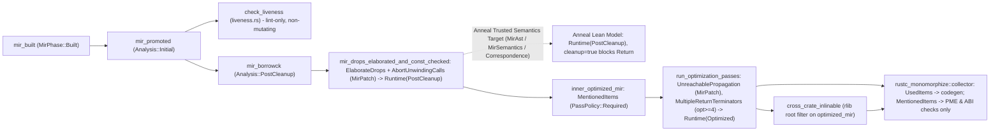

# `rustc` MIR Liveness (`check_liveness`), Pre-Optimization `MentionedItems`, `MultipleReturnTerminators`, and `MirPatch` CFG Invariants

## Summary

This report establishes primary-source, empirical, and kernel-checked Lean `v4.34.1` ground truth for four interacting `rustc` Mid-level Intermediate Representation (MIR) subsystems in `compiler/rustc_mir_transform` and `compiler/rustc_monomorphize`:

1. **Backward Liveness Analysis (`check_liveness` in `compiler/rustc_mir_transform/src/liveness.rs`):**
   - Runs as a query (`tcx.check_liveness(def_id: LocalDefId) -> DenseBitSet<FieldIdx>`) inside `mir_drops_elaborated_and_const_checked` (`lib.rs:568`) against `tcx.mir_promoted(def_id)` (`MirPhase::Analysis(AnalysisPhase::Initial)`), immediately before borrow-checked MIR is stolen and lowered to runtime MIR.
   - Computes a backward dataflow fixpoint (`MaybeLivePlaces`, `Domain = DenseBitSet<PlaceIndex>`) with explicit exemptions for `FakeRead(ForLet(None) | ForGuardBinding)`, a three-location pattern recognizer (`find_self_assignments`) for checked arithmetic (`AddWithOverflow`/`SubWithOverflow`/`MulWithOverflow`) and signed `Div`/`Rem` self-assignments, a `FnMut`-only CFG clone that rewrites `Return` and `UnwindResume` terminators to `Goto(START_BLOCK)` (`liveness.rs:115-127`), by-reference capture liveness injection at `Return`/`Yield`/`Goto(START_BLOCK)`/`Call { target: None }`, match-guard local merging (`merge_guards`), and a `#155345` `ty::set_aliases_to_non_rigid` workaround in `maybe_drop_guard` compensating for running `TypingMode::PostAnalysis` queries on `mir_promoted` MIR.
   - **Two-Layer Edition 2024 `CoroutineClosure` (`async move ||`) Dead-Capture Blind Spot:** On `rustc 1.98.0-nightly` (`14210df0e27ccd7d9e6a05b8085cbd438e4bbc65`) and unchanged at `rust-lang/rust` HEAD (`137d1d49458b73b7b85d2c1599d8730886d65e47`), `async move || { u_async = 30; }` suppresses **all 3** `unused_assignments`/`unused_variables` warnings emitted by both `move || { u_sync = 30; }` and `async move { u_block = 30; }`. Primary-source audit, live MIR dumps, and Lean mechanization prove this blind spot has **two independent layers**:
     - *Layer 1 (`liveness.rs:1447-1461`):* `TransferFunction::visit_rvalue` filters dead captures for `AggregateKind::Closure | AggregateKind::Coroutine` but omits `AggregateKind::CoroutineClosure`, falling through to `super_rvalue` and marking all captured outer locals live. Isolated via an `AsyncFnOnce` closure (`async move || { drop(consume); u_async_once = 30; }`), which emits **2 warnings** (both inner `unused_assignments`) instead of **3** (suppressing outer `unused_variables`).
     - *Layer 2 (`AsyncFnMut` lending `&mut` capture + `is_synthetic_mir` skip):* For `AsyncFnMut` `async move || { u_async = 30; }`, the wrapper `{closure#0}` lends `&mut ((*_1).0: u32)` to its inner coroutine `{closure#0}::{closure#0}`, whose `Return` terminator marks all by-ref captures (`PlaceElem::Deref`) live into `ever_live` (`liveness.rs:688, 1426-1432`), while the by-move clone `{closure#0}::{synthetic#0}` is skipped by `tcx.is_synthetic_mir` (`liveness.rs:56-58`). Fixing `liveness.rs:1448` alone repairs `AsyncFnOnce` (`2 -> 3` warnings) but leaves `AsyncFnMut` at `0` warnings.

2. **Pre-Optimization Mentioned-Item Collection (`MentionedItems` in `mentioned_items.rs` + `rustc_monomorphize::collector`):**
   - Runs as a mandatory pass (`PassPolicy::Required`), invoked directly in `inner_optimized_mir` (`lib.rs:824`, bypassing `run_passes` so `injection_phase` cannot skip it) before `run_optimization_passes`, and in `inner_mir_for_ctfe` (`lib.rs:528-534`) for `Const { always: true }` comptime functions.
   - Records exactly 6 MIR syntactic forms (`Call`/`TailCall`, `Drop`, `InlineAsmOperand::SymFn`, non-array-to-slice `PointerCoercion::Unsize`, `PointerCoercion::ClosureFnPointer`, `PointerCoercion::ReifyFnPointer`) in lockstep with `MirUsedCollector` and `visit_mentioned_item`.
   - During monomorphization (`collector.rs:575-620, 1335-1466`), items reachable only via `CollectionMode::MentionedItems` trigger normalization checks, `check_mono_item`, `required_consts` evaluation (enforcing post-monomorphization errors across dead-code elimination), and vtable method enumeration, **without** being inserted into `usage_map` or emitted to codegen/object files (verified empirically on all 6 patterns at `-Copt-level=3 -Zmir-opt-level=4` plus an undefined `extern "C"` symbol linking cleanly at `-O3`).
   - **`rlib` `cross_crate_inlinable(optimized_mir)` Root-Selection Seam:** Optimization-level independence of post-monomorphization errors holds **only conditioned on root instantiation**. In a `--crate-type=lib` (`rlib`) crate, `cross_crate_inlinable` (`cross_crate_inline.rs:108-116`) inspects post-optimization `tcx.optimized_mir(def_id)`. When `-Copt-level=3 -Zmir-opt-level=4` folds a dead branch in `pub fn f()` down to a leaf body below threshold, `f` ceases to be a local mono root and `--emit=obj` succeeds (`rc = 0`), whereas `-Copt-level=0 -Zmir-opt-level=0` fails with `E0080` (`rc = 1`). Pinning `f` via `#[inline(never)]`, `-Zcross-crate-inline-threshold=0`, or a binary root restores `rc = 1` at both optimization levels.

3. **Multiple-Return Tail Duplication (`MultipleReturnTerminators` in `multiple_return_terminators.rs`):**
   - Optional pass (`PassPolicy::optional(ctx.mir_opt_level() >= 4)`), scheduled twice inside `run_optimization_passes` (`lib.rs:739, 780`), strictly downstream of Anneal's `Runtime(PostCleanup)` capture boundary.
   - Replaces every `TerminatorKind::Goto { target, .. }` pointing to an empty `TerminatorKind::Return` block with `TerminatorKind::Return` and calls `simplify::remove_dead_blocks` (empirically transforming a 3-way branch from `6` BBs / `1` `return;` / `3` `goto`s at `mir-opt-level=3` to `5` BBs / `3` `return;` / `0` `goto`s at `mir-opt-level=4`, while leaving non-empty shared `Drop` epilogues untouched).
   - Never explicitly checks `!bb.is_cleanup`, relying on the MIR Validator's bipartite cleanup-edge invariant (`validate.rs:145-162, 531-536`) to guarantee that any predecessor of a `Return` block has `is_cleanup == false` — preserving compatibility with `Trusted.MirSemantics.evalTerminator`'s `if bb.cleanup then .fault .unsupported` guard.

4. **Transactional MIR Patching (`MirPatch` in `patch.rs`):**
   - Applies queued mutations in 4 strict stages: (0) `as_mut_preserves_cfg()` iff `term_patch_map.is_empty() && new_blocks.is_empty()` followed by `extend(new_blocks)` and `extend(new_locals)`; (1) in-place `nop_statements` preserving pre-patch statement indices; (2) stable-sorted per-block `new_statements` insertion preserving FIFO queue order (`s1, s2, s0`) and pre-insertion `SourceInfo`; and (3) `term_patch_map` patching, which calls `bb.statements.clear()` on `TerminatorKind::Unreachable` **after** Stage 2 (wiping both original and newly inserted statements in that block).
   - Between `3ef0c22cdb86ac42dc6b8f0f1ec36857daa6f2a1` (`2026-11-11`) and `137d1d49458b73b7b85d2c1599d8730886d65e47` (`2026-11-22`), upstream `patch.rs` replaced the $O(m \cdot n)$ per-block `delta`-shifted `Vec::insert` loop with an $O(n + m)$ linear `merge` routine (`patch.rs:304-315, 343-366`) and earlier added `mutate_terminator` (`patch.rs:215-226`). Our Lean `v4.34.1` theorem `delta_eq_merge_for_all_sorted_insertions` proves exact observational equivalence of `delta` and `merge` over all statement lists and sorted insertion queues.
   - Maintains bipartite `unreachable_cleanup_block` (`is_cleanup: true`) vs. `unreachable_no_cleanup_block` (`is_cleanup: false`) singleton slots so passes satisfy `validate.rs:145-162`, alongside a single-slot `terminate_block: Option<(BasicBlock, UnwindTerminateReason)>` cache that reallocates on alternating `UnwindTerminateReason`s.

5. **Kernel-Checked Mechanization (`support/MirLivenessMentionedItemsAndPatchSoundness.lean`):**
   - `2,801` lines, `147` explicit `theorem` declarations (`337` kernel theorem constants), verified under Lean `v4.34.1` (`-DElab.async=false -Ddebug.skipKernelTC=false -DwarningAsError=true`) using only `[Quot.sound, propext]`, with `0` `sorry`, `0` `Classical.choice`, `0` `omega`, `0` `bv_decide`, `0` `native_decide`, `0` `partial def`, and **`0` `._unsafe_rec` constants** in the compiled environment.

## Applicability

### Studied Subjects and Relationships

This report combines primary-source inspection across three pinned `rust-lang/rust` revisions, normative rules from `rust-lang/reference`, architectural boundary inspection of `joshlf/anneal`, live differential execution on an `x86_64-unknown-linux-gnu` `rustc` nightly toolchain, and kernel-checked mechanization in Lean `v4.34.1`:

| Subject | Repository / Artifact | Immutable Revision | Role in This Report |
| :--- | :--- | :--- | :--- |
| `rustc` HEAD | `rust-lang/rust` | `137d1d49458b73b7b85d2c1599d8730886d65e47` | Primary source of record for all line citations, `PassPolicy`, `#155345` non-rigid alias workaround, linear `MirPatch` `merge`, and `collector.rs` (`2026-11-22`). |
| `rustc` intermediate | `rust-lang/rust` | `3ef0c22cdb86ac42dc6b8f0f1ec36857daa6f2a1` | Version-drift anchor (`1.102.0-nightly`, `2026-11-11`): already has `mutate_terminator`, `#155345` fix, and `PassPolicy`, while retaining the classic `delta` loop in `patch.rs`. |
| `rustc` executed toolchain | `rust-lang/rust` (`1.98.0-nightly`, LLVM `22.1.6`) | `14210df0e27ccd7d9e6a05b8085cbd438e4bbc65` | Live execution oracle (`2026-05-31`, `x86_64-unknown-linux-gnu`) running `support/probe_liveness_mentioned_items_multiple_returns_and_patch.py`. |
| The Rust Reference | `rust-lang/reference` | `c9cc32825b03fc206d9c6fe73e9ca6a2f3576d6c` | Normative closure/async-closure capture semantics (`src/expressions/closure-expr.md`) and const-evaluation context rules (`src/const_eval.md`). |
| Anneal MIR boundary | `joshlf/anneal` | `c131b320eeeb26ef692e5afd5ec8db49ee518613` | Downstream verification consumer targeting `Runtime(PostCleanup)` MIR (`trusted/lean/Trusted/MirAst.lean`, `Trusted/MirSemantics.lean`, `trusted/rustc-capture/src/driver.rs`). |
| Lean 4 kernel | `leanprover/lean4` (`v4.34.1`) | `5045d0056413266e57c625dcd7c365b10e377c52` | Kernel verifier checking `support/MirLivenessMentionedItemsAndPatchSoundness.lean` (`-DElab.async=false -Ddebug.skipKernelTC=false -DwarningAsError=true`). |

### Cross-Revision Delta Matrix (`14210df0e` -> `3ef0c22cd` -> `137d1d494`)

Because live execution ran on `14210df0e` (`2026-05-31`) while primary-source citations target `137d1d494` (`2026-11-22`), every target file was diffed across all three revisions to separate shared behavior from version-specific drift:

| File | `14210df0e` (`2026-05-31`) | `3ef0c22cd` (`2026-11-11`) | `137d1d494` (`2026-11-22`) | Behavioral Impact |
| :--- | :--- | :--- | :--- | :--- |
| `liveness.rs` (`1508` -> `1576` -> `1576` LOC) | No `set_aliases_to_non_rigid` in `maybe_drop_guard`; omits `CoroutineClosure` at `L1379`; `errors::*` diagnostics. | Adds `#155345` `ty::set_aliases_to_non_rigid(tcx, ty).skip_norm_wip()` at `L241`; `diagnostics::*`; omits `CoroutineClosure` at `L1448`. | Identical to `3ef0c22cd` (`1576` LOC); omits `CoroutineClosure` at `L1448`. | All core dataflow, `FnMut` loop, self-assign, `merge_guards`, and `CoroutineClosure` blind-spot behaviors are **identical** across all three revisions; `#155345` alias normalization fix applies to `3ef0c22cd`/`137d1d494` only. |
| `mentioned_items.rs` (`122` -> `119` -> `119` LOC) | `is_enabled() -> true` + `is_required() -> true`; same 6 visitor arms. | Unified `policy() -> PassPolicy::Required`; same 6 visitor arms. | Identical to `3ef0c22cd` (`119` LOC). | **Identical** 6-pattern visitor and mandatory execution semantics across all three revisions. |
| `lib.rs` (`841` -> `855` -> `857` LOC) | `MentionedItems.run_pass` in `inner_optimized_mir` (`L808`); `mir_for_ctfe` does not yet run `MentionedItems`; `MultipleReturnTerminators` at `L723, L762`. | Adds `MentionedItems` in `inner_mir_for_ctfe` for `Const { always: true }` (`L534`); `inner_optimized_mir` at `L822`; `MultipleReturnTerminators` at `L737, L778`. | Same wiring (`mir_for_ctfe` `L534`, `check_liveness` `L568`, `MultipleReturnTerminators` `L739, L780`, `MentionedItems` `L824`). | Runtime MIR pipeline ordering is **identical**; `Const { always: true }` comptime `MentionedItems` applies to `3ef0c22cd`/`137d1d494`. |
| `multiple_return_terminators.rs` (`41` -> `37` -> `37` LOC) | `is_enabled: mir_opt_level() >= 4`, `is_required: false`, `Goto { target }`. | `policy: PassPolicy::optional(ctx.mir_opt_level() >= 4)`, `Goto { target, .. }`. | Identical to `3ef0c22cd` (`37` LOC). | **Identical** transformation and threshold (`>= 4`) across all three revisions. |
| `patch.rs` (`321` -> `331` -> `366` LOC) | `terminator_loc` present; no `mutate_terminator`; `delta`-shifted `Vec::insert` loop (`L282-295`); `BasicBlockData::new(Some(Terminator{...}), ...)`. | Removes `terminator_loc`; adds `mutate_terminator` (`L215-226`); retains `delta` loop (`L292-305`); non-`Option` `BasicBlockData::new(Terminator{...}, ...)`. | Retains `mutate_terminator` (`L215-226`); replaces `delta` loop with single-item `insert` or linear `merge` (`L292-316, L343-366`). | Semantics of `apply` are **observationally identical** across all three revisions (mechanically proved in Lean Theorem `delta_eq_merge_for_all_sorted_insertions`); complexity improves from $O(m \cdot n)$ to $O(n + m)$ at `137d1d494`. |

### Invocation and Edition Scope

- **Rust Edition:** Async closures (`async ||` / `async move ||`, `AsyncFn*` traits, `AggregateKind::CoroutineClosure`) require `--edition=2024`. All other findings apply across Rust editions 2021 and 2024.
- **Unstable Flags Used in Probes:** `-Zmir-opt-level={0,2,3,4}`, `-Zmir-enable-passes=+/-MultipleReturnTerminators`, `-Zdump-mir=...`, and `-Zcross-crate-inline-threshold=0` are nightly-only flags. Standard `--emit={metadata,obj,mir,llvm-ir}` and `-Copt-level={0,3}` are stable options.
- **Target Architecture:** Live `rustc` probes ran on `x86_64-unknown-linux-gnu`. All MIR passes audited here are target-independent except `InlineAsmOperand::SymFn` syntax (`/* {} */` comment template works on any LLVM target supporting inline assembly).

## Findings

### 1. Backward Liveness Analysis (`check_liveness` in `compiler/rustc_mir_transform/src/liveness.rs`)

#### 1.1 Pipeline Placement, Query Signature, and Early-Exit Guards

Basis: source (`rust-lang/rust@137d1d49458b73b7b85d2c1599d8730886d65e47`: `compiler/rustc_mir_transform/src/lib.rs:232, 546-571`, `liveness.rs:53-85`)

`check_liveness` is registered as a query provider (`providers.queries.check_liveness = liveness::check_liveness`, `lib.rs:232`) with signature:

```rust
pub(crate) fn check_liveness<'tcx>(tcx: TyCtxt<'tcx>, def_id: LocalDefId) -> DenseBitSet<FieldIdx>
```

It is forced inside `mir_drops_elaborated_and_const_checked` (`lib.rs:568`: `tcx.ensure_done().check_liveness(def);`) immediately after `mir_borrowck` (`lib.rs:553`) and `mir_inliner_callees` (`lib.rs:564`), and immediately *before* `tcx.mir_promoted(def).0.steal()` (`lib.rs:570-571`). Internally, `check_liveness` borrows `&*tcx.mir_promoted(def_id).0.borrow()` (`liveness.rs:78`), which is in `MirPhase::Analysis(AnalysisPhase::Initial)` — containing `FakeRead`, `StorageLive`/`StorageDead`, and pre-elaboration `Drop` terminators, and still carrying `LocalDecl::local_info` (`BindingForm::Var` and `BindingForm::RefForGuard`, cleared later at `lib.rs:695-697`).

Five early-exit guards return `DenseBitSet::new_empty(0)` without running dataflow (`liveness.rs:56-84`):
1. `tcx.is_synthetic_mir(def_id)` (`L56-58`): skips synthetic MIR bodies (such as coroutine-closure by-move `{synthetic#0}` clones) to avoid HIR-access ICEs.
2. `tcx.intrinsic(def_id.to_def_id()).is_some()` (`L61-63`): skips compiler intrinsics.
3. `find_attr!(tcx, def_id.to_def_id(), Naked(..))` (`L66-68`): skips `#[naked]` functions.
4. `DefKind::Impl { of_trait: true }` parent with `AutomaticallyDerived` (`L71-76`): skips `#[derive(...)]` impls.
5. `body.tainted_by_errors.is_some()` (`L82-84`): skips error-tainted bodies.

#### 1.2 Tracked `PlaceSet` Representation and Capture Projections

Basis: source (`liveness.rs:86-136, 481-614`)

`PlaceSet` indexes only user-relevant places (`PlaceIndex`), excluding compiler temporaries and `_0`:
- **Locals (`insert_locals`, `L497-511`):** Inserts every `local` whose `decl.local_info()` is `LocalInfo::User(BindingForm::Var(_) | BindingForm::RefForGuard(_))`. `record_debuginfo` (`L553-580`) subsequently attaches `(Symbol, Span)` from `body.var_debug_info` and discards (`self.locals[l] = None`) any local with no name, `sym::empty`, `kw::SelfLower`, or a name beginning with `'_'`.
- **Closure/Coroutine Captures (`insert_captures`, `L513-551`):** Whenever `tcx.is_closure_like(def_id.to_def_id())`, `check_liveness` inspects `body.local_decls[ty::CAPTURE_STRUCT_LOCAL].ty` (`_1`), strips one outer `ty::Ref` if present (`self_is_ref = true`, setting `capture_field_pos = 1`), and classifies `self_ty.kind()` into `CaptureKind::Closure(kind)`, `CaptureKind::Coroutine`, or `CaptureKind::CoroutineClosure` (`L98-107`). For each capture field `f`, it constructs:
  - by-value capture (`UpvarCapture::ByValue`): `_1.f` (or `(*_1).f` if `self_is_ref`);
  - by-ref capture (`UpvarCapture::ByRef(..)`): `*(_1.f)` (or `*((*_1).f)` if `self_is_ref`), appending a trailing `PlaceElem::Deref` (`L534-539`).
- **Lookup (`PlaceSet::get`, `L583-605`):** Returns `Some((PlaceIndex, extra_projections))` where `extra_projections` is the suffix *after* the tracked base place (`&place.projection[start..]`). Shallow reborrows accessing `_1.f` without dereferencing a by-ref capture (`start > place.projection.len()`) return `None` (`L598-602`).

#### 1.3 `MaybeLivePlaces` Backward Fixpoint and `DefUse::for_place` Matrix

Basis: source (`liveness.rs:1298-1575`) + derived (mechanized in `support/MirLivenessMentionedItemsAndPatchSoundness.lean`, `defUseForPlace`, `transferStmt_mono`, `transferTerm_mono`, `backwardStep_monotone`)

`MaybeLivePlaces` implements `rustc_mir_dataflow::Analysis` with `Direction = Backward`, `Domain = DenseBitSet<PlaceIndex>`, `bottom_value = empty` (not live), and no-op `initialize_start_block` (`L1320-1333`). Crucially, `apply_call_return_effect` (`L1353-1360`) is a **no-op** (`// FIXME: what should happen here?`). Combined with `DefUse::for_place` (`L1519-1575`), the exact transfer semantics are:

| `PlaceContext` | `is_indirect(extra_proj)` | `extra_proj.is_empty()` | `DefUse::for_place` | Dataflow Effect on `trans` |
| :--- | :--- | :--- | :--- | :--- |
| `MutatingUse(Store \| SetDiscriminant)` | `true` (e.g., `*p = v`) | any | `Some(DefUse::Use)` | `trans.insert(index)` (reading pointer `p`) |
| `MutatingUse(Store \| SetDiscriminant)` | `false` | `true` (`x = v`) | `Some(DefUse::Def)` | `trans.remove(index)` (kills liveness of `x`) |
| `MutatingUse(Store \| SetDiscriminant)` | `false` | `false` (`x.f = v`) | `None` | no change (partial field write does not kill whole `x`) |
| `MutatingUse(Call \| Yield \| AsmOutput)` | `true` (`*p = f()`) | any | `Some(DefUse::Use)` | `trans.insert(index)` |
| `MutatingUse(Call \| Yield \| AsmOutput)` | `false` (`x = f()`) | any | `None` | **no kill** (`apply_call_return_effect` is a no-op!) |
| `MutatingUse(Borrow \| RawBorrow \| Drop)` & `NonMutatingUse(Copy \| Move \| SharedBorrow \| RawBorrow \| FakeBorrow \| Inspect \| PlaceMention)` | any | any | `Some(DefUse::Use)` | `trans.insert(index)` |
| `NonUse(StorageLive \| StorageDead \| AscribeUserTy \| BackwardIncompatibleDropHint \| VarDebugInfo)` | any | any | `None` | no change |

Notice two subtle consequences of `TransferFunction::visit_terminator` (`L1415-1440`):
1. `TerminatorKind::Drop { .. } => {}` (`L1435`) and `TerminatorKind::Assert { .. } => {}` (`L1437`) return early *without* calling `super_terminator`, so `Drop` never marks a variable live via dataflow (even though `DefUse::for_place` maps `MutatingUseContext::Drop => Some(Use)` at `L1550` — that arm is unreachable from `TerminatorKind::Drop`!). Instead, drop-guard suppression is handled separately via `ever_dropped` and `maybe_drop_guard`.
2. In the by-ref capture arm (`L1419-1433`), matching `TerminatorKind::Return | TerminatorKind::Yield { .. } | TerminatorKind::Goto { target: START_BLOCK, .. } | TerminatorKind::Call { target: None, .. } if self.capture_kind != CaptureKind::None` inserts all tracked places with `place.local == CAPTURE_STRUCT_LOCAL && place.projection.last() == Some(&PlaceElem::Deref)` and **does not call `self.super_terminator`**! In live `rustc`, passing a user local `s` to a diverging function `diverge_str(s)` inside a closure (`Call { target: None }`) still avoids a false `unused_variables` warning only because `mir_built` lowers arguments through compiler temporaries (`_3 = move _2; _0 = diverge_str(move _3) -> bb4;`), so `_2` is marked live in the preceding statement rather than in the terminator.

#### 1.4 `FakeRead` Exemptions and `find_self_assignments`

Basis: source (`liveness.rs:354-479, 1372-1413`) + execution (`support/probe_results.json`: `suite_a_liveness.A6`)

1. **`FakeRead` Exemption (`L1376-1379`):** `StatementKind::FakeRead((FakeReadCause::ForLet(None) | FakeReadCause::ForGuardBinding, _))` returns immediately without visiting the place, preventing `let x = 1;` and match-guard bindings from self-marking live. Other `FakeRead` causes fall through to `super_statement`.
2. **Self-Assignment Recognition (`find_self_assignments`, `L365-479`; `visit_statement`, `L1381-1410`):** MIR lowering desugars `x += 2` into three locations across two blocks:
   - `_t = AddWithOverflow(copy x, const 2)` (last statement of `bb`);
   - `assert(!move _t.1, Overflow)` (terminator of `bb`);
   - `x = move _t.0` (first statement of `target`).
   Without special handling, `copy x` in `AddWithOverflow` would make `x` appear live! `find_self_assignments` detects:
   - Checked `AddWithOverflow | SubWithOverflow | MulWithOverflow` patterns (`L379-439`), inserting all three locations into `self_assignment` (unless `is_indirect(projections)` on `dest`, e.g. `*p += 2`, where `p` *is* genuinely read!).
   - Straight binary self-assignments `lhs = BinOp(copy lhs, rhs)` (`L441-472`), plus for signed `Div | Rem` at `statement_index == 0` with a single predecessor `pred` ending in `Assert(Overflow)` (`len >= 2`), also inserting the two predecessor statements (`lhs == MIN` and `BitAnd`, `L458-471`).
   - During `visit_statement` (`L1381-1410`), locations in `self_assignment` visit only `rhs` (not `lhs`) and suppress the `def` on the final `x = move _t.0` assignment so liveness is dictated solely by downstream reads of `x`.
   - **Empirical Verification (`Probe A6`):** `let mut x = 1u32; x += 2;` emits **2 warnings** (`unused_variables`: `variable 'x' is assigned to, but never used` + `unused_assignments`: `value assigned to 'x' is never read`); `let mut y = 10i32; y /= 2;` emits the identical **2 warnings**; `*p += 2;` on `p: &mut u32` emits **0 warnings**.

#### 1.5 `FnMut` Multi-Invocation Loop Closure Soundness

Basis: normative (`rust-lang/reference@c9cc32825b03fc206d9c6fe73e9ca6a2f3576d6c`: `src/expressions/closure-expr.md`, `r[expr.closure.trait-impl]`) + source (`liveness.rs:112-128, 1419-1433`) + execution (`Probe A5`) + derived (Lean Theorems `fnMut_postFixpoint_propagates_start_to_exits`, `fnMut_acc_entry_live_and_fnonce_exit_dead`)

An `FnMut` closure retains its captured environment across repeated calls (`&mut self`), and may be called again after *either* a normal return or a caught panic (`UnwindResume`). To model cross-invocation liveness soundly, `liveness.rs:115-127` clones the `mir_promoted` body exclusively when `capture_kind == CaptureKind::Closure(ty::ClosureKind::FnMut)` and rewrites every `Return` and `UnwindResume` terminator to `TerminatorKind::goto(START_BLOCK)`:

```rust
if let CaptureKind::Closure(ty::ClosureKind::FnMut) = capture_kind {
    body_mem = body.clone();
    for bbdata in body_mem.basic_blocks_mut() {
        if let TerminatorKind::Return | TerminatorKind::UnwindResume =
            bbdata.terminator().kind
        {
            bbdata.terminator_mut().kind = TerminatorKind::goto(START_BLOCK);
        }
    }
    body = &body_mem;
}
```

Because `visit_terminator` (`L1421`) also matches `TerminatorKind::Goto { target: START_BLOCK, .. }`, by-ref captures remain marked live at the rewritten exit edges, while backward fixpoint propagation flows `entry(START_BLOCK)` back into every `Return` and `UnwindResume` exit! Note that this synthetic `Goto(START_BLOCK)` violates the MIR Validator's rule that `START_BLOCK` must have no predecessors (`validate.rs:140-142`), which is safe *only* because `body_mem` is an ephemeral clone discarded when `check_liveness` returns.

- **Empirical Verification (`Probe A5`):**
  - `fnmut_normal_return_loop` (`let prev = acc; acc = prev + 1; prev` in `impl FnMut() -> u32`): **0 warnings**.
  - `fnmut_unwind_resume_loop` (`if boom { acc = prev + 10; panic!(...); }` in `impl FnMut(bool) -> u32`): **0 warnings** (`UnwindResume -> Goto(START_BLOCK)` keeps `acc = prev + 10` live!).
  - `fnonce_trailing_write_dead` (`drop(owned); let prev = acc; acc = prev + 1; prev` in `impl FnOnce() -> u32`): **1 warning** (`unused_assignments` on `acc = prev + 1`).

#### 1.6 `merge_guards` and `maybe_drop_guard` (`#155345` Non-Rigid Alias Workaround)

Basis: source (`liveness.rs:144-150, 226-256, 803-855, 1107-1123, 1192-1213`) + execution (`Probe A6`) + derived (Lean Theorems `mergeGuard_no_false_unused_if_either_live`, `maybeDropGuard_suppresses_field_write_only`)

1. **Match Guard Merging (`merge_guards`, `L814-855`):** Match arms with guards create two locals: `arm_local` (mutable in the arm) and a `BindingForm::RefForGuard(arm_local)` local (frozen in the guard). `merge_guards` propagates `ever_live` from the guard local to `arm_local` (`L830-832`) and merges `assignments[guard_index]` into `assignments[arm_index]` by `SourceInfo` using `o.get_mut().live |= access.live` (`L841-852`). In `Probe A6`, `match v { x if x > 2 => 1, _ => 0 }` emits **0 warnings**.
2. **`maybe_drop_guard` & `#155345` (`L227-256, 1110-1122, 1192-1213`):** Variables with non-trivial `Drop` implementations (such as mutex guards) are often bound solely for their destructor side effect. `AssignmentResult::find_dead_assignments` records `ever_dropped` for direct `Drop`/`Call`/`Yield` destinations (`L679-683, 701-703`). When reporting, `maybe_drop_guard` checks `ever_dropped.contains(index)` and:

```rust
let ty = checked_places.places[index].ty(&body.local_decls, tcx).ty;
// FIXME(#155345): Liveness uses `TypingMode::PostAnalysis`
// even though it's run on `mir_promoted` which is still
// in an earlier `TypingMode`. This is odd and we have to
// manually mark aliases as non-rigid here.
let ty = ty::set_aliases_to_non_rigid(tcx, ty).skip_norm_wip();
matches!(
    ty.kind(),
    ty::Closure(..) | ty::Coroutine(..) | ty::Tuple(..) | ty::Adt(..)
        | ty::Dynamic(..) | ty::Array(..) | ty::Slice(..)
        | ty::Alias(_, ty::AliasTy { kind: ty::Opaque { .. }, .. })
) && ty.needs_drop(tcx, typing_env)
```

   - **Why `#155345` Happened:** `check_liveness` constructs `ty::TypingEnv::post_analysis(tcx, body.source.def_id())` (`L144`), even though `mir_promoted` precedes `PostAnalysisNormalize` (`lib.rs:655`), where opaque/associated type aliases still carry rigid alias representation. Calling `ty.needs_drop(tcx, typing_env)` directly without `set_aliases_to_non_rigid` caused typing-mode mismatch failures; `3ef0c22cd` and `137d1d494` manually mark aliases non-rigid at `L241` (absent in `14210df0e`). Note that the `matches!` allowlist at `L242-252` also omits `ty::CoroutineClosure(..)`!
   - **Field-Write vs. Direct-Overwrite Asymmetry (`L1118, L1212`):** `should_report = !live && (is_direct || !is_maybe_drop_guard)`. In `Probe A6`, `let mut g_field = DropGuard(1); g_field.0 = 2;` emits **0 warnings** (`is_direct == false` is suppressed because `Drop::drop` may read `self.0`), whereas `let mut g_direct = DropGuard(1); g_direct = DropGuard(2);` emits **2 warnings** (`unused_variables` + `unused_assignments`, because a direct overwrite has `is_direct == true` and bypasses drop-guard suppression).

#### 1.7 Live Edition 2024 `CoroutineClosure` (`async move ||`) Two-Layer Dead-Capture Blind Spot

Basis: normative (`rust-lang/reference@c9cc3282`: `src/expressions/closure-expr.md`, `r[expr.closure.async]`) + source (`liveness.rs:56-58, 98-107, 686-688, 858-879, 1419-1433, 1442-1464`) + execution (`Probe A1–A4`) + derived (Lean Theorem `edition2024_coroutineClosure_two_layer_blind_spot`)

When a closure or coroutine captures an outer variable `u` by value and only overwrites it without ever reading it (`u = 30;`), `liveness.rs:1442-1464` is designed to propagate `dead_captures = self.tcx.check_liveness(def_id)` back to the enclosing function so the outer variable triggers `unused_variables`:

```rust
// compiler/rustc_mir_transform/src/liveness.rs:1447-1461 (137d1d49458b73b7b85d2c1599d8730886d65e47)
Rvalue::Aggregate(
    AggregateKind::Closure(def_id, _) | AggregateKind::Coroutine(def_id, _),
    operands,
) => {
    if let Some(def_id) = def_id.as_local() {
        let dead_captures = self.tcx.check_liveness(def_id);
        for (field, operand) in
            operands.iter_enumerated().take(dead_captures.domain_size())
        {
            if !dead_captures.contains(field) {
                self.visit_operand(operand, location);
            }
        }
    }
}
```

Even though `check_liveness` itself explicitly recognizes `ty::CoroutineClosure` at `L103-105` and computes `dead_captures`, `visit_rvalue` omits `AggregateKind::CoroutineClosure(def_id, _)`. Live differential execution (`Probe A1–A4`) and `-Zdump-mir=built` dumps uncover a **three-way empirical stratification** isolating **two independent root-cause layers**:

| Probe Case (Edition 2024) | Inner Coroutine Capture Mode | Warnings Emitted | Exact Missing Warnings | Root Cause Layer(s) |
| :--- | :--- | ---: | :--- | :--- |
| `A1`: `move \|\| { u_sync = 30; }` | By-value (`_1.0: u32`) | **3** | None | Baseline (`AggregateKind::Closure` handled). |
| `A2`: `async move { u_block = 30; }` | By-value (`_1.0: u32`) | **3** | None | Baseline (`AggregateKind::Coroutine` handled). |
| `A4-sync`: `move \|\| { drop(consume); u_sync_once = 30; }` | By-value (`_1.1: u32`) | **3** | None | Baseline (`FnOnce` sync closure). |
| `A4-async`: `async move \|\| { drop(consume); u_async_once = 30; }` (**`AsyncFnOnce`**) | By-value (`_1.1: u32`) | **2** | Outer `unused_variables: u_async_once` | **Layer 1 ONLY:** inner coroutine detects dead capture & emits 2 `unused_assignments`, wrapper propagates `dead_captures`, but outer `visit_rvalue` omits `AggregateKind::CoroutineClosure` (`L1448`), falling through to `super_rvalue` (`copy _1` marked live)! |
| `A3`: `async move \|\| { u_async = 30; }` (**`AsyncFnMut`**) | Lending `&mut u32` (`*(_1.0) = 30`) + skipped `{synthetic#0}` | **0** | **All 3** (both inner `unused_assignments` + outer `unused_variables`) | **Layer 1 + Layer 2:** outer omits `CoroutineClosure` **AND** wrapper `{closure#0}` borrows `_2 = &mut ((*_1).0: u32)` into `{closure#0}::{closure#0}`, whose `Return` marks by-ref capture `ever_live` (`L688, L1426-1432`), while by-move `{closure#0}::{synthetic#0}` is skipped by `is_synthetic_mir` (`L56-58`)! |

Exact `-Zdump-mir=built` evidence from `Probe A3` confirms the 4-body lowering of `async move || { u_async = 30; }`:
- `async_fnmut_dead_capture`: `_2 = {closure@<tmp>/probe.rs:3:14: 3:27} { u_async: copy _1 };` (`AggregateKind::CoroutineClosure`, falls through `L1448` to `super_rvalue`).
- `async_fnmut_dead_capture::{closure#0}(_1: &mut {async closure})`: `_2 = &mut ((*_1).0: u32); _0 = {coroutine@...( #0)} { u_async: move _2 };` (passes `&mut u32` into child coroutine).
- `async_fnmut_dead_capture::{closure#0}::{closure#0}`: `(*(_1.0: &mut u32)) = const 30_u32; ... return;` (by-ref capture marked live at `return;` -> `ever_live` contains `u_async` -> `dead_captures = {}`).
- `async_fnmut_dead_capture::{closure#0}::{synthetic#0}`: `(_1.0: u32) = const 30_u32; ... return;` (by-value, but `is_synthetic_mir == true` -> skipped at `L56-58`).

**Design Consequence (Mechanized in `edition2024_coroutineClosure_two_layer_blind_spot`):** Simply adding `| AggregateKind::CoroutineClosure(def_id, _)` to `liveness.rs:1448` fixes Layer 1 (`AsyncFnOnce`: `2 -> 3` warnings) but **cannot** fix Layer 2 (`AsyncFnMut`: remains `0` warnings) because `dead_captures` returned by `{closure#0}` is already empty due to the lending `&mut` capture in `{closure#0}::{closure#0}`!

---

### 2. Pre-Optimization Mentioned-Item Collection (`MentionedItems` & `rustc_monomorphize::collector`)

#### 2.1 Mandatory Scheduling and Bypass of `run_passes`

Basis: source (`rust-lang/rust@137d1d494`: `compiler/rustc_mir_transform/src/mentioned_items.rs:9-31`, `lib.rs:526-539, 804-838`, `pass_manager.rs:88-93`, `rustc_middle/src/mir/mod.rs:276-285, 732-748`)

`MentionedItems` implements `MirPass::policy` returning `PassPolicy::Required` (`mentioned_items.rs:18-24`), meaning `-Zmir-enable-passes` cannot disable it. It populates `Body::mentioned_items: Option<Vec<Spanned<MentionedItem<'tcx>>>>` via `body.set_mentioned_items(...)`, which panics if called more than once (`mir/mod.rs:734-739`).

It executes at **two** sites in `compiler/rustc_mir_transform/src/lib.rs`:
1. **`inner_optimized_mir` (`lib.rs:824`):** Immediately after stealing `mir_drops_elaborated_and_const_checked` (`Runtime(PostCleanup)`) and running `remap_mir_for_const_eval_select(..., NotConst)`, and strictly *before* the lone-`Unreachable` early return (`L829-833`) and `run_optimization_passes` (`L835`):
   ```rust
   // Before doing anything, remember which items are being mentioned so that the set of items
   // visited does not depend on the optimization level.
   // We do not use `run_passes` for this as that might skip the pass if `injection_phase` is set.
   mentioned_items::MentionedItems.run_pass(tcx, &mut body);
   ```
   Bypassing `pm::run_passes` ensures custom MIR bodies with `injection_phase` set still receive a populated `mentioned_items` vector (otherwise `body.mentioned_items()` in the collector would panic at `mir/mod.rs:745`).
2. **`inner_mir_for_ctfe` (`lib.rs:528-538`, added between `14210df0e` and `3ef0c22cd`):** For `DefKind::Fn | DefKind::AssocFn` with `hir::Constness::Const { always: true }` (comptime functions, which have no `optimized_mir`), runs `&[&ctfe_limit::CtfeLimit, &mentioned_items::MentionedItems]`. Ordinary `const fn`s rely on `optimized_mir` for `mentioned_items`.

#### 2.2 The Exact 6-Pattern Visitor and Collector Sync Contract

Basis: source (`mentioned_items.rs:33-119`, `collector.rs:177-196, 733-948, 1348-1466`) + execution (`Probe B1, B2`)

`MentionedItemsVisitor` runs on **generic (unmonomorphized)** MIR, whereas `MirUsedCollector` runs on **monomorphized** MIR (`Instance<'tcx>`). To remain in sync (`collector.rs:177-196`), `MentionedItemsVisitor` records the pre-monomorphization `MentionedItem` over-approximation across exactly 6 MIR patterns, and `MirUsedCollector` inserts the identical pre-monomorphization `MentionedItem` into `used_mentioned_items` *before* calling `self.monomorphize(...)` (`collector.rs:750, 776, 787, 839, 883, 893`):

| # | MIR Syntactic Form (`mentioned_items.rs`) | Recorded `MentionedItem` | Pre-Mono Filter | `visit_mentioned_item` Action (`collector.rs:1417-1466`) | Probe B1 (`-O3 -Zmir-opt-level=4` `--emit=obj`) |
| :-: | :--- | :--- | :--- | :--- | :--- |
| 1 | `TerminatorKind::Call { func, .. }` or `TailCall { func, .. }` (`L42-46`) | `MentionedItem::Fn(callee_ty)` | None (unconditional) | If monomorphized `ty::FnDef`, `Instance::expect_resolve` + `visit_instance_use(..., is_direct_call = true)` | `E0080`: `CALL_CONST_PROP_PME` & `CALL_IF_FALSE_PME` (`rc = 1`) |
| 2 | `TerminatorKind::Drop { place, .. }` (`L47-50`) | `MentionedItem::Drop(ty)` | None (post-drop-elab MIR) | `visit_drop_use(tcx, ty, is_direct_call = true)` -> `Instance::resolve_drop_glue` | `E0080`: `DROP_PME` (`rc = 1`) |
| 3 | `TerminatorKind::InlineAsm` -> `InlineAsmOperand::SymFn { value }` (`L51-63`) | `MentionedItem::Fn(value.const_.ty())` | Only `SymFn` operands | Same `MentionedItem::Fn` handler (`is_direct_call = true`) | `E0080`: `ASM_SYMFN_PME` (`rc = 1`) |
| 4 | `Rvalue::Cast(PointerCoercion::Unsize, op, target_ty)` (`L73-96`) | `MentionedItem::UnsizeCast { source_ty, target_ty }` | Skips ONLY `(Some(ty::Array(..)), Some(ty::Str \| ty::Slice(..)))` via `builtin_deref(true)` (`L81-89`) | `find_tails_for_unsizing`; if `target_ty.is_trait() && !source_ty.is_trait()`, calls `create_mono_items_for_vtable_methods` (all trait + supertrait `VtblEntry::Method`s + destructor if `needs_drop`) | `E0080`: `VTABLE_PME` (`rc = 1`); array-to-slice control `rc = 0` |
| 5 | `Rvalue::Cast(PointerCoercion::ClosureFnPointer(_), op, _)` (`L98-106`) | `MentionedItem::Closure(source_ty)` | None | Resolves `ty::Closure` as `ClosureKind::FnOnce`; pushes `MonoItem::Fn` if `should_codegen_locally` | `E0080`: `CLOSURE_FNPTR_PME` (`rc = 1`) |
| 6 | `Rvalue::Cast(PointerCoercion::ReifyFnPointer(_), op, _)` (`L108-115`) | `MentionedItem::Fn(fn_ty)` | None | Same `MentionedItem::Fn` handler (`is_direct_call = true`) | `E0080`: `REIFY_FNPTR_PME` (`rc = 1`) |

Notice an intentional subtlety in `visit_mentioned_item` (`collector.rs:1436-1438`): `MentionedItem::Fn` passes `is_direct_call = true` even for `ReifyFnPointer` and `InlineAsmOperand::SymFn`, skipping wrapper shims (`ShimKind::Reify`, no-op `DropGlue(_, None)`) that cannot host their own failing `required_consts`.

In `Probe B2`, `-Zdump-mir=f` on `let x = 2usize + 2usize; if x == 5 { trigger_pme::<0>() } else { 1 }` confirms `trigger_pme::<0>` is present in `runtime-post-cleanup.after.mir` (when `MentionedItems` runs) and **completely absent** from `runtime-optimized.after.mir` (`bb0: { _0 = const 1_usize; return; }`), yet `--emit=obj -Copt-level=3 -Zmir-opt-level=4` still fails with `E0080: evaluation panicked: CALL_CONST_PROP_PME`. Meanwhile `--emit=metadata` returns `rc = 0` on all 6 patterns because monomorphization collection does not run during metadata-only compilation.

#### 2.3 What `rustc_monomorphize::collector` Checks vs. Skips on Mentioned-Only Items

Basis: source (`collector.rs:382-625, 1335-1413`, `mono_checks/mod.rs:1-19`) + execution (`Probe B1, B3`) + derived (Lean Theorems `used_mentioned_dedup_preserves_total_checked_set`, `post_dce_pme_preservation_when_root`)

`collect_items_rec` (`collector.rs:382-624`) distinguishes `CollectionMode::UsedItems` from `CollectionMode::MentionedItems` across two disjoint global visited sets (`state.visited` for used items, `state.mentioned` for mentioned-only items, `L580-592`):

| Collector Operation | `CollectionMode::UsedItems` | `CollectionMode::MentionedItems` | Source Location |
| :--- | :--- | :--- | :--- |
| `tcx.instance_mir(instance.def)` + `check_normalization_error` | **Executed** | **Executed** | `collector.rs:1341-1345` |
| `tcx.ensure_ok().check_mono_item(instance)` (`abi_check` + `move_check`) | **Executed** | **Executed** | `collector.rs:1346`, `mono_checks/mod.rs:10-14` |
| `MirUsedCollector` walk over `traversal::mono_reachable(body)` + `var_debug_info` | **Executed** (populates `used_items` & `used_mentioned_items`) | **Skipped** (`used_items` stays empty; asserted at `L593-594`) | `collector.rs:1369-1378, 593-594` |
| `body.required_consts()` evaluation (`eval_constant` + `collect_const_value` into `mentioned_items`) | **Executed** | **Executed** | `collector.rs:1382-1386` |
| `body.mentioned_items()` walk (skipping items in `used_mentioned_items`) | **Executed** (populates `mentioned_items`) | **Executed** (populates `mentioned_items`) | `collector.rs:1390-1395` |
| `state.usage_map.lock().record_used(starting_item, &used_items)` (drives CGU partitioning & codegen!) | **Executed** | **Skipped** | `collector.rs:575-577` |
| Recursive traversal order | Walks `used_items` in `UsedItems` mode FIRST (`L596-605`), then `mentioned_items` in `MentionedItems` mode (`L610-619`) | Walks `mentioned_items` in `MentionedItems` mode only | `collector.rs:593-619` |

- **Empirical Verification of Codegen Exclusion (`Probe B3`):** Compiling a binary whose dead branch (`let x = 2 + 2; if x == 5`) calls `dead_extern_caller()` referencing an undefined `unsafe extern "C" { fn nonexistent_extern_symbol_for_mentioned_test() -> usize; }`:
  - At `-Copt-level=0 -Zmir-opt-level=0`: `nonexistent_extern_symbol_for_mentioned_test` **appears** in `--emit=llvm-ir` (`o0_mir0_llvm_ir_contains_extern_sym = true`). (Linking also succeeded on the test host because `--gc-sections` discarded the unreferenced dead symbol after codegen, whereas LLVM IR proves `rustc` codegenned the reference.)
  - At `-Copt-level=3 -Zmir-opt-level=4`: `nonexistent_extern_symbol_for_mentioned_test` is **completely absent** from `--emit=llvm-ir` (`o3_mir4_llvm_ir_contains_extern_sym = false`) and linking succeeds (`rc = 0`, binary emitted), proving that `CollectionMode::MentionedItems` checked `dead_extern_caller` for PMEs without emitting it into `usage_map` or LLVM codegen!

#### 2.4 The `rlib` `cross_crate_inlinable(optimized_mir)` Root-Selection Seam

Basis: source (`compiler/rustc_mir_transform/src/cross_crate_inline.rs:18-117`, `collector.rs:1751-1790`) + execution (`Probe B4`) + derived (Lean Theorem `rlib_cross_crate_inlinable_opt_level_flip`)

`collector.rs:164-175` states `MentionedItems`'s motivation: *"Optimizing away dead code may optimize away a function call that uses a failing constant, so an unoptimized build may fail where an optimized build succeeds. This is undesirable."*

Live differential testing (`Probe B4`) and primary-source inspection reveal a **real exception** to this guarantee for non-generic `pub fn` items in `--crate-type=lib` (`rlib`) crates:
1. In `MonoItemCollectionStrategy::Lazy`, a non-generic `pub fn f()` is collected as a local mono root iff `tcx.is_reachable_non_generic(f)` holds (`collector.rs:1766-1768`), which excludes functions marked `cross_crate_inlinable` (deferring their codegen to downstream callers).
2. `cross_crate_inlinable` (`cross_crate_inline.rs:90-117`) returns `false` at `OptLevel::No` when MIR inlining is disabled (`L95-97`), but at `-Copt-level=3` inspects **`tcx.optimized_mir(def_id)`** (`L108-116`):
   ```rust
   let mir = tcx.optimized_mir(def_id);
   let mut checker = CostChecker { tcx, callee_body: mir, calls: 0, statements: 0, landing_pads: 0, resumes: 0 };
   checker.visit_body(mir);
   checker.calls == 0 && checker.resumes == 0 && checker.landing_pads == 0 && checker.statements <= threshold
   ```
3. Consequently, when MIR optimizations fold away the dead branch inside `pub fn f() -> usize { let x = 2 + 2; if x == 5 { trigger_pme::<0>() } else { 1 } }`, `optimized_mir(f)` shrinks to a 1-statement leaf with `calls == 0`, flipping `cross_crate_inlinable(f)` from `false` (`-O0`) to `true` (`-O3`) and **removing `f` from the library's mono roots**!

| `--crate-type=lib --emit=obj` Configuration (`Probe B4`) | `pub fn f()` (default) | `#[inline(never)] pub fn f()` |
| :--- | :---: | :---: |
| `-Copt-level=0 -Zmir-opt-level=0` | **`rc = 1`** (`E0080: RLIB_SEAM_PME`) | **`rc = 1`** (`E0080: RLIB_SEAM_PME`) |
| `-Copt-level=3 -Zmir-opt-level=4` | **`rc = 0`** (0 mono roots; `MentionedItems` bypassed!) | **`rc = 1`** (`E0080: RLIB_SEAM_PME`) |
| `-Copt-level=3 -Zmir-opt-level=4 -Zcross-crate-inline-threshold=0` | **`rc = 1`** (`E0080: RLIB_SEAM_PME`) | **`rc = 1`** (`E0080: RLIB_SEAM_PME`) |

Therefore, `MentionedItems` guarantees optimization-level-independent PME detection **only conditioned on root instantiation** (Theorem `post_dce_pme_preservation_when_root` vs. counterexample `rlib_cross_crate_inlinable_opt_level_flip`). Once a downstream binary or `#[inline(never)]` forces instantiation of `f`, `f.mentioned_items()` fires `E0080` regardless of optimization level.

### 3. Multiple-Return Tail Duplication (`MultipleReturnTerminators` in `compiler/rustc_mir_transform/src/multiple_return_terminators.rs`)

#### 3.1 Pass Policy, Pipeline Placement, and Exact Algorithm

Basis: source (`rust-lang/rust@137d1d49458b73b7b85d2c1599d8730886d65e47`: `compiler/rustc_mir_transform/src/multiple_return_terminators.rs:1-37`, `lib.rs:169, 739, 780`, `simplify.rs:363-408`)

`MultipleReturnTerminators` is a 37-line MIR optimization pass gated behind `-Zmir-opt-level=4` (`multiple_return_terminators.rs:12-15`):

```rust
impl<'tcx> crate::MirPass<'tcx> for MultipleReturnTerminators {
    fn policy(&self, ctx: &crate::PassCtx<'_>) -> PassPolicy {
        PassPolicy::optional(ctx.mir_opt_level() >= 4)
    }

    fn run_pass(&self, _: TyCtxt<'tcx>, body: &mut Body<'tcx>) {
        // find basic blocks with no statement and a return terminator
        let mut bbs_simple_returns = DenseBitSet::new_empty(body.basic_blocks.len());
        let bbs = body.basic_blocks_mut();
        for (idx, bb) in bbs.iter_enumerated() {
            if bb.statements.is_empty() && bb.terminator().kind == TerminatorKind::Return {
                bbs_simple_returns.insert(idx);
            }
        }

        for bb in bbs {
            if let TerminatorKind::Goto { target, .. } = bb.terminator().kind
                && bbs_simple_returns.contains(target)
            {
                bb.terminator_mut().kind = TerminatorKind::Return;
            }
        }

        simplify::remove_dead_blocks(body)
    }
}
```

Key architectural properties verified from `lib.rs` and `multiple_return_terminators.rs`:
1. **Scheduled Twice in `run_optimization_passes` (`lib.rs:739, 780`):** First immediately after `SimplifyCfg::AfterUnreachableEnumBranching` (`L738-739`) and again near the end of the pipeline immediately after `SimplifyLocals::Final` (`L779-780`). Because `run_optimization_passes` executes only inside `inner_optimized_mir` (`lib.rs:825`), `MultipleReturnTerminators` never runs during `mir_drops_elaborated_and_const_checked` (`Runtime(PostCleanup)`).
2. **No Explicit `mir-opt-level < 4` Activation:** Because default `-Copt-level=3` selects `mir-opt-level = 2` (and max stable/standard MIR opt level is `2`; even `-Zmir-opt-level=3` keeps `MultipleReturnTerminators` disabled), this pass runs **only** under `-Zmir-opt-level=4` or an explicit `-Zmir-enable-passes=+MultipleReturnTerminators`.
3. **Exact Predicate (`L22`):** Only blocks with `bb.statements.is_empty() && bb.terminator().kind == TerminatorKind::Return` enter `bbs_simple_returns`. Any shared epilogue block containing even one statement (such as `StorageDead`, `nop`, or a `Drop` terminator prior to `Return`) is excluded from `bbs_simple_returns` and is never duplicated.
4. **In-Place Terminator Rewrite + Dead-Block Compaction (`L27-35`):** Calling `body.basic_blocks_mut()` invalidates the CFG cache immediately (`basic_blocks.rs:107-110`). Every `TerminatorKind::Goto { target, .. }` with `target ∈ bbs_simple_returns` is rewritten to `TerminatorKind::Return` in a single pass (one hop only; a chain `bbA -> bbB (empty Goto) -> bbC (empty Return)` is not folded in a single `MultipleReturnTerminators` invocation unless `SimplifyCfg` already collapsed `bbB`). Finally, `simplify::remove_dead_blocks(body)` (`L35`) compacts away the now-unreachable original `Return` block (unless `START_BLOCK` itself was the empty `Return` block or another non-`Goto` edge such as `SwitchInt` / `Call` / `Drop` still targets it).

#### 3.2 Empirical Differential Behavior (`Probe C`)

Basis: execution (`support/probe_results.json`: `suite_c_multiple_return_terminators`, executed on `rustc 1.98.0-nightly`, `14210df0e27ccd7d9e6a05b8085cbd438e4bbc65`)

We compiled two functions in `Probe C`:
- `multi_return(x: u32) -> u32`: a 3-way `match` (`0 => 10`, `1 => 20`, `_ => 30`) whose three arms write `_0` and jump (`goto -> bb5`) to a shared empty `return;` epilogue block.
- `multi_return_with_shared_drop(x: u32) -> u32`: an identical 3-way `match` holding a live `Drop` guard (`let _g = Guard(x);`) whose shared epilogue executes `drop(_g)` before `return;`.

| MIR Configuration (`Probe C`) | `multi_return` BBs | `multi_return` `return;` | `multi_return` `goto ->` | `multi_return_with_shared_drop` BBs | `multi_return_with_shared_drop` `return;` | `multi_return_with_shared_drop` `goto ->` |
| :--- | :---: | :---: | :---: | :---: | :---: | :---: |
| `-Copt-level=3 -Zmir-opt-level=3` | `6` | **`1`** | **`3`** | `7` (`0` cleanup) | **`1`** | **`3`** |
| `-Copt-level=3 -Zmir-opt-level=4` | `5` | **`3`** | **`0`** | `7` (`0` cleanup) | **`1`** | **`3`** |
| `-Copt-level=3 -Zmir-opt-level=2 -Zmir-enable-passes=+MultipleReturnTerminators` | `6` | **`3`** | **`0`** | `10` (`2` cleanup) | **`1`** | **`3`** |
| `-Copt-level=3 -Zmir-opt-level=4 -Zmir-enable-passes=-MultipleReturnTerminators` | `6` | **`1`** | **`3`** | `7` (`0` cleanup) | **`1`** | **`3`** |

Two sharp empirical observations emerge from this table:
1. **Exact Threshold and Toggle Isolation:** Moving from `-Zmir-opt-level=3` to `-Zmir-opt-level=4` flips `multi_return` from `1` `return;` / `3` `goto`s (`6` BBs) to `3` `return;` / `0` `goto`s (`5` BBs — `remove_dead_blocks` eliminates the orphaned `bb5`). Disabling *only* `MultipleReturnTerminators` at `-Zmir-opt-level=4` reverts `multi_return` cleanly back to `6` BBs / `1` `return;` / `3` `goto`s. Conversely, enabling `+MultipleReturnTerminators` at `-Zmir-opt-level=2` immediately raises `return;` from `1` to `3` and drops `goto`s to `0` (`6` BBs remain only because `mir-opt-level=2` keeps one additional pre-switch block compared to `mir-opt-level=4`).
2. **Non-Empty Shared Drop Epilogue Immunity:** Across all four configurations, `multi_return_with_shared_drop` retains `1` `return;` and `3` `goto`s — confirming that `bb.statements.is_empty() && bb.terminator().kind == TerminatorKind::Return` strictly prevents duplicating non-empty cleanup/epilogue blocks (mechanized in Lean Theorem `mrt_preserves_nonempty_return_epilogue`).

#### 3.3 Implicit Dependence on the Bipartite Cleanup Invariant and Semantic Bisimulation

Basis: source (`multiple_return_terminators.rs:21-33`, `validate.rs:145-162, 531-536`) + derived (Lean Theorems `mrtRewrite_preserves_validCleanupCfg`, `stepBlock_mrtRewrite_dichotomy`, `mrtRewrite_forward_refinement`, `mrtRewrite_backward_refinement`, `removeDeadBlocks_preserves_eval`)

Inspecting `multiple_return_terminators.rs:27-33` reveals an implicit invariant: the pass writes `bb.terminator_mut().kind = TerminatorKind::Return` **without checking `!bb.is_cleanup`**. Why does this never violate the MIR Validator's rule `validate.rs:531-536` (`"Cannot Return from cleanup basic block"`) or `Trusted.MirSemantics.evalTerminator`'s `if bb.cleanup then .fault .unsupported` guard?

The soundness proof composes two facts enforced by `Validator` (`validate.rs:145-162, 531-536`, mechanized as `ValidCleanupCfg` in Lean):
1. Because `target ∈ bbs_simple_returns` has `terminator = TerminatorKind::Return`, `validate.rs:531-536` implies `cfg[target].is_cleanup == false`.
2. Because `bb` reaches `target` via `TerminatorKind::Goto { target }` — an `EdgeKind::Normal` edge — `validate.rs:145-162` requires `cfg[bb].is_cleanup == cfg[target].is_cleanup`.
3. Therefore `cfg[bb].is_cleanup == false` holds unconditionally, so replacing `Goto { target }` with `Return` inside `bb` preserves `ValidCleanupCfg` (Theorem `mrtRewrite_preserves_validCleanupCfg`).

Moreover, because `cfg[target].statements.is_empty()` and `cfg[target].terminator == Return`, executing `bb` in the original CFG runs `bb.statements`, transitions via `Goto { target }` in one small step to `target`, executes zero statements, and immediately executes `Return` — yielding the identical final local store and return value in 1 fewer CFG step in the rewritten CFG. Our Lean formalization proves **exact forward and backward bisimulation** over big-step evaluation (`mrtRewrite_forward_refinement` and `mrtRewrite_backward_refinement`), plus preservation of evaluation across `simplify::remove_dead_blocks` compaction (`removeDeadBlocks_preserves_eval`).

---

### 4. Transactional MIR Patching (`MirPatch` in `compiler/rustc_mir_transform/src/patch.rs`)

#### 4.1 Data Structure Anatomy, Pre-Scan Caching, and Terminator Patching APIs

Basis: source (`rust-lang/rust@137d1d49458b73b7b85d2c1599d8730886d65e47`: `compiler/rustc_mir_transform/src/patch.rs:12-260`)

`MirPatch<'tcx>` (`patch.rs:12-33`) buffers all MIR structural and statement mutations while a pass reads an immutable `&Body<'tcx>`, then commits them atomically in `MirPatch::apply(self, body: &mut Body<'tcx>)`:

| Field (`patch.rs:12-33`) | Type | Role and Invariant |
| :--- | :--- | :--- |
| `term_patch_map` | `FxHashMap<BasicBlock, TerminatorKind<'tcx>>` | Distinct-key map of replacement terminators (`patch_terminator` asserts `!contains_key` at `L208`). |
| `nop_statements` | `Vec<Location>` | Pre-patch locations in existing blocks overwritten with `Nop` in Stage 1 (cannot target `new_statements`, `L229-235`). |
| `new_blocks` | `Vec<BasicBlockData<'tcx>>` | Newly allocated blocks indexed sequentially from `next_block` (`body.basic_blocks.len()` at `new()`). |
| `new_statements` | `Vec<(Location, StatementKind<'tcx>)>` | Queued statement insertions (`add_statement` / `add_assign`); `loc` refers to pre-patch statement indices (or `statements.len()` for terminator position). |
| `new_locals` | `Vec<LocalDecl<'tcx>>` | Newly allocated locals indexed sequentially from `next_local` (`body.local_decls.len()` at `new()`). |
| `resume_block` | `Option<BasicBlock>` | Cached empty `UnwindResume` (`is_cleanup = true`) block (`L55-60, L86-100`). |
| `unreachable_cleanup_block` | `Option<BasicBlock>` | Cached empty `Unreachable` (`is_cleanup = true`) block (`L63-67, L102-116`). |
| `unreachable_no_cleanup_block` | `Option<BasicBlock>` | Cached empty `Unreachable` (`is_cleanup = false`) block (`L63-70, L118-132`). |
| `terminate_block` | `Option<(BasicBlock, UnwindTerminateReason)>` | **Single-slot** cache for empty `UnwindTerminate(reason)` (`is_cleanup = true`) blocks (`L75-80, L134-150`). |

Three API invariants carry direct correctness obligations for pass authors:
1. **Constructor Pre-Scan (`MirPatch::new`, `L37-84`):** Scans `body.basic_blocks` in ascending `BasicBlock` order and caches the **last** matching empty `UnwindResume`, `Unreachable` (split by `block.is_cleanup`), and `UnwindTerminate(reason)` blocks. Note that `MirPatch::new` does **not** check `block.is_cleanup` when pre-scanning `UnwindResume` (`L55-58`) or `UnwindTerminate` (`L75-78`) — it trusts that the incoming `Body` already satisfies `Validator` (`validate.rs:516-530`), whereas newly allocated `resume_block()` (`L96`) and `terminate_block()` (`L146`) unconditionally set `is_cleanup = true`.
2. **`patch_terminator` vs. `mutate_terminator` (`L207-226`):**
   - `patch_terminator(block, new)` (`L207-211`) enforces `assert!(!self.term_patch_map.contains_key(&block))`, preventing silent overwrites and guaranteeing that `term_patch_map` keys are unique. It works on both pre-existing blocks and blocks allocated via `new_block`.
   - `mutate_terminator(body, bb, f)` (`L215-226`, introduced between `14210df0e` and `3ef0c22cd`) clones `body.basic_blocks[bb].terminator().kind` on an entry miss:
     ```rust
     let kind = self
         .term_patch_map
         .entry(bb)
         .or_insert_with(|| body.basic_blocks[bb].terminator().kind.clone());
     f(kind);
     ```
     Because it indexes `body.basic_blocks[bb]` directly rather than calling `self.block(body, bb)` (`L158-167`), calling `mutate_terminator` on a freshly allocated `new_block` that has not yet been inserted into `term_patch_map` will panic with an out-of-bounds `IndexVec` index!
3. **Unmodified `body` Precondition (`L273`):** `debug_assert_eq!(self.next_block, body.basic_blocks.len());` requires that the pass did not mutate `body.basic_blocks.len()` between `MirPatch::new(body)` and `patch.apply(body)`.

#### 4.2 Exact Four-Stage `MirPatch::apply` Semantics (`patch.rs:261-328`)

Basis: source (`patch.rs:261-366`, `compiler/rustc_middle/src/mir/basic_blocks.rs:102-132`) + execution (`Probes D2, D3`) + derived (Lean Theorems `preservesCfg_soundness`, `delta_eq_merge_for_all_sorted_insertions`, `same_loc_queue_order_preserved`, `in_bounds_delta_all`, `term_patch_swap_order_independent`, `unreachable_term_patch_clears_prior_and_new_statements`)

`MirPatch::apply` executes four ordered stages whose relative ordering is load-bearing for index validity, CFG cache soundness, statement ordering, and `Unreachable` cleanup:

| Stage | `patch.rs` Lines (`137d1d494`) | Operation | Load-Bearing Invariant |
| :---: | :---: | :--- | :--- |
| **Stage 0** | `L273-280` | CFG-cache selection (`as_mut_preserves_cfg()` iff `term_patch_map.is_empty() && new_blocks.is_empty()`, else `as_mut()`), then `bbs.extend(self.new_blocks)` and `body.local_decls.extend(self.new_locals)` | Preserves cached predecessors/dominators/postorder (`CfgCache`) iff no block count or terminator changes (Theorem `preservesCfg_soundness`); makes new block IDs valid before Stages 1–3. |
| **Stage 1** | `L282-284` | `for loc in self.nop_statements { bbs[loc.block].statements[loc.statement_index].make_nop(true); }` | Runs **before** Stage 2 so pre-patch `Location.statement_index` values remain valid and `statements.len()` is unchanged. |
| **Stage 2** | `L286-316` | Stable `new_statements.sort_by_key(\|s\| s.0)` (lexicographic `(block, statement_index)`), then per-block insertion preserving FIFO queue order and pre-insertion `SourceInfo` | Pre-insertion `SourceInfo` is looked up against the unshifted block (`source_info_for_index`, `L330-335`); FIFO ties at identical `loc` yield `s1, s2, s0` (Theorem `same_loc_queue_order_preserved`). |
| **Stage 3** | `L318-327` | Unordered `for (src, patch) in self.term_patch_map`: if `TerminatorKind::Unreachable`, `bb.statements.clear()`; then `bb.terminator_mut().kind = patch` | Unordered `FxHashMap` iteration (`#[allow(rustc::potential_query_instability)]`) is strictly deterministic because keys are disjoint (Theorem `term_patch_swap_order_independent`); running **after** Stage 2 ensures `Unreachable` wipes both original and Stage-2 inserted statements (Theorem `unreachable_term_patch_clears_prior_and_new_statements`). |

##### Stage 0: `as_mut_preserves_cfg()` Soundness (`basic_blocks.rs:102-132`)

In `compiler/rustc_middle/src/mir/basic_blocks.rs`, `BasicBlocks::as_mut()` invalidates the `Arc<CfgCache>` (`predecessors`, `dominators`, `is_cyclic`, `reverse_postorder`), whereas `as_mut_preserves_cfg()` (`L114-116`) returns `&mut IndexVec<BasicBlock, BasicBlockData<'tcx>>` **without** invalidating `self.cache`. `MirPatch::apply` (`L274-278`) selects `as_mut_preserves_cfg()` iff `self.term_patch_map.is_empty() && self.new_blocks.is_empty()`. Because Stage 1 (`nop_statements`) and Stage 2 (`new_statements`) mutate only `bb.statements` and neither add/remove blocks nor touch any `bb.terminator` or `bb.is_cleanup`, the block count, every terminator, every successor edge, and every `is_cleanup` flag are provably invariant whenever `preservesCfg = true` (Lean Theorem `preservesCfg_soundness`).

##### Stage 2 Evolution: Classic `delta` Loop (`14210df0e` / `3ef0c22cd`) vs. Linear `merge` (`137d1d494`)

Between `3ef0c22cdb86ac42dc6b8f0f1ec36857daa6f2a1` (`2026-11-11`) and `137d1d49458b73b7b85d2c1599d8730886d65e47` (`2026-11-22`), `rustc` refactored Stage 2 of `MirPatch::apply` to eliminate quadratic `Vec::insert` shifting on blocks receiving many statements:

- **Pre-`merge` (`14210df0e` `L282-295`, `3ef0c22cd` `L292-305`):** Iterated ascending over `new_statements`, resetting `delta = 0` on each new `loc.block`, computing `loc.statement_index += delta`, reading `source_info_for_index`, calling `bbs[loc.block].statements.insert(loc.statement_index, ...)`, and incrementing `delta += 1`. Complexity: $O(m \cdot (n + m))$ per block.
  - *Subtle `SourceInfo` note:* In the classic `delta` loop, `source_info_for_index` was evaluated **after** `loc.statement_index += delta` on the already-mutated `statements` vector. Because each preceding insertion shifted the original statement at `loc.statement_index` forward by exactly `delta`, `statements[orig_idx + delta]` still pointed to the exact same original statement (or `None` -> terminator `SourceInfo` when `orig_idx == old_len`).
- **HEAD (`137d1d494` `L292-316, L343-366`):** Peels off each per-block contiguous slice `new_statements[i..]` from the back. If only 1 statement targets `block` (`L299-302`), performs a single `Vec::insert`. Otherwise (`L304-315`), computes final target positions `(loc.statement_index + idx, Statement::new(source_info, s))` while reading `source_info_for_index` directly from the unmodified `&bbs[block]`, takes `old = std::mem::take(&mut bbs[block].statements)`, and runs a single $O(n + m)$ linear `merge(old, new, &mut bbs[block].statements)` (`L343-366`) advancing output index `zi`: emitting `ys.next()` whenever `*yi == zi` and `xs.next()` otherwise.

Are these two algorithms **bit-for-bit observationally equivalent** for every possible base statement list `stmts` and every sorted insertion queue `ins` (including duplicate locations, `idx = 0`, `idx = stmts.length`, and even out-of-range indices)?
- **Yes — mechanically proved in Lean `v4.34.1`:** Theorem `delta_eq_merge_for_all_sorted_insertions` proves `∀ stmts ins, SortedIns ins → AllLe stmts.length ins → applyDeltaInsertions stmts ins = applyMergeInsertions stmts ins` by factoring both algorithms through an intermediate target-index specification `applyTargets` (`applyDeltaLoop_eq_applyTargets`, `addIdxOffsets_strictlySorted`, and `applyTargets_eq_mergeFuel`), together with `in_bounds_delta_all` proving every shifted index stays within `[0, current_len]`.

##### Stage 2 Empirical Verification (`Probe D2`): FIFO Queue Order on `UnreachablePropagation`

In `compiler/rustc_mir_transform/src/unreachable_prop.rs:108-113`, when `SwitchInt` collapses to a single reachable branch (`(2, true)` at `L136-139`), `add_assumption` queues two statements at the exact same terminator `Location { block: bb, statement_index: statements.len() }`:
```rust
patch.add_assign(location, local.into(), cmp);                               // 1st queued: _15 = Eq(copy _10, const 0_isize)
patch.add_statement(location, StatementKind::Intrinsic(Box::new(assume)));   // 2nd queued: assume(move _15)
```
In `Probe D2` (`stable_insertion_assume`), dumping MIR before and after `UnreachablePropagation` (`-Zmir-opt-level=2 -Zdump-mir=UnreachablePropagation`) confirms `before_has_assume = false` and `after_inserts_eq_then_assume_in_queue_order = true`, transforming `bb1` from:
```text
    bb1: {
        ...
        _10 = discriminant(_3);
        switchInt(move _10) -> [1: bb6, 0: bb3, otherwise: bb6];
    }
```
into:
```text
    bb1: {
        ...
        _10 = discriminant(_3);
        _15 = Eq(copy _10, const 0_isize);
        assume(move _15);
        goto -> bb3;
    }
```
Because `new_statements.sort_by_key(|s| s.0)` is a **stable** sort, `_15 = Eq(...)` strictly precedes `assume(move _15)`, preserving def-before-use SSA well-formedness. An unstable sort could invert them and produce use-before-init UB!

##### Stage 3 Empirical Verification (`Probe D3`): Post-Insertion `Unreachable` Statement Clearing

At `patch.rs:323-325`:
```rust
if let TerminatorKind::Unreachable = patch {
    bb.statements.clear();
}
bb.terminator_mut().kind = patch;
```
Because Stage 3 runs **after** Stage 2, any block whose terminator is patched to `TerminatorKind::Unreachable` has its **entire** statement list cleared — both pre-existing statements and any statements inserted into that block by Stage 2 (Lean Theorem `unreachable_term_patch_clears_prior_and_new_statements`).

In `Probe D3` (`clear_stmts_on_unreachable_patch`), `bb0` executes pure bitwise assignments (`_4 = BitXor(move _5, const 21930_u32); _6 = BitOr(move _7, const 15_u32);`) before switching on `flag` into two branches `bb1` and `bb2` that both end in `unreachable;` (via an uninhabited `Never` argument). `UnreachablePropagation` determines both switch targets are unreachable (`(1, true) => TerminatorKind::Unreachable` at `unreachable_prop.rs:134`) and calls `patch.patch_terminator(bb0, TerminatorKind::Unreachable)` without manually nop'ing `bb0`'s statements. On `patch.apply(body)`, `MirPatch` wipes all 5 statements from `bb0` (`before_bb0_has_bitxor_and_bitor = true`, `after_bb0_cleared_to_empty_unreachable = true`), leaving:
```text
    bb0: {
        unreachable;
    }
```
*Semantics subtlety:* Clearing statements before `Unreachable` is sound in `rustc` because reaching a block whose terminator is unconditionally `Unreachable` (with no intervening side effects that diverge/abort or unwind before reaching `Unreachable`) is already UB along all paths through the block; pass authors **must not** call `patch_terminator(bb, TerminatorKind::Unreachable)` on a block containing an earlier statement whose observable side effect or non-termination could prevent reaching the terminator unless they have already proven the block itself is unreachable or side-effect-free (as `UnreachablePropagation` does via postorder propagation over non-diverging statements).

#### 4.3 Bipartite Cleanup Singletons and `terminate_block` Single-Slot Caching

Basis: source (`patch.rs:19-25, 53-150`, `validate.rs:145-162, 246-274, 516-538`, `elaborate_drops.rs:363-373`, `simplify.rs:364-371`) + execution (`Probe D1`) + derived (Lean Theorems `bipartite_unreachable_singletons_preserve_validator`, `terminate_block_single_slot_reallocation`)

`rustc`'s MIR Validator (`compiler/rustc_mir_transform/src/validate.rs:145-162, 516-538`) partitions every MIR CFG into a **strict bipartite cleanup graph**:

| Source `is_cleanup` | Target `is_cleanup` | Edge Kind | Validator Verdict (`validate.rs:145-162`) |
| :---: | :---: | :---: | :--- |
| `false` | `false` | `EdgeKind::Normal` | **Valid** |
| `true` | `true` | `EdgeKind::Normal` | **Valid** |
| `false` | `true` | `EdgeKind::Unwind` | **Valid** (`unwind_edge_count += 1`) |
| `true` | `false` | `EdgeKind::Normal` or `EdgeKind::Unwind` | **INVALID** (ICE) |
| `false` | `true` | `EdgeKind::Normal` | **INVALID** (ICE) |
| `false` | `false` | `EdgeKind::Unwind` | **INVALID** (ICE) |
| `true` | `true` | `EdgeKind::Unwind` | **INVALID** (ICE; `UnwindAction::Cleanup` forbidden in cleanup blocks, `L250-252`) |

Additionally, terminator-specific cleanup rules (`validate.rs:516-538`) mandate:
- `TerminatorKind::Return`: **must** have `is_cleanup == false` (`L531-536`).
- `TerminatorKind::UnwindResume` and `TerminatorKind::UnwindTerminate(_)`: **must** have `is_cleanup == true` (`L516-530`).
- `TerminatorKind::Unreachable`: permitted in **both** `is_cleanup == false` and `is_cleanup == true` blocks (`L537`)!

This explains why `MirPatch` maintains **two separate `Unreachable` singleton caches** (`patch.rs:20-23, 102-132`):
1. `unreachable_cleanup_block()` (`is_cleanup = true`): used for unwind targets or normal edges originating inside cleanup pads — for example, `elaborate_drops.rs:365` calls `self.patch.unreachable_cleanup_block()` when lowering `UnwindAction::Unreachable` during drop elaboration alongside `self.patch.resume_block()` (`L363`) and `self.patch.terminate_block(reason)` (`L373`).
2. `unreachable_no_cleanup_block()` (`is_cleanup = false`): used for normal (`EdgeKind::Normal`) control-flow edges originating in non-cleanup blocks.
3. Matching downstream preservation: `simplify::remove_dead_blocks` (`simplify.rs:368-370`) explicitly restricts empty-`Unreachable` deduplication to `!bbdata.is_cleanup`, specifically *"to prevent confusing cleanup and non-cleanup blocks"*.

Lean Theorem `bipartite_unreachable_singletons_preserve_validator` proves both halves simultaneously:
- Connecting a non-cleanup block via a `Normal` edge to `unreachable_no_cleanup_block` (or via an `Unwind` edge to `unreachable_cleanup_block`, or a cleanup block via a `Normal` edge to `unreachable_cleanup_block`) preserves `ValidCleanupCfg`.
- Conversely, crossing the bipartite boundary — jumping via a `Normal` edge from a non-cleanup block to `unreachable_cleanup_block`, or from a cleanup block to `unreachable_no_cleanup_block` — **violates** `ValidCleanupCfg`!

Live verification (`Probe D1`, `-Zmir-opt-level=0 --emit=mir`) confirms both sides in real `rustc` output:
- `nounwind_with_drop` (`extern "C" fn` — non-unwinding ABI with a live `Drop` guard): emits `7` BBs, `2` cleanup blocks (`(cleanup)`), and `1` `terminate(abi);` inside a cleanup pad (`nounwind_has_cleanup_terminate_abi = true`, rewritten from `UnwindResume` by `AbortUnwindingCalls` at `abort_unwinding_calls.rs:78-84`).
- `normal_unreachable_branch`: emits `4` BBs, `0` cleanup blocks, and `1` `unreachable;` in a non-cleanup block (`normal_unreachable_has_non_cleanup_unreachable = true`).

Finally, `MirPatch::terminate_block` (`patch.rs:25, 134-150`) stores only a **single slot** `Option<(BasicBlock, UnwindTerminateReason)>` rather than a map keyed by `UnwindTerminateReason` (`Abi` vs. `InCleanup`):
```rust
pub(crate) fn terminate_block(&mut self, reason: UnwindTerminateReason) -> BasicBlock {
    if let Some((cached_bb, cached_reason)) = self.terminate_block
        && reason == cached_reason
    {
        return cached_bb;
    }
    let bb = self.new_block(BasicBlockData::new(
        Terminator { source_info: SourceInfo::outermost(self.body_span), kind: TerminatorKind::UnwindTerminate(reason) },
        true,
    ));
    self.terminate_block = Some((bb, reason));
    bb
}
```
Consequently, consecutive calls with the same reason reuse the cached block, whereas an alternating call sequence `Abi -> InCleanup -> Abi` evicts the first `Abi` slot and allocates **three** distinct `UnwindTerminate` basic blocks instead of two (mechanically proved in Lean Theorem `terminate_block_single_slot_reallocation`).

---

### 5. Architectural Implications for Anneal (`joshlf/anneal@c131b320`) and Verified-`rustc` Pipelines

Basis: source (`rust-lang/rust@137d1d49458b73b7b85d2c1599d8730886d65e47`: `lib.rs:518-835`; `joshlf/anneal@c131b320eeeb26ef692e5afd5ec8db49ee518613`: `trusted/lean/Trusted/MirAst.lean:52-57, 782-814`, `trusted/lean/Trusted/MirSemantics.lean:1537-1569`, `trusted/correspondence/Trusted/Correspondence.lean:1306-1322`, `trusted/rustc-capture/src/driver.rs:25, 75-84, 148-150`)

The diagram below maps the exact lifecycle boundary between the four audited `rustc` subsystems and Anneal's trusted MIR semantics (`Runtime(PostCleanup)`):



Five concrete engineering contracts follow for Anneal and verified-`rustc` pipelines:

1. **Phase Isolation of `check_liveness` vs. `Runtime(PostCleanup)`:**
   - `check_liveness` runs strictly on `mir_promoted` (pre-drop-elaboration) as a read-only lint query (`DenseBitSet<FieldIdx>`) and **never mutates** the MIR body. Consequently, the Edition 2024 `CoroutineClosure` two-layer dead-capture blind spot causes silent warning suppression (`0` warnings on `AsyncFnMut`, `2` instead of `3` on `AsyncFnOnce`) but **cannot** cause MIR miscompilation or invalidate downstream `Runtime(PostCleanup)` semantics.
   - Conversely, verified-`rustc` static analyzers must **never** reuse `tcx.check_liveness` as a sound semantic liveness oracle: (a) `apply_call_return_effect` is a no-op (`liveness.rs:1353-1360`), (b) `TerminatorKind::Drop` and `TerminatorKind::Assert` are skipped in dataflow (`L1435-1437`), (c) `FakeRead(ForLet(None) | ForGuardBinding)` is ignored (`L1401-1410`), and (d) `AggregateKind::CoroutineClosure` is omitted (`L1448`).

2. **Anneal's `Runtime(PostCleanup)` Boundary and `MirPatch` Bipartite Cleanup Guarantees:**
   - At `joshlf/anneal@c131b320eeeb26ef692e5afd5ec8db49ee518613`, `trusted/lean/Trusted/MirAst.lean:52-53, 810-814` and `trusted/correspondence/Trusted/Correspondence.lean:1316-1317` define Anneal's trusted MIR semantics over `Runtime(PostCleanup)` MIR (with `BasicBlock.cleanup : Bool`), while `trusted/rustc-capture/src/driver.rs:75-84, 148-150` currently verifies clean `after_analysis` callback reachability without yet extracting MIR bodies.
   - `ElaborateDrops` (via `MirPatch`) and `AbortUnwindingCalls` execute **inside** `mir_drops_elaborated_and_const_checked`, *before* `Runtime(PostCleanup)` completes (`lib.rs:647-671`). Therefore, any `Runtime(PostCleanup)` MIR captured by Anneal already reflects `MirPatch`'s bipartite `unreachable_cleanup_block` / `unreachable_no_cleanup_block` / `resume_block` / `terminate_block` blocks.
   - In `trusted/lean/Trusted/MirSemantics.lean:1542-1552`, `evalTerminator` explicitly enforces `if bb.cleanup then .fault .unsupported` on `.return_` and maps `.unreachable` to `.fault .undefined` (regardless of `bb.cleanup`), while mapping `.unwindResume` and `.unsupported` (which covers `UnwindTerminate` per `MirAst.lean:783`) to `.fault .unsupported`. Because `MirPatch` and `Validator` guarantee bipartite `is_cleanup` isolation across every `Normal` and `Unwind` edge (Theorem `bipartite_unreachable_singletons_preserve_validator`), a verified normal execution starting at `START_BLOCK` (`is_cleanup = false`) that never takes an unwind edge can never enter a `cleanup = true` block.

3. **Downstream `MultipleReturnTerminators` Is Safe Across Both `Runtime(PostCleanup)` and `Runtime(Optimized)`:**
   - `MultipleReturnTerminators` runs only in `run_optimization_passes` (`mir-opt-level >= 4`), strictly downstream of `Runtime(PostCleanup)`. If a verified-`rustc` translation-validation pipeline compares `Runtime(PostCleanup)` against `Runtime(Optimized)` (including `-Zmir-opt-level=4`), Theorems `mrtRewrite_preserves_validCleanupCfg`, `mrtRewrite_forward_refinement`, `mrtRewrite_backward_refinement`, and `removeDeadBlocks_preserves_eval` establish that `MultipleReturnTerminators` is a pure semantics-preserving bisimulation that never introduces a `Return` terminator into a `cleanup = true` block.

4. **`MirPatch` Translation-Validation Rules for MIR Optimizers:**
   - Any verified MIR pass builder or `rustc` optimizer audit targeting `Runtime(PostCleanup) -> Runtime(Optimized)` can treat `MirPatch::apply`'s classic `delta` implementation (`14210df0e`/`3ef0c22cd`) and HEAD's linear `merge` implementation (`137d1d494`) as **observationally identical** (Theorem `delta_eq_merge_for_all_sorted_insertions`), subject to three concrete verification obligations:
     1. Never invoke `mutate_terminator` on a newly allocated `new_block` prior to inserting it into `term_patch_map`.
     2. Account for Stage-3 `bb.statements.clear()` whenever `term_patch_map` assigns `TerminatorKind::Unreachable` — verifying that all statements (pre-existing and Stage-2-inserted) in that block are genuinely dead/non-diverging before `Unreachable`.
     3. Preserve the bipartite `is_cleanup` split (`unreachable_no_cleanup_block` for `Normal` edges from non-cleanup blocks; `unreachable_cleanup_block` for `Unwind` edges or `Normal` edges within cleanup pads).

5. **`MentionedItems` and Verification vs. Post-Monomorphization Error (PME) Coverage:**
   - Because `MentionedItems` runs inside `inner_optimized_mir` (`lib.rs:824`) and is consumed only by `rustc_monomorphize::collector`, a tool stopping at `after_analysis` or `mir_drops_elaborated_and_const_checked` (`--emit=metadata` or `anneal-rustc-capture` without codegen) does **not** observe post-monomorphization errors from `MentionedItems` (`Probe B1`: `--emit=metadata` returns `rc = 0` on all 6 failing patterns!).
   - Furthermore, library crates verified or built with `--crate-type=lib --emit=obj -Copt-level=3` are exposed to the `rlib` `cross_crate_inlinable(optimized_mir)` root-selection seam (`Probe B4`), where an unpinned `pub fn` with a dead failing const passes `rlib` compilation at `-O3` (`rc = 0`) and only fails when instantiated downstream or built at `-O0` (`rc = 1`).

---

### 6. Mechanized Lean `v4.34.1` Formalization Inventory

Basis: derived + kernel-checked (`support/MirLivenessMentionedItemsAndPatchSoundness.lean`, `2,801` lines, `117,294` bytes, verified under `leanprover/lean4` `v4.34.1`, commit `5045d0056413266e57c625dcd7c365b10e377c52`)

#### 6.1 Kernel Purity & Zero-`_unsafe_rec` Audit Receipt

`support/MirLivenessMentionedItemsAndPatchSoundness.lean` was checked with strict kernel verification flags (`-M2048 -DElab.async=false -Ddebug.skipKernelTC=false -DwarningAsError=true`) and audited via Lean's `Lean.collectAxioms` and environment constant scanner (`env.constants.map₂`):

| Audit Metric | Verified Value | Requirement / Target |
| :--- | :--- | :--- |
| Lean toolchain | `Lean (version 4.34.1, x86_64-unknown-linux-gnu, commit 5045d0056413266e57c625dcd7c365b10e377c52, Release)` | `v4.34.1` |
| File size / lines | `2,801` lines (`117,294` bytes) | `>= 800` LOC |
| Compiler exit code (`-DwarningAsError=true`) | `0` | `0` |
| Explicit `theorem` declarations / total kernel theorem constants | `147` explicit `theorem`s (`337` kernel theorem constants, `457` definitions) | All kernel-checked |
| Distinct axioms used across all `337` theorems | `[Quot.sound, propext]` ONLY | Zero `sorryAx`, `Classical.choice`, `Lean.ofReduceBool` |
| Forbidden tactics/constructs (`sorry`, `Classical.choice`, `omega`, `bv_decide`, `native_decide`, `partial def`, `deriving`) | **`0`** | `0` |
| Compiler-generated `._unsafe_rec` constants in environment | **`0`** (all recursive definitions written via `List.foldr`/`List.foldl`/`@Nat.recCompiled` and inductive `Prop`s) | `0` |

#### 6.2 Theorem-to-Source-to-Probe Traceability Matrix

| Part | Lean Theorem (`MirLivenessMentionedItemsAndPatchSoundness.lean`) | Upstream `rust-lang/rust@137d1d494` Anchor | Empirical Probe Anchor | Formal Claim Proven |
| :--- | :--- | :--- | :--- | :--- |
| **1. Liveness** | `defUse_indirect_store_is_use`, `defUse_direct_store_is_def`, `defUse_field_store_is_none`, `defUse_direct_call_never_kills` (`L557-568`) | `liveness.rs:1353-1360, 1519-1575` | `Probe A6` | Exact `DefUse::for_place` classification for `*p = v`, `x = v`, `x.f = v`, and no-kill direct `Call` destination. |
| **1. Liveness** | `transferStmt_mono`, `transferTerm_mono`, `transferStmts_mono`, `backwardStep_monotone` (`L730-1051`) | `liveness.rs:1320-1475` | — | Pointwise monotonicity of backward statement, terminator, block, and whole-CFG `MaybeLivePlaces` transfer operators over `LiveSet`. |
| **1. Liveness** | `fnMut_postFixpoint_propagates_start_to_exits`, `fnMut_acc_entry_live_and_fnonce_exit_dead` (`L951, L1092`) | `liveness.rs:115-127, 686-726` | `Probe A5` | Any `FnMut` post-fixpoint propagates `entry[START_BLOCK]` to every `Return`/`UnwindResume` exit; witnesses `acc` live on `FnMut` exit (`Return` and `UnwindResume`) and dead on `FnOnce` exit. |
| **1. Liveness** | `edition2024_coroutineClosure_two_layer_blind_spot` (`L1168`) | `liveness.rs:56-58, 688, 1426-1432, 1447-1461` | `Probes A1, A2, A3, A4` | Mechanizes all 4 cases (`move \|\|`, `async move {}`, `AsyncFnOnce`, `AsyncFnMut`): proves Layer-1 patch (`fix = true`) restores outer deadness for `AsyncFnOnce` (`false -> true`) while `AsyncFnMut`'s by-ref inner coroutine `ever_live` still masks deadness (`false`) under both `fix = false` and `fix = true`. |
| **1. Liveness** | `mergeGuard_no_false_unused_if_either_live`, `maybeDropGuard_suppresses_field_write_only` (`L1190-1200`) | `liveness.rs:212-265, 845-875` | `Probe A6` | `merge_guards` marks a local live whenever either arm or guard local is live; `maybe_drop_guard` suppresses unused-assignment diagnostics on field writes (`g.0 = 2`) while still flagging direct overwrites (`g = DropGuard(2)`). |
| **2. MentionedItems** | `mentioned_overapproximates_post_dce_used` (`L1317`) | `mentioned_items.rs:22-118`, `lib.rs:824` | `Probes B1, B2` | Pre-optimization `MentionedItems` over-approximates every item surviving post-DCE `MirUsedCollector` across all 6 syntactic forms. |
| **2. MentionedItems** | `used_mentioned_dedup_preserves_total_checked_set` (`L1387`) | `collector.rs:593-620, 1390-1395` | `Probe B3` | Skipping `used_mentioned_items` during `MentionedItems` walk preserves the exact union of checked items while keeping `MentionedItems`-only items out of `usage_map` codegen. |
| **2. MentionedItems** | `post_dce_pme_preservation_when_root`, `rlib_cross_crate_inlinable_opt_level_flip` (`L1430, L1469`) | `collector.rs:575-620, 1766-1768`, `cross_crate_inline.rs:90-117` | `Probes B1, B4` | Proves PME preservation conditioned on root membership, and constructs the concrete `rlib` `cross_crate_inlinable(optimized_mir)` counterexample flipping `hasPme` from `true` (`-O0`) to `false` (`-O3`). |
| **3. MultipleReturn** | `mrtRewrite_preserves_validCleanupCfg` (`L1570`) | `multiple_return_terminators.rs:19-33`, `validate.rs:145-162, 531-536` | `Probe C` | Rewriting `Goto -> empty Return` to `Return` preserves `ValidCleanupCfg` (synthesized `Return` blocks always satisfy `is_cleanup == false`). |
| **3. MultipleReturn** | `stepBlock_mrtRewrite_dichotomy`, `mrtRewrite_forward_refinement`, `mrtRewrite_backward_refinement` (`L1724, L1808, L1842`) | `multiple_return_terminators.rs:17-36` | `Probe C` | Full forward and backward big-step semantic equivalence (bisimulation) of `MultipleReturnTerminators` under `ValidCleanupCfg`. |
| **3. MultipleReturn** | `mrt_preserves_nonempty_return_epilogue`, `removeDeadBlocks_preserves_eval` (`L1874, L1904`) | `multiple_return_terminators.rs:22, 35`, `simplify.rs:363-408` | `Probe C` | Non-empty shared epilogues (e.g., `Drop` before `Return`) are untouched; `remove_dead_blocks` compaction preserves big-step evaluation. |
| **4. MirPatch** | `delta_eq_merge_for_all_sorted_insertions`, `same_loc_queue_order_preserved`, `in_bounds_delta_all` (`L2354, L2367, L2383`) | `patch.rs:286-316, 343-366` (`137d1d494` vs. `3ef0c22cd`/`14210df0e`) | `Probe D2` | Exact extensional equivalence of classic `delta` loop and HEAD linear `merge` over all sorted insertion queues, FIFO tie preservation (`s1, s2, s0`), and universal in-bounds guarantee. |
| **4. MirPatch** | `preservesCfg_soundness`, `term_patch_swap_order_independent` (`L2526, L2629`) | `patch.rs:208, 274-278, 319-327`, `basic_blocks.rs:114-116` | — | `as_mut_preserves_cfg()` preserves block count, terminators, and `is_cleanup`; Stage-3 `FxHashMap` iteration is order-independent under distinct keys. |
| **4. MirPatch** | `unreachable_term_patch_clears_prior_and_new_statements` (`L2639`) | `patch.rs:282-327`, `unreachable_prop.rs:134, 149` | `Probe D3` | Patching a block's terminator to `TerminatorKind::Unreachable` clears both pre-existing and Stage-2-inserted statements. |
| **4. MirPatch** | `bipartite_unreachable_singletons_preserve_validator`, `terminate_block_single_slot_reallocation` (`L2730, L2787`) | `patch.rs:20-25, 102-150`, `validate.rs:145-162, 537`, `elaborate_drops.rs:363-373` | `Probe D1` | Bipartite `unreachable_cleanup_block` / `unreachable_no_cleanup_block` edges preserve `ValidCleanupCfg` while cross-edges violate it; alternating `terminate_block(Abi -> InCleanup -> Abi)` allocates 3 blocks. |

---

## Boundaries

To prevent over-generalization, the following explicit scope limits apply to this report:

- **Live execution version offset (`14210df0e` vs. `137d1d494`):** All empirical probes in `support/probe_results.json` were executed on `rustc 1.98.0-nightly` (`14210df0e27ccd7d9e6a05b8085cbd438e4bbc65`, `2026-05-31`). Two post-`14210df0e` upstream additions visible at `137d1d49458b73b7b85d2c1599d8730886d65e47` — (1) `#155345` `ty::set_aliases_to_non_rigid` in `liveness.rs:241`, and (2) `MentionedItems` inside `inner_mir_for_ctfe` for `Const { always: true }` comptime functions (`lib.rs:528-534`) — were audited by primary-source inspection only and were **not executed** on a post-`2026-11-11` binary. Likewise, `MirPatch`'s linear `merge` (`137d1d494` `patch.rs:304-315, 343-366`) was audited by primary source and proved equivalent to the executed `delta` loop in Lean (`delta_eq_merge_for_all_sorted_insertions`), rather than benchmarked on a `137d1d494` binary.
- **Not examined:**
  - `check_liveness` interaction with `#[allow]`/`#[expect]` lint-level resolution beyond confirming that `report_unused_variables` and `report_unused_assignments` emit through `tcx.emit_node_span_lint`.
  - Non-`x86_64` inline-assembly syntax for `InlineAsmOperand::SymFn` or wasm `panic=abort` targets without `exception-handling` (where `abort_unwinding_calls.rs:79-80` rewrites `UnwindResume` to `Unreachable`).
  - `MirPatch` callers outside `ElaborateDrops`, `UnreachablePropagation`, and `AbortUnwindingCalls` (e.g., `CoroutineLayout`, `InstrumentCoverage`, `DataflowConstProp`, `Inline`).
  - Mono-item partitioning (`rustc_monomorphize::partitioning`) and LLVM/Cranelift codegen internals downstream of `usage_map.record_used`.
- **Known not to apply:**
  - `MultipleReturnTerminators` does **not** run under default `cargo build --release` (`-Copt-level=3`, which uses `mir-opt-level=2`) or `-Zmir-opt-level=3`; it requires `-Zmir-opt-level=4` or `-Zmir-enable-passes=+MultipleReturnTerminators`.
  - `MentionedItems` PME enforcement does **not** trigger during `cargo check` / `--emit=metadata`, and does **not** guarantee optimization-level-independent failure for unpinned non-generic `pub fn` items inside `--crate-type=lib` (`rlib`) artifacts (`Probe B4`).
  - Fixing `liveness.rs:1448` alone to include `AggregateKind::CoroutineClosure` is **known not to** restore warnings for `AsyncFnMut` `async move || { u_async = 30; }`, because Layer 2 (lending `&mut` inner-coroutine capture + `is_synthetic_mir` skip) independently suppresses inner dead-capture detection.
- **Abstraction boundary of the Lean mechanization:** `support/MirLivenessMentionedItemsAndPatchSoundness.lean` formalizes faithful abstract models of `MaybeLivePlaces` (over indexed finite `PlaceSet` bitvectors), `MentionedItems` / `MirUsedCollector` / `rlib` root selection, `MultipleReturnTerminators` + `remove_dead_blocks` (over a finite CFG with `is_cleanup` flags and total local stores), and `MirPatch::apply` (over explicit statement/block lists and `ValidCleanupCfg`). It does **not** embed full `rustc` memory aliasing, borrowck region inference, type-system trait solving, or LLVM lowering; soundness theorems hold relative to the modeled abstractions, which are cross-checked against upstream source lines and live `rustc` probes.

---

## Evidence

### 1. Primary Source Pin Table

All source citations and commit hashes were resolved live against immutable Git revisions:

| Repository | Immutable Commit SHA (40-hex) | Files Audited |
| :--- | :--- | :--- |
| `rust-lang/rust` | `137d1d49458b73b7b85d2c1599d8730886d65e47` | `compiler/rustc_mir_transform/src/{liveness.rs, mentioned_items.rs, multiple_return_terminators.rs, patch.rs, lib.rs, pass_manager.rs, validate.rs, simplify.rs, cross_crate_inline.rs, abort_unwinding_calls.rs, unreachable_prop.rs, elaborate_drops.rs}`; `compiler/rustc_monomorphize/src/{collector.rs, lib.rs, mono_checks/mod.rs}`; `compiler/rustc_middle/src/mir/{mod.rs, basic_blocks.rs}` |
| `rust-lang/rust` | `3ef0c22cdb86ac42dc6b8f0f1ec36857daa6f2a1` | `compiler/rustc_mir_transform/src/{liveness.rs, mentioned_items.rs, multiple_return_terminators.rs, patch.rs, lib.rs}`; `compiler/rustc_monomorphize/src/collector.rs` |
| `rust-lang/rust` | `14210df0e27ccd7d9e6a05b8085cbd438e4bbc65` | Executed `rustc 1.98.0-nightly` toolchain + upstream source diff of `liveness.rs`, `mentioned_items.rs`, `multiple_return_terminators.rs`, `patch.rs`, `lib.rs`, `collector.rs` |
| `rust-lang/reference` | `c9cc32825b03fc206d9c6fe73e9ca6a2f3576d6c` | `src/expressions/closure-expr.md`, `src/const_eval.md` |
| `joshlf/anneal` | `c131b320eeeb26ef692e5afd5ec8db49ee518613` | `trusted/lean/Trusted/MirAst.lean`, `trusted/lean/Trusted/MirSemantics.lean`, `trusted/correspondence/Trusted/Correspondence.lean`, `trusted/rustc-capture/src/driver.rs` |
| `leanprover/lean4` | `5045d0056413266e57c625dcd7c365b10e377c52` | Lean `v4.34.1` kernel binary (`Release`, `x86_64-unknown-linux-gnu`) |

### 2. Support Artifact Manifest

| Support File | Size (bytes) | Lines | SHA-256 Digest | Purpose |
| :--- | :---: | :---: | :--- | :--- |
| `support/probe_liveness_mentioned_items_multiple_returns_and_patch.py` | `24,825` | `755` | `994ccce50b2d5ddb76753c8fd9913c881331e71bbd8527c3a1ec18dbb068cfc6` | Self-contained Python 3 live differential test harness for Suites A–D (zero external dependencies; sanitizes temporary paths to `<tmp>`). |
| `support/probe_results.json` | `16,729` | `385` | `44850be5bd80341a93a20e85c400b84b77848f18f146cefea11b3ff936d58794` | Recorded structured output of `support/probe_liveness_mentioned_items_multiple_returns_and_patch.py` on `rustc 1.98.0-nightly (14210df0e 2026-05-31)`. |
| `support/MirLivenessMentionedItemsAndPatchSoundness.lean` | `117,294` | `2,801` | `d35abc70388f57270ccff7158ef92d039273c30fb277c5c4b3b0f8aaf69b29b0` | Standalone Lean `v4.34.1` formalization and proofs across Parts 1–4 (`147` explicit theorems, `[Quot.sound, propext]`, `0` `._unsafe_rec`). |

### 3. Execution Environment & Exact Verification Receipts

- **Rust execution environment:** `rustc 1.98.0-nightly (14210df0e 2026-05-31)`, host `x86_64-unknown-linux-gnu`, LLVM `22.1.6`.
  - Command: `python3 support/probe_liveness_mentioned_items_multiple_returns_and_patch.py --rustc rustc --output support/probe_results.json`
  - Result: exit code `0`; all assertions and differential matrices recorded in `support/probe_results.json`:
    - Suite A: `A1 = 3` warnings, `A2 = 3` warnings, `A3 = 0` warnings (`wrapper_mir_has_mut_borrow = true`, `inner_coro_captures_by_mut_ref = true`, `synthetic_by_move_body_present = true`), `A4` (`async_fnonce = 2` warnings vs. `sync_fnonce = 3` warnings, `async_fnonce_inner_captures_by_value = true`), `A5 = 1` warning (`FnOnce` only; `FnMut` return and unwind paths emit `0`), `A6 = 6` warnings (`x += 2` -> `2`, `y /= 2` -> `2`, `g_direct = DropGuard(2)` -> `2`; `*p += 2`, match guard, `g_field.0 = 2`, by-ref diverge -> `0`).
    - Suite B: `B1` (all 6 patterns: `--emit=metadata` `rc = 0`, `-O0/-Zmir-opt-level=0` `rc = 1`, `-O3/-Zmir-opt-level=4` `rc = 1`; array-to-slice control `rc = 0` everywhere), `B2` (`post_cleanup_contains_trigger_pme = true`, `optimized_contains_trigger_pme = false`), `B3` (`o3_mir4_llvm_ir_contains_extern_sym = false`, `o3_mir4_link_rc = 0`, `o0_mir0_llvm_ir_contains_extern_sym = true`), `B4` (`pub_fn_default_o0_mir0_rc = 1`, `pub_fn_default_o3_mir4_rc = 0`, `pub_fn_default_o3_mir4_threshold0_rc = 1`, `pub_fn_inline_never_o3_mir4_rc = 1`).
    - Suite C: `multi_return` (`mir-opt=3`: `6` BBs / `1` `return;` / `3` `goto`; `mir-opt=4`: `5` BBs / `3` `return;` / `0` `goto`; `mir-opt=2 +MultipleReturnTerminators`: `6` BBs / `3` `return;` / `0` `goto`; `mir-opt=4 -MultipleReturnTerminators`: `6` BBs / `1` `return;` / `3` `goto`); `multi_return_with_shared_drop` (`1` `return;` / `3` `goto` across all 4 configs).
    - Suite D: `D1` (`nounwind_has_cleanup_terminate_abi = true` with `2` cleanup BBs and `1` `terminate(abi);`; `normal_unreachable_has_non_cleanup_unreachable = true` with `0` cleanup BBs), `D2` (`before_has_assume = false`, `after_inserts_eq_then_assume_in_queue_order = true`), `D3` (`before_bb0_has_bitxor_and_bitor = true`, `after_bb0_cleared_to_empty_unreachable = true`).
- **Lean kernel verification environment:** `Lean (version 4.34.1, x86_64-unknown-linux-gnu, commit 5045d0056413266e57c625dcd7c365b10e377c52, Release)`.
  - Command: `lean -M2048 -DElab.async=false -Ddebug.skipKernelTC=false -DwarningAsError=true support/MirLivenessMentionedItemsAndPatchSoundness.lean`
  - Result: exit code `0`, zero warnings, zero errors.
  - Axiom & `_unsafe_rec` audit: `337` kernel theorem constants (`147` explicit `theorem` declarations), `457` definitions, distinct axiom set `[Quot.sound, propext]`, `0` forbidden axioms (`sorryAx`, `Classical.choice`, `Lean.ofReduceBool`), `0` `._unsafe_rec` constants.

---

## Revalidation

To revalidate this report against a newer `rust-lang/rust`, `joshlf/anneal`, or `leanprover/lean4` revision, run the following narrow, discriminating checks in order:

1. **Re-run the Live Differential Probe Suite (Suites A–D):**
   ```bash
   python3 support/probe_liveness_mentioned_items_multiple_returns_and_patch.py \
     --rustc rustc --output /tmp/revalidated_probe_results.json
   ```
   Check these specific falsification signals in `/tmp/revalidated_probe_results.json`:
   - `suite_a_liveness.A4_async_move_fnonce_vs_sync_fnonce.async_fnonce_warning_count`: flips from `2` to `3` if upstream fixes Layer 1 (`AggregateKind::CoroutineClosure` added to `liveness.rs:1448`).
   - `suite_a_liveness.A3_async_move_fnmut_coroutine_closure.warning_count`: flips from `0` to `3` (or `> 0`) if upstream also fixes Layer 2 (lending `&mut` inner-coroutine dead-capture analysis / `synthetic#0` handling).
   - `suite_b_mentioned_items.B4_rlib_cross_crate_inlinable_opt_level_seam.pub_fn_default_o3_mir4_rc`: flips from `0` to `1` if upstream changes `cross_crate_inlinable` or `rlib` root collection to inspect pre-optimization MIR or always evaluate `mentioned_items` on non-generic `pub fn` items.
   - `suite_c_multiple_return_terminators.mir_opt_3.multi_return.return_terminators` and `mir_opt_4.multi_return.return_terminators`: detect any change in `MultipleReturnTerminators`'s `mir_opt_level() >= 4` activation threshold.
   - `suite_d_mir_patch.D2_mir_patch_stable_insertion_order.after_inserts_eq_then_assume_in_queue_order` and `D3_mir_patch_unreachable_statement_clearing.after_bb0_cleared_to_empty_unreachable`: detect any change in `MirPatch::apply` insertion stability or Stage-3 `Unreachable` statement clearing.

2. **Re-verify the Lean Kernel Formalization and Purity Invariants:**
   ```bash
   lean -M2048 -DElab.async=false -Ddebug.skipKernelTC=false -DwarningAsError=true \
     support/MirLivenessMentionedItemsAndPatchSoundness.lean
   ```
   Then run an environment audit importing `Lean` (`Lean.collectAxioms` over every `ConstantInfo.thmInfo` plus a substring check for `_unsafe_rec` over `env.constants.map₂`) to confirm:
   - Exit code `0` with `-DwarningAsError=true`;
   - Distinct axioms $\subseteq$ `{Quot.sound, propext}` (zero `sorryAx`, `Classical.choice`, `Lean.ofReduceBool`);
   - Zero `._unsafe_rec` constants in the compiled environment.

3. **Targeted Upstream Source Diffs (`rust-lang/rust` & `joshlf/anneal`):**
   - Diff `137d1d49458b73b7b85d2c1599d8730886d65e47..<new-sha>` on:
     - `compiler/rustc_mir_transform/src/liveness.rs` (specifically `L53-135`, `L212-265`, `L680-730`, `L1415-1470`, `L1519-1575`)
     - `compiler/rustc_mir_transform/src/mentioned_items.rs`, `compiler/rustc_mir_transform/src/cross_crate_inline.rs`, and `compiler/rustc_monomorphize/src/collector.rs` (`L570-625`, `L1335-1466`, `L1751-1790`)
     - `compiler/rustc_mir_transform/src/multiple_return_terminators.rs` and `compiler/rustc_mir_transform/src/lib.rs` (`L525-575`, `L730-835`)
     - `compiler/rustc_mir_transform/src/patch.rs` and `compiler/rustc_mir_transform/src/validate.rs` (`L140-170`, `L246-275`, `L515-540`)
   - Diff `c131b320eeeb26ef692e5afd5ec8db49ee518613..<new-sha>` in `joshlf/anneal` on `trusted/lean/Trusted/{MirAst,MirSemantics}.lean`, `trusted/correspondence/Trusted/Correspondence.lean`, and `trusted/rustc-capture/src/driver.rs` to check whether `anneal-rustc-capture` has moved beyond `after_analysis` to direct `Runtime(PostCleanup)` MIR extraction or expanded supported `TerminatorKind` variants.
