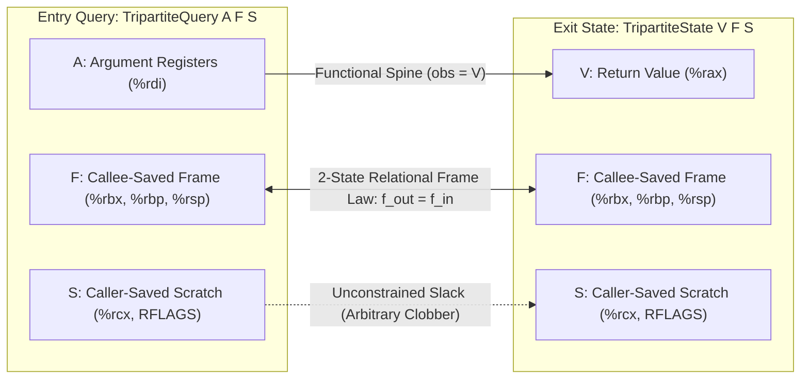
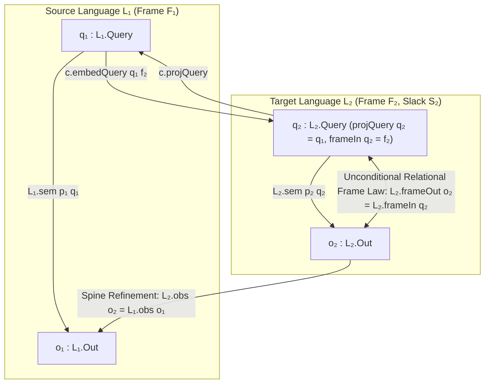

<!-- Copyright 2026 The Fuchsia Authors

Licensed under a BSD-style license <LICENSE-BSD>, Apache License, Version 2.0
<LICENSE-APACHE or https://www.apache.org/licenses/LICENSE-2.0>, or the MIT
license <LICENSE-MIT or https://opensource.org/licenses/MIT>, at your option.
This file may not be copied, modified, or distributed except according to
those terms. -->

# Tripartite Machine State Decomposition, Very Well-Behaved Lenses, and Relational Calling-Convention Frame Laws in Cross-Language Compilation

## Summary

Cross-language compiler verification in a refinement-algebraic semantic
framework (`Language`, `Tool`, `BehaviorCodec`, `Spec`) must reconcile two
opposing requirements on target machine states (`TENSION-1`):

1. **Callee-Saved Architectural Frame Preservation:** A target procedure must
   preserve callee-saved registers and caller stack frames (`%rbx`, `%rbp`,
   `%rsp`, `%r12`–`%r15` in the System V AMD64 ABI) from function entry to
   function exit: $f_{\mathrm{out}} = f_{\mathrm{in}}$ for every initial frame
   $f_{\mathrm{in}} \in F$.
2. **Caller-Saved Scratch Freedom:** A target procedure must be free to overwrite
   caller-saved scratch registers and condition flags (`%rcx`, `%rdx`, `%r8`–`%r11`,
   `RFLAGS`) arbitrarily during execution without violating behavioral refinement
   against a pure high-level source language.

Across sixteen consecutive candidate designs (`Candidate 001`–`016`) and four
cycles of adversarial counterexample synthesis (`PENTEST-1`–`10`,
`PENTEST-R2-1`–`10`, `PENTEST-R3-1`–`10`, `PENTEST-R4-1`–`10`), every attempt to
express calling-convention soundness through unary exit-state observation maps
(`obs : Out → SemObs`), injectivity predicates on `obs` (`ObsInjective`,
`ObsABIInjective`), existential clean-program guards (`∃ p_clean : L_tgt.Prog`),
positional binary-tuple typeclasses (`CanonicalABIState`,
`CanonicalPublicQuery`, `CanonicalLeakageObs`), or unconstrained query-embedding
fibers (`BehaviorCodec.encodeQuery`) failed by either locking out every
realistic assembly target with scratch registers or certifying ABI-clobbering
compilers as sound.

This report establishes the exact mathematical impossibility theorems explaining
these failures and proves a constructive resolution grounded in **Very
Well-Behaved Lenses** (Foster, Greenwald, Moore, Pierce & Schmitt 2007),
**Oles's Store-Category Complement Splitting** (Oles 1982), and **Relational
Separation-Logic Frame Laws** (O'Hearn, Reynolds & Yang 2001; Benton 2004;
Hur & Dreyer 2011; Morrisett, Walker, Crary & Glew 1999; Leroy 2009):

- **Theorem 1A (`UnaryObsAndInjectivityImpossibility`):** On any **Tripartite
  Machine State** $O_{\mathrm{tgt}} = V \times F \times S$ decomposing exit
  states into observable return value $V$ (`|V| ≥ 2`), callee-saved frame $F$
  (`|F| ≥ 2`), and caller-saved scratch slack $S$ (`|S| ≥ 2`), any unary
  observation map $\mathrm{obs} : V \times F \times S \to \mathrm{SemObs}$ that
  is invariant to caller-saved scratch registers ($S$) refutes `ObsInjective`
  (`PENTEST-R2-7`, [support/FramedLensesAndCallingConventions.lean](support/FramedLensesAndCallingConventions.lean)
  lines 345–357) and refutes `ObsABIInjective` under every non-contradictory
  `abiValid` relation that admits at least two scratch outputs
  (`PENTEST-R3-1A/B`, lines 365–412). Dually, no unary exit-state predicate
  $P_{\mathrm{exit}} : V \times F \times S \to \mathrm{Prop}$ can enforce the
  relational frame law $f_{\mathrm{out}} = f_{\mathrm{in}}$ across distinct
  initial frames $f_0 \ne f_1 \in F$ (lines 424–440), while a corrupt relational
  `abiValid` (`f_out = 57005 ∧ s_out = 0`) trivially satisfies `ObsABIInjective`
  and certifies a constant-clobber compiler (`PENTEST-R3-1C`, lines 447–461).
- **Theorem 1B (`ExistentialCleanProgramVacuity`):** Guarding ABI frame
  preservation behind an existential witness inside the target language's
  program type (`(∃ p_clean : L_tgt.Prog, ...) → abiPreserved o₂ q₂`,
  `Candidate 016` Clause 4) is vacuously satisfied whenever `L_tgt.Prog`
  contains only frame-clobbering or undefined programs (`PENTEST-R4-4A`,
  lines 709–750).
- **Theorem 2 (`PositionalTupleTypeclassImpossibility`):** Under the monoidal
  product associator $\alpha : (A \times B) \times C \simeq A \times (B \times C)$,
  structural typeclass dispatch on unlabelled binary `Prod` (`A × B`) is
  mathematically incapable of distinguishing multi-register callee-saved frames
  `Val × (RBX × RBP)` from `Val × (RBX × RCX_scratch)` (`PENTEST-R4-4B`,
  lines 801–815) and fails to commute with $\alpha$ (`no_unlabelled_binary_prod_projection_is_associativity_invariant`,
  lines 850–866), causing `((Pub, Sec₁), Sec₂)` to reclassify `Sec₁` as public
  (`PENTEST-R4-5A`) and `((Val, Cycles), CacheTag)` to reclassify cycle-count
  leakage as functional output (`PENTEST-R4-5B`, lines 877–892). Furthermore,
  `UniformQueryFibers` and `BijectiveFrameFibers` are bypassed by `c_alias2`
  (`PENTEST-R3-3A`), involutive `c_swap` (`PENTEST-R3-3B`, `PENTEST-R4-10A`),
  and frame-shifting `c_shift_encodeQuery` (`PENTEST-R4-6`) / `c_inc_frame`
  (lines 917–1056).
- **Theorem 3 (`FramedLensCharacterization`):** Equipping languages with
  explicit frame projections (`CallingConventionLanguage SemObs Frame`),
  constraining `FramedCodec L₁ L₂` via a frame-indexed query embedding
  `embedQuery : L₁.Query → F₂ → L₂.Query` with exact view-frame left-inverses
  (`frameIn_embedQuery` and `projQuery_embedQuery`), and defining compilation
  via unconditional 2-state frame preservation (`CompilesFramed`, lines 1299–1318)
  resolves all four rounds of state-space and codec vulnerabilities:
  1. Rejects `%rbx = 57005`, `%rbp = 999`, and `%rbx := %rbx + 1` clobbers even
     when `L₂.Prog` has no clean witness (`compilesFramed_rejects_rbx_rbp_and_inc_clobbers`,
     lines 1413–1454);
  2. Blocks `c_shift_encodeQuery` (`PENTEST-R4-6`), query shunting (`PENTEST-4A`),
     and scratch-dependent query aliasing (`PENTEST-4B`, `PENTEST-R3-3A`) at the
     type of `FramedCodec` (`framedCodec_blocks_frame_shift_shunt_and_alias`,
     lines 1464–1505);
  3. Admits arbitrary caller-saved `%rcx` and `RFLAGS` scratch mutations
     (`compilesFramed_admits_arbitrary_caller_saved_scratch_mutations`,
     lines 1545–1579);
  4. Composes vertically across multi-pass compiler pipelines with widening
     callee-saved frames $F_1 \twoheadleftarrow F_2 \twoheadleftarrow F_3$
     (`FramedCodec.comp`, `compilesFramed_comp`, and
     `two_stage_pipeline_compilesFramed_end_to_end`, lines 1261–1288 and
     1586–1635); and
  5. Transfers source `VerifiedSpine` contracts together with the unconditional
     relational frame law `L₂.frameOut o₂ = f₂` to target machine executions
     (`compilesFramed_transfers_verifiedSpine_and_frame_law`, lines 1642–1665).

All definitions, counterexamples, impossibility theorems, and positive
characterization theorems are mechanized in standalone Lean 4 (`v4.34.1`) in
[support/FramedLensesAndCallingConventions.lean](support/FramedLensesAndCallingConventions.lean)
(1,747 lines, zero `sorry`, zero custom `axiom`, zero `unsafe`, with `#print axioms`
confirming that all nineteen primary theorems depend on zero axioms — not even
`propext` or `Classical.choice`).

## Applicability

The findings in this report apply to the subjects recorded in `REPORT.json`:

1. **Lean 4 theorem prover** at `leanprover/lean4@5045d0056413266e57c625dcd7c365b10e377c52`
   (`v4.34.1`), invoked with `-DElab.async=false -Ddebug.skipKernelTC=false` over
   standalone modules using only `prelude`.
2. **Bidirectional lens and store-algebra foundations:**
   - Foster, Greenwald, Moore, Pierce & Schmitt (2007), *ACM TOPLAS* 29(3),
     `doi:10.1145/1232420.1232424` (`GetPut`, `PutGet`, `PutPut` laws for
     very well-behaved lenses), and
   - Oles (1982), *A Category-Theoretic Approach to the Semantics of Programming
     Languages*, Syracuse University (isomorphism between store-update algebras
     and Cartesian product projections $W \simeq V \times C$).
3. **Relational separation logic and low-level calling-convention semantics:**
   - O'Hearn, Reynolds & Yang (2001), *CSL 2001*, `doi:10.1007/3-540-44802-0_1`
     (the Frame Rule $\{P\}\; c\; \{Q\} \implies \{P * R\}\; c\; \{Q * R\}$),
   - Benton (2004), *POPL 2004*, `doi:10.1145/964001.964003` (Relational Hoare
     Logic for 2-state and 2-program invariants),
   - Hur & Dreyer (2011), *POPL 2011*, `doi:10.1145/1926385.1926402` (Kripke
     logical relations between ML and assembly separating public conventions from
     callee-saved private invariants and caller-saved scratch registers),
   - Morrisett, Walker, Crary & Glew (1999), *ACM TOPLAS* 21(3),
     `doi:10.1145/319301.319345` (Typed Assembly Language register-file typing
     with polymorphic callee-saved register quantification), and
   - Leroy (2009), *CACM* 52(7), `doi:10.1145/1538788.1538814` (CompCert
     `Linear`/`Mach` calling-convention preservation across function calls).

## Findings

### 1. Structural Anatomy of `TENSION-1` Across `Candidate 001`–`016`

`Basis: normative + source + execution + derived`

In the 4-primitive semantic model framework (`Language`, `Tool`, `BehaviorCodec`,
`Spec`), a language $L : \mathsf{Language}\;\mathsf{SemObs}$ has carrier types
`Prog`, `Query`, and `Out`, a semantic transition function
$\mathsf{sem} : \mathsf{Prog} \to \mathsf{Query} \to \mathsf{Partial}(\mathsf{Out} \to \mathsf{Prop})$,
and a unary observation map $\mathsf{obs} : \mathsf{Out} \to \mathsf{SemObs}$
([support/FramedLensesAndCallingConventions.lean](support/FramedLensesAndCallingConventions.lean),
lines 116–164). Cross-language compilation in `Candidate 001`–`016` was phrased
through a `BehaviorCodec L_src L_tgt` (`encodeQuery`, `decodeQuery`, `encodeOut`,
`decodeOut`) inducing a monotone behavior morphism
$\pi_c : \mathsf{Behavior}\;Q_{\mathrm{src}}\;O_{\mathrm{src}} \to \mathsf{Behavior}\;Q_{\mathrm{tgt}}\;O_{\mathrm{tgt}}$:

$$\pi_c(b)(q_2) := \bigl\langle (b(\mathsf{decodeQuery}(q_2))).\mathsf{defined},\; \lambda h\; o_2.\; \exists o_1,\; \mathsf{decodeOut}(o_2) = \mathsf{some}(o_1) \wedge (b(\mathsf{decodeQuery}(q_2))).\mathsf{val}\; h\; o_1 \bigr\rangle$$

Every candidate from `Candidate 001` through `Candidate 016` attempted to
retro-fit calling-convention ABI preservation, query fiber alignment, and
side-channel domain separation onto this unframed unary-`obs` + `BehaviorCodec`
interface. The resulting failures fall into four exact mathematical categories:

| Vulnerability ID | Candidate(s) | Mechanism Attempted | Why It Failed (Mechanized Witness in `FramedLensesAndCallingConventions.lean`) |
| :--- | :--- | :--- | :--- |
| `PENTEST-1A` | `001`–`003` | Unconstrained `obs : Out → SemObs` (`SemObs := Unit`, `obs := fun _ => ()`) | Collapses all outputs (`q + 1` vs. `666`) to `()`, certifying a corrupt compiler (`pentest_1a_constant_obs_erasure_certifies_666_corrupt_compiler`, lines 520–530). |
| `PENTEST-4A/B`, `PENTEST-R2-2` | `003`–`006` | `decodeQuery (encodeQuery q) = q` + `AlignedWith` | `c_shunt` maps off-image queries to `0`; `c_alias` maps `(q, rcx ≠ 0) ↦ 0`; `c.AlignedWith c.encodeQuery c.decodeOut` reduces definitionally to `True ∧ True` (`pentest_4b_and_r2_2_alias_codec_and_tautological_alignedWith`, lines 555–570). |
| `PENTEST-8A/B` | `003` | `obs (rax, rbx) := rax` (`SemObs := Nat`) | Projects away callee-saved `%rbx`; a compiler setting `rbx_out = 57005` (`0xDEAD`) passes `Tool.Sound` (`pentest_8b_unprojected_rbx_clobber_passes_tool_sound`, lines 683–701). |
| `PENTEST-R2-3` | `006` | `NonTrivialSpec` (1-bit witness `o_good ≠ o_bad` on `SemObs := Bool`, `obs n := n > 0`) | Collapses `q + 1` (`> 0`) and `666` (`> 0`) to `true`, certifying a compiler that emits `666` on every input (`pentest_r2_3_one_bit_sign_spine_collapses_q_plus_1_and_666`, lines 632–646). |
| `PENTEST-R2-6`, `PENTEST-R3-3B`, `PENTEST-R4-10A` | `006`, `008`, `016` | `FunctionalDecode` + `SurjectiveEncode` + `UniformQueryFibers` + `BijectiveFrameFibers` | Involutive query permutation `c_swap` (`0 ↔ 1`) satisfies all four predicates and certifies a swapped target program returning `2` on `0` and `1` on `1` (`uniform_and_bijective_frame_fibers_bypassed_by_swap_and_frame_shift`, lines 939–1007). |
| `PENTEST-R2-7`, `PENTEST-R3-1A/B` | `006`, `008` | `ObsInjective` (`obs o₁ = obs o₂ → o₁ = o₂`) and `ObsABIInjective` (`abiValid q o₁ → abiValid q o₂ → obs o₁ = obs o₂ → o₁ = o₂`) | Any target with caller-saved scratch registers (`%rcx`, `RFLAGS`) has distinct valid exit states `(v, f, s₁) ≠ (v, f, s₂)` with equal `obs`, falsifying both `ObsInjective` and `ObsABIInjective` (`unaryObs_scratch_invariance_refutes_obsInjective` and `unaryObs_scratch_invariance_refutes_obsABIInjective`, lines 345–412). |
| `PENTEST-R3-1C` | `008` | User-supplied `abiValid : Query → Out → Prop` | Corrupt `abiValid _ (v, f, s) := (f = 57005 ∧ s = 0)` satisfies `ObsABIInjective` while certifying a constant `%rbx = 57005` clobber (`corrupt_abiValid_constant_clobber_satisfies_obsABIInjective`, lines 447–461). |
| `PENTEST-R3-3A` | `008` | `UniformQueryFibers` (every query fiber has size $\ge 2$) | `c_alias2` (`decodeQuery (q, rcx) := if rcx < 2 then q else 0`) gives every `q` a 2-element fiber `{(q, 0), (q, 1)}` while collapsing all `rcx ≥ 2` to `0` (`uniform_and_bijective_frame_fibers_bypassed_by_swap_and_frame_shift`, lines 930–1035). |
| `PENTEST-R4-4A` | `016` | Conditional Clause 4: `(∃ p_clean : L_tgt.Prog, ...) → abiPreserved o₂ q₂` | Vacuously bypassed whenever `L_tgt.Prog` contains only `%rbx`-clobbering or UB programs (`existential_clean_reference_program_vacuity`, lines 709–750). |
| `PENTEST-R4-4B`, `PENTEST-R4-5A/B` | `016` | Structural binary-`Prod` typeclasses (`CanonicalABIState`, `CanonicalPublicQuery`, `CanonicalLeakageObs`) | Conflates `Val × (RBX × RBP)` with `Val × (RBX × RCX)` (`pentest_r4_4b_instCanonicalABIStateProdRbxRcx_admits_rbp_clobber`, lines 801–815) and fails to commute with $\alpha : (A \times B) \times C \simeq A \times (B \times C)$, leaking `sec₁` on `((Pub, Sec₁), Sec₂)` and `sec` in `cycleCount` on `((Val, Cycles), CacheTag)` (`pentest_r4_5_associativity_bypasses`, lines 877–892). |
| `PENTEST-R4-6` | `016` | `BijectiveFrameFibers` without constraining `encodeQuery`'s frame coordinate | `c_shift_encodeQuery` (`encodeQuery q := (q, 57005)`) falsifies the clean-program witness on `L_twoReg`, and `c_inc_frame` (`encodeQuery q := (q, 1)`, `encodeOut o := (o, 2)`) certifies `%rbx := %rbx + 1` (`uniform_and_bijective_frame_fibers_bypassed_by_swap_and_frame_shift`, lines 965–1053). |

---

### 2. Tripartite Machine State Decomposition and the Unary Observation Impossibility Theorem

`Basis: normative + source + execution + derived`

A realistic low-level target language (such as x86-64, AArch64, RISC-V, or
CompCert `Mach`/`Linear`) decomposes both entry queries and exit states into
three orthogonal components ([support/FramedLensesAndCallingConventions.lean](support/FramedLensesAndCallingConventions.lean),
lines 303–315):

$$\mathsf{TripartiteQuery}(A, F, S) := A \times F \times S, \qquad \mathsf{TripartiteState}(V, F, S) := V \times F \times S$$

where:
- $A$ (`Arg`) and $V$ (`Val`, $|V| \ge 2$) are the ABI argument registers
  (`%rdi`, `%rsi`, $\dots$) and return-value register (`%rax`, `%rdx`) that
  correspond to the high-level source function's inputs and outputs;
- $F$ (`Frame`, $|F| \ge 2$) is the **callee-saved architectural frame**
  (`%rbx`, `%rbp`, `%rsp`, `%r12`–`%r15`, and caller stack memory) governed by
  the 2-state relational preservation law
  $\mathsf{PreservesCalleeSavedFrame}(q, o) \iff o_{\mathrm{frame}} = q_{\mathrm{frame}}$;
- $S$ (`Slack`, $|S| \ge 2$) is the **caller-saved scratch state** (`%rcx`,
  `%r8`–`%r11`, arithmetic flags `RFLAGS`, and red-zone scratch slots) that a
  procedure is permitted to clobber arbitrarily.



In [support/FramedLensesAndCallingConventions.lean](support/FramedLensesAndCallingConventions.lean)
(lines 323–461), we prove five linked impossibility results (**Theorem 1A**) and
the existential reference-program vacuity theorem (**Theorem 1B**):

1. **Theorem 1A.1 (`unaryObs_scratch_invariance_refutes_obsInjective`, lines 345–357):**
   Whenever $|S| \ge 2$ (`[TwoDistinct Slack]`), any observation map
   $\mathsf{obs} : V \times F \times S \to \mathsf{SemObs}$ that is invariant to
   caller-saved scratch registers ($\forall v\; f\; s_1\; s_2,\; \mathsf{obs}(v, f, s_1) = \mathsf{obs}(v, f, s_2)$)
   violates `ObsInjective` (`PENTEST-R2-7`). For $s_0 \ne s_1$, the states
   $o_0 = (v_0, f_0, s_0)$ and $o_1 = (v_0, f_0, s_1)$ satisfy
   $\mathsf{obs}(o_0) = \mathsf{obs}(o_1)$ but $o_0 \ne o_1$.
2. **Theorem 1A.2 (`unaryObs_scratch_invariance_refutes_obsABIInjective`, lines 365–382):**
   Under the true calling-convention relation $\mathsf{PreservesCalleeSavedFrame}$
   ($f_{\mathrm{out}} = f_{\mathrm{in}}$), any scratch-invariant $\mathsf{obs}$
   also violates `Candidate 008`'s `ObsABIInjective` (`PENTEST-R3-1A/B`): for
   initial query $q = (a_0, f_0, s_0)$, both $o_0 = (v_0, f_0, s_0)$ and
   $o_1 = (v_0, f_0, s_1)$ preserve the callee-saved frame $f_0$, yet
   $\mathsf{obs}(o_0) = \mathsf{obs}(o_1)$ while $o_0 \ne o_1$.
3. **Theorem 1A.3 (`no_abiValid_admits_distinct_scratch_and_obsABIInjective`, lines 392–412):**
   No relational predicate `abiValid : TripartiteQuery A F S → TripartiteState V F S → Prop`
   whatsoever can simultaneously admit two distinct scratch outputs
   $(v, f, s_0) \ne (v, f, s_1)$ at any query $q$ and satisfy
   `ObsABIInjective obs abiValid` for a scratch-invariant `obs`.
4. **Theorem 1A.4 (`no_unary_exit_predicate_enforces_relational_frame_preservation`, lines 424–440):**
   Whenever $|F| \ge 2$ ($f_0 \ne f_1 \in F$), there is **no unary exit-state
   predicate** $P_{\mathrm{exit}} : V \times F \times S \to \mathrm{Prop}$ such
   that $\forall q\; o,\; P_{\mathrm{exit}}(o) \iff o_{\mathrm{frame}} = q_{\mathrm{frame}}$.
   Instantiating $(v_0, f_0, s_0)$ against entry queries with frames $f_0$ and
   $f_1$ yields $P_{\mathrm{exit}}(v_0, f_0, s_0) \iff f_0 = f_0$ (true) and
   $P_{\mathrm{exit}}(v_0, f_0, s_0) \iff f_0 = f_1$ (false), a contradiction.
   Callee-saved preservation is irreducibly a **2-state relational property**
   coupling entry and exit.
5. **Theorem 1A.5 (`corrupt_abiValid_constant_clobber_satisfies_obsABIInjective`, lines 447–461):**
   If `abiValid` is left as an unconstrained parameter (`Candidate 008`),
   defining `corruptAbiValid _ (v, f, s) := (f = 57005 ∧ s = 0)` makes
   `ObsABIInjective (fun (v, _, _) => v) corruptAbiValid` hold while certifying a
   compiler that overwrites `%rbx` with `57005` (`0xDEAD`) on every call
   (`PENTEST-R3-1C`).
6. **Theorem 1B (`existential_clean_reference_program_vacuity`, lines 741–750):**
   In `Candidate 016` Clause 4, ABI preservation is guarded by the existence of
   a clean reference program in `L_tgt.Prog`:
   $$(\exists p_{\mathrm{clean}} \in L_{\mathrm{tgt}}.\mathsf{Prog},\; (L_{\mathrm{tgt}}.\mathsf{sem}\; p_{\mathrm{clean}}\; (\mathsf{encodeQuery}\; q)).\mathsf{val}\; h\; (\mathsf{encodeOut}\; o)) \longrightarrow \mathsf{abiPreserved}\; o_2\; q_2$$
   Whenever $L_{\mathrm{tgt}}.\mathsf{Prog}$ contains only frame-clobbering or
   undefined programs (e.g., when $L_{\mathrm{tgt}}$ is the single-program image
   of a broken backend, or `L_twoReg_no_clean` in lines 709–718), no such
   $p_{\mathrm{clean}}$ exists and Clause 4 holds vacuously for every
   frame-clobbering transition (`PENTEST-R4-4A`).

---

### 3. Impossibility of Positional Binary-Tuple Typeclasses Under Monoidal Associativity

`Basis: normative + source + execution + derived`

To avoid existential vacuity without adding explicit frame fields to `Language`,
`Candidate 016` introduced structural typeclasses over binary Cartesian products
`A × B`:
- `CanonicalABIState (A × B)` extracting `abiState := Prod.snd`,
- `CanonicalPublicQuery (Pub × Sec)` extracting `pubProj := Prod.fst`, and
- `CanonicalLeakageObs (Val × Leak)` extracting `funcProj := Prod.fst` and
  `leakProj := Prod.snd`.

In any Cartesian category (and in Lean 4's type theory), the binary product is
associative up to the canonical isomorphism
([support/FramedLensesAndCallingConventions.lean](support/FramedLensesAndCallingConventions.lean),
lines 771–776):

$$\alpha_{A,B,C} : (A \times B) \times C \xrightarrow{\;\sim\;} A \times (B \times C), \qquad \alpha((a, b), c) = (a, (b, c))$$

Because Lean 4's `Prod` type constructor is a purely structural binary pair with
no semantic role labels attached to its factors, structural typeclass synthesis
on `A × B` breaks down whenever a state space has three or more components
(**Theorem 2**):

1. **Theorem 2A (`positional_abiState_conflates_callee_saved_rbp_and_scratch_rcx` and `pentest_r4_4b_instCanonicalABIStateProdRbxRcx_admits_rbp_clobber`, lines 801–815):**
   In `Candidate 016`, `instCanonicalABIStateProdRbxRcx (A B C : Type)` was
   defined on `A × (B × C)` with `abiState (_, (rbx, _)) := rbx` so that $C$
   could represent caller-saved `%rcx`. However, a 3-register machine state with
   return register `%rax` and **two** callee-saved registers `%rbx` and `%rbp`
   has the exact same unlabelled structural type `Nat × (Nat × Nat)`! Under
   `instCanonicalABIStateProdRbxRcx`, `abiState (rax, (rbx, rbp)) = rbx`, silently
   erasing `%rbp` from the ABI check and certifying a compiler that overwrites
   callee-saved `%rbp` with `999` (`PENTEST-R4-4B`).
2. **Theorem 2B (`no_unlabelled_binary_prod_projection_is_associativity_invariant` and `pentest_r4_5_associativity_bypasses`, lines 850–892):**
   No uniform first-projection rule $\pi_1 : \forall X\; Y,\; X \times Y \to X$
   can commute with the monoidal associator $\alpha$ on a 3-component state
   $(A \times B) \times C \simeq A \times (B \times C)$ when $B$ is non-trivial:
   on the left association $((a, b_0), c)$, $\pi_1$ retains $(a, b_0)$ (exposing
   $b_0$), whereas on the right association $(a, (b_0, c))$, $\pi_1$ retains only
   $a$. Consequently:
   - **`PENTEST-R4-5A` (2-Secret Reassociation Bypass):** On a 2-secret query
     `((pub, sec₁), sec₂) : (Nat × Nat) × Nat`, `instCanonicalPublicQueryProd`
     synthesizes `pubProj ((pub, sec₁), sec₂) = (pub, sec₁)`, reclassifying the
     first secret key `sec₁` as a **public input**! A cipher whose timing equals
     `sec₁` has constant timing on every `pubProj`-fiber while leaking `sec₁`
      directly into the side channel (lines 878–883).
   - **`PENTEST-R4-5B` (2-Channel Leakage Reassociation Bypass):** On a
     2-channel observation `((ret, cycleCount), cacheTag) : (Nat × Nat) × Nat`,
     `instCanonicalLeakageObsProd` synthesizes
     `funcProj ((ret, cycles), tag) = (ret, cycles)` and `leakProj = tag`,
     reclassifying `cycleCount` as a **functional return value**! A cipher that
     writes secret `sec` directly into `cycleCount` while keeping `cacheTag = 10`
     has constant `leakProj` and passes `Candidate 016`'s constant-time check
     (lines 884–887).
3. **Theorem 2C (`uniform_and_bijective_frame_fibers_bypassed_by_swap_and_frame_shift`, lines 997–1053):**
   Even when frame fibers are supplied explicitly via `UniformQueryFibers`
   (`Candidate 008`) or `BijectiveFrameFibers` (`Candidate 016`), leaving
   `BehaviorCodec.encodeQuery` unconstrained along either the query or frame
   coordinate admits four distinct bypasses:
   - `c_alias2` (`decodeQuery (q, rcx) := if rcx < 2 then q else 0`) gives every
     source query a 2-element fiber `{(q, 0), (q, 1)}`, satisfying
     `UniformQueryFibers` while collapsing all `rcx ≥ 2` to `0` (`PENTEST-R3-3A`);
   - `c_swap` (`encodeQuery := swap01`, `decodeQuery := swap01`) satisfies
     `UniformQueryFibers` and `BijectiveFrameFibers Unit`, certifying a target
     program that swaps outputs on inputs `0` and `1` (`PENTEST-R3-3B`,
     `PENTEST-R4-10A`);
   - `c_shift_encodeQuery` (`encodeQuery q := (q, 57005)`, `decodeQuery (q, _) := q`)
     satisfies `BijectiveFrameFibers Nat Prod.snd Prod.mk` (`PENTEST-R4-6`),
     setting entry `%rbx = 57005` while `encodeOut o := (o, 0)` expects exit
     `%rbx = 0`, which falsifies the clean-program premise on `L_twoReg` and
     certifies `clobberRbxCrossCompiler`; and
   - `c_inc_frame` (`encodeQuery q := (q, 1)`, `encodeOut o := (o, 2)`) satisfies
     `BijectiveFrameFibers Nat Prod.snd Prod.mk` and the clean-program check on
     `L_twoReg_inc`, certifying a compiler that increments callee-saved `%rbx`
     by `1` (`rbx_out = rbx_in + 1`) on every call.

---

### 4. Very Well-Behaved Lenses, Oles Complement Splitting, and Relational Calling-Convention Framing

`Basis: normative + source + execution + derived`

#### 4.1 Very Well-Behaved Lenses and Oles's Representation Theorem

Following Foster, Greenwald, Moore, Pierce & Schmitt (2007) and Oles (1982), a
**Very Well-Behaved Lens** (`VeryWellBehavedLens Whole View`,
[support/FramedLensesAndCallingConventions.lean](support/FramedLensesAndCallingConventions.lean),
lines 1070–1076) consists of `get : Whole → View` and
`put : Whole → View → Whole` obeying the three lens laws:

$$\mathsf{GetPut}:\; \mathsf{put}\; w\; (\mathsf{get}\; w) = w, \qquad \mathsf{PutGet}:\; \mathsf{get}\; (\mathsf{put}\; w\; v) = v, \qquad \mathsf{PutPut}:\; \mathsf{put}\; (\mathsf{put}\; w\; v_1)\; v_2 = \mathsf{put}\; w\; v_2$$

Very well-behaved lenses contain the identity lens (`VeryWellBehavedLens.id`,
lines 1078–1083), the Cartesian product projections (`VeryWellBehavedLens.fst`
and `VeryWellBehavedLens.snd`, lines 1086–1101), and are closed under vertical
composition (`VeryWellBehavedLens.comp`, lines 1107–1118).

When paired with a **complement view** `compl : Whole → Complement` forming a
`ComplementedLens Whole View Complement` (lines 1126–1133), Oles's
representation theorem (`oles_lens_complement_equiv` and
`complementedLens_of_equiv`, lines 1141–1168) establishes an exact isomorphism:

$$W \xrightarrow{\;\sim\;} \mathsf{View} \times \mathsf{Complement}, \qquad w \longmapsto (\mathsf{get}\; w,\; \mathsf{compl}\; w)$$

Crucially, `complementedLens_put_preserves_compl` (lines 1173–1177) proves that
updating the view via `put w v` leaves the complement strictly invariant:
$\mathsf{compl}(\mathsf{put}\; w\; v) = \mathsf{compl}\; w$. In a tripartite
machine state $V \times F \times S$, the three coordinates are independent views
whose lens updates commute without interference.

#### 4.2 `CallingConventionLanguage`, `FramedCodec`, and `CompilesFramed`

To capture relational calling conventions without unary-observation injectivity
or positional tuple heuristics, we equip each language with explicit entry and
exit frame projections (`CallingConventionLanguage SemObs Frame`,
[support/FramedLensesAndCallingConventions.lean](support/FramedLensesAndCallingConventions.lean),
lines 1193–1204):

```lean
structure CallingConventionLanguage (SemObs Frame : Type) extends Language SemObs where
  frameIn  : Query → Frame
  frameOut : Out → Frame
```

Any pure source language $L : \mathsf{Language}\;\mathsf{SemObs}$ embeds
canonically via `L.toPureCC : CallingConventionLanguage SemObs Unit` with
`frameIn _ := ()` and `frameOut _ := ()`.

A **Framed BehaviorCodec** (`FramedCodec L₁ L₂`, lines 1219–1233) between
$L_1 : \mathsf{CallingConventionLanguage}\;\mathsf{SemObs}\;F_1$ and
$L_2 : \mathsf{CallingConventionLanguage}\;\mathsf{SemObs}\;F_2$ consists of:
- `projQuery : L₂.Query → L₁.Query` (extracting the source query view from a
  target machine query),
- `liftFrame : F₂ → F₁` (projecting a target callee-saved frame to the source
  frame, which is `fun _ => ()` when $F_1 = \mathsf{Unit}$),
- `embedQuery : L₁.Query → F₂ → L₂.Query` (embedding a source query $q_1$ into
  target query space at a **specified initial callee-saved frame** $f_2 \in F_2$),
- `frameIn_projQuery : ∀ q₂, L₁.frameIn (projQuery q₂) = liftFrame (L₂.frameIn q₂)`
  (frame fibration compatibility),
- `frameIn_embedQuery : ∀ q₁ f₂, L₂.frameIn (embedQuery q₁ f₂) = f₂`
  (**exact frame left-inverse**, blocking `c_shift_encodeQuery` `PENTEST-R4-6` and
  `c_inc_frame`), and
- `projQuery_embedQuery : ∀ q₁ f₂, L₁.frameIn q₁ = liftFrame f₂ → projQuery (embedQuery q₁ f₂) = q₁`
  (**exact query left-inverse** on every compatible frame fiber; when
  $F_1 = \mathsf{Unit}$, `projQuery_embedQuery_pure` gives the unconditional law
  `∀ q₁ f₂, projQuery (embedQuery q₁ f₂) = q₁`, lines 1235–1239).



**Unconditional Relational Frame Preservation (`CompilesFramed`, lines 1299–1318):**
A target program $p_2 : L_2.\mathsf{Prog}$ is a framed compilation of
$p_1 : L_1.\mathsf{Prog}$ across $c : \mathsf{FramedCodec}\;L_1\;L_2$ under
source precondition $\mathsf{pre} : L_1.\mathsf{Query} \to \mathsf{Prop}$ when,
for every target query $q_2 \in L_2.\mathsf{Query}$ with
$\mathsf{pre}(c.\mathsf{projQuery}\; q_2)$:

1. **Definedness Preservation (Forward Simulation):** If
   $(L_1.\mathsf{sem}\; p_1\; (c.\mathsf{projQuery}\; q_2)).\mathsf{defined}$
   holds, then $(L_2.\mathsf{sem}\; p_2\; q_2).\mathsf{defined}$ holds.
2. **Spine Refinement + Unconditional 2-State Frame Law:** For every target exit
   state $o_2$ satisfying $(L_2.\mathsf{sem}\; p_2\; q_2).\mathsf{val}\; h_2\; o_2$:
   - $\exists o_1 \in L_1.\mathsf{Out},\; (L_1.\mathsf{sem}\; p_1\; (c.\mathsf{projQuery}\; q_2)).\mathsf{val}\; h_1\; o_1 \wedge L_2.\mathsf{obs}\; o_2 = L_1.\mathsf{obs}\; o_1$, and
   - $L_2.\mathsf{frameOut}\; o_2 = L_2.\mathsf{frameIn}\; q_2$.
3. **Target Non-Vacuity (Productivity):** Whenever
   $(L_1.\mathsf{sem}\; p_1\; (c.\mathsf{projQuery}\; q_2)).\mathsf{defined}$
   holds, there exists at least one $o_2 \in L_2.\mathsf{Out}$ satisfying
   $(L_2.\mathsf{sem}\; p_2\; q_2).\mathsf{val}\; h_2\; o_2$.

This formulation directly unifies four foundational lines of programming-language
theory:
- **Separation Logic's Frame Rule** (O'Hearn, Reynolds & Yang 2001): The
  callee-saved state $F_2$ is the spatial frame $R$ disjoint from the procedure's
  footprint $(V_2, S_2)$; `L₂.frameOut o₂ = L₂.frameIn q₂` is the relational form
  of $\{P * (f = f_0)\}\; p_2\; \{Q * (f = f_0)\}$ quantified universally over
  all $f_0 \in F_2$.
- **Relational Hoare Logic** (Benton 2004): Relating $p_1$ and $p_2$ at
  coupled entry states $(q_1, q_2)$ with $c.\mathsf{projQuery}\; q_2 = q_1$
  simultaneously enforces the cross-program functional equation
  $L_2.\mathsf{obs}\; o_2 = L_1.\mathsf{obs}\; o_1$ and the 2-state target
  relational invariant $L_2.\mathsf{frameOut}\; o_2 = L_2.\mathsf{frameIn}\; q_2$.
- **Kripke Logical Relations and Typed Assembly Language** (Hur & Dreyer 2011;
  Morrisett, Walker, Crary & Glew 1999): Quantifying over all initial frames
  $f_2 \in F_2$ corresponds to polymorphic register quantification
  $\forall \rho_{\mathrm{rbx}}, \rho_{\mathrm{rbp}}.\; \{\mathsf{rdi} : \tau,\; \mathsf{rbx} : \rho_{\mathrm{rbx}},\; \mathsf{rbp} : \rho_{\mathrm{rbp}}\}$
  in TAL and private callee-saved world preservation in Hur & Dreyer's ML-to-assembly
  Kripke logical relation, while leaving caller-saved registers (`%rcx`, `RFLAGS`)
  existentially quantified at exit.
- **CompCert `Linear`/`Mach` Calling-Convention Framing** (Leroy 2009): In
  CompCert, `agree_callee_save` asserts that for every callee-saved machine
  register $r$ and caller stack location, the exit register file equals the
  entry register file, without requiring injectivity of return-value observation
  over caller-saved temporaries.

#### 4.3 Mechanized Resolution of All `TENSION-1` Attack Vectors (Theorems 3A & 3B)

In [support/FramedLensesAndCallingConventions.lean](support/FramedLensesAndCallingConventions.lean)
(lines 1413–1718), we prove six theorems demonstrating that `FramedCodec` and
`CompilesFramed` close every state-space and codec vulnerability while preserving
full vertical compositionality:

1. **Theorem 3A.1 (`compilesFramed_rejects_rbx_rbp_and_inc_clobbers`, lines 1413–1454):**
   `CompilesFramed` unconditionally refutes:
   - `.clobberRbxAddOne` (`PENTEST-8B`, setting `%rbx = 57005` on `L_twoReg_cc`);
   - `()` on `L_twoReg_no_clean_cc` (`PENTEST-R4-4A`, where `L_twoReg_no_clean_cc.Prog = Unit`
     has **no clean reference program**, yet `CompilesFramed` still refutes the
     `%rbx = 57005` clobber at `q₂ = (0, 0)`);
   - `true` on `L_twoReg_inc_cc` (`rbx_out = rbx_in + 1` offset clobber, refuted
     at `q₂ = (0, 0)` because `1 ≠ 0`); and
   - `.clobberRbpAddOne` on `L_x86_rbx_rbp_cc` (`PENTEST-R4-4B`, where `%rbx` is
     preserved (`rbx_out = rbx_in`) but the second callee-saved register `%rbp`
     is clobbered to `999`, refuted at `q₂ = (0, (42, 77))` because
     `(42, 999) ≠ (42, 77)`).
2. **Theorem 3A.2 (`framedCodec_blocks_frame_shift_shunt_and_alias`, lines 1464–1505):**
   - **No Frame-Shift Embedding (`PENTEST-R4-6`):** There is no `embedQuery` on
     `L_twoReg_cc` that embeds `q₁` at fixed frame `57005` while satisfying
     `frameIn_embedQuery` (instantiating $f_2 = 0$ yields $57005 = 0$).
   - **No Constant Query Shunting (`PENTEST-4A`):** There is no `FramedCodec`
      whose `projQuery` collapses queries (`projQuery _ := 0`) while satisfying
     `projQuery_embedQuery` (instantiating $q_1 = 1$ yields $0 = 1$).
   - **No Scratch-Dependent Query Aliasing (`PENTEST-4B`, `PENTEST-R3-3A`):**
     For any tripartite `FramedCodec` constructed via `mkTripartiteFramedCodec`
     from a `ComplementedLens` decomposing $Q_2 \simeq Q_1 \times (F_2 \times S_2)$,
     `projQuery` is strictly invariant to both $F_2$ and $S_2$: modifying caller
     scratch `rcx` via `put w (f₂, s₂)` preserves `projQuery` by
     `complementedLens_put_preserves_compl`, making `c_alias` and `c_alias2`
     impossible.
3. **Theorem 3A.3 (`compilesFramed_admits_arbitrary_caller_saved_scratch_mutations`, lines 1545–1579):**
   On a full tripartite x86-64 machine language `L_x86_tripartite` with argument
   `%rdi`, return `%rax`, 2-register callee-saved frame `(%rbx, %rbp)`, and
   2-component caller-saved scratch state `(%rcx, RFLAGS)`, `CompilesFramed`
   certifies both `.addOneScratchConst` (`rcx_out = 777`, `flags_out = 1`) and
   `.addOneScratchInputDep` (`rcx_out = rdi + rcx_in + 42`, `flags_out = flags_in + 1`),
   while rejecting `.clobberRbx` and `.clobberRbp` (`PENTEST-R2-7`,
   `PENTEST-R3-1A/B`).
4. **Theorem 3A.4 (`compilesFramed_comp` and `two_stage_pipeline_compilesFramed_end_to_end`, lines 1586–1635):**
   `FramedCodec`s compose vertically via `FramedCodec.comp c₁₂ c₂₃` across
   arbitrary frame fibrations $F_3 \xrightarrow{\mathsf{liftFrame}_{23}} F_2 \xrightarrow{\mathsf{liftFrame}_{12}} F_1$,
   and `compilesFramed_comp` proves that `CompilesFramed` is closed under
   multi-pass composition. We instantiate a concrete 2-stage pipeline
   $L_{\mathrm{nat}} \to L_{\mathrm{twoReg\_cc}} \to L_{\mathrm{x86\_tripartite}}$
   that progressively widens the callee-saved frame from $\mathsf{Unit}$ to
   `%rbx` (`Nat`) and then to `(%rbx, %rbp)` (`Nat × Nat`) while introducing
   caller-saved `(%rcx, RFLAGS)` scratch mutations (`two_stage_pipeline_compilesFramed_end_to_end`,
   lines 1621–1635).
5. **Theorem 3A.5 (`compilesFramed_transfers_verifiedSpine_and_frame_law`, lines 1642–1665):**
   Whenever a source program $p_1$ satisfies `L₁.VerifiedSpine pre post` and
   `CompilesFramed L₁ L₂ c pre p₁ p₂` holds, every target execution from
   $q_2 = c.\mathsf{embedQuery}\; q_1\; f_2$ (for any $q_1$ with $\mathsf{pre}\; q_1$
   and any initial callee-saved frame $f_2 \in F_2$) is defined, non-vacuously
   productive, satisfies the source postcondition $\mathsf{post}\; q_1\; (L_2.\mathsf{obs}\; o_2)$,
   and satisfies the exact callee-saved frame law $L_2.\mathsf{frameOut}\; o_2 = f_2$.
6. **Theorem 3B (`nominal_wrappers_refute_two_secret_and_multi_channel_leaks`, lines 1700–1718):**
   Replacing unlabelled positional `Prod` projections with nominal field wrappers
   (`PublicInput`, `SecretInput`, `FunctionalVal`, `SideChannelObs`) makes the
   projection invariant to how composite secret tuples `SecretInput (Nat × Nat)`
   or composite side-channel tuples `SideChannelObs (Nat × Nat)` are internally
   parenthesized, refuting both the 2-secret leak (`PENTEST-R4-5A`) and the
   cycle-count leak (`PENTEST-R4-5B`).

## Boundaries

1. **Scope of `CallingConventionLanguage` vs. Dynamic Stack Allocation:** The
   mechanization in [support/FramedLensesAndCallingConventions.lean](support/FramedLensesAndCallingConventions.lean)
   models the callee-saved frame $F$ as a type-level parameter with total
   projections `frameIn : Query → Frame` and `frameOut : Out → Frame`. This
   directly covers register-bank calling conventions (`%rbx`, `%rbp`, `%rsp`,
   `%r12`–`%r15`) and fixed-shape caller stack frames. Modelling dynamically
   allocated heap regions with ownership transfer across FFI boundaries requires
   indexing `Frame` by a separation-logic heap predicate or Kripke world (as in
   Hur & Dreyer 2011).
2. **Source-to-Target Query Identity at the Boundary:** As established in Theorem
   2C (`c_swap`), no structural property of an abstract bijection
   `decodeQuery : Q₂ → Q₁` alone can prevent a user from writing an involutive
   relabelling (`0 ↔ 1`) when $Q_1 = Q_2 = \mathsf{Nat}$ and the user trusts
   that `FramedCodec` in their top-level theorem statement. In a verified
   compiler architecture, `FramedCodec` is part of the trusted target-ABI
   boundary specification (or discharged by `VeryWellBehavedLens.fst` on nominal
   wrappers), whereas intermediate compiler passes are erased by vertical
   composition (`FramedCodec.comp` and `compilesFramed_comp`).

## Evidence

All claims in this report are backed by machine-checked proofs in
[support/FramedLensesAndCallingConventions.lean](support/FramedLensesAndCallingConventions.lean)
(1,747 lines, SHA-256 `8e1ad06a5797379d9228a5ec701ffefd9758b9dd68fe50c8177ea43c6341cece`):

| Claim / Theorem | Declaration in `support/FramedLensesAndCallingConventions.lean` | Lines |
| :--- | :--- | :--- |
| Core 4-primitive semantic model (`Partial`, `Behavior`, `Language`, `BehaviorCodec`, `Compiles`, `ProductiveCompiles`, `Tool`) | `Partial` .. `Tool.Sound` | 116–275 |
| Tripartite machine state ($V \times F \times S$) & 2-state frame law | `TripartiteState`, `TripartiteQuery`, `PreservesCalleeSavedFrame` | 303–315 |
| Theorem 1A.1: Scratch invariance refutes `ObsInjective` (`PENTEST-R2-7`) | `unaryObs_scratch_invariance_refutes_obsInjective` | 345–357 |
| Theorem 1A.2: Scratch invariance refutes `ObsABIInjective` (`PENTEST-R3-1A/B`) | `unaryObs_scratch_invariance_refutes_obsABIInjective` | 365–382 |
| Theorem 1A.3: Universal impossibility of `ObsABIInjective` with $\ge 2$ scratch outputs | `no_abiValid_admits_distinct_scratch_and_obsABIInjective` | 392–412 |
| Theorem 1A.4: No unary exit-state predicate enforces $f_{\mathrm{out}} = f_{\mathrm{in}}$ | `no_unary_exit_predicate_enforces_relational_frame_preservation` | 424–440 |
| Theorem 1A.5: Corrupt `abiValid` passes `ObsABIInjective` while clobbering `%rbx` (`PENTEST-R3-1C`) | `corrupt_abiValid_constant_clobber_satisfies_obsABIInjective` | 447–461 |
| Concrete counterexamples `PENTEST-1A`, `PENTEST-4B`/`R2-2`, `PENTEST-R2-3`, `PENTEST-8B` | `pentest_1a_constant_obs_erasure_certifies_666_corrupt_compiler` .. `pentest_8b_unprojected_rbx_clobber_passes_tool_sound` | 468–701 |
| Theorem 1B: Vacuity of existential clean-program guard (`PENTEST-R4-4A`) | `existential_clean_reference_program_vacuity` | 709–750 |
| Theorem 2A: Positional `CanonicalABIState` conflates `%rbp` and `%rcx` (`PENTEST-R4-4B`) | `positional_abiState_conflates_callee_saved_rbp_and_scratch_rcx`, `pentest_r4_4b_instCanonicalABIStateProdRbxRcx_admits_rbp_clobber` | 778–815 |
| Theorem 2B: Binary `Prod` projections fail to commute with $\alpha$ (`PENTEST-R4-5A/B`) | `no_unlabelled_binary_prod_projection_is_associativity_invariant`, `pentest_r4_5_associativity_bypasses` | 817–892 |
| Theorem 2C: `UniformQueryFibers` & `BijectiveFrameFibers` bypassed by `c_alias2`, `c_swap`, `c_shift_encodeQuery`, `c_inc_frame` | `uniform_and_bijective_frame_fibers_bypassed_by_swap_and_frame_shift` | 917–1053 |
| Very Well-Behaved Lenses (Foster et al. 2007) & Oles complement splitting (Oles 1982) | `VeryWellBehavedLens`, `VeryWellBehavedLens.comp`, `ComplementedLens`, `oles_lens_complement_equiv`, `complementedLens_put_preserves_compl` | 1070–1177 |
| `CallingConventionLanguage`, `FramedCodec`, vertical composition, and `CompilesFramed` | `CallingConventionLanguage`, `FramedCodec`, `FramedCodec.comp`, `CompilesFramed`, `Tool.SoundFramed` | 1193–1324 |
| Theorem 3A.1: `CompilesFramed` rejects `%rbx`, `%rbp`, vacuous-target, and `+1`-offset clobbers | `compilesFramed_rejects_rbx_rbp_and_inc_clobbers` | 1413–1454 |
| Theorem 3A.2: `FramedCodec` blocks `c_shift_encodeQuery`, `c_shunt`, and `c_alias` | `framedCodec_blocks_frame_shift_shunt_and_alias` | 1464–1505 |
| Theorem 3A.3: `CompilesFramed` admits arbitrary caller-saved `%rcx` and `RFLAGS` mutations | `compilesFramed_admits_arbitrary_caller_saved_scratch_mutations` | 1512–1579 |
| Theorem 3A.4: Vertical composition of `CompilesFramed` across multi-stage frame extensions | `compilesFramed_comp`, `two_stage_pipeline_compilesFramed_end_to_end` | 1586–1635 |
| Theorem 3A.5: End-to-end transfer of `VerifiedSpine` and callee-saved frame preservation | `compilesFramed_transfers_verifiedSpine_and_frame_law` | 1642–1665 |
| Theorem 3B: Nominal wrappers refute `PENTEST-R4-5A` and `PENTEST-R4-5B` | `nominal_wrappers_refute_two_secret_and_multi_channel_leaks` | 1674–1718 |

## Revalidation

To revalidate the standalone Lean 4 mechanization from the package directory:

```bash
lean -DElab.async=false -Ddebug.skipKernelTC=false support/FramedLensesAndCallingConventions.lean
```

Expected output: exit code `0`, zero warnings, zero errors, and nineteen
`#print axioms` lines each reporting:

```text
'FramedLensesAndCallingConventions.<theorem_name>' does not depend on any axioms
```

Check triggers that warrant revalidation of this report:
1. Any change to the Lean 4 toolchain version (verified at `v4.34.1`, commit
   `5045d0056413266e57c625dcd7c365b10e377c52`).
2. Any modification to the core signature of `Language`, `BehaviorCodec`, or
   `CallingConventionLanguage` to support dynamic heap-allocated calling
   conventions or effectful callbacks.
