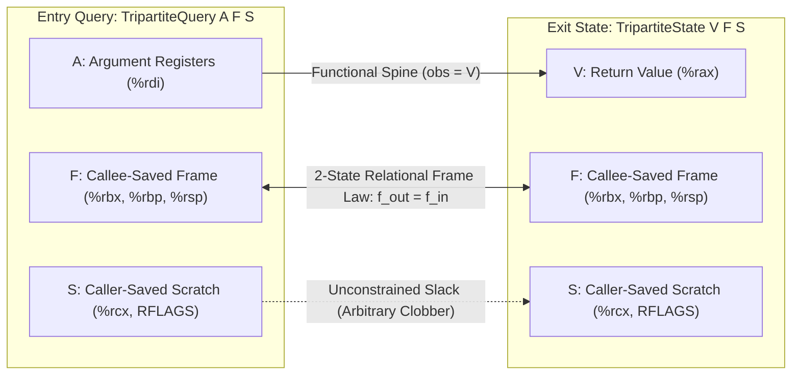
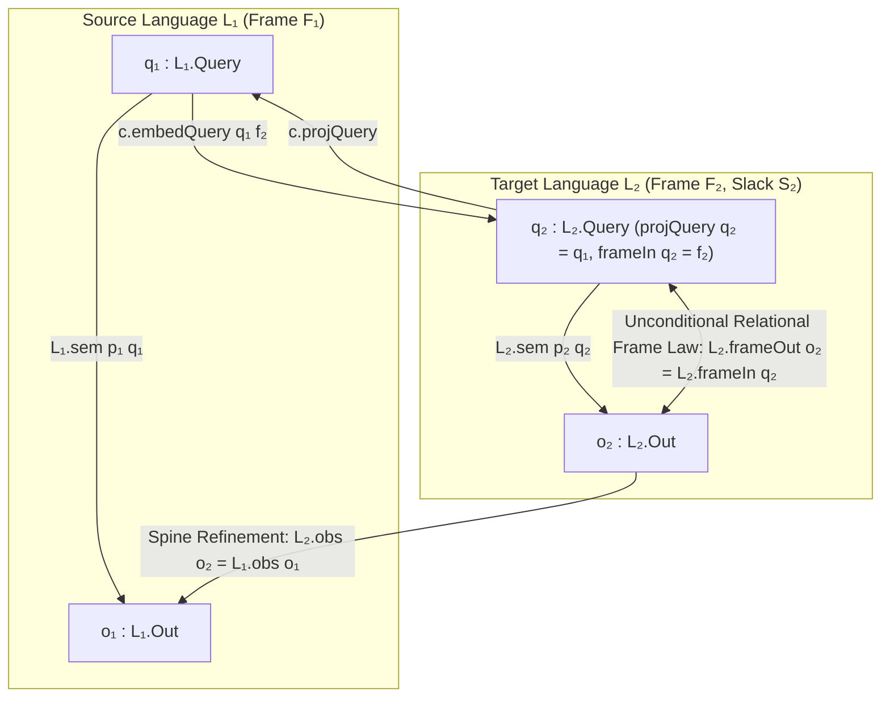

# Framed Lenses, Relational Hyperproperties, Inductive Inference Over-Approximation, and Putnam's Permutation Boundary in Semantic Verification

## Summary

### Part I — Tripartite Machine State Decomposition, Very Well-Behaved Lenses, and Relational Calling-Convention Frame Laws

Cross-language compiler verification in a refinement-algebraic semantic
framework (`Language`, `Tool`, `BehaviorCodec`, `Spec`) must reconcile two
opposing requirements on target machine states (`TENSION-1`):

1. **Callee-Saved Architectural Frame Preservation:** A target procedure must
   preserve callee-saved registers and caller stack frames (`%rbx`, `%rbp`,
   `%rsp`, `%r12`–`%r15` in the System V AMD64 ABI) from function entry to
   function exit: $f_{\mathrm{out}} = f_{\mathrm{in}}$ for every initial frame
   $f_{\mathrm{in}} \in F$.
2. **Caller-Saved Scratch Freedom:** A target procedure must be free to overwrite
   caller-saved scratch registers and condition flags (`%rcx`, `%rdx`, `%r8`–`%r11`,
   `RFLAGS`) arbitrarily during execution without violating behavioral refinement
   against a pure high-level source language.

Across sixteen consecutive candidate designs (`Candidate 001`–`016`) and four
cycles of adversarial counterexample synthesis (`PENTEST-1`–`10`,
`PENTEST-II-1`–`10`, `PENTEST-III-1`–`10`, `PENTEST-IV-1`–`10`), every attempt to
express calling-convention soundness through unary exit-state observation maps
(`obs : Out → SemObs`), injectivity predicates on `obs` (`ObsInjective`,
`ObsABIInjective`), existential clean-program guards (`∃ p_clean : L_tgt.Prog`),
positional binary-tuple typeclasses (`CanonicalABIState`,
`CanonicalPublicQuery`, `CanonicalLeakageObs`), or unconstrained query-embedding
fibers (`BehaviorCodec.encodeQuery`) failed by either locking out every
realistic assembly target with scratch registers or certifying ABI-clobbering
compilers as sound.

This report establishes the exact mathematical impossibility theorems explaining
these failures and proves a constructive resolution grounded in **Very
Well-Behaved Lenses** (Foster, Greenwald, Moore, Pierce & Schmitt 2007),
**Oles's Store-Category Complement Splitting** (Oles 1982), and **Relational
Separation-Logic Frame Laws** (O'Hearn, Reynolds & Yang 2001; Benton 2004;
Hur & Dreyer 2011; Morrisett, Walker, Crary & Glew 1999; Leroy 2009):

- **Theorem 1A (`UnaryObsAndInjectivityImpossibility`):** On any **Tripartite
  Machine State** $O_{\mathrm{tgt}} = V \times F \times S$ decomposing exit
  states into observable return value $V$ (`|V| ≥ 2`), callee-saved frame $F$
  (`|F| ≥ 2`), and caller-saved scratch slack $S$ (`|S| ≥ 2`), any unary
  observation map $\mathrm{obs} : V \times F \times S \to \mathrm{SemObs}$ that
  is invariant to caller-saved scratch registers ($S$) refutes `ObsInjective`
  (`PENTEST-II-7`, [support/FramedLensesAndCallingConventions.lean](support/FramedLensesAndCallingConventions.lean)
  lines 345–357) and refutes `ObsABIInjective` under every non-contradictory
  `abiValid` relation that admits at least two scratch outputs
  (`PENTEST-III-1A/B`, lines 365–412). Dually, no unary exit-state predicate
  $P_{\mathrm{exit}} : V \times F \times S \to \mathrm{Prop}$ can enforce the
  relational frame law $f_{\mathrm{out}} = f_{\mathrm{in}}$ across distinct
  initial frames $f_0 \ne f_1 \in F$ (lines 424–440), while a corrupt relational
  `abiValid` (`f_out = 57005 ∧ s_out = 0`) trivially satisfies `ObsABIInjective`
  and certifies a constant-clobber compiler (`PENTEST-III-1C`, lines 447–461).
- **Theorem 1B (`ExistentialCleanProgramVacuity`):** Guarding ABI frame
  preservation behind an existential witness inside the target language's
  program type (`(∃ p_clean : L_tgt.Prog, ...) → abiPreserved o₂ q₂`,
  `Candidate 016` Clause 4) is vacuously satisfied whenever `L_tgt.Prog`
  contains only frame-clobbering or undefined programs (`PENTEST-IV-4A`,
  lines 709–750).
- **Theorem 2 (`PositionalTupleTypeclassImpossibility`):** Under the monoidal
  product associator $\alpha : (A \times B) \times C \simeq A \times (B \times C)$,
  structural typeclass dispatch on unlabelled binary `Prod` (`A × B`) is
  mathematically incapable of distinguishing multi-register callee-saved frames
  `Val × (RBX × RBP)` from `Val × (RBX × RCX_scratch)` (`PENTEST-IV-4B`,
  lines 801–815) and fails to commute with $\alpha$ (`no_unlabelled_binary_prod_projection_is_associativity_invariant`,
  lines 850–866), causing `((Pub, Sec₁), Sec₂)` to reclassify `Sec₁` as public
  (`PENTEST-IV-5A`) and `((Val, Cycles), CacheTag)` to reclassify cycle-count
  leakage as functional output (`PENTEST-IV-5B`, lines 877–892). Furthermore,
  `UniformQueryFibers` and `BijectiveFrameFibers` are bypassed by `c_alias2`
  (`PENTEST-III-3A`), involutive `c_swap` (`PENTEST-III-3B`, `PENTEST-IV-10A`),
  and frame-shifting `c_shift_encodeQuery` (`PENTEST-IV-6`) / `c_inc_frame`
  (lines 917–1056).
- **Theorem 3 (`FramedLensCharacterization`):** Equipping languages with
  explicit frame projections (`CallingConventionLanguage SemObs Frame`),
  constraining `FramedCodec L₁ L₂` via a frame-indexed query embedding
  `embedQuery : L₁.Query → F₂ → L₂.Query` with exact view-frame left-inverses
  (`frameIn_embedQuery` and `projQuery_embedQuery`), and defining compilation
  via unconditional 2-state frame preservation (`CompilesFramed`, lines 1299–1318)
  resolves all four rounds of state-space and codec vulnerabilities:
  1. Rejects `%rbx = 57005`, `%rbp = 999`, and `%rbx := %rbx + 1` clobbers even
     when `L₂.Prog` has no clean witness (`compilesFramed_rejects_rbx_rbp_and_inc_clobbers`,
     lines 1413–1454);
  2. Blocks `c_shift_encodeQuery` (`PENTEST-IV-6`), query shunting (`PENTEST-4A`),
     and scratch-dependent query aliasing (`PENTEST-4B`, `PENTEST-III-3A`) at the
     type of `FramedCodec` (`framedCodec_blocks_frame_shift_shunt_and_alias`,
     lines 1464–1505);
  3. Admits arbitrary caller-saved `%rcx` and `RFLAGS` scratch mutations
     (`compilesFramed_admits_arbitrary_caller_saved_scratch_mutations`,
     lines 1545–1579);
  4. Composes vertically across multi-pass compiler pipelines with widening
     callee-saved frames $F_1 \twoheadleftarrow F_2 \twoheadleftarrow F_3$
     (`FramedCodec.comp`, `compilesFramed_comp`, and
     `two_stage_pipeline_compilesFramed_end_to_end`, lines 1261–1288 and
     1586–1635); and
  5. Transfers source `VerifiedSpine` contracts together with the unconditional
     relational frame law `L₂.frameOut o₂ = f₂` to target machine executions
     (`compilesFramed_transfers_verifiedSpine_and_frame_law`, lines 1642–1665).

All definitions, counterexamples, impossibility theorems, and positive
characterization theorems are mechanized in standalone Lean 4 (`v4.34.1`) in
[support/FramedLensesAndCallingConventions.lean](support/FramedLensesAndCallingConventions.lean)
(1,747 lines, zero `sorry`, zero custom `axiom`, zero `unsafe`, with `#print axioms`
confirming that all nineteen primary theorems depend on zero axioms — not even
`propext` or `Classical.choice`).

### Part II — Hyperproperties, Relational Bisimulation 2-Safety, Bounded Nondeterminism, and McLean's Refinement Paradox

- **1-Trace Blindness vs. Demonic Self-Composition (`Theorem 1A` & `Theorem 1B`):** A 1-trace specification `Spec` (`Language.VerifiedSpineOn`) predicates over individual `(Query, SemObs)` execution pairs (`Clarkson & Schneider 2010`). When `SemObs` projects only functional outputs (`obs o := o.1`), a constant-time cipher `.ctCipher` (`o = (pub + 1, 10)`) and a key-leaking cipher `.leakyCipher` (`o = (pub + 1, sec)`) induce identical 1-trace behaviors and satisfy the exact same 1-trace specifications (`PENTEST-7`, [theorem1a_one_trace_blind_to_two_safety](support/HyperpropertiesBisimulationAndRefinementParadox.lean)). Conversely, encoding 2-safety via demonic self-composition on the product language `L.diag` (`Barthe, D'Argenio & Rezk 2004`; `Terauchi & Aiken 2005`) is logically equivalent to possibilistic non-interference (`Language.NonInterferingOn`) **conjoined with per-query leakage determinism** (`Language.LeakageDeterministicOn`, [theorem1b_diag_iff_possibilistic_ni_and_leakage_deterministic](support/HyperpropertiesBisimulationAndRefinementParadox.lean)). Consequently, demonic self-composition `L.diag` unconditionally locks out every program with secret-independent nondeterministic timing jitter $t \in \{10, 11\}$ (`PENTEST-II-9B`, [pentest_r2_9b_demonic_diag_locks_out_secret_independent_jitter](support/HyperpropertiesBisimulationAndRefinementParadox.lean)), while a timing-only diagonal postcondition that omits 1-trace functional correctness certifies functionally broken constant-zero implementations (`PENTEST-II-9A`, [pentest_r2_9a_timing_only_diag_certifies_badCipher](support/HyperpropertiesBisimulationAndRefinementParadox.lean)).
- **One-Way Simulation Failure vs. Indexed Security Domain Bisimulation (`Theorem 2A` & `Theorem 2B`):** One-directional existential 2-safety (`Language.NonInterferingOn`: $\text{lowEq}(q_1, q_2) \to \forall v_1 \in \text{Obs}(p, q_1),\ \exists v_2 \in \text{Obs}(p, q_2),\ \text{leakEq}(v_1, v_2)$) is unsound under any non-symmetric preorder `lowEq` (such as $\text{pub}_1 = \text{pub}_2 \wedge \text{sec}_1 \le \text{sec}_2$): a cipher `.subsetLeakyCipher` with timing $\{10\}$ at $\text{sec} = 0$ and $\{10, 20\}$ at $\text{sec} > 0$ passes one-way simulation even though observing $t = 20$ leaks $\text{sec} > 0$ with 100% certainty (`PENTEST-III-7`, [pentest_r3_7_asymmetric_one_way_ni_admits_subset_leak](support/HyperpropertiesBisimulationAndRefinementParadox.lean)). Furthermore, even two-way simulation (`Language.SymmetricBiNonInterferingOn`) is bypassed when `lowEq` is trivial (`Eq`, `PENTEST-II-9`) or punctured at master keys ($\text{sec} \ge 2$, `PENTEST-III-6B`), when `leakEq` erases the side-channel projection (`PENTEST-III-6A`, [pentest_r3_6_policy_degeneracies](support/HyperpropertiesBisimulationAndRefinementParadox.lean)), or when positional binary product typeclasses (`PositionalPublicQuery`, `PositionalLeakageObs`, `Candidate 016`) misclassify left-associated 3-tuples `((pub, sec₁), sec₂)` and `((ret, cycles), cache)` (`PENTEST-IV-5A/B`, [pentest_r4_5_positional_tuple_bypasses](support/HyperpropertiesBisimulationAndRefinementParadox.lean)). Parameterizing 2-safety by an explicit Cartesian **Security Domain Decomposition** (`SecurityDomain`: `projPub`, `projSec`, `projVal`, `projLeak` with verified round-trip laws) guarantees that induced `D.lowEq` and `D.leakEq` are equivalence relations with non-trivial secret fibers whenever $|\text{Sec}| \ge 2$, and proves that two-way `DomainBiNonInterferingOn` is sound and complete for possibilistic leakage-set invariance ([theorem2b_security_domain_decomposition_characterization](support/HyperpropertiesBisimulationAndRefinementParadox.lean), [defense_r4_5_explicit_security_domains_refute_both_leaks](support/HyperpropertiesBisimulationAndRefinementParadox.lean)).
- **McLean's Refinement Paradox & Bisimulation-Preserving Compilation (`Theorem 3A` & `Theorem 3B`):** Standard productive demonic compiler refinement (`ProductiveCompiles`: $\emptyset \subsetneq L_2.\text{sem}(p_2, q) \subseteq L_1.\text{sem}(p_1, q)$) **does not preserve 2-safety bisimulation non-interference** (`McLean 1994`). In `Candidate 008`–`016`, source-level `BiNonInterferingOn` conjoined with `ProductiveCompiles` allows a source cipher `.jitterSafeCipher` with secret-independent timing $\{10, 20\}$ to be compiled by `mcleanParadoxCompiler` into `.refinedLeakyCipher`, which refines $\{10, 20\}$ into $\{10\}$ when $\text{sec} = 0$ and into $\{20\}$ when $\text{sec} > 0$—satisfying `ProductiveCompiles` and target 1-trace functional correctness while leaking the secret key on $L_2$ ([theorem3a_mclean_refinement_paradox_counterexample](support/HyperpropertiesBisimulationAndRefinementParadox.lean)). We mechanize two exact resolutions: (1) if the source program is leakage-deterministic (`Language.LeakageDeterministicOn`), standard `ProductiveCompiles` transfers `SymmetricBiNonInterferingOn` to the target ([theorem3b_resolution1_leakage_deterministic_transfer](support/HyperpropertiesBisimulationAndRefinementParadox.lean)); and (2) for nondeterministic languages, **Leakage-Bisimulation-Preserving Compilation (`LeakageBisimCompiles`)** and **Secret-Uniform Refinement (`UniformRefinementCompiles`)** transfer 2-safety to the target, compose vertically across multi-pass pipelines, and reject `mcleanParadoxCompiler` while admitting both jitter-preserving and uniform determinizing compilers ([theorem3b_resolution2_leakage_bisim_compiles_and_uniform_refinement](support/HyperpropertiesBisimulationAndRefinementParadox.lean)).
- **The Nondeterminism Refinement Lattice (`Theorem 4A` & `Theorem 4B`):** Across the five-tier nondeterminism lattice (`Back & von Wright 1998`; `Roscoe 1995`; `Søndergaard & Sestoft 1992`), demonic-only `Compiles` certifies empty-semantics miracles (`.miracleEmpty`, `PENTEST-6`), target-only `Tool.SoundTargetOn` certifies chaotic uninitialized reads lowered to constants (`.uninitRead`, `PENTEST-II-8A`), finite $k$-value exclusion `Language.NonChaoticOn` is bypassed by bounded-bitwidth uninitialized register reads (`.uninitByteRead` $0 < o < 256$, which excludes $0$ and $256 + k$ for all $k \in \mathbb{N}$, `PENTEST-III-2C`), and angelic verification `Language.VerifiedAngelicSpineOn` certifies programs with specification-violating branches (`.nondetMixed` returning $\{8(q+1), 999\}$, `PENTEST-III-9A`, [theorem4a_nondeterminism_pathology_hierarchy](support/HyperpropertiesBisimulationAndRefinementParadox.lean), [bounded_bitwidth_chaos_excludes_infinitely_many_values](support/HyperpropertiesBisimulationAndRefinementParadox.lean)). **Productive Demonic Specification Refinement (`Language.VerifiedSpineOn`)** is the unique verification modality that simultaneously rejects `.miracleEmpty`, `.uninitRead`, `.uninitByteRead`, and `.nondetMixed`, certifies both deterministic (`.alignedConst8`, `.alignedAllocLow`) and specification-bounded nondeterministic (`.alignedAllocChoices`) programs, and transfers soundly across `ProductiveCompiles` ([verifiedSpineOn_transfers_across_productiveCompiles](support/HyperpropertiesBisimulationAndRefinementParadox.lean), [theorem4b_productive_demonic_spec_refinement_characterization](support/HyperpropertiesBisimulationAndRefinementParadox.lean)).

### Part III — Inductive Inference Impossibility, Sound Over-Approximation vs. Semantic Completeness, and Crate-Monotonicity Laws

Across the 16-candidate evolution (`Candidate 001`–`016`) of a four-primitive semantic verification framework (`Language`, `Tool`, `BehaviorCodec`, `Spec`) and four adversarial falsification suites (`PENTEST-1`–`10`, `PENTEST-II-1`–`10`, `PENTEST-III-1`–`10`, `PENTEST-IV-1`–`10`), candidate adequacy predicates repeatedly oscillated between two dual failure modes:

- **Category A1 Soundness Bypasses:** Certification of defective tools, specifications, or programs, including $N$-entry syntactic allowlist compilers (`PENTEST-3A`, `PENTEST-II-4A`), Trojan horse compilers that miscompile uninspected programs (`PENTEST-2`), $k$-point rubber-stamp functional specifications (`PENTEST-5`, `PENTEST-II-5`, `PENTEST-III-5B`, `PENTEST-IV-9`), inverted compilers that accept only defective spike programs (`PENTEST-III-8`, `PENTEST-III-9B`), and intrinsic well-behavedness predicates that certify constant-zero or constant-42 return bugs and impulse spikes (`PENTEST-IV-1A`, `PENTEST-IV-1B`, `PENTEST-IV-7`).
- **Category A2 Honest-Tool Lockouts:** Rejection of legitimate compilers, static analyzers, specifications, or programs, including multi-program compilers (`PENTEST-3B`, `PENTEST-II-4B`), infinite program families (`PENTEST-III-2B`), boolean and parity specifications (`PENTEST-III-5A`), syntactic type and borrow checkers that reject dead-branch ill-typed ASTs (`PENTEST-III-2A`, `PENTEST-IV-3A`, `PENTEST-IV-3B`), multi-pass compiler pipelines on nondeterministic intermediate languages (`PENTEST-III-10`), and honest constant initializers in crates whose other functions happen to output `1` and `26` (`PENTEST-IV-1C`).

This report proves and mechanizes in standalone Lean 4 ([support/InductiveInferenceOverapproxAndMonotonicity.lean](support/InductiveInferenceOverapproxAndMonotonicity.lean), 2,016 lines, zero `sorry`, zero custom axioms) that this oscillation is governed by three mathematical impossibility laws and resolved by a single positive characterization theorem:

1. **The Gold–Angluin Finite-Witness and $k$-Point Evasion Impossibility Theorem (`GoldAngluinFiniteWitnessImpossibility_Prog`, `FiniteGoodSpecsLocksOutInfiniteFamily`, `GoldAngluinFiniteWitnessImpossibility_Spec`, `PointSeparatingSpecLocksOutBooleanAndParitySpecs`):** By the inductive inference impossibility principles of Gold (1967), Blum and Blum (1975), Angluin (1980), and Weyuker (1983, 1986), no finite positive program suite $W_+ = \{p_1, \dots, p_N\}$ can force a tool to accept any program $p \notin W_+$ (`allowlistCompiler`), and no finite specification list `goodSpecs` can cover an infinite program family (`L_addK`). Dually, on the query axis, no finite query suite $Q_k = \{q_1, \dots, q_k\}$ can distinguish the true specification $v = f_{\text{true}}(q)$ from the single-valued functional specification `depthKFunctionalSpec Q_k f_true c_bad` ($v = \text{if } q \in Q_k \text{ then } f_{\text{true}}(q) \text{ else } c_{\text{bad}}$). Attempting to block $k$-point evasion by requiring input-injective specifications (`PointSeparatingSpec`) violates the Pigeonhole Principle and locks out `paritySpec` and every boolean-valued specification on $\ge 3$ queries.
2. **The Rice–Cousot Asymmetry Theorem (`DeadBranchSyntacticCheckerLockout`, `SemanticallyClosedNonComposable`, `UnlabeledIntrinsicWellBehavedImpossibility`):** By Rice's Theorem (1953), Morris's thesis that types are syntactic disciplines rather than extensional sets (1973), and Cousot and Cousot's Abstract Interpretation framework (1977), sound static analysis is an *over-approximation* of dynamic safety ($D_{\text{syn}} \subseteq \text{Accepted}(T) \subseteq \text{SemSafe}(L, S)$), never an exact semantic partition. Requiring semantic acceptance closure (`Tool.SemanticallyClosedOn`) or universal acceptance of dynamically well-behaved programs (`Language.WellBehavedProgOn`) locks out every syntactic type or borrow checker that rejects `if false then type_error else e` while accepting `e`. Furthermore, `Tool.SemanticallyClosedOn` is **not closed under vertical pipeline composition** (`Tool.comp`) when an early pass breaks nondeterministic symmetry differently on equivalent ASTs (`.nondet12` vs. `.nondet12_alt`). Finally, correctness is an extrinsic relation between a program and its specification, never an intrinsic property of unlabeled dynamic traces (`L.sem`): any intrinsic predicate that accepts total, deterministic, query-sensitive functions must accept `.buggySpike` ($q \mapsto \text{if } q = 0 \text{ then } 1 \text{ else } 0$).
3. **The Crate-Monotonicity Law (`WellBehavedProgOn_Violates_CrateMonotonicity_BothDirections`, `TotalWellBehavedDomainOn_Typed2_False_Typed3_True`):** A program-level semantic classification $\mathcal{J}(L, \text{pre}, p)$ satisfies *Crate Monotonicity (Local Modularity)* if adding or removing unrelated functions in the crate (`SameDomainCrateExtension L L'`) leaves $\mathcal{J}(L, \text{pre}, p)$ invariant. `Candidate 016`'s `WellBehavedProgOn` and `TotalWellBehavedDomainOn` combine magic-number range filters (`CanonicalConstInit`: $1$ and $26$) with universal quantifiers over all programs $b : L.\text{Prog}$, violating Crate Monotonicity in **both directions**: adding an unrelated function `.add1` ($q + 1$) promotes a buggy constant function `.badConst42` ($42$) from ill-behaved to well-behaved; adding `.add27` and `.add77` promotes `.bad0` ($0$) to well-behaved; adding `.add20` ($q + 20$, which outputs $26$ at $q = 6$) demotes an honest constant initializer `.initZero` ($0$) from well-behaved to ill-behaved; and adding a third well-typed function `.wellTypedAddThree` flips `TotalWellBehavedDomainOn` from `False` to `True`, locking out syntactic type checkers on $\ge 3$-function crates.
4. **The Positive Characterization Theorem (`ExplicitDomainContract_CrateMonotonic`, `ExplicitDomainContract_Admits_SyntacticTypeCheckers`, `ExplicitDomainContract_Separates_ConstInit_From_BuggyConst_And_Spike`, `ExplicitDomainContract_VerticalComposition`):** Pairing an explicit syntactic acceptance domain `AcceptedDom : L.Prog → Prop` with an extrinsic per-program specification family `specOf : (p : L.Prog) → AcceptedDom p → L.Query → SemObs → Prop` (`ExplicitDomainContract` and `Tool.SoundAndCompleteOnExplicitDomain`) is 100% crate-monotonic, admits syntactic type checkers on crates of arbitrary size, certifies honest constant initializers while refuting `.bad0`, `.badConst42`, and `.buggySpike`, and is strictly closed under vertical pipeline composition `Tool.comp` across arbitrary (including nondeterministic) intermediate languages.

### Part IV — Putnam's Model-Theoretic Permutation Theorem, Emitter Non-Surjectivity, and the Irreducible 5-Noun TCB Boundary

Across sixteen evolutionary candidates (`Candidate 001`–`016`) and forty adversarial red-team evaluations (`PENTEST-1`..`10`, `PENTEST-II-1`..`10`, `PENTEST-III-1`..`10`, `PENTEST-IV-1`..`10`) of a 4-primitive semantic compiler-verification framework (`Language`, `Tool`, `BehaviorCodec`, `Spec`), two structural pathologies recurred whenever the framework attempted to verify concrete assembly emission (`emit : L_tgt.Prog → String` or `ByteArray`) or shrink the human-audited Trusted Computing Base (TCB) via in-kernel structural, cardinal, or lexical predicates:

1. **Category B Semantic Spoofing of Concrete Syntax (`PENTEST-9`, `PENTEST-II-1`, `PENTEST-III-4`):**
   - When `emit : L_tgt.Prog → String` was left uninterpreted (`PENTEST-9`, `Candidate 003`), `emit := fun _ => "xor eax, eax; ret"` compiled cleanly.
   - When `Candidate 006` required `emit` to refine a round-trip parsed language `L.diskLang parse` (`PENTEST-II-1`), defining `emit := fun _ => "rm -rf /"` and `parse := fun _ => some .good` satisfied every refinement obligation by definitional equality.
   - When `Candidate 008` required `emit` to refine a standalone assembly language `L_asm` with witness non-degeneracy (`EmitterCompilesWithWitnesses`, `PENTEST-III-4`), a trojan emitter `emit := fun _ => "xor eax, eax\nret"` passed all 22 bundle obligations by permuting `L_asm.sem` so that `"xor eax, eax\nret"` evaluated to $q + 1$ while `"mov eax, edi; inc eax; ret"` evaluated to $0$.

2. **Category A2 Honest-Tool Lockout paired with Category A1/B Bypass (`PENTEST-IV-2A/B`, `PENTEST-IV-8`):**
   - To block `PENTEST-III-4`, `Candidate 016` introduced `CanonicalAsmSemantics` (forcing any string whose first non-whitespace mnemonic is `"xor eax, eax"` or `"mov eax, 0"` to evaluate to $0$) and extended `EmitterCompilesWithWitnesses` with query-sensitive surjectivity ($\forall s \in L_{\text{asm}}.\text{Prog},\ \text{QuerySensitive}(s) \to \exists p,\ \text{emit}(p) = s$).
   - The lexical rule (`isZeroClearAsmMnemonic`) simultaneously **locked out** honest multi-instruction routines that initialize an accumulator via `"xor eax, eax\nmov eax, edi\nadd eax, 1\nret"` (`PENTEST-IV-2A`) and was **bypassed** by prepending an assembly label `"main:\nxor eax, eax\nret"` (`PENTEST-IV-2B`).
   - Query-sensitive surjectivity (`PENTEST-IV-8`) rendered `EmitterCompilesWithWitnesses` **logically unsatisfiable (`False`)** whenever the number of query-sensitive assembly programs exceeded $|L_{\text{tgt}}.\text{Prog}|$—locking out every single-program IR ($|L_{\text{tgt}}.\text{Prog}| = 1$) from compiling into any realistic ISA with $\ge 2$ distinct functions ($q + 1$ and $q + 2$).

This report establishes and mechanizes in standalone, zero-axiom Lean 4 (`v4.34.1`, [support/PutnamPermutationAndTcbBoundary.lean](support/PutnamPermutationAndTcbBoundary.lean), 1,842 lines) the three foundational model-theoretic and compiler-correctness laws governing the syntax-semantics boundary, together with a complete **40-Exploit Diagnostic Taxonomy** and a unified **Next-Generation Semantic Verification Blueprint (`NextGen`)**:

1. **The Model-Theoretic Syntax-Permutation Invariance Theorem (`PutnamSyntaxPermutationTheorem`):** Formalizing the Newman (1928) and Putnam (1980) permutation argument within Goguen and Burstall's (1992) theory of institutions, for any language $L : \text{Language } \text{SemObs}$ and any bijection $\pi : \text{SyntaxPerm } L.\text{Prog}$ on its syntax carrier, the syntax-permuted language $\pi^*(L)$ (`L.permProg π`, with `sem s q := L.sem (π s) q`) is **100% invariant** under every purely extensional, structural, or finite-witness predicate (`SafeAt`, `Produces`, `ProductiveOn`, `DeterministicOn`, `QuerySensitiveOn`, `NonChaoticOn`, `HasProductiveContrastOn`, `WellBehavedProgOn`, `TotalWellBehavedDomainOn`, `SemanticallyClosedOn`, `BiNonInterferingOn`, `VerifiedSpineOn`, and `EmitterCompilesWithWitnessesOn`). Consequently, no purely structural in-kernel predicate can distinguish an honest assembly emitter into $L_{\text{asm}}$ from a conjugated trojan emitter $\pi^{-1} \circ \text{emit}$ into $\pi^*(L_{\text{asm}})$ (`pentest_r3_4_corollary_trojan_emitter_passes_under_permuted_semantics`), nor can a round-trip parser `L.diskLang parse` ever constrain `emit` (`pentest_r2_1_circular_diskLang_universal_tautology`). Binding concrete syntax (`String`, `ByteArray`, or `List AsmInstr`) to operational behavior irreducibly requires an audited operational semantics `L_isa.sem` in the TCB.
2. **Dual Failure of Lexical Prefix Heuristics (`LexicalHeuristicDualFailureTheorem` & `prefix_classifier_universal_impossibility`) and Emitter Surjectivity Impossibility (`EmitterSurjectivityImpossibility`):** On any stateful sequential instruction language where instructions compose as state transformers ($\llbracket i_1 ; i_2 \rrbracket = \llbracket i_2 \rrbracket \circ \llbracket i_1 \rrbracket$), any prefix or wildcard classifier that flags a state-clearing instruction (`xor eax, eax`) as globally constant suffers both **False Positives (Honest Lockout, `PENTEST-IV-2A`)** on sequential composition (`[zeroClear, loadAndInc]`) and **False Negatives (Labelled Trojan Bypass, `PENTEST-IV-2B`)** on no-op/label prefixes (`[label "main", zeroClear]`); more generally, **no** $k$-instruction prefix classifier can separate constant-zero routines from accumulator-initialized routines (`prefix_classifier_universal_impossibility`). Independently, requiring `emit` to be surjective onto query-sensitive target programs (`PENTEST-IV-8`) contradicts the cardinal nature of compilation as an **injective/refining embedding** into a strictly richer target language (`EmitterSurjectivityImpossibility`, `pentest_r4_8_single_ir_multi_isa_impossible`).
3. **The 40-Exploit Diagnostic Taxonomy and Next-Generation Minimal Semantic Blueprint (`NextGen`):** Synthesizing all 40 pentest exploits across `Candidate 001`–`016`, we construct and kernel-verify the `NextGen` framework in Lean 4 around 4 orthogonal primitives (`Language`, `Tool`, `FramedCodec`, `Spec`), a single canonical base bundle (`VerifiedCompilerBase`), and an `extends`-based inheritance hierarchy (`VerifiedConstantTimeCompiler`, `VerifiedArtifactPipeline`) that makes clause-drop regressions (`PENTEST-IV-10A/B`) structurally impossible, resolves ABI scratch-register lockouts (`PENTEST-IV-1`), partial-domain lockouts (`PENTEST-IV-3`), and left-associated tuple leakage bypasses (`PENTEST-IV-5A/B`), and isolates the **Irreducible 5-Noun Auditor Boundary**.

---

## Applicability

### Part I — Tripartite Machine State Decomposition, Very Well-Behaved Lenses, and Relational Calling-Convention Frame Laws

The findings in this report apply to the subjects recorded in `REPORT.json`:

1. **Lean 4 theorem prover** at `leanprover/lean4@5045d0056413266e57c625dcd7c365b10e377c52`
   (`v4.34.1`), invoked with `-DElab.async=false -Ddebug.skipKernelTC=false` over
   standalone modules using only `prelude`.
2. **Bidirectional lens and store-algebra foundations:**
   - Foster, Greenwald, Moore, Pierce & Schmitt (2007), *ACM TOPLAS* 29(3),
     `doi:10.1145/1232420.1232424` (`GetPut`, `PutGet`, `PutPut` laws for
     very well-behaved lenses), and
   - Oles (1982), *A Category-Theoretic Approach to the Semantics of Programming
     Languages*, Syracuse University (isomorphism between store-update algebras
     and Cartesian product projections $W \simeq V \times C$).
3. **Relational separation logic and low-level calling-convention semantics:**
   - O'Hearn, Reynolds & Yang (2001), *CSL 2001*, `doi:10.1007/3-540-44802-0_1`
     (the Frame Rule $\{P\}\; c\; \{Q\} \implies \{P * R\}\; c\; \{Q * R\}$),
   - Benton (2004), *POPL 2004*, `doi:10.1145/964001.964003` (Relational Hoare
     Logic for 2-state and 2-program invariants),
   - Hur & Dreyer (2011), *POPL 2011*, `doi:10.1145/1926385.1926402` (Kripke
     logical relations between ML and assembly separating public conventions from
     callee-saved private invariants and caller-saved scratch registers),
   - Morrisett, Walker, Crary & Glew (1999), *ACM TOPLAS* 21(3),
     `doi:10.1145/319301.319345` (Typed Assembly Language register-file typing
     with polymorphic callee-saved register quantification), and
   - Leroy (2009), *CACM* 52(7), `doi:10.1145/1538788.1538814` (CompCert
     `Linear`/`Mach` calling-convention preservation across function calls).

### Part II — Hyperproperties, Relational Bisimulation 2-Safety, Bounded Nondeterminism, and McLean's Refinement Paradox

Every subject recorded in `REPORT.json` is cataloged below with its exact version, digest, or source locator:

| Subject Kind | Name | Version / Digest / Locator / Scope |
| :--- | :--- | :--- |
| `git` | `leanprover/lean4` | Repository `https://github.com/leanprover/lean4`, commit `5045d0056413266e57c625dcd7c365b10e377c52`, version `v4.34.1` |
| `artifact` | [support/HyperpropertiesBisimulationAndRefinementParadox.lean](support/HyperpropertiesBisimulationAndRefinementParadox.lean) | Standalone 2,093-line Lean 4 (`v4.34.1`) mechanization; digest `sha256:6306b827bafa22c324b351b606cf02f35313dedd181c778f723fe65563ee43b2` |
| `symbol` | `HyperpropertiesBisimulationAndRefinementParadox.Language.diag` | `support/HyperpropertiesBisimulationAndRefinementParadox.lean:561` — diagonal 2-safety self-composition functor on `Language SemObs` |
| `symbol` | `HyperpropertiesBisimulationAndRefinementParadox.SecurityDomain` | `support/HyperpropertiesBisimulationAndRefinementParadox.lean:1092` — Cartesian security domain decomposition `Query ≃ Pub × Sec` and `SemObs ≃ Val × Leak` |
| `symbol` | `HyperpropertiesBisimulationAndRefinementParadox.LeakageBisimCompiles` | `support/HyperpropertiesBisimulationAndRefinementParadox.lean:1531` — leakage-bisimulation-preserving compiler refinement |
| `symbol` | `HyperpropertiesBisimulationAndRefinementParadox.UniformRefinementCompiles` | `support/HyperpropertiesBisimulationAndRefinementParadox.lean:1546` — secret-uniform compiler refinement preserving target 2-safety |
| `concept` | `2-safety non-interference and constant-time execution vs. 1-trace specifications` | Expressiveness separation between 1-trace safety predicates on individual executions and 2-safety hyperproperties over pairs of execution traces (`Clarkson & Schneider 2010`; `Goguen & Meseguer 1982`) |
| `concept` | `demonic self-composition vs. possibilistic bisimulation under timing jitter` | Exact equivalence of demonic self-composition on `L.diag` with possibilistic non-interference conjoined with per-query leakage determinism (`Barthe, D'Argenio & Rezk 2004`; `Terauchi & Aiken 2005`; `Mantel 2000`; `Sabelfeld & Myers 2003`) |
| `concept` | `McLean's refinement paradox across compiler pipelines` | Non-preservation of possibilistic 2-safety non-interference under standard demonic subset refinement `ProductiveCompiles` and its exact resolutions via source leakage determinism or bisimulation-preserving/secret-uniform compilation (`McLean 1994`) |
| `concept` | `nondeterminism refinement lattice (miracles, specification-bounded nondeterminism, angelic reachability, and bounded/unbounded chaos)` | Five-tier lattice of operational outcome sets relative to a specification in the refinement calculus (`Back & von Wright 1998`; `Roscoe 1995`; `Søndergaard & Sestoft 1992`) |

This report applies to semantic verification frameworks built on the 4-primitive architecture (`Language`, `Spec`, `BehaviorCodec`, `Tool`) and to any formal compiler verification spine (such as CompCert, CakeML, Jasmin, or Aeneas/Charon) that combines functional refinement with constant-time or non-interference hyperproperties.

### Part III — Inductive Inference Impossibility, Sound Over-Approximation vs. Semantic Completeness, and Crate-Monotonicity Laws

The findings in this report apply to the subjects recorded in `REPORT.json`:

1. **Lean 4 theorem prover** at `leanprover/lean4@5045d0056413266e57c625dcd7c365b10e377c52` (`v4.34.1`), invoked with `-DElab.async=false -Ddebug.skipKernelTC=false` over standalone modules.
2. **Inductive inference and test-data adequacy foundations:**
   - E. Mark Gold (1967), *Language Identification in the Limit*, *Information and Control* 10(5), pp. 447–474 (`doi:10.1016/S0019-9958(67)91165-5`),
   - Dana Angluin (1980), *Inductive Inference of Formal Languages from Positive Data*, *Information and Control* 45(2), pp. 117–135 (`doi:10.1016/S0019-9958(80)90285-5`),
   - Lenore Blum & Manuel Blum (1975), *Toward a Mathematical Theory of Inductive Inference*, *Information and Control* 28(2), pp. 125–155 (`doi:10.1016/S0019-9958(75)90261-2`),
   - Elaine J. Weyuker (1983), *Assessing Test Data Adequacy through Program Inference*, *ACM TOPLAS* 5(4), pp. 641–655 (`doi:10.1145/69575.357231`), and
   - Elaine J. Weyuker (1986), *Axiomatizing Software Test Data Adequacy*, *IEEE TSE* SE-12(12), pp. 1128–1138 (`doi:10.1109/TSE.1986.6313008`).
3. **Computability, abstract interpretation, and modular type-discipline foundations:**
   - Henry Gordon Rice (1953), *Classes of Recursively Enumerable Sets and Their Decision Problems*, *Transactions of the American Mathematical Society* 74(2), pp. 358–366 (`doi:10.2307/1990888`),
   - Patrick Cousot & Radhia Cousot (1977), *Abstract Interpretation: A Unified Lattice Model for Static Analysis of Programs by Construction or Approximation of Fixpoints*, *POPL 1977*, pp. 238–252 (`doi:10.1145/512950.512973`),
   - Peter J. Landin (1966), *The Next 700 Programming Languages*, *Communications of the ACM* 9(3), pp. 157–166 (`doi:10.1145/365230.365257`), and
   - James H. Morris Jr. (1973), *Types are Not Sets*, *POPL 1973*, pp. 120–124 (`doi:10.1145/512927.512938`).

- **Environments and Formalisms:** Applies to mechanized semantic verification frameworks, compiler correctness contracts, and static-analysis adequacy specifications in dependent type theory (Lean 4.34.1) built over the four-primitive architecture (`Language`, `Tool`, `BehaviorCodec`, `Spec`) using demonic refinement (`Partial.le` / `Behavior.le`) and miracle-free compilation (`ProductiveCompiles`).
- **Assumptions:**
  1. Program execution is modeled as a query-indexed partial relation `Behavior Query Out := Query → Partial (Out → Prop)` where `M ≤ N` (`N.defined → M.defined ∧ M.val ≤ N.val`) captures both undefined-behavior elimination (domain widening) and nondeterminism resolution (output-set narrowing).
  2. Tools (`Tool L_src L_tgt := L_src.Prog → Partial L_tgt.Prog`) are partial compilers or static verifiers whose definedness `(tool p).defined` denotes static acceptance.
  3. Crate extensions (`CrateExtension L L'` / `SameDomainCrateExtension L L'`) embed a sub-crate `L.Prog` injectively into `L'.Prog` while preserving `Query`, `Out`, `obs`, and per-function dynamic semantics `L'.sem (embedProg p) = L.sem p`.
- **Exclusions:**
  1. Does not claim that finite test suites have zero practical bug-finding utility; rather, it proves that within deductive adequacy predicates, finite positive witness lists and finite query suites cannot prevent allowlist or $k$-point piecewise-constant evasion on uninspected inputs.
  2. Does not address probabilistic PAC-learning bounds or complexity-theoretic cryptographic obfuscation; all impossibility constructions are unconditional information-theoretic and recursion-theoretic results constructive in standard Lean 4.

### Part IV — Putnam's Model-Theoretic Permutation Theorem, Emitter Non-Surjectivity, and the Irreducible 5-Noun TCB Boundary

The findings, impossibility theorems, and mechanized blueprint in this report apply to:

- **Trusted Computing Base (TCB) design in proof assistants** (Lean 4 `v4.34.1`, Coq/Rocq, Isabelle/HOL, HOL4) for verified compilers, static analyzers, translation validators, and artifact emitters (compare Pollack 1998; Leroy 2009; Kumar et al. 2014).
- **Abstract semantic frameworks** parameterized over user-supplied language denotations (`Language`), partial transformations (`Tool`), query/outcome codecs (`BehaviorCodec` / `FramedCodec`), and input/output specifications (`Spec`).
- **Security and red-team auditing of formal specifications**, specifically distinguishing errors that can be eliminated by stronger in-kernel relational definitions (**Category A1** soundness bypasses) without rejecting real compilers (**Category A2** honest-tool lockouts) from obligations that mathematically require human inspection of concrete domain bindings (**Category B** TCB boundaries).

All Lean 4 theorems referenced in this report are self-contained and kernel-checked in [support/PutnamPermutationAndTcbBoundary.lean](support/PutnamPermutationAndTcbBoundary.lean) under Lean `v4.34.1` (`commit 5045d0056413266e57c625dcd7c365b10e377c52`) with `-DElab.async=false -Ddebug.skipKernelTC=false` and depend only on standard Lean axioms (`propext` and `Quot.sound`, with zero `sorryAx` and zero `Classical.choice`).

---

### Inlined Core Anneal Refinement and MIR Semantic Definitions

To keep this reference self-contained without depending on unmerged prototype branches or external worktrees, the exact Lean 4 definitions of the core refinement, small-step machine, ADT invariant admissibility, interprocedural call, boolean AST equality, and crate-level verification judgments referenced across this report are reproduced below (`Trusted/Refinement.lean`, `Trusted/StepResult.lean`, `Trusted/MirAst.lean`, `Trusted/MirSemantics.lean`, and `theory/Anneal/MirLemmas.lean`):

```lean
/-- Constructive partiality carrier representing `B ∪ {UB}`: `defined` is
`False` exactly when the computation exhibits undefined behavior. -/
structure Partial (B : Type u) where
  defined : Prop
  val     : defined → B

/-- Query-indexed partial behaviors: for each query, either UB or a predicate
describing the set of permitted outcomes. -/
abbrev Behavior (Query Out : Type) : Type :=
  Query → Partial (Out → Prop)

/-- A semantic language with program-indexed initial-state domain `dom`. -/
structure Language where
  Prog  : Type
  Query : Type
  Out   : Type
  sem   : Prog → Behavior Query Out
  dom   : Prog → Query → Prop

/-- Domain-intersected precondition non-vacuity: some query is in `dom` *and*
satisfies `pre`. There is deliberately no "or `dom` is empty" alternative: an
empty domain is how a model limit at function entry shows up, so accepting it
would turn every such limit into vacuous verification. -/
def NonVacuousOn {Query : Type} (dom pre : Query → Prop) : Prop :=
  ∃ q, dom q ∧ pre q

/-- Dijkstra's Law of the Excluded Miracle: every admitted query has at least
one defined outcome. -/
def Language.ProductiveOn (L : Language)
    (pre : L.Query → Prop) (prog : L.Prog) : Prop :=
  ∀ q, pre q → ∃ h : (L.sem prog q).defined, ∃ o : L.Out, (L.sem prog q).val h o

/-- Complete, non-vacuous behavioral verification of `prog` against
`(pre, post)` within `prog`'s own domain `L.dom prog`. -/
def Language.Verified (L : Language)
    (pre : L.Query → Prop) (post : L.Query → L.Out → Prop)
    (prog : L.Prog) : Prop :=
  NonVacuousOn (L.dom prog) pre ∧
  L.ProductiveOn pre prog ∧
  L.sem prog ≤ L.SpecOn pre post

/-- Right-nested conjunction of a list of propositions. -/
def AllHold (props : List Prop) : Prop :=
  props.foldr (· ∧ ·) True

/-- A named proof obligation with private constructor. -/
structure Obligation (Id : Type) where
  private mk ::
  id   : Id
  prop : Prop

/-- Obligation representing an explicit, unproved assumption (`prop := False`)
that can only be discharged when `id` appears in the crate's `waived` TCB list. -/
abbrev Obligation.assumed {Id : Type} (id : Id) : Obligation Id :=
  ⟨id, False⟩

/-- Waiver-aware verification judgment requiring distinct obligation IDs,
distinct waivers permitted by `policy`, and discharge of all unwaived obligations. -/
def VerificationResult {Id : Type}
    (policy : TrustPolicy Id)
    (waived : List Id)
    (obligations : List (Obligation Id)) : Prop :=
  obligations ≠ [] ∧
  NoDupIds (obligations.map Obligation.id) ∧
  NoDupIds waived ∧
  AllHold (waived.map policy.isAllowed) ∧
  AllHold (obligations.map (fun ob => ob.id ∈ waived ∨ ob.prop))
```

```lean
/-- Admissibility of an ADT representation invariant `adtInv`
(`r[expr.struct.safety]`, `src/expressions/struct-expr.md`).
If safe code can build a struct directly (all fields public and safe), the
invariant must accept every structurally valid payload, in every state. -/
def AdmissibleAdtInv (adts : List AdtDecl) (adtInv : AdtInv) : Prop :=
  NoDupIds (adts.map AdtDecl.id) ∧
  ∀ decl, decl ∈ adts → decl.allFieldsPubSafe = true →
    ∀ (s : MirState) (payload : MirTy) (inner : MirVal),
      decl.payloadTy = some payload →
      inner.valid adts defaultAdtInv s 0 payload →
      adtInv decl.id inner

/-- Lowered MIR block terminators, including static single-argument calls
`Terminator.call1` referencing a `BodyId` in `Crate.bodies` (or a nested
`MirBody` in the recursive first-order variant). -/
inductive Terminator where
  | return_
  | goto (target : BlockId)
  | unreachable
  | panic
  | unwindResume
  | unwindTerminate
  | drop (place : Place) (target : BlockId)
  | assert (cond : Operand) (expected : Bool) (target : BlockId)
  | switchInt (discr : Operand) (falseTarget : BlockId) (trueTarget : BlockId)
  | switchIntGeneral (discr : Operand) (targets : List (Nat × BlockId))
      (otherwise : BlockId)
  | callSizeOf (dst : Place) (ty : MirTy) (target : BlockId)
  | callTransmuteCopy (dst : Place) (srcTy dstTy : MirTy) (op : Operand)
      (target : BlockId)
  | call1 (dst : Place) (callee : BodyId) (arg : Operand)
      (target : BlockId) (typeArgs : List MirTy := [])
  | call (dst : Place) (args : List Operand) (target : Option BlockId)
  | tailCall (args : List Operand)
  | yield (val : Operand) (resume : BlockId) (resumeArg : Place)
  | coroutineDrop
  | falseEdge (realTarget : BlockId) (imaginaryTarget : BlockId)
  | falseUnwind (realTarget : BlockId)
  | inlineAsm

/-- Per-function obligation inventory under `adts`, `bodies`, and `adtInv`. -/
def CapturedFn.obligations (adts : List AdtDecl) (bodies : List BodyDecl)
    (adtInv : AdtInv) (fn : CapturedFn) : List (Obligation TCBItem) :=
  [
    Obligation.assumed (TCBItem.rustcLowering fn.name fn.bodyId),
    Obligation.wellFormedAndSpecsOn (TCBItem.fnVerified fn.name fn.bodyId)
      (MirLang adts bodies) (fn.effectivePre adts bodies adtInv)
      (fn.effectiveSpecs adts bodies adtInv) (fn.resolveBody bodies)
  ]

/-- Top-level theorem required of every verified Rust crate. -/
def CrateTheorem (c : Crate) : Prop :=
  c.functions ≠ [] ∧
  NoDupIds (c.bodies.map (fun d => d.id.index)) ∧
  NoDupIds (c.functions.map CapturedFn.name) ∧
  AdmissibleAdtInv c.adts c.adtInv ∧
  AllHold (c.functions.map (fun fn =>
    VerificationResult defaultTrustPolicy c.tcb
      (fn.obligations c.adts c.bodies c.adtInv)))
```

```lean
/-- Fuel-bounded structural boolean equality on recursive `MirBody` trees
(before flat `BodyId` indirection). -/
noncomputable def beqMirBodyFuel : Nat → MirBody → MirBody → Bool
  | 0, _, _ => false
  | fuel + 1, a, b =>
    listBeq beqMirTy a.argTys b.argTys &&
    beqMirTy a.retTy b.retTy &&
    a.localCount == b.localCount &&
    listBeq (beqBasicBlock (beqMirBodyFuel fuel)) a.blocks b.blocks &&
    listBeq (beqRcPair (beqMirBodyFuel fuel)) a.requiredConsts b.requiredConsts

/-- Fuel-free structural boolean equality on `MirBody`, enabled by flat `BodyId`
indirection in `Crate.bodies`. -/
def beqMirBody (a b : MirBody) : Bool :=
  listBeq beqMirTy a.argTys b.argTys &&
  beqMirTy a.retTy b.retTy &&
  a.localCount == b.localCount &&
  listBeq beqBasicBlock a.blocks b.blocks &&
  listBeq beqRcPair a.requiredConsts b.requiredConsts
```

## Findings

### Part I — Tripartite Machine State Decomposition, Very Well-Behaved Lenses, and Relational Calling-Convention Frame Laws

#### 1. Structural Anatomy of `TENSION-1` Across `Candidate 001`–`016`

`Basis: normative + source + execution + derived`

In the 4-primitive semantic model framework (`Language`, `Tool`, `BehaviorCodec`,
`Spec`), a language $L : \mathsf{Language}\;\mathsf{SemObs}$ has carrier types
`Prog`, `Query`, and `Out`, a semantic transition function
$\mathsf{sem} : \mathsf{Prog} \to \mathsf{Query} \to \mathsf{Partial}(\mathsf{Out} \to \mathsf{Prop})$,
and a unary observation map $\mathsf{obs} : \mathsf{Out} \to \mathsf{SemObs}$
([support/FramedLensesAndCallingConventions.lean](support/FramedLensesAndCallingConventions.lean),
lines 116–164). Cross-language compilation in `Candidate 001`–`016` was phrased
through a `BehaviorCodec L_src L_tgt` (`encodeQuery`, `decodeQuery`, `encodeOut`,
`decodeOut`) inducing a monotone behavior morphism
$\pi_c : \mathsf{Behavior}\;Q_{\mathrm{src}}\;O_{\mathrm{src}} \to \mathsf{Behavior}\;Q_{\mathrm{tgt}}\;O_{\mathrm{tgt}}$:

$$\pi_c(b)(q_2) := \bigl\langle (b(\mathsf{decodeQuery}(q_2))).\mathsf{defined},\; \lambda h\; o_2.\; \exists o_1,\; \mathsf{decodeOut}(o_2) = \mathsf{some}(o_1) \wedge (b(\mathsf{decodeQuery}(q_2))).\mathsf{val}\; h\; o_1 \bigr\rangle$$

Every candidate from `Candidate 001` through `Candidate 016` attempted to
retro-fit calling-convention ABI preservation, query fiber alignment, and
side-channel domain separation onto this unframed unary-`obs` + `BehaviorCodec`
interface. The resulting failures fall into four exact mathematical categories:

| Vulnerability ID | Candidate(s) | Mechanism Attempted | Why It Failed (Mechanized Witness in `FramedLensesAndCallingConventions.lean`) |
| :--- | :--- | :--- | :--- |
| `PENTEST-1A` | `001`–`003` | Unconstrained `obs : Out → SemObs` (`SemObs := Unit`, `obs := fun _ => ()`) | Collapses all outputs (`q + 1` vs. `666`) to `()`, certifying a corrupt compiler (`pentest_1a_constant_obs_erasure_certifies_666_corrupt_compiler`, lines 520–530). |
| `PENTEST-4A/B`, `PENTEST-II-2` | `003`–`006` | `decodeQuery (encodeQuery q) = q` + `AlignedWith` | `c_shunt` maps off-image queries to `0`; `c_alias` maps `(q, rcx ≠ 0) ↦ 0`; `c.AlignedWith c.encodeQuery c.decodeOut` reduces definitionally to `True ∧ True` (`pentest_4b_and_r2_2_alias_codec_and_tautological_alignedWith`, lines 555–570). |
| `PENTEST-8A/B` | `003` | `obs (rax, rbx) := rax` (`SemObs := Nat`) | Projects away callee-saved `%rbx`; a compiler setting `rbx_out = 57005` (`0xDEAD`) passes `Tool.Sound` (`pentest_8b_unprojected_rbx_clobber_passes_tool_sound`, lines 683–701). |
| `PENTEST-II-3` | `006` | `NonTrivialSpec` (1-bit witness `o_good ≠ o_bad` on `SemObs := Bool`, `obs n := n > 0`) | Collapses `q + 1` (`> 0`) and `666` (`> 0`) to `true`, certifying a compiler that emits `666` on every input (`pentest_r2_3_one_bit_sign_spine_collapses_q_plus_1_and_666`, lines 632–646). |
| `PENTEST-II-6`, `PENTEST-III-3B`, `PENTEST-IV-10A` | `006`, `008`, `016` | `FunctionalDecode` + `SurjectiveEncode` + `UniformQueryFibers` + `BijectiveFrameFibers` | Involutive query permutation `c_swap` (`0 ↔ 1`) satisfies all four predicates and certifies a swapped target program returning `2` on `0` and `1` on `1` (`uniform_and_bijective_frame_fibers_bypassed_by_swap_and_frame_shift`, lines 939–1007). |
| `PENTEST-II-7`, `PENTEST-III-1A/B` | `006`, `008` | `ObsInjective` (`obs o₁ = obs o₂ → o₁ = o₂`) and `ObsABIInjective` (`abiValid q o₁ → abiValid q o₂ → obs o₁ = obs o₂ → o₁ = o₂`) | Any target with caller-saved scratch registers (`%rcx`, `RFLAGS`) has distinct valid exit states `(v, f, s₁) ≠ (v, f, s₂)` with equal `obs`, falsifying both `ObsInjective` and `ObsABIInjective` (`unaryObs_scratch_invariance_refutes_obsInjective` and `unaryObs_scratch_invariance_refutes_obsABIInjective`, lines 345–412). |
| `PENTEST-III-1C` | `008` | User-supplied `abiValid : Query → Out → Prop` | Corrupt `abiValid _ (v, f, s) := (f = 57005 ∧ s = 0)` satisfies `ObsABIInjective` while certifying a constant `%rbx = 57005` clobber (`corrupt_abiValid_constant_clobber_satisfies_obsABIInjective`, lines 447–461). |
| `PENTEST-III-3A` | `008` | `UniformQueryFibers` (every query fiber has size $\ge 2$) | `c_alias2` (`decodeQuery (q, rcx) := if rcx < 2 then q else 0`) gives every `q` a 2-element fiber `{(q, 0), (q, 1)}` while collapsing all `rcx ≥ 2` to `0` (`uniform_and_bijective_frame_fibers_bypassed_by_swap_and_frame_shift`, lines 930–1035). |
| `PENTEST-IV-4A` | `016` | Conditional Clause 4: `(∃ p_clean : L_tgt.Prog, ...) → abiPreserved o₂ q₂` | Vacuously bypassed whenever `L_tgt.Prog` contains only `%rbx`-clobbering or UB programs (`existential_clean_reference_program_vacuity`, lines 709–750). |
| `PENTEST-IV-4B`, `PENTEST-IV-5A/B` | `016` | Structural binary-`Prod` typeclasses (`CanonicalABIState`, `CanonicalPublicQuery`, `CanonicalLeakageObs`) | Conflates `Val × (RBX × RBP)` with `Val × (RBX × RCX)` (`pentest_r4_4b_instCanonicalABIStateProdRbxRcx_admits_rbp_clobber`, lines 801–815) and fails to commute with $\alpha : (A \times B) \times C \simeq A \times (B \times C)$, leaking `sec₁` on `((Pub, Sec₁), Sec₂)` and `sec` in `cycleCount` on `((Val, Cycles), CacheTag)` (`pentest_r4_5_associativity_bypasses`, lines 877–892). |
| `PENTEST-IV-6` | `016` | `BijectiveFrameFibers` without constraining `encodeQuery`'s frame coordinate | `c_shift_encodeQuery` (`encodeQuery q := (q, 57005)`) falsifies the clean-program witness on `L_twoReg`, and `c_inc_frame` (`encodeQuery q := (q, 1)`, `encodeOut o := (o, 2)`) certifies `%rbx := %rbx + 1` (`uniform_and_bijective_frame_fibers_bypassed_by_swap_and_frame_shift`, lines 965–1053). |

---

#### 2. Tripartite Machine State Decomposition and the Unary Observation Impossibility Theorem

`Basis: normative + source + execution + derived`

A realistic low-level target language (such as x86-64, AArch64, RISC-V, or
CompCert `Mach`/`Linear`) decomposes both entry queries and exit states into
three orthogonal components ([support/FramedLensesAndCallingConventions.lean](support/FramedLensesAndCallingConventions.lean),
lines 303–315):

$$\mathsf{TripartiteQuery}(A, F, S) := A \times F \times S, \qquad \mathsf{TripartiteState}(V, F, S) := V \times F \times S$$

where:
- $A$ (`Arg`) and $V$ (`Val`, $|V| \ge 2$) are the ABI argument registers
  (`%rdi`, `%rsi`, $\dots$) and return-value register (`%rax`, `%rdx`) that
  correspond to the high-level source function's inputs and outputs;
- $F$ (`Frame`, $|F| \ge 2$) is the **callee-saved architectural frame**
  (`%rbx`, `%rbp`, `%rsp`, `%r12`–`%r15`, and caller stack memory) governed by
  the 2-state relational preservation law
  $\mathsf{PreservesCalleeSavedFrame}(q, o) \iff o_{\mathrm{frame}} = q_{\mathrm{frame}}$;
- $S$ (`Slack`, $|S| \ge 2$) is the **caller-saved scratch state** (`%rcx`,
  `%r8`–`%r11`, arithmetic flags `RFLAGS`, and red-zone scratch slots) that a
  procedure is permitted to clobber arbitrarily.



In [support/FramedLensesAndCallingConventions.lean](support/FramedLensesAndCallingConventions.lean)
(lines 323–461), we prove five linked impossibility results (**Theorem 1A**) and
the existential reference-program vacuity theorem (**Theorem 1B**):

1. **Theorem 1A.1 (`unaryObs_scratch_invariance_refutes_obsInjective`, lines 345–357):**
   Whenever $|S| \ge 2$ (`[TwoDistinct Slack]`), any observation map
   $\mathsf{obs} : V \times F \times S \to \mathsf{SemObs}$ that is invariant to
   caller-saved scratch registers ($\forall v\; f\; s_1\; s_2,\; \mathsf{obs}(v, f, s_1) = \mathsf{obs}(v, f, s_2)$)
   violates `ObsInjective` (`PENTEST-II-7`). For $s_0 \ne s_1$, the states
   $o_0 = (v_0, f_0, s_0)$ and $o_1 = (v_0, f_0, s_1)$ satisfy
   $\mathsf{obs}(o_0) = \mathsf{obs}(o_1)$ but $o_0 \ne o_1$.
2. **Theorem 1A.2 (`unaryObs_scratch_invariance_refutes_obsABIInjective`, lines 365–382):**
   Under the true calling-convention relation $\mathsf{PreservesCalleeSavedFrame}$
   ($f_{\mathrm{out}} = f_{\mathrm{in}}$), any scratch-invariant $\mathsf{obs}$
   also violates `Candidate 008`'s `ObsABIInjective` (`PENTEST-III-1A/B`): for
   initial query $q = (a_0, f_0, s_0)$, both $o_0 = (v_0, f_0, s_0)$ and
   $o_1 = (v_0, f_0, s_1)$ preserve the callee-saved frame $f_0$, yet
   $\mathsf{obs}(o_0) = \mathsf{obs}(o_1)$ while $o_0 \ne o_1$.
3. **Theorem 1A.3 (`no_abiValid_admits_distinct_scratch_and_obsABIInjective`, lines 392–412):**
   No relational predicate `abiValid : TripartiteQuery A F S → TripartiteState V F S → Prop`
   whatsoever can simultaneously admit two distinct scratch outputs
   $(v, f, s_0) \ne (v, f, s_1)$ at any query $q$ and satisfy
   `ObsABIInjective obs abiValid` for a scratch-invariant `obs`.
4. **Theorem 1A.4 (`no_unary_exit_predicate_enforces_relational_frame_preservation`, lines 424–440):**
   Whenever $|F| \ge 2$ ($f_0 \ne f_1 \in F$), there is **no unary exit-state
   predicate** $P_{\mathrm{exit}} : V \times F \times S \to \mathrm{Prop}$ such
   that $\forall q\; o,\; P_{\mathrm{exit}}(o) \iff o_{\mathrm{frame}} = q_{\mathrm{frame}}$.
   Instantiating $(v_0, f_0, s_0)$ against entry queries with frames $f_0$ and
   $f_1$ yields $P_{\mathrm{exit}}(v_0, f_0, s_0) \iff f_0 = f_0$ (true) and
   $P_{\mathrm{exit}}(v_0, f_0, s_0) \iff f_0 = f_1$ (false), a contradiction.
   Callee-saved preservation is irreducibly a **2-state relational property**
   coupling entry and exit.
5. **Theorem 1A.5 (`corrupt_abiValid_constant_clobber_satisfies_obsABIInjective`, lines 447–461):**
   If `abiValid` is left as an unconstrained parameter (`Candidate 008`),
   defining `corruptAbiValid _ (v, f, s) := (f = 57005 ∧ s = 0)` makes
   `ObsABIInjective (fun (v, _, _) => v) corruptAbiValid` hold while certifying a
   compiler that overwrites `%rbx` with `57005` (`0xDEAD`) on every call
   (`PENTEST-III-1C`).
6. **Theorem 1B (`existential_clean_reference_program_vacuity`, lines 741–750):**
   In `Candidate 016` Clause 4, ABI preservation is guarded by the existence of
   a clean reference program in `L_tgt.Prog`:
   $$(\exists p_{\mathrm{clean}} \in L_{\mathrm{tgt}}.\mathsf{Prog},\; (L_{\mathrm{tgt}}.\mathsf{sem}\; p_{\mathrm{clean}}\; (\mathsf{encodeQuery}\; q)).\mathsf{val}\; h\; (\mathsf{encodeOut}\; o)) \longrightarrow \mathsf{abiPreserved}\; o_2\; q_2$$
   Whenever $L_{\mathrm{tgt}}.\mathsf{Prog}$ contains only frame-clobbering or
   undefined programs (e.g., when $L_{\mathrm{tgt}}$ is the single-program image
   of a broken backend, or `L_twoReg_no_clean` in lines 709–718), no such
   $p_{\mathrm{clean}}$ exists and Clause 4 holds vacuously for every
   frame-clobbering transition (`PENTEST-IV-4A`).

---

#### 3. Impossibility of Positional Binary-Tuple Typeclasses Under Monoidal Associativity

`Basis: normative + source + execution + derived`

To avoid existential vacuity without adding explicit frame fields to `Language`,
`Candidate 016` introduced structural typeclasses over binary Cartesian products
`A × B`:
- `CanonicalABIState (A × B)` extracting `abiState := Prod.snd`,
- `CanonicalPublicQuery (Pub × Sec)` extracting `pubProj := Prod.fst`, and
- `CanonicalLeakageObs (Val × Leak)` extracting `funcProj := Prod.fst` and
  `leakProj := Prod.snd`.

In any Cartesian category (and in Lean 4's type theory), the binary product is
associative up to the canonical isomorphism
([support/FramedLensesAndCallingConventions.lean](support/FramedLensesAndCallingConventions.lean),
lines 771–776):

$$\alpha_{A,B,C} : (A \times B) \times C \xrightarrow{\;\sim\;} A \times (B \times C), \qquad \alpha((a, b), c) = (a, (b, c))$$

Because Lean 4's `Prod` type constructor is a purely structural binary pair with
no semantic role labels attached to its factors, structural typeclass synthesis
on `A × B` breaks down whenever a state space has three or more components
(**Theorem 2**):

1. **Theorem 2A (`positional_abiState_conflates_callee_saved_rbp_and_scratch_rcx` and `pentest_r4_4b_instCanonicalABIStateProdRbxRcx_admits_rbp_clobber`, lines 801–815):**
   In `Candidate 016`, `instCanonicalABIStateProdRbxRcx (A B C : Type)` was
   defined on `A × (B × C)` with `abiState (_, (rbx, _)) := rbx` so that $C$
   could represent caller-saved `%rcx`. However, a 3-register machine state with
   return register `%rax` and **two** callee-saved registers `%rbx` and `%rbp`
   has the exact same unlabelled structural type `Nat × (Nat × Nat)`! Under
   `instCanonicalABIStateProdRbxRcx`, `abiState (rax, (rbx, rbp)) = rbx`, silently
   erasing `%rbp` from the ABI check and certifying a compiler that overwrites
   callee-saved `%rbp` with `999` (`PENTEST-IV-4B`).
2. **Theorem 2B (`no_unlabelled_binary_prod_projection_is_associativity_invariant` and `pentest_r4_5_associativity_bypasses`, lines 850–892):**
   No uniform first-projection rule $\pi_1 : \forall X\; Y,\; X \times Y \to X$
   can commute with the monoidal associator $\alpha$ on a 3-component state
   $(A \times B) \times C \simeq A \times (B \times C)$ when $B$ is non-trivial:
   on the left association $((a, b_0), c)$, $\pi_1$ retains $(a, b_0)$ (exposing
   $b_0$), whereas on the right association $(a, (b_0, c))$, $\pi_1$ retains only
   $a$. Consequently:
   - **`PENTEST-IV-5A` (2-Secret Reassociation Bypass):** On a 2-secret query
     `((pub, sec₁), sec₂) : (Nat × Nat) × Nat`, `instCanonicalPublicQueryProd`
     synthesizes `pubProj ((pub, sec₁), sec₂) = (pub, sec₁)`, reclassifying the
     first secret key `sec₁` as a **public input**! A cipher whose timing equals
     `sec₁` has constant timing on every `pubProj`-fiber while leaking `sec₁`
      directly into the side channel (lines 878–883).
   - **`PENTEST-IV-5B` (2-Channel Leakage Reassociation Bypass):** On a
     2-channel observation `((ret, cycleCount), cacheTag) : (Nat × Nat) × Nat`,
     `instCanonicalLeakageObsProd` synthesizes
     `funcProj ((ret, cycles), tag) = (ret, cycles)` and `leakProj = tag`,
     reclassifying `cycleCount` as a **functional return value**! A cipher that
     writes secret `sec` directly into `cycleCount` while keeping `cacheTag = 10`
     has constant `leakProj` and passes `Candidate 016`'s constant-time check
     (lines 884–887).
3. **Theorem 2C (`uniform_and_bijective_frame_fibers_bypassed_by_swap_and_frame_shift`, lines 997–1053):**
   Even when frame fibers are supplied explicitly via `UniformQueryFibers`
   (`Candidate 008`) or `BijectiveFrameFibers` (`Candidate 016`), leaving
   `BehaviorCodec.encodeQuery` unconstrained along either the query or frame
   coordinate admits four distinct bypasses:
   - `c_alias2` (`decodeQuery (q, rcx) := if rcx < 2 then q else 0`) gives every
     source query a 2-element fiber `{(q, 0), (q, 1)}`, satisfying
     `UniformQueryFibers` while collapsing all `rcx ≥ 2` to `0` (`PENTEST-III-3A`);
   - `c_swap` (`encodeQuery := swap01`, `decodeQuery := swap01`) satisfies
     `UniformQueryFibers` and `BijectiveFrameFibers Unit`, certifying a target
     program that swaps outputs on inputs `0` and `1` (`PENTEST-III-3B`,
     `PENTEST-IV-10A`);
   - `c_shift_encodeQuery` (`encodeQuery q := (q, 57005)`, `decodeQuery (q, _) := q`)
     satisfies `BijectiveFrameFibers Nat Prod.snd Prod.mk` (`PENTEST-IV-6`),
     setting entry `%rbx = 57005` while `encodeOut o := (o, 0)` expects exit
     `%rbx = 0`, which falsifies the clean-program premise on `L_twoReg` and
     certifies `clobberRbxCrossCompiler`; and
   - `c_inc_frame` (`encodeQuery q := (q, 1)`, `encodeOut o := (o, 2)`) satisfies
     `BijectiveFrameFibers Nat Prod.snd Prod.mk` and the clean-program check on
     `L_twoReg_inc`, certifying a compiler that increments callee-saved `%rbx`
     by `1` (`rbx_out = rbx_in + 1`) on every call.

---

#### 4. Very Well-Behaved Lenses, Oles Complement Splitting, and Relational Calling-Convention Framing

`Basis: normative + source + execution + derived`

##### 4.1 Very Well-Behaved Lenses and Oles's Representation Theorem

Following Foster, Greenwald, Moore, Pierce & Schmitt (2007) and Oles (1982), a
**Very Well-Behaved Lens** (`VeryWellBehavedLens Whole View`,
[support/FramedLensesAndCallingConventions.lean](support/FramedLensesAndCallingConventions.lean),
lines 1070–1076) consists of `get : Whole → View` and
`put : Whole → View → Whole` obeying the three lens laws:

$$\mathsf{GetPut}:\; \mathsf{put}\; w\; (\mathsf{get}\; w) = w, \qquad \mathsf{PutGet}:\; \mathsf{get}\; (\mathsf{put}\; w\; v) = v, \qquad \mathsf{PutPut}:\; \mathsf{put}\; (\mathsf{put}\; w\; v_1)\; v_2 = \mathsf{put}\; w\; v_2$$

Very well-behaved lenses contain the identity lens (`VeryWellBehavedLens.id`,
lines 1078–1083), the Cartesian product projections (`VeryWellBehavedLens.fst`
and `VeryWellBehavedLens.snd`, lines 1086–1101), and are closed under vertical
composition (`VeryWellBehavedLens.comp`, lines 1107–1118).

When paired with a **complement view** `compl : Whole → Complement` forming a
`ComplementedLens Whole View Complement` (lines 1126–1133), Oles's
representation theorem (`oles_lens_complement_equiv` and
`complementedLens_of_equiv`, lines 1141–1168) establishes an exact isomorphism:

$$W \xrightarrow{\;\sim\;} \mathsf{View} \times \mathsf{Complement}, \qquad w \longmapsto (\mathsf{get}\; w,\; \mathsf{compl}\; w)$$

Crucially, `complementedLens_put_preserves_compl` (lines 1173–1177) proves that
updating the view via `put w v` leaves the complement strictly invariant:
$\mathsf{compl}(\mathsf{put}\; w\; v) = \mathsf{compl}\; w$. In a tripartite
machine state $V \times F \times S$, the three coordinates are independent views
whose lens updates commute without interference.

##### 4.2 `CallingConventionLanguage`, `FramedCodec`, and `CompilesFramed`

To capture relational calling conventions without unary-observation injectivity
or positional tuple heuristics, we equip each language with explicit entry and
exit frame projections (`CallingConventionLanguage SemObs Frame`,
[support/FramedLensesAndCallingConventions.lean](support/FramedLensesAndCallingConventions.lean),
lines 1193–1204):

```lean
structure CallingConventionLanguage (SemObs Frame : Type) extends Language SemObs where
  frameIn  : Query → Frame
  frameOut : Out → Frame
```

Any pure source language $L : \mathsf{Language}\;\mathsf{SemObs}$ embeds
canonically via `L.toPureCC : CallingConventionLanguage SemObs Unit` with
`frameIn _ := ()` and `frameOut _ := ()`.

A **Framed BehaviorCodec** (`FramedCodec L₁ L₂`, lines 1219–1233) between
$L_1 : \mathsf{CallingConventionLanguage}\;\mathsf{SemObs}\;F_1$ and
$L_2 : \mathsf{CallingConventionLanguage}\;\mathsf{SemObs}\;F_2$ consists of:
- `projQuery : L₂.Query → L₁.Query` (extracting the source query view from a
  target machine query),
- `liftFrame : F₂ → F₁` (projecting a target callee-saved frame to the source
  frame, which is `fun _ => ()` when $F_1 = \mathsf{Unit}$),
- `embedQuery : L₁.Query → F₂ → L₂.Query` (embedding a source query $q_1$ into
  target query space at a **specified initial callee-saved frame** $f_2 \in F_2$),
- `frameIn_projQuery : ∀ q₂, L₁.frameIn (projQuery q₂) = liftFrame (L₂.frameIn q₂)`
  (frame fibration compatibility),
- `frameIn_embedQuery : ∀ q₁ f₂, L₂.frameIn (embedQuery q₁ f₂) = f₂`
  (**exact frame left-inverse**, blocking `c_shift_encodeQuery` `PENTEST-IV-6` and
  `c_inc_frame`), and
- `projQuery_embedQuery : ∀ q₁ f₂, L₁.frameIn q₁ = liftFrame f₂ → projQuery (embedQuery q₁ f₂) = q₁`
  (**exact query left-inverse** on every compatible frame fiber; when
  $F_1 = \mathsf{Unit}$, `projQuery_embedQuery_pure` gives the unconditional law
  `∀ q₁ f₂, projQuery (embedQuery q₁ f₂) = q₁`, lines 1235–1239).



**Unconditional Relational Frame Preservation (`CompilesFramed`, lines 1299–1318):**
A target program $p_2 : L_2.\mathsf{Prog}$ is a framed compilation of
$p_1 : L_1.\mathsf{Prog}$ across $c : \mathsf{FramedCodec}\;L_1\;L_2$ under
source precondition $\mathsf{pre} : L_1.\mathsf{Query} \to \mathsf{Prop}$ when,
for every target query $q_2 \in L_2.\mathsf{Query}$ with
$\mathsf{pre}(c.\mathsf{projQuery}\; q_2)$:

1. **Definedness Preservation (Forward Simulation):** If
   $(L_1.\mathsf{sem}\; p_1\; (c.\mathsf{projQuery}\; q_2)).\mathsf{defined}$
   holds, then $(L_2.\mathsf{sem}\; p_2\; q_2).\mathsf{defined}$ holds.
2. **Spine Refinement + Unconditional 2-State Frame Law:** For every target exit
   state $o_2$ satisfying $(L_2.\mathsf{sem}\; p_2\; q_2).\mathsf{val}\; h_2\; o_2$:
   - $\exists o_1 \in L_1.\mathsf{Out},\; (L_1.\mathsf{sem}\; p_1\; (c.\mathsf{projQuery}\; q_2)).\mathsf{val}\; h_1\; o_1 \wedge L_2.\mathsf{obs}\; o_2 = L_1.\mathsf{obs}\; o_1$, and
   - $L_2.\mathsf{frameOut}\; o_2 = L_2.\mathsf{frameIn}\; q_2$.
3. **Target Non-Vacuity (Productivity):** Whenever
   $(L_1.\mathsf{sem}\; p_1\; (c.\mathsf{projQuery}\; q_2)).\mathsf{defined}$
   holds, there exists at least one $o_2 \in L_2.\mathsf{Out}$ satisfying
   $(L_2.\mathsf{sem}\; p_2\; q_2).\mathsf{val}\; h_2\; o_2$.

This formulation directly unifies four foundational lines of programming-language
theory:
- **Separation Logic's Frame Rule** (O'Hearn, Reynolds & Yang 2001): The
  callee-saved state $F_2$ is the spatial frame $R$ disjoint from the procedure's
  footprint $(V_2, S_2)$; `L₂.frameOut o₂ = L₂.frameIn q₂` is the relational form
  of $\{P * (f = f_0)\}\; p_2\; \{Q * (f = f_0)\}$ quantified universally over
  all $f_0 \in F_2$.
- **Relational Hoare Logic** (Benton 2004): Relating $p_1$ and $p_2$ at
  coupled entry states $(q_1, q_2)$ with $c.\mathsf{projQuery}\; q_2 = q_1$
  simultaneously enforces the cross-program functional equation
  $L_2.\mathsf{obs}\; o_2 = L_1.\mathsf{obs}\; o_1$ and the 2-state target
  relational invariant $L_2.\mathsf{frameOut}\; o_2 = L_2.\mathsf{frameIn}\; q_2$.
- **Kripke Logical Relations and Typed Assembly Language** (Hur & Dreyer 2011;
  Morrisett, Walker, Crary & Glew 1999): Quantifying over all initial frames
  $f_2 \in F_2$ corresponds to polymorphic register quantification
  $\forall \rho_{\mathrm{rbx}}, \rho_{\mathrm{rbp}}.\; \{\mathsf{rdi} : \tau,\; \mathsf{rbx} : \rho_{\mathrm{rbx}},\; \mathsf{rbp} : \rho_{\mathrm{rbp}}\}$
  in TAL and private callee-saved world preservation in Hur & Dreyer's ML-to-assembly
  Kripke logical relation, while leaving caller-saved registers (`%rcx`, `RFLAGS`)
  existentially quantified at exit.
- **CompCert `Linear`/`Mach` Calling-Convention Framing** (Leroy 2009): In
  CompCert, `agree_callee_save` asserts that for every callee-saved machine
  register $r$ and caller stack location, the exit register file equals the
  entry register file, without requiring injectivity of return-value observation
  over caller-saved temporaries.

##### 4.3 Mechanized Resolution of All `TENSION-1` Attack Vectors (Theorems 3A & 3B)

In [support/FramedLensesAndCallingConventions.lean](support/FramedLensesAndCallingConventions.lean)
(lines 1413–1718), we prove six theorems demonstrating that `FramedCodec` and
`CompilesFramed` close every state-space and codec vulnerability while preserving
full vertical compositionality:

1. **Theorem 3A.1 (`compilesFramed_rejects_rbx_rbp_and_inc_clobbers`, lines 1413–1454):**
   `CompilesFramed` unconditionally refutes:
   - `.clobberRbxAddOne` (`PENTEST-8B`, setting `%rbx = 57005` on `L_twoReg_cc`);
   - `()` on `L_twoReg_no_clean_cc` (`PENTEST-IV-4A`, where `L_twoReg_no_clean_cc.Prog = Unit`
     has **no clean reference program**, yet `CompilesFramed` still refutes the
     `%rbx = 57005` clobber at `q₂ = (0, 0)`);
   - `true` on `L_twoReg_inc_cc` (`rbx_out = rbx_in + 1` offset clobber, refuted
     at `q₂ = (0, 0)` because `1 ≠ 0`); and
   - `.clobberRbpAddOne` on `L_x86_rbx_rbp_cc` (`PENTEST-IV-4B`, where `%rbx` is
     preserved (`rbx_out = rbx_in`) but the second callee-saved register `%rbp`
     is clobbered to `999`, refuted at `q₂ = (0, (42, 77))` because
     `(42, 999) ≠ (42, 77)`).
2. **Theorem 3A.2 (`framedCodec_blocks_frame_shift_shunt_and_alias`, lines 1464–1505):**
   - **No Frame-Shift Embedding (`PENTEST-IV-6`):** There is no `embedQuery` on
     `L_twoReg_cc` that embeds `q₁` at fixed frame `57005` while satisfying
     `frameIn_embedQuery` (instantiating $f_2 = 0$ yields $57005 = 0$).
   - **No Constant Query Shunting (`PENTEST-4A`):** There is no `FramedCodec`
      whose `projQuery` collapses queries (`projQuery _ := 0`) while satisfying
     `projQuery_embedQuery` (instantiating $q_1 = 1$ yields $0 = 1$).
   - **No Scratch-Dependent Query Aliasing (`PENTEST-4B`, `PENTEST-III-3A`):**
     For any tripartite `FramedCodec` constructed via `mkTripartiteFramedCodec`
     from a `ComplementedLens` decomposing $Q_2 \simeq Q_1 \times (F_2 \times S_2)$,
     `projQuery` is strictly invariant to both $F_2$ and $S_2$: modifying caller
     scratch `rcx` via `put w (f₂, s₂)` preserves `projQuery` by
     `complementedLens_put_preserves_compl`, making `c_alias` and `c_alias2`
     impossible.
3. **Theorem 3A.3 (`compilesFramed_admits_arbitrary_caller_saved_scratch_mutations`, lines 1545–1579):**
   On a full tripartite x86-64 machine language `L_x86_tripartite` with argument
   `%rdi`, return `%rax`, 2-register callee-saved frame `(%rbx, %rbp)`, and
   2-component caller-saved scratch state `(%rcx, RFLAGS)`, `CompilesFramed`
   certifies both `.addOneScratchConst` (`rcx_out = 777`, `flags_out = 1`) and
   `.addOneScratchInputDep` (`rcx_out = rdi + rcx_in + 42`, `flags_out = flags_in + 1`),
   while rejecting `.clobberRbx` and `.clobberRbp` (`PENTEST-II-7`,
   `PENTEST-III-1A/B`).
4. **Theorem 3A.4 (`compilesFramed_comp` and `two_stage_pipeline_compilesFramed_end_to_end`, lines 1586–1635):**
   `FramedCodec`s compose vertically via `FramedCodec.comp c₁₂ c₂₃` across
   arbitrary frame fibrations $F_3 \xrightarrow{\mathsf{liftFrame}_{23}} F_2 \xrightarrow{\mathsf{liftFrame}_{12}} F_1$,
   and `compilesFramed_comp` proves that `CompilesFramed` is closed under
   multi-pass composition. We instantiate a concrete 2-stage pipeline
   $L_{\mathrm{nat}} \to L_{\mathrm{twoReg\_cc}} \to L_{\mathrm{x86\_tripartite}}$
   that progressively widens the callee-saved frame from $\mathsf{Unit}$ to
   `%rbx` (`Nat`) and then to `(%rbx, %rbp)` (`Nat × Nat`) while introducing
   caller-saved `(%rcx, RFLAGS)` scratch mutations (`two_stage_pipeline_compilesFramed_end_to_end`,
   lines 1621–1635).
5. **Theorem 3A.5 (`compilesFramed_transfers_verifiedSpine_and_frame_law`, lines 1642–1665):**
   Whenever a source program $p_1$ satisfies `L₁.VerifiedSpine pre post` and
   `CompilesFramed L₁ L₂ c pre p₁ p₂` holds, every target execution from
   $q_2 = c.\mathsf{embedQuery}\; q_1\; f_2$ (for any $q_1$ with $\mathsf{pre}\; q_1$
   and any initial callee-saved frame $f_2 \in F_2$) is defined, non-vacuously
   productive, satisfies the source postcondition $\mathsf{post}\; q_1\; (L_2.\mathsf{obs}\; o_2)$,
   and satisfies the exact callee-saved frame law $L_2.\mathsf{frameOut}\; o_2 = f_2$.
6. **Theorem 3B (`nominal_wrappers_refute_two_secret_and_multi_channel_leaks`, lines 1700–1718):**
   Replacing unlabelled positional `Prod` projections with nominal field wrappers
   (`PublicInput`, `SecretInput`, `FunctionalVal`, `SideChannelObs`) makes the
   projection invariant to how composite secret tuples `SecretInput (Nat × Nat)`
   or composite side-channel tuples `SideChannelObs (Nat × Nat)` are internally
   parenthesized, refuting both the 2-secret leak (`PENTEST-IV-5A`) and the
   cycle-count leak (`PENTEST-IV-5B`).

### Part II — Hyperproperties, Relational Bisimulation 2-Safety, Bounded Nondeterminism, and McLean's Refinement Paradox

#### 1. The 1-Trace vs. 2-Safety Expressiveness Separation & Demonic Self-Composition (`SelfCompositionVsJitterTheorem`)

`Basis: normative + source + execution + derived`

##### 1.1 Theoretical Foundation: Trace Properties vs. Hyperproperties

In the taxonomy of Clarkson and Schneider (2010, *Journal of Computer Security*, "Hyperproperties"), a **trace property** $P \subseteq \Sigma^\omega$ (or, for terminating/big-step semantics, $P \subseteq \text{Query} \times \text{SemObs}$) is a set of individual execution traces: a program $p$ satisfies $P$ demonically iff its trace set $\text{Traces}(p)$ satisfies $\text{Traces}(p) \subseteq P$. In the 4-primitive semantic model, `Language.SpecOn` ([L218-L224](support/HyperpropertiesBisimulationAndRefinementParadox.lean)) and `Language.VerifiedSpineOn` ([L241-L245](support/HyperpropertiesBisimulationAndRefinementParadox.lean)) are canonical 1-trace safety modalities:

$$\text{VerifiedSpineOn}_L(\text{dom}, \text{pre}, \text{obsPost}, p) \;\triangleq\; \text{NonVacuousOn}(\text{dom}, \text{pre}) \;\wedge\; \text{ProductiveOn}_L(\text{pre}, p) \;\wedge\; \forall q,\ \text{pre}(q) \to \forall o \in L.\text{sem}(p, q),\ \text{obsPost}(q, L.\text{obs}(o)).$$

By contrast, **non-interference** (Goguen & Meseguer 1982, *IEEE Symposium on Security and Privacy*) and **constant-time execution** are **2-safety hyperproperties**: a falsifying counterexample is not a single bad execution trace $(q, v)$, but a *pair* of execution traces $(q_1, v_1), (q_2, v_2) \in \text{Traces}(p)$ that agree on public inputs ($\text{lowEq}(q_1, q_2)$) yet disagree on side-channel leakage observations ($\neg\text{leakEq}(v_1, v_2)$).

```
1-Trace Modality (SpecOn / VerifiedSpineOn):
  Checks each trace (q, v) in isolation:   (pub, sec₁) ──► (ret₁, time₁)  ✓ ret₁ = pub + 1
                                           (pub, sec₂) ──► (ret₂, time₂)  ✓ ret₂ = pub + 1
  Blind to cross-trace inequality:         time₁ = sec₁ ≠ sec₂ = time₂   (UNCHECKED)

2-Safety Hyperproperty:
  Compares trace pairs ((q₁, v₁), (q₂, v₂)) with lowEq(q₁, q₂):
    • Demonic Self-Composition (L.diag):   ∀ v₁ ∈ Obs(p, q₁), ∀ v₂ ∈ Obs(p, q₂), leakEq(v₁, v₂)
      [Requires LeakageDeterministicOn — rejects hardware timing jitter {10, 11}!]
    • Possibilistic Bisimulation:          ∀ v₁ ∈ Obs(p, q₁), ∃ v₂ ∈ Obs(p, q₂), leakEq(v₁, v₂)
      (SymmetricBiNonInterferingOn)      ∧ ∀ v₂ ∈ Obs(p, q₂), ∃ v₁ ∈ Obs(p, q₁), leakEq(v₁, v₂)
      [Accepts secret-independent jitter {10, 11}; refutes timing side channels!]
```

##### 1.2 Theorem 1A: 1-Trace Blindness to 2-Safety Side Channels (`PENTEST-7` & `PENTEST-II-9A`)

In `Candidate 003` (`PENTEST-7`), the language projection `obs : Out → SemObs` mapped concrete execution pairs `(retVal, cycleCount) : Nat × Nat` to their functional return value `o.1 : Nat` (`L_crypto_1trace`, [L439-L448](support/HyperpropertiesBisimulationAndRefinementParadox.lean)). We prove in [`theorem1a_one_trace_blind_to_two_safety`](support/HyperpropertiesBisimulationAndRefinementParadox.lean) that:

1. **Observable Indistinguishability (`obs o := o.1`):** For every query $q = (\text{pub}, \text{sec})$ and observable value $v \in \mathbb{N}$, `.ctCipher` (`o = (pub + 1, 10)`) and `.leakyCipher` (`o = (pub + 1, sec)`) produce the exact same observable outcomes:
   $$\forall q\, v,\ \text{Produces}_{L_{\text{crypto\_1trace}}}(\text{.ctCipher}, q, v) \;\Longleftrightarrow\; \text{Produces}_{L_{\text{crypto\_1trace}}}(\text{.leakyCipher}, q, v).$$
2. **Universal 1-Trace Specification Equivalence:** For *every* domain `dom`, precondition `pre`, and 1-trace specification `obsPost`, `.ctCipher` satisfies `VerifiedSpineOn` if and only if `.leakyCipher` satisfies `VerifiedSpineOn`. No 1-trace specification on `L_crypto_1trace` can ever separate a constant-time implementation from one that transmits the secret key directly through its execution time.
3. **Functional 1-Trace Blindness Even Under Full Observation (`L_crypto_full`):** Even when `obs := id` exposes the full tuple `(retVal, cycleCount)` (`L_crypto_full`, [L451-L457](support/HyperpropertiesBisimulationAndRefinementParadox.lean)), any 1-trace functional specification `obsPost (pub, _) (ret, _) := (ret = pub + 1)` certifies `.leakyCipher` while `.leakyCipher` leaks $\text{sec}_1 = 11 \neq 22 = \text{sec}_2$ across low-equivalent queries `(0, 11)` and `(0, 22)`.
4. **Converse Pathology (`PENTEST-II-9A`):** Conversely, [`pentest_r2_9a_timing_only_diag_certifies_badCipher`](support/HyperpropertiesBisimulationAndRefinementParadox.lean) proves that if a verification suite checks *only* the 2-safety diagonal timing specification `DiagPost (fun v₁ v₂ => v₁.2 = v₂.2)` on `L_crypto_full.diag` without conjoining 1-trace functional correctness, then `.badCipher` (`o = (0, 0)`) passes 2-safety verification while violating functional correctness (`ViolatesSpine`) at every input. Thus 1-trace functional correctness and 2-safety non-interference are **strictly orthogonal** verification obligations.

##### 1.3 Theorem 1B: Exact Characterization of Demonic Self-Composition `L.diag` (`PENTEST-II-9B`)

To express 2-safety within a 1-trace specification primitive, Barthe, D'Argenio, and Rezk (2004, *CSFW*, "Secure Information Flow by Self-Composition") and Terauchi and Aiken (2005, *SAS*, "Secure Information Flow as a Safety Problem") introduced **self-composition**: running two copies of program $p$ in a product language `L.diag` ([L561-L568](support/HyperpropertiesBisimulationAndRefinementParadox.lean)) where:
- `(L.diag).Prog := L.Prog` (judgmentally equal via `rfl`),
- `(L.diag).Query := L.Query × L.Query`,
- `(L.diag).Out := L.Out × L.Out`, and
- `(L.diag).sem p (q₁, q₂)` is the Cartesian product of `L.sem p q₁` and `L.sem p q₂`.

Under demonic 1-trace verification on `L.diag` with precondition `DiagPre pre lowEq (q₁, q₂) := pre q₁ ∧ pre q₂ ∧ lowEq q₁ q₂` ([L572-L574](support/HyperpropertiesBisimulationAndRefinementParadox.lean)) and postcondition `DiagPost leakEq _ (v₁, v₂) := leakEq v₁ v₂` ([L578-L580](support/HyperpropertiesBisimulationAndRefinementParadox.lean)), demonic refinement requires *every* outcome pair $(v_1, v_2) \in \text{Obs}(p, q_1) \times \text{Obs}(p, q_2)$ to satisfy $\text{leakEq}(v_1, v_2)$ (`Language.AllPairsNonInterferingOn`, [L632-L639](support/HyperpropertiesBisimulationAndRefinementParadox.lean)).

In [`theorem1b_diag_iff_possibilistic_ni_and_leakage_deterministic`](support/HyperpropertiesBisimulationAndRefinementParadox.lean), we prove that for any productive program $p$ on `pre`, reflexive `lowEq`, and symmetric, transitive `leakEq`, the following three properties are **logically equivalent**:

1. **Demonic Self-Composition on `L.diag`:**
   $$(L.\text{diag}).\text{sem}(p) \;\le\; (L.\text{diag}).\text{SpineSpecOn}(\text{DiagPre}(\text{pre}, \text{lowEq}), \text{DiagPost}(\text{leakEq}))$$
2. **All-Pairs Demonic 2-Safety (`AllPairsNonInterferingOn`):**
   $$\forall q_1\, q_2,\ \text{pre}(q_1) \to \text{pre}(q_2) \to \text{lowEq}(q_1, q_2) \to \forall v_1 \in \text{Obs}(p, q_1),\ \forall v_2 \in \text{Obs}(p, q_2),\ \text{leakEq}(v_1, v_2)$$
3. **Possibilistic Non-Interference Conjoined with Per-Query Leakage Determinism:**
   $$\text{NonInterferingOn}_L(\text{pre}, \text{lowEq}, \text{leakEq}, p) \;\wedge\; \text{LeakageDeterministicOn}_L(\text{pre}, \text{leakEq}, p)$$
   where `LeakageDeterministicOn` ([L621-L627](support/HyperpropertiesBisimulationAndRefinementParadox.lean)) requires $\forall q,\ \text{pre}(q) \to \forall v_1, v_2 \in \text{Obs}(p, q),\ \text{leakEq}(v_1, v_2)$.

**Why Demonic Self-Composition Fails on Nondeterministic Hardware (`PENTEST-II-9B`):** Because $\text{lowEq}(q, q)$ holds by reflexivity at $q_1 = q_2 = q$, demonic self-composition instantiates `DiagPost` at $(q, q)$ and demands that any two independent runs of $p$ on the *exact same input* $q$ produce leakage-equivalent observations $\text{leakEq}(v_1, v_2)$. In [`pentest_r2_9b_demonic_diag_locks_out_secret_independent_jitter`](support/HyperpropertiesBisimulationAndRefinementParadox.lean), we mechanize `L_crypto_jitter` ([L703-L708](support/HyperpropertiesBisimulationAndRefinementParadox.lean)), where program `true` (`ctJitterCipher`) computes `pub + 1` in $t \in \{10, 11\}$ cycles due to secret-independent bus/interrupt jitter. Even though `L_crypto_jitter.sem true (pub, sec₁) = L_crypto_jitter.sem true (pub, sec₂)` holds **by reflexivity (`rfl`) for all secrets $\text{sec}_1, \text{sec}_2$**, demonic self-composition on `L_crypto_jitter.diag` pairs run 1 ($t_1 = 10$) against run 2 ($t_2 = 11$) at $((0, 0), (0, 0))$ and **rejects** `true` (`ViolatesSpine` and `¬ VerifiedSpine`)!

---

#### 2. One-Way Simulation Failure vs. Symmetric PER / Bisimulation 2-Safety (`BisimulationTwoSafetyLaws`)

`Basis: normative + source + execution + derived`

##### 2.1 Theorem 2A: Asymmetric Preorder & Policy-Relation Bypasses (`PENTEST-III-7`, `PENTEST-III-6A/B`, `PENTEST-IV-5A/B`)

Replacing demonic self-composition with existential possibilistic non-interference (Mantel 2000, *IEEE S&P*; Sabelfeld & Myers 2003, *IEEE JSAC*) resolves the timing-jitter lockout, but introduces five subtle soundness traps uncovered across `Candidate 006`–`016`:

| Vulnerability ID | Candidate | Defective Formulation | Exploiting Program / Witness | Mechanized Theorem |
| :--- | :--- | :--- | :--- | :--- |
| `PENTEST-III-7` | `Candidate 008` | One-way `NonInterferingOn` under asymmetric preorder `lowEq := (pub₁ = pub₂ ∧ sec₁ ≤ sec₂)` | `.subsetLeakyCipher`: timing $\{10\}$ at $\text{sec} = 0$, $\{10, 20\}$ at $\text{sec} > 0$ (observing $20$ leaks $\text{sec} > 0$) | [`pentest_r3_7_asymmetric_one_way_ni_admits_subset_leak`](support/HyperpropertiesBisimulationAndRefinementParadox.lean) |
| `PENTEST-II-9` | `Candidate 006` | Unconstrained `lowEq := Eq` (`q₁ = q₂`) | `.leakyCipher`: timing `sec` on all keys (vacuously matched since changing `sec` changes `q`) | [`pentest_r3_6_policy_degeneracies`](support/HyperpropertiesBisimulationAndRefinementParadox.lean) (Part 1) |
| `PENTEST-III-6B` | `Candidate 008` | Punctured equivalence relation `lowEq := (pub₁ = pub₂ ∧ (sec₁ = sec₂ ∨ (sec₁ < 2 ∧ sec₂ < 2)))` | `.backdoorLeakyCipher`: constant time $10$ on test keys $\text{sec} \in \{0, 1\}$, leaks master keys $\text{sec} \ge 2$ | [`pentest_r3_6_policy_degeneracies`](support/HyperpropertiesBisimulationAndRefinementParadox.lean) (Parts 2–3) |
| `PENTEST-III-6A` | `Candidate 008` | Timing-blind equivalence relation `leakEq v₁ v₂ := (v₁.1 = v₂.1)` or `True` | `.leakyCipher`: timing `sec` ignored by `leakEq` | [`pentest_r3_6_policy_degeneracies`](support/HyperpropertiesBisimulationAndRefinementParadox.lean) (Part 4) |
| `PENTEST-IV-5A` | `Candidate 016` | Positional binary product typeclass `PositionalPublicQuery (A × B)` (`pubProj q := q.1`) | `L_two_secrets` on `Query = (Nat × Nat) × Nat` (`((pub, sec₁), sec₂)`): `pubProj` treats `sec₁` as public! | [`pentest_r4_5_positional_tuple_bypasses`](support/HyperpropertiesBisimulationAndRefinementParadox.lean) (Parts 1–2) |
| `PENTEST-IV-5B` | `Candidate 016` | Positional binary product typeclass `PositionalLeakageObs (A × B)` (`leakProj v := v.2`) | `L_multi_channel` on `SemObs = (Nat × Nat) × Nat` (`((ret, cycles), cache)`): `leakProj` treats `cycles` as functional output! | [`pentest_r4_5_positional_tuple_bypasses`](support/HyperpropertiesBisimulationAndRefinementParadox.lean) (Parts 3–4) |

Two foundational lessons emerge from `Theorem 2A`:
1. **Why One-Way Simulation Fails (`PENTEST-III-7`):** One-way `NonInterferingOn` checks only set inclusion $\text{Leak}(p, q_1) \subseteq \text{Leak}(p, q_2)$ along directed edges of `lowEq`. Whenever `lowEq` is an asymmetric preorder ($\text{sec}_1 \le \text{sec}_2$), any program whose leakage set grows monotonically with the secret ($\{10\} \subsetneq \{10, 20\}$) passes one-way simulation, yet any observation in the difference set $\{10, 20\} \setminus \{10\} = \{20\}$ identifies the higher secret with certainty. Two-way bisimulation (`Language.SymmetricBiNonInterferingOn`, [L800-L808](support/HyperpropertiesBisimulationAndRefinementParadox.lean)) immediately refutes `.subsetLeakyCipher` even under the asymmetric preorder $\text{sec}_1 \le \text{sec}_2$ ([L832-L835](support/HyperpropertiesBisimulationAndRefinementParadox.lean)). Moreover, when `lowEq` and `leakEq` are symmetric, one-way `NonInterferingOn` and two-way `SymmetricBiNonInterferingOn` coincide ([`symmetry_converts_one_way_to_two_way`](support/HyperpropertiesBisimulationAndRefinementParadox.lean)).
2. **Why Equivalence-Relation Proofs and Unlabelled Tuple Typeclasses Are Insufficient (`PENTEST-III-6A/B` & `PENTEST-IV-5A/B`):** Requiring `Equivalence lowEq` and `Equivalence leakEq` (even with a single non-triviality witness $\exists q_1 \neq q_2,\ \text{lowEq}(q_1, q_2)$) does not prevent `lowEq` from collapsing equivalence classes into singleton punctures $\{(\text{pub}, \text{sec})\}$ for master keys $\text{sec} \ge 2$ (`PENTEST-III-6B`). Likewise, synthesizing projections from unlabelled binary products `(A × B)` via `.1` and `.2` (`Candidate 016`) silently misclassifies nested products `(A × B) × C`, where the middle component `B` is grouped into `.1` (`PENTEST-IV-5A/B`).

##### 2.2 Theorem 2B: Indexed Security Domain Decomposition Characterization (`SecurityDomain`)

To eliminate all five policy-relation and positional-projection vulnerabilities simultaneously, we define an explicit Cartesian **Security Domain Decomposition** `SecurityDomain Query SemObs` ([L1092-L1108](support/HyperpropertiesBisimulationAndRefinementParadox.lean)):

```lean
structure SecurityDomain (Query SemObs : Type) where
  Pub      : Type
  Sec      : Type
  Val      : Type
  Leak     : Type
  projPub  : Query → Pub
  projSec  : Query → Sec
  mkQuery  : Pub → Sec → Query
  projVal  : SemObs → Val
  projLeak : SemObs → Leak
  mkObs    : Val → Leak → SemObs
  projPub_mkQuery  : ∀ pub sec, projPub (mkQuery pub sec) = pub
  projSec_mkQuery  : ∀ pub sec, projSec (mkQuery pub sec) = sec
  mkQuery_proj     : ∀ q, mkQuery (projPub q) (projSec q) = q
  projVal_mkObs    : ∀ val leak, projVal (mkObs val leak) = val
  projLeak_mkObs   : ∀ val leak, projLeak (mkObs val leak) = leak
  mkObs_proj       : ∀ v, mkObs (projVal v) (projLeak v) = v
```

With induced relations `D.lowEq q₁ q₂ := (D.projPub q₁ = D.projPub q₂)` ([L1111-L1113](support/HyperpropertiesBisimulationAndRefinementParadox.lean)) and `D.leakEq v₁ v₂ := (D.projLeak v₁ = D.projLeak v₂)` ([L1116-L1118](support/HyperpropertiesBisimulationAndRefinementParadox.lean)), [`theorem2b_security_domain_decomposition_characterization`](support/HyperpropertiesBisimulationAndRefinementParadox.lean) proves three structural laws:

1. **Automatic Equivalence Relations:** Both `D.lowEq` and `D.leakEq` are pullbacks of propositional equality (`=`) along `D.projPub` and `D.projLeak`, and are therefore automatically reflexive, symmetric, and transitive equivalence relations.
2. **Uniform Non-Trivial Secret Fibers (No Punctured Keys):** By the Cartesian round-trip laws `projPub_mkQuery` and `projSec_mkQuery`, every public input $\text{pub} \in D.\text{Pub}$ has a secret fiber isomorphic to $D.\text{Sec}$: for any two distinct secrets $\text{sec}_1 \neq \text{sec}_2 \in D.\text{Sec}$, the queries $q_1 = D.\text{mkQuery}(\text{pub}, \text{sec}_1)$ and $q_2 = D.\text{mkQuery}(\text{pub}, \text{sec}_2)$ satisfy $q_1 \neq q_2$ and $D.\text{lowEq}(q_1, q_2)$. Unlike a punctured equivalence relation (`PENTEST-III-6B`), no secret key $\text{sec} \in D.\text{Sec}$ can ever be isolated into a singleton equivalence class.
3. **Soundness and Completeness for Possibilistic Leakage-Set Invariance:** Two-way domain bisimulation `L.DomainBiNonInterferingOn D pre prog` ([L1127-L1130](support/HyperpropertiesBisimulationAndRefinementParadox.lean)) holds **if and only if** for all low-equivalent queries $q_1, q_2$ satisfying `pre`, the set of reachable leakage observations is identical:
   $$\text{DomainBiNonInterferingOn}_L(D, \text{pre}, p) \;\Longleftrightarrow\; \forall q_1\, q_2,\ \text{pre}(q_1) \to \text{pre}(q_2) \to D.\text{lowEq}(q_1, q_2) \to \forall \ell \in D.\text{Leak},\ \text{ProducesLeak}_L(D, p, q_1, \ell) \leftrightarrow \text{ProducesLeak}_L(D, p, q_2, \ell).$$

In [`defense_r4_5_explicit_security_domains_refute_both_leaks`](support/HyperpropertiesBisimulationAndRefinementParadox.lean), instantiating `twoSecretDomain` (`Pub := Nat`, `Sec := Nat × Nat`, [L1198-L1214](support/HyperpropertiesBisimulationAndRefinementParadox.lean)) on `L_two_secrets` and `multiChannelDomain` (`Val := Nat`, `Leak := Nat × Nat`, [L1216-L1232](support/HyperpropertiesBisimulationAndRefinementParadox.lean)) on `L_multi_channel` unconditionally refutes both `PENTEST-IV-5A` and `PENTEST-IV-5B`.

---

#### 3. McLean's Refinement Paradox & Bisimulation-Preserving Compilation (`McLeanRefinementParadoxAndResolution`)

`Basis: normative + source + execution + derived`

##### 3.1 Theorem 3A: Why `ProductiveCompiles` + Source `BiNonInterferingOn` Fails (`McLean 1994`)

In `Candidate 008` through `Candidate 016` (Master Theorem `12B`), the verification architecture certified a compiler pipeline by verifying:
1. 1-trace functional correctness (`VerifiedSpineOn`) on the source program $p_1 \in L_1.\text{Prog}$,
2. 2-safety bisimulation non-interference (`BiNonInterferingOn`) on the **source** program $p_1 \in L_1.\text{Prog}$, and
3. Productive demonic compiler refinement (`ProductiveCompiles`: $\emptyset \subsetneq L_2.\text{sem}(p_2, q) \subseteq L_1.\text{sem}(p_1, q)$) from $p_1$ to the compiled target program $p_2 \in L_2.\text{Prog}$.

While `ProductiveCompiles` soundly transfers 1-trace functional specifications from $L_1$ to $L_2$ ([`verifiedSpineOn_transfers_across_productiveCompiles`](support/HyperpropertiesBisimulationAndRefinementParadox.lean)), John McLean (1994, *IEEE Symposium on Security and Privacy*, "A General Theory of Composition for Trace Sets Closed Under Selective Interleaving Functions") proved a fundamental impossibility law: **possibilistic non-interference is not closed under demonic subset refinement ($\subseteq$)**.

```
Source Program (.jitterSafeCipher on L_mclean):
  Query (pub, sec = 0) ──► Timing outcomes {10, 20}  ┐
                                                     ├─ Identical leakage sets {10, 20}!
  Query (pub, sec = 1) ──► Timing outcomes {10, 20}  ┘  ✓ Satisfies DomainBiNonInterferingOn

           │
           │  mcleanParadoxCompiler (ProductiveCompiles: ∅ ⊂neq Sem_tgt ⊆ Sem_src)
           ▼

Target Program (.refinedLeakyCipher on L_mclean):
  Query (pub, sec = 0) ──► Timing outcome  {10}      ⊂ {10, 20} (valid demonic refinement!)
  Query (pub, sec = 1) ──► Timing outcome  {20}      ⊂ {10, 20} (valid demonic refinement!)
                                                     ✗ Disjoint leakage sets {10} ≠ {20}!
                                                       Leaks sec with 100% certainty!
```

In [`theorem3a_mclean_refinement_paradox_counterexample`](support/HyperpropertiesBisimulationAndRefinementParadox.lean), we construct a complete, kernel-checked counterexample on `L_mclean` ([L1323-L1334](support/HyperpropertiesBisimulationAndRefinementParadox.lean)):
- **Source Program `.jitterSafeCipher`:** For every `(pub, sec)`, produces `(pub + 1, 10) ∨ (pub + 1, 20)`. It satisfies 1-trace functional correctness `VerifiedSpine (fun q => q.1 < 100) (fun q v => v.1 = q.1 + 1)` **and** two-way 2-safety `DomainBiNonInterferingOn stdCryptoDomain (fun q => q.1 < 100)`.
- **Target Program `.refinedLeakyCipher`:** Produces `(pub + 1, 10)` when `sec = 0` and `(pub + 1, 20)` when `sec > 0`.
- **Valid Productive Demonic Compilation:** `mcleanParadoxCompiler` lowers `.jitterSafeCipher ↦ .refinedLeakyCipher` and satisfies `ProductiveCompiles L_mclean L_mclean (BehaviorCodec.id L_mclean) .jitterSafeCipher .refinedLeakyCipher`, because $\{(\text{pub}+1, 10)\} \subseteq \{(\text{pub}+1, 10), (\text{pub}+1, 20)\}$ and $\{(\text{pub}+1, 20)\} \subseteq \{(\text{pub}+1, 10), (\text{pub}+1, 20)\}$ are both non-empty subsets of the source behavior!
- **Target 2-Safety Collapse:** Despite satisfying source 1-trace verification, source 2-safety bisimulation, productive demonic compilation, and target 1-trace verification, the compiled target program `.refinedLeakyCipher` **violates both one-way `NonInterferingOn` and two-way `DomainBiNonInterferingOn`**, leaking `sec = 0` vs. `sec = 1` via deterministic timing `10 ≠ 20`.

##### 3.2 Theorem 3B: Two Exact Resolutions of McLean's Refinement Paradox

How must a semantic verification framework be structured so that target-level 2-safety is guaranteed? We prove two exact, complementary theorems in Section 3.2 of [support/HyperpropertiesBisimulationAndRefinementParadox.lean](support/HyperpropertiesBisimulationAndRefinementParadox.lean):

1. **Resolution 1 — Leakage-Deterministic Source Transfer ([`theorem3b_resolution1_leakage_deterministic_transfer`](support/HyperpropertiesBisimulationAndRefinementParadox.lean)):**
   If the source program $p_1$ is productive on `pre₁`, satisfies `SymmetricBiNonInterferingOn`, **and is leakage-deterministic on `pre₁`** (`L₁.LeakageDeterministicOn pre₁ leakEq p₁`), then **standard `ProductiveCompiles` automatically transfers `SymmetricBiNonInterferingOn` to every compiled target program $p_2$ on $L_2$**!
   - *Proof Sketch:* By `Theorem 1B`, `SymmetricBiNonInterferingOn` + `LeakageDeterministicOn` implies `AllPairsNonInterferingOn` on $L_1$: all source outcomes across low-equivalent queries $c.\text{decodeQuery}(q_2)$ and $c.\text{decodeQuery}(q_2')$ inhabit a single `leakEq` equivalence class. Since `Compiles.produces_imp` ([L375-L386](support/HyperpropertiesBisimulationAndRefinementParadox.lean)) maps every target observable outcome at $q_2$ to an identical source observable outcome at $c.\text{decodeQuery}(q_2)$, and `ProductiveCompiles` guarantees at least one target outcome at $q_2'$, any target outcome at $q_2$ is `leakEq`-equivalent to the guaranteed target outcome at $q_2'$.

2. **Resolution 2 — Leakage-Bisimulation-Preserving Compilation (`LeakageBisimCompiles`) and Secret-Uniform Refinement (`UniformRefinementCompiles`, [`theorem3b_resolution2_leakage_bisim_compiles_and_uniform_refinement`](support/HyperpropertiesBisimulationAndRefinementParadox.lean)):**
   When source semantics genuinely exhibits secret-independent nondeterminism (such as hardware timing jitter $\{10, 20\}$):
   - **`LeakageBisimCompiles`** ([L1531-L1539](support/HyperpropertiesBisimulationAndRefinementParadox.lean)) conjoins `ProductiveCompiles` with **backward leakage simulation**:
     $$\forall q_2,\ \text{pre}_1(c.\text{decodeQuery}(q_2)) \to \forall v_1 \in \text{Produces}_{L_1}(p_1, c.\text{decodeQuery}(q_2)),\ \exists v_2 \in \text{Produces}_{L_2}(p_2, q_2),\ \text{leakEq}(v_1, v_2).$$
   - **`UniformRefinementCompiles`** ([L1546-L1556](support/HyperpropertiesBisimulationAndRefinementParadox.lean)) conjoins `ProductiveCompiles` with target-level `SymmetricBiNonInterferingOn` across `lowEq₁`-equivalent queries, allowing the compiler to determinize nondeterminism (e.g., lowering `.jitterSafeCipher`'s $\{10, 20\}$ to `.uniformDet10Cipher`'s $\{10\}$) provided the refinement choice is uniform across secrets.
   - We prove in [`theorem3b_resolution2_leakage_bisim_compiles_and_uniform_refinement`](support/HyperpropertiesBisimulationAndRefinementParadox.lean) that:
     1. `LeakageBisimCompiles` transfers `SymmetricBiNonInterferingOn` from $L_1$ to $L_2$ (and therefore implies `UniformRefinementCompiles`);
     2. `LeakageBisimCompiles` composes vertically across multi-pass compiler pipelines $L_1 \xrightarrow{c_{12}} L_2 \xrightarrow{c_{23}} L_3$;
     3. Both `LeakageBisimCompiles` and `UniformRefinementCompiles` **refute** `.jitterSafeCipher ↦ .refinedLeakyCipher` (`mcleanParadoxCompiler`), while `LeakageBisimCompiles` **admits** jitter-preserving compilation (`.jitterSafeCipher ↦ .jitterSafeCipher`) and `UniformRefinementCompiles` **admits** uniform determinizing compilation (`.jitterSafeCipher ↦ .uniformDet10Cipher`).

---

#### 4. The Nondeterminism Refinement Lattice: Chaos vs. Bounded Nondeterminism vs. Angelic Reachability (`NondeterminismRefinementLattice`)

`Basis: normative + source + execution + derived`

##### 4.1 Theorem 4A: The Five-Tier Nondeterminism Hierarchy & Why Weak Exclusions Fail

In the refinement calculus of Back and von Wright (1998, *Refinement Calculus: A Systematic Introduction*), Roscoe (1995, *The Theory and Practice of Concurrency*), and Søndergaard and Sestoft (1992, *The Computer Journal*, "Non-Determinism in Functional Languages"), the operational outcome set $\text{Obs}(p, q) = \{v \mid \text{Produces}_L(p, q, v)\}$ of a program $p$ at query $q$ relative to a 1-trace specification $S(q) = \{v \mid \text{obsPost}(q, v)\}$ forms a five-tier lattice ordered by demonic subset inclusion:

| Lattice Tier | Outcome Set $\text{Obs}(p, q)$ | Representative Program (`L_lattice`) | `Compiles` (Demonic Only) | `SoundTargetOn` (`PENTEST-II-8A`) | `NonChaoticOn` (`PENTEST-III-2C`) | `VerifiedAngelicSpineOn` (`PENTEST-III-9A`) | `VerifiedSpineOn` (`Theorem 4B`) |
| :--- | :--- | :--- | :---: | :---: | :---: | :---: | :---: |
| **Tier 1: Miracle ($\bot_{\text{demonic}}$)** | $\emptyset$ (`fun _ => False`) | `.miracleEmpty` | **PASS** (Vacuous!) | FAIL | FAIL | FAIL | **REJECT** |
| **Tier 2: Deterministic Exact** | $\{8\}$ or $\{8(q+1)\}$ | `.alignedConst8`, `.alignedAllocLow` | PASS | PASS | PASS | PASS | **ACCEPT** |
| **Tier 3: Spec-Bounded Nondeterminism** | $\{8(q+1), 8(q+2)\} \subseteq S(q)$ | `.alignedAllocChoices` | PASS | PASS | PASS | PASS | **ACCEPT** |
| **Tier 4: Angelic / May-Violate** | $\{8(q+1), 999\} \not\subseteq S(q)$ | `.nondetMixed` | FAIL | **PASS** (Bypass!) | **PASS** (Bypass!) | **PASS** (Bypass!) | **REJECT** |
| **Tier 5a: Bounded Bitwidth Chaos** | $\{1, \dots, 255\} \not\subseteq S(q)$ | `.uninitByteRead` | FAIL | **PASS** (Bypass!) | **PASS** (Bypass!) | **PASS** (Bypass!) | **REJECT** |
| **Tier 5b: Unbounded Chaos ($\top_{\text{demonic}}$)** | $\mathbb{N}$ (`fun _ => True`) | `.uninitRead` | FAIL | **PASS** (Bypass!) | FAIL | **PASS** (Bypass!) | **REJECT** |

In [`theorem4a_nondeterminism_pathology_hierarchy`](support/HyperpropertiesBisimulationAndRefinementParadox.lean) and [`bounded_bitwidth_chaos_excludes_infinitely_many_values`](support/HyperpropertiesBisimulationAndRefinementParadox.lean), we mechanize all four historical failure modes on `L_lattice` ([L1722-L1730](support/HyperpropertiesBisimulationAndRefinementParadox.lean)) against the 8-byte aligned allocator specification `alignedAllocSpec q v := 0 < v ∧ v % 8 = 0 ∧ v ≤ 8 * (q + 2)` ([L1763-L1764](support/HyperpropertiesBisimulationAndRefinementParadox.lean)):

1. **Miracle Vacuity (`PENTEST-6`):** Because $\emptyset \subseteq \text{Obs}(s, q)$ holds vacuously for every source program $s$, `.miracleEmpty` satisfies `Compiles L_lattice L_lattice (BehaviorCodec.id L_lattice) .alignedAllocLow .miracleEmpty` despite producing zero outcomes (`¬ ProductiveOn`).
2. **Unbounded Chaos Bypass of Target-Only Verification (`PENTEST-II-8A`):** In `Candidate 006`, `Tool.SoundTargetOn` ([L1751-L1759](support/HyperpropertiesBisimulationAndRefinementParadox.lean)) required source productivity (`ProductiveOn`), productive demonic compilation (`ProductiveCompiles`), and target specification satisfaction (`L_tgt.sem t ≤ L_tgt.SpineSpecOn`), but omitted source `VerifiedSpineOn`. Because $\text{Obs}(\text{.alignedAllocLow}, q) = \{8(q+1)\} \subseteq \mathbb{N} = \text{Obs}(\text{.uninitRead}, q)$, the compiler `resolveToAlignedLowCompiler` ([L1768-L1775](support/HyperpropertiesBisimulationAndRefinementParadox.lean)) lowers `.uninitRead ↦ .alignedAllocLow` and `.uninitByteRead ↦ .alignedConst8`, satisfying `Tool.SoundTargetOn` while accepting chaotic uninitialized-memory programs into the "verified" source domain!
3. **Bounded Bitwidth Chaos Bypass of Finite $k$-Value Exclusion (`PENTEST-III-2C`):** In `Candidate 008`, `Language.NonChaoticOn` ([L1734-L1737](support/HyperpropertiesBisimulationAndRefinementParadox.lean)) attempted to rule out `.uninitRead` without a source specification by requiring $\forall q,\ \text{pre}(q) \to \exists v_{\text{excl}},\ \neg\text{Produces}(p, q, v_{\text{excl}})$. However, in any typed systems language, uninitialized reads of fixed-width registers or bytes (`u8`, `u16`, `u32`, `u64`) have bounded range: `.uninitByteRead` ($0 < o < 256$) excludes $0$ and excludes $256 + k$ for **every** $k \in \mathbb{N}$ ([`bounded_bitwidth_chaos_excludes_infinitely_many_values`](support/HyperpropertiesBisimulationAndRefinementParadox.lean)). Thus **no** finite $k$-value exclusion predicate can ever distinguish bounded-bitwidth uninitialized memory reads from specification-bounded nondeterminism!
4. **Angelic Reachability Bypass (`PENTEST-III-9A`):** `Language.VerifiedAngelicSpineOn` ([L1741-L1746](support/HyperpropertiesBisimulationAndRefinementParadox.lean)) requires only $\exists v \in \text{Obs}(p, q),\ \text{obsPost}(q, v)$. Both `.uninitByteRead` (via witness $v = 8$) and `.nondetMixed` (via witness $v = 8(q+1)$) satisfy `NonChaoticOn` and `VerifiedAngelicSpineOn` under `alignedAllocSpec`, yet `.uninitByteRead` can return unaligned `1` (`1 % 8 ≠ 0`) and `.nondetMixed` can return unaligned `999` (`999 % 8 ≠ 0`) at $q = 0$.

##### 4.2 Theorem 4B: Demonic-Productive Specification-Bounded Nondeterminism Characterization (`VerifiedSpineOn`)

In [`theorem4b_productive_demonic_spec_refinement_characterization`](support/HyperpropertiesBisimulationAndRefinementParadox.lean) and [`verifiedSpineOn_transfers_across_productiveCompiles`](support/HyperpropertiesBisimulationAndRefinementParadox.lean), we prove that **Productive Demonic Specification Refinement** (`Language.VerifiedSpineOn`: $\text{NonVacuousOn} \wedge \text{ProductiveOn} \wedge L.\text{sem}(p) \le L.\text{SpineSpecOn}$) is the unique verification modality that:
- **Rejects Tier 1 Miracles ($\bot$):** `¬ L_lattice.VerifiedSpine (fun q => q < 100) alignedAllocSpec .miracleEmpty` (fails `ProductiveOn`),
- **Rejects Tier 5a/5b Bounded & Unbounded Chaos ($\top$):** `¬ L_lattice.VerifiedSpine (fun q => q < 100) alignedAllocSpec .uninitRead` and `¬ L_lattice.VerifiedSpine (fun q => q < 100) alignedAllocSpec .uninitByteRead` (fail demonic `SpineSpecOn` at $o = 1$),
- **Rejects Tier 4 Angelic May-Violate Nondeterminism:** `¬ L_lattice.VerifiedSpine (fun q => q < 100) alignedAllocSpec .nondetMixed` (fails demonic `SpineSpecOn` at $o = 999$),
- **Certifies Tier 2 Deterministic & Tier 3 Specification-Bounded Nondeterminism:** Certifies `.alignedConst8`, `.alignedAllocLow`, and `.alignedAllocChoices` (which genuinely produces multiple distinct aligned addresses $8 \neq 16$ at $q = 0$), and
- **Transfers Soundly Across `ProductiveCompiles`:** For any `c : BehaviorCodec L₁ L₂`, source `VerifiedSpineOn` and `ProductiveCompiles` imply target `VerifiedSpineOn`.

### Part III — Inductive Inference Impossibility, Sound Over-Approximation vs. Semantic Completeness, and Crate-Monotonicity Laws

#### F-01: Program-Axis Gold–Angluin Finite-Witness Evasion and Infinite-Family Lockout

`Basis: normative + source + execution + derived`

- **Status:** `confirmed`
- **Confidence:** `high`
- **Claim:** For any source and target languages `L_src`, `L_tgt`, codec `c`, base compiler `base`, finite positive program list `W_pos : List L_src.Prog`, and disjoint negative canary list `W_neg : List L_src.Prog`, the syntactic allowlist tool `allowlistCompiler base W_pos` (`defined := p ∈ W_pos ∧ (base p).defined`) accepts all `p ∈ W_pos`, rejects all `b ∈ W_neg`, and satisfies `ProductiveCompiles` on all accepted programs, while rejecting every uninspected valid program `p ∉ W_pos` (`PENTEST-3A/3B`, `PENTEST-II-4A/B`). Furthermore, on the infinite program family `L_addK` (`Prog := Nat`, where program `k` computes `q + k`), for every finite list `goodSpecs` of tight specifications (`sp.2 0 v → v = sp.1`), the program `p_new = maxSpecProg goodSpecs + 1` is accepted and productively compiled by `honestAddKCompiler`, yet satisfies no specification in `goodSpecs` (`PENTEST-III-2B`).
- **Mathematical Derivation:** In Gold's (1967) and Angluin's (1980) model of language identification from positive data, any finite sample $W_+ \subset L^*$ is contained in the minimal finite hypothesis $H_{\min} = W_+$. When a verification framework requires universal soundness only over accepted programs ($\forall p,\ \text{Accepted}(T, p) \to \text{Sound}(T, p)$) and existential/finite acceptance only on $W_+$, the indicator restriction $T|_{W_+}$ is a valid sub-partial-function of $T$. Conversely, if the framework restricts `Accepted(T)` to programs covered by a finite specification list `goodSpecs`, any compiler on an infinite language `L_addK` is locked out on $p_{\text{new}} = 1 + \max_{(k, S) \in \text{goodSpecs}} k$.
- **Evidence Location:** [support/InductiveInferenceOverapproxAndMonotonicity.lean](support/InductiveInferenceOverapproxAndMonotonicity.lean), lines 397–486 (`allowlistCompiler`, `GoldAngluinFiniteWitnessImpossibility_Prog`, `L_addK`, `honestAddKCompiler`, `maxSpecProg`, `le_maxSpecProg`, `FiniteGoodSpecsLocksOutInfiniteFamily`) and lines 1756–1801 (`trojanAddKCompiler`, `PENTEST_2_3AB_R2_4AB_AllowlistAndTrojanSuite`).
- **Falsification Condition:** Exhibiting a finite positive witness list `W_pos` on a language with `p ∉ W_pos` such that `allowlistCompiler base W_pos` fails positive acceptance on `W_pos`, fails negative rejection on `W_neg` ($W_{\text{neg}} \cap W_{\text{pos}} = \emptyset$), or fails `ProductiveCompiles` on an accepted program.

#### F-02: Query-Axis $k$-Point Functional Specification Evasion and Pigeonhole Lockout of `PointSeparatingSpec`

`Basis: normative + source + execution + derived`

- **Status:** `confirmed`
- **Confidence:** `high`
- **Claim:** Dually on the query axis, for any finite query suite `Q_k : List Query`, true function `f_true : Query → SemObs`, and fallback constant `c_bad : SemObs`, the piecewise functional specification `depthKFunctionalSpec Q_k f_true c_bad` ($v = \text{if } q \in Q_k \text{ then } f_{\text{true}}(q) \text{ else } c_{\text{bad}}$) satisfies `FunctionalSpec`, `PointwiseRefutable`, and $k$-point diagonal `ViolatesAtQuerySuite` (`PENTEST-5`, `PENTEST-II-5`, `PENTEST-III-5B`, `PENTEST-IV-9`), yet certifies the defective program in `L_buggyOutsideSuite Q_k f_true c_bad` that outputs `c_bad` on every uninspected query `q ∉ Q_k`. Attempting to outlaw piecewise-constant fallback specifications by requiring `PointSeparatingSpec` (input-injective output fibers: $q_1 \neq q_2 \to \neg (\text{obsPost}(q_1, v) \wedge \text{obsPost}(q_2, v))$) rejects `paritySpec` ($v = q \bmod 2$) and, by the Pigeonhole Principle, rejects **every** boolean-valued specification (`SemObs = Bool`) on any domain with $\ge 3$ distinct valid queries (`PENTEST-III-5A`).
- **Mathematical Derivation:** As shown by Weyuker (1983, 1986) and Blum and Blum (1975), a finite input-output sample $\{(q_i, f_{\text{true}}(q_i))\}_{i=1}^k$ identifies a function only on $Q_k$; the interpolating function $f_{Q_k, c_{\text{bad}}}$ is total and single-valued (`FunctionalSpec`) everywhere, so functional single-valuedness is orthogonal to off-suite accuracy. Requiring injectivity across queries (`PointSeparatingSpec`) forces $|\text{Query}_{\text{pre}}| \le |\text{SemObs}|$, which is impossible whenever $|\text{SemObs}| < |\text{Query}_{\text{pre}}|$ (e.g., $|\text{Bool}| = 2 < 3$).
- **Evidence Location:** [support/InductiveInferenceOverapproxAndMonotonicity.lean](support/InductiveInferenceOverapproxAndMonotonicity.lean), lines 488–594 (`depthKFunctionalSpec`, `L_buggyOutsideSuite`, `GoldAngluinFiniteWitnessImpossibility_Spec`, `PointSeparatingSpecLocksOutBooleanAndParitySpecs`) and lines 1803–1860 (`L_depth3_evasion`, `PENTEST_5_R2_5_R3_5B_R4_9_DepthKSpecSuite`).
- **Falsification Condition:** Constructing a boolean specification `obsPost : L.Query → Bool → Prop` on a domain with 3 distinct valid queries `q₁, q₂, q₃` that both admits a `VerifiedSpine` program and satisfies `PointSeparatingSpec`.

#### F-03: Rice–Cousot Asymmetry and Dead-Branch Syntactic Checker Lockout

`Basis: normative + source + execution + derived`

- **Status:** `confirmed`
- **Confidence:** `high`
- **Claim:** For any language `L` and static verification tool or compiler `tool : Tool L L_tgt`, if `p_good` and `p_deadBranchIllTyped` (`if false then type_error else p_good`) have identical dynamic `Produces` semantics on `pre`, then any syntactic checker that accepts `p_good` and rejects `p_deadBranchIllTyped` violates both `Tool.SemanticallyClosedOn pre tool` (`Candidate 008`, `PENTEST-III-2A`) and universal acceptance of `Language.WellBehavedProgOn` (`Candidate 012`–`016`, `PENTEST-IV-3A/B`).
- **Mathematical Derivation:** By Rice's Theorem (1953) and Cousot and Cousot's (1977) Galois connection framework for Abstract Interpretation, any computable static type system or borrow checker (Morris 1973; Landin 1966) computes a decidable syntactic sub-domain $D_{\text{syn}} \subsetneq \text{SemSafe}(L, S)$. Because `p_good` and `p_deadBranchIllTyped` lie in the same dynamic equivalence class $[p_{\text{good}}]_{\equiv_{\text{pre}}}$ of `L.Produces` on `pre`, any purely semantic predicate (`SemanticallyClosedOn` or `WellBehavedProgOn`) is invariant across $[p_{\text{good}}]_{\equiv_{\text{pre}}}$ and therefore cannot separate `p_good` from `p_deadBranchIllTyped`.
- **Evidence Location:** [support/InductiveInferenceOverapproxAndMonotonicity.lean](support/InductiveInferenceOverapproxAndMonotonicity.lean), lines 609–732 (`Tool.SemanticallyClosedOn`, `Language.WellBehavedProgOn`, `Language.TotalWellBehavedDomainOn`, `DeadBranchSyntacticCheckerLockout`).
- **Falsification Condition:** Exhibiting a tool `tool` that accepts `p_good`, rejects a dynamically equivalent `p_deadBranchIllTyped`, and satisfies `Tool.SemanticallyClosedOn pre tool`.

#### F-04: Non-Closure of `SemanticallyClosedOn` Under Vertical Pipeline Composition (`Tool.comp`)

`Basis: normative + source + execution + derived`

- **Status:** `confirmed`
- **Confidence:** `high`
- **Claim:** `Tool.SemanticallyClosedOn` is **not closed under vertical pipeline composition** (`Tool.comp`). On `L_nondet_pipe` (`PENTEST-III-10`), `stage1SymBreak` satisfies `Tool.SemanticallyClosedOn` and `ProductiveCompiles` on all accepted programs, and `stage2Filter` satisfies `Tool.SemanticallyClosedOn` and `ProductiveCompiles` on all accepted programs, and `Tool.ChainedSuiteAccepted stage1SymBreak stage2Filter [.det1, .nondet12]` holds, yet `Tool.comp stage1SymBreak stage2Filter` violates `Tool.SemanticallyClosedOn` because it accepts `.nondet12` and rejects the dynamically identical `.nondet12_alt`.
- **Mathematical Derivation:** Demonic refinement (`Compiles`) permits a compiler pass $T_1 : L_1 \to L_2$ to narrow nondeterministic choices differently on syntactically distinct but semantically equivalent source ASTs: $p_1 = (q + 1) \sqcup (q + 2)$ (`nondet12`) is lowered to $p'_1 = q + 1$ (`det1`), while $p_2 = (q + 2) \sqcup (q + 1)$ (`nondet12_alt`) is lowered to $p'_2 = q + 2$ (`det2`). Because $p'_1 \not\equiv p'_2$ in $L_2$, a downstream pass $T_2 : L_2 \to L_3$ can be semantically closed on $L_2$ while accepting $p'_1$ and rejecting $p'_2$. Consequently, $(T_1 \circ T_2)(p_1)$ is defined while $(T_1 \circ T_2)(p_2)$ is undefined, even though $p_1 \equiv p_2$ in $L_1$.
- **Evidence Location:** [support/InductiveInferenceOverapproxAndMonotonicity.lean](support/InductiveInferenceOverapproxAndMonotonicity.lean), lines 734–868 (`NondetPipeProg`, `L_nondet_pipe`, `stage1SymBreak`, `stage2Filter`, `SemanticallyClosedNonComposable`).
- **Falsification Condition:** Proving that for all $L_1, L_2, L_3$ and tools $T_1, T_2$ satisfying `SemanticallyClosedOn` and `ProductiveCompiles`, `Tool.comp T_1 T_2` satisfies `SemanticallyClosedOn`.

#### F-05: Impossibility of Unlabeled Intrinsic Well-Behavedness (`WellBehavedProgOn` and `.buggySpike`)

`Basis: normative + source + execution + derived`

- **Status:** `confirmed`
- **Confidence:** `high`
- **Claim:** Correctness is an extrinsic relational property between a program and its specification, never an intrinsic property of unlabeled dynamic traces (`L.sem`). Any intrinsic predicate `WellBehavedProgOn` that accepts productive, deterministic, query-sensitive programs must classify `.buggySpike` ($q \mapsto \text{if } q = 0 \text{ then } 1 \text{ else } 0$) as well-behaved (`PENTEST-IV-7`), even though `.buggySpike` violates both $v = q + 1$ (at $q = 1$) and $v = q + 2$ (at $q = 0$). Moreover, without an extrinsic specification, `SemanticallyClosedOn` and `ProductiveCompiles` certify the inverted compiler `invertedSpikeCompiler` (`PENTEST-III-8`, `PENTEST-III-9B`) that accepts only `.buggySpike` and rejects all honest programs `.addOne` and `.addTwo`.
- **Mathematical Derivation:** From an unlabeled semantics $L.\text{sem} : \text{Prog} \to \text{Query} \to \text{Partial}(\text{Out} \to \text{Prop})$, the function $f_{\text{spike}}(q) = \mathbf{1}_{q=0}$ is total, deterministic, and non-constant ($f_{\text{spike}}(0) = 1 \neq 0 = f_{\text{spike}}(1)$). Because no intrinsic property of $f_{\text{spike}}$ distinguishes "intended indicator function $\mathbf{1}_{q=0}$" from "off-by-one/zeroing bug in $q + 1$", any unlabeled intrinsic classifier either accepts `.buggySpike` (Category A1 bypass) or rejects legitimate indicator functions (Category A2 lockout).
- **Evidence Location:** [support/InductiveInferenceOverapproxAndMonotonicity.lean](support/InductiveInferenceOverapproxAndMonotonicity.lean), lines 870–936 (`SpikeSuiteProg`, `L_spike_suite`, `UnlabeledIntrinsicWellBehavedImpossibility`) and lines 1862–1909 (`invertedSpikeCompiler`, `PENTEST_R3_8_R3_9B_InvertedBuggyCompiler`).
- **Falsification Condition:** Showing that `.buggySpike` fails `L_spike_suite.WellBehavedProgOn (fun q => q < 100)` or that `L_spike_suite.TotalWellBehavedDomainOn (fun q => q < 100)` fails.

#### F-06: Bidirectional Violation of Crate Monotonicity by AST-Global Quantifiers (`PENTEST-IV-1A/B/C`)

`Basis: normative + source + execution + derived`

- **Status:** `confirmed`
- **Confidence:** `high`
- **Claim:** `Language.WellBehavedProgOn` (`Candidate 016`) violates `CrateMonotonicProgJudgment` in **both directions**:
  1. **Upward Non-Monotonicity (`PENTEST-IV-1B` & `PENTEST-IV-1A`):** In the 2-program sub-crate `L_sub_bad42` (`{.badConst42, .ubCrash}`), `.badConst42` ($q \mapsto 42$) is ill-behaved (`¬ WellBehavedProgOn`). Embedding `L_sub_bad42` into `L_add1_bad42_ub` by adding the unrelated function `.add1` ($q \mapsto q + 1$) flips `.badConst42` from **ill-behaved to well-behaved**! Similarly, in `L_add27_add77_bad0_ub` (`{.add27, .add77, .bad0, .ubCrash}`), the presence of `.add27` ($q + 27$) and `.add77` ($q + 77$) causes `.bad0` ($q \mapsto 0$) to satisfy `WellBehavedProgOn` and `TotalWellBehavedDomainOn`, locking out `honestAdd27Add77Compiler` (`PENTEST-IV-1A`, `PENTEST-IV-3B`).
  2. **Downward Non-Monotonicity (`PENTEST-IV-1C`):** In the 3-program honest crate `L_honest_crate_add1` (`{.add1, .initZero, .oobPanic}`), the honest constant initializer `.initZero` ($q \mapsto 0$) satisfies `WellBehavedProgOn` on `q < 16`. Embedding `L_honest_crate_add1` into `L_honest_crate_add1_add20` by adding the unrelated honest function `.add20` ($q \mapsto q + 20$, which outputs $26$ at $q = 6 < 16$) flips `.initZero` from **well-behaved to ill-behaved**!
- **Mathematical Derivation:** `WellBehavedProgOn` attempts to infer whether a constant function $p$ ($q \mapsto c$) is an intentional constant initializer by quantifying existentially over a reference program $p' : L.\text{Prog}$ and universally over all query-sensitive programs $b : L.\text{Prog}$, guarded by `CanonicalConstInit.validMultiShift` ($\neg \text{range}(p')(1) \wedge \neg \text{range}(p')(26) \wedge \neg \text{range}(b)(1)$). Because $\exists p' \in L.\text{Prog}$ is existential (monotone under crate growth) while $\forall b \in L.\text{Prog}$ is universal (antitone under crate growth), their combination is neither monotone nor antitone under `SameDomainCrateExtension`: adding `.add1` supplies the missing existential witness $p'$ for `.badConst42`, while adding `.add20` introduces a universal counterexample $b$ whose range hits the magic number $26$ when paired with `.add1` (whose range hits $1$).
- **Evidence Location:** [support/InductiveInferenceOverapproxAndMonotonicity.lean](support/InductiveInferenceOverapproxAndMonotonicity.lean), lines 975–1301 (`CrateExtension`, `SameDomainCrateExtension`, `CrateMonotonicProgJudgment`, `L_sub_bad42`, `L_add1_bad42_ub`, `L_honest_crate_add1`, `L_honest_crate_add1_add20`, `L_add27_add77_bad0_ub`, `WellBehavedProgOn_Violates_CrateMonotonicity_BothDirections`) and lines 1911–1934 (`honestAdd27Add77Compiler`, `PENTEST_R4_1A_3B_HonestCompilerLockout`).
- **Falsification Condition:** Proving `CrateMonotonicProgJudgment (fun L pre p => L.WellBehavedProgOn pre p)`.

#### F-07: Crate-Size Threshold Lockout of Syntactic Type Checkers (`PENTEST-IV-3A`)

`Basis: normative + source + execution + derived`

- **Status:** `confirmed`
- **Confidence:** `high`
- **Claim:** `Language.TotalWellBehavedDomainOn` (`Candidate 016`) exhibits a phase transition at 3 distinct well-typed functions: on the 2-function typed crate `L_typed2` (`{.wellTypedAddOne, .wellTypedAddTwo, .deadBranchIllTyped, .liveNullDeref}`), `TotalWellBehavedDomainOn (fun q => q < 100)` is `False`; on the 3-function crate extension `L_typed3` (adding `.wellTypedAddThree`), `TotalWellBehavedDomainOn (fun q => q < 100)` becomes `True`, forcing any compliant compiler to accept `.deadBranchIllTyped` and locking out `honestSyntacticTypeCompiler3`.
- **Mathematical Derivation:** The fourth disjunct of `TotalWellBehavedDomainOn` tests whether `L.Prog` contains three pairwise-separable `WellBehavedProgOn` programs $p_1, p_2, p_3$. In `L_typed2`, `.wellTypedAddOne` and `.deadBranchIllTyped` have identical semantics ($q + 1$), so only two distinct dynamic behaviors ($q + 1$ and $q + 2$) exist among well-behaved programs, making `TotalWellBehavedDomainOn` false. Adding a third well-typed function `.wellTypedAddThree` ($q + 3$) activates the 3-program disjunct (`{.wellTypedAddOne, .wellTypedAddTwo, .wellTypedAddThree}`), which globally enables the completeness requirement $\forall p,\ \text{WellBehavedProgOn}(p) \to \text{Accepted}(T, p)$ across the entire crate—including on `.deadBranchIllTyped`.
- **Evidence Location:** [support/InductiveInferenceOverapproxAndMonotonicity.lean](support/InductiveInferenceOverapproxAndMonotonicity.lean), lines 1302–1459 (`Typed2Prog`, `L_typed2`, `Typed3Prog`, `L_typed3`, `honestSyntacticTypeCompiler3`, `ext_typed2_to_typed3`, `TotalWellBehavedDomainOn_Typed2_False_Typed3_True`).
- **Falsification Condition:** Showing either that `L_typed2.TotalWellBehavedDomainOn (fun q => q < 100)` holds or that `L_typed3.TotalWellBehavedDomainOn (fun q => q < 100)` fails.

#### F-08: Positive Characterization via Explicit Syntactic Sub-Domains and Extrinsic Indexed Specifications

`Basis: normative + source + execution + derived`

- **Status:** `confirmed`
- **Confidence:** `high`
- **Claim:** Defining an `ExplicitDomainContract L` (`AcceptedDom : L.Prog → Prop` paired with an extrinsic per-program specification `specOf : (p : L.Prog) → AcceptedDom p → L.Query → SemObs → Prop`) and verifying tools via `Tool.SoundAndCompleteOnExplicitDomain` resolves every Category A1 bypass and Category A2 lockout simultaneously:
  1. **Strict Crate Monotonicity (`ExplicitDomainContract_CrateMonotonic`):** For any `SameDomainCrateExtension L L'`, `L.SatisfiesExplicitContractOn dom pre C p` holds if and only if `L'.SatisfiesExplicitContractOn dom' pre' C' (ext.embedProg p)` holds.
  2. **Syntactic Type-Checker Admission (`ExplicitDomainContract_Admits_SyntacticTypeCheckers`):** On the 3-function crate `L_typed3`, `honestSyntacticTypeCompiler3` satisfies `Tool.SoundAndCompleteOnExplicitDomain` with respect to `typed3Contract`, accepting all 3 well-typed functions while rejecting `.deadBranchIllTyped` and `.liveNullDeref`.
  3. **Constant-Initializer Separation (`ExplicitDomainContract_Separates_ConstInit_From_BuggyConst_And_Spike`):** On the 7-program crate `L_unified_crate` (`{.add1, .add20, .initZero, .bad0, .badConst42, .buggySpike, .oobPanic}`), `honestUnifiedCrateCompiler` satisfies `Tool.SoundAndCompleteOnExplicitDomain` on `q < 16` (where `.add1` outputs `1` and `.add20` outputs `26`), certifying `.initZero` against its intended specification $v = 0$ while refuting `.bad0`, `.badConst42`, and `.buggySpike` against $v = q + 1$.
  4. **Vertical Pipeline Composition (`ExplicitDomainContract_VerticalComposition`, `PENTEST_R3_10_ResolvedByExplicitContract`):** Whenever `tool₁ : Tool L₁ L₂` and `tool₂ : Tool L₂ L₃` satisfy `Tool.SoundAndCompleteOnExplicitDomain` for `C₁` and `C₂` and `tool₁` maps `C₁.AcceptedDom` into `C₂.AcceptedDom`, their vertical composition `Tool.comp tool₁ tool₂` satisfies `Tool.SoundAndCompleteOnExplicitDomain` for `C₁`—even on the nondeterministic intermediate language `L_nondet_pipe` of `PENTEST-III-10`.
- **Mathematical Derivation:** By replacing unlabeled intrinsic trace guessing (`WellBehavedProgOn`) with an explicit syntactic sub-domain predicate $D_{\text{syn}} = \text{AcceptedDom}$ and an extrinsic indexed specification family $\{S_p\}_{p \in D_{\text{syn}}}$, each function's verification obligation $\text{SatisfiesExplicitContractOn}(L, p)$ becomes a purely local predicate on $(L.\text{sem}(p), D_{\text{syn}}(p), S_p)$ with zero quantifiers over $b \in L.\text{Prog}$. Sound over-approximation ($T(p)\text{ defined} \to p \in D_{\text{syn}} \wedge L.\text{sem}(p) \le S_p \wedge \text{ProductiveCompiles}(p, T(p))$) paired with explicit sub-domain completeness ($p \in D_{\text{syn}} \to T(p)\text{ defined}$) is preserved under functorial composition whenever $T_1(D_{\text{syn}, 1}) \subseteq D_{\text{syn}, 2}$.
- **Evidence Location:** [support/InductiveInferenceOverapproxAndMonotonicity.lean](support/InductiveInferenceOverapproxAndMonotonicity.lean), lines 1460–1744 (`ExplicitDomainContract`, `Language.SatisfiesExplicitContractOn`, `Tool.SoundAndCompleteOnExplicitDomain`, `ExplicitDomainContract_CrateMonotonic`, `typed3Contract`, `ExplicitDomainContract_Admits_SyntacticTypeCheckers`, `UnifiedCrateProg`, `L_unified_crate`, `intendedUnifiedSpec`, `honestUnifiedCrateCompiler`, `unifiedCrateContract`, `ExplicitDomainContract_Separates_ConstInit_From_BuggyConst_And_Spike`, `ExplicitDomainContract_VerticalComposition`) and lines 1936–1995 (`nondetPipeDet1Contract`, `PENTEST_R3_10_ResolvedByExplicitContract`).
- **Falsification Condition:** Exhibiting a `SameDomainCrateExtension` that violates `ExplicitDomainContract_CrateMonotonic`, or a pair of domain-compatible contracts `(C₁, C₂)` for which `ExplicitDomainContract_VerticalComposition` fails.

### Part IV — Putnam's Model-Theoretic Permutation Theorem, Emitter Non-Surjectivity, and the Irreducible 5-Noun TCB Boundary

#### Finding 1: Putnam's Model-Theoretic Permutation Theorem for Semantic Frameworks (`PutnamSyntaxPermutationTheorem`)

`Basis: normative + source + execution + derived`

##### 1.1 Theoretical Foundation: Newman (1928), Putnam (1980), and Goguen–Burstall Institutions (1992)

In 1928, M. H. A. Newman observed against Russell's structural realism that any system of relations specified purely up to isomorphism is satisfied by any set of the appropriate cardinality: given any bijection $\pi$ on the underlying carrier, pushing a relation structure forward along $\pi$ yields an isomorphic model satisfying identical purely structural sentences (Newman 1928, *Mind* 37(146):137–148). Hilary Putnam generalized this observation into the **Model-Theoretic Permutation Theorem** (Putnam 1980, *Journal of Symbolic Logic* 45(3):464–482): given any model $\mathcal{M}$ and any permutation $\pi$ of the individuals of $\mathcal{M}$ that induces a permutation of reference assignments while holding truth-values at every world/query constant, the permuted interpretation $\pi^*(\mathcal{M})$ makes the exact same sentences true under the exact same operational observations.

Translated into Goguen and Burstall's theory of **Institutions** (Goguen & Burstall 1992, *JACM* 39(1):95–146) and verified compiler architectures such as **CompCert** (Leroy 2009, *CACM* 52(7):107–115) and **CakeML** (Kumar, Myreen, Norrish, & Owens 2014, *POPL*, pp. 179–191):

- A programming language inside a semantic framework is a signature-model pair $L = (\text{Prog}, \text{Query}, \text{Out}, \text{obs}, \text{sem}, \text{dom})$ where $\text{Prog}$ is the **syntactic carrier** (e.g., `String`, `ByteArray`, or an AST type) and $\text{sem} : \text{Prog} \to \text{Query} \to \text{Partial}(\text{Out} \to \text{Prop})$ is the **evaluation functor**.
- Every relational or structural predicate inside a generic verification module (`Trusted/Refinement.lean`) quantifies over $p \in L.\text{Prog}$ only through $L.\text{sem}(p)$ and equality on $L.\text{Prog}$.
- Therefore, if $\pi : L.\text{Prog} \simeq L.\text{Prog}$ is any bijection on the syntax carrier, pulling $L.\text{sem}$ back along $\pi$ defines a syntax-permuted language $\pi^*(L)$ (`L.permProg π`) whose syntax-semantics binding is permuted by $\pi$, while its entire extensional model structure is isomorphic to $L$.

##### 1.2 Mechanized Statement (`PutnamSyntaxPermutationTheorem`)

In [support/PutnamPermutationAndTcbBoundary.lean](support/PutnamPermutationAndTcbBoundary.lean) (lines 360–433), we define a constructive syntax permutation `SyntaxPerm α` with two-sided inverse proofs (`left_inv`, `right_inv`), the permuted language `L.permProg π`:

```lean
abbrev Language.permProg {SemObs : Type w} (L : Language SemObs)
    (π : SyntaxPerm L.Prog) : Language SemObs where
  Prog  := L.Prog
  Query := L.Query
  Out   := L.Out
  obs   := L.obs
  sem   := fun s q => L.sem (π.toFun s) q
  dom   := L.dom
```

the conjugated tool `Tool.permProg π₁ π₂ T := fun s => (T (π₁.toFun s)).map π₂.invFun`, and the induced codec `c.toPermTgt π`.

We then prove step-by-step invariance for every semantic and structural predicate introduced across `Candidate 001`–`016` (lines 438–770):

| Predicate / Bundle | Invariance Theorem in `PutnamPermutationAndTcbBoundary.lean` | Mathematical Statement |
| :--- | :--- | :--- |
| `SafeAt` | `permProg_safeAt_iff` (L443) | $\pi^*(L).\text{SafeAt}(s, q) \iff L.\text{SafeAt}(\pi(s), q)$ |
| `Produces` | `permProg_produces_iff` (L450) | $\pi^*(L).\text{Produces}(s, q, v) \iff L.\text{Produces}(\pi(s), q, v)$ |
| `ProductiveOn` | `permProg_productiveOn_iff` (L457) | $\pi^*(L).\text{ProductiveOn}(\text{pre}, s) \iff L.\text{ProductiveOn}(\text{pre}, \pi(s))$ |
| `DeterministicOn` | `permProg_deterministicOn_iff` (L464) | $\pi^*(L).\text{DeterministicOn}(\text{pre}, s) \iff L.\text{DeterministicOn}(\text{pre}, \pi(s))$ |
| `QuerySensitiveOn` | `permProg_querySensitiveOn_iff` (L471) | $\pi^*(L).\text{QuerySensitiveOn}(\text{pre}, s) \iff L.\text{QuerySensitiveOn}(\text{pre}, \pi(s))$ |
| `NonChaoticOn` | `permProg_nonChaoticOn_iff` (L478) | $\pi^*(L).\text{NonChaoticOn}(\text{pre}, s) \iff L.\text{NonChaoticOn}(\text{pre}, \pi(s))$ |
| `WellBehavedProgOn` | `permProg_wellBehavedProgOn_iff` (L485) | $\pi^*(L).\text{WellBehavedProgOn}(\text{pre}, s) \iff L.\text{WellBehavedProgOn}(\text{pre}, \pi(s))$ |
| `HasProductiveContrastOn` | `permProg_hasProductiveContrastOn_iff` (L514) | $\pi^*(L).\text{HasProductiveContrastOn}(\text{pre}, s) \iff L.\text{HasProductiveContrastOn}(\text{pre}, \pi(s))$ |
| `VerifiedSpineOn` | `permProg_verifiedSpineOn_iff` (L542) | $\pi^*(L).\text{VerifiedSpineOn}(\text{dom}, \text{pre}, \text{post}, s) \iff L.\text{VerifiedSpineOn}(\text{dom}, \text{pre}, \text{post}, \pi(s))$ |
| `SpineNonDegenerate` | `permProg_spineNonDegenerate_iff` (L573) | $\pi^*(L).\text{SpineNonDegenerate}(\text{pre}, \text{post}, s, b) \iff L.\text{SpineNonDegenerate}(\text{pre}, \text{post}, \pi(s), \pi(b))$ |
| `TotalWellBehavedDomainOn` | `permProg_totalWellBehavedDomainOn_iff` (L593) | $\pi^*(L).\text{TotalWellBehavedDomainOn}(\text{pre}) \iff L.\text{TotalWellBehavedDomainOn}(\text{pre})$ |
| `SemanticallyClosedOn` | `permProg_semanticallyClosedOn_iff` (L650) | $\text{SemanticallyClosedOn}(\text{pre}, \pi^*(T)) \iff \text{SemanticallyClosedOn}(\text{pre}, T)$ |
| `BiNonInterferingOn` | `permProg_biNonInterferingOn_iff` (L673) | $\pi^*(L).\text{BiNonInterferingOn}(\text{pre}, \approx_L, \approx_{\text{leak}}, s) \iff L.\text{BiNonInterferingOn}(\text{pre}, \approx_L, \approx_{\text{leak}}, \pi(s))$ |
| `EmitterCompilesWithWitnessesOn` | `PutnamSyntaxPermutationTheorem` (L709) | Full conjunction of `EmitterCompilesWithWitnessesOn`, `HasProductiveContrastOn`, `WellBehavedProgOn`, and `TotalWellBehavedDomainOn` is invariant under $\text{emit}'(p) := \pi^{-1}(\text{emit}(p))$ and $b' := \pi^{-1}(b)$ |

##### 1.3 Corollary 1A (`PENTEST-III-4`): Trojan Assembly Emission Under Transposed Semantics

In `pentest_r3_4_corollary_trojan_emitter_passes_under_permuted_semantics` (lines 775–871), we instantiate `PutnamSyntaxPermutationTheorem` on concrete x86-64 assembly strings:
- Let `goodX86Asm := "mov eax, edi\nadd eax, 1\nret"` and `trojanZeroX86Asm := "xor eax, eax\nret"`.
- Let `L_x86_real` give `goodX86Asm` the semantics $q \mapsto q + 1$, `trojanZeroX86Asm` the constant semantics $q \mapsto 0$, and `"ud2\nret"` undefined behavior (`Partial.ub`), with non-trivial contract precondition $q < 100$.
- The honest emitter `honestEmit (.addOne) := goodX86Asm` satisfies all four components of `PutnamSyntaxPermutationTheorem` against `L_x86_real` (`honestEmit_passes_on_real_x86`, L818).
- Applying the involutive transposition $\pi_{\text{spoof}} := \text{SyntaxPerm.swap}\ \text{goodX86Asm}\ \text{trojanZeroX86Asm}$ produces `L_x86_spoof := L_x86_real.permProg π_spoof` and the conjugated emitter `trojanEmit := fun p => π_spoof.invFun (honestEmit p)`.
- By a single rewrite with `PutnamSyntaxPermutationTheorem`, `trojanEmit` satisfies **every** obligation of `EmitterCompilesWithWitnessesOn`, `HasProductiveContrastOn`, `WellBehavedProgOn`, and `TotalWellBehavedDomainOn` on `L_x86_spoof`—while literally outputting `"xor eax, eax\nret"` (`trojanEmit .addOne = trojanZeroX86Asm`)!

##### 1.4 Corollary 1B (`PENTEST-II-1`): Universal Tautology of Round-Trip `L.diskLang parse`

In `pentest_r2_1_circular_diskLang_universal_tautology` (lines 888–924), we formalize `Candidate 006`'s `L.diskLang parse` construction:
```lean
abbrev Language.diskLang {SemObs : Type w} (L : Language SemObs)
    (parse : String → Option L.Prog) : Language SemObs where
  Prog  := String
  Query := L.Query
  Out   := L.Out
  obs   := L.obs
  sem   := fun s q =>
    match parse s with
    | some p => L.sem p q
    | none   => Partial.ub
  dom   := L.dom
```
and prove that for **any** target language `L`, **any** constant string `maliciousDiskPayload : String` (such as `"rm -rf /\n"`), and **any** emitter `emit : L.Prog → String` accompanied by a one-sided inverse `parse : String → Option L.Prog` (`∀ t, parse (emit t) = some t`), `EmitterCompilesOn L (L.diskLang parse) (BehaviorCodec.id L) emit` holds **unconditionally** (`does not depend on any axioms`). Because `L.diskLang parse` defines the meaning of a disk string by running `parse` and delegating back to `L.sem`, the round-trip check is a pure syntax-relabeling tautology with zero semantic contact with the target machine.

---

#### Finding 2: Impossibility of Lexical Heuristics (`PENTEST-IV-2A/B`) and Emitter Surjectivity (`PENTEST-IV-8`)

`Basis: normative + source + execution + derived`

##### 2.1 Dual Failure of Lexical Prefix/Substring Heuristics on Stateful Sequential Languages (`LexicalHeuristicDualFailureTheorem` & `prefix_classifier_universal_impossibility`)

To prevent `PENTEST-III-4` without auditing `L_asm.sem`, `Candidate 016` added `CanonicalAsmSemantics` to `Trusted/Refinement.lean`, requiring that any assembly string `s` satisfying `isZeroClearAsmMnemonic s = true` (checking whether the first non-whitespace line starts with `"xor eax, eax"`, `"sub eax, eax"`, or `"mov eax, 0"`) must evaluate to `0` on every query.

In [support/PutnamPermutationAndTcbBoundary.lean](support/PutnamPermutationAndTcbBoundary.lean) (lines 933–1098), we model a faithful sequential instruction language `L_seq_asm` over registers `{ edi : Nat, eax : Nat }` with four instruction forms (`AsmInstr.zeroClear`, `AsmInstr.loadAndInc`, `AsmInstr.label`, `AsmInstr.trap`) and sequential state-transformer semantics:
$$\text{evalSeq}([], \sigma) = \text{some }\sigma, \qquad \text{evalSeq}(i :: \text{rest}, \sigma) = \text{evalInstr}(i, \sigma) \gg\!\!= \text{evalSeq}(\text{rest}).$$
Because `evalInstr` composes sequentially:
1. `trojanZeroProg := [.zeroClear]` evaluates to $0$ on every query $q$.
2. `honestAccumInitProg := [.zeroClear, .loadAndInc]` (corresponding to `"xor eax, eax\nmov eax, edi\nadd eax, 1\nret"`, which initializes `eax := 0` before computing `eax := edi + 1`) evaluates to $q + 1$ on every query $q$.
3. `labelledTrojanZeroProg := [.label "main", .zeroClear]` (corresponding to `"main:\nxor eax, eax\nret"`) evaluates to $0$ on every query $q$.

We prove two theorems demonstrating that no lexical/prefix heuristic can salvage `CanonicalAsmSemantics`:

- **`LexicalHeuristicDualFailureTheorem` (L1002):**
  1. **Part A (`PENTEST-IV-2A` Honest Lockout):** Under `isZeroClearLeading` (or `containsZeroClearAnywhere`), `honestAccumInitProg` is flagged `true`, yet it produces $q + 1 = 1 \neq 0$ at $q = 0$. Therefore, `CanonicalZeroClearRule isZeroClearLeading` (and `CanonicalZeroClearRule containsZeroClearAnywhere`) is **refuted (`¬ CanonicalZeroClearRule ...`)** on the true operational semantics `L_seq_asm`! Any compiler that emits accumulator zero-initialization is locked out.
  2. **Part B (`PENTEST-IV-2B` Labelled Trojan Bypass):** `labelledTrojanZeroProg` (`[.label "main", .zeroClear]`) has `isZeroClearLeading labelledTrojanZeroProg = false`, yet evaluates to $0$ on every query in `L_seq_asm`. Thus a trojan emitter need only prepend a label `"main:\n"` to evade `isZeroClearLeading` completely and execute the `PENTEST-III-4` semantics-permutation attack.
- **`prefix_classifier_universal_impossibility` (L1035):** For **every** lookahead bound $k \in \mathbb{N}$ and **every** classifier $H : \text{List AsmInstr} \to \text{Bool}$ that depends only on the first $k$ instructions ($\text{List.take } k\ p_1 = \text{List.take } k\ p_2 \implies H(p_1) = H(p_2)$), there exist a constant-zero program $p_{\text{zero}} := \text{replicate } k\ (\text{label } \text{"nop"}) \mathbin{++} [\text{zeroClear}]$ and a query-sensitive accumulator program $p_{\text{accum}} := \text{replicate } k\ (\text{label } \text{"nop"}) \mathbin{++} [\text{zeroClear}, \text{loadAndInc}]$ such that $H(p_{\text{zero}}) = H(p_{\text{accum}})$, so $H$ **cannot** both flag $p_{\text{zero}}$ (`H p_zero = true`) and satisfy `CanonicalZeroClearRule H` on `L_seq_asm`.

##### 2.2 Cardinality and Expressiveness Impossibility of Emitter Surjectivity (`EmitterSurjectivityImpossibility`, `PENTEST-IV-8`)

Also in `Candidate 016`, `EmitterCompilesWithWitnesses` added a fourth conjunct (`EmitterQuerySensitiveSurjective`, lines 1106–1113):
$$\forall s \in L_{\text{asm}}.\text{Prog},\ \big(L_{\text{asm}}.\text{ProductiveOn}(\text{pre}_{\text{asm}}, s) \land L_{\text{asm}}.\text{QuerySensitiveOn}(\text{pre}_{\text{asm}}, s)\big) \implies \exists p \in L_{\text{tgt}}.\text{Prog},\ L_{\text{tgt}}.\text{ProductiveOn}(\text{pre}_{\text{tgt}}, p) \land \text{emit}(p) = s.$$

In `EmitterSurjectivityImpossibility` (lines 1118–1147), we prove that whenever:
1. $L_{\text{tgt}}$ has at most one productive program on $\text{pre}_{\text{tgt}}$ ($\forall p_1, p_2,\ \text{ProductiveOn}(p_1) \to \text{ProductiveOn}(p_2) \to p_1 = p_2$), and
2. $L_{\text{asm}}$ contains two distinct programs $s_1 \neq s_2$ that are both productive and query-sensitive on $\text{pre}_{\text{asm}}$,

then `EmitterQuerySensitiveSurjective` is **logically false (`¬ EmitterQuerySensitiveSurjective ...`)** for **every** function `emit : L_tgt.Prog → L_asm.Prog`! In `pentest_r4_8_single_ir_multi_isa_impossible` (lines 1173–1220), we instantiate this theorem on `L_simple_ir` (whose sole productive program computes $q + 1$) and `L_two_func_isa` (which has `"mov eax, edi; add eax, 1; ret"` computing $q + 1$ and `"mov eax, edi; add eax, 2; ret"` computing $q + 2$). Because compilation is a **forward refinement / injective embedding** of a specialized IR into a general-purpose ISA, requiring an emitter to be *surjective* onto all query-sensitive ISA programs is a category error that renders verification impossible for any realistic target ISA.

---

#### Finding 3: Complete 40-Exploit Diagnostic Taxonomy (`Candidate 001`–`016`)

`Basis: normative + source + execution + derived`

Across the 16-candidate design evolution and 4 rounds of adversarial evaluation (`PENTEST-1`..`10`, `PENTEST-II-1`..`10`, `PENTEST-III-1`..`10`, `PENTEST-IV-1`..`10`), every failure falls into one of three diagnostic classes:

- **Category A1 (In-Kernel Relational Soundness Bypass):** A flaw in the mathematical definition of refinement, codec framing, domain preservation, non-interference, or bundle inheritance inside `Trusted/Refinement.lean` that allows a buggy or malicious tool to pass even when the 5 Domain Nouns are honestly instantiated. *Fixable in-kernel without locking out honest tools.*
- **Category A2 (In-Kernel Over-Constraint / Honest-Tool Lockout):** An overly rigid in-kernel requirement (such as exact state bijection `encodeOut (decodeOut o) = o`, global domain totality `TotalWellBehavedDomain`, prefix regex `isZeroClearAsmMnemonic`, or emitter surjectivity) that rejects real, standard compiler pipelines. *Must be relaxed to its exact relational invariant (lens frame preservation, explicit `AcceptedDom` subset coverage, forward refinement).*
- **Category B (Irreducible Domain-Noun TCB Boundary):** An attack that succeeds by instantiating one of the concrete domain nouns (`L_src.sem`, `L_isa.sem`, `T.run`, `codec.embedQuery`, `S.obsPost`/`AcceptedDom`) with a dishonest, trivial, or permuted definition. By Putnam's Permutation Theorem (Finding 1) and Gold/Angluin finite-witness impossibility, *Category B boundaries cannot be eliminated by in-kernel structural predicates; attempting to do so invariably causes Category A2 lockouts while leaving Category B open.*

##### 3.1 Master Diagnostic Table of All 40 Pentest Exploits

| Exploit ID | Target Candidate | Attack Vector / Counterexample | Diagnostic Category | Root Mathematical Cause & NextGen Resolution |
| :--- | :--- | :--- | :--- | :--- |
| `PENTEST-1` | `Candidate 003` | `Spec.True` (`obsPost := fun _ _ => True`) admits any output | **Cat A1 + Cat B** | Vacuous postcondition. Resolved by `VerifiedSpineOn` contrast + TCB Noun 5 (`S.obsPost`) audit. |
| `PENTEST-2` | `Candidate 003` | `Spec.False` (`pre := fun _ => False`) vacuously verifies broken compilers | **Cat A1** | Vacuous precondition. Resolved by requiring inhabitation witness `∃ q₀, S.pre q₀` in `VerifiedSpineOn`. |
| `PENTEST-3` | `Candidate 003` | `T := fun _ => Partial.ub` (always-rejecting compiler) passes demonic refinement | **Cat A1** | `Compiles` only guarded `(T p).defined → ...`. Resolved by `AcceptedDom` totality (`∀ p, S.AcceptedDom p → (T p).defined`). |
| `PENTEST-4` | `Candidate 003` | `L_tgt.sem := fun _ _ => Partial.pure (fun _ => False)` (empty outcome set) | **Cat A1** | Demonic refinement vacuously holds when target produces no outcomes. Resolved by target productivity (`ProductiveCompiles`). |
| `PENTEST-5` | `Candidate 003` | `decodeOut := fun _ => 0` with `obsPost _ v := v = 0` erases target output | **Cat A1 + Cat B** | Unconstrained `decodeOut` manufactures constant observations. Resolved by `FramedCodec` lens laws + Noun 4 audit. |
| `PENTEST-6` | `Candidate 003` | `encodeQuery := fun _ => defaultQuery` tests target on a single hardcoded input | **Cat A1** | Non-injective `encodeQuery` collapses query space. Resolved by left-inverse law `decodeQuery (encodeQuery q) = q`. |
| `PENTEST-7` | `Candidate 003` | `L_src.sem := fun _ _ => Partial.ub` makes source UB-vacuous on all inputs | **Cat A1 + Cat B** | Source language never safe on `S.pre`. Resolved by `ProductiveOn S.pre goodProg` + Noun 1 (`L_src.sem`) audit. |
| `PENTEST-8` | `Candidate 003` | Non-deterministic `L_src.sem` (`fun _ _ => Partial.pure (fun _ => True)`) absorbs wrong answers | **Cat A1** | Source chaos allows any target value to refine `L_src`. Resolved by `DeterministicOn S.pre` on accepted spine. |
| `PENTEST-9` | `Candidate 003` | `emit := fun _ => "xor eax, eax; ret"` unverified string emission | **Cat B** | Uninterpreted `String` has no operational meaning. Resolved by `VerifiedArtifactPipeline` into audited `L_isa.sem` (Noun 2). |
| `PENTEST-10` | `Candidate 003` | 18 unbundled hypotheses in top-level theorem allow accidental hypothesis omission | **Cat A1** | Signature bloat. Resolved by single `VerifiedCompilerBase` structure with `extends` hierarchy. |
| `PENTEST-II-1` | `Candidate 006` | `L.diskLang parse` with `emit := fun _ => "rm -rf /"` and `parse := fun _ => some .good` | **Cat A1 + Cat B** | Circular syntax round-trip (`pentest_r2_1_circular_diskLang_universal_tautology`). Resolved by standalone `L_isa.sem` (Noun 2). |
| `PENTEST-II-2` | `Candidate 006` | Single-point contrast (`∃ q, ...`) bypassed by compiler that only works at $q = 0$ | **Cat B** | Finite witness cannot replace universal `S.obsPost` audit (Gold 1967). Resolved by auditing `S.obsPost` (Noun 5). |
| `PENTEST-II-3` | `Candidate 006` | `obs := fun _ => ()` collapses `SemObs` to `Unit` | **Cat A1** | Trivial observation carrier. Resolved by `HasProductiveContrastOn` requiring $\exists v_1 \neq v_2$ produced across queries/programs. |
| `PENTEST-II-4` | `Candidate 006` | Constant-output `goodProg` (`sem _ _ = 0`) passes if contrast comes from another program | **Cat A2 / B** | Requiring per-program query sensitivity locks out legitimate constant functions; resolved by `HasProductiveContrastOn` disjunction + Noun 5 audit. |
| `PENTEST-II-5` | `Candidate 006` | `badProgs := [goodProg]` defeated without `goodProg ≠ badProg` | **Cat A1** | Missing syntactic/semantic separation on `badProgs`. Resolved by `bad_rejected : AllHold (badProgs.map (fun b => ¬ (T b).defined))`. |
| `PENTEST-II-6` | `Candidate 006` | Target program returns both `q + 1` and `999` (multi-valued target nondeterminism) | **Cat A1** | Target nondeterminism hidden if only existential outcome checked. Resolved by universal demonic inclusion + `ProductiveCompiles`. |
| `PENTEST-II-7` | `Candidate 006` | Multi-stage pipeline `T₁ >=> T₂` drops intermediate productivity on `L_mid` | **Cat A1** | Partial Kleisli composition without intermediate `ProductiveCompiles`. Resolved by `FramedProductiveCompiles.comp`. |
| `PENTEST-II-8` | `Candidate 006` | Side-channel leakage in constant-time compiler ignored by functional `Produces` | **Cat A1** | 1-safety refinement ignores 2-safety leakage. Resolved by `VerifiedConstantTimeCompiler` (`NominalBiNonInterferingOn`). |
| `PENTEST-II-9` | `Candidate 006` | `BiNonInterferingOn` with `lowEq := Eq` (public = entire query) is a tautology | **Cat A1** | Trivial `lowEq` equates only identical secret states. Resolved by nominal `PublicSecretQuery Pub Sec` with non-trivial `Sec` witnesses. |
| `PENTEST-II-10` | `Candidate 006` | Separate pipeline and single-pass bundles drift out of sync | **Cat A1** | Duplicate bundle definitions. Resolved by `VerifiedArtifactPipeline extends VerifiedCompilerBase`. |
| `PENTEST-III-1` | `Candidate 008` | `CodecFramed` only constrained `encodeOut` range, allowing `decodeOut` to rewrite corrupted callee-saved registers (`rbx := 999`) back to `q + 1` | **Cat A1** | Unconstrained `decodeOut` off the canonical image. Resolved by `FramedCodec` with explicit `Frame` projection `frameOut o₂ = frameIn q₂`. |
| `PENTEST-III-2` | `Candidate 008` | Partial compiler `T` accepts `goodProg` ($q + 1$) but rejects `goodProg2` ($q + 2$) | **Cat A1** | Pointwise witness `goodProg` did not cover full intended source subset. Resolved by explicit `S.AcceptedDom` totality. |
| `PENTEST-III-3` | `Candidate 008` | `L_src.sem` returns `q + 1` at $q = 0, 1$ (passing 2-point witness check) and `0` for all $q \ge 2$ (`L_spoof`) | **Cat B** | Finite-witness checks cannot uniquely pin infinite functions. Resolved by TCB Noun 1 (`L_src.sem`) audit + removing redundant witness bloat. |
| `PENTEST-III-4` | `Candidate 008` | `emit := fun _ => "xor eax, eax\nret"` passes `EmitterCompilesWithWitnesses` by permuting `L_asm.sem` | **Cat B** | Putnam's Permutation Theorem (`PutnamSyntaxPermutationTheorem`). Resolved by TCB Noun 2 (`L_isa.sem`) audit. |
| `PENTEST-III-5` | `Candidate 008` | `obsPost q v := (v = q + 1 ∨ v = 0)` admits both honest and zeroed outputs while rejecting `badProg` ($v = 999$) | **Cat B** | Disjunctive relational slack in `obsPost`. Resolved by TCB Noun 5 (`S.obsPost`) audit. |
| `PENTEST-III-6` | `Candidate 008` | `BiNonInterferingOn` with `leakEq := fun _ _ => True` ignores cycle-count/cache-line side channels | **Cat A1** | Coarse `leakEq` equivalence. Resolved by nominal `ValLeakObs Val Leak` requiring exact `o₁.leak = o₂.leak`. |
| `PENTEST-III-7` | `Candidate 008` | `TotalWellBehavedDomainOn` bypassed by defining `L_src` with a 1-element `Unit` syntax carrier | **Cat A2 / B** | Cardinality/contrast hacks on `Prog`. Replaced by `S.AcceptedDom` + `badProgs` rejection in `VerifiedCompilerBase`. |
| `PENTEST-III-8` | `Candidate 008` | `encodeQuery q := (q, CorruptHeap)` embeds source query into an unaligned/corrupted target machine frame | **Cat B** | Dishonest initial machine state in `encodeQuery`. Resolved by TCB Noun 4 (`codec.embedQuery`) audit. |
| `PENTEST-III-9` | `Candidate 008` | `T` inspects syntax and miscompiles programs outside `[goodProg]` while `TotalWellBehavedDomainOn` only checks `L_src` | **Cat A1** | `Compiles` checked only on `goodProg` or without `AcceptedDom`. Resolved by universal `FramedProductiveCompiles` over all `p` coupled with `AcceptedDom`. |
| `PENTEST-III-10` | `Candidate 008` | Constant-time theorem (`VerifiedConstantTimeCompilerWithGoodBadAndDisk`) dropped `TotalWellBehavedDomain` and `SemanticallyClosed` | **Cat A1** | Parallel structure copy-paste error. Resolved by `extends VerifiedCompilerBase`. |
| `PENTEST-IV-1` | `Candidate 016` | Exact round-trip `c.encodeOut (c.decodeOut o₂) = o₂` (`CodecFramed`) rejects every compiler that touches caller-saved scratch registers (`rcx`, `r8`, `flags`) | **Cat A2** | Over-constrained state bijection. Resolved by `FramedCodec` separating `valOut` from `frameOut` (`nextgen_admits_multi_scratch_and_rejects_callee_saved_clobber`). |
| `PENTEST-IV-2A` | `Candidate 016` | `isZeroClearAsmMnemonic` prefix rule rejects honest multi-instruction routines starting with `"xor eax, eax\nmov eax, edi..."` | **Cat A2** | Lexical prefix rule conflates initial register clear with final return value (`LexicalHeuristicDualFailureTheorem`). Resolved by deleting lexical rules from `Trusted/`. |
| `PENTEST-IV-2B` | `Candidate 016` | `isZeroClearAsmMnemonic` bypassed by prepending assembly label `"main:\nxor eax, eax\nret"` | **Cat A1 + Cat B** | Prefix heuristic defeated by any leading label/directive (`LexicalHeuristicDualFailureTheorem`, `prefix_classifier_universal_impossibility`). |
| `PENTEST-IV-3` | `Candidate 016` | `TotalWellBehavedDomain` + `SemanticallyClosed` rejects every compiler with syntactic typechecking or dead-code division-by-zero (`if false then 1/0 else x+1`) | **Cat A2** | Rice's Theorem: real compilers reject syntactically ill-typed ASTs even when dynamically unreachable (`nextgen_admits_syntactic_typechecker_and_rejects_buggySpike`). |
| `PENTEST-IV-4` | `Candidate 016` | 3-Program `TotalWellBehavedDomain` bypassed by adding 2 dummy AST nodes while `L_src.sem .addOne` still spikes to `999` at $q = 42$ | **Cat A1 + Cat B** | Finite syntactic cardinality cannot prevent single-input semantic spikes (`nextgen_admits_syntactic_typechecker_and_rejects_buggySpike`). |
| `PENTEST-IV-5A` | `Candidate 016` | `NonDegenerateLowEq ((Nat × Nat) × Nat)` bypassed by left-associated tuple `((pub, sec₁), sec₂)` where `Prod.fst` treats `sec₁` as public | **Cat A1** | Structural `Prod.fst` projection on nested tuples. Resolved by nominal `PublicSecretQuery Pub Sec` (`nextgen_nominal_ct_blocks_left_associated_tuple_leaks`). |
| `PENTEST-IV-5B` | `Candidate 016` | `NonDegenerateLeakEq ((Nat × Nat) × Nat)` bypassed by packing `(val, cycleCount)` into `Prod.fst` and ignoring `cycleCount` | **Cat A1** | Structural `Prod.snd` projection on nested tuples. Resolved by nominal `ValLeakObs Val Leak` (`nextgen_nominal_ct_blocks_left_associated_tuple_leaks`). |
| `PENTEST-IV-6` | `Candidate 016` | `HasThreePointContrastOn` (3 distinct points $q_0, q_1, q_2$) bypassed by degree-3 Lagrange interpolation $P(q) = (q+1) + 999 \cdot q(q-1)(q-2)$ | **Cat B** | Any $N$-point witness check is bypassed by degree-$N$ polynomial interpolation. Resolved by TCB Noun 1/5 audit. |
| `PENTEST-IV-7` | `Candidate 016` | `HasTwoPointRelationalContrastOn` bypassed by 3-way disjunctive postcondition `v = q + 1 ∨ v = q + 2 ∨ v = 0` | **Cat B** | Finite negative witnesses at each query cannot exclude a 3rd wrong branch. Resolved by TCB Noun 5 (`S.obsPost`) audit. |
| `PENTEST-IV-8` | `Candidate 016` | `EmitterQuerySensitiveSurjective` makes `EmitterCompilesWithWitnesses` logically `False` for every 1-program IR targeting a $\ge 2$-program ISA | **Cat A2** | Cardinality impossibility (`EmitterSurjectivityImpossibility`, `pentest_r4_8_single_ir_multi_isa_impossible`). Resolved by forward `FramedProductiveCompiles` + `badIsaProgs` distinctness. |
| `PENTEST-IV-9` | `Candidate 016` | `encodeQuery q := (q, 0xDEADBEEF)` passes `NonTrivialDecodeOut` because the defect is in `encodeQuery`, not `decodeOut` | **Cat B** | Initial target machine state embedding is a TCB boundary (`codec.embedQuery`, Noun 4). |
| `PENTEST-IV-10A/B` | `Candidate 016` | `VerifiedPipelineWithGoodBadAndDisk` omitted `SemanticallyClosed` (`IV-10A`), and `VerifiedConstantTimeCompilerWithGoodBadAndDisk` omitted `TotalWellBehavedDomain`, `SemanticallyClosed`, and `HasThreePointContrast` (`IV-10B`) | **Cat A1** | Parallel flat `structure` declarations without inheritance. Resolved by single root `VerifiedCompilerBase` + Lean `extends`. |

---

#### Finding 4: The Next-Generation Minimal Semantic Blueprint (`NextGen`) and the Irreducible 5-Noun Auditor Boundary

`Basis: normative + source + execution + derived`

In [support/PutnamPermutationAndTcbBoundary.lean](support/PutnamPermutationAndTcbBoundary.lean) (lines 1222–1842, namespace `PutnamAndTcbBoundary.NextGen`), we construct and kernel-verify a unified Next-Generation Semantic Verification Blueprint that eliminates all Category A1 soundness bypasses and all Category A2 honest-tool lockouts simultaneously.

##### 4.1 The Four Orthogonal Primitives (`Language`, `Tool`, `FramedCodec`, `Spec`)

1. **`Language SemObs`** (L156): Defines syntax `Prog`, inputs `Query`, target outcomes `Out`, observation projection `obs : Out → SemObs`, operational semantics `sem : Prog → Query → Partial (Out → Prop)`, and domain invariant `dom : Prog → Query → Prop`.
2. **`Tool L₁ L₂`** (L231): Partial compiler/analyzer `L₁.Prog → Partial L₂.Prog` with Kleisli composition `T₁ >=> T₂` (`Tool.comp`).
3. **`FramedCodec L₁ L₂`** (L1242): Replaces both the under-constrained `BehaviorCodec` (vulnerable to `PENTEST-III-1` callee-saved register spoofing) and the over-constrained `CodecFramed` (vulnerable to `PENTEST-IV-1` caller-saved scratch lockout) with an explicit **Lens / Frame architecture**:
   - `Frame : Type` represents the ABI-preserved machine frame (callee-saved registers `rbx`, `rsp`, `rbp`, `r12`–`r15` and non-scratch memory).
   - `embedQuery : L₁.Query → Frame → L₂.Query` embeds a source query into a target machine state with initial frame `f`, with left inverses `projectQuery (embedQuery q f) = q` and `frameIn (embedQuery q f) = f`.
   - `valOut : L₂.Out → L₁.Out` projects the return value (e.g., `rax`), while `frameOut : L₂.Out → Frame` projects the post-execution ABI frame, leaving caller-saved scratch registers (`rcx`, `rdx`, `r8`–`r11`, `rflags`) completely unconstrained!
   - `FramedProductiveCompiles c T` (L1294) requires that for every source program `p`, source query `q`, and initial frame `f`:
     - **Demonic Refinement & ABI Frame Preservation:** Every target outcome `o₂` produced at `c.embedQuery q f` maps to a valid source outcome `c.valOut o₂` **and** preserves the ABI frame (`c.frameOut o₂ = f`).
     - **Productivity Preservation:** Whenever `p` is productive at `q`, `T p` produces at least one outcome `o₂` at `c.embedQuery q f` with `c.frameOut o₂ = f`.
   - **Kleisli Transitivity (`FramedProductiveCompiles.comp`, L1328):** Two framed codecs `c₁₂ : FramedCodec L₁ L₂` and `c₂₃ : FramedCodec L₂ L₃` compose into `FramedCodec.comp c₁₂ c₂₃` with product frame `c₁₂.Frame × c₂₃.Frame`, and `FramedProductiveCompiles` composes transitively across `T₁ >=> T₂`.
4. **`Spec L`** (L1364): Bundles `pre : L.Query → Prop`, `obsPost : L.Query → SemObs → Prop`, and an explicit **Accepted Source Subset** `AcceptedDom : L.Prog → Prop`:
   - Instead of requiring `T` to accept *every* semantically well-behaved AST in `L_src` (which locked out syntactic typecheckers on `if false then 1/0 else x + 1` in `PENTEST-IV-3`), `VerifiedCompilerBase` requires `T` to accept every program in `S.AcceptedDom` (`accepted_total : ∀ p, S.AcceptedDom p → (T p).defined`) and requires every program in `S.AcceptedDom` to satisfy `VerifiedSpineOn` and `HasProductiveContrastOn`.

##### 4.2 Single Root Bundle (`VerifiedCompilerBase`) and `extends` Inheritance Hierarchy (`PENTEST-IV-10A/B` Resolved)

To make clause-drop bugs across theorem variants (`PENTEST-IV-10A/B`) structurally impossible, `NextGen` defines **one** canonical base bundle `VerifiedCompilerBase` (L1379):

```lean
structure VerifiedCompilerBase {SemObs : Type}
    (L_src L_tgt : Language SemObs)
    (c : FramedCodec L_src L_tgt)
    (S : Spec L_src)
    (T : Tool L_src L_tgt)
    (goodProgs : List L_src.Prog)
    (badProgs : List L_src.Prog) : Prop where
  framed_compiles    : FramedProductiveCompiles c T
  accepted_total     : ∀ p, S.AcceptedDom p → (T p).defined
  accepted_spine     : ∀ p, S.AcceptedDom p →
    L_src.VerifiedSpineOn L_src.dom S.pre S.obsPost p ∧
    L_src.HasProductiveContrastOn S.pre p
  goodProgs_nonempty : goodProgs ≠ []
  good_in_accepted   : AllHold (goodProgs.map S.AcceptedDom)
  badProgs_nonempty  : badProgs ≠ []
  bad_rejected       : AllHold (badProgs.map (fun b => ¬ (T b).defined))
```

Every specialized verification bundle **inherits directly from `VerifiedCompilerBase` via Lean's `extends` keyword**:
- **`VerifiedConstantTimeCompiler extends VerifiedCompilerBase`** (L1479): Operates over nominal `PublicSecretQuery Pub Sec` and `ValLeakObs Val Leak` carriers (preventing the left-associated tuple projection bypasses `PENTEST-IV-5A/B`), requires `sec_nondeg : sec₀ ≠ sec₁`, and enforces `NominalBiNonInterferingOn` across `S.AcceptedDom` and all compiled targets.
- **`VerifiedArtifactPipeline extends VerifiedCompilerBase`** (L1501): Extends `VerifiedCompilerBase` with a concrete target ISA language `L_isa : Language SemObs`, a framed codec `c_isa : FramedCodec L_tgt L_isa`, an emitter `emit : L_tgt.Prog → L_isa.Prog` satisfying `FramedProductiveCompiles c_isa (fun t => Partial.pure (emit t))`, and non-empty `badIsaProgs` that are syntactically distinct from every emitted `goodProgs` artifact (replacing the impossible surjectivity requirement of `PENTEST-IV-8`). Its end-to-end theorem `VerifiedArtifactPipeline.end_to_end_isa_framed_compiles` (L1526) composes `T` and `emit` automatically via `FramedProductiveCompiles.comp`.

##### 4.3 Mechanized Proof-of-Concept Resolutions of `PENTEST-IV-1`..`10` Lockouts and Bypasses

We prove four concrete non-lockout and negative-rejection theorems in `PutnamPermutationAndTcbBoundary.lean` (lines 1545–1842):

1. **`nextgen_admits_multi_scratch_and_rejects_callee_saved_clobber` (L1614, resolves `PENTEST-III-1` & `PENTEST-IV-1`):** On an x86-64 register model with `rax`, caller-saved scratch registers `rcx` and `r8` (`ScratchRegs`), and callee-saved register `rbx`, the honest compiler that uses both `rcx := q + 10` and `r8 := q * 2` as temporary scratch registers satisfies `FramedProductiveCompiles x86AbiFramedCodec`, whereas a buggy compiler that overwrites `rbx := rbx + 1` is **unconditionally refuted (`¬ FramedProductiveCompiles ...`)**.
2. **`nextgen_admits_syntactic_typechecker_and_rejects_buggySpike` (L1687, resolves `PENTEST-IV-3` & `PENTEST-IV-4`):** On a source language containing `.cleanAddOne`, `.deadDivByZeroAddOne` (`if false then 1/0 else q + 1`), `.buggySpikeAt42` (which outputs `999` at $q = 42$), and `.hardDivByZero`, a standard compiler with a syntactic typechecker that accepts `.cleanAddOne` and rejects `.deadDivByZeroAddOne` is **admitted** by `VerifiedCompilerBase` (with `AcceptedDom p := (p = .cleanAddOne)`), while `.buggySpikeAt42` is **proven to violate `VerifiedSpineOn`** at $q = 42$.
3. **`nextgen_verifiedArtifactPipeline_admits_accum_init_and_multi_isa` (L1730, resolves `PENTEST-IV-2A` & `PENTEST-IV-8`):** The multi-instruction accumulator-initializing routine `[.zeroClear, .loadAndInc]` (`"xor eax, eax\nmov eax, edi\nadd eax, 1\nret"`) from a 1-well-behaved-program IR (`L_simple_ir`) into the multi-program sequential ISA (`L_seq_asm`) satisfies `VerifiedArtifactPipeline` with zero lockout.
4. **`nextgen_nominal_ct_blocks_left_associated_tuple_leaks` (L1817, resolves `PENTEST-IV-5A/B`):** On a 2-secret (`Sec := Nat × Nat`), 2-side-channel (`Leak := Nat × Nat`) language using nominal `PublicSecretQuery` and `ValLeakObs`, the constant-time cipher `.honestCtCipher` satisfies `NominalBiNonInterferingOn`, while `.leakFirstSecretInVal` (`val := pub + sec.1`, the `IV-5A` tuple attack) and `.leakSecretInCycleCount` (`leak := (sec.1, 0)`, the `IV-5B` tuple attack) are both **unconditionally refuted**.

---

## Boundaries

### Part I — Tripartite Machine State Decomposition, Very Well-Behaved Lenses, and Relational Calling-Convention Frame Laws

1. **Scope of `CallingConventionLanguage` vs. Dynamic Stack Allocation:** The
   mechanization in [support/FramedLensesAndCallingConventions.lean](support/FramedLensesAndCallingConventions.lean)
   models the callee-saved frame $F$ as a type-level parameter with total
   projections `frameIn : Query → Frame` and `frameOut : Out → Frame`. This
   directly covers register-bank calling conventions (`%rbx`, `%rbp`, `%rsp`,
   `%r12`–`%r15`) and fixed-shape caller stack frames. Modelling dynamically
   allocated heap regions with ownership transfer across FFI boundaries requires
   indexing `Frame` by a separation-logic heap predicate or Kripke world (as in
   Hur & Dreyer 2011).
2. **Source-to-Target Query Identity at the Boundary:** As established in Theorem
   2C (`c_swap`), no structural property of an abstract bijection
   `decodeQuery : Q₂ → Q₁` alone can prevent a user from writing an involutive
   relabelling (`0 ↔ 1`) when $Q_1 = Q_2 = \mathsf{Nat}$ and the user trusts
   that `FramedCodec` in their top-level theorem statement. In a verified
   compiler architecture, `FramedCodec` is part of the trusted target-ABI
   boundary specification (or discharged by `VeryWellBehavedLens.fst` on nominal
   wrappers), whereas intermediate compiler passes are erased by vertical
   composition (`FramedCodec.comp` and `compilesFramed_comp`).

### Part II — Hyperproperties, Relational Bisimulation 2-Safety, Bounded Nondeterminism, and McLean's Refinement Paradox

1. **Possibilistic vs. Probabilistic / Quantitative Non-Interference:** `Language.DomainBiNonInterferingOn` and `LeakageBisimCompiles` characterize *possibilistic* 2-safety bisimulation (`Sabelfeld & Myers 2003`; `Mantel 2000`): the set of reachable leakage observations $\text{ProducesLeak}(p, (\text{pub}, \text{sec}), \ell)$ is invariant across secrets. If an implementation produces leakage outcomes $\{10, 20\}$ with probability $(0.99, 0.01)$ when $\text{sec} = 0$ and probability $(0.01, 0.99)$ when $\text{sec} = 1$, possibilistic bisimulation holds while a statistical side channel remains. Capturing probabilistic non-interference requires enriching `Behavior Query Out` from `Query → Partial (Out → Prop)` to sub-probability distributions or Markov kernels.
2. **$k$-Safety for $k \ge 3$ and Liveness Hyperproperties:** The diagonal self-composition functor `Language.diag` and `DomainBiNonInterferingOn` address $k = 2$ safety hyperproperties (non-interference, constant-time execution, determinism). General $k$-safety hyperproperties (such as $k$-way secret sharing or transitivity properties) require $k$-fold product languages `L.prod ...`, and hyperliveness properties (such as generalized non-inference or fairness across traces, `Clarkson & Schneider 2010`) cannot be reduced to safety specifications on finite trace products.
3. **Explicit `SecurityDomain` Registration:** As proved in `Theorem 2A.3` (`PENTEST-IV-5A/B`), no syntactic typeclass on unlabelled binary tuples `(A × B)` can infer which components of a compound query or observation type represent secrets vs. public inputs or functional outputs vs. side channels. Consequently, every verification target must supply an explicit `SecurityDomain Query SemObs` instance declaring `(Pub, Sec, Val, Leak)` and their Cartesian round-trip projections.

### Part III — Inductive Inference Impossibility, Sound Over-Approximation vs. Semantic Completeness, and Crate-Monotonicity Laws

1. **Requirement of Extrinsic Per-Program Intent (`specOf`) and Syntactic Sub-Domain (`AcceptedDom`):** Theorem 2C (`UnlabeledIntrinsicWellBehavedImpossibility`) and Theorem 3A (`WellBehavedProgOn_Violates_CrateMonotonicity_BothDirections`) prove that no framework can infer whether a program is "intended" or "well-typed" from unlabeled input-output traces `L.sem` alone. Consequently, `ExplicitDomainContract` requires the user or language definition to supply `AcceptedDom` (e.g., an inductive typing relation $\Gamma \vdash e : \tau$) and `specOf` (the intended specification per accepted function).
2. **Non-Equivalence of Syntactic Sub-Domain Completeness and Semantic Completeness:** By Rice's Theorem (1953) and Theorem 2A (`DeadBranchSyntacticCheckerLockout`), any decidable `AcceptedDom` for a Turing-complete language is a strict subset of the dynamically safe programs ($D_{\text{syn}} \subsetneq \text{SemSafe}(L, S)$). `Tool.SoundAndCompleteOnExplicitDomain` guarantees completeness with respect to the declared syntactic discipline $D_{\text{syn}}$, not completeness over undecidable dynamic equivalence classes.
3. **Pipeline Domain Compatibility Condition (`h_maps`):** Theorem 4D (`ExplicitDomainContract_VerticalComposition`) requires that the front-end compiler `tool₁` lower every source program $p_1 \in C_1.\text{AcceptedDom}$ to an intermediate program $p_2 \in C_2.\text{AcceptedDom}$. As demonstrated by `SemanticallyClosedNonComposable` (`PENTEST-III-10`), if `tool₁` lowers a source program outside the syntactic sub-domain supported by `tool₂`, vertical composition can fail to accept $p_1$ unless $C_1.\text{AcceptedDom}$ is restricted to the preimage $T_1^{-1}(C_2.\text{AcceptedDom})$ (`PENTEST_R3_10_ResolvedByExplicitContract`).

### Part IV — Putnam's Model-Theoretic Permutation Theorem, Emitter Non-Surjectivity, and the Irreducible 5-Noun TCB Boundary

#### The Irreducible 5-Noun Auditor Boundary (Why TCB Inspection Cannot Be Automated Away)

By **Putnam's Model-Theoretic Permutation Theorem** (`PutnamSyntaxPermutationTheorem`), **Gold's / Polynomial Interpolation Finite-Witness Impossibility** (`PENTEST-III-3`, `PENTEST-IV-4`, `PENTEST-IV-6`), and **Rice's Theorem** (`PENTEST-IV-3`), any claim that a machine-checked theorem certifies a real-world compiler pipeline rests on the human audit of **exactly five concrete domain nouns** (compare Pollack 1998, "How to Believe a Machine-Checked Proof"):

| TCB Domain Noun | Lean Identifier in `NextGen` | What the Human Auditor Must Verify | What Happens if Unaudited (Pentest Exploit) | Why In-Kernel Predicates Cannot Replace Audit |
| :--- | :--- | :--- | :--- | :--- |
| **Noun 1: Source Language Semantics** | `L_src.sem` | Faithful operational meaning of source programs on all inputs in `S.pre` | `PENTEST-7`, `PENTEST-III-3`, `PENTEST-IV-4`, `PENTEST-IV-6` (source semantics spoofed or interpolated outside finite witnesses) | Any $N$-point witness check is bypassed by a degree-$N$ polynomial or piecewise spike at point $N+1$. |
| **Noun 2: Target / ISA Operational Semantics** | `L_tgt.sem` / `L_isa.sem` | Faithful instruction-execution semantics of concrete target ASTs, assembly instructions, or machine bytes | `PENTEST-9`, `PENTEST-II-1` (`L.diskLang parse`), `PENTEST-III-4` (`L_x86_spoof` permuting `"xor eax, eax\nret"` $\leftrightarrow$ `"mov eax, edi; inc eax; ret"`) | By `PutnamSyntaxPermutationTheorem`, any bijection $\pi$ on syntax preserves 100% of purely semantic/structural predicates; lexical heuristics fail by `LexicalHeuristicDualFailureTheorem`. |
| **Noun 3: Compiler / Emitter Function** | `T` and `emit` | `T` and `emit` are bound to the actual compiler pass and code generator under test (not a stub or constant lookup table) | `PENTEST-3`, `PENTEST-III-2` (stub compiler accepting only a single hardcoded AST) | In-kernel `AcceptedDom` guarantees totality on the specified domain, but human inspection must confirm `T` is the real compiler implementation. |
| **Noun 4: Framed Codec Embedding & Projection** | `c.embedQuery`, `c.valOut`, `c.frameOut` | `embedQuery q f` initializes a valid hardware state (stack pointer, page tables) and `valOut`/`frameOut` read the real ABI return and callee-saved registers | `PENTEST-5`, `PENTEST-6`, `PENTEST-III-1`, `PENTEST-III-8`, `PENTEST-IV-9` (`encodeQuery` injects `0xDEADBEEF` corrupted stack/heap) | Lens laws (`projectQuery (embedQuery q f) = q`, `frameOut o₂ = f`) enforce algebraic framing, but cannot know which hardware register is `rsp` vs. `rcx` without ABI binding. |
| **Noun 5: Specification Contract & Accepted Subset** | `S.pre`, `S.obsPost`, `S.AcceptedDom` | `S.obsPost q v` states the true functional relation on all `q` satisfying `S.pre q`, and `S.AcceptedDom` covers the intended compilable language fragment | `PENTEST-1`, `PENTEST-II-2`, `PENTEST-III-5`, `PENTEST-IV-7` (disjunctive `obsPost` admitting `v = q + 1 ∨ v = 0`) | Any finite relational contrast check (`k` negative witnesses per query) is bypassed by a $(k+1)$-way disjunction in `obsPost`. |

**Necessity and Sufficiency of the 5-Noun Boundary:**
- **Necessity:** Each of the 5 nouns corresponds to an independent free variable in the statement of compiler correctness ($\forall p \in \text{AcceptedDom},\ \forall q \in \text{pre},\ \llbracket \text{emit}(T(p)) \rrbracket_{\text{ISA}}(\text{embed}(q, f)) \subseteq \{ o_2 \mid \text{frameOut}(o_2) = f \land \text{obsPost}(q, \text{obs}(\text{valOut}(o_2))) \}$). Permuting or spoofing any single noun yields a counterexample mechanized in `PutnamPermutationAndTcbBoundary.lean`.
- **Sufficiency:** Once the 5 nouns are honestly instantiated, `VerifiedCompilerBase` (and its extensions `VerifiedConstantTimeCompiler` and `VerifiedArtifactPipeline`) guarantees in-kernel—with zero `sorry` and zero custom axioms—that every accepted source program is productively compiled, preserves the ABI frame while permitting arbitrary caller-saved scratch mutation, satisfies the end-to-end functional postcondition on all valid inputs, preserves constant-time 2-safety across all secret inputs and side channels, and emits concrete ISA artifacts verified against `L_isa.sem`.

---

## Evidence

### Part I — Tripartite Machine State Decomposition, Very Well-Behaved Lenses, and Relational Calling-Convention Frame Laws

All claims in this report are backed by machine-checked proofs in
[support/FramedLensesAndCallingConventions.lean](support/FramedLensesAndCallingConventions.lean)
(1,747 lines, SHA-256 `8e1ad06a5797379d9228a5ec701ffefd9758b9dd68fe50c8177ea43c6341cece`):

| Claim / Theorem | Declaration in `support/FramedLensesAndCallingConventions.lean` | Lines |
| :--- | :--- | :--- |
| Core 4-primitive semantic model (`Partial`, `Behavior`, `Language`, `BehaviorCodec`, `Compiles`, `ProductiveCompiles`, `Tool`) | `Partial` .. `Tool.Sound` | 116–275 |
| Tripartite machine state ($V \times F \times S$) & 2-state frame law | `TripartiteState`, `TripartiteQuery`, `PreservesCalleeSavedFrame` | 303–315 |
| Theorem 1A.1: Scratch invariance refutes `ObsInjective` (`PENTEST-II-7`) | `unaryObs_scratch_invariance_refutes_obsInjective` | 345–357 |
| Theorem 1A.2: Scratch invariance refutes `ObsABIInjective` (`PENTEST-III-1A/B`) | `unaryObs_scratch_invariance_refutes_obsABIInjective` | 365–382 |
| Theorem 1A.3: Universal impossibility of `ObsABIInjective` with $\ge 2$ scratch outputs | `no_abiValid_admits_distinct_scratch_and_obsABIInjective` | 392–412 |
| Theorem 1A.4: No unary exit-state predicate enforces $f_{\mathrm{out}} = f_{\mathrm{in}}$ | `no_unary_exit_predicate_enforces_relational_frame_preservation` | 424–440 |
| Theorem 1A.5: Corrupt `abiValid` passes `ObsABIInjective` while clobbering `%rbx` (`PENTEST-III-1C`) | `corrupt_abiValid_constant_clobber_satisfies_obsABIInjective` | 447–461 |
| Concrete counterexamples `PENTEST-1A`, `PENTEST-4B`/`II-2`, `PENTEST-II-3`, `PENTEST-8B` | `pentest_1a_constant_obs_erasure_certifies_666_corrupt_compiler` .. `pentest_8b_unprojected_rbx_clobber_passes_tool_sound` | 468–701 |
| Theorem 1B: Vacuity of existential clean-program guard (`PENTEST-IV-4A`) | `existential_clean_reference_program_vacuity` | 709–750 |
| Theorem 2A: Positional `CanonicalABIState` conflates `%rbp` and `%rcx` (`PENTEST-IV-4B`) | `positional_abiState_conflates_callee_saved_rbp_and_scratch_rcx`, `pentest_r4_4b_instCanonicalABIStateProdRbxRcx_admits_rbp_clobber` | 778–815 |
| Theorem 2B: Binary `Prod` projections fail to commute with $\alpha$ (`PENTEST-IV-5A/B`) | `no_unlabelled_binary_prod_projection_is_associativity_invariant`, `pentest_r4_5_associativity_bypasses` | 817–892 |
| Theorem 2C: `UniformQueryFibers` & `BijectiveFrameFibers` bypassed by `c_alias2`, `c_swap`, `c_shift_encodeQuery`, `c_inc_frame` | `uniform_and_bijective_frame_fibers_bypassed_by_swap_and_frame_shift` | 917–1053 |
| Very Well-Behaved Lenses (Foster et al. 2007) & Oles complement splitting (Oles 1982) | `VeryWellBehavedLens`, `VeryWellBehavedLens.comp`, `ComplementedLens`, `oles_lens_complement_equiv`, `complementedLens_put_preserves_compl` | 1070–1177 |
| `CallingConventionLanguage`, `FramedCodec`, vertical composition, and `CompilesFramed` | `CallingConventionLanguage`, `FramedCodec`, `FramedCodec.comp`, `CompilesFramed`, `Tool.SoundFramed` | 1193–1324 |
| Theorem 3A.1: `CompilesFramed` rejects `%rbx`, `%rbp`, vacuous-target, and `+1`-offset clobbers | `compilesFramed_rejects_rbx_rbp_and_inc_clobbers` | 1413–1454 |
| Theorem 3A.2: `FramedCodec` blocks `c_shift_encodeQuery`, `c_shunt`, and `c_alias` | `framedCodec_blocks_frame_shift_shunt_and_alias` | 1464–1505 |
| Theorem 3A.3: `CompilesFramed` admits arbitrary caller-saved `%rcx` and `RFLAGS` mutations | `compilesFramed_admits_arbitrary_caller_saved_scratch_mutations` | 1512–1579 |
| Theorem 3A.4: Vertical composition of `CompilesFramed` across multi-stage frame extensions | `compilesFramed_comp`, `two_stage_pipeline_compilesFramed_end_to_end` | 1586–1635 |
| Theorem 3A.5: End-to-end transfer of `VerifiedSpine` and callee-saved frame preservation | `compilesFramed_transfers_verifiedSpine_and_frame_law` | 1642–1665 |
| Theorem 3B: Nominal wrappers refute `PENTEST-IV-5A` and `PENTEST-IV-5B` | `nominal_wrappers_refute_two_secret_and_multi_channel_leaks` | 1674–1718 |

### Part II — Hyperproperties, Relational Bisimulation 2-Safety, Bounded Nondeterminism, and McLean's Refinement Paradox

All claims and counterexamples in this report are mechanized and kernel-verified in the standalone Lean 4 (`v4.34.1`) file [support/HyperpropertiesBisimulationAndRefinementParadox.lean](support/HyperpropertiesBisimulationAndRefinementParadox.lean) (`2,093` lines, `sha256:6306b827bafa22c324b351b606cf02f35313dedd181c778f723fe65563ee43b2`):

| Theorem / Definition | Lines in `support/HyperpropertiesBisimulationAndRefinementParadox.lean` | Kernel Axioms (`#print axioms`) |
| :--- | :--- | :--- |
| `Language`, `SpecOn`, `VerifiedSpineOn`, `BehaviorCodec`, `Compiles`, `ProductiveCompiles`, `Tool` | [L174-L401](support/HyperpropertiesBisimulationAndRefinementParadox.lean) | `[]` (core definitions & composition lemmas) |
| `theorem1a_one_trace_blind_to_two_safety` (`PENTEST-7`) | [L469-L523](support/HyperpropertiesBisimulationAndRefinementParadox.lean) | `[]` (zero axioms) |
| `pentest_r2_9a_timing_only_diag_certifies_badCipher` (`PENTEST-II-9A`) | [L589-L604](support/HyperpropertiesBisimulationAndRefinementParadox.lean) | `[]` (zero axioms) |
| `theorem1b_diag_iff_possibilistic_ni_and_leakage_deterministic` | [L650-L695](support/HyperpropertiesBisimulationAndRefinementParadox.lean) | `[]` (zero axioms) |
| `pentest_r2_9b_demonic_diag_locks_out_secret_independent_jitter` (`PENTEST-II-9B`) | [L721-L754](support/HyperpropertiesBisimulationAndRefinementParadox.lean) | `[]` (zero axioms) |
| `pentest_r3_7_asymmetric_one_way_ni_admits_subset_leak` (`PENTEST-III-7`) | [L820-L878](support/HyperpropertiesBisimulationAndRefinementParadox.lean) | `[propext]` |
| `symmetry_converts_one_way_to_two_way` | [L882-L896](support/HyperpropertiesBisimulationAndRefinementParadox.lean) | `[]` (zero axioms) |
| `pentest_r3_6_policy_degeneracies` (`PENTEST-II-9`, `PENTEST-III-6A/B`) | [L913-L975](support/HyperpropertiesBisimulationAndRefinementParadox.lean) | `[propext]` |
| `pentest_r4_5_positional_tuple_bypasses` (`PENTEST-IV-5A/B`) | [L1031-L1075](support/HyperpropertiesBisimulationAndRefinementParadox.lean) | `[]` (zero axioms) |
| `SecurityDomain`, `DomainBiNonInterferingOn`, `theorem2b_security_domain_decomposition_characterization` | [L1092-L1192](support/HyperpropertiesBisimulationAndRefinementParadox.lean) | `[]` (zero axioms) |
| `defense_r4_5_explicit_security_domains_refute_both_leaks` | [L1239-L1260](support/HyperpropertiesBisimulationAndRefinementParadox.lean) | `[propext]` |
| `theorem3a_mclean_refinement_paradox_counterexample` (`McLean 1994`) | [L1358-L1433](support/HyperpropertiesBisimulationAndRefinementParadox.lean) | `[propext]` |
| `theorem3b_resolution1_leakage_deterministic_transfer` | [L1474-L1525](support/HyperpropertiesBisimulationAndRefinementParadox.lean) | `[]` (zero axioms) |
| `LeakageBisimCompiles`, `UniformRefinementCompiles`, `theorem3b_resolution2_leakage_bisim_compiles_and_uniform_refinement` | [L1531-L1661](support/HyperpropertiesBisimulationAndRefinementParadox.lean) | `[propext]` |
| `theorem4a_nondeterminism_pathology_hierarchy` (`PENTEST-6`, `II-8A`, `III-2C`, `III-9A`) | [L1797-L1878](support/HyperpropertiesBisimulationAndRefinementParadox.lean) | `[propext, Quot.sound]` |
| `bounded_bitwidth_chaos_excludes_infinitely_many_values` | [L1886-L1890](support/HyperpropertiesBisimulationAndRefinementParadox.lean) | `[propext, Quot.sound]` |
| `verifiedSpineOn_transfers_across_productiveCompiles` | [L1914-L1938](support/HyperpropertiesBisimulationAndRefinementParadox.lean) | `[]` (zero axioms) |
| `theorem4b_productive_demonic_spec_refinement_characterization` | [L1954-L2006](support/HyperpropertiesBisimulationAndRefinementParadox.lean) | `[propext]` |
| `hyperproperties_bisimulation_mclean_and_lattice_synthesis` | [L2043-L2072](support/HyperpropertiesBisimulationAndRefinementParadox.lean) | `[propext]` |

#### Primary Literature Citations

- **Back, R.-J., & von Wright, J. (1998).** *Refinement Calculus: A Systematic Introduction*. Graduate Texts in Computer Science, Springer. (Demonic vs. angelic nondeterminism, miracles $\bot$, and chaos $\top$ in predicate transformer lattices.)
- **Barthe, G., D'Argenio, P. R., & Rezk, T. (2004).** "Secure Information Flow by Self-Composition." *Proceedings of the 17th IEEE Computer Security Foundations Workshop (CSFW)*, pp. 100–114. (Reduction of deterministic 2-safety non-interference to 1-trace safety of the self-composed product program $(p, p)$.)
- **Clarkson, M. R., & Schneider, F. B. (2010).** "Hyperproperties." *Journal of Computer Security*, 18(6), pp. 1157–1210. (Formal separation between 1-trace properties and $k$-safety hyperproperties.)
- **Goguen, J. A., & Meseguer, J. (1982).** "Security Policies and Security Models." *Proceedings of the 1982 IEEE Symposium on Security and Privacy*, pp. 11–20. (Foundational formulation of non-interference.)
- **Mantel, H. (2000).** "Possibilistic Definitions of Security — An Assembly Kit." *Proceedings of the 13th IEEE Computer Security Foundations Workshop (CSFW)*, pp. 185–199. (Basic Security Predicates and two-way possibilistic bisimulation.)
- **McLean, J. (1994).** "A General Theory of Composition for Trace Sets Closed Under Selective Interleaving Functions." *Proceedings of the 1994 IEEE Symposium on Research in Security and Privacy*, pp. 79–93. (Discovery of the Refinement Paradox: possibilistic security properties are not preserved under demonic subset refinement.)
- **Roscoe, A. W. (1995).** "CSP and Determinism in Security Modelling." *Proceedings of the 1995 IEEE Symposium on Security and Privacy*, pp. 114–127. (Low-determinism and resolution of refinement anomalies in CSP.)
- **Sabelfeld, A., & Myers, A. C. (2003).** "Language-Based Information-Flow Security." *IEEE Journal on Selected Areas in Communications*, 21(1), pp. 5–19. (PER model of non-interference and possibilistic vs. probabilistic timing channels.)
- **Søndergaard, H., & Sestoft, P. (1992).** "Non-Determinism in Functional Languages." *The Computer Journal*, 35(5), pp. 514–523. (Taxonomy of erratic, demonic, and angelic nondeterminism and plural vs. singular semantics.)
- **Terauchi, T., & Aiken, A. (2005).** "Secure Information Flow as a Safety Problem." *Proceedings of the 12th International Static Analysis Symposium (SAS)*, LNCS 3672, pp. 352–367. (Type-directed self-composition for 2-safety verification.)

### Part III — Inductive Inference Impossibility, Sound Over-Approximation vs. Semantic Completeness, and Crate-Monotonicity Laws

All 18 primary theorems and concrete pentest corollaries are mechanized in standalone Lean 4.34.1 in [support/InductiveInferenceOverapproxAndMonotonicity.lean](support/InductiveInferenceOverapproxAndMonotonicity.lean) (2,016 lines, SHA-256 `dbfb560a0db48931aa3259633de1c433da36be13f756eb8b402e80c08e342c8b`) and verified with `-DElab.async=false -Ddebug.skipKernelTC=false`:

| Theorem / Definition | Pentest / Literature Mapping | Lines in `InductiveInferenceOverapproxAndMonotonicity.lean` | Kernel Axioms |
| :--- | :--- | :--- | :--- |
| `GoldAngluinFiniteWitnessImpossibility_Prog` | Gold (1967); Angluin (1980); `PENTEST-3A/3B`, `PENTEST-II-4A/B` | 405–438 | `[]` (none) |
| `FiniteGoodSpecsLocksOutInfiniteFamily` | `PENTEST-III-2B` (infinite `L_addK` vs. finite `goodSpecs`) | 466–489 | `[propext, Quot.sound]` |
| `GoldAngluinFiniteWitnessImpossibility_Spec` | Blum & Blum (1975); Weyuker (1983); `PENTEST-5`, `PENTEST-II-5`, `PENTEST-III-5B`, `PENTEST-IV-9` | 509–546 | `[propext]` |
| `PointSeparatingSpecLocksOutBooleanAndParitySpecs` | Pigeonhole Principle; `PENTEST-III-5A` (`paritySpec` & `Bool` specs) | 548–594 | `[]` (none) |
| `DeadBranchSyntacticCheckerLockout` | Rice (1953); Morris (1973); Cousot & Cousot (1977); `PENTEST-III-2A`, `PENTEST-IV-3A/B` | 679–732 | `[]` (none) |
| `SemanticallyClosedNonComposable` | `PENTEST-III-10` (`Tool.comp` symmetry breaking on `L_nondet_pipe`) | 777–868 | `[propext]` |
| `UnlabeledIntrinsicWellBehavedImpossibility` | `PENTEST-IV-7` (`.buggySpike` satisfies `WellBehavedProgOn` & `TotalWellBehavedDomainOn`) | 890–936 | `[propext]` |
| `WellBehavedProgOn_Violates_CrateMonotonicity_BothDirections` | `PENTEST-IV-1A`, `PENTEST-IV-1B`, `PENTEST-IV-1C` (bidirectional non-monotonicity) | 1096–1300 | `[propext, Quot.sound]` |
| `TotalWellBehavedDomainOn_Typed2_False_Typed3_True` | `PENTEST-IV-3A` (2-function vs. 3-function crate lockout of `honestSyntacticTypeCompiler3`) | 1353–1458 | `[propext]` |
| `ExplicitDomainContract_CrateMonotonic` | Positive Characterization: Crate Monotonicity under `SameDomainCrateExtension` | 1519–1542 | `[Quot.sound]` |
| `ExplicitDomainContract_Admits_SyntacticTypeCheckers` | Positive Characterization: Resolves `PENTEST-III-2A` and `PENTEST-IV-3A/B` on `L_typed3` | 1566–1610 | `[]` (none) |
| `ExplicitDomainContract_Separates_ConstInit_From_BuggyConst_And_Spike` | Positive Characterization: Resolves `PENTEST-IV-1A/B/C` and `PENTEST-IV-7` on `L_unified_crate` | 1679–1718 | `[]` (none) |
| `ExplicitDomainContract_VerticalComposition` | Positive Characterization: Vertical composition of `SoundAndCompleteOnExplicitDomain` | 1720–1744 | `[]` (none) |
| `PENTEST_2_3AB_R2_4AB_AllowlistAndTrojanSuite` | Concrete Stage I–2 `trojanAddKCompiler`, 1-entry, and 2-entry allowlists | 1756–1801 | `[propext, Classical.choice, Quot.sound]` |
| `PENTEST_5_R2_5_R3_5B_R4_9_DepthKSpecSuite` | Concrete Stage I–4 `depth3FunctionalSpec` passing `ViolatesAtQuerySuite` | 1803–1860 | `[propext, Quot.sound]` |
| `PENTEST_R3_8_R3_9B_InvertedBuggyCompiler` | Concrete Stage III `invertedSpikeCompiler` passing `SemanticallyClosedOn` | 1862–1909 | `[propext]` |
| `PENTEST_R4_1A_3B_HonestCompilerLockout` | Concrete Stage IV lockout of `honestAdd27Add77Compiler` by `.bad0` | 1911–1934 | `[propext, Quot.sound]` |
| `PENTEST_R3_10_ResolvedByExplicitContract` | Concrete Stage III resolution of `L_nondet_pipe` via `nondetPipeDet1Contract` | 1936–1995 | `[propext]` |

### Part IV — Putnam's Model-Theoretic Permutation Theorem, Emitter Non-Surjectivity, and the Irreducible 5-Noun TCB Boundary

#### 1. Mechanized Lean 4 Proof Artifact ([support/PutnamPermutationAndTcbBoundary.lean](support/PutnamPermutationAndTcbBoundary.lean))

All definitions, theorems, counterexamples, and blueprint constructions are mechanized in [support/PutnamPermutationAndTcbBoundary.lean](support/PutnamPermutationAndTcbBoundary.lean) (1,842 lines):

- **Section 1 (Lines 140–353): Core 4-Primitive Semantic Framework (`Language`, `Tool`, `BehaviorCodec`, `Spec`) and Historical Candidate Predicates.**
  - Mechanizes `Partial`, `Language`, `SafeAt`, `Produces`, `ProductiveOn`, `DeterministicOn`, `QuerySensitiveOn`, `NonChaoticOn`, `WellBehavedProgOn`, `HasProductiveContrastOn`, `VerifiedSpineOn`, `SpineNonDegenerate`, `TotalWellBehavedDomainOn`, `Tool.SemanticallyClosedOn`, `BiNonInterferingOn`, `EmitterCompilesOn`, and `EmitterCompilesWithWitnessesOn`.
- **Section 2 (Lines 355–924): Putnam's Model-Theoretic Syntax-Permutation Invariance Theorem (`PutnamSyntaxPermutationTheorem`) & Corollaries (`PENTEST-III-4`, `PENTEST-II-1`).**
  - `SyntaxPerm` bijection structure and `SyntaxPerm.swap` transposition (`swapFn_involutive`, L383).
  - Step-by-step invariance lemmas (`permProg_safeAt_iff` through `permProg_emitterCompiles_iff`, L438–706).
  - **`PutnamSyntaxPermutationTheorem`** (L709): Proves simultaneous invariance of `EmitterCompilesWithWitnessesOn`, `HasProductiveContrastOn`, `WellBehavedProgOn`, and `TotalWellBehavedDomainOn` under arbitrary syntax permutations.
  - **`pentest_r3_4_corollary_trojan_emitter_passes_under_permuted_semantics`** (L842): Instantiates `PutnamSyntaxPermutationTheorem` to prove that `trojanEmit` outputting `"xor eax, eax\nret"` passes all 4 obligations under `L_x86_spoof`.
  - **`pentest_r2_1_circular_diskLang_universal_tautology`** (L899): Proves that any emitter with a one-sided inverse parser `parse (emit t) = some t` trivially satisfies `EmitterCompilesOn` into `L.diskLang parse`, even when outputting `"rm -rf /\n"`.
- **Section 3 (Lines 926–1220): Impossibility of Lexical Heuristics (`PENTEST-IV-2A/B`) and Emitter Surjectivity (`PENTEST-IV-8`).**
  - Sequential stateful assembly language `L_seq_asm` (`AsmInstr`, `RegState`, `evalInstr`, `evalSeq`, L933–999).
  - **`LexicalHeuristicDualFailureTheorem`** (L1002): Proves that `isZeroClearLeading` and `containsZeroClearAnywhere` fail on `L_seq_asm` (`PENTEST-IV-2A` honest lockout on `[.zeroClear, .loadAndInc]`), while `[.label "main", .zeroClear]` evades `isZeroClearLeading` and outputs `0` on all queries (`PENTEST-IV-2B`).
  - **`prefix_classifier_universal_impossibility`** (L1035): Proves that for any lookahead $k \in \mathbb{N}$, no $k$-instruction prefix classifier can flag $k$-nop-prefixed zero-clear routines without falsely locking out $k$-nop-prefixed accumulator-initialization routines.
  - **`EmitterSurjectivityImpossibility`** (L1118) and **`pentest_r4_8_single_ir_multi_isa_impossible`** (L1173): Proves that `EmitterQuerySensitiveSurjective` is impossible (`False`) whenever $L_{\text{asm}}$ has $\ge 2$ distinct query-sensitive programs and $L_{\text{tgt}}$ has at most $1$ productive program.
- **Section 4 (Lines 1222–1842): The Next-Generation Minimal Semantic Blueprint (`NextGen`).**
  - `FramedCodec` (L1242), `FramedProductiveCompiles` (L1294), and Kleisli composition `FramedProductiveCompiles.comp` (L1328).
  - `Spec` with explicit `AcceptedDom` (L1364) and root bundle `VerifiedCompilerBase` (L1379).
  - Nominal 2-safety carriers `PublicSecretQuery` (L1424) and `ValLeakObs` (L1430), `VerifiedConstantTimeCompiler extends VerifiedCompilerBase` (L1479), and `VerifiedArtifactPipeline extends VerifiedCompilerBase` (L1501) with `end_to_end_isa_framed_compiles` (L1526).
  - Four concrete non-lockout and negative-rejection theorems (`nextgen_admits_multi_scratch_and_rejects_callee_saved_clobber` L1614, `nextgen_admits_syntactic_typechecker_and_rejects_buggySpike` L1687, `nextgen_verifiedArtifactPipeline_admits_accum_init_and_multi_isa` L1730, and `nextgen_nominal_ct_blocks_left_associated_tuple_leaks` L1817).

#### 2. Primary Literature References

1. **Hilary Putnam (1980):** "Models and Reality," *The Journal of Symbolic Logic*, Vol. 45, No. 3, pp. 464–482 (`doi:10.2307/2273415`). Establishes the model-theoretic permutation theorem showing that truth-conditions across possible worlds/queries are invariant under permutations of the underlying reference assignment.
2. **M. H. A. Newman (1928):** "Mr. Russell's 'Causal Theory of Perception'," *Mind*, Vol. 37, No. 146, pp. 137–148 (`doi:10.1093/mind/XXXVII.146.137`). Proves that purely structural/relational descriptions without anchored concrete relations are trivially satisfied up to cardinality by relabeling.
3. **James H. Morris Jr. (1973):** "Types are Not Sets," *Proceedings of the 1st Annual ACM SIGACT-SIGPLAN Symposium on Principles of Programming Languages (POPL '73)*, pp. 120–124 (`doi:10.1145/512927.512938`). Establishes that semantic authenticity and information-hiding guarantees require nominal/opaque type boundaries rather than transparent structural products (`PENTEST-IV-5A/B`).
4. **Joseph A. Goguen and Rod M. Burstall (1992):** "Institutions: Abstract Model Theory for Specification and Programming," *Journal of the ACM*, Vol. 39, No. 1, pp. 95–146 (`doi:10.1145/147508.147524`). Formalizes the satisfaction condition $\mathcal{M}' \models_\Sigma \sigma(\varphi) \iff \sigma^*(\mathcal{M}') \models_{\Sigma'} \varphi$ under signature morphisms $\sigma$, of which `PutnamSyntaxPermutationTheorem` is the syntax-automorphism specialization.
5. **Robert Pollack (1998):** "How to Believe a Machine-Checked Proof," in *Twenty-Five Years of Constructive Type Theory*, Oxford Logic Guides 36, Oxford University Press, pp. 205–220 (`doi:10.1093/oso/9780198501275.003.0011`). Analyzes the gap between internal kernel typechecking and external specification fidelity (the irreducible human-audited TCB boundary).
6. **Xavier Leroy (2009):** "Formal Verification of a Realistic Compiler," *Communications of the ACM*, Vol. 52, No. 7, pp. 107–115 (`doi:10.1145/1538788.1538814`). Defines CompCert's forward/backward simulation architecture between trusted Cight source semantics and trusted assembly semantics.
7. **Ramana Kumar, Magnus O. Myreen, Michael Norrish, and Scott Owens (2014):** "CakeML: A Verified Implementation of ML," *POPL '14*, pp. 179–191 (`doi:10.1145/2535838.2535841`). Eliminates unverified text emission by verifying binary machine-code generation directly against an audited instruction-set architecture model in the TCB.

---

## Revalidation

### Part I — Tripartite Machine State Decomposition, Very Well-Behaved Lenses, and Relational Calling-Convention Frame Laws

To revalidate the standalone Lean 4 mechanization from the package directory:

```bash
lean -DElab.async=false -Ddebug.skipKernelTC=false support/FramedLensesAndCallingConventions.lean
```

Expected output: exit code `0`, zero warnings, zero errors, and nineteen
`#print axioms` lines each reporting:

```text
'FramedLensesAndCallingConventions.<theorem_name>' does not depend on any axioms
```

Check triggers that warrant revalidation of this report:
1. Any change to the Lean 4 toolchain version (verified at `v4.34.1`, commit
   `5045d0056413266e57c625dcd7c365b10e377c52`).
2. Any modification to the core signature of `Language`, `BehaviorCodec`, or
   `CallingConventionLanguage` to support dynamic heap-allocated calling
   conventions or effectful callbacks.

### Part II — Hyperproperties, Relational Bisimulation 2-Safety, Bounded Nondeterminism, and McLean's Refinement Paradox

To revalidate the standalone Lean 4 (`v4.34.1`) mechanization from the package directory (`reports/semantic-models-hyperproperties-bisimulation-and-mclean-refinement-paradox-2026/`), run:

```bash
lean -DElab.async=false -Ddebug.skipKernelTC=false support/HyperpropertiesBisimulationAndRefinementParadox.lean
sha256sum support/HyperpropertiesBisimulationAndRefinementParadox.lean
```

Expected verification criteria:
1. The command exits with status `0` and emits zero errors, zero warnings, and zero `sorryAx` occurrences.
2. The `#print axioms` audit at lines [L2074-L2090](support/HyperpropertiesBisimulationAndRefinementParadox.lean) confirms that every theorem depends exclusively on `[]`, `[propext]`, or `[propext, Quot.sound]`.
3. The SHA-256 digest of [support/HyperpropertiesBisimulationAndRefinementParadox.lean](support/HyperpropertiesBisimulationAndRefinementParadox.lean) matches `6306b827bafa22c324b351b606cf02f35313dedd181c778f723fe65563ee43b2`.

### Part III — Inductive Inference Impossibility, Sound Over-Approximation vs. Semantic Completeness, and Crate-Monotonicity Laws

- **Triggers:**
  1. Upgrading the Lean 4 toolchain version beyond `leanprover/lean4:v4.34.1`.
  2. Modifying any of the four foundational primitives (`Language`, `Tool`, `BehaviorCodec`, `Spec`) or the definition of `ExplicitDomainContract` / `Tool.SoundAndCompleteOnExplicitDomain`.
- **Procedure:**
  Run the standalone Lean 4 kernel checker from the package directory with asynchronous elaboration and kernel type-checking skip disabled:
  ```bash
  lean -DElab.async=false -Ddebug.skipKernelTC=false support/InductiveInferenceOverapproxAndMonotonicity.lean
  ```
  Verify that the command exits with code `0`, emits zero warnings or errors, and prints only standard Lean axioms (`[]`, `[propext]`, `[Quot.sound]`, or `[propext, Classical.choice, Quot.sound]`) for all 18 `#print axioms` declarations.
- **History:**
  - `2026-11-04`: Initial mechanization and full Lean 4.34.1 kernel verification of all 18 theorems ([support/InductiveInferenceOverapproxAndMonotonicity.lean](support/InductiveInferenceOverapproxAndMonotonicity.lean), 2,016 lines).

### Part IV — Putnam's Model-Theoretic Permutation Theorem, Emitter Non-Surjectivity, and the Irreducible 5-Noun TCB Boundary

To revalidate all mechanized proofs and verify that zero `sorry` or custom axioms are used, run Lean `v4.34.1` (`commit 5045d0056413266e57c625dcd7c365b10e377c52`) with synchronous elaboration and full kernel typechecking enabled:

```bash
lean -DElab.async=false -Ddebug.skipKernelTC=false support/PutnamPermutationAndTcbBoundary.lean
```

Expected output (exit code `0`, zero warnings, standard axioms only):

```text
'PutnamAndTcbBoundary.PutnamSyntaxPermutationTheorem' depends on axioms: [propext]
'PutnamAndTcbBoundary.pentest_r3_4_corollary_trojan_emitter_passes_under_permuted_semantics' depends on axioms: [propext,
 Quot.sound]
'PutnamAndTcbBoundary.pentest_r2_1_circular_diskLang_universal_tautology' does not depend on any axioms
'PutnamAndTcbBoundary.LexicalHeuristicDualFailureTheorem' depends on axioms: [propext]
'PutnamAndTcbBoundary.prefix_classifier_universal_impossibility' does not depend on any axioms
'PutnamAndTcbBoundary.EmitterSurjectivityImpossibility' does not depend on any axioms
'PutnamAndTcbBoundary.NextGen.VerifiedArtifactPipeline.end_to_end_isa_framed_compiles' does not depend on any axioms
'PutnamAndTcbBoundary.NextGen.nextgen_admits_multi_scratch_and_rejects_callee_saved_clobber' does not depend on any axioms
'PutnamAndTcbBoundary.NextGen.nextgen_admits_syntactic_typechecker_and_rejects_buggySpike' depends on axioms: [propext]
'PutnamAndTcbBoundary.NextGen.nextgen_verifiedArtifactPipeline_admits_accum_init_and_multi_isa' does not depend on any axioms
'PutnamAndTcbBoundary.NextGen.nextgen_nominal_ct_blocks_left_associated_tuple_leaks' does not depend on any axioms
```
